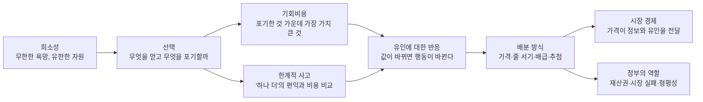

19세기 말 미국의 술집들 가운데에는 문 앞에 **"무료 점심(FREE LUNCH)"**이라고 써 붙인 곳이 많았다. 술을 한 잔만 시키면 햄과 치즈, 빵, 삶은 달걀을 마음껏 먹을 수 있었다. 정말 공짜였을까? 무료 점심에는 대개 짠 음식이 많았다. 짠 음식을 먹은 손님은 목이 말라 술을 더 시켰고, 음식값은 술값에 이미 들어 있었다. 무엇보다 그 점심을 먹느라 쓴 한 시간은 다른 일에 쓸 수 없는 시간이었다. 여기서 경제학자들이 즐겨 쓰는 말이 나왔다. **"세상에 공짜 점심은 없다."**

이 짧은 말 속에 경제학의 출발점이 들어 있다. 우리가 가진 시간과 돈, 자원은 한정되어 있다. 그래서 무언가를 얻으려면 다른 무언가를 포기해야 한다. 경제학은 바로 이 **선택**에 관한 학문이다. 이 강의에서는 경제학이 무엇을 연구하는지, 경제학자들이 세상을 볼 때 쓰는 기본 생각들은 무엇인지, 그리고 앞으로 이 강좌에서 배울 미시경제학과 거시경제학이 어떤 질문을 다루는지 살펴본다.

> [!핵심] 이 강의의 질문
> 1. 경제학은 무엇을 연구하는가? 희소성은 왜 선택을 낳는가?
> 2. 사람들은 어떻게 선택하는가? 기회비용, 한계적 사고, 유인은 무엇인가?
> 3. 시장과 정부는 희소한 자원을 나누는 데 어떤 역할을 하는가?
> 4. 나라 경제 전체를 볼 때 경제학은 어떤 질문을 던지는가?

```figure
src: asset:b871a36dc5e4dcfa38f4ed72b9e5dc6a
caption: 1973년 12월, 미국 오리건주 포틀랜드의 주유소 앞에 길게 늘어선 자동차들. 맨 뒤 차에 '죄송합니다! 기름이 떨어졌습니다'라는 팻말이 붙어 있다. 석유 파동으로 휘발유가 부족해지자, 정부가 가격을 묶어 둔 탓에 가격 대신 줄 서기가 휘발유를 나누었다.
credit: 미국 환경보호청 '도큐메리카' 사진 사업, 1973년 · 미국 국립문서보관소(NARA) 소장
license: Public Domain (미국 연방정부 저작물)
source: https://catalog.archives.gov/id/555459
```

## 경제학은 무엇을 연구하나

### '경제'라는 말

영어 economy는 그리스어 **오이코노미아**(oikonomia)에서 왔다. '집'을 뜻하는 오이코스(oikos)와 '관리'를 뜻하는 노모스(nomos)가 합쳐진 말로, 본래 '집안 살림의 관리'라는 뜻이었다. 한 집안의 살림꾼은 한정된 돈과 식량, 식구들의 시간과 일손을 어떻게 나누어 쓸지 늘 결정해야 한다. 누가 밥을 짓고 누가 밭에 나갈지, 이번 달에 옷을 살지 저축을 할지 정해야 한다. 한 나라의 경제도 마찬가지다. 수많은 사람과 기업이 한정된 자원을 어떻게 나누어 쓸지 끊임없이 결정한다.

동아시아에서 쓰는 '경제'라는 말은 '세상을 다스리고 백성을 구제한다'는 **경세제민**(經世濟民)을 줄인 말이다. 본래는 나라를 다스리는 일 전반을 가리켰는데, 19세기 일본에서 영어 economy의 번역어로 쓰이면서 오늘날의 뜻이 되었다.

### 희소성: 경제학의 출발점

경제학의 가장 기본이 되는 개념은 **희소성**이다. 희소성이란 사람들이 원하는 것에 비해 그것을 만들어 낼 자원이 부족한 상태를 말한다. 사람의 욕망에는 끝이 없지만, 그 욕망을 채워 줄 자원에는 한계가 있다.

경제학에서 말하는 자원, 즉 **생산 요소**는 보통 다음과 같이 나눈다.

| 생산 요소 | 뜻 | 예 | 대가 |
|---|---|---|---|
| 토지(자연 자원) | 자연이 준 자원 | 땅, 물, 석유, 광물, 숲 | 지대 |
| 노동 | 사람이 일하는 데 쓰는 시간과 노력 | 공장 노동자, 의사, 프로그래머의 일 | 임금 |
| 자본 | 생산에 쓰려고 사람이 만든 도구와 설비 | 기계, 공장 건물, 트럭, 컴퓨터 | 이자 |
| 기업가 정신 | 생산 요소를 모아 위험을 지고 새 사업을 이끄는 능력 | 창업, 새로운 상품 개발 | 이윤 |

표: 생산 요소의 네 가지 구분

여기서 '자본'은 일상에서 말하는 돈이 아니라는 점에 주의해야 한다. 경제학에서 자본은 생산에 쓰이는 기계나 설비 같은 **물적 자본**을 뜻한다. 사람이 교육과 훈련으로 쌓은 지식과 기술은 **인적 자본**이라고 부른다.

> [!주의] 희소성은 '가난'과 다르다
> 희소성은 가난한 나라나 가난한 사람만의 문제가 아니다. 아무리 부자라도 하루는 24시간뿐이고, 한 번에 두 곳에 있을 수 없다. 세계에서 가장 부유한 나라도 의료와 국방, 교육, 환경 보호에 쓸 수 있는 예산은 한정되어 있다. 반대로 사막 한가운데의 모래처럼 양이 많아 누구나 원하는 만큼 쓸 수 있는 것은 아무리 쓸모가 있어도 경제학에서 다루는 '희소한 자원'이 아니다. 이런 것을 **자유재**라고 하고, 대가를 치러야 얻을 수 있는 것을 **경제재**라고 한다.

### 경제학의 정의

희소성이 있으니 사람들은 선택을 해야 한다. 그래서 경제학을 이렇게 정의할 수 있다. **경제학은 사회가 희소한 자원을 어떻게 관리하는지, 사람들이 희소성 아래에서 어떻게 선택하는지를 연구하는 학문이다.**

경제학자들도 저마다 조금씩 다르게 정의해 왔다. 영국의 경제학자 **앨프리드 마셜**은 1890년 『경제학 원리』에서 경제학을 "일상적인 삶을 꾸려 가는 인간에 대한 연구"라고 했다. 1932년 **라이어널 로빈스**는 경제학을 "목적과, 여러 용도로 쓰일 수 있는 희소한 수단 사이의 관계로서 인간 행동을 연구하는 과학"이라고 정의했다. 오늘날 가장 널리 쓰이는 것은 로빈스의 정의에 가까운, 희소성과 선택을 중심에 둔 정의다.

### 모든 사회가 풀어야 할 세 가지 문제

희소한 자원을 어떻게 쓸지 정하려면, 어느 사회든 다음 세 가지 질문에 답해야 한다.

1. **무엇을 얼마나 생산할 것인가?** 쌀을 더 기를까, 반도체를 더 만들까? 병원을 지을까, 도로를 지을까?
2. **어떻게 생산할 것인가?** 사람 손으로 할까, 기계로 할까? 어떤 기술과 어떤 원료를 쓸까?
3. **누구를 위해 생산할 것인가?** 만들어진 것을 누가, 얼마만큼 가져갈까?

역사 속의 사회들은 이 질문에 서로 다른 방식으로 답해 왔다.

| 경제 체제 | 세 가지 문제를 푸는 방식 | 예 | 강점과 약점 |
|---|---|---|---|
| 전통 경제 | 관습과 전통에 따라 정한다. 아버지의 일을 아들이 잇는다 | 중세 장원, 전근대 농촌 사회 | 안정적이지만 변화와 혁신이 느리다 |
| 계획 경제(명령 경제) | 정부의 중앙 계획 기관이 생산량과 가격, 분배를 정한다 | 옛 소련, 개혁 이전의 중국, 북한 | 자원을 한곳에 집중할 수 있지만, 정보와 유인이 부족해 비효율이 크다 |
| 시장 경제 | 수많은 가계와 기업이 시장에서 가격을 보며 각자 결정한다 | 대부분의 오늘날 선진국 | 효율적이고 혁신이 빠르지만, 불평등과 시장 실패가 생길 수 있다 |
| 혼합 경제 | 시장을 기본으로 하되 정부가 규제와 조세, 복지로 보완한다 | 한국, 미국, 유럽 국가 등 오늘날 대부분의 나라 | 오늘날 대부분 나라의 실제 모습. 시장과 정부의 몫을 둘러싼 논쟁이 계속된다 |

표: 경제 체제의 비교

## 사람들은 어떻게 선택하나

### 기회비용: 포기한 것의 가치

무언가를 선택한다는 것은 다른 무언가를 포기한다는 뜻이다. 어떤 것을 선택하기 위해 포기해야 하는 것 가운데 **가장 가치가 큰 것**을 그 선택의 **기회비용**이라고 한다.

토요일 오후 세 시간이 있다고 하자. 영화를 보러 갈 수도 있고, 시간당 1만 원을 받는 아르바이트를 할 수도 있고, 시험공부를 할 수도 있다. 영화를 보기로 했다면, 그 기회비용은 영화표 값만이 아니다. 아르바이트로 벌 수 있었던 3만 원, 혹은 시험공부로 얻을 수 있었던 성적 가운데 더 가치 있다고 여기는 것이 영화 보기의 기회비용이다. 기회비용에는 실제로 지갑에서 나간 돈(**명시적 비용**)과, 돈은 나가지 않았지만 포기한 다른 기회의 가치(**암묵적 비용**)가 모두 들어간다.

대학 진학의 비용을 생각해 보면 기회비용이 무엇인지 분명해진다.

| 항목 | 금액(1년, 예시) | 기회비용에 들어가는가? |
|---|---|---|
| 등록금 | 700만 원 | 들어간다. 대학에 가지 않으면 내지 않을 돈이다 |
| 책과 교재 | 50만 원 | 들어간다 |
| 하숙비·식비 | 900만 원 | 대부분 들어가지 않는다. 대학에 가지 않아도 어딘가에서 살고 먹어야 한다. 대학 때문에 더 드는 몫만 들어간다 |
| 대학에 다니느라 포기한 소득 | 2,800만 원 | 들어간다. 고등학교를 졸업하고 바로 일했다면 벌 수 있었던 돈이다 |

표: 대학 진학 1년의 기회비용 (금액은 이해를 돕기 위한 예시)

이 예시에서 대학 진학의 가장 큰 비용은 등록금이 아니라 **포기한 소득**이다. 그래서 프로 스포츠나 연예계처럼 젊은 나이에 큰돈을 벌 수 있는 사람들은 대학 진학의 기회비용이 매우 크고, 실제로 대학에 가지 않는 경우가 많다. 반대로 경기가 나빠 일자리가 줄면 포기하는 소득이 작아지므로, 대학원 진학률이 높아지는 경향이 있다.

```chart
{
  "type": "bar",
  "caption": "대학 진학 1년의 비용 구성 (만 원, 위 표의 예시 금액). 등록금보다 '포기한 소득'이 훨씬 크다. 하숙비·식비는 대학에 가지 않아도 드는 돈이므로 기회비용에서 뺐다",
  "data": {
    "labels": ["등록금", "책과 교재", "포기한 소득"],
    "datasets": [{ "label": "기회비용(만 원)", "data": [700, 50, 2800] }]
  },
  "options": { "indexAxis": "y", "plugins": { "legend": { "display": false } } }
}
```

### 매몰비용: 돌이킬 수 없는 비용은 잊어라

이미 써 버려서 어떤 선택을 하든 되돌려 받을 수 없는 비용을 **매몰비용**이라고 한다. 합리적인 선택을 하려면 매몰비용은 판단에서 빼야 한다. 1만 원을 내고 영화관에 들어갔는데 영화가 너무 지루하다면, "돈이 아까우니 끝까지 보자"고 생각하기 쉽다. 그러나 표값 1만 원은 영화를 끝까지 보든 지금 나가든 돌아오지 않는다. 따져야 할 것은 앞으로 남은 한 시간을 지루한 영화에 쓸지, 다른 일에 쓸지뿐이다.

> [!참고] 콩코드의 오류
> 영국과 프랑스는 1960년대부터 초음속 여객기 **콩코드**를 함께 개발했다. 개발 도중 이 비행기가 상업적으로 수지를 맞추기 어렵다는 전망이 나왔지만, 두 나라 정부는 "이미 쏟아부은 돈이 아깝다"는 이유로 개발을 계속했다. 콩코드는 1976년 취항했지만 20대 남짓만 만들어졌고, 결국 2003년 운항을 멈추었다. 이미 들인 돈이 아까워 손해 보는 일을 계속하는 잘못을 그래서 **콩코드의 오류**라고 부른다. 개인의 투자나 기업의 사업, 국가의 대형 사업에서 흔히 볼 수 있는 실수다.

### 한계적 사고: '조금 더'의 이득과 비용

경제학에서 **한계**(marginal)란 '가장자리', 곧 '하나 더' 또는 '조금 더'를 뜻한다. 사람들은 대부분 '전부 아니면 전무' 식으로 선택하지 않는다. 오늘 공부를 할지 말지가 아니라, 한 시간 더 할지 말지를 정한다. 이처럼 하나를 더 할 때 얻는 이득(**한계 편익**)과 드는 비용(**한계 비용**)을 비교하는 것을 **한계적 사고**라고 한다. 합리적인 사람은 한계 편익이 한계 비용보다 클 때만 그 행동을 '하나 더' 한다.

한계적 사고는 오래된 수수께끼 하나를 풀어 주었다. 애덤 스미스는 『국부론』에서 이렇게 물었다. 물은 사람이 살아가는 데 꼭 필요한데 값이 거의 없고, 다이아몬드는 없어도 사는 데 아무 지장이 없는데 왜 그렇게 비쌀까? 이것이 **물과 다이아몬드의 역설**이다.

답은 한계에 있다. 물은 아주 많기 때문에, 우리가 이미 마신 물에 한 잔을 **더** 마실 때 얻는 만족(**한계 효용**)은 매우 작다. 반면 다이아몬드는 매우 드물어서 하나를 더 가질 때의 만족이 크다. 사람들이 값을 치르는 기준은 물 전체의 가치가 아니라 '한 단위 더'의 가치다. 1870년대 영국의 제번스, 오스트리아의 멩거, 스위스 로잔에서 활동한 왈라스가 거의 같은 시기에 이 생각을 정리했고, 이를 **한계 혁명**이라고 부른다.

```chart
{
  "type": "bar",
  "caption": "목마른 사람이 물을 한 잔씩 더 마실 때 얻는 만족(한계 효용, 이해를 돕기 위한 가상의 점수). 같은 물이라도 마실수록 '한 잔 더'의 가치는 줄어든다. 이를 한계 효용 체감이라고 한다",
  "data": {
    "labels": ["첫째 잔", "둘째 잔", "셋째 잔", "넷째 잔", "다섯째 잔", "여섯째 잔"],
    "datasets": [{ "label": "한계 효용(가상의 점수)", "data": [100, 60, 30, 12, 4, 0] }]
  },
  "options": { "scales": { "y": { "min": 0 } }, "plugins": { "legend": { "display": false } } }
}
```

한계적 사고는 기업의 결정에도 쓰인다. 비행기가 이륙하기 직전에 빈 좌석이 남아 있다고 하자. 좌석 하나의 평균 비용이 30만 원이라도, 이미 뜨기로 한 비행기에 손님 한 명을 더 태울 때 드는 비용(한계 비용)은 기내식과 약간의 연료 정도로 매우 작다. 그래서 항공사는 출발 직전에 남은 좌석을 평균 비용보다 훨씬 싸게 팔기도 한다. 한계 편익(받는 요금)이 한계 비용보다 크다면, 싸게라도 파는 것이 이득이기 때문이다.

### 유인: 사람들은 유인에 반응한다

사람들은 비용과 편익을 비교해 선택하므로, 비용이나 편익이 바뀌면 행동도 바뀐다. 사람의 행동을 바꾸게 하는 보상이나 벌을 **유인**(인센티브)이라고 한다. 사과값이 오르면 사람들은 사과를 덜 사고 배를 더 사며, 과수원 주인은 사과나무를 더 심는다.

정부 정책도 유인을 통해 작동한다. 한국은 2015년 1월 담뱃값을 한 갑에 2,500원에서 4,500원으로 크게 올렸다. 정부 통계에 따르면 성인 남성의 흡연율은 2014년 약 43%에서 2015년 약 39%로 떨어졌다. 담배의 값, 곧 담배를 피우는 비용이 올라가자 담배를 끊거나 줄인 사람이 늘어난 것이다.

> [!주의] 의도하지 않은 결과
> 유인은 정책을 만든 사람이 예상하지 못한 방향으로 작동하기도 한다. 1970년대 미국의 경제학자 샘 펠츠먼은 자동차 안전벨트 의무화 같은 안전 규제가 운전자를 더 안전하다고 느끼게 해 오히려 더 빠르고 부주의하게 운전하게 만들 수 있다고 주장했다. 이 주장이 얼마나 맞는지는 지금도 논쟁 중이지만, 정책을 평가할 때는 사람들이 바뀐 유인에 어떻게 반응할지까지 따져야 한다는 교훈을 남겼다.

> [!사료] 애덤 스미스, 『국부론』 (1776) 제1편 제2장
> "우리가 저녁 식사를 기대할 수 있는 것은 푸줏간 주인이나 양조업자, 빵집 주인의 자비심 덕분이 아니라, 그들이 자기 자신의 이익을 생각하기 때문이다. 우리는 그들의 인간애가 아니라 자기애에 호소하며, 우리에게 무엇이 필요한지가 아니라 그들에게 무엇이 이득인지를 말한다."

```gallery
src: asset:118476d83a9279d7e6959d9bfa25cef0
caption: 애덤 스미스(1723~1790)를 그린 존 케이의 동판화. 판화 아래에 '『국부론』의 저자'라고 새겨져 있다. 스미스가 세상을 떠난 해인 1790년 에든버러에서 만들어졌다.
credit: 존 케이(John Kay), 1790년 · 미국 의회도서관 소장
license: Public Domain (미국 의회도서관: 출판 제한 없음)
source: https://www.loc.gov/item/91706325/
---
src: asset:f6e80005e3fd816bed811f85f2423c88
caption: 『국부론』 초판 제1권의 속표지(1776년, 런던). 원제는 '여러 국민의 부의 본질과 원인에 관한 연구'다. 저자 이름 아래에 '글래스고 대학 전 도덕 철학 교수'라는 직함이 보인다.
credit: W. 스트레이핸·T. 커델 간행, 1776년 · 존 카터 브라운 도서관 소장본(인터넷 아카이브)
license: Public Domain (1776년 간행물, 존 카터 브라운 도서관 소장본 스캔)
source: https://archive.org/details/inquiryintonatur01smit_2
```

## 사람들은 어떻게 서로 영향을 주고받나

### 교역은 모두를 이롭게 할 수 있다

경제학의 중요한 생각 가운데 하나는, 교역이 한쪽이 얻으면 다른 쪽이 잃는 게임이 아니라는 것이다. 사람들이 자기가 잘하는 일에 집중하고, 그렇게 만든 것을 서로 바꾸면 모두가 더 많이 가질 수 있다. 사람마다 혼자 식량을 기르고, 옷을 짓고, 집을 짓는다면 우리는 지금보다 훨씬 가난하게 살았을 것이다. 나라와 나라 사이의 무역도 마찬가지다. 왜 그런지는 3강 「비교우위와 교역의 이득」에서 자세히 살펴본다.

### 분업과 핀 공장

애덤 스미스는 『국부론』을 분업 이야기로 시작했다. 그는 당시 영국의 작은 핀 공장을 예로 들었다. 핀 하나를 만드는 일은 철사를 펴고, 자르고, 끝을 뾰족하게 갈고, 머리를 붙이고, 하얗게 칠하고, 종이에 꽂아 포장하는 등 18가지 정도의 공정으로 나뉜다.

스미스에 따르면, 훈련받지 않은 사람이 혼자서 이 모든 공정을 하면 하루에 핀 20개를 만들기도 어렵고 어쩌면 한 개도 못 만들 수 있다. 그런데 그가 본 작은 공장에서는 10명이 공정을 나누어 맡아 하루에 4만 8,000개가 넘는 핀을 만들었다. 한 사람이 하루에 4,800개를 만든 셈이다. 분업은 세 가지 이유로 생산성을 높인다. 같은 일을 되풀이하면서 솜씨가 좋아지고, 일을 바꿀 때 낭비되는 시간이 줄어들며, 단순해진 작업을 대신할 기계를 발명하기 쉬워진다.

```figure
src: asset:f9706e78ab2aa1f1c7117ab41ca1a838
caption: 디드로와 달랑베르의 『백과전서』 도판 「핀 제조공」(1765년)의 작업장 장면. 철사를 펴고 자르고 끝을 가는 일을 여러 사람이 나누어 맡고 있다. 애덤 스미스가 『국부론』 첫머리에서 든 핀 공장의 분업이 바로 이런 모습이었다.
credit: 구시에 그림, 드페르 새김, 『백과전서 도판집』 제4권, 1765년 · 스미스소니언 도서관 소장본(인터넷 아카이브)
license: Public Domain (1765년 판화, 스미스소니언 도서관 소장본 스캔)
source: https://archive.org/details/Recueildeplancht4Dide
width: wide
```

| 방식 | 사람 수 | 하루 생산량 | 1인당 생산량 |
|---|---|---|---|
| 혼자서 모든 공정을 함 | 1명 | 20개 이하 | 20개 이하 |
| 공정을 나누어 맡음 (분업) | 10명 | 약 48,000개 | 약 4,800개 |

표: 애덤 스미스가 든 핀 공장의 예 (『국부론』 제1편 제1장)

### 시장과 '보이지 않는 손'

그렇다면 수많은 사람의 분업과 교역을 누가 조정할까? 시장 경제에는 무엇을 얼마나 만들라고 명령하는 사람이 없다. 대신 각자 자기 이익을 좇는 수많은 가계와 기업이 시장에서 만나 사고판다. 스미스는 이렇게 각자 자기 이익을 추구하는 사람들이 마치 **보이지 않는 손**에 이끌리듯 사회 전체의 이익을 늘리게 된다고 보았다. 이 유명한 표현은 『국부론』 전체에 단 한 번 나온다.

보이지 않는 손이 일하는 도구는 **가격**이다. 어떤 물건을 원하는 사람이 많아지면 값이 오르고, 값이 오르면 기업은 그 물건을 더 만든다. 반대로 원하는 사람이 줄면 값이 내리고 생산도 준다. 가격은 무엇이 얼마나 부족한지, 누가 얼마나 원하는지에 대한 정보를 한 숫자로 담아 사회 전체에 알린다. 오스트리아 출신의 경제학자 **프리드리히 하이에크**는 1945년 논문 「사회에서 지식의 이용」에서, 흩어져 있는 수많은 사람의 지식을 가격이 모아 준다는 점이야말로 시장의 가장 큰 장점이라고 말했다. 어느 중앙 계획 기관도 그 많은 정보를 모두 모을 수 없다는 것이다.

20세기의 계획 경제는 이 점을 보여 주었다. 옛 소련의 국가 계획 위원회는 수십만 가지 상품의 생산량과 가격을 정해야 했다. 그러나 가격이 실제 희소성을 반영하지 못하자, 어떤 물건은 창고에 쌓여 썩고 어떤 물건은 몇 시간씩 줄을 서야 겨우 살 수 있었다. 생산 목표를 무게로 정하자 공장이 쓸데없이 무거운 제품을 만들었다는 이야기도 전한다. 정보와 유인이 맞지 않으면 어떤 일이 생기는지 보여 준 예다.

### 희소한 것을 나누는 여러 방법

시장의 가격만이 희소한 것을 나누는 유일한 방법은 아니다. 실제로 사회는 여러 방법을 섞어 쓴다.

| 배분 방식 | 어떻게 나누나 | 예 | 문제점 |
|---|---|---|---|
| 가격(시장) | 값을 치를 수 있고 치를 뜻이 있는 사람에게 | 대부분의 상품과 서비스 | 돈이 없는 사람은 꼭 필요한 것도 얻지 못할 수 있다 |
| 줄 서기(선착순) | 먼저 온 사람에게 | 인기 공연 표, 1970년대 미국의 주유소 | 기다리는 시간이 낭비된다 |
| 배급 | 정부가 정한 기준에 따라 일정량씩 | 전쟁 중의 식량·연료 배급 | 암시장이 생기고, 원하는 사람에게 원하는 만큼 가지 못한다 |
| 추첨 | 무작위로 | 아파트 청약 추첨, 공공 주택 입주 | 그것을 가장 원하거나 필요한 사람에게 간다는 보장이 없다 |
| 권위·힘 | 권력자나 힘센 사람이 정한다 | 전근대 사회, 독재 국가 | 불공정하고, 생산할 유인이 사라진다 |

표: 희소한 자원을 나누는 방법들

```gallery
src: asset:34b2f1cd7f3ff12144883d928b5801eb
caption: 가격에 의한 배분: 1942년 워싱턴의 한 경매장에서 경매인을 둘러싼 사람들. 가장 높은 값을 부르는 사람이 물건을 가져간다.
credit: 하워드 리버먼 촬영, 미국 전시정보국, 1942년 · 미국 의회도서관 소장
license: Public Domain (미국 농업안정국·전시정보국 사진, 미국 의회도서관)
source: https://www.loc.gov/item/2017867021/
---
src: asset:fac1494e9b85f37357e27f7c9ce3e292
caption: 줄 서기에 의한 배분: 1979년 6월 제2차 석유 파동 때 미국의 한 주유소로 끝없이 이어진 차량 행렬을 정리하는 직원.
credit: 토머스 J. 오핼러런 촬영, 『U.S. 뉴스 & 월드 리포트』, 1979년 · 미국 의회도서관 소장
license: Public Domain (미국 의회도서관: 출판 제한 없음)
source: https://www.loc.gov/item/2011648704/
---
src: asset:47ce4724f48c9fd84e6432d0a7c6c24d
caption: 배급에 의한 배분: 1943년 2월 미국 위스콘신 대학 학생들이 제2차 전시 배급 통장을 받으려고 등록하는 모습. 제2차 세계대전 중 미국 정부는 설탕, 커피, 고기, 휘발유 등을 배급했다.
credit: 잭 델러노 촬영, 미국 농업안정국·전시정보국, 1943년 · 미국 의회도서관 소장
license: Public Domain (미국 농업안정국·전시정보국 사진, 미국 의회도서관)
source: https://www.loc.gov/item/2017846378/
---
src: asset:330ac64521b25941a561e8481f187e77
caption: 미국 전시정보국의 포스터 「배급은 당신의 몫을 지켜 줍니다」(1942년). 배급제가 부자든 가난한 사람이든 같은 몫을 갖게 해 준다는 형평성의 논리를 내세웠다.
credit: 미국 전시정보국, 1942년 · 미국 의회도서관 소장
license: Public Domain (미국 농업안정국·전시정보국 사진, 미국 의회도서관)
source: https://www.loc.gov/item/2017691852/
```



### 정부는 무엇을 하는가

보이지 않는 손이 잘 작동하려면 정부가 필요하다. 우선 정부는 **재산권**을 지키고 **계약**이 지켜지도록 해야 한다. 내가 기른 쌀을 누군가 빼앗아 가도 아무도 막아 주지 않는다면, 누구도 열심히 농사를 짓지 않을 것이다. 법과 경찰, 법원은 시장이 돌아가기 위한 기본 조건이다.

또 시장이 스스로 좋은 결과를 내지 못하는 경우가 있다. 이를 **시장 실패**라고 한다. 공장이 강물을 오염시켜도 그 피해를 공장이 치르지 않는다면, 공장은 사회 전체로 보아 지나치게 많이 생산할 것이다(**외부효과**, 9강). 한 기업이 시장을 독차지하면 값을 지나치게 올릴 수 있다(**독점**, 14강). 국방이나 등대처럼 돈을 내지 않은 사람도 혜택을 누리는 것은 시장에 맡기면 충분히 공급되지 않는다(**공공재**, 10강).

마지막으로 시장은 효율적일 수는 있어도, 그 결과가 **공평**하다고 보장하지는 않는다. 시장에서는 남들이 원하는 것을 만들 능력이 있는 사람이 많이 벌고, 그렇지 못한 사람은 적게 번다. 정부는 세금과 복지 제도로 소득을 다시 나누기도 한다. 다만 정부도 늘 옳은 결정을 내리는 것은 아니다. 정치적 이해관계나 정보 부족 때문에 정부의 개입이 오히려 결과를 나쁘게 만드는 **정부 실패**도 일어난다.

> [!핵심] 효율성과 형평성
> **효율성**은 희소한 자원으로 사회가 얻을 수 있는 것을 최대한 얻는 것, 즉 '파이를 키우는 것'이다. **형평성**은 그 결과를 사회 구성원에게 공평하게 나누는 것, 즉 '파이를 공정하게 나누는 것'이다. 두 목표는 서로 부딪치기도 한다. 부자에게서 세금을 많이 걷어 가난한 사람을 돕는 정책은 형평성을 높일 수 있지만, 열심히 일할 유인을 줄여 파이 자체를 작게 만들 수도 있다. 경제학은 무엇이 '옳은지' 정해 주지는 않지만, 각 선택이 무엇을 얻고 무엇을 잃는지를 분명히 보여 준다.

## 경제 전체는 어떻게 움직이나

### 생활수준은 생산성에 달려 있다

나라마다, 시대마다 사람들의 생활수준은 엄청나게 다르다. 한국은 그 차이를 한 세대 안에 몸소 겪은 나라다. 1960년 한국의 1인당 국내총생산(GDP)은 세계에서 가장 낮은 축에 들었지만, 60여 년 만에 200배가 넘게 늘었다.

```chart
{
  "type": "line",
  "caption": "한국의 1인당 국내총생산 (당시 가격, 미국 달러, 세계은행 자료를 바탕으로 한 대략적인 수치). 물가 상승을 빼지 않은 금액이지만, 생활수준이 얼마나 크게 달라졌는지 보여 준다",
  "data": {
    "labels": ["1960", "1970", "1980", "1990", "2000", "2010", "2020", "2023"],
    "datasets": [{ "label": "1인당 GDP(달러)", "data": [158, 279, 1715, 6610, 12260, 23090, 31730, 33120] }]
  },
  "options": { "scales": { "y": { "min": 0 } }, "plugins": { "legend": { "display": false } } }
}
```

이런 차이는 어디서 오는가? 경제학자들의 대답은 거의 하나로 모인다. 바로 **생산성**, 곧 노동자 한 사람이 한 시간 동안 만들어 내는 재화와 서비스의 양이다. 한 사람이 더 많이 만들어 낼수록 그 사회는 더 많은 것을 누릴 수 있다. 생산성은 노동자가 쓰는 기계와 설비(물적 자본), 교육과 기술(인적 자본), 자연 자원, 그리고 기술 지식에 따라 달라진다. 그래서 장기적으로 생활수준을 높이는 정책은 결국 교육과 투자, 기술 발전을 통해 생산성을 높이는 정책이다. 이 주제는 23강 「경제성장과 생산성」에서 다룬다.

```figure
src: asset:a3b15842f1ea9ffed6ea36b1aa1201dc
caption: 1913~14년 무렵 미국 디트로이트 하이랜드파크의 포드 자동차 공장. 위에서 내려보낸 모델 T의 차체를 아래쪽 차대에 얹고 있다. 포드는 1913년 움직이는 조립 라인을 들여와 차 한 대를 만드는 시간을 12시간 남짓에서 1시간 30분 정도로 줄였다. 생산성이 오르자 모델 T의 값은 계속 내려갔다.
credit: 미국 도로국 역사 사진, 1914년 무렵 · 미국 국립문서보관소(NARA) 소장
license: Public Domain (미국 연방정부 저작물)
source: https://catalog.archives.gov/id/6788417
```

### 돈을 너무 많이 찍으면 물가가 오른다

물가가 전반적으로 계속 오르는 현상을 **인플레이션**이라고 한다. 아주 심한 인플레이션은 대부분 정부가 돈을 지나치게 많이 찍어 낼 때 일어난다. 제1차 세계대전에 지고 막대한 배상금을 떠안은 독일은 돈을 마구 찍어 냈다. 1923년 독일의 물가는 며칠 만에 두 배씩 뛰었고, 11월에는 미국 1달러가 약 4조 2,000억 마르크에 이르렀다. 사람들은 월급을 받자마자 뛰어가 물건을 샀고, 돈다발을 손수레에 싣고 장을 보았다. 2000년대 말 짐바브웨에서도 비슷한 일이 일어났다. 돈과 물가의 관계는 28강 「화폐 증가와 인플레이션」에서 다룬다.

```figure
src: asset:8d13e8fd562189dd3475bd73d5be423f
caption: 1923년 무렵 독일 베를린에서 지폐로 난로에 불을 붙이는 여성. 지폐 가치가 너무 빨리 떨어져, 돈으로 땔감을 사는 것보다 돈을 태우는 편이 나았다. 미국 의회도서관 목록에는 1920년으로 되어 있으나 하이퍼인플레이션이 절정이던 1923년의 장면으로 보인다.
credit: 키스톤 통신 사진(미국 전시정보국 배포) · 미국 의회도서관 소장
license: Public Domain (미국 농업안정국·전시정보국 사진, 미국 의회도서관)
source: https://www.loc.gov/item/2017696875/
width: narrow
```

### 단기적으로는 인플레이션과 실업 사이에 상충 관계가 있다

정부가 돈을 더 풀거나 지출을 늘리면 단기적으로는 사람들의 씀씀이가 커져 기업이 생산과 고용을 늘리고 실업이 줄어든다. 그러나 그 대가로 물가가 오르기 쉽다. 반대로 물가를 잡으려고 돈줄을 죄면 실업이 늘어날 수 있다. 이처럼 단기에는 인플레이션과 실업 사이에 한쪽을 낮추면 다른 쪽이 올라가는 **상충 관계**가 나타나곤 한다. 경기의 오르내림, 곧 **경기 변동**을 어떻게 다룰지는 거시경제학의 중심 질문이며, 30~32강에서 다룬다.

## 경제학을 나누어 보기

### 미시경제학과 거시경제학

경제학은 크게 두 분야로 나뉜다.

| 구분 | 미시경제학 | 거시경제학 |
|---|---|---|
| 보는 대상 | 개별 가계와 기업, 개별 시장 | 나라 경제 전체 |
| 대표 질문 | 커피값이 오르면 사람들은 커피를 얼마나 덜 마실까? 최저임금을 올리면 편의점의 고용은 어떻게 될까? | 왜 어떤 해에는 경기가 좋고 어떤 해에는 나쁠까? 중앙은행이 금리를 올리면 물가와 실업은 어떻게 될까? |
| 주요 개념 | 수요와 공급, 탄력성, 비용, 시장 구조, 외부효과 | 국내총생산, 물가, 실업, 경제성장, 통화와 재정 정책 |
| 이 강좌에서 | 4강~20강 | 21강~33강 |

표: 미시경제학과 거시경제학

두 분야는 서로 이어져 있다. 나라 전체의 소비는 수많은 가계의 선택을 더한 것이고, 한 나라의 금리 변화는 개별 기업의 투자 결정을 바꾼다. 그래서 오늘날의 거시경제학은 개인과 기업의 선택이라는 미시적 기초 위에 세워지는 경우가 많다.

### 실증 경제학과 규범 경제학

경제학자들은 두 가지 역할을 한다. 세상이 **어떻게 돌아가는지** 설명하려는 과학자의 역할과, 세상을 **어떻게 바꾸어야 하는지** 제안하는 정책 조언자의 역할이다. 앞의 것을 **실증 경제학**, 뒤의 것을 **규범 경제학**이라고 한다.

| 구분 | 실증적 주장 | 규범적 주장 |
|---|---|---|
| 성격 | 세상이 어떠한지에 대한 서술 | 세상이 어떠해야 하는지에 대한 처방 |
| 확인 방법 | 자료와 증거로 맞는지 틀리는지 따질 수 있다 | 가치 판단이 들어가므로 증거만으로 결론 나지 않는다 |
| 예 | "최저임금을 10% 올리면 청년 고용이 줄어든다." | "정부는 최저임금을 올려야 한다." |
| 예 | "담뱃세를 올리면 흡연율이 낮아진다." | "건강을 위해 담뱃세를 더 올려야 한다." |

표: 실증적 주장과 규범적 주장

경제학자들끼리 의견이 다른 것처럼 보일 때, 그 다툼은 종종 사실(실증)에 대한 것이 아니라 가치(규범)에 대한 것이다. 같은 사실을 알고 있어도, 효율성과 형평성 가운데 무엇을 더 중시하느냐에 따라 다른 정책을 지지할 수 있다. 경제학 뉴스를 읽을 때 지금 들은 말이 실증적 주장인지, 규범적 주장인지 구별하는 습관을 들이면 좋다.

## 경제학의 짧은 역사

```timeline
1776 | 애덤 스미스, 『국부론』 | 분업과 시장, '보이지 않는 손'. 근대 경제학의 출발
1798 | 맬서스, 『인구론』 | 인구는 식량보다 빨리 늘어난다는 경고
1817 | 리카도, 『정치경제학과 과세의 원리』 | 비교우위론으로 자유무역을 옹호
1848 | 존 스튜어트 밀, 『정치경제학 원리』 | 고전파 경제학을 집대성
1867 | 마르크스, 『자본론』 제1권 | 자본주의 비판과 노동 가치설
1871–1874 | 한계 혁명 | 제번스·멩거(1871), 왈라스(1874)가 한계 효용 이론을 내놓음
1890 | 마셜, 『경제학 원리』 | 수요·공급 곡선과 부분 균형 분석. '정치경제학'에서 '경제학'으로
1936 | 케인스, 『고용, 이자 및 화폐의 일반 이론』 | 대공황을 배경으로 거시경제학이 탄생
1948 | 새뮤얼슨, 『경제학』 | 오늘날 경제학원론 교과서의 원형
1969 | 첫 노벨 경제학상 | 프리슈와 틴베르헌, 계량 경제학의 개척
2002 | 카너먼, 노벨 경제학상 | 심리학을 경제학에 들여온 행동경제학의 인정
```

```gallery
src: asset:9685f75b5445ca6bc47640dd62e1949d
caption: 애덤 스미스(1723~1790). 1805년판 『국부론』에 실린 점각 판화.
credit: 작자 미상, 1805년 · 미국 의회도서관 소장
license: Public Domain (미국 의회도서관: 출판 제한 없음)
source: https://www.loc.gov/item/2004672780/
---
src: asset:064262c8ec2820836e7854e030061178
caption: 데이비드 리카도(1772~1823). 증권 중개인으로 큰돈을 번 뒤 경제학에 뛰어들어, 1817년 비교우위론을 내놓았다(3강).
credit: W. 홀 새김, 『리카도 저작집』(1888년) 권두화 · 미국 의회도서관 소장
license: Public Domain (1888년 간행물)
source: https://www.loc.gov/item/90708977/
---
src: asset:aba80d186629224e3964cedb678679ff
caption: 존 스튜어트 밀(1806~1873). 『정치경제학 원리』(1848)로 고전파 경제학을 집대성했고, 『자유론』과 『여성의 종속』을 쓴 사상가이기도 하다.
credit: 에른스트 하더의 그림을 찍은 사진, 1884년 · 미국 의회도서관 소장
license: Public Domain (미국 의회도서관: 출판 제한 없음)
source: https://www.loc.gov/item/2004678579/
```

경제학은 처음에 **정치경제학**이라 불렸다. 애덤 스미스는 스코틀랜드 글래스고 대학의 도덕 철학 교수였고, 『국부론』보다 먼저 『도덕 감정론』(1759)을 써서 인간의 공감 능력을 탐구했다. 경제학이 도덕 철학에서 갈라져 나온 학문이라는 사실은, 경제학이 처음부터 '사람들은 어떻게 살아야 잘 살 수 있는가'라는 질문과 함께였음을 보여 준다.

19세기 후반 마셜의 시대에 경제학은 수학과 그래프를 쓰는 독립된 학문이 되었고, 20세기에는 대공황을 겪으며 나라 경제 전체를 다루는 거시경제학이 생겨났다. 오늘날의 경제학은 수많은 자료와 통계, 실험, 심리학의 성과까지 받아들이며 더 넓어지고 있다. 그러나 그 밑바닥에는 여전히 스미스가 던진 질문, 즉 '희소한 자원 속에서 사람들은 어떻게 선택하고, 그 선택들이 모여 사회 전체에 어떤 결과를 낳는가'가 놓여 있다.

> [!더알아보기] 경제학원론 강좌의 지도
> 이 강좌는 크게 다섯 부분으로 나뉜다. ① **기초**에서는 경제학자처럼 생각하는 법과 교역의 이득을, ② **시장**에서는 수요와 공급, 탄력성, 가격 규제와 조세, 시장의 효율성과 국제무역을, ③ **공공 부문**에서는 외부효과와 공공재를, ④ **기업과 시장 구조**에서는 생산비용과 완전경쟁, 독점, 과점을 배운다. 이어 노동 시장과 소득 분배, 소비자 선택과 행동경제학을 살펴본 뒤, ⑤ **거시경제**에서 국내총생산과 물가, 성장, 금융, 실업, 화폐와 인플레이션, 개방 경제, 경기 변동과 경제 정책으로 나아간다.

## 정리

> [!핵심] 1강 요약
> - 경제학은 **희소성** 아래에서 사람과 사회가 어떻게 **선택**하는지를 연구한다. 모든 사회는 무엇을, 어떻게, 누구를 위해 생산할지 정해야 한다.
> - 모든 선택에는 **기회비용**이 따른다. 기회비용은 포기한 것 가운데 가장 가치가 큰 것이며, 돈으로 나가지 않은 암묵적 비용도 포함한다. 이미 써 버린 **매몰비용**은 판단에서 빼야 한다.
> - 합리적인 사람은 **한계 편익**과 **한계 비용**을 비교한다. 물과 다이아몬드의 역설은 한계 효용으로 풀린다. 사람들은 **유인**에 반응한다.
> - **분업**과 **교역**은 생산성을 크게 높인다. 시장에서는 **가격**이 정보와 유인을 전달하는 '보이지 않는 손'의 역할을 한다. 정부는 재산권을 지키고 **시장 실패**를 바로잡으며 **형평성**을 높이는 역할을 한다.
> - 장기적으로 생활수준은 **생산성**에 달려 있고, 돈을 지나치게 찍으면 **인플레이션**이 생긴다. 단기에는 인플레이션과 실업 사이에 상충 관계가 나타나곤 한다.
> - 경제학은 **미시경제학**과 **거시경제학**으로, 주장은 **실증적 주장**과 **규범적 주장**으로 나뉜다.

### 생각해 볼 질문

1. 오늘 하루 내가 한 선택 가운데 하나를 골라, 그 선택의 기회비용을 명시적 비용과 암묵적 비용으로 나누어 적어 보자.
2. 인기 가수의 공연 표를 가격(경매), 줄 서기, 추첨 가운데 어떤 방식으로 파는 것이 좋을까? 각 방식에서 누가 표를 얻고, 무엇이 낭비되는지 생각해 보자.
3. "부동산 세금을 올리면 집값이 내려간다"와 "부동산 세금을 올려야 한다"는 각각 어떤 종류의 주장인가? 두 주장을 판단하려면 각각 무엇이 필요할까?

### 다음 강 예고

2강 「경제학자처럼 생각하기」에서는 경제학자들이 복잡한 세상을 단순하게 그려 보는 도구인 **모형**을 배운다. 가계와 기업이 시장에서 어떻게 이어지는지 보여 주는 **경제 순환도**, 한 사회가 만들 수 있는 것의 한계를 보여 주는 **생산 가능 곡선**, 그리고 경제학에서 자주 쓰는 그래프를 읽는 법을 다룬다.
