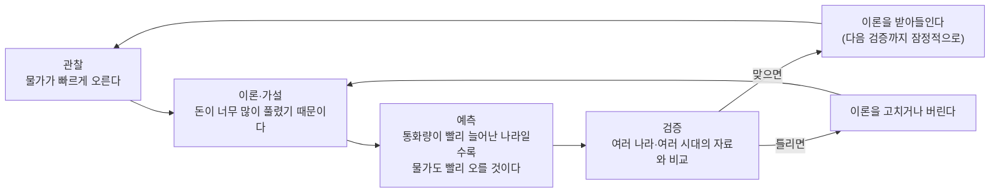

1949년 영국 런던 정치경제대학(LSE)에서, 뉴질랜드 출신의 학생 **빌 필립스**가 집주인의 차고에서 손수 만든 이상한 기계를 선보였다. 높이 2미터쯤 되는 나무와 투명한 플라스틱 관, 물탱크, 밸브로 이루어진 이 기계 안에는 색을 넣은 물이 흘렀다. 물은 돈이었다. 위쪽 탱크에서 흘러내린 물(소득)은 몇 갈래로 나뉘어 세금으로, 저축으로, 소비로 흘러갔고, 정부 지출과 투자라는 관을 통해 다시 위로 퍼 올려졌다. 밸브를 돌려 세율을 올리면 소비로 흐르는 물이 줄어들고, 나라 경제 전체의 물 높이가 내려갔다. 사람들은 이 기계를 **필립스 기계**, 또는 '화폐 국민소득 아날로그 컴퓨터'를 줄여 **MONIAC**이라 불렀다.

물론 진짜 경제는 수도관이 아니다. 그러나 이 기계는 복잡한 경제를 단순하게 줄여 놓으면 오히려 그 구조가 잘 보인다는 것을 보여 주었다. 경제학자들은 이처럼 현실을 단순하게 줄인 그림, 곧 **모형**을 만들어 생각한다. 이 강의는 경제학자들이 세상을 연구하는 방법, 즉 과학자로서의 경제학자와 정책 조언자로서의 경제학자를 살펴보고, 경제학에서 가장 기본이 되는 두 모형인 **경제 순환도**와 **생산 가능 곡선**, 그리고 경제학 공부에 꼭 필요한 **그래프 읽는 법**을 배운다.

> [!핵심] 이 강의의 질문
> 1. 경제학은 어떤 의미에서 과학인가? 경제학자들은 실험을 하기 어려운데 어떻게 이론을 검증하는가?
> 2. 경제학자들은 왜 현실을 단순화한 모형을 쓰는가? 좋은 모형이란 무엇인가?
> 3. 경제 순환도와 생산 가능 곡선은 경제의 어떤 모습을 보여 주는가?
> 4. 경제학자들의 의견은 왜 엇갈리며, 어떤 점에서는 일치하는가?

{{F:e2-opening}}

## 과학자로서의 경제학자

### 과학적 방법

경제학자들은 스스로를 과학자라고 생각한다. 여기서 과학이란 하얀 가운이나 실험실을 뜻하는 것이 아니라 **방법**을 뜻한다. 과학자는 세상을 관찰하고, 관찰한 것을 설명할 이론을 세우고, 그 이론에서 나오는 예측이 실제 자료와 맞는지 확인한다. 자료가 예측과 맞지 않으면 이론을 고치거나 버린다. 물리학자가 사과가 떨어지는 것을 보고 중력 이론을 세우듯, 경제학자는 물가가 오르는 것을 보고 인플레이션 이론을 세운다.



### 실험이 어려운 과학

그런데 경제학에는 큰 어려움이 있다. 실험을 하기가 매우 어렵다는 것이다. 물리학자는 실험실에서 공을 떨어뜨려 볼 수 있지만, 경제학자가 인플레이션 이론을 시험하려고 한 나라의 돈을 마구 찍어 낼 수는 없다. 그래서 경제학자들은 역사가 우연히 마련해 준 **자연 실험**을 찾아 나선다.

> [!더알아보기] 자연 실험: 최저임금과 쿠바 난민
> 1992년 4월 미국 뉴저지주는 최저임금을 시간당 4.25달러에서 5.05달러로 올렸다. 바로 옆 펜실베이니아주 동부는 최저임금을 그대로 두었다. 두 지역은 경제 사정이 비슷했으므로, 최저임금 인상만 빼면 거의 같은 조건이었다. 경제학자 **데이비드 카드**와 **앨런 크루거**는 두 지역의 패스트푸드 가게 수백 곳을 조사해, 최저임금을 올린 뒤에도 뉴저지의 고용이 줄지 않았다는 결과를 1994년에 발표했다. 이 연구는 큰 논쟁을 불러일으켰다. 카드는 또 1980년 쿠바에서 마이애미로 약 12만 5,000명의 난민이 한꺼번에 몰려든 '마리엘 보트리프트' 사건을 자연 실험으로 삼아, 갑작스러운 이민자 유입이 마이애미 노동자들의 임금에 미친 영향을 연구했다. 이런 공로로 카드는 2021년 노벨 경제학상을 받았다.

한편 1970년대의 석유 파동처럼 큰 사건은 그 자체가 경제학자들에게 귀중한 자료가 된다. 중동의 전쟁과 정치 때문에 석유 공급이 갑자기 줄었을 때 세계 경제가 어떻게 움직였는지 보면, 석유 가격이 경제에 미치는 영향을 알 수 있다. 최근에는 실험실에서 사람들에게 실제 돈을 걸고 선택하게 하는 **실험 경제학**과, 개발도상국에서 정책을 무작위로 나누어 시행해 보는 **무작위 대조 실험**도 널리 쓰인다.

### 가정의 역할: 단순화해야 보인다

경제학자들은 이론을 세울 때 여러 **가정**을 한다. 가정을 하는 이유는 현실을 단순하게 만들어 중요한 것에 집중하기 위해서다. 물리학자가 대리석이 떨어지는 것을 계산할 때 공기 저항을 무시하는 것과 같다. 대리석에는 공기 저항이 거의 영향을 주지 않으니 무시해도 되지만, 깃털이 떨어지는 것을 계산할 때는 무시하면 안 된다. 경제학자도 어떤 가정을 할지는 무엇을 연구하느냐에 따라 달라진다.

경제학에서 가장 자주 쓰는 가정은 **"다른 조건이 같다면"**이다. 라틴어로 **세테리스 파리부스**(ceteris paribus)라고 한다. 예를 들어 "커피값이 오르면 사람들은 커피를 덜 마신다"고 말할 때, 사람들의 소득이나 날씨, 차값 같은 다른 조건은 변하지 않는다고 가정한다. 현실에서는 여러 조건이 한꺼번에 변하지만, 한 번에 하나씩 떼어 보아야 원인과 결과를 알 수 있다.

경제학의 모형에서 또 하나 자주 쓰는 가정은 사람들이 **합리적**이라는 가정이다. 여기서 합리적이란 사람들이 자기에게 주어진 정보 안에서 비용과 편익을 따져, 자기가 가장 좋다고 여기는 것을 고른다는 뜻이다. 사람들이 늘 똑똑하다거나 이기적이라는 뜻은 아니다. 남을 돕는 데서 기쁨을 느끼는 사람이 기부를 하는 것도 그 사람에게는 합리적인 선택이다.

물론 실제 사람들은 이 가정대로만 움직이지 않는다. 다이어트를 결심하고도 야식을 먹고, 같은 물건이라도 '1만 원에서 20% 할인'이라고 하면 '8,000원'이라고 할 때보다 더 끌린다. 이처럼 사람들이 예측 가능한 방식으로 합리성에서 벗어나는 모습을 연구하는 분야가 **행동경제학**이다(20강). 그래도 합리성 가정은 많은 경우 사람들의 평균적인 반응을 꽤 잘 설명하기 때문에, 경제학의 출발점으로 널리 쓰인다. 가정이 현실과 똑같은지가 아니라, 그 가정 위에 세운 모형이 현실을 얼마나 잘 예측하는지가 중요하다.

또 경제학자들은 **단기**와 **장기**를 나누어 생각하는 경우가 많다. 물가는 단기적으로는 잘 움직이지 않지만 장기적으로는 충분히 움직인다. 가게 주인은 메뉴판의 값을 매일 바꾸지 않지만, 몇 년이 지나면 값을 바꾼다. 그래서 어떤 정책의 효과를 물을 때는 "몇 달 뒤에?"인지 "몇 년 뒤에?"인지를 함께 물어야 한다.

### 모형: 경제의 지도

경제학자들이 쓰는 **모형**은 지도와 비슷하다. 서울 지하철 노선도는 실제 거리와 방향을 많이 무시하고, 역과 역 사이를 직선과 곡선으로 단순하게 그린다. 그러나 바로 그 단순함 덕분에 어디서 갈아타야 하는지 한눈에 알 수 있다. 실제 땅 모양을 그대로 그린 지도라면 오히려 쓸모가 없을 것이다. 1:1 축척의 지도는 그 나라만큼 크다. 좋은 모형은 현실을 그대로 베끼는 것이 아니라, 질문에 답하는 데 꼭 필요한 것만 남기고 나머지를 과감하게 지운다.

경제학의 모형은 그림(도식)으로, 그래프로, 또는 수식으로 표현된다. 모형은 언제나 현실보다 단순하므로 '틀린' 부분이 있다. 중요한 것은 그 모형이 우리가 알고 싶은 질문에 대해 쓸모 있는 답을 주느냐다.

{{F:e2-map}}

## 첫째 모형: 경제 순환도

### 가계와 기업, 두 개의 시장

경제는 수많은 사람과 기업이 사고파는 활동으로 이루어져 있다. 이를 아주 단순하게 줄이면 두 종류의 의사 결정자만 남는다. 하나는 **가계**, 다른 하나는 **기업**이다. 그리고 이들이 만나는 시장도 두 가지로 줄일 수 있다.

- **생산물 시장**(재화·서비스 시장): 기업이 만든 물건과 서비스를 가계가 사는 시장. 가계는 돈을 내고 빵, 옷, 휴대전화, 미용 서비스를 산다.
- **생산 요소 시장**: 가계가 가진 노동, 토지, 자본을 기업이 사는(빌리는) 시장. 가계는 일을 해 주고 임금을 받고, 땅을 빌려주고 지대를, 돈을 빌려주고 이자를 받는다.

이렇게 그린 그림이 **경제 순환도**다. 경제 순환도에는 두 방향의 흐름이 있다. 하나는 물건과 서비스, 노동 같은 **실물의 흐름**이고, 다른 하나는 그 반대 방향으로 흐르는 **돈의 흐름**이다.


이 그림을 따라가 보자. 내가 편의점에서 2,000원을 주고 우유를 샀다면, 그 2,000원은 생산물 시장을 거쳐 편의점과 우유 회사의 수입이 된다. 우유 회사는 그 돈으로 직원에게 월급을 주고, 목장 땅을 빌린 값을 내고, 공장 설비에 투자한 사람에게 이자와 배당을 준다. 그 돈은 생산 요소 시장을 거쳐 다시 어떤 가계의 소득이 되고, 그 가계는 그 소득으로 또 무언가를 산다. 돈은 이렇게 경제 안을 쉬지 않고 돈다.

### 이 모형이 뺀 것

경제 순환도는 일부러 많은 것을 뺐다. 정부와 세금, 은행과 저축, 외국과의 무역이 없다. 그러나 이 단순한 그림만으로도 중요한 사실을 알 수 있다. 한 사람의 지출은 다른 사람의 소득이라는 것이다. 그래서 사람들이 한꺼번에 지출을 줄이면, 다른 사람들의 소득도 함께 줄어든다. 이 생각은 뒤의 거시경제학(21강, 30강)에서 국내총생산과 경기 변동을 이해하는 바탕이 된다. 뺀 것들은 필요할 때 하나씩 더해 가면 된다. 정부를 넣으면 세금과 정부 지출이, 금융을 넣으면 저축과 투자가, 외국을 넣으면 수출과 수입이 순환도에 더해진다.

> [!사료] 케네의 『경제표』 (1758)
> 경제의 순환을 처음으로 그림으로 그린 사람은 프랑스 왕 루이 15세의 시의(侍醫)였던 **프랑수아 케네**다. 의사였던 그는 몸속을 도는 피처럼 경제 안을 도는 부의 흐름을 생각했다. 그는 1758년 『경제표』라는 지그재그 모양의 표를 만들어, 지주와 농민, 상공업자 사이에 생산물과 돈이 어떻게 오가는지 보여 주었다. 케네를 비롯한 **중농주의자**들은 땅만이 새로운 부를 낳는다고 믿었다는 점에서는 틀렸지만, 경제를 하나의 순환하는 전체로 본 그들의 생각은 오늘날 국민소득 계산과 경제 순환도의 뿌리가 되었다.

{{F:e2-quesnay}}

## 둘째 모형: 생산 가능 곡선

### 무엇을 얼마나 만들 수 있나

이번에는 한 나라가 만들 수 있는 것의 한계를 보여 주는 모형을 살펴보자. 가상의 나라 '한빛국'이 자동차와 컴퓨터, 두 가지만 만든다고 하자. 이 나라의 노동자와 공장, 기술은 정해져 있다. 모든 자원을 자동차에 쓰면 1년에 자동차 1,000대를 만들 수 있고, 모든 자원을 컴퓨터에 쓰면 컴퓨터 3,000대를 만들 수 있다. 그 사이에서 두 가지를 섞어 만들 수도 있다.

이렇게 주어진 자원과 기술로 만들 수 있는 두 재화의 최대 조합을 이은 선을 **생산 가능 곡선**(생산 가능 경계)이라고 한다.

| 조합 | 자동차(대) | 컴퓨터(대) | 자동차 200대를 더 만들 때 포기하는 컴퓨터(기회비용) |
|---|---|---|---|
| 가 | 0 | 3,000 | — |
| 나 | 200 | 2,939 | 61대 |
| 다 | 400 | 2,750 | 189대 |
| 라 | 600 | 2,400 | 350대 |
| 마 | 800 | 1,800 | 600대 |
| 바 | 1,000 | 0 | 1,800대 |

표: 한빛국의 생산 가능 조합 (가상의 예)

```chart
{
  "type": "scatter",
  "caption": "한빛국의 생산 가능 곡선 (가상의 예). 곡선 위의 점 A는 효율적인 생산, 곡선 안쪽의 점 B는 자원을 다 쓰지 못한 비효율적인 생산(예: 실업), 곡선 바깥의 점 C는 지금의 자원과 기술로는 불가능한 생산이다. 점선은 컴퓨터 제조 기술이 발전해 곡선이 바깥으로 이동한 모습이다",
  "height": 380,
  "data": {
    "datasets": [
      { "label": "생산 가능 곡선", "showLine": true, "pointRadius": 3,
        "data": [{"x":0,"y":3000},{"x":200,"y":2939},{"x":400,"y":2750},{"x":600,"y":2400},{"x":800,"y":1800},{"x":900,"y":1308},{"x":1000,"y":0}] },
      { "label": "기술 발전 뒤의 곡선", "showLine": true, "pointRadius": 0, "borderDash": [6, 4],
        "data": [{"x":0,"y":3600},{"x":200,"y":3527},{"x":400,"y":3300},{"x":600,"y":2880},{"x":800,"y":2160},{"x":900,"y":1570},{"x":1000,"y":0}] },
      { "label": "A (효율적)", "pointRadius": 7, "data": [{"x":600,"y":2400}] },
      { "label": "B (비효율적)", "pointRadius": 7, "data": [{"x":400,"y":1500}] },
      { "label": "C (불가능)", "pointRadius": 7, "pointStyle": "triangle", "data": [{"x":900,"y":2700}] }
    ]
  },
  "options": { "scales": { "x": { "title": { "display": true, "text": "자동차 (대)" }, "min": 0, "max": 1100 }, "y": { "title": { "display": true, "text": "컴퓨터 (대)" }, "min": 0, "max": 3800 } } }
}
```

### 생산 가능 곡선이 알려 주는 것

이 단순한 곡선에는 1강에서 배운 생각들이 거의 다 들어 있다.

1. **희소성**: 곡선 바깥의 점 C는 아무리 원해도 지금은 만들 수 없다. 자원이 한정되어 있기 때문이다.
2. **효율성**: 곡선 위의 점 A에서는 자원을 낭비 없이 다 쓰고 있다. 반면 곡선 안쪽의 점 B는 일할 사람이 놀고 있거나 공장이 멈추어 있는 상태다. B에서 A로 가면 아무것도 포기하지 않고 두 가지를 모두 더 만들 수 있다.
3. **기회비용과 상충 관계**: 곡선 위에서는 하나를 더 만들려면 다른 하나를 덜 만들어야 한다. 곡선의 기울기가 바로 기회비용이다.
4. **경제성장**: 기술이 발전하거나 자원이 늘어나면 곡선 자체가 바깥으로 이동한다. 그러면 이전에는 불가능했던 점 C도 만들 수 있게 된다.

### 왜 곡선은 바깥으로 휘었을까

위 표를 보면 자동차를 200대 더 만들 때 포기해야 하는 컴퓨터의 수가 61대, 189대, 350대, 600대, 1,800대로 점점 커진다. 이것을 **기회비용 체증**이라고 한다. 그래서 생산 가능 곡선은 직선이 아니라 바깥으로 불룩한 모양이 된다.

이유는 자원마다 잘하는 일이 다르기 때문이다. 처음 자동차를 만들기 시작할 때는 원래부터 자동차 만드는 일에 알맞은 기계 기술자와 공장을 옮겨 오므로, 컴퓨터 생산을 조금만 줄여도 자동차를 많이 만들 수 있다. 그러나 자동차를 계속 늘리면 결국 컴퓨터 설계에만 능한 프로그래머와 반도체 공장까지 자동차 생산에 끌어와야 한다. 그들은 자동차를 잘 만들지 못하므로, 자동차 몇 대를 더 만들려고 엄청난 양의 컴퓨터를 포기하게 된다.

### 역사 속의 생산 가능 곡선: '총이냐 버터냐'

한 나라가 생산 가능 곡선 위를 크게 움직인 역사적 사례가 있다. 제2차 세계대전 때의 미국이다. 1941년 12월 진주만 공격 뒤 미국 정부는 1942년 2월 민간용 승용차 생산을 사실상 중단시키고, 자동차 공장들을 전차와 폭격기, 엔진 공장으로 바꾸었다. 포드는 미시간주 윌로런에 거대한 공장을 지어 B-24 폭격기를 만들었다. 미국은 '버터'(민간 소비재)를 줄이고 '총'(군수품)을 늘리는 쪽으로 생산 가능 곡선 위를 이동한 것이다.

```chart
{
  "type": "bar",
  "caption": "제2차 세계대전 중 미국의 승용차 생산과 군용 항공기 생산 (만 대, 대략적인 수치). 1942년 2월 민간 승용차 생산이 멈추자 승용차 생산은 1943년 수백 대 수준으로 떨어졌고, 그만큼의 자원이 항공기와 전차 생산으로 옮겨 갔다",
  "data": {
    "labels": ["1941", "1942", "1943", "1944", "1945"],
    "datasets": [
      { "label": "승용차", "data": [378, 22.3, 0.01, 0.06, 7.0] },
      { "label": "군용 항공기", "data": [2.6, 4.8, 8.6, 9.6, 4.6] }
    ]
  },
  "options": { "scales": { "y": { "title": { "display": true, "text": "만 대" }, "min": 0 } } }
}
```

{{F:e2-war}}

흥미로운 점은 전쟁 동안 미국이 군수품을 엄청나게 늘리면서도 민간 소비가 생각만큼 크게 줄지 않았다는 것이다. 대공황 때 놀고 있던 노동자와 공장이 다시 일하기 시작했기 때문이다. 경제가 생산 가능 곡선 **안쪽**(점 B)에 있었기에, 곡선 쪽으로 다가가면서 두 가지를 함께 늘릴 수 있었던 것이다. 대공황 시기의 대량 실업이 얼마나 큰 낭비였는지를 거꾸로 보여 준 셈이다.

### 오늘의 소비냐, 내일의 성장이냐

생산 가능 곡선의 두 축에 '자동차와 컴퓨터' 대신 **소비재**와 **자본재**를 놓으면 또 다른 중요한 선택이 보인다. 소비재는 옷이나 음식처럼 지금 당장 쓰는 물건이고, 자본재는 공장과 기계, 도로처럼 앞으로 더 많은 것을 만들어 내기 위한 물건이다. 올해 자원을 자본재에 더 많이 쓰면 지금 누릴 수 있는 소비는 줄어든다. 그러나 늘어난 공장과 기계 덕분에 미래의 생산 가능 곡선은 더 크게 바깥으로 이동한다. 오늘의 소비를 참는 대가로 내일의 성장을 얻는 것이다.

한국은 이 선택을 극단적으로 한 나라다. 1960년대 초 한국에서 국내총생산 가운데 투자(자본재를 만드는 데 쓴 몫)의 비중은 10% 남짓이었지만, 1970~80년대에 빠르게 높아져 1990년대 초에는 40% 가까이에 이르렀다. 사람들은 허리띠를 졸라매며 저축했고, 그 돈은 공장과 항만, 고속도로를 짓는 데 쓰였다. 그 결과 생산 가능 곡선은 해마다 바깥으로 크게 밀려났다. 물론 투자가 많다고 무조건 좋은 것은 아니다. 어디에 투자하느냐가 중요하며, 1997년 외환위기는 빌린 돈으로 지나치게 투자한 결과이기도 했다(33강). 저축과 투자, 성장의 관계는 23~24강에서 자세히 다룬다.

## 그래프 읽기

경제학 책에는 그래프가 많이 나온다. 그래프는 두 변수 사이의 관계를 한눈에 보여 주는 도구다. 그래프를 읽는 몇 가지 기본만 알아 두면 앞으로의 강의가 훨씬 쉬워진다.

### 좌표와 기울기

동네 카페의 커피 가격과 하루 판매량이 다음과 같다고 하자.

| 커피 한 잔 가격 | 하루 판매량 (더운 날이 아닐 때) | 하루 판매량 (더운 날) |
|---|---|---|
| 5,000원 | 20잔 | 40잔 |
| 4,000원 | 40잔 | 60잔 |
| 3,000원 | 60잔 | 80잔 |
| 2,000원 | 80잔 | 100잔 |
| 1,000원 | 100잔 | 120잔 |

표: 커피 가격과 판매량 (가상의 예)

이 표를 그래프로 그리면 다음과 같다. 경제학에서는 관례적으로 가격을 세로축(y축)에, 양을 가로축(x축)에 놓는다.

```chart
{
  "type": "scatter",
  "caption": "커피의 가격과 판매량 (가상의 예). 가격이 내리면 판매량이 늘어나는 음(-)의 관계다. 날씨가 더워지면 같은 가격에서도 더 많이 팔리므로 곡선 전체가 오른쪽으로 이동한다(점선)",
  "height": 340,
  "data": {
    "datasets": [
      { "label": "보통 날", "showLine": true, "data": [{"x":20,"y":5000},{"x":40,"y":4000},{"x":60,"y":3000},{"x":80,"y":2000},{"x":100,"y":1000}] },
      { "label": "더운 날", "showLine": true, "borderDash": [6, 4], "data": [{"x":40,"y":5000},{"x":60,"y":4000},{"x":80,"y":3000},{"x":100,"y":2000},{"x":120,"y":1000}] }
    ]
  },
  "options": { "scales": { "x": { "title": { "display": true, "text": "하루 판매량 (잔)" }, "min": 0, "max": 130 }, "y": { "title": { "display": true, "text": "가격 (원)" }, "min": 0, "max": 5500 } } }
}
```

그래프의 **기울기**는 가로축의 변화에 대한 세로축의 변화, 곧 '세로 변화 ÷ 가로 변화'다. 가격이 5,000원에서 4,000원으로 1,000원 내릴 때 판매량이 20잔 늘었으므로, 이 선의 기울기는 −1,000 ÷ 20 = **−50**이다. 기울기가 음수라는 것은 한 변수가 늘 때 다른 변수가 줄어드는 **음(−)의 관계**라는 뜻이다. 반대로 공부 시간과 시험 점수처럼 함께 늘어나는 관계는 **양(+)의 관계**이며 기울기가 양수다.

같은 관계를 식으로 쓸 수도 있다. 보통 날의 판매량을 Q, 가격을 P라고 하면 **Q = 120 − 0.02 × P**가 된다. 가격 P에 3,000을 넣으면 Q는 120 − 60 = 60잔이다. 식으로 쓰면 표에 없는 가격, 예컨대 2,500원일 때의 판매량(70잔)도 바로 계산할 수 있다. 이처럼 경제학의 모형은 같은 생각을 여러 언어로 표현한다.

| 표현 방식 | 커피 예의 모습 | 장점 |
|---|---|---|
| 말 | "커피값이 내리면 더 많이 팔린다" | 누구나 쉽게 이해한다 |
| 표 | 가격별 판매량을 적은 위의 표 | 정확한 숫자를 보여 준다 |
| 그래프 | 오른쪽 아래로 기울어진 선 | 관계의 방향과 크기를 한눈에 보여 준다 |
| 수식 | Q = 120 − 0.02 × P | 어떤 값이든 계산하고, 여러 관계를 함께 풀 수 있다 |

표: 같은 경제 관계를 표현하는 네 가지 방식

### 곡선 위의 이동과 곡선 자체의 이동

그래프를 읽을 때 가장 중요한 구분이 있다. 커피 가격이 4,000원에서 3,000원으로 내려 판매량이 40잔에서 60잔으로 늘어난 것은 같은 선 **위를 따라 움직인** 것이다. 그래프의 두 축에 있는 변수(가격과 판매량)가 바뀌었을 뿐이다. 그런데 날씨가 더워져 같은 가격에서도 더 많이 팔리게 된 것은 그래프에 나타나지 않은 변수(날씨)가 바뀐 것이고, 이때는 **선 자체가 이동**한다.

이 구분은 4강 「수요와 공급」에서 '수요량의 변화'와 '수요의 변화'라는 이름으로 다시 나온다. 시험에 자주 나오는 개념이니 지금 확실히 익혀 두자.

### 그래프의 함정: 상관관계와 인과관계

두 변수가 함께 움직인다고 해서 하나가 다른 하나의 원인인 것은 아니다. 함께 움직이는 관계를 **상관관계**, 한쪽이 다른 쪽을 일으키는 관계를 **인과관계**라고 한다. 그래프를 볼 때 흔히 빠지는 함정은 다음과 같다.

| 함정 | 예 | 실제 |
|---|---|---|
| 빠뜨린 변수 | 아이스크림이 많이 팔리는 달에는 물놀이 사고도 많다. 아이스크림이 사고를 부르나? | 둘 다 '더운 날씨'라는 제3의 변수 때문에 함께 늘어난다 |
| 거꾸로 된 인과 | 소방차가 많이 출동한 화재일수록 피해가 크다. 소방차가 피해를 키우나? | 피해가 큰 큰불이기 때문에 소방차가 많이 출동한 것이다 |
| 우연의 일치 | 어떤 해의 영화 흥행과 주가가 함께 움직였다 | 수많은 자료를 뒤지면 아무 관계없는 것끼리도 함께 움직이는 경우를 찾을 수 있다 |
| 눈금 속이기 | 세로축을 98부터 시작해 작은 변화를 엄청난 폭등처럼 보이게 한다 | 축의 눈금과 시작점을 꼭 확인해야 한다 |

표: 그래프를 읽을 때의 함정

경제학자들이 자연 실험을 찾고, 다른 조건을 같게 맞추려고 애쓰는 것도 바로 이 함정을 피하기 위해서다. 뉴스에서 "○○를 많이 하는 사람일수록 소득이 높다" 같은 그래프를 보면, 그것이 인과관계인지 상관관계인지, 빠뜨린 변수는 없는지 한 번 더 생각해 보자.

{{F:e2-data}}

## 정책 조언자로서의 경제학자

### 설명하는 사람에서 처방하는 사람으로

경제학자는 세상을 설명하는 과학자이면서, 세상을 더 낫게 바꾸는 방법을 제안하는 정책 조언자이기도 하다. 1강에서 본 것처럼 앞의 역할에서는 **실증적 주장**을, 뒤의 역할에서는 **규범적 주장**을 한다.

많은 나라 정부에는 경제학자들이 일한다. 미국에서는 1946년 고용법에 따라 대통령에게 경제 정책을 조언하는 **경제 자문 위원회**가 만들어졌다. 한국에서는 기획재정부와 한국개발연구원(KDI) 같은 연구 기관, 그리고 기준금리를 정하는 한국은행 금융통화위원회에서 경제학자들이 정책을 분석하고 결정한다. 정책을 정하는 일은 경제학만으로 되지 않는다. 정치인들은 경제학자의 조언에 더해 여론과 형평성, 정치적 현실을 함께 고려한다.

{{F:e2-advisers}}

### 경제학자들의 의견은 왜 엇갈리나

"경제학자 열 명에게 물으면 열한 가지 답이 나온다"는 농담이 있다. 미국의 트루먼 대통령은 경제학자들이 늘 "한편으로는(on the one hand) 이렇고, 다른 한편으로는(on the other hand) 저렇다"고 말하는 데 질려서 "팔이 하나뿐인 경제학자를 데려오라"고 했다는 이야기가 전한다. 경제학자들의 의견이 엇갈리는 데에는 크게 두 가지 이유가 있다.

- **과학적 판단의 차이**: 세상이 어떻게 돌아가는지에 대한 생각이 다르다. 예를 들어 세금을 깎아 주면 사람들이 저축을 얼마나 더 할지에 대해 경제학자들의 추정치가 다르다. 이런 차이는 더 많은 자료와 연구로 좁혀질 수 있다.
- **가치관의 차이**: 같은 사실을 알아도 무엇을 더 중시하느냐가 다르다. 효율성을 중시하는 사람과 형평성을 중시하는 사람은 같은 세금 정책을 다르게 평가한다. 이것은 과학으로 결론 낼 수 없는 문제다.

### 그래도 의견이 모이는 곳

그렇다고 경제학자들이 모든 것에 대해 다투는 것은 아니다. 1990년대 초 미국 경제학자들을 대상으로 한 설문 조사에서는 다음 같은 명제에 매우 많은 경제학자가 동의했다.

| 명제 | 동의한 경제학자 비율 |
|---|---|
| 임대료 상한제는 공급되는 주택의 양과 질을 떨어뜨린다 | 93% |
| 관세와 수입 할당은 일반적으로 경제 전체의 후생을 줄인다 | 93% |

표: 경제학자들의 의견이 크게 일치한 명제의 예 (Alston, Kearl, Vaughan, 1992, 『American Economic Review』)

흥미로운 점은, 경제학자들이 거의 한목소리로 반대하는 임대료 상한제나 보호 무역 같은 정책이 현실 정치에서는 자주 채택된다는 것이다. 정책은 경제적 효율성만이 아니라 누가 이익을 보고 누가 손해를 보는지, 그 사람들이 얼마나 목소리를 내는지에 따라서도 정해지기 때문이다. 이 두 정책이 왜 문제인지는 6강 「가격 규제와 조세」와 8강 「국제무역」에서 자세히 살펴본다.

## 경제학 모형의 역사

```timeline
1758 | 케네, 『경제표』 | 경제의 순환을 처음으로 그림으로 나타냄
1817 | 리카도의 '두 나라, 두 상품' 모형 | 영국과 포르투갈, 옷감과 포도주로 비교우위를 설명(3강)
1838 | 쿠르노, 『부의 이론의 수학적 원리에 관한 연구』 | 수요를 가격의 함수로 처음 수식화
1870 | 플리밍 젠킨의 수요·공급 그래프 | 영국의 공학자가 수요 곡선과 공급 곡선을 함께 그림
1890 | 마셜, 『경제학 원리』 | 수요와 공급을 '가위의 두 날'에 비유. 그래프가 경제학의 기본 언어가 됨
1936 | 케인스, 『일반 이론』 | 나라 경제 전체를 다루는 거시경제 모형의 출발
1949 | 필립스 기계(MONIAC) | 물의 흐름으로 국민소득의 순환을 보여 준 수력 모형
1973 | 레온티예프, 노벨 경제학상 | 산업 사이의 거래를 표로 나타낸 투입 산출 모형
2021 | 카드·앵그리스트·임번스, 노벨 경제학상 | 자연 실험으로 인과관계를 밝히는 방법을 인정받음
```

{{F:e2-history}}

## 정리

> [!핵심] 2강 요약
> - 경제학자는 **과학적 방법**으로 세상을 연구한다. 실험이 어려우므로 역사 속의 **자연 실험**이나 실험 경제학, 무작위 대조 실험을 활용한다.
> - 경제학자는 현실을 단순화하는 **가정**을 하고, 그 위에 **모형**을 세운다. 가장 기본적인 가정은 **'다른 조건이 같다면'**(세테리스 파리부스)이다. 좋은 모형은 지도처럼, 질문에 필요한 것만 남긴다.
> - **경제 순환도**는 가계와 기업이 생산물 시장과 생산 요소 시장에서 만나는 모습을 보여 준다. 실물과 돈은 반대 방향으로 흐르며, 한 사람의 지출은 다른 사람의 소득이다.
> - **생산 가능 곡선**은 희소성, 효율성, 기회비용, 경제성장을 한 그림에 담는다. 자원마다 잘하는 일이 달라 **기회비용이 체증**하므로 곡선은 바깥으로 휜다. 제2차 세계대전 때 미국은 '버터'에서 '총'으로 곡선 위를 이동했다.
> - 그래프에서는 **기울기**, **곡선 위의 이동과 곡선 자체의 이동**을 구분해야 하고, **상관관계와 인과관계**를 혼동하지 말아야 한다.
> - 경제학자들의 의견은 **과학적 판단**과 **가치관**의 차이 때문에 엇갈리지만, 임대료 상한제나 관세처럼 크게 일치하는 명제도 있다.

### 생각해 볼 질문

1. 내가 하루를 '공부'와 '운동' 두 가지에만 쓴다고 할 때, 나의 생산 가능 곡선을 그려 보자. 밤을 새워 몸이 피곤한 날의 곡선은 어떻게 달라질까? 곡선 안쪽에 있는 날은 어떤 날일까?
2. 경제 순환도에 정부를 넣는다면 어떤 화살표가 새로 생길까? 세금과 정부 지출, 공공 서비스를 그려 넣어 보자.
3. "커피를 많이 마시는 사람일수록 업무 성과가 높다"는 조사 결과가 있다면, 이것을 인과관계로 받아들이기 전에 어떤 점을 확인해야 할까?

### 다음 강 예고

3강 「비교우위와 교역의 이득」에서는 생산 가능 곡선을 이용해, 모든 일을 더 잘하는 사람과 모든 일을 더 못하는 사람 사이에서도 교역이 둘 모두를 이롭게 할 수 있는 이유를 살펴본다. 애덤 스미스의 **절대우위**와 데이비드 리카도의 **비교우위**, 그리고 무역에서 누가 이득을 보고 누가 손해를 보는지를 다룬다.
