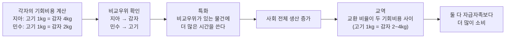

아침에 일어나 마시는 커피는 에티오피아나 베트남, 콜롬비아에서 자란 원두로 만든 것이다. 손에 든 스마트폰에는 한국에서 만든 반도체와 일본의 소재, 중국에서 조립한 부품, 미국에서 설계한 운영 체제가 들어 있다. 입고 있는 티셔츠는 방글라데시에서, 점심에 먹는 쇠고기는 오스트레일리아에서 왔을지 모른다. 우리는 하루에도 수십 나라 사람들이 만든 물건에 기대어 산다.

우리는 왜 필요한 것을 스스로 만들지 않고 남과 바꾸어 쓸까? 남보다 모든 일을 더 잘하는 사람도 남과 거래해서 얻는 것이 있을까? 이 강의에서는 경제학에서 가장 아름다우면서도 가장 오해받는 생각 가운데 하나인 **비교우위**를 배운다. 1817년 영국의 경제학자 **데이비드 리카도**가 정리한 이 생각은, 교역이 왜 모두를 이롭게 할 수 있는지, 그리고 그런데도 왜 교역을 둘러싼 갈등이 끊이지 않는지를 설명해 준다.

> [!핵심] 이 강의의 질문
> 1. 사람과 나라는 왜 서로 거래하는가? 교역은 어떻게 모두를 이롭게 할 수 있는가?
> 2. 절대우위와 비교우위는 어떻게 다른가? 모든 일을 더 잘하는 사람도 거래로 이득을 볼 수 있는가?
> 3. 교역의 이득은 누구에게 돌아가고, 누가 손해를 보는가?

{{F:e3-opening}}

## 혼자 사는 경제와 함께 사는 경제

### 목장 주인과 감자 농부

교역의 이득을 이해하기 위해 아주 단순한 세상을 생각해 보자. 이 세상에는 두 사람만 산다. 고기를 기르는 **목장 주인 민수**와 감자를 기르는 **농부 지아**다. 두 사람은 고기와 감자를 모두 먹고 싶어 한다. 둘 다 하루에 8시간 일할 수 있고, 한 단위를 만드는 데 걸리는 시간은 다음과 같다.

| 사람 | 고기 1kg을 만드는 데 걸리는 시간 | 감자 1kg을 만드는 데 걸리는 시간 | 8시간 동안 고기만 만들면 | 8시간 동안 감자만 만들면 |
|---|---|---|---|---|
| 농부 지아 | 1시간 | 15분 | 고기 8kg | 감자 32kg |
| 목장 주인 민수 | 20분 | 10분 | 고기 24kg | 감자 48kg |

표: 지아와 민수의 생산 능력 (가상의 예)

눈여겨볼 점이 있다. 민수는 고기도 감자도 지아보다 빨리 만든다. 고기 1kg에 민수는 20분, 지아는 1시간이 걸린다. 감자 1kg에도 민수는 10분, 지아는 15분이 걸린다. 민수는 **두 가지 일 모두** 지아보다 잘한다. 그렇다면 민수는 지아와 거래할 이유가 없을까?

### 거래하지 않을 때

먼저 두 사람이 거래 없이 각자 혼자 산다고 하자(**자급자족**). 지아는 하루 8시간 가운데 4시간은 고기를, 4시간은 감자를 만들어 고기 4kg과 감자 16kg을 먹는다. 민수는 6시간은 고기를, 2시간은 감자를 만들어 고기 18kg과 감자 12kg을 먹는다.

### 거래할 때

이제 지아가 민수에게 이렇게 제안한다고 하자. "나는 감자만 기를게. 너는 고기를 조금 더 길러. 그리고 내 감자 15kg과 네 고기 5kg을 바꾸자."

- 지아는 8시간을 모두 감자에 써서 감자 32kg을 만든다. 그 가운데 15kg을 민수의 고기 5kg과 바꾸면, 고기 5kg과 감자 17kg을 먹게 된다. 자급자족할 때(고기 4kg, 감자 16kg)보다 **둘 다 더 많다**.
- 민수는 7시간은 고기를, 1시간은 감자를 만들어 고기 21kg과 감자 6kg을 만든다. 고기 5kg을 지아의 감자 15kg과 바꾸면 고기 16kg과 감자 21kg을 먹게 된다. 자급자족할 때(고기 18kg, 감자 12kg)와 비교하면 고기는 2kg 줄었지만 감자는 9kg이나 늘었다.

| 사람 | 자급자족할 때 먹는 양 | 거래 후 먹는 양 | 거래로 얻은 이득 |
|---|---|---|---|
| 농부 지아 | 고기 4kg, 감자 16kg | 고기 5kg, 감자 17kg | 고기 +1kg, 감자 +1kg |
| 목장 주인 민수 | 고기 18kg, 감자 12kg | 고기 16kg, 감자 21kg | 고기 −2kg, 감자 +9kg |

표: 교역 전후의 소비 (가상의 예)

민수는 고기를 2kg 덜 먹게 되었지만, 그 대신 감자를 9kg 더 먹는다. 민수에게 고기 1kg은 감자 2kg과 같은 시간이 드므로(20분 대 10분), 고기 2kg을 포기하는 것은 감자 4kg을 포기하는 것과 같다. 그런데 감자를 9kg 더 얻었으니 확실히 이득이다. 모든 일을 더 잘하는 민수도, 모든 일을 더 못하는 지아도 거래로 이득을 보았다. 어떻게 이런 일이 가능할까?

## 절대우위와 비교우위

### 절대우위

같은 물건을 더 적은 자원(여기서는 시간)으로 만들 수 있는 사람을 그 물건에 **절대우위**가 있다고 한다. 민수는 고기와 감자 모두에 절대우위가 있다. 애덤 스미스는 『국부론』에서 각 나라가 절대우위가 있는 물건을 만들어 서로 교환하면 모두 이득을 본다고 했다. 그러나 절대우위만으로는 민수와 지아의 거래를 설명할 수 없다. 민수는 모든 것에 절대우위가 있기 때문이다.

### 비교우위: 기회비용을 비교하라

열쇠는 1강에서 배운 **기회비용**이다. 각자가 고기 1kg을 만들려면 감자를 얼마나 포기해야 하는지 계산해 보자.

| 사람 | 고기 1kg의 기회비용 | 감자 1kg의 기회비용 |
|---|---|---|
| 농부 지아 | 감자 4kg (1시간 ÷ 15분) | 고기 0.25kg |
| 목장 주인 민수 | 감자 2kg (20분 ÷ 10분) | 고기 0.5kg |

표: 지아와 민수의 기회비용

고기 1kg을 만들 때 지아는 감자 4kg을, 민수는 감자 2kg만 포기한다. 고기의 기회비용은 민수가 더 낮다. 반대로 감자 1kg을 만들 때 지아는 고기 0.25kg을, 민수는 고기 0.5kg을 포기한다. 감자의 기회비용은 지아가 더 낮다.

이처럼 어떤 물건을 **더 낮은 기회비용**으로 만들 수 있는 사람을 그 물건에 **비교우위**가 있다고 한다. 민수는 고기에, 지아는 감자에 비교우위가 있다. 한 사람이 두 물건 모두에 비교우위를 가질 수는 없다. 한 물건의 기회비용이 낮으면, 그 역수인 다른 물건의 기회비용은 반드시 높기 때문이다. 그래서 **누구나 무언가에는 비교우위를 갖는다.** 모든 일에 서툰 사람도, 상대적으로 덜 서툰 일이 있게 마련이다.

### 교역의 가격

각자 비교우위가 있는 물건에 집중(**특화**)하고 서로 바꾸면, 사회 전체의 생산이 늘어나고 그 늘어난 몫을 나누어 가질 수 있다. 이것이 **교역의 이득**이다. 그런데 교역이 둘 모두에게 이득이 되려면 교환 비율, 곧 교역의 '가격'이 두 사람의 기회비용 **사이**에 있어야 한다.

앞의 예에서 지아와 민수는 고기 5kg을 감자 15kg과 바꾸었다. 고기 1kg에 감자 3kg인 셈이다. 지아에게 고기 1kg을 직접 만드는 비용은 감자 4kg인데 거래로는 감자 3kg에 얻을 수 있으니 이득이다. 민수에게 고기 1kg을 만드는 비용은 감자 2kg인데 거래로는 감자 3kg을 받고 팔 수 있으니 역시 이득이다. 교환 비율이 감자 2kg과 4kg 사이라면 어떤 비율이든 둘 다 이득을 본다.



### 생산 가능 곡선으로 보기

2강에서 배운 생산 가능 곡선으로 그려 보면 교역의 이득이 더 분명하게 보인다. 혼자 살 때 각자가 소비할 수 있는 것은 자기 생산 가능 곡선 위나 안쪽뿐이다. 그러나 교역을 하면 자기 생산 가능 곡선 **바깥**의 점에서 소비할 수 있게 된다. 교역은 마치 새로운 기술을 발명한 것처럼 사람들의 소비 가능성을 넓혀 준다.

```chart
{
  "type": "scatter",
  "caption": "지아의 생산 가능 곡선과 소비점 (가상의 예). 혼자 살 때 지아는 곡선 위의 점(고기 4kg, 감자 16kg)에서 소비하지만, 교역을 하면 곡선 바깥의 점(고기 5kg, 감자 17kg)에서 소비할 수 있다",
  "height": 340,
  "data": {
    "datasets": [
      { "label": "지아의 생산 가능 곡선", "showLine": true, "pointRadius": 0, "data": [{"x":0,"y":32},{"x":8,"y":0}] },
      { "label": "자급자족할 때의 소비", "pointRadius": 7, "data": [{"x":4,"y":16}] },
      { "label": "교역 후의 소비", "pointRadius": 8, "pointStyle": "star", "data": [{"x":5,"y":17}] }
    ]
  },
  "options": { "scales": { "x": { "title": { "display": true, "text": "고기 (kg)" }, "min": 0, "max": 10 }, "y": { "title": { "display": true, "text": "감자 (kg)" }, "min": 0, "max": 36 } } }
}
```

### 일상 속의 비교우위

비교우위는 나라 사이의 무역만이 아니라 우리 일상 곳곳에 있다. 한 집안에서 요리를 잘하는 사람이 요리를 맡고 정리를 잘하는 사람이 청소를 맡는 것, 회사에서 영업에 재능 있는 사람과 회계에 꼼꼼한 사람이 일을 나누는 것이 모두 비교우위에 따른 특화다. 직업을 고르는 일도 결국 자기가 상대적으로 낮은 기회비용으로 할 수 있는 일을 찾는 과정이다. 무엇이든 혼자서 다 해내려는 사람보다, 자기가 상대적으로 잘하는 일에 집중하고 나머지를 남과 바꾸는 사람이 더 많은 것을 누릴 수 있다. 특화는 또 그 일을 되풀이하게 만들어 솜씨를 더 좋게 하므로, 처음에는 작았던 비교우위가 시간이 지나며 더 커지기도 한다. 애덤 스미스가 핀 공장에서 본 분업의 이득과 리카도의 비교우위는 이렇게 서로 이어진다.

> [!참고] 최고의 변호사는 직접 타자를 쳐야 할까?
> 어느 변호사가 사무실의 누구보다 타자를 빨리 친다고 하자. 그렇다면 변호사가 서류 타자까지 직접 해야 할까? 비교우위의 논리는 아니라고 답한다. 변호사가 한 시간 동안 법률 상담으로 50만 원을 벌 수 있다면, 그 시간에 타자를 치는 기회비용은 50만 원이다. 타자를 조금 느리게 치더라도 시간당 2만 원을 받는 비서에게 맡기고 자신은 상담을 하는 편이 둘 모두에게 이득이다. 위대한 운동선수가 잔디를 가장 빨리 깎을 수 있더라도 직접 깎지 않는 것도 같은 이유다.

## 리카도의 옷감과 포도주

### 1817년의 모형

이 생각을 처음으로 정확하게 정리한 사람이 데이비드 리카도다. 그는 1817년 『정치경제학과 과세의 원리』에서 영국과 포르투갈, 옷감과 포도주라는 두 나라, 두 상품의 예를 들었다. 리카도의 숫자는 다음과 같다.

| 나라 | 옷감 일정량을 만드는 데 드는 노동 | 포도주 일정량을 만드는 데 드는 노동 |
|---|---|---|
| 영국 | 노동자 100명이 1년 | 노동자 120명이 1년 |
| 포르투갈 | 노동자 90명이 1년 | 노동자 80명이 1년 |

표: 리카도가 든 예 (『정치경제학과 과세의 원리』 제7장, 1817)

포르투갈은 옷감과 포도주 **모두** 영국보다 적은 노동으로 만든다. 포르투갈은 두 상품 모두에 절대우위가 있다. 그러나 기회비용을 따져 보면, 포르투갈에서 포도주를 만드는 비용은 옷감의 80/90(약 0.89)인 반면 영국에서는 120/100(1.2)이다. 포르투갈은 포도주에, 영국은 옷감에 비교우위가 있다. 그래서 포르투갈은 포도주를, 영국은 옷감을 만들어 서로 바꾸면 두 나라 모두 더 많은 옷감과 포도주를 가질 수 있다.

{{F:e3-ricardo}}

리카도의 이론은 당시 영국의 뜨거운 정치 문제와 연결되어 있었다. 나폴레옹 전쟁이 끝난 뒤 영국 의회는 1815년 외국산 곡물의 수입을 막는 **곡물법**을 만들었다. 지주들은 곡물값이 높게 유지되어 이득을 보았지만, 노동자들은 비싼 빵을 사 먹어야 했고 공장주들은 임금을 올려 주어야 했다. 리카도는 곡물법에 반대하며 자유무역을 주장했다. 곡물법은 오랜 논쟁 끝에 1846년 폐지되었고, 영국은 이후 자유무역의 시대로 나아갔다.

{{F:e3-trade-history}}

## 나라 사이의 교역

### 무역도 같은 원리다

나라 사이의 무역도 지아와 민수의 거래와 같은 원리로 움직인다. 다만 실제로 무역을 하는 것은 '나라'가 아니라 그 나라의 기업과 소비자들이다. 다른 나라에서 만들어 들여오는 물건을 **수입품**, 다른 나라에 파는 물건을 **수출품**이라고 한다.

한국은 무역으로 성장한 대표적인 나라다. 1960년대 초 한국의 주요 수출품은 철광석, 텅스텐, 오징어, 생사 같은 1차 산품이었다. 노동력은 풍부했지만 자본과 기술이 부족했던 1960~70년대에는 가발, 섬유, 신발처럼 사람 손이 많이 가는 상품에 비교우위가 있었다. 자본이 쌓이고 기술이 발전하면서 비교우위는 철강과 배, 자동차로, 다시 반도체와 디스플레이로 옮겨 갔다. 비교우위는 고정된 것이 아니라 한 나라가 가진 자원과 기술에 따라 바뀐다.

| 시기 | 한국의 대표 수출품 | 비교우위의 바탕 |
|---|---|---|
| 1960년대 초 | 철광석, 텅스텐, 오징어, 생사 | 천연자원과 1차 산품 |
| 1970년대 | 섬유, 가발, 합판, 신발 | 값싸고 풍부한 노동력 |
| 1980년대 | 철강, 선박, 전자 제품 | 중화학 공업 투자로 쌓은 자본 |
| 1990~2000년대 | 반도체, 자동차, 휴대전화 | 기술과 숙련 노동, 대규모 설비 |
| 2020년대 | 반도체, 자동차, 석유 제품, 선박, 배터리 | 첨단 기술과 연구 개발 |

표: 한국의 수출품 변화와 비교우위 (대략적인 흐름)

```chart
{
  "type": "bar",
  "caption": "한국의 연간 수출액 (억 달러, 당시 가격, 대략적인 수치). 1964년 처음으로 1억 달러를 넘은 수출은 1977년 100억 달러, 1995년 1,000억 달러를 넘어섰다. 수출이 처음 1억 달러를 넘은 1964년 11월 30일은 '수출의 날'로 기념되었다(지금의 '무역의 날')",
  "data": {
    "labels": ["1964", "1970", "1977", "1980", "1990", "1995", "2000", "2010", "2020", "2023"],
    "datasets": [{ "label": "수출액(억 달러)", "data": [1.2, 8.4, 100, 175, 650, 1250, 1723, 4664, 5125, 6327] }]
  },
  "options": { "scales": { "y": { "min": 0 } }, "plugins": { "legend": { "display": false } } }
}
```

{{F:e3-korea-trade}}

### 비교우위는 어디서 오는가

리카도는 나라마다 기술, 곧 노동 생산성이 다르다는 데서 비교우위를 찾았다. 20세기 초 스웨덴의 경제학자 **헥셔**와 **올린**은 다른 원천을 지적했다. 나라마다 가진 생산 요소의 양이 다르다는 것이다. 노동이 풍부한 나라는 노동을 많이 쓰는 상품(옷, 신발)에, 자본이 풍부한 나라는 자본을 많이 쓰는 상품(기계, 화학 제품)에, 땅이 넓은 나라는 땅을 많이 쓰는 상품(밀, 쇠고기)에 비교우위를 갖는다. 1970년대 한국이 섬유와 가발을, 오스트레일리아가 밀과 쇠고기를 수출한 것이 그 예다.

그런데 현실의 무역에는 이것만으로 설명하기 어려운 부분도 있다. 독일과 한국은 서로 자동차를 수출하고 수입한다. 비슷한 나라끼리 비슷한 물건을 주고받는 것이다. 미국의 경제학자 **폴 크루그먼**은 기업이 대량으로 생산할수록 비용이 내려가는 **규모의 경제**와, 소비자들이 다양한 상품을 원한다는 점으로 이런 무역을 설명했다. 그는 이 공로로 2008년 노벨 경제학상을 받았다.

### 무역은 사회 전체의 파이를 키운다

비교우위에 따른 무역은 세계 전체의 생산을 늘린다. 각 나라가 상대적으로 잘하는 일에 집중하기 때문이다. 또 무역은 기업들이 더 넓은 시장에서 대량 생산을 할 수 있게 해 비용을 낮추고(규모의 경제), 소비자에게는 더 많은 선택지를 주며, 다른 나라 기업과의 경쟁을 통해 기술 발전을 자극한다. 20세기 후반 이후 동아시아 나라들이 빠르게 성장한 데에는 세계 시장을 향한 수출이 큰 역할을 했다.

{{F:e3-container}}

## 교역의 그늘: 누가 이익을 보고 누가 손해를 보나

### 이득은 넓게, 손해는 좁게

비교우위 이론은 무역이 나라 **전체**를 이롭게 한다고 말한다. 그러나 나라 안의 **모든 사람**이 이득을 본다고 말하지는 않는다. 값싼 외국산 쌀이 들어오면 소비자들은 싼값에 쌀을 사서 이득을 보지만, 국내 쌀 농가는 손해를 본다. 한국 기업이 해외에 반도체를 많이 팔게 되면 반도체 산업의 노동자와 주주는 이득을 보지만, 그 덕분에 원화 가치가 올라 다른 수출 산업이 어려워질 수도 있다.

| 무역의 결과 | 이익을 보는 사람 | 손해를 보는 사람 |
|---|---|---|
| 값싼 수입품이 들어온다 | 소비자, 수입품을 원료로 쓰는 기업 | 수입품과 경쟁하는 국내 생산자와 그 노동자 |
| 수출이 늘어난다 | 수출 기업과 그 노동자, 주주 | 수출품을 국내에서 사 쓰던 소비자(값이 오를 수 있다) |

표: 무역의 이익과 손해는 고르게 나뉘지 않는다

문제는 이익과 손해가 나뉘는 방식이다. 수입으로 얻는 이익은 수많은 소비자에게 조금씩 넓게 퍼지므로 잘 느껴지지 않는다. 반면 손해는 특정 산업과 특정 지역의 노동자에게 크게 몰린다. 그래서 손해를 보는 쪽은 조직을 만들어 강하게 목소리를 내고, 이익을 보는 쪽은 조용하다. 2강에서 경제학자 대부분이 관세에 반대하는데도 보호 무역이 자주 채택된다고 한 이유가 여기 있다.

### 미국 제조업 도시들의 경험

2000년대 들어 중국이 세계 무역에 본격적으로 참여하자, 미국은 값싼 중국산 제품을 대량으로 들여왔다. 미국 소비자들은 가구와 장난감, 전자 제품을 싸게 살 수 있게 되었다. 그러나 경제학자 데이비드 오터 등은 2013년 연구에서, 중국산 수입품과 경쟁하던 산업이 몰려 있던 미국의 지역들에서 제조업 일자리가 크게 줄고 임금이 떨어졌으며, 그 충격이 생각보다 오래 이어졌다는 결과를 발표했다. 이른바 **'차이나 쇼크'**다. 이 연구는 무역의 이득이 실제로는 저절로 고르게 나뉘지 않으며, 일자리를 잃은 사람들이 새 일자리로 옮겨 가는 데 오랜 시간이 걸린다는 것을 보여 주었다.

### 보호 무역이 남긴 교훈: 스무트-홀리 관세

무역을 막아 국내 산업을 지키려는 시도가 오히려 모두를 어렵게 만든 역사도 있다. 대공황 초기인 1930년 미국 의회는 2만 가지가 넘는 수입품의 관세를 크게 올리는 **스무트-홀리 관세법**을 통과시켰다. 미국 경제학자 1,000여 명이 대통령에게 서명을 거부해 달라고 청원했지만 법은 시행되었다. 그러자 캐나다와 유럽 나라들도 보복 관세를 매겼고, 세계 각국이 앞다투어 무역 장벽을 쌓았다. 1929년부터 1934년 사이 세계 무역액은 3분의 1 남짓으로 줄어들었다. 무역이 줄어든 데에는 대공황 자체의 영향이 컸지만, 보호 무역 경쟁이 위기를 더 깊게 만들었다는 데 많은 역사가와 경제학자가 동의한다. 이 경험은 제2차 세계대전 뒤 관세를 함께 낮추기 위한 국제 협정인 GATT(관세와 무역에 관한 일반 협정, 1947)가 만들어지는 배경이 되었다.

> [!주의] '그러니까 무역을 막자'가 답일까?
> 무역으로 손해를 보는 사람이 있다는 사실이 무역을 막아야 한다는 결론으로 바로 이어지지는 않는다. 무역을 막으면 소비자와 수출 산업 전체가 잃는 것이 보통 훨씬 크다. 많은 경제학자는 무역의 이득을 누리되, 그 이득의 일부로 손해를 본 사람들을 돕는 정책, 예컨대 실업 급여와 직업 훈련, 지역 지원을 함께 펴야 한다고 본다. 한국도 자유무역협정(FTA)을 맺을 때 피해를 입는 농업과 일부 제조업에 지원 대책을 함께 마련해 왔다. 무역 정책의 구체적인 효과는 8강 「국제무역」에서 수요와 공급 그래프로 자세히 분석한다.

```timeline
1776 | 애덤 스미스, 『국부론』 | 분업과 절대우위로 자유무역을 옹호
1815 | 영국, 곡물법 제정 | 외국산 곡물 수입 제한
1817 | 리카도, 『정치경제학과 과세의 원리』 | 비교우위론
1846 | 영국, 곡물법 폐지 | 자유무역 시대의 출발
1930 | 미국, 스무트-홀리 관세법 | 보복 관세가 이어지며 세계 무역 위축
1947 | GATT 체결 | 다자간 관세 인하 협상의 틀
1964 | 한국, 수출 1억 달러 달성 | 수출 주도 성장의 본격화
1995 | 세계무역기구(WTO) 출범 | GATT를 이어받은 국제기구
2001 | 중국, WTO 가입 | 세계 무역 구조의 큰 변화
2004 | 한국–칠레 FTA 발효 | 한국의 첫 자유무역협정
2012 | 한미 FTA 발효 | 
```

## 비교우위에 대한 흔한 오해

| 오해 | 실제 |
|---|---|
| "모든 것을 더 잘 만드는 나라는 무역할 필요가 없다." | 무역의 이득은 절대우위가 아니라 비교우위에서 나온다. 모든 것에 앞선 나라도 상대적으로 더 잘하는 것에 집중하면 이득을 본다. |
| "임금이 싼 나라와 무역하면 우리 임금도 떨어진다." | 임금은 생산성을 반영한다. 생산성이 높은 나라는 높은 임금을 주면서도 생산성이 특히 높은 분야에서 경쟁할 수 있다. 다만 수입과 경쟁하는 특정 직종의 임금은 떨어질 수 있다. |
| "무역은 한쪽이 이기고 한쪽이 지는 경기다." | 자발적인 교환은 양쪽 모두 이득을 볼 때만 일어난다. 무역 흑자는 '승리', 적자는 '패배'가 아니다(29강). |
| "비교우위는 타고난 것이다." | 비교우위는 자원, 기술, 교육, 투자에 따라 바뀐다. 한국의 비교우위는 가발에서 반도체로 옮겨 갔다. |

표: 비교우위에 대한 흔한 오해와 실제

## 정리

> [!핵심] 3강 요약
> - 사람과 나라는 자기가 잘하는 일에 **특화**하고 서로 **교역**함으로써 모두 더 많이 소비할 수 있다. 교역은 생산 가능 곡선 바깥의 점에서 소비할 수 있게 해 준다.
> - 같은 물건을 더 적은 자원으로 만들면 **절대우위**, 더 낮은 **기회비용**으로 만들면 **비교우위**가 있다. 교역의 이득은 절대우위가 아니라 비교우위에서 나온다.
> - 한 사람이 두 물건 모두에 비교우위를 가질 수는 없으므로, **누구나 무언가에는 비교우위가 있다.** 교환 비율이 두 사람의 기회비용 사이에 있으면 둘 다 이득을 본다.
> - **리카도**는 1817년 영국의 옷감과 포르투갈의 포도주 예로 비교우위를 설명하고, 곡물법에 반대하며 자유무역을 주장했다.
> - 무역은 나라 전체의 파이를 키우지만, 이익은 넓게 퍼지고 손해는 특정 산업과 지역에 몰린다. 그래서 무역 정책은 손해를 보는 사람들에 대한 대책과 함께 논의되어야 한다.

### 생각해 볼 질문

1. 나와 친구가 함께 과제를 한다. 나는 자료 조사와 발표 자료 만들기를 모두 친구보다 빨리 한다. 그래도 일을 나누어 맡는 것이 좋은 이유를 비교우위로 설명해 보자.
2. 한국의 비교우위는 1970년대와 지금 어떻게 달라졌는가? 20년 뒤 한국의 비교우위는 어디에 있을지 예상해 보자.
3. 값싼 외국산 농산물 수입을 늘리는 자유무역협정에서 누가 이익을 보고 누가 손해를 보는가? 손해를 보는 사람들을 어떻게 도울 수 있을까?

### 다음 강 예고

4강 「수요와 공급」에서는 시장 경제의 가장 기본이 되는 모형을 배운다. 사람들이 사려는 양(수요)과 팔려는 양(공급)이 어떻게 결정되는지, 둘이 만나 가격이 어떻게 정해지는지, 그리고 날씨나 유행, 원료값이 바뀌면 시장 가격이 어떻게 움직이는지를 그래프로 분석한다.
