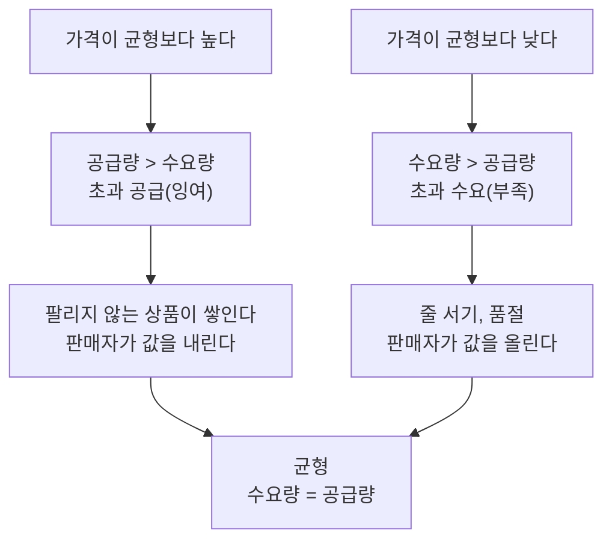

2010년 가을, 한국의 김장철을 앞두고 '배추 파동'이 일어났다. 봄의 냉해와 여름의 폭염, 가을 태풍과 잦은 비가 이어지면서 배추 농사가 크게 망쳤다. 9월 말에는 배추 한 포기 소매 가격이 1만 원을 훌쩍 넘었고, 1만 5,000원에 팔리는 곳까지 나왔다. 평소의 서너 배가 넘는 값이었다. 식당들은 김치를 아껴 내놓았고, 뉴스에는 '금(金)치'라는 말이 오르내렸다. 그런데 이듬해 배추 농사가 풍년이 들자 값은 폭락했고, 농민들은 수확을 포기하고 배추밭을 갈아엎었다.

누가 배추값을 정했을까? 정부도, 농협도, 어떤 대기업도 "배추 한 포기에 1만 5,000원을 받으라"고 명령하지 않았다. 배추값은 배추를 사려는 수많은 사람과 팔려는 수많은 사람이 시장에서 만나 저절로 정해졌다. 이 강의에서는 시장 경제를 이해하는 가장 기본적인 도구인 **수요와 공급** 모형을 배운다. 수요와 공급은 경제학에서 가장 많이 쓰이는 말이며, 이 강좌의 앞으로의 거의 모든 강의가 이 모형 위에 세워진다.

> [!핵심] 이 강의의 질문
> 1. 시장이란 무엇이며, 경쟁 시장은 어떤 특징을 갖는가?
> 2. 사람들이 사려는 양(수요)과 팔려는 양(공급)은 무엇에 따라 달라지는가?
> 3. 수요와 공급이 만나 가격은 어떻게 정해지며, 조건이 바뀌면 가격은 어떻게 움직이는가?

{{F:e4-opening}}

## 시장과 경쟁

### 시장이란 무엇인가

**시장**은 어떤 상품을 사려는 사람과 팔려는 사람이 만나는 곳이다. 남대문 시장이나 노량진 수산 시장처럼 눈에 보이는 장소일 수도 있고, 주식 시장이나 인터넷 중고 거래처럼 눈에 보이지 않는 거래의 망일 수도 있다. 시장에서 사는 사람들은 그 상품의 **수요**를, 파는 사람들은 **공급**을 이룬다.

### 장시에서 온라인 시장까지

시장은 인류의 역사만큼 오래되었다. 한국에서는 조선 후기에 정기적으로 열리는 시장인 **장시**(場市)가 크게 늘었다. 1770년에 펴낸 『동국문헌비고』에는 전국의 장시가 1,000곳이 넘게 기록되어 있다. 대부분 닷새마다 열리는 **5일장**이어서, 이웃한 고을의 장날이 서로 겹치지 않게 돌아가며 열렸다. 보부상들은 이 장 저 장을 돌며 물건을 팔았고, 농민들은 장날에 곡식과 채소를 내다 팔아 소금과 옷감, 농기구를 샀다. 장시에서는 그날그날 모여든 사람들 사이의 흥정으로 값이 정해졌다. 오늘날에는 대형 마트와 온라인 쇼핑몰, 새벽 배송 앱이 장시의 자리를 차지했지만, 사려는 사람과 팔려는 사람이 만나 값이 정해진다는 원리는 그대로다.

### 경쟁 시장

이 강의에서는 **경쟁 시장**을 가정한다. 경쟁 시장이란 사는 사람과 파는 사람이 아주 많아서, 누구 한 사람도 시장 가격에 의미 있는 영향을 줄 수 없는 시장을 말한다. 배추 시장이 좋은 예다. 전국에는 수많은 배추 농가와 수많은 소비자가 있다. 한 농가가 배추값을 두 배로 받겠다고 해도 소비자는 다른 농가의 배추를 사면 그만이다. 한 소비자가 배추를 사지 않겠다고 해도 배추값은 꿈쩍하지 않는다. 그래서 경쟁 시장의 참여자들은 시장에서 정해진 가격을 그대로 받아들이는 **가격 수용자**다.

완전한 경쟁 시장은 다음 조건을 갖춘다. 팔리는 상품이 모두 같고(동질적), 사고파는 사람이 아주 많으며, 누구나 시장에 쉽게 들어오고 나갈 수 있다. 현실의 시장은 대부분 이 조건을 완벽하게 갖추지는 않는다. 휴대전화 시장처럼 몇몇 기업이 크게 영향을 미치는 시장도 있고(과점, 16강), 한 기업만 있는 시장도 있다(독점, 14강). 그러나 경쟁 시장 모형은 많은 시장을 꽤 잘 설명하며, 다른 시장을 분석하는 출발점이 된다.

## 수요

### 수요량과 수요 법칙

어떤 상품을 사람들이 사려고 하고, 살 수 있는 양을 **수요량**이라고 한다. 수요량은 여러 가지에 따라 달라지지만, 가장 중요한 것은 그 상품의 **가격**이다. 다른 조건이 같다면, 가격이 오르면 수요량은 줄고 가격이 내리면 수요량은 늘어난다. 이 관계가 너무나 많은 상품에서 나타나기 때문에 경제학자들은 이를 **수요 법칙**이라고 부른다.

가격과 수요량의 관계를 표로 나타낸 것을 **수요표**, 그래프로 나타낸 것을 **수요 곡선**이라고 한다. 수요 곡선은 오른쪽 아래로 기울어진다. 다음은 어느 도시의 하루 배추 시장을 가정한 예다.

| 배추 한 포기 가격 | 수요량 (만 포기) | 공급량 (만 포기) | 시장 상태 |
|---|---|---|---|
| 1,000원 | 16 | 4 | 부족 12만 포기 |
| 2,000원 | 14 | 7 | 부족 7만 포기 |
| 3,000원 | 12 | 10 | 부족 2만 포기 |
| 3,500원 | 11 | 11 | **균형** |
| 4,000원 | 10 | 12 | 잉여 2만 포기 |
| 5,000원 | 8 | 15 | 잉여 7만 포기 |
| 6,000원 | 6 | 18 | 잉여 12만 포기 |

표: 배추 시장의 수요표와 공급표 (가상의 예)

수요 곡선이 오른쪽 아래로 기울어지는 이유는 무엇일까? 첫째, 값이 오르면 사람들은 비슷한 다른 상품으로 바꾼다. 배추가 비싸면 무로 깍두기를 담그거나 시판 김치를 산다(대체 효과). 둘째, 값이 오르면 같은 돈으로 살 수 있는 양이 줄어 실제로 가난해진 것과 같은 효과가 난다(소득 효과). 셋째, 1강에서 본 것처럼 같은 상품을 더 많이 가질수록 '하나 더'의 만족은 줄어든다(한계 효용 체감). 그래서 사람들은 값이 내려야 더 많이 산다.

### 개인 수요와 시장 수요

시장 전체의 수요는 그 시장의 모든 소비자의 수요를 더한 것이다. 배추 한 포기가 3,000원일 때 가정 A가 2포기, 가정 B가 5포기, 식당 C가 30포기를 사려 한다면, 셋을 합한 시장 수요량은 37포기다. 가격마다 이렇게 수요량을 더해 가면 시장 수요 곡선이 된다. 그래프로 보면 개인 수요 곡선들을 **가로로 더한** 것이다.

### 수요 곡선의 이동: 수요의 변화

2강에서 배운 '곡선 위의 이동'과 '곡선 자체의 이동'을 떠올려 보자. 배추 **가격**이 바뀌어 사람들이 사려는 양이 바뀌는 것은 수요 곡선 **위를 따라 움직이는** 것이다. 이것을 **수요량의 변화**라고 한다. 반면 가격이 아닌 다른 조건이 바뀌어 같은 가격에서도 사려는 양이 달라지면 수요 곡선 **자체가 이동**한다. 이것을 **수요의 변화**라고 한다. 수요 곡선을 이동시키는 요인은 다음과 같다.

| 요인 | 수요 증가(곡선이 오른쪽으로)의 예 | 설명 |
|---|---|---|
| 소득 | 소득이 늘어 해외여행 수요가 늘어난다 | **정상재**는 소득이 늘면 수요가 는다. 반대로 소득이 늘면 수요가 주는 상품은 **열등재**다(예: 소득이 늘면 시외버스 대신 자가용을 타는 경우의 시외버스) |
| 연관 상품의 가격 | 커피값이 오르자 녹차 수요가 늘어난다 | **대체재**의 값이 오르면 수요가 는다. **보완재**의 값이 내리면 수요가 는다(예: 프린터 값이 내리면 잉크 수요 증가) |
| 기호·유행 | 한 연예인이 입은 옷의 수요가 늘어난다 | 사람들의 취향과 건강 정보, 광고, 유행 |
| 미래에 대한 기대 | 다음 달 값이 오를 것이라 예상해 지금 미리 산다 | 가격이나 소득에 대한 기대 |
| 구매자의 수 | 인구가 늘거나 관광객이 늘어난다 | 시장에 참여하는 소비자의 수 |

표: 수요 곡선을 이동시키는 요인

### 헷갈리기 쉬운 문장: "가격이 오르면 수요가 줄고, 수요가 줄면 가격이 내린다"

이 문장은 그럴듯하게 들리지만 경제학의 용어로는 틀렸다. 앞부분에서 가격이 올라 줄어드는 것은 '수요'가 아니라 **수요량**이다. 곡선 위를 따라 움직였을 뿐 수요 곡선 자체는 그대로다. 그러므로 "수요가 줄어 가격이 다시 내린다"는 뒷부분은 일어나지 않는다. 가격이 오르는 일과 수요량이 주는 일은 같은 곡선 위의 한 번의 이동이다. 반면 소득이 줄어 수요 곡선 자체가 왼쪽으로 이동하면, 그때는 같은 공급 아래에서 가격이 내린다. 신문 기사에서도 이 두 가지를 섞어 쓰는 경우가 많으니, '수요'라는 말이 나오면 곡선의 이동인지 곡선 위의 이동인지 늘 따져 보자.

## 공급

### 공급량과 공급 법칙

어떤 상품을 팔려는 사람들이 팔고자 하고, 팔 수 있는 양을 **공급량**이라고 한다. 다른 조건이 같다면 가격이 오르면 공급량은 늘고, 가격이 내리면 공급량은 준다. 이것을 **공급 법칙**이라고 한다. 배추값이 오르면 농부들은 더 많은 땅에 배추를 심고, 저장해 두었던 배추를 시장에 내놓는다. 값이 오를수록 같은 배추를 팔아 버는 돈이 많아지기 때문이다. 그래서 **공급 곡선**은 오른쪽 위로 기울어진다.

시장 공급도 시장 수요처럼 그 시장의 모든 판매자의 공급량을 가격마다 더한 것이다.

### 공급 곡선의 이동: 공급의 변화

가격 이외의 조건이 바뀌면 공급 곡선 자체가 이동한다.

| 요인 | 공급 증가(곡선이 오른쪽으로)의 예 | 설명 |
|---|---|---|
| 생산 요소의 가격 | 비료값과 인건비가 내린다 | 원료와 임금 같은 생산 비용이 내리면 같은 값에 더 많이 팔 수 있다 |
| 기술 | 새 품종과 재배 기술이 보급된다 | 같은 자원으로 더 많이 만들 수 있다 |
| 자연 조건 | 날씨가 좋아 풍년이 든다 | 농산물은 날씨의 영향을 크게 받는다 |
| 미래에 대한 기대 | 다음 달 값이 내릴 것 같아 지금 출하를 늘린다 | 판매자의 가격 기대 |
| 판매자의 수 | 새 농가와 기업이 시장에 들어온다 | 시장에 참여하는 판매자의 수 |

표: 공급 곡선을 이동시키는 요인

## 시장 균형

### 수요와 공급이 만나는 곳

이제 수요와 공급을 한 그래프에 함께 그려 보자. 두 곡선이 만나는 점에서 사려는 양과 팔려는 양이 정확히 같다. 이 점을 **균형**이라고 하고, 이때의 가격을 **균형 가격**, 거래량을 **균형 거래량**이라고 한다. 앞의 배추 시장에서는 한 포기 3,500원에서 수요량과 공급량이 모두 11만 포기로 같다.

```chart
{
  "type": "scatter",
  "caption": "배추 시장의 수요 곡선과 공급 곡선 (가상의 예). 두 곡선이 만나는 점(가격 3,500원, 거래량 11만 포기)이 시장 균형이다. 균형보다 높은 가격에서는 팔리지 않는 배추가 남고(잉여), 낮은 가격에서는 사려는 사람이 더 많아 배추가 모자란다(부족)",
  "height": 380,
  "data": {
    "datasets": [
      { "label": "수요 곡선", "showLine": true, "pointRadius": 2, "data": [{"x":16,"y":1000},{"x":14,"y":2000},{"x":12,"y":3000},{"x":11,"y":3500},{"x":10,"y":4000},{"x":8,"y":5000},{"x":6,"y":6000}] },
      { "label": "공급 곡선", "showLine": true, "pointRadius": 2, "data": [{"x":4,"y":1000},{"x":7,"y":2000},{"x":10,"y":3000},{"x":11,"y":3500},{"x":12,"y":4000},{"x":15,"y":5000},{"x":18,"y":6000}] },
      { "label": "균형", "pointRadius": 8, "pointStyle": "star", "data": [{"x":11,"y":3500}] }
    ]
  },
  "options": { "scales": { "x": { "title": { "display": true, "text": "거래량 (만 포기)" }, "min": 0, "max": 20 }, "y": { "title": { "display": true, "text": "가격 (원)" }, "min": 0, "max": 6500 } } }
}
```

### 시장은 어떻게 균형을 찾아가나

시장 가격이 균형보다 높으면 어떻게 될까? 한 포기 5,000원이라면 팔려는 양(15만 포기)이 사려는 양(8만 포기)보다 많아 7만 포기가 남는다. 이런 상태를 **초과 공급**(잉여)이라고 한다. 팔리지 않은 배추가 시들어 가자 상인들은 값을 내린다. 값이 내리면 수요량은 늘고 공급량은 줄어, 잉여가 사라질 때까지 값은 계속 내린다.

반대로 시장 가격이 균형보다 낮아 한 포기 2,000원이라면, 사려는 양(14만 포기)이 팔려는 양(7만 포기)보다 많아 7만 포기가 모자란다. 이런 상태를 **초과 수요**(부족)라고 한다. 배추를 사려고 줄을 서고, 늦게 온 사람은 빈손으로 돌아간다. 상인들은 값을 올려도 팔린다는 것을 알고 값을 올린다. 값이 오르면 수요량은 줄고 공급량은 늘어, 부족이 사라질 때까지 값은 오른다.

이처럼 시장 가격은 잉여나 부족이 있으면 저절로 움직여 균형으로 향한다. 이것을 **수요 공급의 법칙**이라고 한다. 대부분의 자유로운 시장에서는 이 조정이 매우 빠르게 일어난다. 1강에서 본 '보이지 않는 손'은 바로 이 과정을 가리킨다.



## 균형의 변화 분석하기

### 세 단계 분석법

시장의 조건이 바뀌면 균형도 바뀐다. 경제학자들은 이를 세 단계로 분석한다.

1. 그 사건이 **수요 곡선**을 이동시키는가, **공급 곡선**을 이동시키는가, 아니면 둘 다인가?
2. 곡선이 **어느 방향**(오른쪽 또는 왼쪽)으로 이동하는가?
3. 새 균형에서 **가격과 거래량**은 어떻게 바뀌는가?

### 사례 1: 흉년과 배추값 (공급 감소)

2010년의 배추 파동을 세 단계로 분석해 보자. ① 이상 기후는 배추를 사려는 사람의 마음을 바꾸지 않는다. 바뀐 것은 배추를 기르고 파는 쪽, 곧 공급이다. ② 같은 가격에서 팔 수 있는 배추가 줄었으므로 공급 곡선은 왼쪽으로 이동한다. ③ 새 균형에서는 가격이 오르고 거래량이 준다. 배추값이 몇 배로 뛴 것은 이 때문이다.

```chart
{
  "type": "scatter",
  "caption": "흉년으로 배추 공급이 줄 때 (가상의 예). 공급 곡선이 왼쪽으로 이동하면서(점선) 균형 가격은 3,500원에서 약 5,000원으로 오르고, 균형 거래량은 11만 포기에서 8만 포기로 준다",
  "height": 360,
  "data": {
    "datasets": [
      { "label": "수요 곡선", "showLine": true, "pointRadius": 0, "data": [{"x":16,"y":1000},{"x":14,"y":2000},{"x":12,"y":3000},{"x":10,"y":4000},{"x":8,"y":5000},{"x":6,"y":6000}] },
      { "label": "원래 공급 곡선", "showLine": true, "pointRadius": 0, "data": [{"x":4,"y":1000},{"x":7,"y":2000},{"x":10,"y":3000},{"x":12,"y":4000},{"x":15,"y":5000},{"x":18,"y":6000}] },
      { "label": "흉년 뒤 공급 곡선", "showLine": true, "pointRadius": 0, "borderDash": [6, 4], "data": [{"x":1,"y":1000},{"x":3,"y":2000},{"x":5,"y":3000},{"x":6.5,"y":4000},{"x":8,"y":5000},{"x":10,"y":6000}] },
      { "label": "원래 균형", "pointRadius": 7, "data": [{"x":11,"y":3500}] },
      { "label": "새 균형", "pointRadius": 8, "pointStyle": "star", "data": [{"x":8,"y":5000}] }
    ]
  },
  "options": { "scales": { "x": { "title": { "display": true, "text": "거래량 (만 포기)" }, "min": 0, "max": 20 }, "y": { "title": { "display": true, "text": "가격 (원)" }, "min": 0, "max": 6500 } } }
}
```

### 사례 2: 감염병과 마스크 (수요 증가)

2020년 초 코로나19가 퍼지자 마스크를 사려는 사람이 갑자기 크게 늘었다. ① 바뀐 것은 마스크를 사려는 사람들의 사정, 곧 수요다. ② 같은 가격에서 사려는 양이 늘었으므로 수요 곡선은 오른쪽으로 이동한다. ③ 새 균형에서는 가격이 오르고 거래량이 는다. 실제로 평소 한 장에 수백 원이던 보건용 마스크가 온라인에서 한 장에 4,000~5,000원에 팔리기도 했다. 정부는 3월부터 약국에서 마스크를 한 장 1,500원에 1인당 일주일 2장씩 파는 '공적 마스크' 제도를 시행했다. 값을 묶고 줄 서기와 배급으로 나누는 방식이었다(이런 가격 규제의 효과는 6강에서 다룬다). 시간이 지나 생산 설비가 늘어나 공급 곡선이 오른쪽으로 이동하자 마스크값은 다시 내려갔다.

{{F:e4-market}}

### 사례 3: 둘 다 움직일 때

수요와 공급이 함께 움직이면 결과는 각각이 얼마나 크게 움직였느냐에 달려 있다. 예를 들어 새 기술로 전기차 배터리를 더 싸게 만들게 되면서(공급 증가) 동시에 환경 규제로 전기차를 찾는 사람이 늘었다면(수요 증가), 거래량은 분명히 늘어난다. 그러나 가격은 공급 증가가 더 크면 내리고, 수요 증가가 더 크면 오른다. 이처럼 두 곡선이 함께 움직이면 가격과 거래량 가운데 하나는 방향이 정해지지 않는다.

| 변화 | 공급 불변 | 공급 증가 | 공급 감소 |
|---|---|---|---|
| **수요 불변** | 가격·거래량 그대로 | 가격 ↓, 거래량 ↑ | 가격 ↑, 거래량 ↓ |
| **수요 증가** | 가격 ↑, 거래량 ↑ | 가격 ?, 거래량 ↑ | 가격 ↑, 거래량 ? |
| **수요 감소** | 가격 ↓, 거래량 ↓ | 가격 ↓, 거래량 ? | 가격 ?, 거래량 ↓ |

표: 수요와 공급의 변화가 균형 가격과 거래량에 미치는 영향 (?는 이동 폭에 따라 달라짐)

## 가격은 무엇을 하는가

### 신호, 유인, 배분

시장 가격은 세 가지 일을 한다. 첫째, 가격은 **신호**다. 배추값이 오르면 그 자체가 "배추가 부족하다"는 정보를 전국에 알린다. 둘째, 가격은 **유인**이다. 비싼 배추값은 농부들에게 배추를 더 심게 하고, 소비자들에게는 배추를 아끼게 한다. 셋째, 가격은 **배분**의 수단이다. 모자라는 배추는 가장 높은 값을 치를 뜻이 있는 사람에게 간다.

1강에서 본 하이에크의 말처럼, 가격은 수많은 사람의 흩어진 정보를 한데 모아 준다. 배추를 사는 주부는 강원도 고랭지 밭에 비가 얼마나 왔는지 몰라도, 배추값을 보고 김장을 미룰지 정할 수 있다. 한 사람도 전체를 알지 못하지만 시장 전체는 놀랍도록 잘 조정된다.

### 농산물 가격은 왜 유난히 출렁일까

배추 같은 농산물 가격은 특히 크게 출렁인다. 날씨에 따라 공급이 크게 바뀌는데, 사람들이 먹는 배추의 양은 값이 올라도 크게 줄지 않고 값이 내려도 크게 늘지 않기 때문이다. 수요가 가격에 둔감하면 공급이 조금만 바뀌어도 가격은 크게 움직인다. 또 배추는 심어서 거둘 때까지 몇 달이 걸리므로, 올해 비쌌던 배추를 보고 너도나도 심으면 이듬해에는 너무 많이 나와 값이 폭락하는 일이 되풀이된다. 이렇게 가격과 생산량이 거미줄처럼 오르내리는 현상을 **거미집 모형**이라고 부른다. 가격에 얼마나 민감한지를 재는 '탄력성'은 5강의 주제다.

### 균형 가격은 '공정한' 가격인가

태풍이 지나간 뒤 생수와 발전기 값이 몇 배로 뛰면 많은 사람이 분노한다. 남의 어려움을 이용해 폭리를 취한다는 것이다. 미국의 여러 주는 재난 때 생필품 값을 크게 올리는 것을 법으로 금지하고 있다. 경제학자들은 이런 가격 상승이 공급이 줄고 수요가 늘어난 결과이며, 높은 값이 오히려 다른 지역의 판매자들을 불러들여 공급을 늘리고, 꼭 필요한 사람에게 물건이 가도록 돕는다고 설명한다. 값을 묶으면 물건은 먼저 줄 선 사람이나 사재기하는 사람에게 돌아가고, 공급을 늘릴 유인은 사라진다.

그러나 이것은 실증적 분석일 뿐, 그 결과가 '공정한지'는 규범적 판단의 문제다(1강). 돈이 없는 사람이 생수를 사지 못하는 것이 문제라면, 값을 묶는 대신 그 사람들에게 직접 생수나 돈을 나누어 주는 방법도 있다. 경제학은 각 방법이 무엇을 얻고 무엇을 잃는지 보여 줄 뿐이며, 어느 것을 고를지는 사회가 정할 몫이다. 이 문제는 6강 「가격 규제와 조세」에서 더 깊이 다룬다.

> [!더알아보기] 마셜의 가위
> 19세기 경제학자들은 물건의 가치가 무엇으로 정해지는지를 두고 다투었다. 리카도 같은 고전파는 생산에 든 노동과 비용(공급 쪽)이 가치를 정한다고 보았고, 제번스 같은 한계 효용 학파는 소비자가 느끼는 효용(수요 쪽)이 정한다고 보았다. 앨프리드 마셜은 1890년 『경제학 원리』에서 이 논쟁을 이렇게 정리했다. "종이를 자르는 것이 가위의 위쪽 날인지 아래쪽 날인지 묻는 것과 같다." 가격은 수요와 공급, 두 날이 함께 정한다는 것이다.

{{F:e4-exchange}}

## 정리

> [!핵심] 4강 요약
> - **경쟁 시장**에서는 사고파는 사람이 많아 누구도 가격에 영향을 줄 수 없다. 모두가 **가격 수용자**다.
> - **수요 법칙**: 다른 조건이 같다면 가격이 오르면 수요량이 준다. 수요 곡선은 오른쪽 아래로 기운다. 소득, 연관 상품(대체재·보완재)의 가격, 기호, 기대, 구매자 수가 바뀌면 **수요 곡선이 이동**한다.
> - **공급 법칙**: 다른 조건이 같다면 가격이 오르면 공급량이 는다. 공급 곡선은 오른쪽 위로 기운다. 생산 요소 가격, 기술, 자연 조건, 기대, 판매자 수가 바뀌면 **공급 곡선이 이동**한다.
> - 두 곡선이 만나는 점이 **균형**이다. 가격이 균형보다 높으면 **잉여**, 낮으면 **부족**이 생기고, 가격은 저절로 균형을 향해 움직인다.
> - 시장 변화는 **세 단계**(어느 곡선이, 어느 방향으로, 가격과 거래량은?)로 분석한다. 가격은 **신호·유인·배분**의 역할을 한다.

### 생각해 볼 질문

1. 다음 사건은 어느 시장의 수요 또는 공급 곡선을 어느 방향으로 이동시키는가? ① 라면값이 오른다(우동 시장), ② 커피 원두 산지에 서리가 내린다(커피 시장), ③ 여름이 다가온다(에어컨 시장).
2. 아파트값이 오르는데 거래량도 함께 늘었다. 이것은 수요의 변화 때문일까, 공급의 변화 때문일까? 그래프로 설명해 보자.
3. 인기 공연 표가 정가보다 훨씬 비싸게 되팔리는 현상을 수요와 공급으로 설명해 보자. 공연 주최 측은 왜 표값을 처음부터 높게 받지 않을까?

### 다음 강 예고

5강 「탄력성」에서는 가격이 바뀔 때 수요량과 공급량이 '얼마나' 바뀌는지를 재는 도구를 배운다. 왜 담뱃값을 올려도 흡연이 크게 줄지 않는지, 왜 풍년이 농부에게 오히려 손해일 수 있는지, 석유 파동 때 기름값이 왜 그렇게 크게 올랐는지를 탄력성으로 설명한다.
