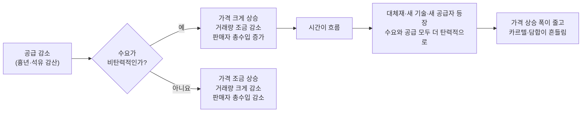

1973년 10월, 중동에서 제4차 중동 전쟁이 일어났다. 아랍의 석유 수출국들은 이스라엘을 지원한 미국과 네덜란드 등에 석유 수출을 끊고, 생산량을 줄였다. 석유 수출국 기구(OPEC)는 원유 가격을 잇달아 올렸고, 몇 달 만에 원유 가격은 배럴당 3달러 남짓에서 11달러 남짓으로 네 배 가까이 뛰었다. 이것이 **제1차 석유 파동**이다. 한국에서도 기름값이 치솟고 물가가 크게 올랐다.

놀라운 것은 그다음이다. 기름값이 네 배가 되었는데도, 처음 한두 해 동안 사람들의 휘발유 소비는 그다지 줄지 않았다. 출근하려면 차를 몰아야 했고, 공장은 기계를 멈출 수 없었다. 그러나 몇 년이 지나자 상황이 달라졌다. 사람들은 기름을 덜 먹는 작은 차를 샀고, 공장은 에너지를 아끼는 설비로 바꾸었으며, 새로운 유전이 개발되었다. 그리고 1980년대 중반, 석유 가격은 무너져 내렸다.

같은 가격 변화에 왜 처음에는 사람들이 거의 반응하지 않다가 나중에는 크게 반응했을까? 4강에서 우리는 가격이 오르면 수요량이 '줄어든다'는 방향을 배웠다. 이 강의에서는 수요량과 공급량이 '얼마나' 반응하는지를 재는 도구인 **탄력성**을 배운다. 탄력성을 알면 왜 풍년이 농부에게 손해일 수 있는지, 왜 담뱃세가 흡연을 크게 줄이지 못하면서도 세수를 크게 늘리는지 이해할 수 있다.

> [!핵심] 이 강의의 질문
> 1. 수요와 공급이 가격에 '얼마나' 민감하게 반응하는지 어떻게 잴 수 있는가?
> 2. 어떤 상품의 수요는 왜 가격에 민감하고, 어떤 상품은 둔감한가?
> 3. 탄력성은 기업의 수입, 농민의 소득, 정부 정책의 효과에 어떤 영향을 주는가?

```figure
src: asset:72f01e87995a2138ceff724020ce47cb
caption: 1974년 미국에서 버려진 옛 주유기. 계기판의 '갤런당 29.9센트'는 석유 파동 이전의 휘발유 값이다. 미국 환경보호청은 이 사진에 '지난날의 표지'라는 설명을 붙였다.
credit: 미국 환경보호청 '도큐메리카' 사진 사업, 1974년 · 미국 국립문서보관소(NARA) 소장
license: Public Domain (미국 연방정부 저작물)
source: https://catalog.archives.gov/id/555508
```

## 수요의 가격 탄력성

### 탄력성이란

**탄력성**이란 어떤 변수가 다른 변수의 변화에 얼마나 민감하게 반응하는지를 나타내는 척도다. 고무줄처럼 조금만 당겨도 쭉 늘어나면 탄력적이고, 거의 늘어나지 않으면 비탄력적이다. 가장 많이 쓰는 것은 **수요의 가격 탄력성**으로, 가격이 1% 변할 때 수요량이 몇 % 변하는지를 나타낸다.

**수요의 가격 탄력성 = 수요량의 변화율(%) ÷ 가격의 변화율(%)**

예를 들어 아이스크림 가격이 10% 올랐을 때 수요량이 20% 줄었다면 탄력성은 20 ÷ 10 = 2다. 수요 법칙 때문에 가격과 수요량은 반대 방향으로 움직이므로 계산하면 음수가 나오지만, 관례적으로 부호를 떼고 절댓값으로 말한다.

변화율을 쓰는 이유가 있다. 가격과 양의 단위가 상품마다 다르기 때문이다. 쌀은 kg으로, 휘발유는 리터로, 영화는 편으로 센다. 변화율로 바꾸면 단위와 관계없이 서로 다른 상품의 민감도를 비교할 수 있다.

### 중간점 방식으로 계산하기

그런데 변화율을 계산할 때 문제가 하나 있다. 가격이 4,000원에서 5,000원으로 오르면 25% 오른 것이지만, 5,000원에서 4,000원으로 내리면 20% 내린 것이다. 같은 두 점 사이인데 방향에 따라 탄력성이 달라진다. 이를 피하려고 경제학자들은 처음 값과 나중 값의 **평균**(중간점)을 기준으로 변화율을 계산한다.

| 단계 | 계산 (가격 4,000원 → 5,000원, 수요량 120개 → 80개) |
|---|---|
| 가격의 변화율 | (5,000 − 4,000) ÷ 4,500 = 약 22.2% |
| 수요량의 변화율 | (80 − 120) ÷ 100 = −40% |
| 탄력성 | 40 ÷ 22.2 = 약 1.8 (탄력적) |

표: 중간점 방식으로 계산한 수요의 가격 탄력성 (가상의 예)

### 탄력적인 수요와 비탄력적인 수요

탄력성이 1보다 크면 수요량이 가격보다 더 큰 비율로 변하므로 **탄력적**이라고 한다. 1보다 작으면 **비탄력적**, 정확히 1이면 **단위 탄력적**이라고 한다. 두 극단도 있다. 가격이 아무리 변해도 수요량이 전혀 변하지 않으면 탄력성은 0이고 수요 곡선은 수직이다(**완전 비탄력적**). 반대로 가격이 조금만 올라도 수요량이 0이 되면 탄력성은 무한대이고 수요 곡선은 수평이다(**완전 탄력적**).

| 탄력성 | 이름 | 수요 곡선의 모양 | 예 |
|---|---|---|---|
| 0 | 완전 비탄력적 | 수직 | 생명을 유지하는 데 꼭 필요한 약(인슐린 등)에 가까운 경우 |
| 0~1 | 비탄력적 | 가파름 | 쌀, 소금, 휘발유(단기), 담배 |
| 1 | 단위 탄력적 | 중간 | — |
| 1보다 큼 | 탄력적 | 완만함 | 외식, 해외여행, 특정 상표의 과자 |
| 무한대 | 완전 탄력적 | 수평 | 경쟁 시장의 한 농가가 마주하는 수요(13강) |

표: 수요의 가격 탄력성의 다섯 가지 경우

```gallery
src: asset:bf81f06f1151fb0a0f5604d0caf69f45
caption: 1880년 무렵 미국 서부의 소금 제조장. 증발 연못 앞에 소금 더미가 쌓여 있다. 소금 같은 필수품은 값이 올라도 사람들이 쓰는 양이 크게 줄지 않는다.
credit: 윌리엄 헨리 잭슨 촬영, 1880년 무렵 · 미국 의회도서관 소장
license: Public Domain (미국 의회도서관: 출판 제한 없음)
source: https://www.loc.gov/item/2016797423/
---
src: asset:1b0fa8fd9f833784e0f4da40db6b1b3c
caption: 1911년 미국 버펄로의 담배 가게. 중독성이 있는 담배는 대표적인 비탄력적 상품이어서 오래전부터 무거운 세금의 대상이 되었다.
credit: 1911년 · 미국 의회도서관 소장
license: Public Domain (미국 의회도서관: 출판 제한 없음)
source: https://www.loc.gov/item/2007677142/
```

### 탄력성을 결정하는 것

어떤 상품의 수요는 왜 탄력적이고 어떤 상품은 왜 비탄력적일까? 네 가지가 중요하다.

1. **가까운 대체재가 있는가**: 대체재가 많을수록 탄력적이다. 한 브랜드의 생수값이 오르면 사람들은 쉽게 다른 브랜드로 바꾼다. 반면 휘발유는 단기적으로 대신할 것이 마땅치 않다.
2. **필수품인가 사치품인가**: 필수품은 비탄력적이고 사치품은 탄력적이다. 병원비가 올라도 아픈 사람은 병원에 가지만, 요트값이 오르면 사람들은 요트 사기를 미룬다.
3. **시장을 어떻게 정의하는가**: 시장을 좁게 정의할수록 탄력적이다. '음식' 전체의 수요는 매우 비탄력적이지만, '아이스크림'은 그보다 탄력적이고, '바닐라 아이스크림'은 더 탄력적이다. 다른 음식으로 바꾸기 쉬워지기 때문이다.
4. **시간이 얼마나 지났는가**: 시간이 길수록 탄력적이다. 석유 파동 때처럼 처음에는 대안이 없어 소비를 줄이기 어렵지만, 시간이 지나면 연비 좋은 차로 바꾸고 이사를 하고 대중교통을 타는 식으로 적응한다.

| 상품 | 수요의 가격 탄력성 (대략적인 추정 범위) | 해석 |
|---|---|---|
| 휘발유 (단기, 1년 이내) | 약 0.1~0.3 | 매우 비탄력적 |
| 휘발유 (장기, 5년 이상) | 약 0.5~0.8 | 시간이 지나면 더 민감해진다 |
| 담배 (성인) | 약 0.3~0.5 | 비탄력적. 청소년은 더 탄력적이라는 연구가 많다 |
| 외식 | 약 1 안팎 | 대체로 단위 탄력적에 가깝다 |
| 해외여행 | 1보다 큼 | 탄력적 |

표: 여러 상품의 수요 탄력성 추정치 (여러 연구에서 보고된 대략적인 범위)

## 탄력성과 총수입

### 값을 올리면 더 벌까

기업이나 정부에게 탄력성이 중요한 이유는 **총수입**(판매자 입장) 또는 **총지출**(구매자 입장) 때문이다. 총수입은 가격 × 판매량이다. 가격을 올리면 한 개당 받는 돈은 늘지만 팔리는 양은 준다. 둘 가운데 어느 효과가 더 크냐는 탄력성이 결정한다.

- 수요가 **비탄력적**이면(탄력성 < 1) 가격을 올릴 때 판매량이 조금만 줄어 총수입이 **늘어난다**.
- 수요가 **탄력적**이면(탄력성 > 1) 가격을 올릴 때 판매량이 크게 줄어 총수입이 **줄어든다**.
- 단위 탄력적이면 가격이 변해도 총수입은 변하지 않는다.

한 놀이공원의 입장권 가격과 하루 입장객 수가 다음과 같다고 하자. 직선 모양의 수요 곡선 위에서도 탄력성은 위치마다 다르다. 가격이 높고 수량이 적은 위쪽에서는 탄력적이고, 가격이 낮고 수량이 많은 아래쪽에서는 비탄력적이다.

```chart
{
  "type": "bar",
  "caption": "놀이공원 입장권 가격에 따른 하루 총수입 (가상의 예. 입장객 = 2,000명 − 20 × 가격(천 원)). 가격을 낮은 수준에서 올릴 때는(비탄력적인 구간) 총수입이 늘지만, 5만 원을 넘어 더 올리면(탄력적인 구간) 총수입이 줄어든다. 탄력성이 정확히 1인 5만 원에서 총수입이 가장 크다",
  "data": {
    "labels": ["1만 원", "2만 원", "3만 원", "4만 원", "5만 원", "6만 원", "7만 원", "8만 원", "9만 원"],
    "datasets": [{ "label": "총수입(만 원)", "data": [1800, 3200, 4200, 4800, 5000, 4800, 4200, 3200, 1800] }]
  },
  "options": { "scales": { "y": { "min": 0, "title": { "display": true, "text": "하루 총수입 (만 원)" } } }, "plugins": { "legend": { "display": false } } }
}
```

### 응용 1: 풍년이 농부에게 손해인 이유

농산물은 대체로 수요가 비탄력적이다. 쌀값이 내렸다고 사람들이 밥을 두 배로 먹지는 않는다. 그런데 날씨가 좋아 풍년이 들면 공급이 크게 늘어난다. 공급 곡선이 오른쪽으로 이동하면 가격은 내리고 거래량은 늘지만, 수요가 비탄력적이므로 가격이 내리는 폭이 거래량이 느는 폭보다 크다. 그 결과 농민 전체의 총수입은 오히려 **줄어든다**. 이것을 **풍년의 역설**이라고 한다. 4강에서 본 것처럼 풍년 든 해에 농민들이 배추밭을 갈아엎는 것은 이 때문이다. 수확해서 시장에 내놓을수록 값이 더 떨어지고, 수확에 드는 인건비조차 건지지 못하기 때문이다.

같은 논리로 농업 기술의 발전도 개별 농민에게는 이득이지만, 모든 농민이 함께 새 기술을 쓰면 농산물 값이 떨어져 농민 전체의 소득은 줄어들 수 있다. 20세기 내내 선진국에서 농업 기술이 발전할수록 농민 수가 줄어든 이유 가운데 하나다.

> [!사료] 1933년 미국의 '돼지 600만 마리'
> 대공황 시기 미국 농산물 값이 폭락하자, 1933년 루스벨트 정부는 **농업 조정법**을 만들어 농민들에게 돈을 주고 생산을 줄이게 했다. 공급을 줄여 값을 올리려는 것이었다. 그해 정부는 시장에 나가기 전의 새끼 돼지 약 600만 마리를 사들여 도살했고, 이미 심은 목화밭 수백만 에이커를 갈아엎게 했다. 수많은 사람이 굶주리는 와중에 먹을 것을 없앤다는 거센 비난이 일었다. 그러나 수요가 비탄력적인 시장에서 공급을 줄이면 농민 전체의 수입이 늘어난다는 논리 자체는 탄력성 그대로였다.

```gallery
src: asset:7c153133f58aed321ecfe50614213e60
caption: 1939년 미국 일리노이주 농가의 창고에 가득 찬 남는 옥수수. 대공황기에 풍작이 이어지자 농산물 값이 폭락했다.
credit: 아서 로스스타인 촬영, 미국 농업안정국, 1939년 · 미국 의회도서관 소장
license: Public Domain (미국 농업안정국·전시정보국 사진, 미국 의회도서관)
source: https://www.loc.gov/item/2017777313/
---
src: asset:b688048e2f32f9662607bc75f7fba156
caption: 1941년 미국 몬태나주의 대풍작 밀밭에서 일하는 콤바인. 1에이커에 40부셸이 나왔다는 설명이 붙어 있다. 수요가 비탄력적이면 이런 풍작은 농민 전체의 수입을 줄일 수 있다.
credit: 매리언 포스트 월콧 촬영, 미국 농업안정국, 1941년 · 미국 의회도서관 소장
license: Public Domain (미국 농업안정국·전시정보국 사진, 미국 의회도서관)
source: https://www.loc.gov/item/2017807697/
```

### 응용 2: 석유 카르텔은 왜 오래가지 못하나

석유 수출국 기구(OPEC)는 1973년과 1979년 두 차례 생산을 줄여 석유 가격을 크게 올렸다. 단기적으로 석유 수요는 매우 비탄력적이었으므로, 생산을 조금 줄여도 가격이 크게 올라 산유국들의 수입은 크게 늘었다. 그러나 장기적으로는 수요와 공급이 모두 탄력적으로 변했다. 소비자들은 연비 좋은 차와 단열이 잘 되는 집으로 바꾸었고, OPEC 밖의 북해와 알래스카, 멕시코에서 새 유전이 개발되었다. 공급이 늘고 수요가 줄자 1980년대 중반 석유 가격은 폭락했다.

```chart
{
  "type": "line",
  "caption": "국제 원유 가격의 연평균 (배럴당 달러, 당시 가격, 대략적인 수치). 1973년과 1979년의 석유 파동으로 크게 오른 가격은 수요와 공급이 장기적으로 적응하면서 1986년 크게 떨어졌다. 2000년대에는 중국 등 신흥국의 수요 증가로 다시 크게 올랐다",
  "data": {
    "labels": ["1970", "1972", "1974", "1976", "1978", "1980", "1982", "1984", "1986", "1990", "1995", "1998", "2000", "2004", "2008", "2012", "2016", "2020", "2022"],
    "datasets": [{ "label": "원유 가격(달러/배럴)", "data": [1.8, 1.9, 11.0, 11.5, 13.0, 36.8, 32.9, 28.8, 14.4, 23.7, 17.0, 12.7, 28.5, 38.3, 97.3, 111.7, 43.7, 41.8, 99.0] }]
  },
  "options": { "scales": { "y": { "min": 0 } }, "plugins": { "legend": { "display": false } } }
}
```

### 응용 3: 담뱃세와 마약 단속

1강에서 본 것처럼 한국은 2015년 담뱃값을 2,500원에서 4,500원으로 80% 올렸다. 흡연율은 낮아졌지만 그 폭은 가격 인상 폭보다 훨씬 작았다. 담배 수요가 비탄력적이기 때문이다. 그 결과 담배 판매량은 줄었어도 담배에서 걷는 세금은 크게 늘었다. 담배 수요가 비탄력적이라는 사실은 '담뱃세는 건강 정책인가, 세수 정책인가'라는 논쟁으로 이어졌다.

실제 숫자로 탄력성을 계산해 보자. 정부 발표에 따르면 담배 판매량은 2014년 약 43억 6,000만 갑에서 2015년 약 33억 3,000만 갑으로 줄었다. 같은 기간 담배 관련 세금 수입은 약 7조 원에서 약 10조 5,000억 원으로 늘었다.

| 항목 | 2014년 | 2015년 | 중간점 방식 변화율 |
|---|---|---|---|
| 담뱃값(한 갑) | 2,500원 | 4,500원 | +57% |
| 판매량 | 약 43.6억 갑 | 약 33.3억 갑 | 약 −27% |
| 탄력성 | | | 약 27 ÷ 57 ≈ 0.47 (비탄력적) |

표: 2015년 담뱃값 인상으로 계산한 담배 수요의 가격 탄력성 (정부 발표 수치를 바탕으로 한 대략적인 계산)

물론 이 계산은 대략적인 것이다. 같은 시기 금연 광고와 금연 구역 확대, 담뱃갑 경고 그림 도입(2016년 말) 같은 다른 정책도 함께 시행되었고, 값이 오르기 직전에 사재기를 했다가 이듬해 소비한 사람도 있었다. 실제로 2016년에는 판매량이 약 36억 6,000만 갑으로 다시 늘었다. 2강에서 배운 것처럼 '다른 조건이 같다면'을 현실 자료에서 지키기는 어렵다. 그래서 경제학자들은 여러 나라, 여러 시기의 자료를 모으고 통계 기법을 써서 탄력성을 추정하며, 그 추정치에는 늘 어느 정도의 폭이 있다.

탄력성은 범죄 정책에도 쓰인다. 정부가 마약 밀수를 단속해 공급을 줄이면 마약 가격이 오른다. 그런데 중독자들의 마약 수요는 매우 비탄력적이어서, 가격이 올라도 소비량은 별로 줄지 않고 마약에 쓰는 총지출은 오히려 늘어난다. 마약을 살 돈을 마련하려고 저지르는 범죄가 늘어날 수도 있다. 그래서 많은 경제학자는 공급 단속과 함께 치료와 교육으로 **수요 자체를 줄이는** 정책이 필요하다고 본다.

```figure
src: asset:01ea11a56b968e3f04de15895b1da435
caption: 1981년 미국의 주유소 직원이 '1달러 31.9센트' 가격표를 내거는 모습. 제2차 석유 파동 뒤 휘발유 값은 1974년(29.9센트)의 네 배가 넘었다.
credit: 토머스 J. 오핼러런 촬영, 『U.S. 뉴스 & 월드 리포트』, 1981년 · 미국 의회도서관 소장
license: Public Domain (미국 의회도서관: 출판 제한 없음)
source: https://www.loc.gov/item/2026160410/
```

### 응용 4: 같은 상품, 다른 가격

영화관은 같은 영화를 평일 낮에는 싸게, 주말 저녁에는 비싸게 보여 준다. 항공사는 몇 달 전에 예약하는 사람과 출발 직전에 예약하는 사람에게 다른 값을 받는다. 박물관과 놀이공원은 학생과 노인에게 할인을 해 준다. 모두 탄력성의 차이를 이용한 것이다. 주말 저녁에 영화를 보려는 사람이나 출장 때문에 내일 당장 비행기를 타야 하는 사람은 수요가 비탄력적이어서 비싸도 산다. 반면 평일 낮에 시간이 많은 학생이나 여행 날짜를 마음대로 정할 수 있는 사람은 수요가 탄력적이어서, 값이 비싸면 다른 것을 하거나 다른 날을 고른다. 판매자는 이렇게 탄력성이 다른 집단에 다른 값을 매겨 총수입을 늘린다. 이것을 **가격 차별**이라고 하며, 14강 「독점」에서 자세히 다룬다.

## 다른 탄력성들

### 소득 탄력성과 교차 탄력성

가격 말고 다른 변수에 대한 반응도 탄력성으로 잴 수 있다.

| 탄력성 | 계산 | 값의 의미 | 예 |
|---|---|---|---|
| 수요의 소득 탄력성 | 수요량 변화율 ÷ 소득 변화율 | 0보다 크면 **정상재**, 0보다 작으면 **열등재**. 1보다 크면 **사치재**, 0~1이면 **필수재** | 해외여행·외식(사치재), 쌀(필수재), 값싼 대용품(열등재) |
| 수요의 교차 가격 탄력성 | A의 수요량 변화율 ÷ B의 가격 변화율 | 0보다 크면 **대체재**, 0보다 작으면 **보완재** | 버터와 마가린(대체재), 자동차와 휘발유(보완재) |

표: 소득 탄력성과 교차 가격 탄력성

소득 탄력성은 경제가 성장할 때 산업 구조가 어떻게 바뀌는지 설명해 준다. 사람들이 부유해질수록 소득 탄력성이 낮은 식료품에 쓰는 돈의 비중은 줄고, 소득 탄력성이 높은 교육, 의료, 여행, 문화에 쓰는 비중은 늘어난다. 19세기 독일의 통계학자 **에른스트 엥겔**은 가계 조사를 통해, 소득이 늘수록 식료품비가 지출에서 차지하는 비율이 낮아진다는 것을 발견했다. 이를 **엥겔의 법칙**, 그 비율을 **엥겔 계수**라고 한다. 한국에서도 경제가 성장하면서 가계 지출 가운데 식료품비의 비중이 크게 줄었다.

## 공급의 가격 탄력성

### 공급은 얼마나 빨리 늘 수 있나

공급도 가격에 반응하는 정도가 저마다 다르다. **공급의 가격 탄력성**은 가격이 1% 변할 때 공급량이 몇 % 변하는지를 나타낸다. 공급의 탄력성은 판매자가 생산량을 얼마나 쉽게 바꿀 수 있느냐에 달려 있다.

- 바닷가의 땅이나 피카소의 그림처럼 양이 정해진 것은 값이 아무리 올라도 더 만들 수 없다. 공급은 **완전 비탄력적**이다.
- 책이나 자동차, 텔레비전처럼 공장에서 만드는 상품은 값이 오르면 공장을 더 오래 돌려 생산을 늘릴 수 있어 비교적 탄력적이다.
- **시간**이 중요하다. 단기에는 공장 크기가 정해져 있어 생산을 크게 늘리기 어렵지만, 장기에는 새 공장을 짓고 새 기업이 들어올 수 있어 공급이 더 탄력적이 된다.

주택이 좋은 예다. 아파트는 땅을 구하고 허가를 받아 짓는 데 몇 년이 걸린다. 그래서 집값이 갑자기 오를 때 단기의 주택 공급은 매우 비탄력적이며, 수요가 늘면 거래량보다 가격이 크게 오른다. 집값 문제를 두고 "공급을 늘려야 한다"는 주장과 "공급만으로는 단기에 해결되지 않는다"는 주장이 함께 나오는 것도 이 때문이다.

탄력성은 6강에서 배울 세금의 효과를 이해하는 데에도 꼭 필요하다. 세금을 매기면 그 부담은 탄력성이 낮은 쪽, 곧 가격에 덜 민감하게 반응하는 쪽에 더 많이 돌아간다. 도망갈 곳이 없는 쪽이 세금을 더 많이 지게 되는 것이다. 정부가 담배나 술, 휘발유처럼 수요가 비탄력적인 상품에 무거운 세금을 매기는 이유도, 판매량이 크게 줄지 않아 세금이 안정적으로 걷히기 때문이다.



## 정리

> [!핵심] 5강 요약
> - **수요의 가격 탄력성**은 가격이 1% 변할 때 수요량이 몇 % 변하는지 나타낸다. 1보다 크면 **탄력적**, 1보다 작으면 **비탄력적**이다. 계산할 때는 **중간점 방식**을 쓴다.
> - 수요는 대체재가 많을수록, 사치품일수록, 시장을 좁게 정의할수록, 시간이 길수록 탄력적이다.
> - 수요가 비탄력적이면 가격을 올릴 때 **총수입이 늘고**, 탄력적이면 **줄어든다**. 그래서 풍년은 농민 전체의 수입을 줄일 수 있고(**풍년의 역설**), 석유 카르텔은 단기에는 성공하지만 장기에는 흔들린다.
> - **소득 탄력성**은 정상재·열등재·사치재·필수재를, **교차 탄력성**은 대체재와 보완재를 구분한다. 소득이 늘수록 식료품비의 비중은 줄어든다(**엥겔의 법칙**).
> - **공급의 가격 탄력성**은 생산을 얼마나 쉽게 늘릴 수 있느냐에 달려 있으며, 시간이 길수록 커진다. 주택 공급은 단기에 매우 비탄력적이다.

### 생각해 볼 질문

1. 영화관이 평일 낮에는 표값을 싸게, 주말 저녁에는 비싸게 받는 이유를 탄력성으로 설명해 보자.
2. 정부가 담뱃세를 올리는 목적이 '흡연율을 낮추는 것'이라면, 청소년과 성인 가운데 누구의 흡연이 더 크게 줄어들까? 그 이유는?
3. 공공 교통 요금을 올리면 교통 공사의 수입은 늘어날까, 줄어들까? 어떤 정보가 있어야 답할 수 있을까?

### 다음 강 예고

6강 「가격 규제와 조세」에서는 정부가 시장 가격에 직접 개입할 때 무슨 일이 일어나는지 살펴본다. 임대료 상한제와 최저임금제 같은 가격 규제가 왜 부족과 잉여를 낳는지, 그리고 세금을 판매자에게 매기든 구매자에게 매기든 결국 그 부담을 누가 지는지를 탄력성으로 분석한다.
