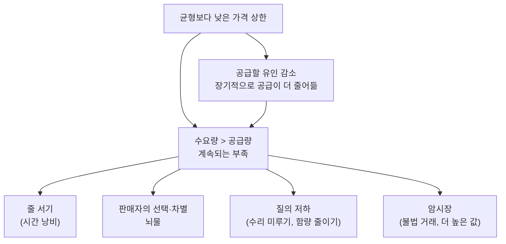

1971년 8월 15일 일요일 저녁, 미국의 닉슨 대통령은 텔레비전 연설에서 깜짝 놀랄 발표를 했다. 앞으로 90일 동안 미국의 모든 임금과 물가를 동결한다는 것이었다. 당시 미국은 물가가 해마다 4~5%씩 오르고 있었다. 사람들은 환호했고, 이튿날 주가는 크게 올랐다. 물가를 법으로 묶어 버리면 인플레이션이 사라질 것처럼 보였다.

그러나 통제가 단계를 바꾸어 가며 이어지자 이상한 일이 벌어지기 시작했다. 사료값은 오르는데 고기 값은 묶여 있자, 농장주들은 송아지와 닭을 시장에 내놓지 않았다. 텍사스에서는 병아리를 키울수록 손해가 나자 농민들이 병아리 수십만 마리를 물에 빠뜨려 죽였다는 보도가 나왔다. 1973년 여름 슈퍼마켓의 고기 진열대는 텅 비었다. 결국 통제는 1974년에 풀렸고, 묶여 있던 물가는 한꺼번에 뛰어올랐다.

이 강의에서는 정부가 시장 가격에 직접 개입할 때 무슨 일이 일어나는지 살펴본다. 가격의 최고 한도를 정하는 **가격 상한제**, 최저 한도를 정하는 **가격 하한제**, 그리고 시장 거래에 **세금**을 매길 때 그 부담을 실제로 누가 지는지를 4강과 5강에서 배운 수요와 공급, 탄력성으로 분석한다.

> [!핵심] 이 강의의 질문
> 1. 정부가 가격의 상한이나 하한을 정하면 시장에서는 어떤 일이 일어나는가?
> 2. 임대료 상한제와 최저임금제는 누구를 돕고, 어떤 부작용을 낳는가?
> 3. 세금은 누가 내는가? 법이 정한 납세자와 실제로 세금 부담을 지는 사람은 같은가?

{{F:e6-opening}}

## 가격 상한제

### 최고 가격을 정하면

**가격 상한제**는 정부가 어떤 상품을 그 이상의 값으로 팔지 못하게 최고 가격을 정하는 제도다. 정부가 가격 상한제를 실시하는 것은 대개 가격이 너무 높아 서민이 고통받는다는 여론 때문이다. 전쟁이나 재난 때의 생필품, 집세, 대출 이자 같은 것이 흔한 대상이다.

가격 상한이 시장 균형 가격보다 **높게** 정해지면 아무 일도 일어나지 않는다. 시장 가격이 원래 그보다 낮으므로 상한이 구속력을 갖지 않는다. 문제는 상한이 균형 가격보다 **낮게** 정해질 때다. 이때 그 가격에서 사려는 양은 팔려는 양보다 많아지고, **부족**(초과 수요)이 생긴다. 4강에서 본 것처럼 자유로운 시장이라면 부족이 생길 때 가격이 올라 부족을 없애겠지만, 법이 가격을 묶어 두었으므로 부족은 계속 남는다.

```chart
{
  "type": "scatter",
  "caption": "구속력 있는 가격 상한 (가상의 예). 균형 가격은 3,500원이지만 정부가 2,000원을 상한으로 정하면, 그 가격에서 수요량(14만 개)이 공급량(7만 개)보다 7만 개 많아 부족이 계속된다",
  "height": 360,
  "data": {
    "datasets": [
      { "label": "수요 곡선", "showLine": true, "pointRadius": 0, "data": [{"x":16,"y":1000},{"x":14,"y":2000},{"x":12,"y":3000},{"x":10,"y":4000},{"x":8,"y":5000},{"x":6,"y":6000}] },
      { "label": "공급 곡선", "showLine": true, "pointRadius": 0, "data": [{"x":4,"y":1000},{"x":7,"y":2000},{"x":10,"y":3000},{"x":12,"y":4000},{"x":15,"y":5000},{"x":18,"y":6000}] },
      { "label": "가격 상한 2,000원", "showLine": true, "pointRadius": 0, "borderDash": [6, 4], "data": [{"x":0,"y":2000},{"x":20,"y":2000}] },
      { "label": "상한 가격에서의 공급량·수요량", "pointRadius": 7, "data": [{"x":7,"y":2000},{"x":14,"y":2000}] },
      { "label": "원래 균형", "pointRadius": 7, "pointStyle": "star", "data": [{"x":11,"y":3500}] }
    ]
  },
  "options": { "scales": { "x": { "title": { "display": true, "text": "거래량 (만 개)" }, "min": 0, "max": 20 }, "y": { "title": { "display": true, "text": "가격 (원)" }, "min": 0, "max": 6500 } } }
}
```

### 부족은 다른 방식으로 해결된다

가격으로 배분하지 못하게 되면, 모자라는 물건은 다른 방식으로 나뉜다. 1강에서 본 배분 방식들이 여기서 다시 등장한다.

- **줄 서기**: 먼저 온 사람이 산다. 1970년대 미국의 주유소와 2020년 공적 마스크 판매 때 긴 줄이 늘어섰다. 줄을 서느라 쓰는 시간은 사회 전체로 보면 낭비다.
- **판매자의 선택**: 판매자가 친척이나 단골, 뇌물을 주는 사람에게 먼저 판다. 집주인은 세입자를 골라 받을 수 있게 되고, 차별이 생기기 쉽다.
- **질의 저하**: 값을 올릴 수 없는 판매자는 대신 질을 떨어뜨린다. 집세가 묶인 집주인은 수리를 미루고, 고기값이 묶인 정육점은 비계를 더 섞는다.
- **암시장**: 법을 어기고 상한보다 비싸게 사고파는 시장이 생긴다. 제2차 세계대전 때 배급과 가격 통제를 실시한 나라들에서는 어디서나 암시장이 번성했다.



### 임대료 상한제

가격 상한제의 가장 유명한 예가 **임대료 상한제**다. 집세가 너무 올라 서민이 살 곳을 잃는다는 걱정에서, 여러 나라와 도시가 집세의 상한이나 인상률의 상한을 정해 왔다. 미국 뉴욕시는 제2차 세계대전 중인 1943년 연방 정부의 집세 통제를 시작으로, 전쟁이 끝난 뒤에도 오랫동안 집세 통제를 유지했다.

임대료 상한제의 효과는 단기와 장기에 크게 다르다. 단기에는 집의 수가 정해져 있고 사람들도 쉽게 이사하지 못하므로 수요와 공급이 모두 비탄력적이다. 그래서 집세를 묶어도 부족은 크지 않고, 지금 사는 세입자들은 낮은 집세의 혜택을 본다. 그러나 장기에는 수요와 공급이 모두 탄력적이 된다. 집주인들은 집을 새로 짓지 않고, 있던 집도 수리하지 않거나 다른 용도로 돌린다. 반면 싼 집세를 찾아 이 도시로 오려는 사람은 늘어난다. 부족은 해가 갈수록 커진다.

스웨덴의 경제학자 **아사르 린드베크**는 1972년 이렇게 썼다. "임대료 통제는 폭격을 빼면, 지금까지 알려진 것 가운데 도시를 파괴하는 가장 효율적인 기술인 것 같다." 2강에서 본 것처럼 경제학자의 93%가 임대료 상한제는 주택의 양과 질을 떨어뜨린다는 데 동의한다. 그래서 경제학자들은 서민의 주거비를 돕고 싶다면 집세를 묶기보다 저소득층에게 **주거비를 직접 보조**하거나 공공 임대 주택을 늘리는 편이 낫다고 본다. 다만 갑작스러운 집세 폭등으로부터 세입자를 보호하기 위해 인상률에 완만한 상한을 두는 정책을 두고는 경제학자들 사이에서도 평가가 갈린다. 한국은 2020년 「주택임대차보호법」을 고쳐 계약 갱신 때 임대료 인상률을 5% 이내로 제한하고 세입자에게 계약 갱신 청구권을 주었는데, 그 효과를 두고 지금도 논쟁이 이어지고 있다.

{{F:e6-rent}}

## 가격 하한제

### 최저 가격을 정하면

**가격 하한제**는 정부가 어떤 상품을 그보다 싸게 팔지 못하게 최저 가격을 정하는 제도다. 가격 하한이 균형 가격보다 **높게** 정해지면 그 가격에서 팔려는 양이 사려는 양보다 많아 **잉여**(초과 공급)가 생긴다. 판매자들은 팔고 싶은 만큼 팔지 못하고, 남는 물건은 쌓인다.

농산물 가격 지지 정책이 대표적이다. 유럽 연합(EU)은 1970~80년대 공동 농업 정책으로 농산물 값을 시장 가격보다 높게 보장했다. 그러자 농민들이 생산을 크게 늘려 팔리지 않는 버터와 우유, 포도주가 쌓였다. 사람들은 이를 '버터 산(山)'과 '포도주 호수'라고 불렀다. 정부는 남는 농산물을 사들여 창고에 보관하거나 헐값에 수출하는 데 막대한 돈을 썼다. 한국에서도 정부가 쌀을 시장보다 비싼 값에 사들이는 추곡 수매 제도가 2005년까지 이어졌고, 해마다 남는 쌀의 보관 비용이 문제가 되었다.

### 최저임금제

가격 하한제 가운데 가장 많은 사람의 삶에 영향을 주는 것이 **최저임금제**다. 노동도 하나의 상품이라고 보면, 임금은 노동의 가격이다. 노동을 파는 쪽은 노동자, 사는 쪽은 기업이다. 최저임금이 시장 균형 임금보다 높으면, 일하려는 사람(노동 공급)은 늘고 고용하려는 일자리(노동 수요)는 줄어 **실업**이 생길 수 있다. 특히 경험과 기술이 적어 시장 임금이 낮은 청년과 저숙련 노동자가 영향을 받기 쉽다.

한국은 1988년 최저임금제를 처음 시행했다. 최저임금은 해마다 최저임금 위원회에서 노동자 대표, 사용자 대표, 공익 위원이 협상해 정한다.

```chart
{
  "type": "line",
  "caption": "한국의 시간당 최저임금 (원, 고용노동부 고시). 2018년에는 전년보다 16.4%, 2019년에는 10.9% 올라 그 효과를 두고 큰 논쟁이 벌어졌다. 2025년 처음으로 시간당 1만 원을 넘었다",
  "data": {
    "labels": ["2010", "2012", "2014", "2016", "2017", "2018", "2019", "2020", "2021", "2022", "2023", "2024", "2025", "2026"],
    "datasets": [{ "label": "시간당 최저임금(원)", "data": [4110, 4580, 5210, 6030, 6470, 7530, 8350, 8590, 8720, 9160, 9620, 9860, 10030, 10320] }]
  },
  "options": { "scales": { "y": { "min": 0 } }, "plugins": { "legend": { "display": false } } }
}
```

최저임금이 실제로 고용을 얼마나 줄이는지는 경제학에서 가장 뜨거운 논쟁 가운데 하나다. 2강에서 본 카드와 크루거의 연구처럼, 최저임금을 적당히 올렸을 때 고용이 거의 줄지 않았다는 연구가 많이 나왔다. 그 이유로는 기업이 노동 시장에서 어느 정도 임금을 정할 힘을 가진 경우(17강에서 다룰 '수요 독점')나, 임금이 오르면 이직이 줄고 노동자가 더 열심히 일해 생산성이 오르는 효과 등이 제시된다. 반면 최저임금을 크게 올리면 일자리가 줄거나 근로 시간이 줄어든다는 연구도 많다. 한국의 2018~2019년 급격한 인상을 두고도, 저임금 노동자의 소득을 높였다는 평가와 소규모 자영업과 일부 업종의 고용을 줄였다는 평가가 엇갈렸다.

| 관점 | 주장 | 근거로 드는 것 |
|---|---|---|
| 최저임금 인상 찬성 | 저임금 노동자의 생활을 개선하고 소득 불평등을 줄인다 | 적당한 인상은 고용을 크게 줄이지 않았다는 실증 연구, 소득 증가가 소비를 늘리는 효과 |
| 최저임금 인상 신중론 | 인상 폭이 크면 일자리와 근로 시간이 줄어, 오히려 가장 취약한 사람이 피해를 본다 | 노동 수요의 탄력성, 자동화(무인 계산대 등)의 확산, 소규모 사업장의 부담 |
| 대안을 제시하는 견해 | 저소득 가구를 돕는 데는 근로 장려 세제(EITC) 같은 정책이 더 정확할 수 있다 | 최저임금을 받는 사람이 모두 저소득 가구에 속하지는 않는다(예: 중산층 가구의 학생 아르바이트) |

표: 최저임금을 둘러싼 견해

{{F:e6-minimum-wage}}

## 조세

### 세금은 시장을 줄인다

정부는 도로를 닦고 학교를 운영하고 국방을 지키는 데 필요한 돈을 세금으로 걷는다. 세금이 시장에 미치는 영향을 알아보기 위해, 정부가 커피 한 잔에 500원의 세금을 매긴다고 하자.

세금이 붙으면 소비자가 내는 가격과 판매자가 손에 쥐는 가격 사이에 500원의 차이, 곧 **쐐기**가 생긴다. 소비자가 내는 값은 원래보다 오르고, 판매자가 받는 값은 원래보다 내린다. 소비자는 비싸져서 덜 사고, 판매자는 덜 받게 되어 덜 판다. 그래서 세금이 붙은 시장은 세금이 없을 때보다 거래량이 **줄어든다**. 7강에서 보겠지만, 이렇게 줄어든 거래는 사회 전체의 손실이 된다.

### 누구에게 매기든 결과는 같다

신기한 사실이 있다. 커피 한 잔에 500원의 세금을 판매자(카페)에게 매기든, 구매자(손님)에게 매기든 시장의 결과는 똑같다. 판매자에게 매기면 공급 곡선이 500원만큼 위로 이동하고, 구매자에게 매기면 수요 곡선이 500원만큼 아래로 이동한다. 어느 쪽이든 새 균형에서 소비자가 실제로 치르는 가격, 판매자가 실제로 받는 가격, 거래량은 같아진다. 법이 누구에게 세금을 내라고 정하는가(**법적 부담**)와, 실제로 세금 때문에 누가 손해를 보는가(**경제적 귀착**)는 다른 문제다.

한국의 국민연금과 건강보험료는 노동자와 회사가 반씩 내게 되어 있다. 그러나 경제학의 관점에서 보면, 이 '반반'은 법적 부담일 뿐이다. 회사는 자기가 내는 보험료까지 노동자를 고용하는 비용으로 생각하므로, 그만큼 임금을 덜 올려 줄 수 있다. 실제로 누가 얼마나 부담하는지는 아래에서 보듯 노동 수요와 공급의 탄력성이 정한다.

### 세금은 탄력성이 낮은 쪽이 더 진다

세금의 부담이 소비자와 판매자 사이에 어떻게 나뉘는지는 **탄력성**이 결정한다. 원칙은 간단하다. **가격에 덜 민감한 쪽(비탄력적인 쪽)이 세금을 더 많이 부담한다.** 가격이 바뀌어도 거래를 줄이기 어려운 쪽, 곧 도망갈 곳이 없는 쪽이 세금을 떠안는다.

```chart
{
  "type": "scatter",
  "caption": "커피 한 잔에 500원의 세금을 매길 때 (가상의 예. 수요가 공급보다 비탄력적인 경우). 세금 전 균형 가격은 3,000원이다. 세금 뒤 소비자가 내는 가격은 3,400원으로 400원 오르고, 판매자가 받는 가격은 2,900원으로 100원 내린다. 비탄력적인 소비자가 세금의 대부분(500원 가운데 400원)을 부담한다",
  "height": 380,
  "data": {
    "datasets": [
      { "label": "수요 곡선 (비탄력적, 가파름)", "showLine": true, "pointRadius": 0, "data": [{"x":60,"y":4500},{"x":80,"y":3500},{"x":90,"y":3000},{"x":100,"y":2500}] },
      { "label": "공급 곡선 (탄력적, 완만함)", "showLine": true, "pointRadius": 0, "data": [{"x":40,"y":2500},{"x":90,"y":3000},{"x":140,"y":3500}] },
      { "label": "세금 뒤 공급 곡선 (+500원)", "showLine": true, "pointRadius": 0, "borderDash": [6, 4], "data": [{"x":40,"y":3000},{"x":90,"y":3500},{"x":140,"y":4000}] },
      { "label": "소비자가 내는 가격 3,400원", "pointRadius": 7, "data": [{"x":82,"y":3400}] },
      { "label": "판매자가 받는 가격 2,900원", "pointRadius": 7, "pointStyle": "triangle", "data": [{"x":82,"y":2900}] },
      { "label": "세금 전 균형", "pointRadius": 7, "pointStyle": "star", "data": [{"x":90,"y":3000}] }
    ]
  },
  "options": { "scales": { "x": { "title": { "display": true, "text": "하루 판매량 (잔)" }, "min": 30, "max": 150 }, "y": { "title": { "display": true, "text": "가격 (원)" }, "min": 2000, "max": 4800 } } }
}
```

이 원리로 여러 현실을 설명할 수 있다. 노동 공급은 대체로 비탄력적이다. 사람들은 임금이 조금 내려도 일을 그만두기 어렵다. 그래서 급여에 붙는 세금과 사회 보험료는 법적으로 회사가 반을 내더라도, 많은 부분이 결국 노동자의 몫이 된다고 경제학자들은 본다. 담배와 술, 휘발유처럼 수요가 비탄력적인 상품에 매기는 세금은 대부분 소비자가 진다.

> [!사료] 1990년 미국의 '사치세'
> 1990년 미국 의회는 부자들에게 세금을 더 걷으려고 요트, 개인 비행기, 비싼 모피와 보석, 고급 승용차에 10%의 사치세를 매겼다. 부자가 사는 물건에 세금을 매기면 부자가 세금을 낼 것이라고 생각했기 때문이다. 그러나 요트 같은 사치품의 수요는 매우 탄력적이었다. 부자들은 요트를 덜 사고, 그 돈으로 해외여행을 가거나 집을 더 크게 지었다. 반면 요트를 만드는 회사와 노동자들은 쉽게 다른 일로 옮겨 갈 수 없었다(공급이 비탄력적). 요트 판매가 줄자 요트 공장의 노동자 수천 명이 일자리를 잃었다. 세금의 부담은 부자가 아니라 노동자에게 돌아간 것이다. 의회는 1993년 요트 등에 대한 사치세를 폐지했다.

{{F:e6-tax-history}}

## 정리

| 정책 | 효과 | 혜택을 보는 사람 | 문제점 |
|---|---|---|---|
| 가격 상한 (균형보다 낮게) | 부족 발생 | 물건을 손에 넣은 소비자, 기존 세입자 | 줄 서기, 질 저하, 암시장, 장기적인 공급 감소 |
| 가격 하한 (균형보다 높게) | 잉여 발생 | 팔 수 있는 판매자, 일자리를 지킨 노동자 | 팔리지 않는 재고, 일자리를 얻지 못한 사람 |
| 세금 | 거래량 감소, 가격 쐐기 | 세금으로 마련한 공공 서비스의 수혜자 | 탄력성이 낮은 쪽이 부담을 더 짐, 거래 감소에 따른 손실 |

표: 가격 규제와 조세의 효과 정리

> [!핵심] 6강 요약
> - 균형보다 낮은 **가격 상한**은 **부족**을 낳는다. 부족은 줄 서기, 판매자의 선택, 질 저하, 암시장으로 해결된다. **임대료 상한제**는 단기에는 세입자를 돕지만 장기에는 주택의 양과 질을 떨어뜨린다.
> - 균형보다 높은 **가격 하한**은 **잉여**를 낳는다. 농산물 가격 지지는 재고를, **최저임금**은 일부 노동자의 실업을 낳을 수 있으나, 그 크기를 두고는 실증 연구가 엇갈린다.
> - 세금은 소비자 가격과 판매자 가격 사이에 **쐐기**를 박고 거래량을 줄인다. 세금을 판매자에게 매기든 구매자에게 매기든 결과는 같다. **법적 부담**과 **경제적 귀착**은 다르다.
> - 세금 부담은 **탄력성이 낮은 쪽**이 더 많이 진다. 1990년 미국의 사치세는 부자가 아니라 요트 공장 노동자에게 부담을 지웠다.
> - 가격을 묶는 대신, 돕고 싶은 사람에게 **직접 보조**하는 방법이 부작용이 적은 경우가 많다.

### 생각해 볼 질문

1. 인기 가수의 공연 표값을 정부가 '5만 원 이하'로 묶는다면 어떤 일이 일어날까? 암표와 줄 서기, 추첨이라는 말을 써서 설명해 보자.
2. 최저임금 인상이 고용에 미치는 영향은 노동 수요의 탄력성에 달려 있다. 편의점 아르바이트와 공장의 숙련 기술직 가운데 어느 쪽의 노동 수요가 더 탄력적일까?
3. 정부가 배달 앱 수수료에 세금을 매기면, 그 부담은 배달 앱 회사, 음식점, 소비자 가운데 누구에게 가장 많이 돌아갈까? 무엇을 알아야 답할 수 있을까?

### 다음 강 예고

7강 「소비자 잉여, 생산자 잉여와 시장의 효율성」에서는 시장이 만들어 내는 이득을 숫자로 재는 방법을 배운다. 소비자와 생산자가 거래로 얻는 이득(잉여)을 정의하고, 자유로운 시장이 왜 이 이득을 가장 크게 만드는지, 그리고 세금과 가격 규제가 사회 전체에 남기는 손실(**자중 손실**)이 얼마나 되는지를 계산해 본다.
