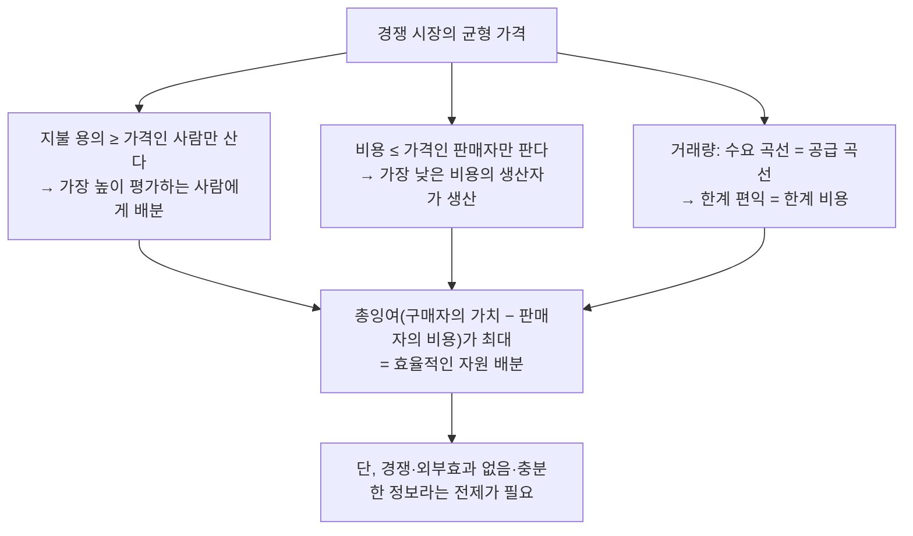

1995년 9월, 미국의 프로그래머 **피에르 오미디어**는 주말 동안 취미로 만든 경매 사이트에 고장 난 레이저 포인터를 올렸다. 시험 삼아 올린 것이었는데, 놀랍게도 이 물건은 14달러 83센트에 팔렸다. 오미디어는 구매자에게 연락해 "이건 고장 난 물건인데 알고 사신 거냐"고 물었다. 구매자는 이렇게 답했다. "저는 고장 난 레이저 포인터를 모으는 사람입니다." 이 사이트가 뒷날 세계 최대의 인터넷 경매 회사가 된 **이베이**다.

쓸모없어 보이는 물건도 누군가에게는 큰 가치가 있다. 오미디어에게 고장 난 레이저 포인터는 버릴 물건이었지만, 수집가에게는 14달러 83센트를 내고도 아깝지 않은 물건이었다. 거래가 이루어지자 두 사람 모두 전보다 나아졌다. 오미디어는 쓰레기를 돈으로 바꾸었고, 수집가는 원하던 물건을 얻었다. 오늘날 한국에서 수많은 사람이 중고 거래 앱으로 안 쓰는 물건을 사고파는 것도 같은 이치다.

거래가 만들어 내는 이 '이득'을 숫자로 잴 수 있을까? 이 강의에서는 경제학자들이 시장의 성과를 평가하는 도구인 **소비자 잉여**와 **생산자 잉여**를 배운다. 그리고 이 도구로 자유로운 시장이 왜 효율적인지, 세금과 가격 규제가 사회에 얼마나 큰 손실을 남기는지 계산해 본다. 지금까지 '어떻게 되는가'를 다룬 실증 분석에서 한 걸음 나아가, 시장의 결과가 '바람직한가'를 따지는 **후생 경제학**의 첫걸음이다.

> [!핵심] 이 강의의 질문
> 1. 구매자와 판매자는 거래에서 각각 얼마만큼의 이득을 얻는가?
> 2. 자유로운 시장은 왜 사회 전체의 이득을 가장 크게 만드는가? 그 조건은 무엇인가?
> 3. 세금과 가격 규제는 사회 전체에 얼마만큼의 손실을 남기는가?

{{F:e7-opening}}

## 소비자 잉여

### 지불 용의

중고 거래 앱에 아이돌 그룹의 한정판 데뷔 앨범 한 장이 올라왔다고 하자. 이 앨범을 사고 싶어 하는 사람이 네 명 있다. 각자 이 앨범에 최대한 낼 수 있는 금액, 곧 **지불 용의**(최대 지불 의사 금액)는 다음과 같다.

| 구매자 | 지불 용의 | 앨범이 4만 원에 팔린다면 | 소비자 잉여 |
|---|---|---|---|
| 하늘 | 10만 원 | 산다 | 10만 − 4만 = 6만 원 |
| 바다 | 8만 원 | 산다 | 8만 − 4만 = 4만 원 |
| 산 | 7만 원 | 산다 | 7만 − 4만 = 3만 원 |
| 들 | 5만 원 | 산다 | 5만 − 4만 = 1만 원 |

표: 한정판 앨범에 대한 지불 용의와 소비자 잉여 (가상의 예)

지불 용의는 구매자가 그 물건에 매기는 가치다. 앨범이 지불 용의보다 싸면 사고, 비싸면 사지 않는다. 정확히 지불 용의와 같은 값이면 사든 안 사든 상관없다.

### 소비자 잉여란

하늘은 앨범에 10만 원까지 낼 생각이었는데 4만 원에 샀다면, 6만 원만큼 이득을 본 셈이다. 이처럼 구매자의 지불 용의에서 실제로 낸 가격을 뺀 금액을 **소비자 잉여**라고 한다. 소비자 잉여는 구매자가 거래에 참여해 얻는 이득을 돈으로 잰 것이다. 네 사람의 소비자 잉여를 모두 더하면 시장 전체의 소비자 잉여가 된다(위 표에서는 14만 원).

지불 용의를 높은 순서로 늘어놓으면 그것이 바로 수요 곡선이다. 앨범 값이 10만 원이면 하늘 한 사람만 사고, 8만 원이면 두 사람이, 7만 원이면 세 사람이 산다. 그러므로 수요 곡선의 높이는 그 단위를 사는 '마지막' 구매자의 지불 용의를 나타낸다. 그리고 **수요 곡선 아래, 가격선 위의 넓이**가 소비자 잉여가 된다.

```chart
{
  "type": "bar",
  "caption": "네 구매자의 지불 용의(막대 전체 높이)와 가격 4만 원. 막대에서 가격선(4만 원) 위로 솟은 부분이 각자의 소비자 잉여다. 막대를 이어 붙이면 계단 모양의 수요 곡선이 되며, 사람이 많아지면 이 계단이 매끄러운 곡선이 된다",
  "data": {
    "labels": ["하늘", "바다", "산", "들"],
    "datasets": [
      { "label": "치른 가격 (4만 원)", "data": [4, 4, 4, 4], "stack": "s" },
      { "label": "소비자 잉여 (만 원)", "data": [6, 4, 3, 1], "stack": "s" }
    ]
  },
  "options": { "scales": { "x": { "stacked": true }, "y": { "stacked": true, "min": 0, "title": { "display": true, "text": "만 원" } } } }
}
```

가격이 내리면 소비자 잉여는 두 가지 이유로 늘어난다. 이미 사던 사람은 더 싸게 사서 잉여가 커지고, 전에는 비싸서 사지 않던 사람이 새로 사면서 잉여를 얻는다.

### 소비자 잉여는 무엇을 재는가

소비자 잉여는 구매자 자신의 눈으로 본 이득을 잰다. 그래서 정책을 평가하는 좋은 기준이 된다. 다만 한계도 있다. 마약 중독자가 마약에 큰 돈을 낼 용의가 있다고 해서 그 소비자 잉여를 사회의 이득으로 계산하기는 어렵다. 경제학자들은 대개 사람들이 합리적이며 자기에게 무엇이 좋은지 스스로 판단한다고 보고 소비자 잉여를 사용하지만, 중독이나 정보 부족처럼 그 가정이 깨지는 경우에는 조심해서 써야 한다(20강).

{{F:e7-dupuit}}

> [!사료] 쥘 뒤피와 다리의 통행료 (1844)
> 소비자 잉여라는 생각을 처음 정리한 사람은 프랑스의 토목 기술자 **쥘 뒤피**다. 그는 다리와 운하, 도로 같은 공공 시설의 가치를 어떻게 잴지 고민했다. 1844년 논문 「공공사업의 효용 측정에 관하여」에서 그는, 다리를 건너는 사람들이 실제로 내는 통행료보다 다리가 주는 효용이 훨씬 크며, 사람마다 기꺼이 낼 금액이 다르다고 지적했다. 그리고 통행료를 너무 높이면 다리를 건넜을 사람들이 건너지 않아 사회가 이득을 잃는다고 했다. 이 '잃어버린 이득'이 바로 뒤에서 배울 **자중 손실**이다. 소비자 잉여라는 이름은 뒷날 앨프리드 마셜이 붙였다.

## 생산자 잉여

### 비용과 판매 용의

이번에는 판매자 쪽을 보자. 어느 동네에서 집 외벽 칠하기 일을 맡기려는 집주인이 있고, 칠장이 네 명이 이 일을 하겠다고 나섰다. 각 칠장이가 이 일을 하는 데 드는 **비용**은 재료비와 들이는 시간의 기회비용을 합친 것으로, 이보다 싼 값에는 일을 맡지 않을 최저 금액이다.

| 판매자(칠장이) | 비용 | 일이 60만 원에 맡겨진다면 | 생산자 잉여 |
|---|---|---|---|
| 김 씨 | 30만 원 | 맡는다 | 60 − 30 = 30만 원 |
| 이 씨 | 40만 원 | 맡는다 | 60 − 40 = 20만 원 |
| 박 씨 | 50만 원 | 맡는다 | 60 − 50 = 10만 원 |
| 최 씨 | 70만 원 | 맡지 않는다 | — |

표: 칠장이들의 비용과 생산자 잉여 (가상의 예)

### 생산자 잉여란

판매자가 받은 가격에서 그 판매자의 비용을 뺀 금액을 **생산자 잉여**라고 한다. 생산자 잉여는 판매자가 거래에 참여해 얻는 이득이다. 비용을 낮은 순서로 늘어놓으면 공급 곡선이 되므로, **공급 곡선 위, 가격선 아래의 넓이**가 생산자 잉여가 된다. 가격이 오르면 이미 팔던 판매자의 잉여가 커지고, 새로운 판매자가 시장에 들어와 잉여를 얻는다.

## 시장의 효율성

### 총잉여: 사회가 얻는 이득

소비자 잉여와 생산자 잉여를 더한 것을 **총잉여**라고 한다. 식으로 쓰면 다음과 같다.

**총잉여 = 소비자 잉여 + 생산자 잉여 = (구매자의 가치 − 가격) + (가격 − 판매자의 비용) = 구매자의 가치 − 판매자의 비용**

가격은 구매자가 내고 판매자가 받으므로 서로 지워진다. 결국 총잉여는 그 물건이 구매자에게 주는 가치에서 그 물건을 만드는 데 든 비용을 뺀 것이다. 자원을 배분해 총잉여가 가장 크게 되면, 그 배분은 **효율적**이라고 한다. 반대로 거래를 더 하거나 덜 해서, 또는 물건을 다른 사람에게 주어서 총잉여를 늘릴 수 있다면 지금의 배분은 비효율적이다.

### 자애로운 사회 계획가의 실험

시장이 효율적인지 알아보기 위해 상상 속의 **자애로운 사회 계획가**를 떠올려 보자. 그는 모든 사람의 지불 용의와 비용을 알고 있으며, 사회의 총잉여를 가장 크게 만들고 싶어 한다. 그는 다음 세 가지를 하려 할 것이다.

1. 물건을 **가장 높이 평가하는 구매자**에게 준다.
2. 물건을 **가장 낮은 비용으로 만드는 판매자**에게 만들게 한다.
3. **딱 알맞은 양**을 만든다. 구매자에게 주는 가치(한계 편익)가 만드는 비용(한계 비용)보다 큰 한, 하나 더 만들어 총잉여를 늘린다. 가치가 비용보다 작아지면 멈춘다.

놀랍게도, 경쟁 시장의 균형은 이 세 가지를 모두 저절로 해낸다. 균형 가격에서 지불 용의가 가격보다 높은 사람만 사므로 물건은 가장 높이 평가하는 사람에게 간다. 비용이 가격보다 낮은 판매자만 팔므로 가장 싸게 만드는 사람이 만든다. 그리고 거래량은 수요 곡선(한계 편익)과 공급 곡선(한계 비용)이 만나는 곳, 곧 한계 편익과 한계 비용이 같아지는 곳에서 정해진다. 1강의 '보이지 않는 손'이 무엇을 뜻하는지 이제 숫자로 이해할 수 있다.



### 효율성의 전제와 한계

시장이 효율적이라는 결론에는 중요한 전제가 있다. 첫째, 시장이 **경쟁적**이어야 한다. 독점 기업처럼 가격을 마음대로 정할 힘이 있으면 거래량이 너무 적어진다(14강). 둘째, 거래의 영향이 거래 당사자에게만 미쳐야 한다. 공장이 강을 오염시키는 것처럼 제3자에게 영향을 주는 **외부효과**가 있으면 시장의 결과는 효율적이지 않다(9강). 셋째, 구매자와 판매자가 상품에 대해 충분히 알아야 한다(20강). 이런 전제가 깨질 때 시장은 효율적인 결과를 내지 못하고, 이를 **시장 실패**라고 한다.

또 효율성은 **형평성**과 다르다. 효율적인 시장은 파이를 가장 크게 만들지만, 그 파이를 공평하게 나누는지는 말해 주지 않는다. 지불 용의는 돈이 많은 사람일수록 높을 수 있으므로, 시장은 꼭 필요한 사람보다 돈이 많은 사람에게 물건을 줄 수 있다. 효율성과 형평성 가운데 무엇을 얼마나 중시할지는 규범적 판단의 문제다.

이탈리아의 경제학자 **빌프레도 파레토**는 효율성을 이렇게 정의했다. 다른 누구도 손해 보지 않게 하면서 누군가를 더 낫게 만들 수 없는 상태. 이를 **파레토 효율**이라고 한다. 파레토 효율인 상태는 수없이 많을 수 있다. 한 사람이 모든 것을 가진 상태도, 그 사람의 몫을 빼앗지 않고는 다른 사람을 낫게 할 수 없으므로 파레토 효율이다. 효율성만으로 좋은 사회를 말할 수 없는 이유다.

{{F:e7-pareto}}

## 세금의 비용: 자중 손실

### 세금은 파이를 줄인다

6강에서 세금이 소비자가 내는 가격을 올리고 판매자가 받는 가격을 내리며 거래량을 줄인다는 것을 보았다. 이제 잉여로 그 비용을 재 보자. 세금이 붙으면 소비자 잉여와 생산자 잉여가 모두 줄어든다. 줄어든 잉여의 일부는 정부의 **세금 수입**이 되어 도로나 학교 같은 곳에 쓰인다. 그러나 나머지 일부는 누구에게도 가지 않고 그냥 사라진다. 세금 때문에 일어나지 않게 된 거래가 낳았을 이득이다. 이 사라진 이득을 **자중 손실**(사중 손실)이라고 한다.

예를 들어 보자. 민수는 친구 지아에게 일주일 동안 집 청소를 맡기려 한다. 민수는 청소에 10만 원까지 낼 생각이 있고, 지아는 8만 원 이상이면 기꺼이 하려 한다. 9만 원에 거래가 이루어지면 민수와 지아는 각각 1만 원씩 이득을 본다. 그런데 정부가 청소 서비스에 3만 원의 세금을 매긴다면, 민수가 낼 수 있는 최대 금액(10만 원)으로는 지아에게 8만 원 이상을 주면서 세금 3만 원까지 낼 수 없다. 거래는 일어나지 않는다. 정부는 세금을 한 푼도 걷지 못하고, 민수와 지아는 2만 원의 이득을 잃는다. 이것이 자중 손실이다.

### 자중 손실의 크기는 탄력성이 정한다

세금의 자중 손실은 세금 때문에 줄어든 거래량에서 나온다. 그러므로 수요와 공급이 **탄력적일수록** 세금이 거래량을 크게 줄여 자중 손실이 커진다. 반대로 수요나 공급이 비탄력적이면 거래량이 별로 줄지 않아 자중 손실이 작다. 그래서 경제학자들은 땅처럼 공급이 완전히 비탄력적인 것에 세금을 매기면 자중 손실이 거의 없다고 본다. 19세기 미국의 사상가 **헨리 조지**가 다른 세금을 모두 없애고 토지에만 세금을 매기자는 '단일세'를 주장한 것도 이 때문이다.

### 세금이 두 배가 되면 손실은 네 배가 된다

세금이 커질수록 자중 손실은 세금 크기보다 훨씬 빠르게 늘어난다. 직선 모양의 수요·공급 곡선에서는 세금을 두 배로 올리면 자중 손실은 **네 배**, 세 배로 올리면 **아홉 배**가 된다. 자중 손실이 세금 크기의 제곱에 비례하기 때문이다.

반면 세금 수입은 처음에는 세금을 올릴수록 늘지만, 어느 수준을 넘으면 거래량이 너무 많이 줄어 오히려 줄어든다. 세율과 세금 수입의 이런 관계를 그린 것을 **래퍼 곡선**이라고 한다. 1974년 미국의 경제학자 **아서 래퍼**가 워싱턴의 한 식당에서 정치인들에게 냅킨에 이 곡선을 그려 보였다는 일화로 유명하다. 래퍼 곡선의 생각은 1980년대 미국 레이건 정부의 감세 정책에 영향을 주었다. 다만 실제 미국의 세율이 '세금을 깎으면 오히려 세수가 늘어나는' 높은 구간에 있었는지에 대해서는 많은 경제학자가 회의적이었고, 레이건 시기의 감세 뒤 실제로 재정 적자가 크게 늘었다.

```chart
{
  "type": "bar",
  "caption": "세금의 크기에 따른 세금 수입과 자중 손실 (가상의 예, 직선 수요·공급). 세금이 커질수록 자중 손실은 제곱으로 빠르게 늘고, 세금 수입은 처음에는 늘다가 어느 수준을 넘으면 줄어든다(래퍼 곡선)",
  "data": {
    "labels": ["1", "2", "3", "4", "5", "6", "7", "8", "9"],
    "datasets": [
      { "label": "세금 수입", "data": [90, 160, 210, 240, 250, 240, 210, 160, 90] },
      { "label": "자중 손실", "data": [5, 20, 45, 80, 125, 180, 245, 320, 405] }
    ]
  },
  "options": { "scales": { "x": { "title": { "display": true, "text": "단위당 세금의 크기" } }, "y": { "min": 0 } } }
}
```

{{F:e7-tax}}

### 가격 규제의 자중 손실

6강의 가격 상한과 가격 하한도 자중 손실을 낳는다. 균형보다 낮은 가격 상한이 정해지면 공급량이 줄어 거래량이 균형보다 작아진다. 그 줄어든 거래에서 사라진 이득이 자중 손실이다. 게다가 부족한 물건이 가장 높이 평가하는 사람에게 가지 않고 줄을 먼저 선 사람에게 가므로, 배분에서도 손실이 생긴다. 줄 서느라 쓴 시간도 사회 전체로 보면 손실이다. 최저임금 같은 가격 하한도 일자리를 원하는 사람이 일하지 못하게 되면 같은 종류의 손실을 낳는다.

| 개입 | 소비자 잉여 | 생산자 잉여 | 정부 수입 | 자중 손실 |
|---|---|---|---|---|
| 세금 | 줄어든다 | 줄어든다 | 늘어난다 | 생긴다 (거래 감소분) |
| 가격 상한 (균형보다 낮게) | 늘 수도, 줄 수도 있다 | 줄어든다 | 없다 | 생긴다 (+ 줄 서기·잘못된 배분) |
| 가격 하한 (균형보다 높게) | 줄어든다 | 늘 수도, 줄 수도 있다 | 없다 | 생긴다 (+ 팔리지 않는 잉여) |
| 보조금 | 늘어난다 | 늘어난다 | 지출이 늘어난다 | 생긴다 (과잉 거래분) |

표: 정부 개입이 잉여에 미치는 영향 (경쟁 시장, 외부효과가 없을 때)

> [!주의] 그렇다면 세금은 나쁜 것인가?
> 자중 손실이 있다고 해서 세금을 없애야 한다는 뜻은 아니다. 세금으로 마련한 국방과 치안, 교육, 사회 안전망은 사회에 큰 이득을 준다. 이 강의가 보여 주는 것은, 그 이득을 따질 때 세금으로 걷은 돈만이 아니라 세금 때문에 사라진 거래의 손실까지 비용으로 계산해야 한다는 점이다. 또 같은 금액을 걷더라도 탄력성이 낮은 곳에, 넓은 바탕에 낮은 세율로 걷으면 손실을 줄일 수 있다. 어떤 세금이 좋은 세금인지는 11강 「조세 제도와 정부의 역할」에서 다룬다. 한편 외부효과가 있는 시장에서는 세금이 오히려 효율성을 높이기도 한다(9강).

## 정리

> [!핵심] 7강 요약
> - **지불 용의**는 구매자가 물건에 매기는 가치다. 지불 용의에서 가격을 뺀 것이 **소비자 잉여**이며, 수요 곡선 아래·가격선 위의 넓이로 나타난다.
> - 가격에서 판매자의 **비용**을 뺀 것이 **생산자 잉여**이며, 공급 곡선 위·가격선 아래의 넓이로 나타난다.
> - **총잉여 = 구매자의 가치 − 판매자의 비용**. 경쟁 시장의 균형은 가장 높이 평가하는 사람에게, 가장 싸게 만드는 사람이 만든 것을, 한계 편익과 한계 비용이 같아지는 양만큼 배분해 **총잉여를 최대**로 만든다.
> - 이 결론은 경쟁, 외부효과 없음, 충분한 정보라는 전제가 있을 때만 성립하며, **효율성은 형평성과 다르다**.
> - 세금과 가격 규제는 거래를 줄여 **자중 손실**을 낳는다. 자중 손실은 탄력성이 클수록 크고, 세금 크기의 **제곱**에 비례해 늘어난다. 세금 수입은 세율이 너무 높으면 오히려 줄어든다(**래퍼 곡선**).

### 생각해 볼 질문

1. 내가 최근에 산 물건 하나를 골라, 그 물건에 대한 나의 지불 용의와 실제 가격을 비교해 소비자 잉여를 계산해 보자.
2. 인기 공연 표를 정가에 팔아 매진되었고 암표가 비싸게 거래된다. 이 상황에서 누가 잉여를 얻고, 어떤 비효율이 생기는지 설명해 보자.
3. 정부가 같은 금액의 세금을 걷어야 한다면, 담배에 매기는 것과 해외여행에 매기는 것 가운데 어느 쪽이 자중 손실이 작을까? 형평성의 측면에서는 어떨까?

### 다음 강 예고

8강 「국제무역」에서는 이 강의에서 배운 잉여 분석을 무역에 적용한다. 한 나라가 무역을 시작하면 누가 이득을 보고 누가 손해를 보는지, 관세와 수입 할당이 사회 전체에 얼마나 손실을 남기는지, 그리고 보호 무역을 주장하는 여러 논리를 하나씩 따져 본다.
