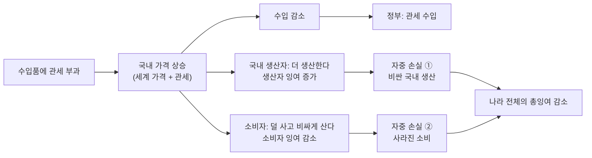

2018년 3월, 미국의 트럼프 대통령은 국가 안보를 이유로 수입 철강에 25%, 알루미늄에 10%의 관세를 매긴다고 발표했다. 값싼 외국 철강 때문에 문을 닫는 미국 제철소와 일자리를 지키겠다는 것이었다. 미국에 철강을 많이 수출하던 한국은 긴 협상 끝에 관세를 면제받는 대신, 미국에 수출하는 철강의 양을 2015~2017년 평균의 70%로 줄이는 **수입 할당**(쿼터)을 받아들였다. 미국 제철소들은 한숨을 돌렸지만, 철강을 원료로 쓰는 미국의 자동차 회사와 건설 회사, 맥주 캔 회사들은 비싼 철강값에 불만을 쏟아냈다.

무역 정책은 늘 이런 갈등을 낳는다. 3강에서 우리는 비교우위 덕분에 무역이 나라 전체를 이롭게 할 수 있다는 것을 배웠다. 그런데 왜 많은 나라가 관세를 매기고 수입을 제한할까? 이 강의에서는 7강에서 배운 소비자 잉여와 생산자 잉여를 이용해, 한 나라가 무역을 시작할 때 누가 이득을 보고 누가 손해를 보는지, 관세와 수입 할당이 사회 전체에 얼마나 손실을 남기는지 정확히 따져 본다. 그리고 보호 무역을 주장하는 여러 논리를 하나씩 검토한다.

> [!핵심] 이 강의의 질문
> 1. 한 나라가 무역을 시작하면 국내의 소비자와 생산자는 각각 얼마나 이득이나 손해를 보는가?
> 2. 관세와 수입 할당은 누구에게 이득을 주고, 사회 전체에 어떤 손실을 남기는가?
> 3. 보호 무역을 주장하는 논리들은 얼마나 설득력이 있는가?

{{F:e8-opening}}

## 무역은 어떻게 결정되나

### 세계 가격과 국내 가격

가상의 나라 '한빛국'이 다른 나라와 무역을 하지 않는다고 하자. 이때 한빛국의 철강 가격은 국내의 수요와 공급만으로 정해진다. 이것을 무역 이전의 **국내 가격**이라고 하자. 한편 세계 시장에서 거래되는 철강의 가격을 **세계 가격**이라고 한다.

한빛국이 무역을 시작하면 무엇이 일어날까? 한빛국이 세계 시장에 비해 작은 나라라면, 한빛국이 철강을 얼마나 사고팔든 세계 가격은 거의 변하지 않는다. 한빛국은 세계 가격을 그대로 받아들이는 **가격 수용자**가 된다. 그러면 결과는 국내 가격과 세계 가격을 비교하는 것만으로 알 수 있다.

- **세계 가격 > 국내 가격**: 한빛국 철강은 세계 시장에서 상대적으로 싸다. 한빛국은 철강에 비교우위가 있으며, 무역을 시작하면 철강을 **수출**한다.
- **세계 가격 < 국내 가격**: 외국 철강이 더 싸다. 다른 나라가 비교우위를 가지며, 한빛국은 철강을 **수입**한다.

국내 가격과 세계 가격을 비교하는 것은 결국 3강에서 배운 기회비용, 곧 비교우위를 비교하는 것과 같다.

## 수출국과 수입국의 이익과 손해

### 수출하는 나라

세계 가격이 국내 가격보다 높아 한빛국이 철강을 수출하게 되면, 국내 철강 가격도 세계 가격까지 오른다. 국내 생산자는 더 비싼 값에 더 많이 팔고, 국내 소비자는 더 비싼 값에 덜 산다. 국내에서 소비하고 남는 양이 수출된다.

- 국내 **생산자**는 이득을 본다(생산자 잉여 증가).
- 국내 **소비자**는 손해를 본다(소비자 잉여 감소).
- 그런데 생산자의 이득이 소비자의 손해보다 크므로 **나라 전체의 총잉여는 늘어난다.**

### 수입하는 나라

반대로 세계 가격이 국내 가격보다 낮아 한빛국이 철강을 수입하게 되면, 국내 철강 가격은 세계 가격까지 내려간다. 국내 소비자는 더 싸게 더 많이 사고, 국내 생산자는 더 싸게 덜 판다. 국내에서 모자라는 양을 수입으로 채운다.

```chart
{
  "type": "scatter",
  "caption": "철강을 수입하는 한빛국 (가상의 예). 무역 전 국내 균형 가격은 100이다. 세계 가격 60에서 무역을 시작하면 국내 소비량은 90으로 늘고 국내 생산량은 30으로 줄어, 그 차이 60을 수입한다. 소비자는 이득을, 생산자는 손해를 보지만 나라 전체의 총잉여는 늘어난다",
  "height": 380,
  "data": {
    "datasets": [
      { "label": "국내 수요", "showLine": true, "pointRadius": 0, "data": [{"x":0,"y":180},{"x":120,"y":20}] },
      { "label": "국내 공급", "showLine": true, "pointRadius": 0, "data": [{"x":0,"y":20},{"x":120,"y":180}] },
      { "label": "세계 가격 60", "showLine": true, "pointRadius": 0, "borderDash": [6, 4], "data": [{"x":0,"y":60},{"x":120,"y":60}] },
      { "label": "무역 전 균형 (60, 100)", "pointRadius": 7, "pointStyle": "star", "data": [{"x":60,"y":100}] },
      { "label": "무역 후 국내 생산(30)·소비(90)", "pointRadius": 7, "data": [{"x":30,"y":60},{"x":90,"y":60}] }
    ]
  },
  "options": { "scales": { "x": { "title": { "display": true, "text": "철강 거래량" }, "min": 0, "max": 120 }, "y": { "title": { "display": true, "text": "가격" }, "min": 0, "max": 190 } } }
}
```

- 국내 **소비자**는 이득을 본다(소비자 잉여 증가).
- 국내 **생산자**는 손해를 본다(생산자 잉여 감소).
- 그런데 이번에도 소비자의 이득이 생산자의 손해보다 크므로 **나라 전체의 총잉여는 늘어난다.**

| 구분 | 수출하는 나라 | 수입하는 나라 |
|---|---|---|
| 국내 가격 | 세계 가격까지 오른다 | 세계 가격까지 내린다 |
| 국내 생산자 | 이득 | 손해 |
| 국내 소비자 | 손해 | 이득 |
| 나라 전체(총잉여) | 증가 | 증가 |

표: 무역의 이익과 손해 (작은 개방 경제의 경우)

이 분석은 두 가지를 분명히 보여 준다. 첫째, 무역은 나라 전체를 더 부유하게 만든다. 이긴 사람의 이득이 진 사람의 손해보다 크다. 둘째, 그런데도 무역에는 반드시 손해를 보는 사람이 있다. 이긴 사람이 진 사람에게 보상을 해 준다면 모두가 나아질 수 있지만, 그런 보상은 저절로 일어나지 않는다. 무역 정책을 둘러싼 정치적 갈등은 바로 여기서 생긴다.

### 무역의 또 다른 이득

잉여 분석에 잡히지 않는 이득도 있다. 무역은 소비자에게 더 **다양한 상품**을 준다. 기업은 세계 시장을 상대로 대량 생산을 해 비용을 낮출 수 있다(**규모의 경제**). 외국 기업과 경쟁하면서 국내 기업의 독점적 힘이 약해지고(**경쟁 촉진**), 새로운 기술과 아이디어가 국경을 넘어 퍼진다(**기술 전파**). 많은 경제학자는 이런 효과가 잉여 분석으로 계산되는 이득보다 오히려 크다고 본다.

{{F:e8-trade}}

### 큰 나라의 무역은 세계 가격을 바꾼다

지금까지는 한빛국이 세계 가격에 영향을 주지 못하는 작은 나라라고 가정했다. 그러나 미국이나 중국처럼 큰 나라는 다르다. 중국이 철광석 수입을 늘리면 세계 철광석 값이 오르고, 미국이 자동차 수입을 줄이면 세계 자동차 값이 내려간다. 큰 나라가 관세를 매기면 외국 수출업자가 값을 내려 시장을 지키려 하므로, 관세 부담의 일부가 외국에 넘어갈 수 있다. 이 때문에 이론적으로는 큰 나라가 적당한 관세로 이득을 볼 가능성도 있다. 그러나 상대국도 똑같이 보복 관세를 매기면 두 나라 모두 무역의 이득을 잃는다. 실제로 2018년 미·중 무역 분쟁 뒤의 여러 연구는, 미국이 매긴 관세의 부담이 대부분 미국의 수입업자와 소비자에게 돌아갔다고 분석했다.

### 무역에 크게 기대는 한국 경제

한국은 세계에서 무역 의존도가 가장 높은 나라 가운데 하나다. 수출과 수입을 합친 무역액은 국내총생산의 70~90% 수준을 오가며, 미국(20%대)이나 일본(30~40%대)보다 훨씬 높다. 원유와 천연가스, 철광석 같은 자원은 거의 모두 수입하고, 반도체와 자동차, 선박, 석유 제품 등을 만들어 수출한다. 그래서 한국 경제는 세계 경기와 주요 교역국의 무역 정책에 매우 민감하다. 세계 무역이 줄어든 2009년 금융위기나 2020년 코로나19 초기에 한국의 수출이 크게 흔들린 것도 이 때문이다. 자유로운 무역 질서가 유지되는 것은 한국에게 특히 중요한 이해관계다.

## 무역을 제한하는 정책

### 관세

**관세**는 수입품에 매기는 세금이다. 6강에서 배운 세금과 같은 원리로 작동한다. 한빛국이 수입 철강 한 단위에 관세를 매기면, 국내 철강 가격은 세계 가격에 관세를 더한 만큼 오른다. 국내 소비자는 덜 사고, 국내 생산자는 더 많이 생산하며, 수입은 줄어든다.

| 집단 | 관세의 영향 |
|---|---|
| 국내 소비자 | 비싼 값에 덜 사서 **손해**(소비자 잉여 감소) |
| 국내 생산자 | 비싼 값에 더 팔아 **이득**(생산자 잉여 증가) |
| 정부 | 관세 **수입**(수입량 × 단위당 관세) |
| 나라 전체 | 두 개의 **자중 손실**이 생긴다 |

표: 관세의 영향

관세의 자중 손실은 두 가지다. 하나는 국내 생산자가 세계 가격보다 비싼 비용으로 철강을 **지나치게 많이 생산**하는 데서 오는 손실이다. 외국에서 더 싸게 살 수 있는 것을 국내에서 비싸게 만드는 낭비다. 다른 하나는 소비자가 세계 가격이라면 살 수 있었던 철강을 **사지 못하게 된** 데서 오는 손실이다. 관세는 결국 나라 전체의 총잉여를 줄여, 무역의 이득을 일부 되돌린다.



### 수입 할당과 수출 자율 규제

**수입 할당**(쿼터)은 수입할 수 있는 양에 상한을 두는 정책이다. 수입량이 줄어 국내 가격이 오르므로, 그 효과는 관세와 거의 같다. 다만 관세였다면 정부가 걷었을 수입이, 할당제에서는 수입 허가를 받은 사람이나 외국 수출업자에게 돌아간다는 차이가 있다.

1981년 미국은 일본 자동차가 몰려들자 일본에 압력을 넣어, 일본이 스스로 대미 승용차 수출을 1년에 168만 대로 줄이게 했다. 이것을 **수출 자율 규제**라고 한다. 수출량이 묶이자 일본 회사들은 같은 대수로 더 많이 벌기 위해 값이 비싼 고급차를 수출하기 시작했다. 1989년 도요타의 **렉서스**가 미국에 등장한 것도 이런 흐름 속에서였다. 또 일본 회사들은 할당을 피해 미국 안에 공장을 지었다. 수입 제한이 미국 소비자에게 비싼 차값이라는 부담을 지우는 사이, 일본 회사들은 높아진 값으로 오히려 큰 이익을 남겼다는 분석이 많다.

> [!사료] 한국 쌀 시장의 관세화 (2015)
> 한국은 1994년 우루과이 라운드 협상에서 쌀 시장 개방을 미루는 대신, 매년 일정량의 외국 쌀을 낮은 관세로 의무 수입하기로 했다. 이 유예는 2014년까지 20년 동안 이어졌다. 그러나 의무 수입량이 해마다 늘어나 부담이 커지자, 한국은 2015년부터 쌀 시장을 **관세화**하고 수입 쌀에 **513%**의 관세를 매겼다. 외국 쌀값의 6배가 넘는 값이 되도록 한 것이다. 쌀이 갖는 식량 안보와 농촌 사회의 의미를 생각하면 높은 보호를 정당화할 수 있다는 주장과, 그 비용을 결국 소비자와 다른 산업이 치른다는 주장이 맞섰다.

{{F:e8-tariff}}

### 덤핑과 반덤핑 관세

외국 기업이 자기 나라에서 파는 값보다 싸게, 또는 생산 비용보다 싸게 수출하는 것을 **덤핑**이라고 한다. 수입국 정부는 덤핑으로 국내 산업이 피해를 입었다고 판정하면 그 차이만큼 **반덤핑 관세**를 매길 수 있다. WTO 규칙도 이를 허용한다. 문제는 '정상 가격'을 어떻게 정하느냐가 복잡하고, 반덤핑 조사가 사실상 경쟁 상대를 막는 수단으로 쓰이는 경우가 많다는 점이다. 한국의 철강과 화학 제품, 세탁기, 태양광 패널은 여러 나라의 반덤핑 조사를 받아 왔고, 한국도 외국 제품에 반덤핑 관세를 매긴다. 소비자 입장에서 보면 외국 기업이 싸게 파는 것은 이득이지만, 그것이 경쟁자를 몰아낸 뒤 값을 올리려는 '약탈적 가격'이라면 이야기가 달라진다. 이 둘을 구분하기는 쉽지 않다.

## 보호 무역을 주장하는 논리들

경제학자 대부분은 자유무역을 지지하지만, 보호 무역을 주장하는 목소리는 끊이지 않는다. 그 논리를 하나씩 살펴보자.

| 논리 | 주장 | 경제학자들의 일반적인 반론 |
|---|---|---|
| 일자리 보호 | 수입이 국내 일자리를 없앤다 | 수입은 일부 산업의 일자리를 없애지만 수출 산업과 수입품을 쓰는 산업의 일자리를 만든다. 장기적으로 전체 일자리 수를 정하는 것은 무역이 아니다 |
| 국가 안보 | 전쟁 때 필요한 산업(철강, 식량, 반도체)은 국내에 있어야 한다 | 일리가 있지만 남용되기 쉽다. 거의 모든 산업이 '안보'를 내세운다 |
| 유치산업 보호 | 막 시작한 산업은 자랄 때까지 보호해야 한다 | 어느 산업이 자랄지 정부가 고르기 어렵고, 한번 보호받은 산업은 보호를 놓지 않으려 한다 |
| 불공정 경쟁 | 외국 정부가 자기 기업에 보조금을 준다 | 외국이 보조금으로 싸게 팔면 그 혜택은 우리 소비자에게 돌아온다. 다만 국제 규칙(WTO) 위반에는 대응할 수 있다 |
| 협상 카드 | 관세를 위협 수단으로 써서 상대국이 시장을 열게 한다 | 위협이 통하지 않으면 양쪽 모두 관세를 올려 손해를 본다(1930년의 스무트-홀리 관세) |

표: 보호 무역의 논리와 반론

### 유치산업 보호론과 동아시아의 경험

이 가운데 가장 진지하게 논쟁되는 것이 **유치산업 보호론**이다. 미국의 초대 재무장관 **알렉산더 해밀턴**은 1791년 「제조업에 관한 보고서」에서 신생국 미국의 공업을 키우려면 관세로 보호해야 한다고 주장했다. 독일의 경제학자 **프리드리히 리스트**도 1841년 『정치경제학의 국민적 체계』에서, 영국이 자유무역을 외치는 것은 이미 사다리를 올라간 나라가 사다리를 걷어차는 것과 같다고 비판하며 후발국의 보호를 옹호했다.

한국과 대만의 경제 발전을 두고도 이 논쟁은 이어진다. 한국 정부는 1960~80년대 일부 산업을 수입 제한과 금융 지원으로 보호하면서 동시에 수출 실적을 엄격하게 요구했다. 보호받은 기업도 세계 시장에서 경쟁해야 했다는 점에서, 국내 시장만 지키다 효율이 떨어진 다른 개발도상국의 수입 대체 정책과 달랐다는 평가가 많다. 그러나 같은 시기의 보호가 성장에 얼마나 도움이 되었는지, 오히려 비용이 더 컸는지에 대해서는 경제학자들 사이에 지금도 의견이 갈린다.

## 무역 협정의 시대

### GATT에서 WTO로

1930년대 보호 무역 경쟁의 교훈에서, 제2차 세계대전 뒤 각국은 함께 관세를 낮추는 길을 택했다. 1947년 23개국이 **관세와 무역에 관한 일반 협정**(GATT)을 맺었고, 이후 여러 차례의 '라운드' 협상을 통해 관세를 단계적으로 내렸다. 1995년에는 GATT를 이어받아 **세계무역기구**(WTO)가 출범했다. WTO는 회원국 사이의 무역 분쟁을 판정하는 절차도 갖추었다.

| 협상 | 기간 | 참가국 수 | 주요 내용 |
|---|---|---|---|
| 제네바 | 1947 | 23 | GATT 출범, 관세 인하 |
| 케네디 라운드 | 1964~1967 | 62 | 공산품 관세의 대폭 인하, 반덤핑 규정 |
| 도쿄 라운드 | 1973~1979 | 102 | 관세 외 무역 장벽(보조금, 기술 규제 등) 다룸 |
| 우루과이 라운드 | 1986~1994 | 123 | 농산물·서비스·지식재산권 포함, WTO 설립 합의 |
| 도하 개발 라운드 | 2001~ | WTO 회원국 | 농업 보조금 등을 둘러싼 대립으로 사실상 정체 |

표: GATT와 WTO의 주요 다자간 무역 협상 (WTO 자료를 바탕으로 정리)

### 자유무역협정(FTA)

다자간 협상이 어려워지자 각국은 마음이 맞는 나라끼리 **자유무역협정**(FTA)을 맺어 관세를 없애는 방향으로 나아갔다. 한국은 2004년 칠레와 첫 FTA를 발효한 뒤 싱가포르, 유럽 자유무역연합(EFTA), 아세안, 인도, 유럽 연합(2011), 미국(2012), 중국(2015) 등과 잇달아 FTA를 맺었고, 2022년에는 아시아·태평양 15개국이 참여한 역내 포괄적 경제 동반자 협정(RCEP)이 발효되었다. FTA를 맺을 때마다 수출 산업은 시장이 넓어지기를 기대했고, 농업처럼 경쟁력이 약한 분야는 강하게 반대했다. 정부는 피해 산업 지원 대책을 함께 마련해 왔다.

> [!주의] 무역 정책의 새로운 흐름
> 2010년대 후반부터 세계는 다시 보호 무역 쪽으로 기울고 있다. 미국과 중국은 서로 수천억 달러어치의 상품에 관세를 매기는 무역 분쟁을 벌였고, 반도체처럼 안보와 직결된 산업에서는 동맹국끼리만 공급망을 만들려는 움직임이 커졌다. 코로나19 때 마스크와 의약품, 반도체 부족을 겪으며 '효율'보다 '안정'을 중시하는 목소리도 높아졌다. 이 강의의 분석은 이런 정책들이 국가 안보라는 목적을 위해 어떤 경제적 비용을 치르는지 따져 보는 출발점이 된다.

## 정리

> [!핵심] 8강 요약
> - 작은 나라는 **세계 가격**을 받아들인다. 세계 가격이 국내 가격보다 높으면 수출하고, 낮으면 수입한다.
> - 수출국에서는 생산자가 이득, 소비자가 손해를 보고, 수입국에서는 소비자가 이득, 생산자가 손해를 본다. 어느 경우든 **이득이 손해보다 커 나라 전체의 총잉여는 늘어난다.**
> - **관세**는 국내 가격을 올려 생산자와 정부에 이득을 주지만, 소비자의 손해가 더 커 **자중 손실**을 남긴다. **수입 할당**은 관세와 비슷한 효과를 내지만 그 수입이 할당을 받은 쪽에 돌아간다. 1981년 일본 자동차의 수출 자율 규제가 그 예다.
> - 일자리, 국가 안보, **유치산업**, 불공정 경쟁, 협상 카드 같은 보호 무역 논리 가운데 일부는 일리가 있지만, 대부분 그 비용이 크다는 것이 경제학자들의 일반적인 평가다.
> - 1947년 **GATT**와 1995년 **WTO**는 다자간 관세 인하를 이끌었고, 한국은 2004년 이후 여러 나라와 **FTA**를 맺었다.

### 생각해 볼 질문

1. 미국이 수입 철강에 관세를 매기면, 미국의 철강 회사, 자동차 회사, 소비자, 그리고 한국의 철강 회사는 각각 어떤 영향을 받을까?
2. 쌀에 513%의 관세를 매기는 것을 '식량 안보'로 정당화할 수 있을까? 그 비용은 누가 치르는가?
3. 반도체 산업을 키우기 위해 정부가 보조금을 주는 것과, 외국 반도체에 관세를 매기는 것은 어떻게 다를까?

### 다음 강 예고

9강 「외부효과」에서는 시장이 효율적인 결과를 내지 못하는 첫 번째 경우를 살펴본다. 공장의 매연이나 이웃집의 소음처럼 거래 당사자가 아닌 사람에게 영향을 주는 **외부효과**가 왜 시장 실패를 낳는지, 그리고 세금과 규제, 배출권 거래, 협상 같은 해결책을 비교한다.
