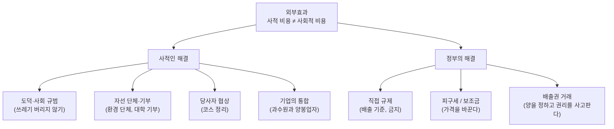

1948년 10월 말, 미국 펜실베이니아주의 작은 공업 도시 **도노라**에 짙은 안개가 내려앉았다. 기온 역전 현상으로 공기가 골짜기에 갇히자, 아연 제련소와 제철소에서 뿜어 나온 매연과 유독 가스가 빠져나가지 못하고 닷새 동안 마을을 뒤덮었다. 한낮에도 앞이 보이지 않을 정도였다. 주민 20명이 숨지고 수천 명이 호흡기 질환으로 쓰러졌다. 4년 뒤인 1952년 12월에는 영국 런던에 '그레이트 스모그'가 닥쳐, 몇 달 사이에 1만 명 안팎이 목숨을 잃은 것으로 추정된다.

공장 주인이 매연을 뿜은 것은 나쁜 마음을 먹어서가 아니었다. 매연을 줄이는 설비를 다는 데는 돈이 들지만, 매연을 하늘로 내보내는 데는 돈이 들지 않았다. 공장이 아연을 만들어 팔 때 그 가격에는 원료값과 임금은 들어 있었지만, 마을 사람들의 폐가 입는 피해는 들어 있지 않았다. 7강에서 우리는 경쟁 시장이 효율적이라는 것을 배웠다. 그러나 그 결론에는 "거래의 영향이 거래 당사자에게만 미친다"는 전제가 있었다. 이 강의에서는 그 전제가 깨지는 경우, 곧 **외부효과**를 다룬다. 외부효과가 왜 시장 실패를 낳는지, 그리고 사회는 이를 어떻게 바로잡을 수 있는지 살펴본다.

> [!핵심] 이 강의의 질문
> 1. 외부효과란 무엇이며, 왜 시장의 결과를 비효율적으로 만드는가?
> 2. 정부는 외부효과를 어떻게 바로잡을 수 있는가? 규제, 세금, 배출권 거래는 어떻게 다른가?
> 3. 정부가 나서지 않아도 당사자들끼리 해결할 수 있는 경우는 언제인가?

```figure
src: asset:7f46629694ff4168e8d5fc4ba3f912ae
caption: 1940년 무렵 연기에 뒤덮인 미국 피츠버그. 철강 도시 피츠버그는 한낮에도 가로등을 켜야 할 만큼 매연이 심해 '뚜껑 열린 지옥'이라 불렸다. 1940년대 후반부터 매연 규제로 하늘이 차츰 맑아졌다.
credit: 미국 국무부 촬영, 1940년 무렵 · 미국 국립문서보관소(NARA) 소장
license: Public Domain (미국 연방정부 저작물)
source: https://catalog.archives.gov/id/518066
width: wide
```

## 외부효과란 무엇인가

### 제3자에게 미치는 영향

**외부효과**란 어떤 사람의 행동이 거래에 참여하지 않은 제3자의 복지에 영향을 주는데, 그 영향에 대해 아무런 대가를 치르거나 받지 않는 것을 말한다. 영향이 나쁘면 **부정적 외부효과**(외부 불경제), 좋으면 **긍정적 외부효과**(외부 경제)라고 한다.

| 구분 | 예 | 시장에 맡기면 |
|---|---|---|
| 부정적 외부효과 | 공장의 대기·수질 오염, 자동차 배기가스와 교통 혼잡, 이웃집의 소음, 간접흡연, 항생제 남용으로 생기는 내성균 | 사회적으로 바람직한 양보다 **너무 많이** 생산·소비된다 |
| 긍정적 외부효과 | 예방 접종(남의 감염 위험도 낮춘다), 교육(더 나은 시민과 동료), 기초 연구와 새 기술, 잘 가꾼 정원과 오래된 건물의 보존, 과수원 옆 양봉 | 사회적으로 바람직한 양보다 **너무 적게** 생산·소비된다 |

표: 부정적 외부효과와 긍정적 외부효과

### 왜 시장이 실패하나

외부효과가 있으면 시장이 실패하는 이유는 간단하다. 사람들은 자기에게 돌아오는 비용과 편익만 따지고, 남에게 주는 비용과 편익은 따지지 않기 때문이다.

공장이 아연 1톤을 더 만들 때를 생각해 보자. 공장이 따지는 비용(**사적 비용**)은 원료와 임금, 전기 같은 것이다. 그러나 사회 전체가 치르는 비용(**사회적 비용**)에는 여기에 주민들의 건강 피해와 농작물 피해 같은 **외부 비용**이 더해진다.

**사회적 비용 = 사적 비용 + 외부 비용**

시장의 공급 곡선은 사적 비용만 반영한다. 그래서 시장 균형에서 생산되는 양은 사회적 비용까지 따졌을 때 바람직한 양보다 많다. 사회 전체로 보면, 사회적 비용이 구매자의 가치보다 큰 아연까지 만들어지고 있는 것이다. 7강의 말로 하면 이 과잉 생산에서 **자중 손실**이 생긴다.

```chart
{
  "type": "scatter",
  "caption": "부정적 외부효과 (가상의 예). 시장 공급 곡선은 사적 비용만 반영해 시장 균형(거래량 60)에서 생산이 이루어진다. 단위당 30의 외부 비용을 더한 사회적 비용 곡선과 수요 곡선이 만나는 곳(거래량 45)이 사회적으로 바람직한 양이다. 시장은 15만큼 너무 많이 생산한다",
  "height": 380,
  "data": {
    "datasets": [
      { "label": "수요 (구매자의 가치)", "showLine": true, "pointRadius": 0, "data": [{"x":0,"y":150},{"x":100,"y":50}] },
      { "label": "공급 (사적 비용)", "showLine": true, "pointRadius": 0, "data": [{"x":0,"y":30},{"x":100,"y":130}] },
      { "label": "사회적 비용 (사적 비용 + 외부 비용 30)", "showLine": true, "pointRadius": 0, "borderDash": [6, 4], "data": [{"x":0,"y":60},{"x":90,"y":150}] },
      { "label": "시장 균형", "pointRadius": 7, "data": [{"x":60,"y":90}] },
      { "label": "사회적 최적", "pointRadius": 8, "pointStyle": "star", "data": [{"x":45,"y":105}] }
    ]
  },
  "options": { "scales": { "x": { "title": { "display": true, "text": "생산량" }, "min": 0, "max": 100 }, "y": { "title": { "display": true, "text": "가격·비용" }, "min": 0, "max": 160 } } }
}
```

긍정적 외부효과는 반대다. 예방 접종을 받은 사람은 자기 건강만 생각해 접종 여부를 정하지만, 그 덕분에 주변 사람들의 감염 위험도 낮아진다. 접종의 **사회적 가치 = 사적 가치 + 외부 편익**이다. 시장은 사적 가치만 반영하므로, 접종은 사회적으로 바람직한 수준보다 적게 이루어진다. 그래서 많은 나라가 예방 접종에 보조금을 주거나 무료로 실시한다.

```gallery
src: asset:d48d157f1ed6336bc0fb4eb7ff4011bc
caption: 미국 정부의 예방 접종 포스터 「예방 접종이 생명을 구합니다. 자녀에게 디프테리아와 천연두 예방 접종을 하셨나요?」. 접종은 맞은 사람뿐 아니라 이웃의 감염 위험까지 낮추는 긍정적 외부효과를 낳는다.
credit: 미국 노동부 아동국, 1930~40년대 무렵 · 미국 국립문서보관소(NARA) 소장
license: Public Domain (미국 연방정부 저작물)
source: https://catalog.archives.gov/id/514611
---
src: asset:8aa24096b0132d033af365fc3e5c02ba
caption: 꽃가루를 모으는 꿀벌. 양봉업자의 벌은 꿀을 모으는 동안 이웃 과수원의 꽃가루받이를 돕는다. 대표적인 긍정적 외부효과다.
credit: 미국 농무부 농업연구청 촬영 · 미국 국립문서보관소(NARA) 소장
license: Public Domain (미국 연방정부 저작물)
source: https://catalog.archives.gov/id/148741791
```

### 외부효과를 '내부화'하기

외부효과의 핵심 문제는 사람들이 남에게 주는 영향을 자기 결정에 넣지 않는다는 것이다. 그렇다면 해법은 그 영향을 당사자의 손익 계산 안으로 끌어들이는 것이다. 이를 외부효과의 **내부화**라고 한다. 오염을 일으키는 사람이 그 피해만큼 비용을 치르게 하거나, 좋은 영향을 주는 사람이 그만큼 보상을 받게 하면, 사람들은 스스로 사회적으로 바람직한 양을 고르게 된다.

```gallery
src: asset:37b32d5c79f7815679d2843325f80737
caption: 1973년 짙은 스모그에 잠긴 미국 로스앤젤레스 도심. 자동차 배기가스가 햇빛과 반응해 생기는 광화학 스모그다.
credit: 미국 환경보호청 '도큐메리카' 사진 사업, 1973년 · 미국 국립문서보관소(NARA) 소장
license: Public Domain (미국 연방정부 저작물)
source: https://catalog.archives.gov/id/552394
---
src: asset:41a74bbeda4a77fec81b6106dede583d
caption: 1973년 미국 오하이오주 쿠야호가강으로 하수를 쏟아내는 시 펌프장. 기름과 오물로 덮인 이 강은 1969년 강물 위에서 불이 난 것으로 유명해졌고, 이 일은 미국 환경 운동의 상징이 되었다.
credit: 미국 환경보호청 '도큐메리카' 사진 사업, 1973년 · 미국 국립문서보관소(NARA) 소장
license: Public Domain (미국 연방정부 저작물)
source: https://catalog.archives.gov/id/550206
---
src: asset:23a0a4307e08dd6b33d0241d9cbacd33
caption: 1973년 미국 볼티모어 항구 물가에 떠밀려 온 죽은 물고기들. 수질 오염의 피해는 어민과 주민 같은 제3자에게 돌아간다.
credit: 미국 환경보호청 '도큐메리카' 사진 사업, 1973년 · 미국 국립문서보관소(NARA) 소장
license: Public Domain (미국 연방정부 저작물)
source: https://catalog.archives.gov/id/546779
```

## 정부의 해결책

### 명령과 통제: 직접 규제

가장 직접적인 방법은 정부가 법으로 어떤 행동을 금지하거나 제한하는 것이다. 특정 유독 물질의 배출을 금지하거나, 공장 굴뚝에 정화 장치를 의무적으로 달게 하거나, 자동차 배기가스 기준을 정하는 것이 그 예다. 이런 방식을 **명령과 통제** 규제라고 한다.

미국은 1970년 **환경보호청**(EPA)을 만들고 같은 해 「대기 청정법」을 크게 강화했다. 한국도 1980년 환경청을 세우고 1990년대에 환경부로 확대했으며, 1990년에 「대기환경보전법」 등을 만들었다. 직접 규제는 납이나 석면처럼 아주 위험한 물질을 없애는 데 효과적이다. 휘발유에 넣던 납을 금지하자 어린이 혈중 납 농도가 크게 떨어진 것이 대표적인 성공 사례다.

그러나 직접 규제에는 약점도 있다. 정부가 모든 공장의 사정을 알기 어렵고, 모든 공장에 똑같은 기준을 적용하면 비효율이 생긴다. 어떤 공장은 오염을 아주 싸게 줄일 수 있고, 어떤 공장은 아주 비싸게 줄일 수 있다. 또 기준만 지키면 그 이상 줄일 유인이 없다.

### 피구세: 오염에 값을 매기기

영국의 경제학자 **아서 세실 피구**는 1920년 『후생 경제학』에서 외부효과를 일으키는 활동에 그 외부 비용만큼 세금을 매기자고 제안했다. 이를 **피구세**(교정적 조세)라고 한다. 앞의 그래프에서 단위당 30의 세금을 매기면, 공장이 따지는 비용이 사회적 비용과 같아져 생산량이 저절로 사회적 최적인 45로 줄어든다.

피구세의 장점은 두 가지다. 첫째, 같은 양의 오염을 **가장 싼 비용으로** 줄인다. 세금이 붙으면 오염을 싸게 줄일 수 있는 공장은 많이 줄이고, 비싸게 줄일 수 있는 공장은 세금을 내는 쪽을 택한다. 정부가 각 공장의 사정을 몰라도 된다. 둘째, 오염을 줄일수록 세금을 덜 내므로, 기술을 개발해 오염을 더 줄이려는 **유인**이 계속된다. 게다가 6강과 7강에서 본 대부분의 세금과 달리, 피구세는 자중 손실을 낳는 대신 오히려 효율성을 **높인다**. 그래서 피구세를 지지하는 경제학자 모임이 생길 정도로, 피구세는 경제학자들 사이에서 인기가 높다. 휘발유에 붙는 세금, 담뱃세, 혼잡 통행료, 탄소세가 모두 피구세의 성격을 띤다.

| 해결책 | 방식 | 장점 | 단점 |
|---|---|---|---|
| 직접 규제 | 배출 기준·금지·장치 의무화 | 확실하고 이해하기 쉽다. 아주 위험한 물질에 적합 | 모든 기업에 같은 기준을 적용해 비용이 크다. 기준 이상 줄일 유인이 없다 |
| 피구세(오염세) | 오염 한 단위마다 세금 | 가장 싸게 줄이는 곳에서 줄인다. 계속 줄일 유인, 세수 확보 | 오염이 실제로 얼마나 줄어들지 미리 알기 어렵다 |
| 배출권 거래 | 오염 총량을 정하고 권리를 사고팔게 함 | 총량을 확실히 정한다. 가장 싸게 줄이는 곳에서 줄인다 | 배출권 가격이 크게 출렁일 수 있다. 처음 배출권을 누구에게 나눠 줄지 다툼 |
| 보조금 | 긍정적 외부효과에 지원 | 접종·연구·교육을 늘린다 | 재원이 필요하다. 어디에 줄지 정하기 어렵다 |

표: 외부효과에 대한 정부의 해결책 비교

### 배출권 거래: 오염할 권리를 시장에서

또 다른 방법은 정부가 오염의 **총량**을 정한 뒤, 그만큼의 **오염 배출권**을 만들어 기업들이 사고팔게 하는 것이다. 오염을 싸게 줄일 수 있는 기업은 많이 줄이고 남는 배출권을 팔며, 줄이기 어려운 기업은 배출권을 사서 쓴다. 결과적으로 정해진 총량을 가장 싼 비용으로 달성하게 된다. 피구세가 오염의 '가격'을 정하고 양은 시장에 맡긴다면, 배출권 거래는 오염의 '양'을 정하고 가격은 시장에 맡긴다.

배출권 거래의 대표적인 성공 사례는 1990년 미국의 **산성비 프로그램**이다. 미국 정부는 발전소에서 나오는 이산화황 배출 총량을 정하고 배출권을 거래하게 했다. 그 결과 이산화황 배출은 예상보다 빠르고 싸게 줄었다. 이후 유럽 연합은 2005년, 한국은 2015년에 온실가스 **배출권 거래제**를 시작했다.



```figure
src: asset:f6f24ad95b50c0314de4307b8bfa4e82
caption: 1973년 미국 루이지애나주 배턴루지의 주택가 위로 연기를 뿜는 알루미늄 공장 굴뚝과 그 옆에서 노는 아이들. 공장의 비용에는 들어가지 않는 외부 비용이 고스란히 이웃 주민에게 돌아간다.
credit: 미국 환경보호청 '도큐메리카' 사진 사업, 1973년 · 미국 국립문서보관소(NARA) 소장
license: Public Domain (미국 연방정부 저작물)
source: https://catalog.archives.gov/id/546043
```

## 정부 없이 해결하기

### 사적인 해결책

외부효과를 늘 정부가 해결해야 하는 것은 아니다. 사람들 스스로 해결하는 방법도 많다. '쓰레기를 함부로 버리지 마라'는 **도덕과 사회 규범**은 사람들이 남에게 주는 피해를 스스로 줄이게 만든다. **자선 단체**는 환경을 지키거나 교육과 연구를 지원해 긍정적 외부효과를 늘린다. 이해관계가 얽힌 당사자들이 **하나로 합치기**도 한다. 과수원 주인은 벌이 꽃가루를 옮겨 주기를 원하고, 양봉업자는 벌이 꿀을 모을 꽃이 필요하다. 두 사업을 한 사람이 함께 하면 서로 주는 외부효과가 저절로 내부화된다. 실제로는 과수원 주인과 양봉업자가 계약을 맺어, 과수원이 양봉업자에게 꽃가루받이 대가를 치르는 경우도 많다.

### 코스 정리

미국의 경제학자 **로널드 코스**는 1960년 논문 「사회적 비용의 문제」에서 놀라운 주장을 했다. 당사자들이 **비용 없이 협상**할 수 있다면, 재산권이 누구에게 있든 그들은 스스로 효율적인 결과에 이른다는 것이다. 이를 **코스 정리**라고 한다.

예를 들어 보자. 민수는 개를 기르는데, 그 개가 밤마다 짖어 이웃 지아가 잠을 설친다. 개를 기르는 것이 민수에게 주는 가치는 50만 원이고, 개 짖는 소리가 지아에게 주는 피해는 80만 원이라고 하자. 지아는 민수에게 60만 원을 주고 개를 다른 곳으로 보내 달라고 제안할 수 있다. 민수는 개의 가치(50만 원)보다 많이 받으니 받아들이고, 지아는 피해(80만 원)보다 적게 내니 이득이다. 반대로 개의 가치가 피해보다 크다면 협상은 이루어지지 않고 개는 그대로 남는다. 어느 쪽이든 결과는 효율적이다. 만약 법이 '조용히 잘 권리'를 지아에게 준다면, 이번에는 민수가 지아에게 돈을 주고 개를 기를 허락을 사야 한다. 돈이 누구에게서 누구에게 가는지는 달라지지만, 개를 기를지 말지라는 결과는 같다.

그러나 현실에서는 협상에 비용이 든다. 이것을 **거래 비용**이라고 한다. 당사자가 너무 많으면(공장 하나와 주민 수만 명) 모두를 모아 협상하기 어렵다. 서로 버티며 더 많이 받아 내려다 협상이 깨지기도 한다. 그래서 대기 오염처럼 피해자가 많은 문제는 사적인 협상만으로 해결하기 어렵고, 정부의 역할이 필요해진다. 코스 정리의 진짜 교훈은 '정부가 필요 없다'가 아니라, **재산권을 분명히 하고 거래 비용을 낮추는 것**이 외부효과 문제를 푸는 데 얼마나 중요한지 보여 준 데 있다. 코스는 이 공로로 1991년 노벨 경제학상을 받았다.

> [!참고] 미세먼지는 왜 풀기 어려운가
> 한국의 미세먼지 문제는 외부효과의 어려움을 잘 보여 준다. 미세먼지는 발전소, 공장, 자동차, 건설 현장, 가정 난방 등 수많은 곳에서 나오고, 바람을 타고 국경을 넘나들기도 한다. 배출원이 많고 피해자도 많아 코스식 협상은 사실상 불가능하다. 나라 밖에서 날아오는 먼지에는 한 나라의 세금이나 규제도 미치지 못해, 국가 사이의 협력이 필요하다. 한국은 노후 석탄 발전소의 가동을 줄이고, 오래된 경유차의 운행을 제한하며, 겨울철 '미세먼지 계절 관리제'를 시행하는 등 여러 수단을 함께 쓰고 있다.

## 기후 변화: 가장 큰 외부효과

이산화탄소 같은 온실가스는 어디서 배출되든 지구 전체의 기온을 올린다. 배출하는 사람은 그 비용을 거의 치르지 않고, 피해는 전 세계 사람들과 미래 세대에게 돌아간다. 영국의 경제학자 **니컬러스 스턴**은 2006년 보고서에서 기후 변화를 "세계가 지금까지 본 것 가운데 가장 큰 시장 실패"라고 불렀다.

경제학자들 다수는 탄소에 가격을 매기는 것, 곧 **탄소세**나 **배출권 거래제**가 온실가스를 가장 싸게 줄이는 방법이라고 본다. 미국의 경제학자 **윌리엄 노드하우스**는 기후 변화와 경제를 함께 다루는 모형을 만들어 탄소에 적정한 가격을 매기는 방법을 연구했고, 2018년 노벨 경제학상을 받았다. 그러나 기후 변화는 수많은 나라가 함께 행동해야 하는 문제라는 점에서 더 어렵다. 한 나라만 탄소에 높은 값을 매기면 그 나라 기업은 경쟁에서 불리해지고, 공장이 규제가 약한 나라로 옮겨 갈 수 있다. 1997년 교토 의정서와 2015년 파리 협정 같은 국제 협약은 이 문제를 풀려는 시도다. 유럽 연합은 탄소 규제가 약한 나라에서 들어오는 철강·시멘트 등에 탄소 비용을 매기는 '탄소 국경 조정 제도'를 단계적으로 도입하고 있다.

```figure
src: asset:29563c66984d68b46b86528e25b0f163
caption: 1972년 스모그 너머로 보이는 미국의 정유 공장. 석유를 태워 생기는 온실가스는 기후 변화라는 가장 큰 외부효과를 낳는다.
credit: 미국 환경보호청 '도큐메리카' 사진 사업, 1972년 · 미국 국립문서보관소(NARA) 소장
license: Public Domain (미국 연방정부 저작물)
source: https://catalog.archives.gov/id/542705
```

```timeline
1920 | 피구, 『후생 경제학』 | 외부효과에 세금을 매기자는 제안
1948 | 미국 도노라 스모그 | 20명 사망
1952 | 런던 그레이트 스모그 | 수천~1만여 명 사망 추정, 1956년 청정 대기법의 계기
1960 | 코스, 「사회적 비용의 문제」 | 재산권과 거래 비용
1970 | 미국 환경보호청(EPA) 설립, 대기 청정법 강화 | 
1990 | 미국 산성비 프로그램 | 이산화황 배출권 거래
1997 | 교토 의정서 | 선진국의 온실가스 감축 의무
2005 | 유럽 연합 배출권 거래제 | 
2015 | 한국 배출권 거래제 시작, 파리 협정 | 
2018 | 노드하우스, 노벨 경제학상 | 기후 변화의 경제학
```

## 정리

> [!핵심] 9강 요약
> - **외부효과**는 거래 당사자가 아닌 제3자에게 대가 없이 주는 영향이다. 부정적 외부효과가 있으면 시장은 **너무 많이**, 긍정적 외부효과가 있으면 **너무 적게** 생산한다.
> - **사회적 비용 = 사적 비용 + 외부 비용**. 외부효과를 당사자의 손익 계산에 넣는 것을 **내부화**라고 한다.
> - 정부는 **직접 규제**, **피구세**(오염세), **배출권 거래**, **보조금**으로 외부효과를 바로잡을 수 있다. 피구세와 배출권 거래는 오염을 가장 싸게 줄이는 곳에서 줄이게 해 효율적이다.
> - **코스 정리**: 협상 비용이 없다면 재산권이 누구에게 있든 당사자들은 효율적인 결과에 이른다. 그러나 현실에서는 **거래 비용** 때문에 협상이 어렵다.
> - 기후 변화는 가장 큰 외부효과로, **탄소 가격**과 국제 협력이 핵심 과제다.

### 생각해 볼 질문

1. 밤늦게 아파트에서 들리는 층간 소음은 어떤 외부효과인가? 코스 정리에 따르면 이 문제는 어떻게 풀릴 수 있으며, 현실에서는 왜 잘 풀리지 않을까?
2. 정부가 전기차를 사는 사람에게 보조금을 주는 것과, 휘발유에 세금을 더 매기는 것은 어떻게 다른가? 각각의 장단점을 비교해 보자.
3. 대학 교육에는 어떤 긍정적 외부효과가 있을까? 그렇다면 대학 등록금을 정부가 지원해야 할까?

### 다음 강 예고

10강 「공공재와 공유자원」에서는 시장이 실패하는 또 다른 경우를 다룬다. 등대와 국방처럼 돈을 내지 않은 사람도 혜택을 누리는 **공공재**는 왜 시장에서 충분히 공급되지 않는지(**무임승차자 문제**), 바다의 물고기나 깨끗한 공기처럼 누구나 쓸 수 있는 **공유자원**은 왜 지나치게 쓰이는지(**공유지의 비극**) 살펴본다.
