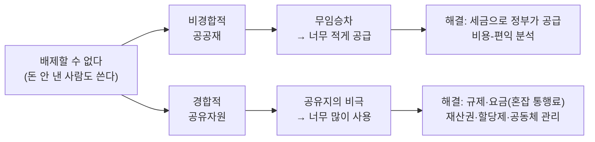

경제학 교과서에는 오랫동안 단골로 등장하는 건물이 하나 있었다. 바로 **등대**다. 19세기 영국의 존 스튜어트 밀부터 20세기 미국의 폴 새뮤얼슨까지, 많은 경제학자가 등대를 시장이 공급할 수 없는 대표적인 예로 들었다. 등대의 불빛은 한번 켜지면 근처를 지나는 모든 배가 볼 수 있다. 등대 주인은 불빛을 보고 안전하게 지나간 배를 일일이 쫓아가 돈을 받을 수 없다. 그러니 누가 돈을 들여 등대를 짓겠는가? 등대는 정부가 지어야 한다는 것이었다.

그런데 1974년, 9강에서 만난 경제학자 **로널드 코스**가 「경제학 속의 등대」라는 논문에서 뜻밖의 사실을 밝혔다. 17~19세기 영국의 많은 등대는 정부가 아니라 개인이 지었다는 것이다. 등대 주인들은 왕실에서 허가를 받은 뒤, 배가 항구에 들어올 때 '등대세'를 걷었다. 항구라는 길목에서 요금을 받을 수 있었기에 등대를 지을 수 있었던 것이다.

등대 이야기는 이 강의의 질문을 잘 보여 준다. 어떤 재화는 왜 시장에서 잘 공급되지 않는가? 그리고 그 어려움은 정부만이 풀 수 있는가? 이 강의에서는 재화를 두 가지 기준으로 나누고, 시장이 실패하는 두 경우인 **공공재**와 **공유자원**을 살펴본다. 공공재는 너무 적게 공급되고, 공유자원은 너무 많이 쓰인다. 둘 다 9강의 외부효과와 깊이 이어져 있다.

> [!핵심] 이 강의의 질문
> 1. 재화는 어떤 기준으로 나눌 수 있으며, 공공재와 공유자원은 무엇이 다른가?
> 2. 공공재는 왜 시장에서 충분히 공급되지 않는가? 정부는 공공재의 양을 어떻게 정하는가?
> 3. 공유자원은 왜 지나치게 쓰이는가? 이를 막는 방법은 무엇인가?

```figure
src: asset:3910ddfedfca14d3a8ca52960b3afed8
caption: 미국 매사추세츠주 앞바다의 마이넛 레지 등대. 바다 한가운데 바위 위에 세운 이 등대의 불빛은 근처를 지나는 모든 배가 볼 수 있다. 등대는 경제학 교과서의 대표적인 공공재였다.
credit: 디트로이트 출판사, 1890~1910년 무렵 · 미국 의회도서관 소장
license: Public Domain (미국 의회도서관: 출판 제한 없음)
source: https://www.loc.gov/item/2016797226/
width: narrow
```

## 재화의 네 가지 종류

### 배제성과 경합성

재화를 나누는 데에는 두 가지 기준이 쓰인다.

- **배제성**: 값을 치르지 않은 사람이 그 재화를 쓰지 못하게 막을 수 있는가? 빵은 돈을 내지 않으면 가게 주인이 주지 않으므로 배제할 수 있다. 라디오 방송이나 국방은 돈을 내지 않은 사람도 혜택을 누리므로 배제하기 어렵다.
- **경합성**: 한 사람이 쓰면 다른 사람이 쓸 수 있는 양이 줄어드는가? 내가 빵을 먹으면 그 빵은 남이 먹을 수 없다. 반면 내가 등대 불빛을 본다고 다른 배가 볼 불빛이 줄어들지는 않는다.

두 기준을 조합하면 재화를 네 가지로 나눌 수 있다.

| 구분 | 경합적 | 비경합적 |
|---|---|---|
| **배제 가능** | **사적재**: 빵, 옷, 휴대전화, 붐비는 유료 도로 | **클럽재**(자연 독점): 케이블 텔레비전, 소방 서비스(일정 지역), 붐비지 않는 유료 도로, 소프트웨어 |
| **배제 불가능** | **공유자원**: 바다의 물고기, 깨끗한 공기와 물, 붐비는 무료 도로, 야생 동물 | **공공재**: 국방, 등대, 가로등, 불꽃놀이, 기초 과학 지식, 홍수 방지 제방 |

표: 배제성과 경합성에 따른 재화의 분류

지금까지 이 강좌에서 다룬 것은 대부분 **사적재**였다. 사적재는 배제할 수 있고 경합적이어서 시장이 잘 작동한다. 이 강의는 배제할 수 없는 두 가지, 곧 **공공재**와 **공유자원**에 집중한다. 비경합적이지만 배제할 수 있는 **클럽재**는 한 기업이 가장 싸게 공급하는 경우가 많아 14강 「독점」에서 다룬다.

분류가 늘 칼로 자르듯 분명한 것은 아니다. 도로는 붐비지 않을 때는 비경합적이지만, 출퇴근 시간에 막히면 한 대가 더 들어올 때마다 다른 차의 속도가 줄어들어 경합적이 된다. 기술이 바뀌면 배제성도 바뀐다. 텔레비전 방송은 예전에는 배제할 수 없었지만, 유료 방송과 인터넷 스트리밍은 가입하지 않은 사람을 쉽게 막는다.

## 공공재

### 무임승차자 문제

어느 작은 마을 사람들이 새해 첫날 불꽃놀이를 보고 싶어 한다. 마을 사람 500명이 각자 불꽃놀이에 2만 원씩의 가치를 둔다면, 불꽃놀이의 총가치는 1,000만 원이다. 불꽃놀이 비용이 500만 원이라면 하는 것이 사회적으로 이득이다. 그런데 어떤 기업가가 불꽃놀이를 열고 돈을 받으려 하면 어떻게 될까? 불꽃은 하늘에서 터지므로, 돈을 내지 않은 사람도 집 마당에서 볼 수 있다. 사람들은 '어차피 남들이 내겠지' 하고 돈을 내지 않으려 한다. 결국 아무도 불꽃놀이를 열지 않는다.

이처럼 재화의 혜택은 누리면서 그 비용은 치르지 않는 사람을 **무임승차자**라고 한다. 공공재는 배제할 수 없으므로 누구나 무임승차를 할 수 있고, 그래서 시장에서는 사회적으로 바람직한 양보다 훨씬 적게 공급된다. 9강의 말로 하면, 공공재는 큰 **긍정적 외부효과**를 갖는 재화다. 내가 낸 돈의 혜택이 나에게만 돌아오지 않고 남들에게도 돌아가기 때문이다.

해결책은 정부가 **세금**을 걷어 공공재를 공급하는 것이다. 마을 사람 모두에게 1만 원씩 세금을 걷어 불꽃놀이를 열면 모두가 1만 원의 이득을 본다. 세금은 강제로 걷으므로 무임승차가 불가능하다.

### 중요한 공공재들

| 공공재 | 왜 공공재인가 | 누가 공급하나 |
|---|---|---|
| 국방 | 한 사람을 지키면 같은 지역의 모든 사람이 함께 지켜진다 | 거의 언제나 정부 |
| 기초 과학 연구 | 한번 밝혀진 지식(예: 수학 정리)은 누구나 쓸 수 있다 | 정부의 연구비, 대학. 응용 기술은 특허로 일부 배제 가능 |
| 빈곤 퇴치 | 가난이 줄어든 사회에 사는 혜택은 모두가 누린다(이견이 있다) | 정부의 복지 제도, 자선 단체 |
| 치안과 법질서 | 범죄가 줄어든 동네의 안전은 모든 주민이 누린다 | 정부(경찰, 법원) |
| 감염병 예방과 방역 | 감염병이 퍼지지 않으면 모두가 안전하다 | 정부(질병관리청 등), 국제기구 |

표: 정부가 공급하는 대표적인 공공재

### 공공재의 양은 어떻게 정하나

시장이 없으니, 정부는 공공재를 얼마나 공급할지 스스로 정해야 한다. 이때 쓰는 도구가 **비용-편익 분석**이다. 새 고속도로를 놓을 때 정부는 건설비와 유지비(비용)를 이 도로를 쓰는 사람들이 얻는 시간 절약, 사고 감소, 물류비 절감(편익)과 비교한다. 한국에서는 총사업비가 일정 규모 이상인 대형 공공사업에 대해 **예비 타당성 조사**를 실시해 비용과 편익을 따진다.

그러나 비용-편익 분석에는 어려움이 많다. 시장 가격이 없으니 편익을 직접 잴 수 없다. 사람들에게 물어보면 공짜로 얻을 수 있는 것은 과장해서 높게 말하고, 세금을 내야 하는 것은 낮게 말하기 쉽다.

특히 어려운 것은 **사람의 생명**을 어떻게 값으로 따질 것인가다. 교차로에 신호등을 세우면 사고가 줄어 생명을 구할 수 있다. 그런데 모든 교차로에 신호등을 세우고 모든 도로에 가드레일을 칠 수는 없다. 어디까지 돈을 쓸지 정하려면 생명을 구하는 편익에 어떤 값을 매겨야 한다. 경제학자들은 사람들이 위험한 일을 할 때 위험 수당으로 얼마를 더 받는지, 안전한 차를 사려고 얼마를 더 내는지를 보고 이 값을 추정한다. 이것을 **통계적 생명 가치**라고 하며, 미국 정부 기관들은 2020년대 들어 한 사람당 약 1,000만 달러 이상의 값을 쓰고 있다. 생명에 값을 매긴다는 것이 불편하게 느껴지지만, 값을 매기지 않으면 오히려 한정된 예산을 생명을 가장 많이 구하는 곳에 쓰지 못하게 된다.

```gallery
src: asset:ba0d0c0f8f179ffe3ce290da17a8cf3e
caption: 1982년 미국 독립기념일에 워싱턴 기념탑 위로 터지는 불꽃. 하늘에서 터지는 불꽃은 돈을 내지 않은 사람도 볼 수 있어, 무임승차자 문제를 설명하는 단골 예다.
credit: 미국 국방부 시청각국 촬영, 1982년 · 미국 국립문서보관소(NARA) 소장
license: Public Domain (미국 연방정부 저작물)
source: https://catalog.archives.gov/id/6371732
---
src: asset:68c83ac37178997ad9f2074d591f9cc3
caption: 1900년 무렵 미국 피츠버그의 카네기 도서관 열람실. 철강왕 앤드루 카네기는 2,500곳이 넘는 공공 도서관을 세우는 데 돈을 냈다. 자선 단체와 기부도 공공재를 공급하는 한 방법이다.
credit: 1900년 무렵 · 미국 의회도서관 소장
license: Public Domain (미국 의회도서관: 출판 제한 없음)
source: https://www.loc.gov/item/2007684172/
```

### 다시 등대로

코스가 밝힌 영국의 등대 이야기로 돌아가 보자. 등대는 정말 공공재일까? 바다 한가운데의 불빛은 배제할 수 없지만, 배들은 결국 어느 항구에 들어와야 한다. 항구에서 등대세를 걷을 수 있다면 등대는 배제할 수 있는 클럽재에 가까워진다. 이처럼 어떤 재화가 공공재인지는 그 재화의 성질만이 아니라 **배제하는 기술과 제도**에 달려 있다. 다만 영국의 개인 등대들도 왕실의 허가와 법으로 정한 징수권이라는 정부의 도움에 기대고 있었다는 점에서, 시장과 정부는 칼로 자르듯 나뉘지 않는다. 영국 정부는 1836년 법으로 개인 등대들을 공공 기관인 '트리니티 하우스'가 사들이게 했다.

```figure
src: asset:e2fe13335aa7bf4133da4ef3ceca46e0
caption: 1938년 미국 오리건주 해안의 헤세타 헤드 등대와 등대지기의 집. 미국의 등대는 정부의 등대 관리국이 세우고 운영했다.
credit: 미국 국립공원관리청 촬영, 1938년 · 미국 국립문서보관소(NARA) 소장
license: Public Domain (미국 연방정부 저작물)
source: https://catalog.archives.gov/id/520120
```

## 공유자원

### 공유지의 비극

1968년 미국의 생물학자 **개릿 하딘**은 과학 잡지 『사이언스』에 「공유지의 비극」이라는 글을 실었다. 그는 19세기 영국 경제학자 윌리엄 로이드가 든 예를 빌려 이렇게 설명했다.

어느 마을에 누구나 소를 풀어 먹일 수 있는 공동 목초지가 있다. 목동들은 각자 소를 한 마리 더 풀어 놓을지 생각한다. 소 한 마리를 더 풀면 그 소에서 나오는 우유와 고기는 모두 자기 것이 된다. 반면 풀이 줄어드는 피해는 마을 사람 모두가 나누어 진다. 그래서 각자에게는 소를 한 마리 더 풀어 놓는 것이 늘 이득이다. 모두가 그렇게 생각하면 목초지는 풀 한 포기 남지 않게 망가진다. 각자는 합리적으로 행동했지만 그 결과는 모두에게 비극이 된다. 이것이 **공유지의 비극**이다.

```chart
{
  "type": "line",
  "caption": "공동 목초지의 소 수와 우유 생산 (가상의 예. 소 한 마리당 생산량은 소가 늘수록 줄어든다). 마을 전체의 생산량은 소 50마리에서 가장 많지만, 각 목동은 소 한 마리당 생산량이 소 한 마리의 비용보다 크기만 하면 계속 소를 늘린다. 그래서 목초지에는 사회적으로 바람직한 수보다 훨씬 많은 소가 몰린다",
  "data": {
    "labels": ["10", "20", "30", "40", "50", "60", "70", "80", "90"],
    "datasets": [
      { "label": "마을 전체의 우유 생산량", "data": [900, 1600, 2100, 2400, 2500, 2400, 2100, 1600, 900], "yAxisID": "y" },
      { "label": "소 한 마리당 생산량", "data": [90, 80, 70, 60, 50, 40, 30, 20, 10], "yAxisID": "y1" }
    ]
  },
  "options": { "scales": { "x": { "title": { "display": true, "text": "목초지의 소 (마리)" } }, "y": { "min": 0, "position": "left", "title": { "display": true, "text": "전체 생산량" } }, "y1": { "min": 0, "position": "right", "grid": { "drawOnChartArea": false }, "title": { "display": true, "text": "한 마리당 생산량" } } } }
}
```

공유지의 비극은 9강의 외부효과로 설명할 수 있다. 소 한 마리를 더 풀 때 다른 목동들의 소가 먹을 풀이 줄어드는 것은 **부정적 외부효과**다. 각 목동은 이 외부 비용을 따지지 않으므로 공유자원은 지나치게 쓰인다.

### 역사 속의 공유지의 비극

| 자원 | 무슨 일이 있었나 |
|---|---|
| 아메리카 들소 | 19세기 초 북아메리카 초원에는 수천만 마리의 들소가 살았다. 철도가 놓이고 들소 가죽의 값이 오르자 사냥꾼들이 앞다투어 들소를 잡았다. 누구의 소유도 아니었기에 남겨 둘 유인이 없었다. 1880년대 말 들소는 1,000마리 남짓까지 줄어 멸종 위기에 몰렸다 |
| 캐나다 뉴펀들랜드의 대구 | 수백 년 동안 풍부했던 그랜드뱅크스의 대구는 20세기 후반 대형 트롤 어선의 남획으로 급감했다. 1992년 캐나다 정부는 대구잡이를 전면 금지했고, 3만 명 넘는 어민과 가공 노동자가 일자리를 잃었다. 수십 년이 지나도 대구는 예전만큼 회복되지 않았다 |
| 한국 동해의 명태 | 1980년대 초 한 해 십수만 톤이 잡히던 동해의 명태는 어린 명태(노가리)까지 마구 잡은 데다 바다 환경의 변화가 겹쳐 2000년대 들어 거의 잡히지 않게 되었다. 정부는 2014년 명태 살리기 사업을 시작했고, 2019년부터 명태 포획을 전면 금지했다 |

표: 공유자원 남획의 역사적 사례

```gallery
src: asset:14fb1a6ca943adcc81523af4bf68c799
caption: 1874년 『하퍼스 위클리』에 실린 「서부 스케치: 가죽과 뼈 말리기」. 사냥꾼들이 들소 가죽을 펴 말리고 뼈를 쌓고 있다. 누구의 소유도 아니던 들소는 불과 몇십 년 만에 멸종 위기에 몰렸다.
credit: 프렌제니 & 태버니어 그림, 1874년 · 미국 의회도서관 소장
license: Public Domain (미국 의회도서관: 출판 제한 없음)
source: https://www.loc.gov/item/90710851/
---
src: asset:1f63d1a8e5567b5e196cf8e8c0b22a29
caption: 커리어 & 아이브스의 석판화 「고래잡이: 참고래 공격하기」(1860년 무렵). 고래기름을 얻으려는 남획으로 19세기에 여러 고래 종이 급감했다. 1986년부터 국제 포경 위원회가 상업 포경을 중단시켰다.
credit: 커리어 & 아이브스, 1860년 무렵 · 메트로폴리탄 미술관 소장
license: Public Domain (메트로폴리탄 미술관: CC0)
source: https://www.metmuseum.org/art/collection/search/769243
---
src: asset:7c79c3ee528632636408b3d542e8b6e4
caption: 1885년 미국 볼티모어 항구를 가득 메운 굴잡이 배들. 체서피크만의 굴은 남획과 오염, 질병으로 20세기 들어 크게 줄었다.
credit: 미국 어업위원회 촬영, 1885년 · 미국 국립문서보관소(NARA) 소장
license: Public Domain (미국 연방정부 저작물)
source: https://catalog.archives.gov/id/513081
```

### 공유지의 비극을 막는 방법

공유지의 비극을 막는 방법은 공유자원을 쓰는 사람이 그 외부 비용을 치르게 하거나, 쓸 수 있는 양을 제한하는 것이다.

- **규제**: 사냥 철과 어획량을 제한하고, 그물코 크기를 정하며, 어린 물고기의 포획을 금지한다.
- **세금과 요금**: 공유자원을 쓰는 데 값을 매긴다. **혼잡 통행료**가 대표적이다. 싱가포르는 1975년 세계 처음으로 도심에 들어오는 차에 통행료를 받기 시작했고, 영국 런던은 2003년, 스웨덴 스톡홀름은 2007년, 미국 뉴욕은 2025년에 혼잡 통행료를 도입했다. 서울도 1996년부터 남산 1호·3호 터널을 지나는 승용차에 혼잡 통행료를 받고 있다.
- **재산권 부여**: 공유자원을 사적재로 바꾸는 것이다. 영국에서는 16~19세기에 공동 목초지에 울타리를 치고 개인 소유로 나누는 **인클로저**가 이루어졌다. 생산성은 높아졌지만 땅을 잃은 농민들이 도시로 밀려나는 큰 사회적 비용이 따랐다. 오늘날에는 어업에서 각 어선에 잡을 수 있는 양을 할당하고 이를 사고팔게 하는 **개별 양도성 할당제**가 쓰인다. 뉴질랜드(1986)와 아이슬란드(1990) 등이 도입해 어족 자원을 지키는 데 성과를 거두었다.

```figure
src: asset:7a7ac278b7966d73e2afa03476e0d5fe
caption: 1972년 미국 휴스턴 고속도로의 교통 체증. 붐비는 무료 도로는 공유자원이다. 차 한 대가 더 들어올 때마다 다른 모든 차의 속도가 줄어든다.
credit: 미국 환경보호청 '도큐메리카' 사진 사업, 1972년 · 미국 국립문서보관소(NARA) 소장
license: Public Domain (미국 연방정부 저작물)
source: https://catalog.archives.gov/id/545884
```



### 오스트롬: 공동체는 스스로 다스릴 수 있다

하딘은 공유지의 비극을 막으려면 정부의 규제나 사유화밖에 없다고 보았다. 그러나 미국의 정치경제학자 **엘리너 오스트롬**은 세계 곳곳을 직접 조사해 다른 길을 찾아냈다. 스위스 알프스의 마을들은 수백 년 동안 공동 목초지에 풀어 놓을 소의 수를 스스로 정해 지켜 왔다. 일본의 산촌 마을들은 공동 소유의 산에서 나무와 풀을 베는 규칙을 정해 숲을 지켰고, 스페인 발렌시아 지방의 농민들은 수백 년 동안 관개 수로의 물을 나누는 규칙을 운영했다.

오스트롬은 성공적인 공동체 관리에 공통된 특징이 있다고 했다. 누가 자원을 쓸 수 있는지 경계가 분명하고, 규칙을 쓰는 사람들이 직접 만들며, 규칙을 어기는지 서로 감시하고, 어긴 사람에게 단계적으로 벌을 주며, 분쟁을 값싸게 해결하는 장치가 있다는 것이다. 정부나 시장만이 답이 아니라, 신뢰와 규칙을 갖춘 공동체도 공유자원을 지킬 수 있다는 그의 연구는 2009년 노벨 경제학상으로 이어졌다. 여성으로서는 처음이었다. 한국의 어촌계가 마을 앞바다의 해산물을 공동으로 관리하며 채취 기간과 양을 정하는 것도 이런 공동체 관리의 예다.

## 정리

> [!핵심] 10강 요약
> - 재화는 **배제성**과 **경합성**에 따라 사적재, 공공재, 공유자원, 클럽재로 나뉜다.
> - **공공재**는 배제할 수 없고 비경합적이다. **무임승차자 문제** 때문에 시장에서 너무 적게 공급되므로, 정부가 세금으로 공급하고 **비용-편익 분석**으로 양을 정한다. 생명의 가치를 따지는 **통계적 생명 가치**도 그 도구다.
> - 등대 이야기가 보여 주듯, 어떤 재화가 공공재인지는 **배제하는 기술과 제도**에 따라 달라진다.
> - **공유자원**은 배제할 수 없지만 경합적이다. 각자가 외부 비용을 따지지 않아 지나치게 쓰이는 **공유지의 비극**이 일어난다. 들소와 대구, 명태의 남획이 그 예다.
> - 공유지의 비극은 **규제**, **요금**(혼잡 통행료), **재산권**(할당제), 그리고 오스트롬이 밝힌 **공동체의 자치 규칙**으로 막을 수 있다.

### 생각해 볼 질문

1. 유튜브의 무료 동영상은 네 가지 재화 가운데 무엇에 가까운가? 유튜브는 무임승차 문제를 어떻게 해결하고 있는가?
2. 출퇴근 시간의 서울 도심 도로에 혼잡 통행료를 받는다면 누가 이득을 보고 누가 손해를 볼까?
3. 기후 변화 문제를 '공유지의 비극'으로 설명해 보자. 오스트롬의 공동체 관리 원칙을 국제 협력에 적용할 수 있을까?

### 다음 강 예고

11강 「조세 제도와 정부의 역할」에서는 공공재와 복지를 위한 돈을 정부가 어떻게 걷는지 살펴본다. 한국 정부는 어떤 세금을 얼마나 걷고 어디에 쓰는지, 좋은 세금의 조건인 **효율성**과 **공평성**은 무엇인지, 그리고 누진세와 비례세, 부가가치세를 둘러싼 논쟁을 다룬다.
