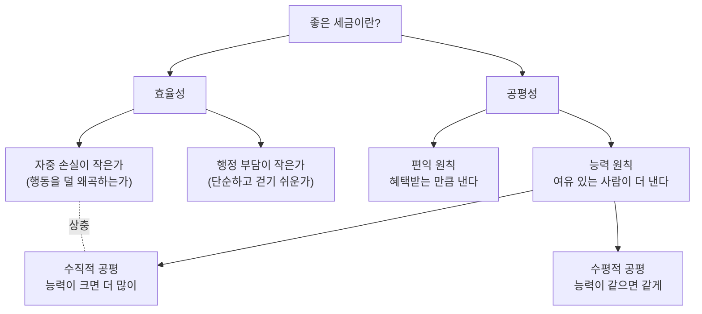

1696년 영국 정부는 새로운 세금을 만들었다. 집에 난 **창문의 수**에 따라 세금을 매기는 '창문세'였다. 정부가 집집마다 들어가 재산을 조사하지 않아도, 길에서 창문만 세면 세금을 매길 수 있었다. 창문이 많은 큰 집에 사는 부자가 세금을 더 내게 되니 공평해 보이기도 했다. 그런데 사람들은 세금을 덜 내려고 창문을 벽돌로 막아 버렸다. 빛과 바람이 들지 않는 어두운 집에서 사람들은 습기와 병에 시달렸다. 창문세는 무려 150년이 넘게 이어지다가 1851년에야 폐지되었다. 지금도 영국의 오래된 건물에서는 벽돌로 막힌 창문 자국을 볼 수 있다.

"세상에 확실한 것은 죽음과 세금뿐"이라는 말이 있다. 미국의 벤저민 프랭클린이 1789년 편지에 쓴 말로 유명하다. 정부는 국방과 치안, 교육, 복지, 도로 같은 일을 하려면 돈이 필요하고, 그 돈의 대부분을 세금으로 걷는다. 이 강의에서는 한국 정부가 어떤 세금을 얼마나 걷고 어디에 쓰는지 살펴보고, 좋은 세금의 두 가지 조건인 **효율성**과 **공평성**을 따져 본다. 창문세 이야기처럼, 세금은 사람들의 행동을 바꾸고, 누가 얼마를 내야 공평한지에 대해 사회는 끝없이 논쟁한다.

> [!핵심] 이 강의의 질문
> 1. 한국 정부는 어떤 세금을 얼마나 걷고, 그 돈을 어디에 쓰는가?
> 2. 효율적인 세금이란 무엇인가? 세금은 어떤 비용을 낳는가?
> 3. 공평한 세금이란 무엇인가? 누진세, 비례세, 역진세는 어떻게 다른가?

{{F:e11-opening}}

## 정부는 얼마를 걷고 어디에 쓰나

### 한국의 세금

한국의 세금은 중앙 정부가 걷는 **국세**와 지방 자치 단체가 걷는 **지방세**로 나뉜다. 2024년 국세 수입은 약 336조 원이었다. 가장 큰 몫은 개인의 소득에 매기는 **소득세**, 물건과 서비스를 살 때 붙는 **부가가치세**, 기업의 이윤에 매기는 **법인세**의 세 가지다. 이 셋을 흔히 '3대 세목'이라고 부른다.

```chart
{
  "type": "doughnut",
  "caption": "2024년 한국의 국세 수입 구성 (조 원, 기획재정부 결산 자료를 바탕으로 한 대략적인 수치. 총 약 336조 원). 기업 실적 부진으로 법인세가 전년(약 80조 원)보다 크게 줄었다",
  "data": {
    "labels": ["소득세", "부가가치세", "법인세", "그 밖의 세금 (교통·에너지·환경세, 상속·증여세, 관세 등)"],
    "datasets": [{ "label": "국세 수입(조 원)", "data": [117.4, 82.2, 62.5, 74.4] }]
  }
}
```

세금 말고도 국민이 내는 것이 있다. 국민연금과 건강보험, 고용보험, 산재보험의 **사회 보험료**다. 세금과 사회 보험료를 합쳐 국내총생산(GDP)에 견준 비율을 **국민 부담률**이라고 한다. 한국의 국민 부담률은 대략 GDP의 28~32% 수준으로, 경제협력개발기구(OECD) 회원국 평균(30%대 중반)보다 낮다. 덴마크나 프랑스처럼 복지가 두터운 유럽 나라들은 40%를 넘는다. 반대로 미국은 한국과 비슷하거나 조금 낮다. 국민이 세금을 얼마나 낼지는 정부가 얼마나 많은 일을 할지와 맞물린 선택이다.

### 정부는 어디에 쓰나

2024년 한국 중앙 정부의 총지출 예산은 약 657조 원이었다. 국세 수입보다 훨씬 많은 이 돈은 세금에 더해 사회 보험료와 각종 기금 수입, 그리고 나랏빚(국채)으로 마련된다. 가장 큰 몫은 **보건·복지·고용** 분야로, 총지출의 3분의 1이 넘는다. 기초 연금과 국민연금 지급, 건강 보험 지원, 기초 생활 보장, 실업 급여 같은 것들이다. 그다음으로 지방 정부에 넘겨주는 교부금과 교육, 국방, 사회 기반 시설(도로·철도), 연구 개발 등에 쓰인다.

정부 지출 가운데 상당 부분은 정부가 직접 무엇을 사는 데 쓰이는 것이 아니라, 한 사람에게서 걷어 다른 사람에게 건네는 **이전 지출**이다. 연금과 복지 급여가 대표적이다. 고령화가 빠르게 진행되면서 연금과 건강 보험에 들어가는 돈은 해마다 크게 늘고 있다. 이를 누가 어떻게 부담할지는 한국 사회의 가장 큰 숙제 가운데 하나다.

{{F:e11-history}}

## 좋은 세금의 조건 1: 효율성

### 세금의 두 가지 비용

세금을 걷으면 납세자가 낸 돈만큼 정부가 쓸 돈이 생긴다. 그런데 세금의 비용은 낸 돈에서 그치지 않는다. 경제학자들은 세금의 비용을 두 가지로 나누어 따진다.

첫째는 **자중 손실**이다. 7강에서 배운 것처럼 세금은 사람들의 행동을 바꾸어, 세금이 없었다면 일어났을 이로운 거래를 막는다. 창문세 때문에 사람들이 창문을 막아 어두운 집에서 산 것이 바로 자중 손실이다. 정부는 막힌 창문에서 세금을 한 푼도 걷지 못했고, 사람들은 빛과 바람을 잃었다. 소득세는 사람들이 덜 일하게 만들 수 있고, 저축에 매기는 세금은 저축을 줄일 수 있다.

둘째는 **행정 부담**, 곧 세금을 내고 걷는 데 드는 비용이다. 납세자는 세금을 계산하고 서류를 꾸미는 데 시간과 돈을 쓰고, 세무사를 고용하기도 한다. 정부는 세무서를 운영하고 탈세를 단속해야 한다. 세법이 복잡할수록 이 비용은 커진다. 복잡한 세법은 또 세금을 피할 길을 찾아내는 데 큰돈을 쓰는 사람들을 만들어 낸다.

### 평균 세율과 한계 세율

세금이 사람들의 행동에 미치는 영향을 이해하려면 두 가지 세율을 구분해야 한다. **평균 세율**은 낸 세금 전체를 소득 전체로 나눈 것이다. **한계 세율**은 소득이 1원 더 늘 때 추가로 내는 세금의 비율이다. 1강에서 배운 한계적 사고를 떠올리면, 사람들이 일을 조금 더 할지 말지를 정할 때 중요한 것은 한계 세율이다. 추가로 버는 돈에서 세금으로 얼마가 나가는지가 '하나 더'의 이득을 정하기 때문이다.

한국의 종합 소득세는 소득이 높아질수록 더 높은 세율이 적용되는 구간별 세율 구조다.

| 과세 표준(1년 소득에서 공제를 뺀 금액) | 세율 |
|---|---|
| 1,400만 원 이하 | 6% |
| 1,400만 원 초과 ~ 5,000만 원 이하 | 15% |
| 5,000만 원 초과 ~ 8,800만 원 이하 | 24% |
| 8,800만 원 초과 ~ 1억 5,000만 원 이하 | 35% |
| 1억 5,000만 원 초과 ~ 3억 원 이하 | 38% |
| 3억 원 초과 ~ 5억 원 이하 | 40% |
| 5억 원 초과 ~ 10억 원 이하 | 42% |
| 10억 원 초과 | 45% |

표: 한국의 종합 소득세 기본 세율 (2023년 이후, 지방 소득세 별도)

여기서 흔한 오해가 있다. 과세 표준이 5,000만 원에서 5,100만 원으로 늘면 소득 전체에 24%가 매겨지는 것이 아니다. 5,000만 원을 넘는 **100만 원에만** 24%가 적용된다. 앞의 1,400만 원에는 6%, 그다음 3,600만 원에는 15%가 그대로 적용된다. 그래서 이 사람의 한계 세율은 24%이지만, 평균 세율은 그보다 훨씬 낮은 약 13% 남짓이다. '세율 구간이 올라가 오히려 손해'라는 일은 생기지 않는다.

### 정액세: 가장 효율적이지만

가장 효율적인 세금은 무엇일까? 모든 사람에게 소득이나 행동과 관계없이 똑같은 금액을 걷는 **정액세**(인두세)다. 정액세는 더 일하든 덜 일하든 내는 세금이 같으므로 한계 세율이 0이다. 사람들의 행동을 바꾸지 않으니 자중 손실이 없다. 계산도 간단하다. 그러나 정액세는 가난한 사람과 부자가 똑같은 금액을 내므로 매우 불공평하게 느껴진다. 1990년 영국 대처 정부가 지방세를 사실상의 정액세인 '인두세'로 바꾸자 전국에서 격렬한 반대 시위가 일어났고, 이 세금은 대처가 물러나는 원인의 하나가 되었다. 효율성만으로는 좋은 세금을 말할 수 없는 것이다.

## 좋은 세금의 조건 2: 공평성

### 편익 원칙과 능력 원칙

누가 세금을 얼마나 내야 공평할까? 두 가지 생각이 있다.

**편익 원칙**은 정부 서비스에서 혜택을 받는 만큼 세금을 내야 한다는 생각이다. 도로를 많이 쓰는 사람이 휘발유세를 더 내는 것이 그 예다. 시장에서 물건값을 내는 것과 비슷한 논리다. 그러나 가난한 사람을 돕는 복지 정책에는 이 원칙을 적용하기 어렵다. 혜택을 받는 가난한 사람에게 세금을 걷을 수는 없기 때문이다.

**능력 원칙**은 세금을 낼 수 있는 능력, 곧 경제적 여유가 큰 사람이 더 많이 내야 한다는 생각이다. 같은 100만 원도 가난한 사람에게는 큰 부담이지만 부자에게는 그렇지 않으니, 부담의 '희생'을 공평하게 하려면 부자가 더 많이 내야 한다는 것이다. 능력 원칙은 다시 둘로 나뉜다. **수직적 공평**은 능력이 큰 사람이 더 많이 내야 한다는 것이고, **수평적 공평**은 능력이 같은 사람은 같은 세금을 내야 한다는 것이다.

### 누진세, 비례세, 역진세

소득에 따라 세금의 비율이 어떻게 달라지느냐에 따라 세금을 셋으로 나눈다.

| 종류 | 소득이 늘 때 세금 비율(평균 세율) | 예 |
|---|---|---|
| 누진세 | 높아진다 | 한국의 소득세(구간별 6~45%), 상속세 |
| 비례세 | 같다 | 많은 나라의 법인세 일부, 한때 동유럽에서 유행한 단일 세율 소득세 |
| 역진세 | 낮아진다 | 정액세. 또 부가가치세·담뱃세처럼 소비에 붙는 세금은 소득 대비로 보면 역진적인 경향 |

표: 누진세, 비례세, 역진세

부가가치세는 모든 사람이 산 물건값의 10%를 똑같이 내므로 비례세처럼 보인다. 그러나 가난한 사람일수록 소득의 대부분을 소비에 쓰고, 부자는 소득의 상당 부분을 저축한다. 그래서 소득과 비교하면 가난한 사람이 소득에서 더 큰 비율을 부가가치세로 내게 된다. 소비에 붙는 세금이 역진적이라는 말은 이 뜻이다. 한국은 이를 줄이려고 쌀이나 채소 같은 기초 생활 필수품과 의료, 교육 서비스에는 부가가치세를 면제한다.

> [!사료] 부가가치세의 도입 (1977)
> 한국은 1977년 7월 1일 **부가가치세**를 도입했다. 그때까지 영업세와 물품세 등 여러 갈래로 나뉘어 있던 간접세를 하나로 묶은 것이다. 부가가치세는 생산과 유통의 각 단계에서 새로 더해진 가치(부가가치)에만 세금을 매기고, 앞 단계에서 낸 세금은 빼 주는 방식이어서 거래 단계마다 세금이 겹쳐 쌓이지 않는다. 사고파는 사람이 서로 세금 계산서를 주고받아야 세금을 돌려받을 수 있으므로, 거래가 투명해지는 효과도 있다. 그러나 도입 초기에는 물가가 오르고 영세 상인들의 부담과 반발이 컸다. 1979년 부마 민주 항쟁 당시 상인들의 불만도 그 배경의 하나로 거론된다. 오늘날 부가가치세는 세계 170여 나라가 쓰는 세금이 되었고, 한국에서는 세율 10%가 도입 이래 지금까지 그대로 유지되고 있다.

### 세금은 정말 누가 내는가

공평성을 따질 때 다시 기억해야 할 것이 6강에서 배운 **세금의 귀착**이다. 법이 누구에게 세금을 내라고 정하든, 실제 부담은 탄력성에 따라 나뉜다. 대표적인 논쟁이 **법인세**다. 법인세는 기업이 내지만 기업은 사람이 아니다. 법인세의 부담은 결국 주주(배당이 줄어든다), 노동자(임금이 덜 오른다), 소비자(값이 오른다) 가운데 누군가에게 돌아간다. 자본이 나라 사이를 쉽게 옮겨 다닐수록 자본은 세금을 피해 나라 밖으로 빠져나갈 수 있으므로, 법인세의 부담이 이동하기 어려운 노동자에게 더 많이 돌아간다는 연구도 있다. 그래서 '부자 기업에 세금을 매기면 부자가 낸다'는 생각은 생각만큼 단순하지 않다.



## 세금의 역사 속에서

세금은 늘 정치와 맞물려 왔다. 영국에서는 1215년 귀족들이 왕의 마음대로 세금을 걷지 못하게 하는 「대헌장」을 받아 냈고, 미국 독립 전쟁은 "대표 없이 과세 없다"는 구호와 함께 시작되었다. 소득세는 전쟁 비용을 마련하려고 생겨났다. 영국은 나폴레옹과의 전쟁 비용을 대려고 1799년 처음 소득세를 걷었고, 미국은 1913년 헌법을 고쳐 연방 소득세를 도입한 뒤 두 차례 세계대전을 거치며 소득세를 국민 대다수가 내는 세금으로 키웠다.

조선에서도 세금은 공평성 논쟁의 한가운데 있었다. 조선 전기의 세금은 땅에 매기는 전세(田稅)와 몸으로 치르는 역(役), 그리고 지방 특산물을 바치는 **공납**(貢納)이었다. 공납은 집집마다 매겨졌기 때문에 땅이 없는 가난한 농민에게도 무거운 짐이 되었고, 관리와 상인이 대신 바치고 몇 배의 값을 받아 내는 '방납'의 폐단이 컸다. 1608년 경기도부터 시행된 **대동법**은 공납을 땅의 면적에 따라 쌀로 내게 바꾸었다. 땅이 많은 사람이 더 많이 내게 되었으므로 능력 원칙에 가까운 개혁이었다. 땅이 많은 양반 지주들이 반대해 전국에 시행되기까지 100년(1708년 완성)이 걸렸다.

```timeline
1215 | 영국, 「대헌장」 | 왕의 마음대로 세금을 걷지 못하게 함
1608 | 조선, 대동법 시행 시작 | 공납을 토지 기준의 쌀로. 1708년 전국 시행
1696 | 영국, 창문세 도입 | 1851년 폐지
1773 | 보스턴 차 사건 | "대표 없이 과세 없다"
1799 | 영국, 최초의 소득세 | 나폴레옹 전쟁 비용
1913 | 미국, 연방 소득세 도입 | 헌법 수정 제16조
1949 | 한국, 소득세법 제정 | 
1977 | 한국, 부가가치세 도입 | 세율 10%
1990 | 영국, 인두세 반대 시위 | 정액세의 정치적 한계
```

{{F:e11-tax}}

## 정리

> [!핵심] 11강 요약
> - 한국의 국세는 **소득세·부가가치세·법인세**가 큰 몫을 차지한다. 세금과 사회 보험료를 합친 **국민 부담률**은 OECD 평균보다 낮다. 정부 지출의 가장 큰 몫은 보건·복지·고용이다.
> - 세금의 비용에는 낸 세금 외에 **자중 손실**과 **행정 부담**이 있다. 사람들의 행동에 영향을 주는 것은 **한계 세율**이며, 구간별 누진세에서는 늘어난 소득에만 높은 세율이 적용된다.
> - **정액세**는 가장 효율적이지만 불공평하다. 공평성에는 **편익 원칙**과 **능력 원칙**(수직적·수평적 공평)이 있다.
> - 소득이 늘 때 세금 비율이 높아지면 **누진세**, 같으면 **비례세**, 낮아지면 **역진세**다. 소비에 붙는 세금은 소득 대비 역진적인 경향이 있다.
> - 세금의 실제 부담은 **귀착**에 따라 달라지므로, 법인세처럼 누가 내는지 단순하지 않은 세금이 많다. 효율성과 공평성은 자주 **상충**한다.

### 생각해 볼 질문

1. 과세 표준이 9,000만 원인 사람의 소득세를 위 표로 계산해 보자. 이 사람의 한계 세율과 평균 세율은 각각 얼마인가?
2. 부가가치세를 15%로 올리고 소득세를 내리면 효율성과 공평성은 각각 어떻게 달라질까?
3. 조선의 대동법과 영국의 창문세는 각각 어떤 기준으로 세금을 매겼는가? 두 세금을 효율성과 공평성의 기준으로 평가해 보자.

### 다음 강 예고

12강 「생산비용」에서는 시장의 공급 곡선 뒤에 숨어 있는 기업의 결정을 들여다본다. 기업의 목표인 **이윤**, 생산량과 투입량의 관계인 **생산 함수**, 고정 비용과 가변 비용, 평균 비용과 한계 비용, 그리고 대량 생산이 비용을 낮추는 **규모의 경제**를 배운다.
