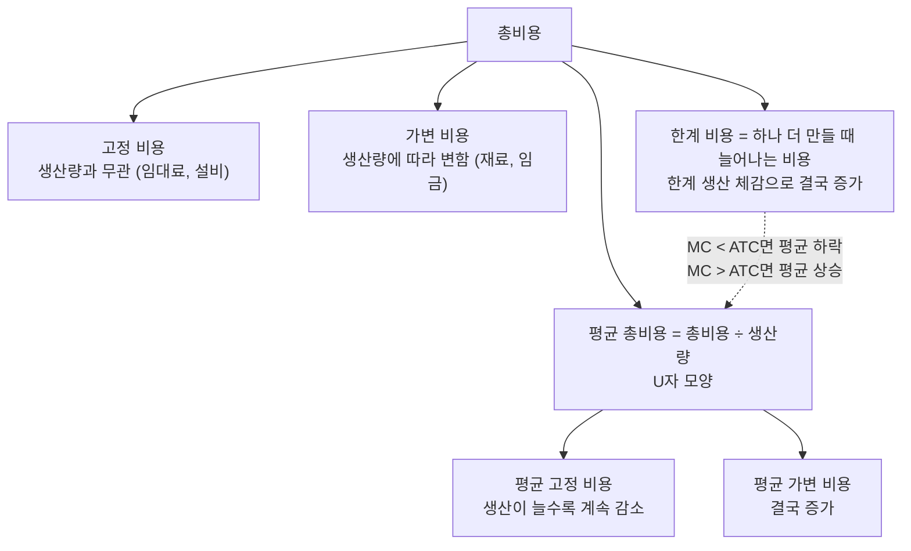

1908년 미국의 포드 자동차 회사가 **모델 T**를 내놓았을 때, 차 한 대의 값은 850달러였다. 당시 노동자 한 사람의 1년 벌이를 훌쩍 넘는 돈이었다. 그런데 모델 T의 값은 해가 갈수록 떨어졌다. 1913년 포드가 움직이는 조립 라인을 들여오자 차 한 대를 조립하는 시간은 12시간 남짓에서 1시간 30분 정도로 줄었다. 1920년대 중반에는 모델 T가 300달러도 안 되는 값에 팔렸다. 1927년 생산이 끝날 때까지 모델 T는 1,500만 대 넘게 팔렸고, 자동차는 부자의 장난감에서 보통 사람의 교통수단이 되었다.

포드는 어떻게 차값을 3분의 1로 낮출 수 있었을까? 답은 **비용**에 있다. 같은 차를 더 적은 비용으로 만들 수 있게 되자, 값을 내려도 이윤을 남길 수 있었다. 4강에서 우리는 공급 곡선이 오른쪽 위로 기운다는 것을 배웠다. 이 강의에서는 그 공급 곡선 뒤에 숨어 있는 기업의 결정, 곧 **생산과 비용**을 들여다본다. 비용의 개념은 앞으로 13~16강에서 배울 여러 시장 구조를 이해하는 바탕이 된다.

> [!핵심] 이 강의의 질문
> 1. 기업의 이윤이란 무엇이며, 경제학자가 보는 비용은 회계사가 보는 비용과 어떻게 다른가?
> 2. 생산을 늘리면 비용은 어떻게 변하는가? 고정 비용, 가변 비용, 평균 비용, 한계 비용은 무엇인가?
> 3. 기업 규모가 커지면 왜 비용이 낮아지기도 하고 높아지기도 하는가?

{{F:e12-opening}}

## 비용이란 무엇인가

### 이윤 = 총수입 − 총비용

경제학에서는 기업의 목표를 **이윤**을 가장 크게 하는 것이라고 가정한다. 이윤은 기업이 상품을 팔아 번 돈(**총수입**)에서 그 상품을 만드는 데 든 비용(**총비용**)을 뺀 것이다. 총수입은 가격에 판매량을 곱하면 되니 간단하다. 어려운 것은 총비용이다. 무엇을 비용으로 볼 것인가?

### 명시적 비용과 암묵적 비용

1강에서 배운 **기회비용**을 떠올려 보자. 어떤 것의 비용은 그것을 얻기 위해 포기한 것이다. 기업의 비용도 마찬가지다. 기업의 비용에는 실제로 돈이 나가는 **명시적 비용**과, 돈은 나가지 않지만 포기한 기회의 가치인 **암묵적 비용**이 있다.

회사를 그만두고 카페를 차린 지수를 예로 들어 보자. 지수는 회사에서 연봉 4,000만 원을 받았고, 모아 둔 1억 원으로 카페를 차렸다.

| 항목 | 금액(1년) | 구분 |
|---|---|---|
| 카페의 총수입 | 1억 5,000만 원 | |
| 원두·우유·컵 등 재료비 | 4,000만 원 | 명시적 비용 |
| 아르바이트생 임금 | 3,000만 원 | 명시적 비용 |
| 가게 임대료·전기료 | 3,000만 원 | 명시적 비용 |
| **회계적 이윤** (총수입 − 명시적 비용) | **5,000만 원** | |
| 회사를 그만두며 포기한 연봉 | 4,000만 원 | 암묵적 비용 |
| 1억 원을 예금했다면 받았을 이자 (연 3%) | 300만 원 | 암묵적 비용 |
| **경제적 이윤** (총수입 − 명시적 비용 − 암묵적 비용) | **700만 원** | |

표: 카페 사장 지수의 회계적 이윤과 경제적 이윤 (가상의 예)

회계사는 장부에 적힌 명시적 비용만 빼므로 지수의 이윤을 5,000만 원으로 계산한다. 이것이 **회계적 이윤**이다. 그러나 경제학자는 지수가 카페를 하느라 포기한 연봉과 이자까지 비용으로 넣는다. 그러면 지수의 **경제적 이윤**은 700만 원이다. 경제적 이윤이 0보다 크다는 것은, 지수가 다른 일을 하는 것보다 카페를 하는 것이 낫다는 뜻이다. 만약 경제적 이윤이 마이너스라면, 회계상으로는 돈을 벌고 있어도 지수는 회사로 돌아가는 편이 낫다. 기업이 시장에 들어오고 나가는 결정은 경제적 이윤에 달려 있으며, 13강에서 이 개념이 중요하게 쓰인다.

## 생산과 비용

### 생산 함수와 한계 생산

어느 빵집이 있다. 오븐 한 대와 가게는 정해져 있고, 사장은 제빵사를 몇 명 고용할지 정해야 한다. 고용하는 제빵사 수(투입)와 하루에 만드는 빵의 양(산출) 사이의 관계를 **생산 함수**라고 한다.

| 제빵사 수 | 하루 생산량 (개) | 한계 생산 (제빵사 한 명을 더 쓸 때 늘어나는 빵) |
|---|---|---|
| 0 | 0 | — |
| 1 | 100 | 100 |
| 2 | 180 | 80 |
| 3 | 240 | 60 |
| 4 | 280 | 40 |
| 5 | 300 | 20 |
| 6 | 310 | 10 |

표: 빵집의 생산 함수 (가상의 예, 오븐과 가게 크기는 고정)

투입을 한 단위 늘릴 때 늘어나는 산출량을 **한계 생산**이라고 한다. 이 빵집에서는 제빵사를 늘릴수록 한 명이 더해 주는 빵의 양이 100개, 80개, 60개로 줄어든다. 이것을 **한계 생산 체감**이라고 한다. 오븐이 한 대뿐이라 제빵사가 많아지면 오븐 앞에서 차례를 기다리는 시간이 늘고, 좁은 가게에서 서로 부딪치기 때문이다. 고정된 투입물(오븐, 가게)에 가변 투입물(제빵사)을 계속 늘리면, 언젠가는 추가 투입의 효과가 줄어든다.

한계 생산 체감은 경제학의 오래된 생각이다. 19세기 초 맬서스와 리카도는 땅의 양은 정해져 있는데 인구가 늘어 같은 땅에 농민이 더 많이 일하게 되면, 농민 한 사람이 더해 주는 식량이 점점 줄어든다고 보았다. 맬서스는 그래서 인구가 늘면 결국 식량이 모자라 사람들이 가난에서 벗어날 수 없다고 비관했다. 그러나 그 뒤의 역사는 다르게 흘러갔다. 기술이 발전해 생산 함수 자체가 위로 올라갔기 때문이다(23강).

{{F:e12-workshop}}

### 고정 비용과 가변 비용

이제 생산량에 따라 비용이 어떻게 변하는지 보자. 기업의 비용은 두 가지로 나뉜다.

- **고정 비용**: 생산량과 관계없이 드는 비용. 가게 임대료, 오븐 할부금, 보험료처럼 빵을 하나도 만들지 않아도 내야 하는 돈이다.
- **가변 비용**: 생산량에 따라 달라지는 비용. 밀가루와 버터 같은 재료비, 제빵사의 임금, 전기료가 그 예다.

**총비용 = 고정 비용 + 가변 비용**

### 평균 비용과 한계 비용

기업이 생산량을 정할 때 알고 싶은 것은 두 가지다. 하나는 "빵 한 개를 만드는 데 평균적으로 얼마가 드는가?"이고, 다른 하나는 "빵을 하나 더 만들면 비용이 얼마나 더 드는가?"이다.

- **평균 총비용** = 총비용 ÷ 생산량. 한 단위당 평균 비용이다. 이것은 다시 **평균 고정 비용**(고정 비용 ÷ 생산량)과 **평균 가변 비용**(가변 비용 ÷ 생산량)의 합이다.
- **한계 비용** = 생산을 한 단위 늘릴 때 늘어나는 총비용.

어느 빵집의 하루 비용이 다음과 같다고 하자. 고정 비용은 하루 3만 원이다.

| 생산량 (백 개) | 고정 비용 | 가변 비용 | 총비용 | 평균 총비용 | 한계 비용 |
|---|---|---|---|---|---|
| 0 | 3.0 | 0 | 3.0 | — | — |
| 1 | 3.0 | 0.3 | 3.3 | 3.30 | 0.3 |
| 2 | 3.0 | 0.8 | 3.8 | 1.90 | 0.5 |
| 3 | 3.0 | 1.5 | 4.5 | 1.50 | 0.7 |
| 4 | 3.0 | 2.4 | 5.4 | 1.35 | 0.9 |
| 5 | 3.0 | 3.5 | 6.5 | 1.30 | 1.1 |
| 6 | 3.0 | 4.8 | 7.8 | 1.30 | 1.3 |
| 7 | 3.0 | 6.3 | 9.3 | 1.33 | 1.5 |
| 8 | 3.0 | 8.0 | 11.0 | 1.38 | 1.7 |
| 9 | 3.0 | 9.9 | 12.9 | 1.43 | 1.9 |
| 10 | 3.0 | 12.0 | 15.0 | 1.50 | 2.1 |

표: 빵집의 비용 (단위: 만 원, 가상의 예)

```chart
{
  "type": "line",
  "caption": "빵집의 평균 총비용, 평균 가변 비용, 한계 비용 (만 원/백 개, 위 표의 가상 예). 한계 비용은 생산이 늘수록 올라가고, 평균 총비용은 U자 모양이다. 한계 비용 곡선은 평균 총비용 곡선의 가장 낮은 점(효율적 규모) 근처를 지나간다",
  "data": {
    "labels": ["1", "2", "3", "4", "5", "6", "7", "8", "9", "10"],
    "datasets": [
      { "label": "평균 총비용", "data": [3.3, 1.9, 1.5, 1.35, 1.3, 1.3, 1.33, 1.38, 1.43, 1.5] },
      { "label": "평균 가변 비용", "data": [0.3, 0.4, 0.5, 0.6, 0.7, 0.8, 0.9, 1.0, 1.1, 1.2] },
      { "label": "한계 비용", "data": [0.3, 0.5, 0.7, 0.9, 1.1, 1.3, 1.5, 1.7, 1.9, 2.1] }
    ]
  },
  "options": { "scales": { "x": { "title": { "display": true, "text": "하루 생산량 (백 개)" } }, "y": { "min": 0, "max": 3.5, "title": { "display": true, "text": "만 원 / 백 개" } } } }
}
```

### 비용 곡선의 세 가지 특징

이 표와 그래프에서 비용 곡선의 중요한 특징 세 가지를 읽을 수 있다.

1. **한계 비용은 결국 올라간다.** 한계 생산 체감 때문이다. 오븐이 하나뿐인 빵집에서 빵을 더 만들려면 제빵사를 더 고용해야 하는데, 추가로 고용한 제빵사가 만드는 빵은 점점 줄어든다. 빵 한 단위를 더 만드는 데 드는 비용은 그만큼 커진다.
2. **평균 총비용은 U자 모양이다.** 생산이 적을 때는 고정 비용을 적은 빵으로 나누어 평균 비용이 높다. 생산을 늘리면 고정 비용이 많은 빵에 나뉘어 평균 비용이 내려간다. 그러나 생산이 너무 많아지면 한계 생산 체감 때문에 가변 비용이 빠르게 늘어 평균 비용이 다시 올라간다. 평균 총비용이 가장 낮은 생산량을 **효율적 규모**라고 한다. 이 빵집의 효율적 규모는 하루 500~600개쯤이다.
3. **한계 비용이 평균 총비용보다 낮으면 평균은 내려가고, 높으면 평균은 올라간다.** 시험 점수로 생각하면 쉽다. 지금까지 평균 80점인 학생이 다음 시험에서 70점(한계 점수)을 받으면 평균은 내려가고, 90점을 받으면 평균은 올라간다. 그래서 한계 비용 곡선은 평균 총비용 곡선의 가장 낮은 점을 지나간다.



## 단기와 장기

### 장기에는 모든 비용이 가변 비용이다

고정 비용과 가변 비용의 구분은 기간에 따라 달라진다. 빵집은 오늘 당장 오븐을 늘릴 수 없지만, 1년쯤 지나면 더 큰 가게로 옮기고 오븐을 더 살 수 있다. 경제학에서 **단기**는 일부 생산 요소(공장, 설비)를 바꿀 수 없는 기간이고, **장기**는 모든 생산 요소를 바꿀 수 있는 기간이다. 장기에는 모든 비용이 가변 비용이 된다. 단기와 장기를 나누는 것은 달력의 날짜가 아니라 바꿀 수 있는 것과 없는 것이다. 노점상에게 장기는 며칠일 수 있지만, 반도체 공장이나 원자력 발전소에게 장기는 몇 년이 넘는다.

### 규모의 경제와 규모의 불경제

장기에 기업이 규모를 키우면 평균 총비용은 어떻게 될까? 세 가지 경우가 있다.

| 경우 | 규모를 키울 때 장기 평균 비용 | 이유 | 예 |
|---|---|---|---|
| **규모의 경제** | 줄어든다 | 분업과 전문화, 대량 구매로 원료 값 할인, 큰 고정 비용(연구·설비·광고)을 많은 생산량에 나눔 | 자동차, 반도체, 철강, 조선, 소프트웨어 |
| **규모 수익 불변** | 그대로다 | 같은 공장을 하나 더 짓는 것과 비슷 | 많은 서비스업 |
| **규모의 불경제** | 늘어난다 | 조직이 너무 커져 관리와 조정이 어려워짐, 정보 전달이 느려짐, 관료주의 | 지나치게 커진 기업, 계획 경제의 거대 조직 |

표: 규모의 경제, 규모 수익 불변, 규모의 불경제

규모의 경제가 큰 산업에서는 소수의 대기업이 시장을 차지하기 쉽다. 반도체가 좋은 예다. 최첨단 반도체 공장 하나를 짓는 데는 수십조 원이 든다. 이렇게 거대한 고정 비용을 감당하고 그 비용을 수많은 반도체에 나누어 평균 비용을 낮출 수 있는 회사는 세계에 몇 곳밖에 없다. 극단적인 예는 소프트웨어다. 처음 프로그램을 개발하는 데는 큰돈이 들지만, 한번 만들어진 프로그램을 한 사람에게 더 내려받게 하는 한계 비용은 거의 0이다. 그래서 사용자가 많을수록 평균 비용은 끝없이 내려간다. 이런 산업은 14강에서 배울 **자연 독점**의 성격을 띠기 쉽다.

반대로 동네 미용실이나 식당은 규모의 경제가 크지 않다. 손님이 두 배가 되면 미용사도 두 배가 필요하다. 그래서 이런 업종에는 작은 가게가 많다. 규모가 지나치게 커진 조직은 오히려 비효율에 빠지기도 한다. 2강과 1강에서 본 옛 소련의 거대한 국영 기업들이 그 예다.

{{F:e12-factory}}

### 포드의 교훈

처음의 포드 이야기로 돌아가 보자. 포드는 모델 T 한 차종만 대량으로 만들어 규모의 경제를 극대화했다. "고객은 원하는 색깔의 차를 살 수 있다. 그 색이 검은색이기만 하다면"이라는 그의 말은 유명하다. 검은 페인트가 가장 빨리 말랐기 때문에, 1914년 무렵부터 한동안 모델 T는 검은색으로만 생산되었다. 그러나 1920년대 후반이 되자 소비자들은 다양한 색과 모델을 원했고, 해마다 새 모델을 내놓은 경쟁사 제너럴 모터스(GM)에 1위 자리를 빼앗겼다. 규모의 경제는 강력한 무기지만, 소비자가 원하는 다양성을 무시하면 오래 가지 못한다. 이 주제는 15강 「독점적 경쟁」에서 이어진다.

{{F:e12-ford}}

## 정리

> [!핵심] 12강 요약
> - **이윤 = 총수입 − 총비용**. 경제학자는 명시적 비용에 **암묵적 비용**(포기한 기회의 가치)까지 비용으로 넣는다. 그래서 **경제적 이윤**은 회계적 이윤보다 작다.
> - **생산 함수**는 투입과 산출의 관계다. 고정된 투입물에 가변 투입물을 늘리면 **한계 생산이 체감**한다.
> - 총비용은 **고정 비용**과 **가변 비용**으로 나뉜다. **평균 총비용**은 U자 모양이고, **한계 비용**은 결국 올라간다. 한계 비용 곡선은 평균 총비용 곡선의 최저점(**효율적 규모**)을 지난다.
> - **단기**에는 일부 생산 요소가 고정되어 있지만, **장기**에는 모든 비용이 가변 비용이다.
> - 장기에 규모를 키울 때 평균 비용이 줄면 **규모의 경제**, 늘면 **규모의 불경제**다. 규모의 경제가 큰 산업에는 소수의 대기업이 생기기 쉽다.

### 생각해 볼 질문

1. 공무원 시험을 준비하며 2년을 보낸 사람의 '경제적 비용'에는 무엇이 들어갈까? 명시적 비용과 암묵적 비용으로 나누어 보자.
2. 편의점은 왜 24시간 문을 열까? 밤에 손님이 적은데도 가게를 여는 것이 이득인지를 고정 비용과 가변 비용으로 설명해 보자.
3. 넷플릭스 같은 동영상 서비스와 동네 미용실 가운데 어느 쪽이 규모의 경제가 더 클까? 그 차이는 시장 구조에 어떤 영향을 줄까?

### 다음 강 예고

13강 「완전경쟁시장」에서는 이 강의에서 배운 비용 곡선을 이용해, 수많은 작은 기업이 같은 상품을 파는 경쟁 시장에서 기업이 생산량을 어떻게 정하는지 살펴본다. 가격과 한계 비용이 같아지는 곳에서 생산하는 이유, 적자가 나도 문을 닫지 않는 경우, 그리고 장기적으로 경제적 이윤이 0이 되는 이유를 다룬다.
