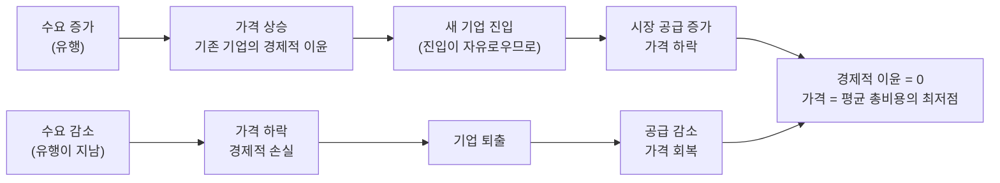

2023년 여름, 한국의 거리에는 **탕후루** 가게가 우후죽순처럼 생겨났다. 과일을 꼬치에 꿰어 설탕 옷을 입힌 이 중국식 간식이 청소년들 사이에서 큰 인기를 끌자, 가게를 내면 줄을 서는 손님 덕분에 큰돈을 번다는 소문이 퍼졌다. 한 해 사이에 탕후루 가게는 전국에 수백 곳이 새로 문을 열었다. 그런데 이듬해가 되자 상황이 바뀌었다. 유행이 시들고 가게는 너무 많아졌다. 손님은 여러 가게로 흩어졌고, 가게마다 매출이 크게 줄었다. 2024년에는 문을 여는 가게보다 닫는 가게가 더 많아졌다.

이런 일은 처음이 아니다. 2016년의 '대만 카스텔라', 그 이전의 찜닭과 조개구이, 수많은 디저트 가게가 비슷한 길을 걸었다. 돈을 많이 번다는 소문이 나면 너도나도 뛰어들고, 가게가 많아지면 이윤은 사라진다. 이 강의에서는 이런 현상을 가장 잘 설명하는 모형인 **완전경쟁시장**을 배운다. 12강에서 배운 비용 곡선을 이용해, 경쟁 시장의 기업이 얼마나 생산할지, 언제 문을 닫을지, 그리고 왜 장기적으로는 경제적 이윤이 0이 되는지를 살펴본다.

> [!핵심] 이 강의의 질문
> 1. 완전경쟁시장의 기업은 생산량을 어떻게 정하는가?
> 2. 손해를 보는 기업은 언제 잠시 문을 닫고, 언제 시장을 완전히 떠나는가?
> 3. 장기적으로 경쟁 시장의 기업은 왜 경제적 이윤을 얻지 못하는가?

```figure
src: asset:54b842448f488dad074887d7648e2d2d
caption: 1937년 미국 메릴랜드주의 밀 수확. 밀 농가는 완전경쟁시장의 교과서적인 예다. 수많은 농가가 거의 똑같은 밀을 기르므로, 농부 한 사람은 시장 가격을 바꿀 수 없다.
credit: 아서 로스스타인 촬영, 1937년 · 미국 의회도서관 소장 (농업안정국 사진)
license: Public Domain (미국 농업안정국·전시정보국 사진, 미국 의회도서관)
source: https://www.loc.gov/item/2017776022/
```

## 완전경쟁시장이란

### 네 가지 조건

4강에서 경쟁 시장을 간단히 소개했다. 경제학자들이 말하는 **완전경쟁시장**은 다음 조건을 갖춘 시장이다.

1. **사는 사람과 파는 사람이 아주 많다.** 누구도 혼자서 시장 가격에 영향을 줄 수 없다.
2. **팔리는 상품이 모두 같다(동질적이다).** 소비자는 어느 판매자에게서 사든 차이를 느끼지 못한다.
3. **진입과 퇴출이 자유롭다.** 새 기업이 쉽게 들어오고, 기존 기업도 쉽게 떠날 수 있다.
4. **정보가 충분하다.** 사는 사람과 파는 사람 모두 가격과 상품에 대해 잘 안다.

처음 두 조건 때문에 완전경쟁시장의 기업은 **가격 수용자**가 된다. 밀을 기르는 한 농부가 시장 가격보다 조금이라도 비싸게 받으려 하면 아무도 그 밀을 사지 않는다. 다른 농부의 밀도 똑같기 때문이다. 반대로 시장 가격보다 싸게 팔 이유도 없다. 시장 가격에 원하는 만큼 팔 수 있기 때문이다. 그래서 개별 기업이 마주하는 수요 곡선은 시장 가격 높이에서 **수평**이다. 5강에서 배운 말로 하면 완전 탄력적이다.

현실에서 이 조건을 완벽하게 갖춘 시장은 드물다. 그러나 밀이나 쌀, 우유, 계란 같은 농산물 시장, 금이나 원유 같은 원자재 시장, 주식 시장, 그리고 많은 가게가 비슷한 상품을 파는 시장은 완전경쟁에 꽤 가깝다. 앞의 탕후루 가게들도 가게마다 조금씩 다르지만(이 점은 15강에서 다룬다), 진입이 쉽고 가게가 많다는 점에서 경쟁 시장의 특징을 잘 보여 준다.

```gallery
src: asset:cae21fe41b2607d4e2c9450cb39c5447
caption: 1940년 미국 미시간주 벤턴 하버의 농산물 시장. 많은 농부가 비슷한 토마토 상자를 들고 나와 팔고, 상인들은 가장 싼 값을 부르는 농부에게서 산다.
credit: 존 바천 촬영, 1940년 · 미국 의회도서관 소장 (농업안정국 사진)
license: Public Domain (미국 농업안정국·전시정보국 사진, 미국 의회도서관)
source: https://www.loc.gov/item/2017720451/
---
src: asset:d3d8a760d3659d4207439ba51bc88fcb
caption: 1900년 무렵 시카고 상품 거래소의 거래장. 수많은 사람이 같은 등급의 밀과 옥수수를 사고팔아, 가격은 누구 한 사람이 아니라 시장 전체의 수요와 공급으로 정해진다.
credit: 조지 R. 로런스 촬영, 1900년 무렵 · 미국 의회도서관 소장
license: Public Domain (미국 의회도서관: 출판 제한 없음)
source: https://www.loc.gov/item/2007663560/
```

## 이윤을 가장 크게 하는 생산량

### 경쟁 기업의 수입

경쟁 기업의 수입은 단순하다. 가격이 정해져 있으므로 **총수입**은 가격 × 판매량이고, 한 단위당 받는 **평균 수입**은 가격과 같다. 한 단위를 더 팔 때 늘어나는 수입인 **한계 수입**도 가격과 같다. 경쟁 기업에게는 **가격 = 평균 수입 = 한계 수입**이다.

### 한계 수입 = 한계 비용

12강의 빵집이 경쟁 시장에서 빵 100개를 1만 5,000원(1.5만 원)에 팔 수 있다고 하자. 빵집은 하루에 얼마나 만들어야 할까?

| 생산량 (백 개) | 총수입 | 총비용 | 이윤 | 한계 수입 | 한계 비용 | 하나 더 만들 때 |
|---|---|---|---|---|---|---|
| 0 | 0 | 3.0 | −3.0 | — | — | — |
| 1 | 1.5 | 3.3 | −1.8 | 1.5 | 0.3 | 이득 (1.5 > 0.3) |
| 2 | 3.0 | 3.8 | −0.8 | 1.5 | 0.5 | 이득 |
| 3 | 4.5 | 4.5 | 0.0 | 1.5 | 0.7 | 이득 |
| 4 | 6.0 | 5.4 | 0.6 | 1.5 | 0.9 | 이득 |
| 5 | 7.5 | 6.5 | 1.0 | 1.5 | 1.1 | 이득 |
| 6 | 9.0 | 7.8 | 1.2 | 1.5 | 1.3 | 이득 |
| 7 | 10.5 | 9.3 | 1.2 | 1.5 | 1.5 | 이득도 손해도 없음 |
| 8 | 12.0 | 11.0 | 1.0 | 1.5 | 1.7 | 손해 (1.5 < 1.7) |
| 9 | 13.5 | 12.9 | 0.6 | 1.5 | 1.9 | 손해 |

표: 가격이 1.5만 원(백 개당)일 때 빵집의 이윤 (단위: 만 원, 12강의 비용 표를 바탕으로 한 가상의 예)

이윤은 하루 600~700개를 만들 때 1만 2,000원으로 가장 크다. 표의 오른쪽 열을 보면 그 이유를 알 수 있다. 빵을 한 단위 더 만들 때 받는 돈(한계 수입 1.5)이 드는 비용(한계 비용)보다 크면, 더 만드는 것이 이득이다. 한계 비용이 가격보다 커지면 더 만들수록 손해다. 그러므로 이윤을 가장 크게 하려면 **한계 수입 = 한계 비용**이 되는 곳까지 생산해야 한다. 경쟁 기업에서는 한계 수입이 가격과 같으므로, 이 조건은 **가격 = 한계 비용**이 된다. 1강에서 배운 한계적 사고가 기업의 결정에 그대로 쓰이는 것이다.

```chart
{
  "type": "line",
  "caption": "가격이 1.5만 원일 때 빵집의 총수입과 총비용 (만 원, 위 표의 가상 예). 두 선 사이의 거리가 이윤이다. 거리는 생산량 600~700개에서 가장 크며, 이곳에서 한계 비용이 가격과 같아진다",
  "data": {
    "labels": ["0", "1", "2", "3", "4", "5", "6", "7", "8", "9"],
    "datasets": [
      { "label": "총수입", "data": [0, 1.5, 3.0, 4.5, 6.0, 7.5, 9.0, 10.5, 12.0, 13.5] },
      { "label": "총비용", "data": [3.0, 3.3, 3.8, 4.5, 5.4, 6.5, 7.8, 9.3, 11.0, 12.9] }
    ]
  },
  "options": { "scales": { "x": { "title": { "display": true, "text": "하루 생산량 (백 개)" } }, "y": { "min": 0, "title": { "display": true, "text": "만 원" } } } }
}
```

### 한계 비용 곡선이 곧 공급 곡선이다

가격이 바뀌면 어떻게 될까? 가격이 1.9만 원으로 오르면 빵집은 한계 비용이 1.9가 되는 900개까지 생산을 늘린다. 가격이 1.1만 원으로 내리면 500개로 줄인다. 이처럼 경쟁 기업은 어떤 가격에서든 그 가격과 한계 비용이 같아지는 양을 생산한다. 그러므로 **기업의 한계 비용 곡선이 곧 그 기업의 공급 곡선**이다. 4강에서 공급 곡선이 오른쪽 위로 기운다고 했던 것은, 한계 비용이 생산을 늘릴수록 올라가기 때문이었다. 시장 공급 곡선은 이런 개별 기업들의 공급 곡선을 모두 더한 것이다.

## 손해를 볼 때: 잠시 문을 닫을까, 떠날까

### 단기의 조업 중단

빵값이 크게 떨어져 빵집이 어떻게 생산해도 손해를 본다면 어떻게 해야 할까? 여기서 12강에서 배운 **고정 비용**과 **매몰 비용**이 중요해진다.

단기에는 가게 임대료 같은 고정 비용을 장사를 하든 안 하든 내야 한다. 그러므로 단기에 문을 닫을지 결정할 때는 고정 비용을 따지지 말아야 한다. 이미 피할 수 없는 매몰 비용이기 때문이다. 따져야 할 것은 문을 열어서 버는 돈(총수입)이 문을 열어서 추가로 드는 돈(가변 비용)보다 많은가다. 가격이 **평균 가변 비용**보다 높으면, 손해를 보더라도 문을 여는 편이 낫다. 가변 비용을 다 갚고 남는 돈으로 고정 비용의 일부라도 메울 수 있기 때문이다. 가격이 평균 가변 비용보다 낮아지면 문을 열수록 손해가 커지므로 잠시 **조업을 중단**한다.

겨울철 해수욕장의 상점이 문을 닫는 것이 그 예다. 겨울에 오는 손님에게서 버는 돈이 직원 월급과 난방비조차 메우지 못하면, 가게 임대료를 계속 내더라도 문을 닫는 편이 낫다. 반대로 12강에서 본 편의점이 손님이 적은 밤에도 문을 여는 것은, 밤 손님에게서 버는 돈이 밤에 추가로 드는 인건비와 전기료보다 많기 때문이다.

### 장기의 퇴출

장기에는 사정이 다르다. 임대 계약이 끝나면 가게를 비울 수 있고, 오븐도 팔 수 있다. 장기에는 모든 비용이 피할 수 있는 비용이다. 그래서 장기에는 가격이 **평균 총비용**보다 낮아 경제적 손실을 보는 기업은 시장을 **떠난다(퇴출)**. 반대로 가격이 평균 총비용보다 높아 경제적 이윤을 얻을 수 있다면 새 기업이 **들어온다(진입)**.

| 상황 | 단기의 결정 | 장기의 결정 |
|---|---|---|
| 가격 > 평균 총비용 | 생산 (경제적 이윤) | 기존 기업 남음, 새 기업 진입 |
| 평균 가변 비용 < 가격 < 평균 총비용 | 생산 (손실이지만 문 닫는 것보다 작다) | 퇴출 |
| 가격 < 평균 가변 비용 | 조업 중단 | 퇴출 |

표: 경쟁 기업의 단기와 장기 결정

> [!참고] 매몰 비용과 '본전 생각'
> 문을 닫을지 정할 때 많은 사장님이 '인테리어에 들인 돈이 아까워서' 장사를 그만두지 못한다. 그러나 이미 쓴 인테리어 비용은 장사를 계속하든 그만두든 돌아오지 않는 매몰 비용이다(1강). 판단의 기준은 앞으로 들어올 돈과 앞으로 나갈 돈뿐이다. 경제학의 눈으로 보면, 본전 생각 때문에 손해를 보면서 버티는 것은 손실을 더 키울 뿐이다. 물론 지금은 손해지만 곧 손님이 늘 것이라고 믿을 만한 이유가 있다면 이야기가 다르다.

## 장기 균형: 경제적 이윤은 0이 된다

### 진입과 퇴출이 이윤을 없앤다

이제 탕후루 이야기를 경제학으로 풀어 보자. 탕후루의 인기가 갑자기 높아지자(수요 증가) 시장 가격이 올랐고, 기존 가게들은 평균 총비용보다 훨씬 높은 가격을 받으며 큰 경제적 이윤을 얻었다. 이 소식은 금세 퍼졌다. 탕후루를 만드는 기술은 어렵지 않았고 가게를 내는 데 큰돈이 들지 않았으므로 새 가게가 줄줄이 들어왔다. 공급이 늘자 가격은 내려가고 가게당 손님은 줄었다. 이윤이 남아 있는 한 진입은 계속되었고, 결국 이윤은 사라졌다. 유행이 시들어 수요가 줄자 이번에는 손실을 보는 가게들이 문을 닫았다.



이 과정은 경제적 이윤이 0이 될 때 멈춘다. 경제적 이윤이 0이면 더 들어올 유인도, 떠날 유인도 없기 때문이다. 경제적 이윤이 0이라는 것은 가격이 평균 총비용과 같다는 뜻이다. 동시에 기업은 가격과 한계 비용이 같은 곳에서 생산한다. 12강에서 한계 비용 곡선은 평균 총비용 곡선의 가장 낮은 점을 지난다고 했다. 그러므로 경쟁 시장의 장기 균형에서 기업들은 **평균 총비용이 가장 낮은 효율적 규모**에서 생산하며, 소비자는 그 가장 낮은 비용만큼의 가격만 낸다. 7강에서 경쟁 시장이 효율적이라고 한 이유가 장기에서도 확인된다.

### 이윤이 0인데 왜 장사를 할까

"이윤이 0이라면 왜 힘들게 장사를 하는가?"라는 의문이 들 수 있다. 여기서 말하는 이윤은 **경제적 이윤**이라는 점을 기억하자(12강). 경제적 이윤이 0이라는 것은 사장님이 자기 시간과 돈을 다른 곳에 썼을 때 벌 수 있었던 만큼을 정확히 벌고 있다는 뜻이다. 회계적 이윤은 0보다 크다. 12강의 지수가 카페를 해서 회사 연봉과 예금 이자만큼만 번다면, 지수의 경제적 이윤은 0이지만 그것은 '정상적인' 수입을 벌고 있는 것이다. 그래서 경제적 이윤이 0인 상태의 회계적 이윤을 **정상 이윤**이라고 부르기도 한다.

### 장기 공급 곡선

진입과 퇴출이 자유로운 경쟁 시장에서는 장기적으로 가격이 평균 총비용의 최저점으로 돌아온다. 그래서 모든 기업의 비용 구조가 같고, 새 기업이 들어와도 비용이 변하지 않는다면, 장기 시장 공급 곡선은 그 가격에서 **수평**이 된다. 수요가 아무리 늘어도 장기적으로는 기업 수가 늘어날 뿐 가격은 변하지 않는다.

그러나 현실의 장기 공급 곡선은 오른쪽 위로 기우는 경우가 많다. 첫째, 생산에 필요한 자원이 한정되어 있으면 기업이 늘수록 그 자원의 값이 오른다. 농가가 늘면 좋은 농지의 값이 오르고, 카페가 늘면 목 좋은 자리의 임대료가 오른다. 둘째, 기업마다 비용이 다르다. 새로 들어오는 기업은 기존 기업보다 비용이 높을 수 있다. 그래서 가격이 조금 더 올라야 새 기업이 들어온다. 그래도 장기 공급 곡선은 단기 공급 곡선보다 훨씬 탄력적이다(5강).

```figure
src: asset:f60073b6e3b487ea845855351a466463
caption: 1938년 미국 오하이오주에서 탈곡기로 밀을 터는 농부들. 탈곡기와 트랙터 같은 새 기술은 비용을 낮추었고, 경쟁 시장에서 그 이득은 결국 낮은 값의 형태로 소비자에게 돌아갔다.
credit: 벤 샨 촬영, 1938년 · 미국 의회도서관 소장 (농업안정국 사진)
license: Public Domain (미국 농업안정국·전시정보국 사진, 미국 의회도서관)
source: https://www.loc.gov/item/2017731809/
```

## 경쟁이 가져다주는 것

### 혁신과 경쟁

경쟁 시장에서는 남들보다 조금이라도 비용을 낮추는 방법을 찾아낸 기업이 잠시 동안 경제적 이윤을 얻는다. 그러나 다른 기업들이 그 방법을 따라 하면 이윤은 다시 사라진다. 그래서 경쟁 시장의 기업들은 끊임없이 비용을 낮추고 새로운 방법을 찾아야 한다. 그 혜택은 결국 낮은 가격으로 소비자에게 돌아간다. 20세기 동안 농산물의 실질 가격이 꾸준히 내려간 것은, 수많은 농민이 새로운 품종과 비료, 기계를 받아들이며 경쟁한 결과다(5강에서 본 농민의 처지와도 이어진다).

오스트리아 출신의 경제학자 **조지프 슘페터**는 경쟁의 진짜 힘은 가격 경쟁이 아니라 새로운 상품과 기술, 새로운 조직이 낡은 것을 밀어내는 과정에 있다고 보았다. 그는 이것을 **창조적 파괴**라고 불렀다. 마차 회사를 자동차 회사가, 필름 카메라를 디지털카메라와 스마트폰이 밀어낸 것처럼, 경쟁은 끊임없이 새로운 승자와 패자를 만든다.

| 구분 | 완전경쟁시장 | 앞으로 배울 시장 구조 |
|---|---|---|
| 기업 수 | 아주 많다 | 독점(1개, 14강), 과점(몇 개, 16강), 독점적 경쟁(많다, 15강) |
| 상품 | 같다 | 독점: 대체재 없음 / 독점적 경쟁: 조금씩 다름 / 과점: 같거나 다름 |
| 가격 결정력 | 없다 (가격 수용자) | 있다 (가격 설정자) |
| 진입 | 자유롭다 | 독점·과점: 어렵다 / 독점적 경쟁: 자유롭다 |
| 장기 경제적 이윤 | 0 | 독점: 남을 수 있다 / 독점적 경쟁: 0 |
| 효율성 | 효율적 (가격 = 한계 비용) | 대체로 비효율적 (가격 > 한계 비용) |

표: 완전경쟁시장과 다른 시장 구조의 비교 (앞으로 배울 내용 미리 보기)

## 정리

> [!핵심] 13강 요약
> - **완전경쟁시장**은 판매자와 구매자가 많고, 상품이 같으며, 진입과 퇴출이 자유로운 시장이다. 기업은 **가격 수용자**이며, 가격 = 평균 수입 = 한계 수입이다.
> - 기업은 **한계 수입 = 한계 비용**, 곧 **가격 = 한계 비용**인 곳에서 생산해 이윤을 가장 크게 한다. 그래서 **한계 비용 곡선이 곧 공급 곡선**이다.
> - 단기에는 가격이 **평균 가변 비용**보다 낮을 때 조업을 중단한다(고정 비용은 매몰 비용). 장기에는 가격이 **평균 총비용**보다 낮으면 퇴출하고, 높으면 새 기업이 진입한다.
> - 진입과 퇴출 때문에 장기적으로 **경제적 이윤은 0**이 되고, 기업은 평균 총비용이 가장 낮은 **효율적 규모**에서 생산한다. 경제적 이윤이 0이어도 회계적으로는 **정상 이윤**을 번다.
> - 장기 공급 곡선은 단기보다 훨씬 탄력적이며, 경쟁은 비용 절감과 **창조적 파괴**를 통해 소비자에게 이득을 준다.

### 생각해 볼 질문

1. 동네에 새로 생긴 무인 아이스크림 가게가 몇 달 만에 크게 늘었다. 1년 뒤 이 시장은 어떻게 될까? 진입과 퇴출, 경제적 이윤이라는 말을 써서 예측해 보자.
2. 손님이 거의 없는 평일 낮에도 문을 여는 식당과, 겨울에 문을 닫는 해수욕장 가게의 결정을 평균 가변 비용으로 설명해 보자.
3. '돈을 많이 버는 업종'이라는 소문이 난 업종에 뒤늦게 뛰어드는 것은 왜 위험할까?

### 다음 강 예고

14강 「독점」에서는 경쟁의 정반대, 곧 한 기업이 시장 전체를 차지하는 경우를 다룬다. 독점은 왜 생기는지, 독점 기업은 가격과 생산량을 어떻게 정하는지, 독점이 왜 사회에 손실을 주는지, 그리고 정부의 독점 규제와 특허, 가격 차별을 살펴본다.
