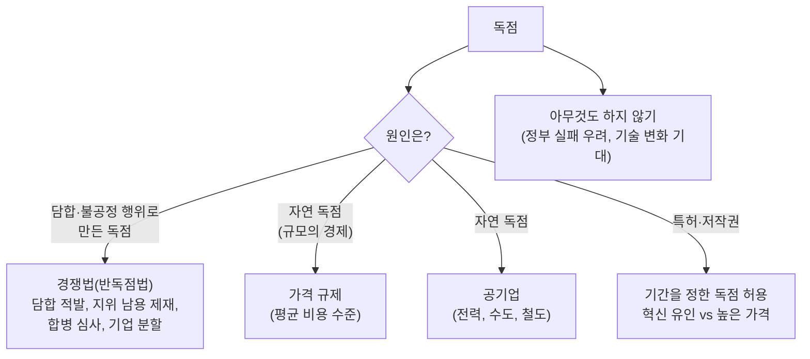

1947년 미국의 한 광고 회사 카피라이터가 다이아몬드 회사 **드비어스**를 위해 한 줄의 광고 문구를 만들었다. **"다이아몬드는 영원하다(A Diamond is Forever)."** 이 문구는 결혼 반지에는 다이아몬드가 있어야 한다는 생각을 세계에 퍼뜨린 것으로 유명하다. 그런데 이 문구에는 또 다른 뜻이 숨어 있었다. 다이아몬드는 영원하니 한번 산 다이아몬드를 다시 팔지 말라는 것이다. 사람들이 중고 다이아몬드를 시장에 내놓기 시작하면 다이아몬드값이 떨어질 수 있었기 때문이다.

드비어스는 20세기 대부분 동안 세계 다이아몬드 원석 공급의 대부분을 장악했다. 남아프리카의 광산을 소유하고, 다른 나라 광산의 원석까지 사들여 시장에 내놓는 양을 조절했다. 다이아몬드는 1강에서 본 '물과 다이아몬드의 역설'의 그 다이아몬드다. 그 비싼 값에는 희소성과 함께, 공급을 쥐고 흔든 한 회사의 힘이 담겨 있었다.

13강의 경쟁 기업은 시장 가격을 그대로 받아들여야 했다. 그러나 한 기업이 시장 전체를 차지하면 사정이 완전히 달라진다. 이 강의에서는 그 극단인 **독점**을 다룬다. 독점은 왜 생기는지, 독점 기업은 가격과 생산량을 어떻게 정하는지, 독점이 왜 사회에 손실을 주는지, 그리고 사회는 독점에 어떻게 대응해 왔는지 살펴본다.

> [!핵심] 이 강의의 질문
> 1. 독점은 왜 생기는가?
> 2. 독점 기업은 가격과 생산량을 어떻게 정하며, 그것은 경쟁 시장과 어떻게 다른가?
> 3. 독점은 사회에 어떤 손실을 주고, 정부는 이에 어떻게 대응하는가?

```gallery
src: asset:b584ceeca60d0bf836343a5e6ee8bd50
caption: 1880년 무렵 남아프리카 킴벌리 다이아몬드 광산의 '빅 홀' 가장자리. 수많은 광부가 손으로 파 들어간 이 구덩이의 소유권을 세실 로즈가 하나씩 사들여, 1888년 드비어스 통합 광산 회사가 탄생했다.
credit: 작자 미상, 1879~1884년 무렵 · 암스테르담 국립미술관 소장
license: Public Domain (레이크스 미술관: CC0)
source: https://id.rijksmuseum.nl/200349809
---
src: asset:c0d2bac579ee0f5c6e86c4b2e66cbc77
caption: 1896년 킴벌리의 드비어스 통합 광산 회사 사무소. 이 회사는 남아프리카 광산을 손에 넣으면서 세계 다이아몬드 원석 공급을 장악했다.
credit: 작자 미상, 1896년 · 암스테르담 국립미술관 소장
license: Public Domain (레이크스 미술관: CC0)
source: https://id.rijksmuseum.nl/200346894
```

## 독점은 왜 생기나

**독점 기업**이란 가까운 대체재가 없는 상품을 혼자서 파는 기업이다. 독점이 오래 유지되려면 다른 기업이 그 시장에 들어오지 못하게 막는 **진입 장벽**이 있어야 한다. 진입 장벽에는 크게 세 가지가 있다.

| 진입 장벽 | 내용 | 예 |
|---|---|---|
| 핵심 자원의 소유 | 생산에 꼭 필요한 자원을 한 기업이 가진다 | 드비어스의 다이아몬드 광산, 작은 섬마을의 하나뿐인 우물 |
| 정부가 준 독점권 | 정부가 법으로 한 기업에게만 생산·판매를 허락한다 | 특허와 저작권, 과거 한국의 담배·인삼 전매, 조선 시전 상인의 금난전권 |
| 자연 독점 | 한 기업이 시장 전체에 공급하는 것이 여러 기업보다 싸다 | 수돗물, 전력망, 가스관, 철도망 |

표: 독점을 낳는 세 가지 진입 장벽

### 정부가 만든 독점

정부는 여러 이유로 독점을 만든다. 가장 중요한 것이 **특허**와 **저작권**이다. 새 약을 개발하는 데는 10년이 넘는 시간과 수천억 원이 든다. 개발한 약을 누구나 베껴 팔 수 있다면 아무도 신약 개발에 돈을 쓰지 않을 것이다. 그래서 정부는 발명자에게 일정 기간(대개 출원 뒤 20년) 그 발명을 혼자 쓸 권리를 준다. 독점으로 인한 높은 가격이라는 비용을 치르는 대신, 혁신을 이끌어 내는 것이다.

역사적으로는 정부가 세금을 걷거나 특정 집단을 보호하려고 독점을 주기도 했다. 조선 후기 한양의 **시전** 상인들은 나라에 필요한 물품을 대는 대신 **금난전권**을 받았다. 허가받지 않은 상인(난전)이 도성 안에서 같은 물건을 팔지 못하게 단속할 수 있는 권리였다. 그러자 물가가 오르고 영세 상인들의 불만이 커졌다. 1791년 정조는 육의전을 뺀 시전의 금난전권을 없앴는데, 이를 **신해통공**이라고 한다. 독점 대신 경쟁을 택해 상업을 활성화한 개혁이었다. 한국에서는 20세기에도 정부가 담배와 인삼을 전매했다. 전매를 맡던 정부 기관인 전매청은 1987년 공사로 바뀌었고(1989년 한국담배인삼공사), 회사는 2002년 민영화되었다.

```figure
src: asset:5688a213c5a11565c4bd7c7658613987
caption: 토머스 에디슨의 백열전구 특허(미국 특허 제223,898호, 1880년 1월 27일) 도면. 특허는 발명자에게 일정 기간 독점권을 주어 발명의 대가를 보장한다.
credit: 미국 특허청, 1880년 · 미국 국립문서보관소(NARA) 소장
license: Public Domain (미국 연방정부 저작물)
source: https://catalog.archives.gov/id/595450
width: narrow
```

### 자연 독점

어떤 산업은 기업 하나가 시장 전체에 공급할 때 가장 비용이 싸다. 수도를 생각해 보자. 도시 전체에 수도관을 까는 데는 엄청난 고정 비용이 들지만, 수도관이 깔린 뒤 한 집에 물을 더 보내는 한계 비용은 매우 작다. 그래서 공급량이 늘수록 평균 비용은 계속 내려간다(12강의 규모의 경제). 이런 산업에 두 회사가 들어와 수도관을 두 벌 까는 것은 낭비다. 이렇게 규모의 경제 때문에 생기는 독점을 **자연 독점**이라고 한다. 10강의 클럽재(배제할 수 있지만 비경합적인 재화)도 자연 독점의 성격을 띤다.

```figure
src: asset:8d2b693dca5fe530fea5d448f2d42d1a
caption: 1900년대 초 미국의 장거리 전화 교환대. 전화망은 대표적인 자연 독점이었다. 미국에서는 벨 시스템(AT&T)이 정부의 규제를 받으며 1984년 분할될 때까지 전화 사업의 대부분을 맡았다.
credit: 시어스 로벅 발행 입체 사진, 1900~1910년 무렵 · 미국 의회도서관 소장
license: Public Domain (미국 의회도서관: 출판 제한 없음)
source: https://www.loc.gov/item/2017651466/
```

## 독점 기업은 어떻게 값을 정하나

### 독점 기업의 수요 곡선

경쟁 기업과 독점 기업의 가장 큰 차이는 수요 곡선이다. 경쟁 기업은 시장 가격에 원하는 만큼 팔 수 있으므로 수평의 수요 곡선을 마주한다. 반면 독점 기업은 시장 전체의 수요 곡선, 곧 오른쪽 아래로 기운 수요 곡선을 마주한다. 값을 올리면 덜 팔리고, 더 많이 팔려면 값을 내려야 한다. 독점 기업은 **가격 설정자**이지만, 수요 곡선의 제약에서 벗어날 수는 없다. 값과 판매량 가운데 하나를 고르면 다른 하나는 수요 곡선이 정한다.

### 한계 수입은 가격보다 작다

작은 섬마을에서 생수를 혼자 파는 상점이 있다고 하자. 생수의 수요와 상점의 수입은 다음과 같다. 생수 한 병을 들여오는 비용(한계 비용)은 2,000원으로 일정하다.

| 판매량 (천 병) | 가격 (천 원) | 총수입 | 한계 수입 | 한계 비용 | 이윤 |
|---|---|---|---|---|---|
| 0 | 10 | 0 | — | — | 0 |
| 1 | 9 | 9 | 9 | 2 | 7 |
| 2 | 8 | 16 | 7 | 2 | 12 |
| 3 | 7 | 21 | 5 | 2 | 15 |
| 4 | 6 | 24 | 3 | 2 | **16** |
| 5 | 5 | 25 | 1 | 2 | 15 |
| 6 | 4 | 24 | −1 | 2 | 12 |
| 7 | 3 | 21 | −3 | 2 | 7 |
| 8 | 2 | 16 | −5 | 2 | 0 |

표: 섬마을 생수 독점 상점의 수입과 이윤 (단위: 천 원·천 병, 가상의 예, 고정 비용은 없다고 가정)

여기서 중요한 점은 **한계 수입이 가격보다 작다**는 것이다. 판매량을 3천 병에서 4천 병으로 늘리려면 값을 7,000원에서 6,000원으로 내려야 한다. 새로 판 1천 병에서는 6,000원씩 600만 원을 더 벌지만, 원래 팔던 3천 병도 1,000원씩 싸게 팔게 되어 300만 원을 잃는다. 그래서 한계 수입은 300만 원(1천 병당 3,000원)으로, 가격 6,000원보다 작다. 경쟁 기업은 값을 내리지 않고도 더 팔 수 있었기에 한계 수입이 가격과 같았지만, 독점 기업은 더 팔려면 모든 손님에게 값을 내려야 한다.

### 독점의 가격과 생산량

독점 기업도 이윤을 가장 크게 하려면 13강과 같은 원리를 따른다. **한계 수입 = 한계 비용**이 되는 곳까지 생산한다. 위 표에서 4천 병까지는 한계 수입(3)이 한계 비용(2)보다 크지만, 5천 병째에서는 한계 수입(1)이 한계 비용(2)보다 작다. 그러므로 상점은 4천 병을 팔고, 수요 곡선에서 그 양에 맞는 가격인 6,000원을 받는다. 이윤은 1,600만 원으로 가장 크다.

경쟁 시장과 비교해 보자. 경쟁 시장이라면 가격이 한계 비용 2,000원까지 내려가 8천 병이 팔렸을 것이다. 독점 기업은 **생산량을 줄이고**(8천 → 4천 병) **값을 올린다**(2,000원 → 6,000원). 경쟁 시장에서는 가격 = 한계 비용이었지만, 독점 시장에서는 **가격 > 한계 비용**이다.

```chart
{
  "type": "scatter",
  "caption": "섬마을 생수 독점 (가상의 예). 독점 기업은 한계 수입과 한계 비용이 만나는 4천 병을 팔고, 수요 곡선에서 6,000원을 받는다. 경쟁 시장이었다면 가격 = 한계 비용인 8천 병, 2,000원이었을 것이다. 4천 병과 8천 병 사이에서 사라진 거래가 자중 손실이다",
  "height": 380,
  "data": {
    "datasets": [
      { "label": "수요 곡선 (= 가격)", "showLine": true, "pointRadius": 0, "data": [{"x":0,"y":10},{"x":10,"y":0}] },
      { "label": "한계 수입", "showLine": true, "pointRadius": 0, "borderDash": [6, 4], "data": [{"x":0,"y":10},{"x":5,"y":0}] },
      { "label": "한계 비용 (2천 원)", "showLine": true, "pointRadius": 0, "data": [{"x":0,"y":2},{"x":10,"y":2}] },
      { "label": "독점 균형 (4천 병, 6천 원)", "pointRadius": 8, "pointStyle": "star", "data": [{"x":4,"y":6}] },
      { "label": "경쟁 균형 (8천 병, 2천 원)", "pointRadius": 7, "data": [{"x":8,"y":2}] }
    ]
  },
  "options": { "scales": { "x": { "title": { "display": true, "text": "판매량 (천 병)" }, "min": 0, "max": 10 }, "y": { "title": { "display": true, "text": "가격·비용 (천 원)" }, "min": 0, "max": 11 } } }
}
```

## 독점의 사회적 비용

### 자중 손실

독점은 왜 사회에 해로울까? 독점 기업이 큰 이윤을 얻는다는 것 자체가 문제의 핵심은 아니다. 독점 이윤은 소비자의 돈이 독점 기업의 주인에게 옮겨 간 것일 뿐, 사회 전체의 잉여가 사라진 것은 아니다. 물론 그 이전이 공정한지는 별개의 문제다.

진짜 문제는 **거래량이 줄어든다**는 것이다. 위 예에서 4천 병째부터 8천 병째까지의 생수는 사람들이 한계 비용(2,000원)보다 높은 값을 낼 용의가 있는데도 팔리지 않는다. 독점 기업이 이윤을 위해 생산을 줄였기 때문이다. 이 사라진 거래가 7강에서 배운 **자중 손실**이다. 이 예에서 자중 손실은 (8 − 4) × (6 − 2) ÷ 2 = 8, 곧 800만 원이다. 독점의 자중 손실은 세금의 자중 손실과 같은 원리다. 독점 기업이 받는 높은 가격은 마치 사적인 세금처럼 소비자 가격과 생산 비용 사이에 쐐기를 박는다.

### 그 밖의 비용

독점에는 다른 비용도 있다. 경쟁 압력이 없으니 비용을 줄이거나 품질을 높일 유인이 약하다. 독점의 지위를 얻거나 지키기 위해 로비와 소송에 큰돈을 쓰기도 하는데, 이것을 **지대 추구**라고 한다. 반대로 독점이 혁신을 낳는다는 주장도 있다. 13강의 슘페터는 혁신으로 얻는 일시적인 독점 이윤이 기업들을 혁신으로 이끄는 원동력이라고 보았다. 특허 제도는 바로 이 생각을 제도로 만든 것이다.

## 가격 차별

### 손님마다 다른 값

5강에서 영화관과 항공사가 손님에 따라 다른 값을 받는 것을 보았다. 같은 상품을 손님에 따라 다른 값에 파는 것을 **가격 차별**이라고 한다. 가격 차별은 경쟁 시장에서는 불가능하다. 비싸게 받으려는 판매자에게서는 손님이 다른 판매자에게 가 버리기 때문이다. 가격 차별은 시장 지배력이 있는 기업만 할 수 있다.

가격 차별이 가능하려면 두 가지 조건이 필요하다. 첫째, 지불 용의가 다른 손님들을 구분할 수 있어야 한다(학생증, 나이, 예약 시기). 둘째, 싸게 산 사람이 비싸게 되파는 **재판매**를 막을 수 있어야 한다. 영화표는 이름을 확인하지 않아도 그 시간에 그 자리에 앉아야 하므로 되팔기 어렵다.

| 가격 차별의 예 | 손님을 구분하는 방법 | 탄력적인 집단(싸게) / 비탄력적인 집단(비싸게) |
|---|---|---|
| 영화관 조조 할인 | 시간대 | 시간이 많은 사람 / 저녁에 꼭 보려는 직장인 |
| 항공권 | 예약 시기, 주말 체류 여부 | 미리 계획하는 여행객 / 급한 출장객 |
| 학생·경로 할인 | 학생증, 나이 | 소득이 적은 학생과 노인 / 일반 성인 |
| 할인 쿠폰 | 쿠폰을 모으는 수고 | 가격에 민감해 쿠폰을 챙기는 사람 / 시간이 귀한 사람 |
| 대량 구매 할인 | 구매량 | 많이 사는 사람 / 조금 사는 사람 |
| 장학금 (대학 등록금) | 가정의 소득 | 저소득층 / 고소득층 |

표: 가격 차별의 예

### 가격 차별은 나쁜가

가격 차별이라는 말은 부정적으로 들리지만, 그 효과는 단순하지 않다. 독점 기업이 모든 손님에게 같은 값을 받으면, 그 값보다 지불 용의가 낮은 손님은 사지 못한다. 가격 차별을 하면 이런 손님에게도 싼 값에 팔 수 있어 **거래량이 늘어나고 자중 손실이 줄어든다**. 만약 기업이 손님 한 사람 한 사람의 지불 용의를 정확히 알아 그만큼씩 받는 **완전 가격 차별**을 하면, 자중 손실은 완전히 사라진다. 다만 이때 소비자 잉여도 모두 기업의 이윤이 된다. 가격 차별은 효율성을 높일 수 있지만, 그 이득이 누구에게 가느냐는 다른 문제다. 오늘날 인터넷 기업들은 사용자의 정보를 이용해 사람마다 다른 값을 보여 줄 수 있게 되어, 가격 차별을 어디까지 허용할지가 새로운 논쟁거리가 되고 있다.

## 정부는 독점에 어떻게 대응하나

### 경쟁법(반독점법)

19세기 말 미국에서는 석유, 철도, 철강, 설탕 같은 산업에서 여러 회사가 '트러스트'로 뭉쳐 시장을 장악했다. 존 D. 록펠러의 **스탠더드 오일**은 한때 미국 정유 시장의 90% 가까이를 차지했다. 이에 맞서 미국 의회는 1890년 **셔먼법**을 만들어 거래를 제한하는 담합과 독점화를 불법으로 정했다. 1911년 미국 대법원은 스탠더드 오일을 34개 회사로 쪼개라고 판결했다. 1984년에는 미국의 전화를 독점하던 AT&T가 지역 전화 회사들로 분할되었다.

한국은 1980년 「독점 규제 및 공정거래에 관한 법률」(공정거래법)을 만들고 1981년 **공정거래위원회**를 세웠다. 공정거래위원회는 기업들의 담합을 적발하고, 시장 지배적 지위를 남용하는 행위를 제재하며, 경쟁을 크게 줄이는 기업 결합(인수·합병)을 심사한다. 2016년에는 스마트폰 통신 칩 특허를 이용해 지위를 남용했다며 미국의 퀄컴에 1조 원이 넘는 과징금을 매겼다. 오늘날 경쟁 당국의 가장 큰 관심사는 구글, 애플, 아마존 같은 거대 플랫폼 기업이다. 미국 법원은 2024년 구글이 인터넷 검색 시장에서 불법적으로 독점을 유지해 왔다고 판결했다.

```timeline
1624 | 영국, 독점법 제정 | 왕실의 독점 특허를 제한하고 발명 특허만 인정
1791 | 조선, 신해통공 | 육의전을 뺀 시전의 금난전권 폐지
1890 | 미국, 셔먼법 | 최초의 근대적 반독점법
1911 | 스탠더드 오일 해체 판결 | 34개 회사로 분할
1980 | 한국, 공정거래법 제정 | 1981년 공정거래위원회 출범
1984 | 미국, AT&T 분할 | 
2000 | 미국 법원, 마이크로소프트 독점 판결 | 분할 명령은 항소심에서 뒤집힘
2016 | 한국 공정위, 퀄컴에 1조 원대 과징금 | 
2024 | 미국 법원, 구글 검색 독점 판결 | 
```

```gallery
src: asset:df4a58784e448a16c11ec77086f09f28
caption: 1904년 『퍽』의 만평 「다음!」. 스탠더드 오일의 석유 탱크가 문어가 되어 철강, 구리, 해운 산업과 주 의회, 미국 의회를 휘감고 백악관까지 손을 뻗고 있다.
credit: 우도 J. 케플러 그림, 『퍽』 1904년 9월 7일 · 미국 의회도서관 소장
license: Public Domain (미국 의회도서관: 출판 제한 없음)
source: https://www.loc.gov/item/2001695241/
---
src: asset:fa71d87694db448e17309715e6c0d2e9
caption: 1889년 『퍽』의 만평 「상원의 주인들」. 철강, 구리, 설탕, 석유 같은 트러스트를 나타내는 거대한 돈주머니들이 상원 의원들을 내려다보고 있다. 이듬해인 1890년 셔먼 반독점법이 만들어졌다.
credit: 조지프 케플러 그림, 『퍽』 1889년 1월 23일 · 미국 의회도서관 소장
license: Public Domain (미국 의회도서관: 출판 제한 없음)
source: https://www.loc.gov/item/2002718861/
---
src: asset:1cb5ad4dac16d23ff27a0bbba530be41
caption: 1918년의 존 D. 록펠러. 스탠더드 오일은 한때 미국 석유 정제의 약 90%를 장악했으나, 1911년 대법원 판결로 34개 회사로 나뉘었다.
credit: 아널드 겐테 촬영, 1918년 · 미국 의회도서관 소장
license: Public Domain (미국 의회도서관: 출판 제한 없음)
source: https://www.loc.gov/item/2016647796/
```

### 자연 독점을 다루는 방법

자연 독점은 쪼개면 오히려 비용이 올라가므로 반독점법으로 다루기 어렵다. 정부는 다른 방법을 쓴다.

- **가격 규제**: 정부가 독점 기업의 가격을 정한다. 그런데 자연 독점은 평균 비용이 계속 내려가므로 한계 비용이 평균 비용보다 낮다. 가격을 한계 비용으로 정하면 기업이 손해를 보고 문을 닫는다. 그래서 대개 평균 비용 수준에서 가격을 정하거나, 손실을 보조금으로 메운다.
- **공기업**: 정부가 직접 소유해 운영한다. 한국의 전력(한국전력공사), 수도(지방 자치 단체), 철도(코레일)가 그 예다. 다만 공기업은 이윤 동기가 약해 비용을 줄이려는 노력이 부족할 수 있다.
- **아무것도 하지 않기**: 미국의 경제학자 **조지 스티글러**처럼, 정부의 개입이 독점보다 더 큰 실패를 낳을 수 있으니 시장에 맡기자는 주장도 있다. 기술 변화로 독점이 저절로 무너지는 경우도 많다는 것이다. 유선 전화의 독점은 휴대 전화와 인터넷 전화가 등장하며 무너졌다.



## 정리

> [!핵심] 14강 요약
> - **독점**은 대체재가 없는 상품을 혼자 파는 것이다. 핵심 자원의 소유, 정부가 준 독점권(특허·저작권·전매), **자연 독점**(규모의 경제)이 **진입 장벽**이 된다.
> - 독점 기업은 오른쪽 아래로 기운 시장 수요 곡선을 마주하므로 **한계 수입이 가격보다 작다**. **한계 수입 = 한계 비용**에서 생산량을 정하고, 수요 곡선에서 가격을 받는다. 그래서 **가격 > 한계 비용**이다.
> - 독점은 경쟁 시장보다 **생산량을 줄이고 가격을 올려** **자중 손실**을 낳는다. 독점 이윤 자체는 손실이 아니라 소비자에게서 기업으로의 이전이다.
> - **가격 차별**은 손님을 구분하고 재판매를 막을 수 있을 때 가능하며, 거래량을 늘려 자중 손실을 줄일 수 있지만 소비자 잉여를 기업으로 옮긴다.
> - 정부는 **경쟁법**(셔먼법, 한국 공정거래법), **가격 규제**, **공기업**으로 독점에 대응한다. 조선의 **신해통공**처럼 독점권을 없애 경쟁을 살린 역사도 있다.

### 생각해 볼 질문

1. 신약 특허 기간을 20년에서 10년으로 줄이면 어떤 이득과 손해가 생길까? 환자, 제약 회사, 미래의 환자 입장에서 각각 생각해 보자.
2. 대학이 장학금으로 학생마다 실제 등록금을 다르게 받는 것은 가격 차별일까? 이것은 효율성과 형평성 면에서 어떤 효과가 있을까?
3. 검색 엔진이나 메신저처럼 사용자가 많을수록 더 쓸모 있어지는 서비스는 왜 한두 기업이 시장을 차지하기 쉬울까? 정부는 어떻게 대응해야 할까?

### 다음 강 예고

15강 「독점적 경쟁」에서는 완전경쟁과 독점의 중간에 있는 시장을 다룬다. 동네의 수많은 카페와 식당, 옷 가게처럼 많은 기업이 저마다 조금씩 다른 상품을 파는 시장에서 기업들은 어떻게 행동하는지, 광고와 브랜드는 소비자에게 이로운지 해로운지 살펴본다.
