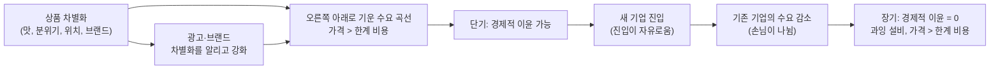

한국의 거리를 걷다 보면 한 블록에도 카페가 서너 곳씩 있다. 한국에는 커피를 파는 가게가 9만~10만 곳에 이른다고 추산된다. 이 가게들은 모두 '커피'를 팔지만, 같은 상품을 파는 것은 아니다. 어떤 곳은 값이 싸고, 어떤 곳은 원두가 특별하며, 어떤 곳은 창밖 풍경이 좋고, 어떤 곳은 콘센트가 많아 공부하기 좋다. 어떤 가게는 유명한 상표의 이름을 달고 있고, 어떤 가게는 사장님의 이름을 걸고 있다.

카페 시장은 13강의 완전경쟁시장과 다르다. 상품이 조금씩 다르기 때문에, 단골이 좋아하는 카페는 옆 가게보다 500원쯤 비싸게 받아도 손님을 잃지 않는다. 그렇다고 14강의 독점도 아니다. 값을 너무 올리면 손님은 금세 옆 가게로 간다. 그리고 장사가 잘된다는 소문이 나면 근처에 새 카페가 문을 연다. 이 강의에서는 완전경쟁과 독점 사이에 있는, 그러나 현실에서 가장 흔한 시장 구조인 **독점적 경쟁**을 살펴본다. 그리고 이런 시장에서 빠질 수 없는 **광고**와 **브랜드**가 소비자에게 이로운지 해로운지도 따져 본다.

> [!핵심] 이 강의의 질문
> 1. 독점적 경쟁시장은 완전경쟁시장, 독점과 무엇이 같고 무엇이 다른가?
> 2. 독점적 경쟁시장의 기업은 단기와 장기에 어떻게 행동하며, 그 결과는 효율적인가?
> 3. 광고와 브랜드는 소비자에게 정보를 주는가, 아니면 소비자를 조종하는가?

```figure
src: asset:b0fd9df407014c63161355c47e1ee43f
caption: 1900년 무렵 미국 버펄로의 중심가. 건물마다 가게 간판이 빼곡하다. 비슷한 물건을 파는 가게들이 저마다 조금씩 다른 상품과 서비스로 손님을 끄는 것이 독점적 경쟁시장의 모습이다.
credit: 디트로이트 출판사, 1900년 무렵 · 미국 의회도서관 소장
license: Public Domain (미국 의회도서관: 출판 제한 없음)
source: https://www.loc.gov/item/2016808301/
width: wide
```

## 완전경쟁과 독점 사이

### 독점적 경쟁의 세 가지 특징

1930년대 초 미국의 **에드워드 체임벌린**과 영국의 **조앤 로빈슨**은 거의 같은 시기에 각각 책을 펴내, 현실의 많은 시장이 완전경쟁도 독점도 아니라는 점을 지적했다. 체임벌린은 이런 시장을 **독점적 경쟁**이라고 불렀다. 독점적 경쟁시장은 세 가지 특징을 갖는다.

1. **판매자가 많다.** 카페, 식당, 미용실, 옷 가게, 학원처럼 많은 기업이 같은 고객을 두고 경쟁한다.
2. **상품이 차별화되어 있다.** 각 기업의 상품은 다른 기업의 상품과 조금씩 다르다. 그래서 각 기업은 자기 상품에 대해 어느 정도의 시장 지배력을 갖는다. 수요 곡선이 수평이 아니라 오른쪽 아래로 기운다.
3. **진입과 퇴출이 자유롭다.** 새 기업이 쉽게 들어오고 쉽게 떠날 수 있다.

첫째와 셋째 특징은 완전경쟁과 같고, 둘째 특징은 독점과 같다. '독점적 경쟁'이라는 이름은 이 두 성격을 함께 가진 데서 나왔다.

| 구분 | 완전경쟁 (13강) | 독점적 경쟁 | 독점 (14강) |
|---|---|---|---|
| 판매자의 수 | 아주 많다 | 많다 | 하나 |
| 상품 | 같다 | 조금씩 다르다 | 대체재가 없다 |
| 진입과 퇴출 | 자유롭다 | 자유롭다 | 막혀 있다 |
| 기업이 마주한 수요 곡선 | 수평 | 오른쪽 아래로 기움 (비교적 탄력적) | 시장 수요 곡선 |
| 장기 경제적 이윤 | 0 | 0 | 남을 수 있다 |
| 가격과 한계 비용 | 가격 = 한계 비용 | 가격 > 한계 비용 | 가격 > 한계 비용 |
| 예 | 쌀, 밀, 금 | 카페, 식당, 옷, 책, 영화 | 수도, 특허 의약품 |

표: 세 가지 시장 구조의 비교

## 독점적 경쟁 기업의 행동

### 단기: 작은 독점자처럼

단기에 독점적 경쟁 기업은 14강의 독점 기업과 똑같이 행동한다. 자기 상품에 대한 수요 곡선이 오른쪽 아래로 기울어 있으므로 한계 수입은 가격보다 작다. 기업은 **한계 수입 = 한계 비용**이 되는 생산량을 고르고, 수요 곡선에서 그에 맞는 가격을 받는다. 가격이 평균 총비용보다 높으면 경제적 이윤을 얻고, 낮으면 손실을 본다.

### 장기: 진입이 이윤을 없앤다

그러나 장기에는 13강의 경쟁 시장처럼 **진입과 퇴출**이 일어난다. 어느 동네의 카페들이 이윤을 많이 낸다는 소문이 나면 새 카페가 문을 연다. 새 카페가 생기면 기존 카페의 손님 일부가 새 카페로 옮겨 간다. 기존 카페의 수요 곡선은 왼쪽으로 이동하고, 이윤은 줄어든다. 진입은 이윤이 0이 될 때까지 계속된다. 반대로 손실이 나면 일부 카페가 문을 닫고, 남은 카페의 손님이 늘어 손실이 줄어든다.

```chart
{
  "type": "bar",
  "caption": "한 동네의 카페 수와 카페 한 곳당 경제적 이윤 (가상의 예). 처음 몇몇 카페가 이윤을 내자 새 카페가 잇달아 문을 열고, 손님이 나뉘면서 가게당 이윤은 줄어든다. 진입은 경제적 이윤이 0이 될 때 멈춘다",
  "data": {
    "labels": ["카페 5곳", "10곳", "15곳", "20곳", "25곳", "30곳"],
    "datasets": [{ "label": "가게당 월 경제적 이윤(만 원)", "data": [600, 380, 210, 90, 20, 0] }]
  },
  "options": { "scales": { "y": { "min": 0, "title": { "display": true, "text": "만 원/월" } } }, "plugins": { "legend": { "display": false } } }
}
```

그래서 독점적 경쟁시장의 장기 균형에서도 완전경쟁처럼 **경제적 이윤은 0**이 된다. 가격은 평균 총비용과 같아진다. 그런데 완전경쟁과 결정적인 차이가 있다. 독점적 경쟁 기업의 수요 곡선은 오른쪽 아래로 기울어 있으므로, 가격이 평균 총비용과 같아지는 점은 평균 총비용 곡선의 **가장 낮은 점이 아니라 그 왼쪽**, 곧 평균 총비용이 아직 내려가고 있는 곳이다.

### 과잉 설비와 가격 인상분

이 차이에서 독점적 경쟁의 두 가지 특징이 나온다.

- **과잉 설비**: 독점적 경쟁 기업은 평균 총비용이 가장 낮은 효율적 규모보다 적게 생산한다. 손님이 더 와도 충분히 받을 수 있는 여유가 남아 있다. 점심시간이 지난 식당의 빈자리, 손님이 드문 미용실의 빈 의자가 그 예다. 완전경쟁 기업은 효율적 규모에서 생산하므로 이런 여유가 없다.
- **한계 비용보다 높은 가격**: 독점적 경쟁 기업의 가격은 한계 비용보다 높다. 그래서 단골손님이 한 명 더 오면 기업은 언제나 반긴다. 그 손님에게서 받는 값이 그 손님에게 커피 한 잔을 더 만드는 비용보다 크기 때문이다. 완전경쟁 기업은 가격 = 한계 비용이므로 손님 한 명이 더 와도 특별히 이득이 없다. 식당 주인이 "또 오세요"라고 진심으로 말하는 이유가 여기 있다.

### 독점적 경쟁은 비효율적인가

가격이 한계 비용보다 높으므로 독점과 같은 **자중 손실**이 생긴다. 커피 한 잔에 3,000원까지 낼 용의가 있는 손님은 커피를 만드는 한계 비용(1,000원)보다 높은 가치를 두는데도, 가격이 4,500원이라 사지 않는다. 그러나 정부가 수많은 카페의 가격을 일일이 규제하기는 불가능하다. 게다가 가격을 한계 비용으로 낮추면 경제적 이윤이 0인 카페들은 손실을 보고 문을 닫게 된다.

또 시장에 들어오는 기업의 수가 사회적으로 알맞은지도 분명하지 않다. 새 카페가 문을 열 때 두 가지 외부효과가 생긴다(9강).

- **상품 다양성의 외부효과**: 새 카페는 소비자에게 새로운 선택지를 주어 소비자 잉여를 늘린다. 그러나 새 카페의 주인은 이 이득을 다 가져가지 못한다. 그래서 진입은 사회적으로 바람직한 수준보다 **적을** 수 있다.
- **고객 빼앗기의 외부효과**: 새 카페는 기존 카페의 손님을 빼앗아 그들의 이윤을 줄인다. 새 카페 주인은 이 손해를 따지지 않는다. 그래서 진입은 사회적으로 바람직한 수준보다 **많을** 수 있다.

두 효과 가운데 어느 쪽이 큰지는 시장마다 다르다. 경제학은 독점적 경쟁시장의 기업 수가 너무 많은지 적은지 일반적으로 말할 수 없다. 그래서 대부분의 나라는 이런 시장을 그대로 시장에 맡겨 둔다.

```gallery
src: asset:193fbf3cd164784861d215f5c1fccb4d
caption: 1937년 미국 미네소타주의 작은 식료품점. 진열대에 여러 회사의 통조림과 병, 상자가 가득하다. 같은 콩 통조림이라도 브랜드마다 조금씩 다르다.
credit: 러셀 리 촬영, 1937년 · 미국 의회도서관 소장 (농업안정국 사진)
license: Public Domain (미국 농업안정국·전시정보국 사진, 미국 의회도서관)
source: https://www.loc.gov/item/2017780436/
---
src: asset:bcc3dc92ab86a064b43a9e51b72de149
caption: 1939년 미국 볼티모어 거리의 식당 메뉴판. 구운 닭, 송아지 스튜, 햄버그스테이크를 10~25센트에 판다고 써 붙였다. 식당들은 가격과 메뉴로 서로 경쟁한다.
credit: 아서 로스스타인 촬영, 1939년 · 미국 의회도서관 소장 (농업안정국 사진)
license: Public Domain (미국 농업안정국·전시정보국 사진, 미국 의회도서관)
source: https://www.loc.gov/item/2017724722/
```

## 광고

### 광고의 경제학

독점적 경쟁시장의 기업들은 상품이 조금씩 다르기 때문에 광고를 할 유인이 크다. 완전경쟁시장의 쌀 농부는 광고를 할 이유가 없다. 내 쌀과 남의 쌀이 같고, 시장 가격에 원하는 만큼 팔 수 있기 때문이다. 독점 기업도 광고를 덜 한다. 대체재가 없기 때문이다. 광고가 가장 많은 것은 탄산음료, 화장품, 과자, 의약품, 자동차처럼 차별화된 소비재 시장이다. 한국의 광고 시장 규모는 한 해 15조 원이 넘는 것으로 집계된다.

광고가 사회에 이로운지 해로운지를 두고 경제학자들의 의견은 오래 엇갈려 왔다.

| 관점 | 주장 |
|---|---|
| 광고 비판론 | 광고는 정보를 주기보다 사람들의 기호를 조작해, 원래 없던 욕구를 만들어 낸다. 상품 사이의 차이를 실제보다 크게 보이게 해 브랜드 충성도를 높이고, 수요를 비탄력적으로 만들어 가격을 올린다. 큰 광고비는 새 기업의 진입을 막는 장벽이 된다 |
| 광고 옹호론 | 광고는 어떤 상품이 있는지, 값은 얼마인지, 어디서 파는지 같은 정보를 준다. 소비자가 더 많은 선택지를 알게 되어 시장이 더 경쟁적이 되고, 가격이 내려간다. 새 기업이 기존 기업의 손님을 빼앗아 오는 수단이 된다 |

표: 광고를 둘러싼 두 관점

### 광고가 금지되면 값이 오를까

미국의 경제학자 **리 벤험**은 1972년 이 논쟁을 실제 자료로 따져 보았다. 1960년대 미국의 주들 가운데는 안경점의 광고를 금지한 주와 허용한 주가 있었다. 벤험은 광고를 금지한 주의 안경값이 광고를 허용한 주보다 20~30%쯤 비쌌다는 사실을 발견했다. 광고가 막히자 소비자들이 가게 사이의 값을 비교하기 어려워졌고, 가게들은 경쟁 압력을 덜 받았던 것이다. 이 연구는 의사, 변호사, 약사 같은 전문직의 광고 규제를 다시 생각하게 만들었다.

### 광고는 품질의 신호가 될 수 있다

많은 광고에는 상품에 대한 정보가 거의 없다. 유명 배우가 음료수를 들고 웃을 뿐이다. 이런 광고는 아무 쓸모가 없을까? 미국의 경제학자 **필립 넬슨**은 광고 자체가 정보라고 주장했다. 비싼 광고를 할 수 있는 회사는 자기 상품에 자신이 있는 회사라는 것이다. 품질이 나쁜 상품은 광고를 보고 한 번 사 본 소비자가 다시 사지 않으므로, 큰돈을 들여 광고해도 본전을 뽑지 못한다. 반면 품질이 좋은 상품은 한 번 써 본 소비자가 계속 사므로 광고비를 회수할 수 있다. 그래서 소비자는 "이렇게 큰돈을 들여 광고하는 걸 보니 좋은 상품이겠지" 하고 추론할 수 있다. 광고는 품질에 대한 **신호**가 된다(20강).

```gallery
src: asset:963edf8b4a969b5065ffd5a94e37faaf
caption: 코카콜라의 초기 광고 「코카콜라를 드세요, 5센트」(1900년 무렵). 잘 차려입은 여성이 코카콜라 잔을 들고 있다. 상품에 대한 정보는 거의 없지만, 이런 광고는 브랜드의 이미지를 만든다.
credit: 1900년 무렵 (카탈로그 연도 1890년) · 미국 의회도서관 소장
license: Public Domain (미국 의회도서관: 출판 제한 없음)
source: https://www.loc.gov/item/2004671509/
---
src: asset:9a810e75e6de8c9b5f80d16b38fa96f2
caption: 1934년 밤의 뉴욕 타임스 스퀘어. 버드와이저, 카멜 담배, 쉐보레 같은 브랜드의 전광판이 거리를 밝힌다.
credit: 1934년 · 미국 의회도서관 소장
license: Public Domain (미국 의회도서관: 출판 제한 없음)
source: https://www.loc.gov/item/2006677804/
---
src: asset:c0561b8655af2c723b5f12bd237108d0
caption: 윌 브래들리가 그린 빅터 자전거 광고 포스터(1896년). 1890년대 미국에는 자전거 열풍이 불어 수백 곳의 자전거 회사가 광고로 경쟁했다.
credit: 윌 브래들리 그림, 1896년 · 미국 의회도서관 소장
license: Public Domain (미국 의회도서관: 출판 제한 없음)
source: https://www.loc.gov/item/99472283/
```

## 브랜드

### 브랜드는 무엇을 약속하나

광고와 깊이 얽힌 것이 **브랜드**다. 성분이 똑같은 진통제라도 유명 제약사의 브랜드 약은 이름 없는 복제약보다 몇 배 비싸게 팔린다. 비판하는 쪽은 이것을 브랜드가 만들어 낸 비합리적인 차이라고 본다. 성분이 같으니 소비자는 쓸데없이 돈을 더 내는 셈이다.

옹호하는 쪽은 브랜드가 두 가지 쓸모가 있다고 본다. 첫째, 브랜드는 **품질에 대한 정보**를 준다. 처음 가 본 도시에서 낯선 식당 대신 아는 브랜드의 식당에 들어가는 사람은, 그 식당의 음식이 어떨지 미리 알 수 있다. 둘째, 브랜드는 기업에게 **품질을 지킬 유인**을 준다. 유명한 브랜드를 가진 기업은 식중독 사고 하나로 오랫동안 쌓은 평판을 잃을 수 있으므로, 품질 관리에 더 신경 쓴다. 브랜드는 '평판'이라는 담보를 거는 것과 같다.

### 비슷해지는 경쟁자들: 호텔링의 해변

차별화의 반대 현상도 있다. 1929년 미국의 경제학자 **해럴드 호텔링**은 이런 예를 들었다. 긴 해변에 아이스크림 장수 두 사람이 있다. 손님은 해변에 고르게 퍼져 있고, 가까운 장수에게 가서 산다. 사회적으로는 두 장수가 해변을 4등분한 지점에 하나씩 서는 것이 손님들의 걷는 거리를 가장 줄인다. 그러나 각 장수는 손님을 한 명이라도 더 끌어오려고 가운데로 조금씩 옮겨 가고, 결국 둘 다 해변 한가운데에 나란히 서게 된다. 같은 거리에 비슷한 가게들이 모이고, 큰 정당 두 곳의 공약이 비슷해지는 것도 이 논리로 설명할 수 있다. 차별화는 늘 극단으로 치닫는 것이 아니라, 경쟁 상대와 고객의 위치에 따라 정해진다.



## 정리

> [!핵심] 15강 요약
> - **독점적 경쟁시장**은 판매자가 많고, **상품이 차별화**되어 있으며, 진입과 퇴출이 자유로운 시장이다. 카페, 식당, 옷 가게처럼 현실에서 가장 흔한 시장이다.
> - 단기에는 독점처럼 **한계 수입 = 한계 비용**에서 생산하고, 장기에는 진입과 퇴출로 **경제적 이윤이 0**이 된다.
> - 장기 균형에서 기업은 효율적 규모보다 적게 생산하는 **과잉 설비**를 가지며, **가격 > 한계 비용**이다. 그래서 자중 손실이 있지만, 정부가 규제하기는 어렵다. 진입에는 **상품 다양성**과 **고객 빼앗기**라는 반대 방향의 외부효과가 있다.
> - **광고**는 기호를 조작하고 진입 장벽이 된다는 비판과, 정보를 주고 경쟁을 촉진하며 **품질의 신호**가 된다는 옹호가 맞선다. 광고 금지가 안경값을 올렸다는 연구가 있다.
> - **브랜드**는 품질 정보를 주고 품질을 지킬 유인을 준다. **호텔링의 해변**처럼 경쟁자들이 서로 비슷해지기도 한다.

### 생각해 볼 질문

1. 내가 자주 가는 카페나 식당이 옆 가게보다 비싼데도 그곳에 가는 이유는 무엇인가? 그 가게가 마주한 수요 곡선은 얼마나 탄력적일까?
2. 성분이 같은 브랜드 약과 복제약 가운데 무엇을 사겠는가? 그 선택은 합리적인가?
3. 한 거리에 같은 업종의 가게들이 모여 있는 '○○ 골목'이 생기는 이유를 호텔링의 해변으로 설명해 보자. 소비자에게는 어떤 이득과 손해가 있을까?

### 다음 강 예고

16강 「과점과 게임 이론」에서는 몇몇 큰 기업이 시장을 나누어 가진 **과점**을 다룬다. 과점 기업들은 서로의 행동을 의식하며 결정해야 한다. 이런 전략적 상황을 분석하는 **게임 이론**과 그 대표적인 예인 **죄수의 딜레마**, 그리고 담합과 카르텔이 왜 깨지기 쉬운지 살펴본다.
