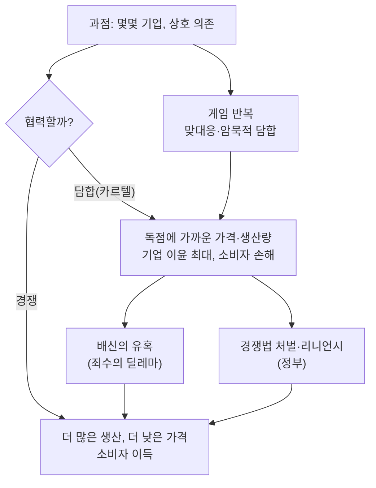

1950년 1월, 미국 캘리포니아의 연구소 **랜드 연구소**에서 두 수학자 메릴 플러드와 멜빈 드레셔가 동료 두 사람에게 간단한 게임을 시켰다. 두 사람은 서로 의논하지 않고 '협력'과 '배신' 가운데 하나를 고른다. 둘 다 협력하면 둘 다 꽤 많은 점수를 얻지만, 상대가 협력할 때 나 혼자 배신하면 더 많은 점수를 얻는다. 둘 다 배신하면 둘 다 적은 점수를 얻는다. 게임을 100번 되풀이하는 동안 두 사람은 협력과 배신 사이를 오갔고, 메모에는 상대에 대한 불평이 쏟아졌다. 그해 프린스턴 대학의 수학자 **앨버트 터커**는 이 게임을 두 범죄자 이야기로 바꾸어 설명했다. 이것이 사회 과학에서 가장 유명한 게임인 **죄수의 딜레마**다.

랜드 연구소는 미국 공군을 위해 핵무기 경쟁을 연구하던 곳이었다. 미국과 소련이 서로 핵무기를 줄이면 둘 다 안전하고 돈도 아끼지만, 상대가 줄일 때 나만 늘리면 우위에 설 수 있다. 그래서 둘 다 늘린다. 이 구조는 석유 수출국들의 감산 약속, 같은 동네 주유소 두 곳의 가격 경쟁, 이동 통신 회사들의 마케팅 경쟁에서도 똑같이 나타난다. 이 강의에서는 몇몇 큰 기업이 시장을 나누어 가진 **과점**을 다룬다. 과점 기업은 서로의 행동을 의식하며 결정해야 하므로, 이를 분석하려면 전략적 상황을 다루는 **게임 이론**이 필요하다.

> [!핵심] 이 강의의 질문
> 1. 과점 시장은 어떤 특징을 갖는가? 과점 기업은 왜 서로를 의식해야 하는가?
> 2. 죄수의 딜레마는 무엇이며, 왜 협력이 어려운가?
> 3. 과점 기업의 담합은 왜 생기고, 왜 깨지기 쉬운가? 정부는 어떻게 대응하는가?

{{F:e16-opening}}

## 과점: 몇몇 기업의 시장

### 과점의 특징

**과점**은 비슷하거나 같은 상품을 파는 몇몇 기업이 시장의 대부분을 차지하는 구조다. 과점은 우리 주변에 흔하다. 한국의 이동 통신 시장은 세 회사가 대부분을 차지하고, 국내 라면 시장, 맥주 시장, 정유 시장도 몇몇 기업이 나누어 가진다. 세계로 눈을 넓히면 메모리 반도체, 대형 여객기(보잉과 에어버스), 스마트폰 운영 체제가 대표적인 과점 시장이다.

```chart
{
  "type": "doughnut",
  "caption": "세계 D램(메모리 반도체) 시장의 매출 점유율 (2023년 무렵, 시장 조사 기관 발표를 바탕으로 한 대략적인 수치). 세 회사가 시장의 90% 이상을 차지하는 대표적인 과점 시장이다",
  "data": {
    "labels": ["삼성전자", "SK하이닉스", "마이크론", "그 밖의 기업"],
    "datasets": [{ "label": "점유율(%)", "data": [41, 31, 24, 4] }]
  }
}
```

과점의 핵심 특징은 **상호 의존성**이다. 완전경쟁 기업은 시장 가격을 그대로 받아들이면 되고, 독점 기업은 다른 기업을 걱정할 필요가 없다. 그러나 과점 기업은 자기 결정이 경쟁사에 영향을 주고, 경쟁사의 반응이 다시 자기에게 돌아온다. A 통신사가 요금을 내리면 B와 C도 따라 내릴까? 따라 내린다면 요금을 내린 의미가 없고, 따라 내리지 않는다면 A는 손님을 많이 빼앗아 올 수 있다. 과점 기업의 결정은 체스를 두는 것과 비슷하다. 상대의 다음 수를 읽어야 한다.

과점이 생기는 이유는 대개 14강에서 본 진입 장벽과 같다. 반도체나 여객기처럼 막대한 고정 비용과 규모의 경제가 필요한 산업에서는 소수의 대기업만 살아남는다. 통신처럼 정부의 허가(주파수)가 필요한 산업도 과점이 되기 쉽다.

### 담합하면 독점처럼

과점 기업들에게 가장 이득이 되는 것은 무엇일까? 서로 경쟁하지 않고 마치 하나의 독점 기업처럼 행동하는 것이다. 14강의 섬마을에 생수 상점이 두 곳 있다고 하자. 두 상점이 의논해 생산량을 줄이고 독점 가격을 받으면, 둘이 나누어 가질 이윤은 가장 커진다. 이렇게 기업들이 가격이나 생산량을 함께 정하는 것을 **담합**이라고 하고, 담합하는 기업 집단을 **카르텔**이라고 한다. 석유 수출국 기구(OPEC)가 대표적인 카르텔이다.

그런데 담합에는 근본적인 약점이 있다. 다른 기업들이 약속대로 생산을 줄여 가격이 높게 유지될 때, 나 혼자 몰래 생산을 늘리면 높은 가격에 더 많이 팔 수 있다. 모든 기업이 같은 생각을 하면 담합은 깨진다. 이것이 바로 죄수의 딜레마의 구조다.

## 게임 이론과 죄수의 딜레마

### 죄수의 딜레마

경찰이 두 용의자 갑과 을을 붙잡았다. 둘은 함께 은행을 털었다고 의심받지만, 경찰이 가진 증거로는 가벼운 무기 소지 혐의로 1년형밖에 줄 수 없다. 경찰은 둘을 다른 방에 가두고 각자에게 같은 제안을 한다. "자백하면 너는 풀어 주겠다. 상대가 자백하지 않으면 상대는 20년형을 받는다. 둘 다 자백하면 둘 다 8년형이다."

| | 을: 침묵 | 을: 자백 |
|---|---|---|
| **갑: 침묵** | 갑 1년, 을 1년 | 갑 20년, 을 석방 |
| **갑: 자백** | 갑 석방, 을 20년 | 갑 8년, 을 8년 |

표: 죄수의 딜레마의 보수 행렬

갑의 입장에서 생각해 보자. 을이 침묵한다면, 나도 침묵하면 1년, 자백하면 석방이니 자백이 낫다. 을이 자백한다면, 나도 침묵하면 20년, 자백하면 8년이니 역시 자백이 낫다. 을이 무엇을 하든 갑에게는 자백이 낫다. 이처럼 상대가 무엇을 하든 언제나 가장 좋은 전략을 **우월 전략**이라고 한다. 을도 똑같이 생각하므로 둘 다 자백하고, 둘 다 8년형을 받는다.

둘이 함께 침묵했다면 둘 다 1년형으로 끝났을 것이다. 각자는 합리적으로 행동했지만 그 결과는 둘 모두에게 나쁘다. 이것이 **죄수의 딜레마**다. 개인의 합리성과 집단의 합리성이 어긋나는 상황이며, 10강의 공유지의 비극과도 같은 구조다.

### 내시 균형

이런 전략적 상황을 분석하는 수학의 분야가 **게임 이론**이다. 헝가리 출신의 수학자 **존 폰 노이만**과 경제학자 **오스카어 모르겐슈테른**은 1944년 『게임 이론과 경제 행동』을 펴내 이 분야를 열었다. 1950년 프린스턴 대학의 대학원생 **존 내시**는 짧은 논문으로 게임 이론의 핵심 개념을 내놓았다. 모든 참가자가 다른 참가자의 전략을 주어진 것으로 보고 자기에게 가장 좋은 전략을 골랐을 때, 누구도 혼자서 전략을 바꿀 유인이 없는 상태를 **내시 균형**이라고 한다. 죄수의 딜레마에서 '둘 다 자백'이 내시 균형이다. 내시는 이 공로로 1994년 노벨 경제학상을 받았고, 그의 삶은 영화 「뷰티풀 마인드」(2001)로 만들어졌다.

{{F:e16-game}}

### 과점 기업의 딜레마

과점 기업들의 담합도 똑같은 구조다. 두 정유 회사가 생산량을 '적게'(담합 유지) 또는 '많게'(배신) 정할 수 있다고 하자.

| | B사: 적게 생산 (담합 유지) | B사: 많이 생산 (배신) |
|---|---|---|
| **A사: 적게 생산** | A 800억, B 800억 | A 500억, B 1,000억 |
| **A사: 많이 생산** | A 1,000억, B 500억 | A 600억, B 600억 |

표: 과점 기업의 담합 게임 (이윤, 가상의 예)

각 회사에게 '많이 생산'은 우월 전략이다. 그래서 둘 다 많이 생산하고, 이윤은 각자 600억 원으로 담합했을 때(800억 원)보다 줄어든다. 기업들에게는 아쉬운 결과지만, **소비자에게는 좋은 결과**다. 생산량이 늘고 가격이 내려가기 때문이다. 죄수의 딜레마가 늘 나쁜 것은 아니다. 과점 시장에서는 기업들 사이의 죄수의 딜레마가 경쟁을 유지시켜 사회 전체에 이롭게 작용한다.

과점 시장의 결과는 그래서 완전경쟁과 독점 사이에 놓인다. 과점 기업들은 독점보다 많이, 완전경쟁보다 적게 생산하며, 가격은 독점보다 낮고 완전경쟁보다 높다. 기업 수가 많아질수록 결과는 완전경쟁에 가까워진다.

### 죄수의 딜레마는 어디에나 있다

| 상황 | '협력' | '배신' | 결과 |
|---|---|---|---|
| 군비 경쟁 | 무기를 줄인다 | 무기를 늘린다 | 둘 다 무기를 늘려 비용과 위험이 커진다 |
| 광고 경쟁 | 광고를 줄인다 | 광고를 늘린다 | 둘 다 광고비를 쓰지만 점유율은 그대로다 |
| 공유자원 | 물고기를 적게 잡는다 | 많이 잡는다 | 남획으로 자원이 고갈된다(10강) |
| 관세 전쟁 | 관세를 낮춘다 | 관세를 올린다 | 둘 다 무역의 이득을 잃는다(8강) |
| 국제 기후 협력 | 온실가스를 줄인다 | 줄이지 않는다 | 기후 변화가 계속된다(9강) |

표: 생활과 정책 속의 죄수의 딜레마

광고 경쟁에 대한 흥미로운 사례가 있다. 미국은 1971년부터 텔레비전과 라디오의 담배 광고를 금지했다. 담배 회사들은 겉으로는 반대했지만, 금지 뒤 오히려 이윤이 늘었다는 분석이 많다. 서로 광고비를 쏟아붓던 죄수의 딜레마에서 정부가 대신 '협력'을 강제해 준 셈이었기 때문이다.

## 협력은 어떻게 가능한가

### 되풀이되는 게임

죄수의 딜레마에 갇힌 사람들은 늘 협력에 실패할까? 그렇지 않다. 게임이 **한 번**이 아니라 **여러 번 되풀이**되면 상황이 달라진다. 오늘 배신하면 내일 상대도 배신할 것이다. 앞으로 오래 거래할 상대라면, 지금 조금 더 벌려고 배신하기보다 협력을 이어 가는 편이 낫다.

1980년 미국의 정치학자 **로버트 액설로드**는 세계의 학자들에게 죄수의 딜레마를 수백 번 되풀이하는 게임의 전략을 컴퓨터 프로그램으로 보내 달라고 해 대회를 열었다. 복잡한 전략들을 제치고 우승한 것은 가장 단순한 전략이었다. 처음에는 협력하고, 그다음부터는 상대가 직전에 한 대로 따라 하는 **'맞대응'**(눈에는 눈, 이에는 이) 전략이다. 맞대응은 착하게 시작하고, 배신당하면 바로 응징하며, 상대가 다시 협력하면 곧바로 용서한다. 액설로드는 이 결과를 바탕으로, 서로 오래 만나는 관계에서는 이기적인 사람들 사이에서도 협력이 저절로 생겨날 수 있다고 주장했다.

이 원리는 과점 기업들에게도 적용된다. 매일 마주치는 동네 주유소 두 곳은 굳이 의논하지 않아도, 한쪽이 값을 내리면 다른 쪽이 즉시 따라 내린다는 것을 서로 안다. 그래서 둘 다 값을 높게 유지하는 '암묵적 담합'이 생길 수 있다.

### 담합은 왜 그래도 깨지나

그럼에도 카르텔은 오래가지 못하는 경우가 많다. 참가자가 많을수록 누가 배신했는지 알아내기 어렵고, 수요가 줄어 경기가 나빠지면 배신의 유혹이 커진다. OPEC은 1970년대에 큰 성공을 거두었지만, 1980년대에는 회원국들이 할당량보다 많이 생산하면서 유가가 폭락했다(5강). 회원국들이 서로 다른 처지에 있었기 때문이다. 돈이 급한 나라는 약속을 어기고 더 팔고 싶어 했다.

{{F:e16-cartel}}

## 정부와 과점

### 담합은 불법이다

과점 기업의 담합은 소비자에게서 큰 이득을 빼앗는다. 그래서 대부분의 나라는 경쟁법으로 담합을 금지하고 무겁게 처벌한다(14강). 한국 공정거래위원회는 해마다 수많은 담합 사건을 적발한다. 밀가루와 설탕, 라면, 석유 제품, 건설 공사 입찰 같은 분야에서 대규모 담합이 문제가 되었다. 다만 담합을 증명하기는 쉽지 않다. 2012년 공정거래위원회는 라면 회사들이 가격을 함께 올렸다며 1,000억 원이 넘는 과징금을 매겼지만, 2015년 대법원은 회사들이 실제로 합의했다는 증거가 부족하다며 이를 취소했다. 값을 비슷하게 올린 것만으로는 담합이라고 볼 수 없고, 서로 '합의'했다는 증거가 필요하기 때문이다.

### 죄수의 딜레마를 이용한 수사

경쟁 당국은 죄수의 딜레마를 거꾸로 이용하기도 한다. 담합에 가담한 기업이 먼저 자진 신고를 하고 조사에 협조하면 과징금을 면제하거나 크게 줄여 주는 **자진 신고자 감면 제도**(리니언시)다. 한국은 1997년 이 제도를 도입했다. 담합에 가담한 기업들은 '다른 회사가 먼저 신고하면 우리만 무거운 벌을 받는다'는 두려움에 앞다투어 신고하게 된다. 경찰이 두 용의자에게 자백을 권한 것과 같은 원리다. 많은 대형 담합 사건이 이 제도로 밝혀졌다.



## 게임 이론의 발전

```timeline
1838 | 쿠르노, 복점 모형 | 두 기업의 생산량 경쟁을 처음으로 수식화
1928 | 폰 노이만, 최소 최대 정리 | 
1944 | 폰 노이만·모르겐슈테른, 『게임 이론과 경제 행동』 | 게임 이론의 출발
1950 | 내시 균형 / 죄수의 딜레마 | 내시의 논문, 랜드 연구소 실험과 터커의 명명
1960 | 셸링, 『갈등의 전략』 | 핵 억지와 협상의 게임 이론
1980 | 액설로드의 반복 죄수의 딜레마 대회 | 맞대응 전략의 우승
1994 | 내시·하사니·젤텐, 노벨 경제학상 | 
2005 | 아우만·셸링, 노벨 경제학상 | 갈등과 협력의 이해
2012 | 섀플리·로스, 노벨 경제학상 | 짝짓기(매칭) 이론과 시장 설계
2020 | 밀그럼·윌슨, 노벨 경제학상 | 경매 이론과 주파수 경매 설계
```

게임 이론은 과점을 넘어 경제학 전체의 기본 도구가 되었다. 정부가 이동 통신 주파수를 경매로 팔 때, 대학 입시와 의사 수련 병원 배정처럼 사람과 자리를 짝지을 때, 국가 사이의 협상과 기업의 계약을 설계할 때 게임 이론이 쓰인다. 한국도 2011년부터 이동 통신 주파수를 경매로 배분하고 있다.

## 정리

> [!핵심] 16강 요약
> - **과점**은 몇몇 기업이 시장의 대부분을 차지하는 구조로, 기업들의 결정이 서로 영향을 주는 **상호 의존성**이 핵심이다.
> - 과점 기업들은 **담합**(카르텔)으로 독점처럼 행동하면 이윤이 가장 크지만, 각자 몰래 생산을 늘릴 유인이 있어 담합은 깨지기 쉽다.
> - **죄수의 딜레마**에서는 각자의 **우월 전략**이 모두에게 나쁜 결과를 낳는다. 누구도 혼자 전략을 바꿀 유인이 없는 상태가 **내시 균형**이다. 군비 경쟁, 광고 경쟁, 공유자원, 관세 전쟁이 같은 구조다.
> - 게임이 **반복**되면 **맞대응** 같은 전략으로 협력이 생길 수 있다. 과점 시장의 결과는 독점과 완전경쟁 사이에 놓인다.
> - 정부는 경쟁법으로 담합을 처벌하고, **자진 신고자 감면 제도**로 죄수의 딜레마를 이용해 담합을 적발한다.

### 생각해 볼 질문

1. 시험 기간에 친구들과 '다 같이 공부를 덜 하자'고 약속하면 모두 편하게 같은 점수를 받을 수 있다. 이 약속은 왜 지켜지기 어려울까? 죄수의 딜레마로 설명해 보자.
2. 이동 통신 회사들이 비슷한 시기에 비슷한 요금제를 내놓는 것은 담합일까, 경쟁의 결과일까? 둘을 어떻게 구별할 수 있을까?
3. 기후 변화를 막기 위한 국제 협력을 '반복 게임'으로 만들려면 어떤 제도가 필요할까?

### 다음 강 예고

17강 「노동 시장과 생산 요소」에서는 상품 시장에서 생산 요소 시장으로 눈을 돌린다. 임금은 어떻게 정해지는지, 기업은 노동자를 몇 명 고용하는지, 왜 어떤 직업은 임금이 높고 어떤 직업은 낮은지, 교육과 인적 자본, 노동조합, 차별이 임금에 어떤 영향을 주는지 살펴본다.
