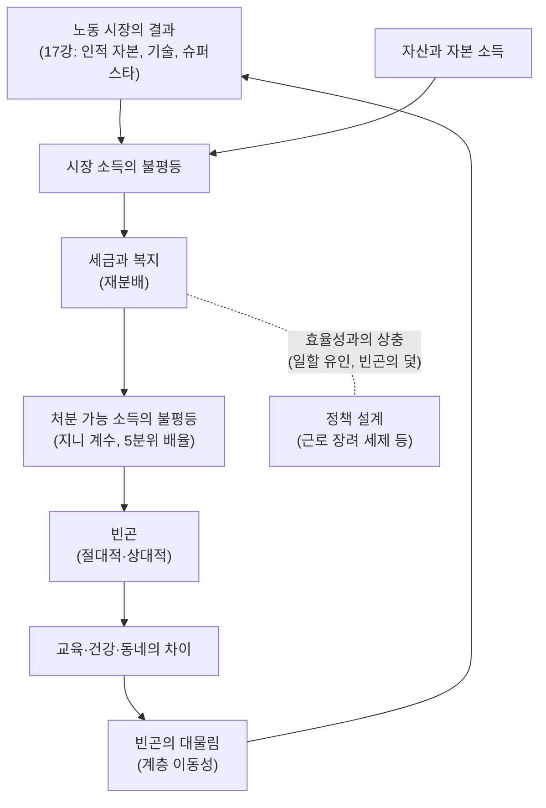

1890년 미국 뉴욕의 신문 기자 **제이컵 리스**는 『나머지 절반은 어떻게 사는가』라는 책을 펴냈다. 덴마크에서 건너온 가난한 이민자였던 그는, 갓 발명된 마그네슘 섬광 가루를 들고 밤마다 뉴욕 빈민가의 어두운 셋방에 들어가 사진을 찍었다. 창문 하나 없는 방에 열 명이 넘는 식구가 뒤엉켜 자고, 아이들은 골목에서 신문을 팔다 잠들었다. 같은 시기 몇 블록 떨어진 5번가에는 철도왕 밴더빌트 가문의 대저택들이 늘어서 있었다. 작가 마크 트웨인은 이 시대를 겉만 번지르르한 **'도금 시대'**라고 불렀다.

130여 년이 지난 지금, 세계는 그때보다 훨씬 풍요로워졌다. 그러나 '나머지 절반은 어떻게 사는가'라는 질문은 여전히 남아 있다. 이 강의에서는 17강에서 배운 노동 시장의 결과가 모여 만들어지는 **소득 분배**를 살펴본다. 불평등은 어떻게 재는지, 한국과 다른 나라의 불평등은 어떤지, 가난은 왜 생기고 대물림되는지, 그리고 정부가 소득을 다시 나누어야 하는지에 대한 철학적 논쟁을 다룬다.

> [!핵심] 이 강의의 질문
> 1. 소득 불평등은 어떻게 재는가? 한국의 불평등은 어느 정도인가?
> 2. 빈곤은 어떻게 정의하며, 왜 생기고 대물림되는가?
> 3. 정부는 소득을 재분배해야 하는가? 그렇다면 어떤 방법으로?

```gallery
src: asset:e1f13944418e9cbab6fa96b35c156b25
caption: 제이컵 리스가 찍은 뉴욕 '포버티 갭' 지역의 셋방(1889년 무렵). 텅 빈 방에 한 가족이 앉아 있다.
credit: 제이컵 A. 리스 촬영, 1889년 무렵 · 미국 의회도서관 소장
license: Public Domain (미국 의회도서관: 출판 제한 없음)
source: https://www.loc.gov/item/2002710281/
---
src: asset:0f026427dd6d6e67d0eca0e0b82ed55d
caption: 제이컵 리스의 「한 자리에 5센트」(1890년 무렵). 뉴욕 베이어드 거리의 무허가 합숙소에서 사람들이 좁은 방에 몸을 붙이고 누워 있다.
credit: 제이컵 A. 리스 촬영, 1890년 무렵 · 미국 의회도서관 소장
license: Public Domain (미국 의회도서관: 출판 제한 없음)
source: https://www.loc.gov/item/2002710259/
```

## 불평등을 재는 방법

### 소득 5분위 배율

불평등을 재는 가장 쉬운 방법은 사람들을 소득 순서대로 줄 세운 뒤 나누어 비교하는 것이다. 가구를 소득 순으로 다섯 묶음(5분위)으로 나누었을 때, 가장 잘사는 20%의 평균 소득이 가장 못사는 20%의 평균 소득의 몇 배인지를 **소득 5분위 배율**이라고 한다. 한국의 처분 가능 소득 기준 5분위 배율은 2020년대 들어 대략 5.7~6배 수준이다. 상위 20%가 하위 20%보다 6배쯤 번다는 뜻이다.

### 로렌츠 곡선과 지니 계수

불평등을 한 숫자로 나타내는 가장 널리 쓰이는 지표는 **지니 계수**다. 이탈리아의 통계학자 **코라도 지니**가 1912년에 만들었다. 지니 계수를 이해하려면 먼저 미국의 경제학자 **맥스 로렌츠**가 1905년에 고안한 **로렌츠 곡선**을 알아야 한다. 가로축에 소득이 낮은 사람부터 누적한 인구 비율을, 세로축에 그 사람들이 가진 소득의 누적 비율을 그린 것이다.

```chart
{
  "type": "line",
  "caption": "로렌츠 곡선 (가상의 예). 모든 사람의 소득이 똑같다면 곡선은 대각선(완전 평등선)이 된다. 불평등할수록 곡선은 아래로 처진다. 대각선과 로렌츠 곡선 사이의 넓이가 클수록 지니 계수가 크다",
  "data": {
    "labels": ["0%", "20%", "40%", "60%", "80%", "100%"],
    "datasets": [
      { "label": "완전 평등선", "data": [0, 20, 40, 60, 80, 100], "borderDash": [6, 4], "pointRadius": 0 },
      { "label": "비교적 평등한 나라", "data": [0, 10, 25, 43, 65, 100] },
      { "label": "불평등한 나라", "data": [0, 4, 12, 25, 47, 100] }
    ]
  },
  "options": { "scales": { "x": { "title": { "display": true, "text": "소득이 낮은 사람부터 누적한 인구 비율" } }, "y": { "min": 0, "max": 100, "title": { "display": true, "text": "누적 소득 비율 (%)" } } } }
}
```

모든 사람의 소득이 똑같다면 하위 20%가 소득의 20%를, 하위 40%가 40%를 가지므로 로렌츠 곡선은 대각선이 된다. 소득이 불평등할수록 곡선은 대각선에서 멀리 아래로 처진다. **지니 계수**는 대각선과 로렌츠 곡선 사이의 넓이를 대각선 아래 삼각형 전체의 넓이로 나눈 값이다. 모두가 똑같이 벌면 0, 한 사람이 모든 소득을 가지면 1이 된다.

| 나라 | 지니 계수 (처분 가능 소득, 대략) | 특징 |
|---|---|---|
| 슬로바키아, 슬로베니아, 노르웨이, 덴마크 | 0.22~0.26 | 가장 평등한 편 |
| 독일, 프랑스 | 0.29~0.30 | |
| 한국 | 약 0.32~0.33 | OECD 평균 수준. 세금·복지 전 시장 소득 기준으로는 0.4 안팎 |
| 일본, 영국 | 0.33~0.36 | |
| 미국 | 약 0.39 | 선진국 가운데 불평등한 편 |
| 남아프리카 공화국, 브라질 | 0.5~0.6 이상 | 세계에서 가장 불평등한 편 |

표: 여러 나라의 지니 계수 (OECD·세계은행 자료를 바탕으로 한 2010년대 후반~2020년대 초의 대략적인 수치)

한국의 지니 계수는 세금을 내고 복지 급여를 받기 전의 **시장 소득** 기준으로는 0.4 안팎이지만, 세금과 공적 이전 소득을 반영한 **처분 가능 소득** 기준으로는 0.32~0.33 정도로 낮아진다. 둘의 차이가 정부의 소득 재분배 효과다. 유럽 나라들은 이 재분배 효과가 한국보다 훨씬 크다. 시장 소득의 불평등은 한국과 비슷하거나 더 큰 나라들도, 세금과 복지를 거치면 훨씬 평등해진다.

### 소득이 아니라 자산과 생애로 보면

소득 불평등만으로는 경제적 불평등을 다 알 수 없다. **자산**(재산)의 불평등은 소득 불평등보다 훨씬 크다. 한국에서도 순자산의 지니 계수는 0.6 안팎으로, 소득보다 크게 높다. 집값이 크게 오른 시기에는 집을 가진 사람과 갖지 못한 사람의 차이가 소득 차이보다 훨씬 크게 벌어진다.

반대로 한 해의 소득만 보면 불평등이 실제보다 커 보이기도 한다. 대학생이나 은퇴한 노인은 그해 소득이 적지만 평생으로 보면 가난하지 않을 수 있다. 사람들은 대개 젊을 때 적게 벌다가 중년에 많이 벌고 은퇴 뒤 다시 적게 번다. 또 소득은 해마다 오르내린다. 그래서 경제학자들은 한 해의 소득보다 평생 소득이나 소비를 기준으로 불평등을 보기도 한다.

## 빈곤

### 빈곤을 정의하기

**빈곤율**은 소득이 일정한 기준선(**빈곤선**)보다 낮은 사람의 비율이다. 빈곤선을 정하는 방법은 두 가지다.

- **절대적 빈곤**: 최소한의 생활에 필요한 음식과 옷, 집의 비용으로 빈곤선을 정한다. 세계은행은 하루 2.15달러(2017년 구매력 기준) 미만으로 사는 사람을 '극빈층'으로 정의한다. 1990년에는 세계 인구의 약 38%가 극빈층이었지만, 2019년에는 9% 안팎으로 줄었다. 중국과 인도, 동아시아의 빠른 성장 덕분이다.
- **상대적 빈곤**: 그 사회의 중간 소득(중위 소득)의 절반에 못 미치면 빈곤으로 본다. OECD가 쓰는 기준이다. 가난은 그 사회에서 '보통의 삶'에서 밀려나는 것이라는 생각이다.

한국의 상대적 빈곤율은 15% 안팎으로 OECD 평균보다 높은 편이다. 특히 66세 이상 **노인 빈곤율이 40% 안팎**으로 OECD 회원국 가운데 가장 높다. 국민연금이 1988년에야 시작되어 지금의 노인 세대 상당수가 충분한 연금을 받지 못하고, 자녀가 부모를 부양하던 전통이 빠르게 약해졌기 때문이다.

```chart
{
  "type": "bar",
  "caption": "66세 이상 노인의 상대적 빈곤율 (%, 2020년 무렵, OECD 자료를 바탕으로 한 대략적인 수치). 한국은 노인 열 명 가운데 네 명 가까이가 중위 소득의 절반에 못 미치는 소득으로 생활해, OECD에서 가장 높은 수준이다",
  "data": {
    "labels": ["한국", "미국", "일본", "OECD 평균", "독일", "프랑스"],
    "datasets": [{ "label": "노인 빈곤율(%)", "data": [40.4, 22.8, 20.0, 14.2, 11.0, 4.4] }]
  },
  "options": { "scales": { "y": { "min": 0 } }, "plugins": { "legend": { "display": false } } }
}
```

### 빈곤은 왜 대물림되나

가난한 집에서 태어난 아이는 가난한 어른이 되기 쉽다. 부모의 소득이 낮으면 아이가 받는 교육과 건강 관리, 영양, 그리고 살아가는 동네가 달라진다. 이는 17강의 인적 자본에 차이를 만들고, 그 차이는 다시 소득의 차이가 된다. 부모와 자녀의 소득이 얼마나 비슷한지를 재는 것을 **세대 간 소득 탄력성**이라고 하는데, 이 값이 클수록 '계층 이동'이 어렵다는 뜻이다. 불평등이 큰 나라일수록 계층 이동성이 낮은 경향이 있다는 관계를 '위대한 개츠비 곡선'이라고 부른다.

미국의 경제학자 **라즈 체티** 등은 수백만 명의 세금 자료를 분석해, 같은 소득의 가정에서 자라도 어느 동네에서 자랐느냐에 따라 아이가 어른이 되어 버는 소득이 크게 달라진다는 것을 보여 주었다. 좋은 학교와 안전한 환경, 이웃의 본보기가 있는 동네로 일찍 이사한 아이일수록 더 많이 벌었다. 가난의 대물림을 끊으려면 어린 시절에 대한 투자가 중요하다는 뜻이다.

```gallery
src: asset:64788447162e12fe6ed4a22e67888bde
caption: 도러시아 랭의 「이주민 어머니」(1936년). 캘리포니아의 완두콩 따는 일꾼이었던 32세의 플로런스 오언스 톰프슨과 아이들이다. 대공황기 빈곤을 상징하는 사진이 되었다.
credit: 도러시아 랭 촬영, 1936년 · 미국 의회도서관 소장 (농업안정국 사진)
license: Public Domain (미국 농업안정국·전시정보국 사진, 미국 의회도서관)
source: https://www.loc.gov/item/2017762891/
---
src: asset:b26d84b1ebc17158ffff59b0ec1292c3
caption: 1936년 미국 포틀랜드의 '후버빌'. 대공황으로 집을 잃은 사람들이 고철과 판자로 지은 오두막이다.
credit: 아서 로스스타인 촬영, 1936년 · 미국 의회도서관 소장 (농업안정국 사진)
license: Public Domain (미국 농업안정국·전시정보국 사진, 미국 의회도서관)
source: https://www.loc.gov/item/2017760788/
```

```figure
src: asset:fcba42a280552995f2d6204ce51d1a83
caption: 19세기 말 미국 뉴포트에 지은 코닐리어스 밴더빌트 2세의 저택 '브레이커스'. 철도 재벌 밴더빌트 가문의 여름 별장으로, 70개에 가까운 방이 있다. 같은 시기 뉴욕 빈민가의 셋방과 대조된다. 이 시기를 '도금 시대'라고 부른다.
credit: 프랭크 H. 차일드 촬영, 1890년대 · 미국 의회도서관 소장
license: Public Domain (미국 의회도서관: 출판 제한 없음)
source: https://www.loc.gov/item/2014645396/
```

## 불평등은 왜 커졌나

20세기 중반 선진국들의 불평등은 크게 줄었다. 두 차례 세계대전과 대공황으로 부자들의 재산이 크게 줄었고, 누진세와 복지 국가가 자리 잡았으며, 노동조합이 강했다. 그러나 1980년대 이후 많은 선진국에서 불평등이 다시 커졌다. 경제학자들이 드는 이유는 다음과 같다.

| 원인 | 설명 |
|---|---|
| 숙련 편향적 기술 변화 | 컴퓨터와 인터넷은 고학력·고숙련 노동자의 생산성을 크게 높였지만, 반복적인 일을 하는 노동자를 대체했다(17강) |
| 세계화 | 저임금 나라에서 수입이 늘면서 선진국의 저숙련 제조업 일자리가 줄었다(3강, 8강의 차이나 쇼크) |
| 슈퍼스타 현상 | 최고 경영자, 스타, 거대 기업에 소득이 몰렸다(17강) |
| 제도의 변화 | 노동조합의 약화, 최고 소득 세율의 인하, 금융 규제 완화 |
| 자본 소득 | 자산을 가진 사람이 얻는 소득이 노동 소득보다 빨리 늘었다 |

표: 1980년대 이후 불평등이 커진 이유로 꼽히는 것들

프랑스의 경제학자 **토마 피케티**는 2013년 『21세기 자본』에서 수백 년의 세금 자료를 모아, 자본 수익률이 경제 성장률보다 높으면 자산이 소수에게 쌓여 불평등이 커진다고 주장했다. 이 책은 세계적인 논쟁을 불러일으켰다. 그의 자료가 불평등의 장기적 흐름을 보여 준 데는 많은 사람이 공감했지만, 그 원인과 해법에 대해서는 반론도 많았다.

## 정부는 소득을 다시 나누어야 하나

### 세 가지 철학

정부가 부자에게서 세금을 걷어 가난한 사람을 돕는 것은 정당할까? 이것은 경제학만으로 답할 수 없는 규범적 질문이다(1강). 세 가지 대표적인 생각이 있다.

| 철학 | 대표 사상가 | 핵심 생각 | 재분배에 대한 태도 |
|---|---|---|---|
| 공리주의 | 제러미 벤담, 존 스튜어트 밀 | 사회 전체의 효용(행복)의 합을 가장 크게 하라. 돈 1만 원은 부자보다 가난한 사람에게 더 큰 효용을 준다(한계 효용 체감) | 재분배에 찬성하되, 일할 유인을 너무 줄이지 않는 선에서 |
| 자유주의(롤스) | 존 롤스, 『정의론』(1971) | 자기가 어떤 처지로 태어날지 모르는 '무지의 베일' 뒤에서 사회 규칙을 정한다면, 가장 못사는 사람의 처지를 가장 낫게 하는 규칙을 고를 것이다(최소 극대화) | 공리주의보다 더 적극적인 재분배 |
| 자유지상주의 | 로버트 노직, 『무정부, 국가, 유토피아』(1974) | 정당한 과정으로 얻은 소득은 그 사람의 것이다. 결과가 아니라 과정이 공정한지가 중요하다 | 정부의 재분배에 반대. 기회의 평등을 보장하는 데 그쳐야 |

표: 소득 재분배를 둘러싼 세 가지 정치 철학

롤스의 '무지의 베일'은 강의실에서 해 보기 좋은 사고 실험이다. 내가 부잣집에서 태어날지, 가난한 집에서 태어날지, 건강하게 태어날지, 장애를 갖고 태어날지 전혀 모른다고 상상해 보자. 그 상태에서 우리는 어떤 사회 규칙을 원할까?

### 빈곤을 줄이는 정책들

| 정책 | 내용 | 장점 | 단점 |
|---|---|---|---|
| 최저임금 | 임금의 하한을 정한다(6강) | 일하는 저임금 노동자의 소득을 높인다 | 일부 일자리를 줄일 수 있다. 가난한 가구를 정확히 겨냥하지 못한다 |
| 기초 생활 보장 (복지) | 소득이 기준에 못 미치는 가구에 생계비를 준다. 한국은 2000년 국민 기초 생활 보장 제도 시행 | 가장 가난한 사람을 직접 돕는다 | 소득이 늘면 급여가 줄어 일할 유인을 줄일 수 있다 |
| 근로 장려 세제 (EITC) | 일해서 번 소득이 적은 가구에 세금을 돌려주는 방식으로 보조한다. 한국은 2009년부터 지급 | 일할수록 더 받으므로 일할 유인을 해치지 않는다 | 일할 수 없는 사람은 돕지 못한다 |
| 현물 지원 | 돈 대신 식료품, 주거, 의료를 준다 | 그 돈이 필요한 곳에 쓰인다 | 받는 사람의 선택권을 제한한다 |
| 기본 소득 | 모든 사람에게 조건 없이 일정한 돈을 준다 | 행정이 단순하고, 낙인이 없으며, 일할 유인을 줄이지 않는다 | 막대한 재원이 필요하다. 실험은 있었지만 전국 단위의 시행 사례는 거의 없다 |

표: 빈곤을 줄이는 여러 정책

어떤 정책이든 피할 수 없는 문제가 있다. 소득이 늘수록 지원이 줄어드는 제도에서는, 일을 해서 소득이 늘어도 지원이 그만큼 줄어 실제 손에 쥐는 돈이 별로 늘지 않는다. 이것은 11강에서 배운 높은 **한계 세율**과 같은 효과를 내서 일할 유인을 줄인다. 이를 '빈곤의 덫'이라고 부른다. 근로 장려 세제는 이 문제를 줄이려는 정책이다.



```gallery
src: asset:0c53af37d12ee973e75a578583ad7dce
caption: 미국 사회보장국의 포스터 「65세부터 평생 매달 수표를」(1935년 무렵). 1935년 사회보장법으로 미국의 공적 연금 제도가 시작되었다.
credit: 미국 사회보장국 · 미국 의회도서관 소장
license: Public Domain (미국 의회도서관: 출판 제한 없음)
source: https://www.loc.gov/item/92500634/
---
src: asset:0b630cf56d4f399b1d958d2b15b65f19
caption: 1965년 린든 존슨 대통령이 노인 의료 보험(메디케어) 법안에 서명하는 모습. 옆에 해리 트루먼 전 대통령이 앉아 있다. 존슨 정부는 '빈곤과의 전쟁'을 선포하고 여러 복지 제도를 만들었다.
credit: 미국 백악관 사진사, 1965년 · 미국 국립문서보관소(NARA) 소장
license: Public Domain (미국 연방정부 저작물)
source: https://catalog.archives.gov/id/2803430
---
src: asset:5a729bb225b114dcbac0fc1a540f1c26
caption: 1966년 '헤드 스타트' 교실에서 아이들에게 책을 읽어 주는 레이디 버드 존슨 영부인. 헤드 스타트는 가난한 가정의 어린아이들에게 취학 전 교육을 제공해 빈곤의 대물림을 끊으려는 정책이다.
credit: 미국 백악관 사진사, 1966년 · 미국 국립문서보관소(NARA) 소장
license: Public Domain (미국 연방정부 저작물)
source: https://catalog.archives.gov/id/596401
```

## 정리

> [!핵심] 18강 요약
> - 불평등은 **소득 5분위 배율**, **로렌츠 곡선**, **지니 계수**(0은 완전 평등, 1은 완전 불평등)로 잰다. 한국의 처분 가능 소득 지니 계수는 0.32~0.33으로 OECD 평균 수준이며, 세금과 복지의 재분배 효과는 유럽보다 작다.
> - **자산** 불평등은 소득 불평등보다 훨씬 크고, 한 해의 소득만으로는 생애에 걸친 불평등을 다 알 수 없다.
> - 빈곤에는 **절대적 빈곤**과 **상대적 빈곤**이 있다. 세계의 극빈층은 크게 줄었지만, 한국의 **노인 빈곤율**은 OECD에서 가장 높다. 빈곤은 교육·건강·동네의 차이를 거쳐 **대물림**된다.
> - 1980년대 이후 불평등이 커진 원인으로 기술 변화, 세계화, 슈퍼스타 현상, 제도 변화, 자본 소득이 꼽힌다.
> - 재분배에 대해 **공리주의**, **롤스의 자유주의**, **노직의 자유지상주의**가 서로 다른 답을 준다. 정책을 설계할 때는 형평성과 일할 유인 사이의 **상충**을 고려해야 한다.

### 생각해 볼 질문

1. 롤스의 '무지의 베일' 뒤에 서 있다고 상상해 보자. 나는 어떤 세금과 복지 제도를 고르겠는가? 그 이유는?
2. 한국의 노인 빈곤율이 특히 높은 이유는 무엇일까? 앞으로 국민연금이 성숙하면 이 문제는 어떻게 될까?
3. 기본 소득을 도입한다면 무엇이 좋아지고 무엇이 어려워질까? 재원은 어떻게 마련할 수 있을까?

### 다음 강 예고

19강 「소비자 선택 이론」에서는 수요 곡선의 바탕에 있는 소비자의 선택을 더 깊이 들여다본다. 예산 제약과 선호(무차별 곡선)로 소비자가 어떻게 가장 좋은 선택을 하는지, 가격이 바뀔 때의 소득 효과와 대체 효과, 그리고 이 이론으로 임금과 노동 공급, 이자율과 저축의 관계를 설명한다.
