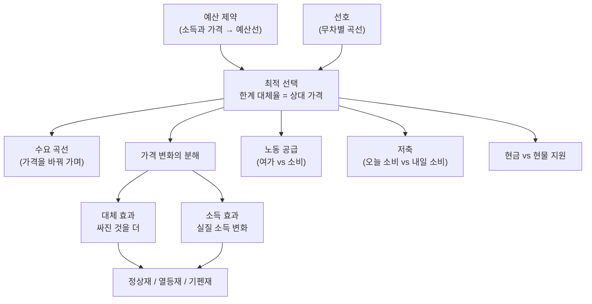

2006년, 미국의 경제학자 **로버트 젠슨**과 **놀런 밀러**는 중국 후난성의 가난한 가정들을 대상으로 특별한 실험을 했다. 무작위로 고른 가정들에 쌀을 싸게 살 수 있는 쿠폰을 나누어 준 것이다. 쌀값이 내렸으니 사람들은 쌀을 더 많이 살 것이라고 예상하기 쉽다. 그런데 가장 가난한 가정들 가운데 일부는 오히려 쌀을 **덜** 샀다. 쌀값이 내려 생긴 여윳돈으로 고기와 생선을 사고, 그만큼 쌀을 줄인 것이다. 반대로 말하면, 이 가정들에게 쌀값이 오르면 쌀을 오히려 더 많이 사게 된다는 뜻이다.

4강에서 배운 수요 법칙과 정반대다. 이런 상품을 영국의 통계학자 로버트 기펜의 이름을 따서 **기펜재**라고 부른다. 앨프리드 마셜이 1895년 『경제학 원리』의 개정판에서 처음 소개한 이래, 기펜재는 오랫동안 '이론적으로만 가능한 이상한 상품'으로 여겨졌다. 젠슨과 밀러는 2008년 논문에서 실제 자료로 그 존재를 보여 주었다.

이 강의에서는 수요 곡선 뒤에 있는 소비자의 선택을 한 걸음 더 깊이 들여다본다. 소비자가 한정된 예산 안에서 어떻게 가장 좋은 조합을 고르는지 그래프로 분석하고, 가격이 변할 때 일어나는 두 가지 효과를 나누어 본다. 이 도구로 기펜재뿐 아니라, 임금이 오르면 사람들이 더 일하는지, 이자율이 오르면 저축을 더 하는지 같은 질문에도 답할 수 있다.

> [!핵심] 이 강의의 질문
> 1. 소비자는 무엇을 살 수 있는가(예산 제약)? 소비자는 무엇을 원하는가(선호)?
> 2. 소비자는 어떻게 가장 좋은 선택에 이르는가?
> 3. 가격이 바뀌면 소비자의 선택은 어떻게 변하는가? 수요 법칙에는 예외가 있는가?

```figure
src: asset:c21f9324de43d00e49b6c76f229d5e75
caption: 1938년 미국 인디애나주 시골 가게에서 식료품을 사는 손님. 정해진 돈으로 무엇을 얼마나 살지 고르는 것이 소비자 선택의 문제다.
credit: 아서 로스스타인 촬영, 1938년 · 미국 의회도서관 소장 (농업안정국·전시정보국 사진)
license: Public Domain (미국 농업안정국·전시정보국 사진, 미국 의회도서관)
source: https://www.loc.gov/item/2017776730/
```

## 무엇을 살 수 있나: 예산 제약

### 예산선

대학생 지아는 한 달 용돈 가운데 4만 원을 커피와 빵에 쓴다. 커피 한 잔은 4,000원, 빵 하나는 2,000원이다. 지아가 살 수 있는 조합은 무엇일까? 4만 원을 모두 커피에 쓰면 커피 10잔, 모두 빵에 쓰면 빵 20개를 살 수 있다. 커피 5잔과 빵 10개, 커피 8잔과 빵 4개처럼 그 사이의 조합도 살 수 있다.

예산을 모두 썼을 때 살 수 있는 조합을 이은 선을 **예산선**이라고 한다. 예산선 위나 그 안쪽의 조합은 살 수 있고, 바깥의 조합은 살 수 없다. 2강의 생산 가능 곡선이 한 사회가 만들 수 있는 것의 한계였다면, 예산선은 한 소비자가 살 수 있는 것의 한계다.

예산선의 기울기는 두 상품의 **상대 가격**이다. 커피 한 잔을 더 마시려면 빵 2개를 포기해야 한다. 시장이 매긴 커피 한 잔의 기회비용은 빵 2개다.

### 예산선의 이동

- **소득이 늘면** 예산선은 바깥으로 평행 이동한다. 지아의 커피·빵 예산이 6만 원으로 늘면 커피 15잔 또는 빵 30개까지 살 수 있다.
- **한 상품의 가격이 바뀌면** 예산선이 회전한다. 커피값이 2,000원으로 내리면 커피는 최대 20잔까지 살 수 있게 되지만, 빵은 여전히 최대 20개다. 예산선은 빵 축의 점을 중심으로 바깥쪽으로 돈다.

## 무엇을 원하나: 선호와 무차별 곡선

### 무차별 곡선

이제 지아의 취향, 곧 **선호**를 나타내 보자. 지아에게 '커피 5잔과 빵 10개'와 '커피 2잔과 빵 25개'가 똑같이 만족스럽다면, 지아는 이 두 조합에 대해 **무차별**하다. 이렇게 소비자에게 똑같은 만족을 주는 조합들을 이은 선을 **무차별 곡선**이라고 한다. 등고선 지도에서 높이가 같은 점을 이은 선과 비슷하다.

무차별 곡선에는 네 가지 성질이 있다.

1. **바깥쪽 곡선일수록 더 좋다.** 사람들은 대개 적은 것보다 많은 것을 좋아한다.
2. **오른쪽 아래로 기운다.** 커피를 더 마시면서 같은 만족을 유지하려면 빵을 덜 먹어야 한다.
3. **서로 교차하지 않는다.** 교차한다면 앞뒤가 맞지 않는 선호가 된다.
4. **원점을 향해 볼록하다.** 사람들은 한쪽으로 치우친 조합보다 골고루 섞인 조합을 좋아한다.

### 한계 대체율

무차별 곡선의 기울기는 소비자가 한 상품을 다른 상품과 기꺼이 맞바꾸려는 비율로, 이것을 **한계 대체율**이라고 한다. 커피가 한 잔뿐이고 빵이 많을 때 지아는 커피 한 잔을 더 얻기 위해 빵을 많이 내줄 것이다. 반대로 커피가 많고 빵이 적을 때는 커피 한 잔을 위해 빵을 조금밖에 내주려 하지 않는다. 이처럼 한 상품을 많이 가질수록 그 상품의 가치가 줄어드는 것(1강의 한계 효용 체감)이 무차별 곡선을 볼록하게 만든다.

| 두 상품의 관계 | 무차별 곡선의 모양 | 예 |
|---|---|---|
| 일반적인 경우 | 원점을 향해 볼록 | 커피와 빵 |
| 완전 대체재 | 직선 | 500원 동전 두 개와 1,000원 지폐 한 장 |
| 완전 보완재 | 직각(L자) | 왼쪽 신발과 오른쪽 신발 |

표: 두 상품의 관계와 무차별 곡선의 모양

## 가장 좋은 선택

### 예산선과 무차별 곡선이 맞닿는 곳

이제 '살 수 있는 것'(예산선)과 '원하는 것'(무차별 곡선)을 한 그래프에 그리자. 지아는 예산선 위의 조합 가운데 가장 바깥쪽 무차별 곡선에 닿는 점을 고른다. 그 점은 무차별 곡선이 예산선에 딱 **맞닿는**(접하는) 곳이다.

```chart
{
  "type": "scatter",
  "caption": "지아의 최적 선택 (가상의 예. 커피 4,000원, 빵 2,000원, 예산 4만 원). 지아는 예산선 위에서 가장 바깥쪽 무차별 곡선에 닿는 점, 곧 커피 5잔과 빵 10개를 고른다. 이 점에서 무차별 곡선의 기울기(한계 대체율)와 예산선의 기울기(상대 가격)가 같다",
  "height": 380,
  "data": {
    "datasets": [
      { "label": "예산선 (4만 원)", "showLine": true, "pointRadius": 0, "data": [{"x":0,"y":20},{"x":10,"y":0}] },
      { "label": "무차별 곡선 (닿는 곡선)", "showLine": true, "pointRadius": 0, "data": [{"x":2,"y":25},{"x":2.5,"y":20},{"x":3,"y":16.7},{"x":4,"y":12.5},{"x":5,"y":10},{"x":6.25,"y":8},{"x":8,"y":6.25},{"x":10,"y":5},{"x":12,"y":4.2}] },
      { "label": "더 낮은 무차별 곡선", "showLine": true, "pointRadius": 0, "borderDash": [6, 4], "data": [{"x":1.6,"y":20},{"x":2,"y":16},{"x":4,"y":8},{"x":6,"y":5.3},{"x":8,"y":4},{"x":10,"y":3.2}] },
      { "label": "최적 선택 (커피 5잔, 빵 10개)", "pointRadius": 8, "pointStyle": "star", "data": [{"x":5,"y":10}] }
    ]
  },
  "options": { "scales": { "x": { "title": { "display": true, "text": "커피 (잔)" }, "min": 0, "max": 12 }, "y": { "title": { "display": true, "text": "빵 (개)" }, "min": 0, "max": 26 } } }
}
```

맞닿는 점에서는 무차별 곡선과 예산선의 기울기가 같다. 곧 **한계 대체율 = 상대 가격**이다. 지아가 커피 한 잔과 기꺼이 바꾸려는 빵의 양(한계 대체율)이 시장에서 커피 한 잔과 바꿀 수 있는 빵의 양(상대 가격)과 같아질 때까지 소비를 조정하는 것이다. 만약 지아가 커피 한 잔을 빵 3개만큼 가치 있게 여기는데 시장에서는 빵 2개에 살 수 있다면, 빵을 줄이고 커피를 사는 것이 이득이다. 1강의 한계적 사고가 소비자의 선택에서 이렇게 나타난다.

## 가격이 바뀌면

### 소득 효과와 대체 효과

커피값이 4,000원에서 2,000원으로 내렸다고 하자. 지아는 커피를 더 마실 것이다. 그런데 그 이유를 둘로 나눌 수 있다.

- **대체 효과**: 커피가 빵에 비해 상대적으로 싸졌다. 커피 한 잔의 기회비용이 빵 2개에서 1개로 줄었으므로, 지아는 빵 대신 커피를 더 고른다. 대체 효과는 언제나 상대적으로 싸진 상품을 더 사게 만든다.
- **소득 효과**: 커피값이 내린 덕분에 같은 4만 원으로 전보다 더 많이 살 수 있게 되었다. 실질적으로 부유해진 것이다. 커피와 빵이 모두 정상재라면 지아는 둘 다 더 산다.

| 상품의 종류 | 대체 효과 | 소득 효과 | 가격이 내리면 수요량은 |
|---|---|---|---|
| 정상재 | 더 산다 | 더 산다 | 늘어난다 (수요 법칙) |
| 열등재 | 더 산다 | 덜 산다 (대체 효과보다 작음) | 늘어난다 (수요 법칙) |
| 기펜재 | 더 산다 | 덜 산다 (대체 효과보다 큼) | **줄어든다** (수요 법칙의 예외) |

표: 가격 하락의 대체 효과와 소득 효과

### 기펜재

대부분의 경우 두 효과는 같은 방향이거나, 반대 방향이더라도 대체 효과가 더 크다. 그래서 수요 법칙이 성립한다. 기펜재는 아주 특별한 경우다. 매우 가난한 사람의 소득 대부분을 차지하는 값싼 주식(主食)이 그 예다. 앞의 후난성 가정들에게 쌀은 소득에서 큰 비중을 차지하는 열등재였다. 쌀값이 내리면 실질 소득이 크게 늘어(강한 소득 효과) 쌀 대신 더 좋은 음식을 사 먹을 수 있게 되므로, 쌀 소비가 오히려 줄었다. 19세기 아일랜드 대기근 때 감자값이 올랐는데 가난한 사람들이 감자를 더 샀다는 이야기도 기펜재의 예로 오랫동안 소개되었지만, 역사학자들의 연구에서는 그 증거가 분명하지 않다는 평가가 많다.

```figure
src: asset:4fd8a3c7464c053e63ac7c1df65d149f
caption: 1849년 『일러스트레이티드 런던 뉴스』에 실린 아일랜드 대기근의 모습 「브리짓 오도넬과 아이들」. 기펜재의 예로 흔히 대기근 때의 감자가 거론되지만, 이를 뒷받침하는 증거는 분명하지 않다는 연구도 많다.
credit: 『일러스트레이티드 런던 뉴스』 1849년 12월 22일 목판화 · 인터넷 아카이브 스캔
license: Public Domain (저작권 보호 기간이 끝난 간행물, 도서관 소장본 스캔)
source: https://archive.org/details/sim_illustrated-london-news_1849-12-22_15_404
width: narrow
```

## 이론을 현실에 적용하기

### 임금이 오르면 더 일할까

17강에서 노동 공급은 일과 여가 사이의 선택이라고 했다. 이것을 소비자 선택 이론으로 보자. 상품은 '여가'와 '소비'이고, 여가 한 시간의 가격은 임금이다. 임금이 오르면 두 효과가 생긴다.

- **대체 효과**: 여가가 비싸졌으므로 여가를 줄이고 더 일한다.
- **소득 효과**: 같은 시간 일해도 더 많이 벌므로, 여가를 더 즐기고 덜 일한다(여가가 정상재라면).

어느 효과가 더 큰지는 사람마다, 소득 수준마다 다르다. 임금이 낮을 때는 대체 효과가 커서 임금이 오르면 더 일하지만, 임금이 아주 높아지면 소득 효과가 커져 오히려 덜 일할 수 있다. 그래서 노동 공급 곡선은 높은 임금에서 뒤로 휘는 모양이 될 수 있다. 실제로 지난 100여 년 동안 선진국의 실질 임금이 크게 오르면서 주당 노동 시간은 꾸준히 줄었다. 한국의 연간 노동 시간도 1980년대 2,800시간을 넘던 수준에서 2020년대에는 1,900시간 안팎으로 줄었다. 반대로 복권에 당첨되어 큰돈이 생긴 사람들(순수한 소득 효과)이 일을 줄이거나 그만두는 경향이 있다는 연구도 있다.

```figure
src: asset:13ef2b0b0746ae969e4cfd7c2c3b3242
caption: 1941년 미국 인디애나주 공원에서 소풍을 즐기는 가족들. 일하는 시간을 줄이면 소득은 줄지만 여가는 늘어난다. 사람들은 일과 여가 사이에서도 선택을 한다.
credit: 존 바천 촬영, 1941년 · 미국 의회도서관 소장 (농업안정국·전시정보국 사진)
license: Public Domain (미국 농업안정국·전시정보국 사진, 미국 의회도서관)
source: https://www.loc.gov/item/2017746705/
```

### 이자율이 오르면 저축을 더 할까

저축은 오늘의 소비와 내일의 소비 사이의 선택이다. 이자율이 오르면 오늘 1만 원을 쓰는 대신 저축해서 얻을 수 있는 내일의 소비가 늘어난다. 오늘 소비의 기회비용이 커지는 것이다(대체 효과 → 저축 증가). 그러나 이자율이 오르면 같은 저축으로 미래에 더 많은 소득을 얻으므로 덜 저축해도 된다(소득 효과 → 저축 감소). 그래서 이자율 상승이 저축을 늘리는지는 이론만으로 결론 나지 않는다. 이자 소득에 세금을 줄이면 저축이 늘어날 것이라는 주장도, 이 두 효과 때문에 생각만큼 분명하지 않다(24강).

```figure
src: asset:bde87abc0d1178f4e47c962d68299561
caption: N. C. 와이어스가 그린 제2차 세계대전 전쟁 채권 포스터 「전쟁 채권을 사라」(1942년). 오늘 쓰지 않고 채권을 사는 것은 지금의 소비와 미래의 소비 사이의 선택이다.
credit: N. C. 와이어스 그림, 1942년 · 미국 의회도서관 소장
license: Public Domain (미국 의회도서관: 출판 제한 없음)
source: https://www.loc.gov/item/2018662891/
width: narrow
```

### 현금 지원과 현물 지원

18강에서 본 빈곤 정책 가운데, 가난한 가정에 같은 금액을 현금으로 주는 것과 식료품(현물)으로 주는 것 가운데 어느 쪽이 나을까? 소비자 선택 이론에 따르면, 받는 사람의 입장에서는 현금이 언제나 현물보다 낫거나 같다. 현금은 예산선을 바깥으로 평행 이동시켜 원하는 것을 자유롭게 고르게 하지만, 식료품은 식료품을 일정량 이상 사야 하는 제약을 남기기 때문이다. 원래 식료품에 그 정도 이상 쓰던 가정이라면 두 방법은 같고, 그보다 적게 쓰던 가정이라면 현금이 더 낫다. 그런데도 많은 나라가 현물 지원을 하는 이유는, 지원금이 술이나 도박에 쓰이지 않기를 바라는 납세자의 뜻이나, 아이의 영양처럼 받는 가정의 부모가 충분히 고려하지 않을 수 있는 가치를 보호하려는 생각 때문이다.

```gallery
src: asset:b164775cda3152d9d3df9bab1aa4bd9a
caption: 1939년 미국에서 처음 발행된 잉여 농산물 구매권(푸드 스탬프). 가난한 가정은 이 구매권으로 남아도는 농산물을 살 수 있었다. 현금과 달리 쓸 수 있는 곳이 정해진 현물 지원이다. 오늘날 미국의 식품 지원 제도(SNAP)로 이어졌다.
credit: 해리스 & 유잉 촬영, 1939년 · 미국 의회도서관 소장
license: Public Domain (미국 의회도서관: 출판 제한 없음)
source: https://www.loc.gov/item/2016875474/
---
src: asset:c9939f2177678c4d074df8a161b33bf2
caption: 1849년 아일랜드 킬러시에서 굶주린 사람들에게 옷을 나누어 주는 모습. 돈 대신 물건을 주는 현물 지원이다.
credit: 『일러스트레이티드 런던 뉴스』 1849년 12월 22일 목판화 · 인터넷 아카이브 스캔
license: Public Domain (저작권 보호 기간이 끝난 간행물, 도서관 소장본 스캔)
source: https://archive.org/details/sim_illustrated-london-news_1849-12-22_15_404
```



> [!더알아보기] 무차별 곡선의 역사
> 무차별 곡선은 1881년 아일랜드 출신의 경제학자 **프랜시스 에지워스**가 처음 그렸고, 7강에서 만난 **빌프레도 파레토**가 1906년 오늘날의 형태로 발전시켰다. 이 도구가 중요했던 이유는, 사람이 느끼는 만족(효용)을 숫자로 '잴' 필요 없이 소비자의 선택을 분석할 수 있게 해 주었기 때문이다. "A보다 B가 좋다"는 순서만 알면 된다. 1930년대 영국의 **존 힉스**는 이 도구로 가격 변화를 대체 효과와 소득 효과로 나누어 분석해, 오늘날 경제학원론에서 배우는 소비자 이론의 틀을 완성했다. 같은 분석을 러시아의 경제학자 **예브게니 슬루츠키**가 1915년에 먼저 해 두었다는 사실이 뒤늦게 알려졌다.

## 정리

> [!핵심] 19강 요약
> - **예산선**은 소득과 가격이 주어졌을 때 살 수 있는 조합의 한계다. 기울기는 **상대 가격**이며, 소득이 바뀌면 평행 이동하고 가격이 바뀌면 회전한다.
> - **무차별 곡선**은 똑같은 만족을 주는 조합을 이은 선이다. 바깥쪽일수록 좋고, 오른쪽 아래로 기울며, 원점을 향해 볼록하다. 그 기울기를 **한계 대체율**이라고 한다.
> - 소비자는 예산선이 무차별 곡선에 맞닿는 점, 곧 **한계 대체율 = 상대 가격**인 점을 고른다.
> - 가격 변화의 효과는 **대체 효과**와 **소득 효과**로 나뉜다. 소득 효과가 대체 효과와 반대 방향이면서 더 크면 가격이 내릴 때 수요량이 주는 **기펜재**가 된다. 중국 후난성의 쌀이 그 실증 사례다.
> - 이 이론으로 **임금과 노동 공급**(뒤로 휘는 노동 공급 곡선), **이자율과 저축**, **현금 지원과 현물 지원**을 분석할 수 있다.

### 생각해 볼 질문

1. 내 한 달 용돈으로 살 수 있는 두 가지 상품(예: 영화와 책)의 예산선을 그려 보자. 용돈이 오르거나 영화표값이 오르면 예산선은 어떻게 바뀌는가?
2. 시급이 크게 오른 아르바이트생은 일하는 시간을 늘릴까, 줄일까? 대체 효과와 소득 효과로 설명해 보자.
3. 정부가 저소득층에게 같은 금액을 '지역 화폐'로 주는 것과 현금으로 주는 것은 받는 사람에게 어떻게 다를까?

### 다음 강 예고

20강 「정보 경제학과 행동경제학」에서는 지금까지의 두 가지 가정, 곧 '사람들은 충분한 정보를 갖고 있다'와 '사람들은 합리적이다'를 다시 따져 본다. 중고차 시장의 '레몬 문제'와 역선택, 도덕적 해이, 신호 보내기, 그리고 사람들이 예측 가능한 방식으로 합리성에서 벗어나는 모습을 연구하는 행동경제학을 살펴본다.
