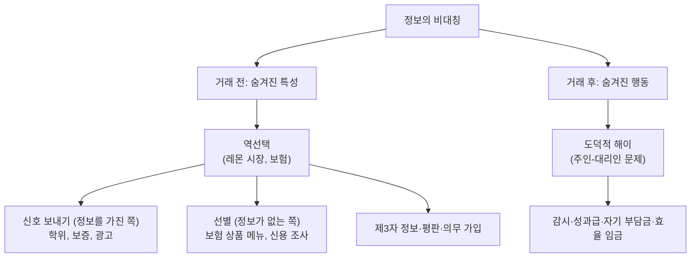

1966년, 미국 캘리포니아 대학 버클리 캠퍼스의 젊은 경제학자 **조지 애컬로프**는 13쪽짜리 짧은 논문을 썼다. 제목은 「'레몬' 시장」. 미국에서 '레몬'은 겉은 멀쩡하지만 속은 엉망인 중고차를 뜻하는 속어다. 논문의 주장은 간단했다. 중고차를 파는 사람은 차의 상태를 알지만 사는 사람은 모른다. 이런 정보의 차이가 있으면 좋은 차는 시장에서 사라지고 나쁜 차만 남을 수 있다는 것이다.

이 논문은 미국의 대표적인 경제학 학술지 세 곳에서 잇달아 퇴짜를 맞았다. 한 곳은 "너무 뻔한 이야기"라고 했고, 다른 곳은 "이것이 맞다면 경제학이 달라져야 한다"며 받아들이지 않았다. 논문은 1970년 하버드 대학의 학술지에 겨우 실렸다. 31년 뒤인 2001년, 애컬로프는 같은 문제를 연구한 마이클 스펜스, 조지프 스티글리츠와 함께 노벨 경제학상을 받았다.

지금까지 이 강좌는 두 가지를 가정해 왔다. 사람들은 거래하는 상품에 대해 **충분한 정보**를 갖고 있고, 그 정보로 **합리적**으로 판단한다는 것이다. 이 강의에서는 두 가정을 다시 따져 본다. 정보가 고르게 나뉘어 있지 않을 때 시장에서는 무슨 일이 생기는지(**정보 경제학**), 그리고 사람들이 예측 가능한 방식으로 합리성에서 벗어날 때 무슨 일이 생기는지(**행동경제학**) 살펴본다.

> [!핵심] 이 강의의 질문
> 1. 거래하는 사람들 사이에 정보의 차이가 있으면 시장은 어떻게 실패하는가?
> 2. 역선택과 도덕적 해이는 무엇이며, 사람들은 이를 어떻게 극복하는가?
> 3. 사람들은 어떤 방식으로 합리성에서 벗어나며, 이를 이용해 더 나은 선택을 돕는 방법은 무엇인가?

{{F:e20-opening}}

## 정보의 비대칭

### 한쪽만 아는 정보

거래하는 사람 가운데 한쪽이 다른 쪽보다 더 많은 정보를 가진 상황을 **정보의 비대칭**이라고 한다. 중고차를 파는 사람은 차가 사고가 난 적이 있는지 알고, 보험에 드는 사람은 자기 건강 상태를 보험 회사보다 잘 안다. 일자리를 구하는 사람은 자기가 얼마나 성실한지 알지만 회사는 모른다. 정보의 비대칭은 두 가지 문제를 낳는다. 거래하기 **전에** 상대가 어떤 사람(상품)인지 모르는 데서 생기는 **역선택**, 그리고 거래한 **뒤에** 상대가 무엇을 하는지 모르는 데서 생기는 **도덕적 해이**다.

## 역선택: 레몬 시장

### 좋은 차가 사라지는 시장

애컬로프의 레몬 시장을 숫자로 따라가 보자. 어느 중고차 시장에 겉보기에 똑같은 차가 100대 있다. 절반은 상태가 좋은 차이고, 절반은 '레몬'이다.

| 차의 종류 | 파는 사람이 받고 싶은 최소 가격 | 사는 사람이 낼 용의가 있는 최대 가격 |
|---|---|---|
| 좋은 차 (50대) | 900만 원 | 1,000만 원 |
| 레몬 (50대) | 300만 원 | 400만 원 |

표: 레몬 시장의 예 (가상)

정보가 모두에게 열려 있다면 좋은 차는 900만~1,000만 원 사이에서, 레몬은 300만~400만 원 사이에서 거래되어 모두가 이득을 본다. 그런데 사는 사람이 어떤 차가 좋은 차인지 구별하지 못하면 어떻게 될까? 사는 사람은 반반의 확률로 좋은 차나 레몬을 사게 되므로, 기껏해야 평균 가치인 700만 원 정도만 내려 할 것이다. 그러면 좋은 차를 가진 사람은 900만 원 아래로는 팔지 않으므로 시장에서 차를 거둬들인다. 시장에는 레몬만 남는다. 사는 사람들은 이를 알아차리고 400만 원 이상은 내지 않는다.

결과적으로 좋은 차는 팔리지 않고 시장에서 사라진다. 좋은 차를 원하는 사람과 좋은 차를 팔려는 사람이 있는데도, 정보의 비대칭 때문에 그 거래가 일어나지 않는 것이다. 나쁜 것이 좋은 것을 몰아내는 이런 현상을 **역선택**이라고 한다. 7강에서 시장의 효율성을 말할 때 붙였던 '충분한 정보'라는 전제가 깨지면 시장이 실패하는 것이다.

### 보험 시장의 역선택

역선택은 보험 시장에서 특히 중요하다. 보험 회사가 모든 사람에게 같은 보험료를 받으면, 자기가 아플 가능성이 높다고 아는 사람일수록 보험에 많이 든다. 건강한 사람은 보험료가 비싸다고 느껴 가입하지 않는다. 그러면 보험 회사는 아픈 사람에게 보험금을 많이 내주게 되어 보험료를 올리고, 그러면 비교적 건강한 사람이 또 빠져나간다. 이런 악순환이 이어지면 보험 시장이 무너질 수 있다. 한국을 비롯한 많은 나라가 건강 보험을 **모든 국민이 의무적으로** 가입하는 공적 보험으로 운영하는 중요한 이유 가운데 하나가 이 역선택을 막기 위해서다.

### 역선택을 극복하는 방법

| 방법 | 내용 | 예 |
|---|---|---|
| 보증과 환불 | 판매자가 품질을 보증한다. 나쁜 상품을 판 판매자는 손해를 보므로, 보증 자체가 좋은 상품이라는 증거가 된다 | 중고차 보증 기간, 무료 반품 |
| 제3자의 정보 | 믿을 만한 기관이 정보를 확인해 준다 | 중고차 성능·상태 점검 기록부, 사고 이력 조회, 신용 평가, 식품 인증 |
| 평판 | 오래 장사할 판매자는 평판을 지키려 한다 | 중고 거래 앱의 거래 후기, 브랜드(15강) |
| 의무 가입 | 모든 사람을 가입시켜 위험이 높은 사람만 남는 것을 막는다 | 국민 건강 보험, 자동차 책임 보험 |

표: 역선택을 극복하는 방법들

## 도덕적 해이

### 감시받지 않을 때의 행동

보험에 든 사람은 보험에 들기 전보다 조심을 덜 할 수 있다. 자동차 보험에 든 운전자가 운전을 조금 덜 조심하거나, 화재 보험에 든 가게 주인이 소화기 점검을 미루는 식이다. 이처럼 거래한 뒤 상대가 자기 행동을 감시할 수 없다는 점을 이용해, 상대에게 손해가 되는 행동을 하는 것을 **도덕적 해이**라고 한다. 원래는 보험 업계에서 쓰던 말이지만 지금은 훨씬 넓게 쓰인다.

### 주인과 대리인

도덕적 해이는 다른 사람을 위해 일하는 사람이 있는 곳 어디서나 생긴다. 일을 맡기는 사람을 **주인**, 일을 맡은 사람을 **대리인**이라고 한다. 회사의 주주(주인)와 경영자(대리인), 사장(주인)과 직원(대리인), 환자(주인)와 의사(대리인), 국민(주인)과 정치인(대리인)이 그 예다. 대리인은 주인의 이익보다 자기 이익을 따를 수 있고, 주인은 대리인의 행동을 일일이 감시하기 어렵다. 이것을 **주인-대리인 문제**라고 한다.

주인은 이 문제를 줄이기 위해 여러 장치를 쓴다. 대리인을 감시하고, 성과에 따라 보수를 주며(성과급, 경영자의 주식 매수 선택권), 보험에서는 손해의 일부를 가입자가 직접 부담하게 한다(자기 부담금). 17강의 효율 임금도 도덕적 해이를 줄이는 장치다. 일자리를 잃으면 높은 임금을 잃게 되므로 노동자가 게으름을 덜 피운다.

> [!주의] '너무 커서 망하게 둘 수 없다'
> 2008년 세계 금융위기는 도덕적 해이의 위험을 크게 드러냈다. 거대 은행들은 위험한 투자로 높은 수익을 노렸다. 투자가 성공하면 큰 이익과 성과급을 챙기고, 실패해도 정부가 '너무 커서 망하게 둘 수 없다'며 구해 줄 것이라고 기대할 수 있었기 때문이다. 실제로 많은 나라 정부가 막대한 세금으로 은행을 구제했다. 위기 뒤 각국은 은행이 위험을 덜 지도록 자본 규제를 강화하고, 실패한 금융 회사를 질서 있게 정리하는 제도를 만들었다. 이 이야기는 33강에서 이어진다.

{{F:e20-information}}

## 신호와 선별

### 신호 보내기

정보를 가진 쪽이 그 정보를 상대에게 믿을 만하게 알리려고 하는 행동을 **신호 보내기**라고 한다. 미국의 경제학자 **마이클 스펜스**는 1973년 교육을 예로 들었다. 기업은 지원자가 얼마나 유능한지 알기 어렵다. 그런데 유능한 사람에게는 어려운 학위를 따는 것이 상대적으로 쉽고, 덜 유능한 사람에게는 훨씬 어렵다. 그래서 학위는 그 내용과 상관없이 '나는 유능하다'는 신호가 된다. 17강에서 교육이 임금을 높이는 이유에 대한 또 하나의 해석으로 소개한 바로 그 생각이다.

신호가 믿을 만하려면 **비용**이 들어야 하고, 그 비용이 좋은 유형에게는 낮고 나쁜 유형에게는 높아야 한다. 15강에서 비싼 광고가 품질의 신호가 된다고 한 것, 중고차 판매자가 긴 보증 기간을 내거는 것, 구혼자가 비싼 반지를 선물하는 것이 모두 같은 원리다.

### 선별

반대로 정보가 없는 쪽이 상대의 정보를 알아내기 위해 행동하는 것을 **선별**이라고 한다. **조지프 스티글리츠**는 보험 회사가 자기 부담금이 높고 보험료가 싼 상품과, 자기 부담금이 낮고 보험료가 비싼 상품을 함께 내놓으면, 고객들이 스스로 자기 위험 수준을 드러내게 된다는 것을 보였다. 사고가 잦을 것이라고 아는 사람은 비싸더라도 자기 부담금이 낮은 상품을 고르기 때문이다. 은행이 대출 신청자의 소득과 신용 기록을 확인하는 것, 회사가 신입 사원에게 수습 기간을 두는 것도 선별이다.



## 행동경제학: 합리성의 한계

### 사람은 늘 합리적인가

2강에서 경제학은 사람들이 합리적이라고 가정한다고 했다. 그러나 1950년대부터 미국의 학자 **허버트 사이먼**은 사람들의 계산 능력과 정보에는 한계가 있어서, 언제나 최선을 찾기보다는 '이만하면 충분한' 선택을 한다고 보았다. 이를 **제한된 합리성**이라고 한다. 사이먼은 1978년 노벨 경제학상을 받았다.

1970년대 이스라엘 출신의 심리학자 **대니얼 카너먼**과 **아모스 트버스키**는 한 걸음 더 나아갔다. 사람들은 무작위로 합리성에서 벗어나는 것이 아니라, **예측 가능한 방식으로 체계적으로** 벗어난다는 것이다. 이들의 연구에서 경제학과 심리학을 결합한 **행동경제학**이 시작되었다. 카너먼은 2002년 노벨 경제학상을 받았다(트버스키는 1996년 세상을 떠났다). 미국의 경제학자 **리처드 세일러**는 이 생각을 경제학의 여러 분야에 적용해 2017년 노벨 경제학상을 받았다.

### 사람들이 체계적으로 실수하는 방식

| 편향 | 내용 | 예 |
|---|---|---|
| 손실 회피 | 같은 크기라도 얻는 기쁨보다 잃는 고통을 두 배쯤 크게 느낀다 | 손해 본 주식을 '본전'이 될 때까지 팔지 못한다 |
| 보유 효과 | 일단 가진 물건을 그것을 갖기 전보다 더 높이 평가한다 | 실험에서 머그잔을 받은 사람들은 팔 때 산 사람이 낼 값의 두 배 이상을 요구했다 |
| 기준점 효과(닻 내리기) | 처음 들은 숫자에 판단이 끌려간다 | '정가 10만 원 → 할인가 5만 원'이 그냥 '5만 원'보다 싸게 느껴진다 |
| 틀 짓기 | 같은 내용도 어떻게 표현하느냐에 따라 선택이 달라진다 | '생존율 90%'와 '사망률 10%'에 대한 반응이 다르다 |
| 현재 편향 | 미래의 큰 이득보다 지금의 작은 즐거움을 지나치게 중시한다 | 다이어트와 운동, 저축을 '내일부터' 미룬다 |
| 과신 | 자기 능력과 판단을 실제보다 높게 평가한다 | 대부분의 운전자가 자기 운전 실력이 평균보다 낫다고 생각한다 |
| 매몰 비용의 오류 | 이미 쓴 돈 때문에 손해 보는 일을 계속한다 | 1강의 콩코드의 오류 |

표: 행동경제학이 밝힌 대표적인 편향

### 넛지: 선택의 설계

사람들이 이렇게 실수한다면, 정부가 나서서 사람들의 선택을 대신 정해야 할까? 세일러와 법학자 캐스 선스타인은 2008년 『넛지』에서 중간 길을 제안했다. 선택의 자유는 그대로 두되, 사람들이 더 나은 선택을 하도록 선택의 환경을 설계하자는 것이다. 팔꿈치로 슬쩍 찌르듯 부드럽게 이끈다는 뜻에서 이를 **넛지**라고 불렀다.

가장 강력한 넛지는 **기본값**(디폴트)이다. 사람들은 특별한 이유가 없으면 기본으로 정해진 선택을 바꾸지 않는다. 장기 기증이 좋은 예다. 어떤 나라는 기증하겠다고 직접 신청해야 기증자가 되고(신청 방식), 어떤 나라는 거부하겠다고 밝히지 않으면 기증자로 본다(거부 방식). 비슷한 문화의 유럽 나라들 사이에서도 기증 동의율이 극적으로 달랐다.

```chart
{
  "type": "bar",
  "caption": "유럽 여러 나라의 장기 기증 동의율 (%, 2000년대 초, Johnson & Goldstein 2003). 왼쪽 네 나라는 기증하겠다고 직접 신청해야 하는 방식, 오른쪽 네 나라는 거부 의사를 밝히지 않으면 기증에 동의한 것으로 보는 방식이다. 기본값 하나가 결과를 크게 바꾼다",
  "data": {
    "labels": ["덴마크", "독일", "영국", "네덜란드", "스웨덴", "벨기에", "프랑스", "오스트리아"],
    "datasets": [{ "label": "동의율(%)", "data": [4.25, 12, 17.17, 27.5, 85.9, 98, 99.91, 99.98] }]
  },
  "options": { "scales": { "y": { "min": 0, "max": 100 } }, "plugins": { "legend": { "display": false } } }
}
```

미국에서는 퇴직 연금에 직원이 직접 가입을 신청하던 방식을, 신청하지 않으면 자동으로 가입되는 방식으로 바꾼 회사에서 신입 사원의 가입률이 40% 안팎에서 80%를 넘는 수준으로 크게 높아졌다는 연구가 있다. 영국 정부는 2010년 '행동 통찰 팀'을 만들어 세금 납부 독촉장의 문구를 바꾸는 것 같은 넛지로 체납을 줄였고, 한국 정부와 지방 자치 단체도 계단에 피아노 건반을 그려 넣거나 고지서 문구를 바꾸는 식의 넛지를 실험해 왔다.

> [!참고] 넛지에 대한 비판
> 넛지는 강제 없이 사람들을 돕는다는 점에서 매력적이지만 비판도 있다. 정부가 무엇이 '더 나은 선택'인지 어떻게 아는가? 그리고 같은 기술을 기업이 쓰면, 탈퇴 버튼을 찾기 어렵게 숨기거나 자동 결제를 기본으로 설정하는 식의 '다크 패턴'이 된다. 또 넛지는 행동을 조금 바꿀 뿐, 가난이나 불평등 같은 구조적인 문제를 대신할 수는 없다는 지적도 있다.

{{F:e20-behavior}}

## 정리

> [!핵심] 20강 요약
> - 거래 당사자 사이에 **정보의 비대칭**이 있으면 시장이 실패할 수 있다.
> - 거래 전의 숨겨진 특성은 **역선택**을 낳는다. 애컬로프의 **레몬 시장**에서는 좋은 차가 사라진다. 보험 시장의 역선택은 공적 보험의 **의무 가입**을 정당화하는 이유가 된다. 보증, 제3자 정보, 평판이 역선택을 줄인다.
> - 거래 후의 숨겨진 행동은 **도덕적 해이**와 **주인-대리인 문제**를 낳는다. 감시, 성과급, 자기 부담금, 효율 임금이 대응책이다.
> - 정보를 가진 쪽은 비용이 드는 **신호**(학위, 보증)를 보내고, 정보가 없는 쪽은 **선별**(보험 상품 메뉴)을 한다.
> - **행동경제학**은 사람들이 손실 회피, 보유 효과, 기준점 효과, 틀 짓기, 현재 편향, 과신 등으로 **체계적으로** 합리성에서 벗어난다는 것을 밝혔다. **넛지**와 **기본값**은 선택의 자유를 지키면서 더 나은 선택을 돕는 방법이다.

### 생각해 볼 질문

1. 중고 거래 앱에서 처음 보는 사람에게 물건을 살 때, 나는 어떤 방법으로 '레몬'을 피하는가? 그것은 신호, 선별, 평판 가운데 무엇에 해당하는가?
2. 실손 의료 보험에 가입한 뒤 병원에 더 자주 가게 되는 것은 도덕적 해이일까? 보험 회사와 정부는 이를 어떻게 줄일 수 있을까?
3. 내가 자주 미루는 일 하나를 골라, 그것을 미루지 않도록 돕는 넛지를 스스로 설계해 보자.

### 다음 강 예고

21강 「국내총생산」부터는 거시경제학으로 넘어간다. 한 나라 경제의 크기를 재는 가장 중요한 지표인 **국내총생산**(GDP)이 무엇을 재고 무엇을 재지 못하는지, 명목 GDP와 실질 GDP는 어떻게 다른지, 그리고 GDP가 사람들의 삶의 질을 얼마나 잘 보여 주는지 살펴본다.
