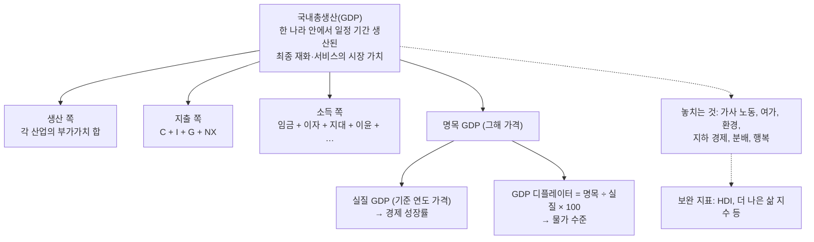

1929년 10월 미국의 주가가 폭락하고 대공황이 시작되었을 때, 미국 정부는 경제가 얼마나 나빠졌는지 정확히 알지 못했다. 철도 화물량, 철강 생산량, 주가 같은 몇몇 숫자가 흩어져 있었을 뿐, 나라 경제 전체가 얼마나 줄었는지 보여 주는 하나의 숫자가 없었다. 1932년 미국 상원은 상무부에 국민 소득을 계산해 달라고 요청했고, 상무부는 러시아 출신의 젊은 경제학자 **사이먼 쿠즈네츠**에게 이 일을 맡겼다. 1934년 1월 쿠즈네츠가 제출한 보고서에 따르면, 미국의 국민 소득은 1929년부터 1932년 사이에 절반 가까이 줄어 있었다.

쿠즈네츠의 작업은 오늘날 **국내총생산**(GDP)의 뿌리가 되었다. 그런데 그는 보고서에서 이렇게 경고했다. "한 나라의 복지는 국민 소득을 재는 것만으로는 거의 추론할 수 없다." 경제의 크기를 재는 숫자와 사람들이 얼마나 잘 사는지는 같은 것이 아니라는 뜻이었다.

이 강의부터 우리는 개별 시장을 넘어 나라 경제 전체를 다루는 **거시경제학**으로 들어간다. 그 첫걸음은 경제 전체의 크기를 재는 것이다. GDP는 무엇을 재고, 어떻게 계산하며, 무엇을 재지 못하는지 살펴본다.

> [!핵심] 이 강의의 질문
> 1. 국내총생산(GDP)은 무엇을 재는가? 왜 경제 전체의 생산, 지출, 소득은 같은가?
> 2. 명목 GDP와 실질 GDP는 어떻게 다르며, 경제 성장률은 어떻게 계산하는가?
> 3. GDP는 사람들의 삶의 질을 얼마나 잘 보여 주는가?

```figure
src: asset:bf6b93163837492080a87ca978f1f2d6
caption: 1942년 미국 메인주 포틀랜드 조선소에서 화물선의 용골을 놓는 모습. 제2차 세계대전 동안 미국 정부는 쿠즈네츠 등이 만든 국민 소득 통계를 이용해 전쟁 물자를 얼마나 생산할 수 있는지 계획했다.
credit: 앨버트 프리먼 촬영, 1942년 · 미국 의회도서관 소장 (농업안정국·전시정보국 사진)
license: Public Domain (미국 농업안정국·전시정보국 사진, 미국 의회도서관)
source: https://www.loc.gov/item/2017693903/
```

## 경제 전체의 소득과 지출

### 생산 = 지출 = 소득

2강의 경제 순환도를 떠올려 보자. 가계는 기업이 만든 재화와 서비스를 사고(지출), 기업은 그 돈으로 노동자에게 임금을, 땅 주인에게 지대를, 자본가에게 이자와 이윤을 준다(소득). 경제 전체로 보면 모든 거래에는 사는 사람과 파는 사람이 있으므로, 누군가의 지출은 반드시 다른 누군가의 소득이 된다. 그래서 한 나라 경제에서 **생산된 것의 가치**, 그것을 사는 데 쓴 **지출**, 그로부터 생긴 **소득**은 모두 같다. 이것을 **국민 소득 삼면 등가의 원칙**이라고 한다. GDP는 이 셋 가운데 어느 쪽으로 재도 같은 값이 나온다.

### GDP의 정의

**국내총생산(GDP)은 일정 기간 동안 한 나라 안에서 생산된 모든 최종 재화와 서비스의 시장 가치다.** 이 정의의 각 부분에는 중요한 뜻이 담겨 있다.

| 정의의 부분 | 뜻 | 예 |
|---|---|---|
| 시장 가치 | 서로 다른 상품을 시장 가격으로 바꾸어 더한다 | 사과 100개와 자동차 1대를 그냥 더할 수 없으므로, 각각의 값을 더한다 |
| 모든 | 시장에서 합법적으로 거래되는 모든 것. 시장을 거치지 않는 것은 대부분 빠진다 | 집에서 하는 요리와 청소, 불법 거래는 빠진다. 다만 자기 집에 사는 사람의 '귀속 임대료'는 추정해 넣는다 |
| 최종 | 다른 상품을 만드는 데 쓰이는 중간재는 빼고 최종 생산물만 센다 | 빵집이 산 밀가루는 빵값에 이미 들어 있으므로 따로 세면 두 번 세게 된다 |
| 재화와 서비스 | 눈에 보이는 물건과 보이지 않는 서비스 모두 | 자동차와 함께 미용, 의료, 교육, 공연도 들어간다 |
| 생산된 | 그 기간에 새로 만든 것만 센다 | 중고차 거래나 이미 있던 집의 매매는 빠진다(중개 수수료는 들어간다) |
| 한 나라 안에서 | 생산한 사람의 국적이 아니라 생산된 장소가 기준 | 한국에서 일하는 외국인의 생산은 들어가고, 해외에서 일하는 한국인의 생산은 빠진다 |
| 일정 기간 동안 | 보통 1년 또는 분기(3개월) | 분기 GDP는 계절의 영향을 없앤 '계절 조정' 값으로 발표한다 |

표: GDP 정의의 각 부분

### 부가가치로 세기

중간재를 두 번 세지 않는 가장 확실한 방법은 생산의 각 단계에서 **새로 더해진 가치**, 곧 **부가가치**만 더하는 것이다. 농부가 밀을 30만 원어치 길러 제분소에 팔고, 제분소는 그 밀로 밀가루를 만들어 빵집에 50만 원에 팔며, 빵집은 그 밀가루로 빵을 만들어 소비자에게 100만 원에 판다고 하자. 각 단계의 부가가치는 30만, 20만, 50만 원이고, 그 합 100만 원은 최종 생산물인 빵의 값과 같다. 11강의 부가가치세가 바로 이 부가가치에 매기는 세금이다.

## GDP의 구성: 누가 쓰는가

지출 쪽에서 보면 GDP는 네 가지로 나뉜다.

**GDP(Y) = 소비(C) + 투자(I) + 정부 구매(G) + 순수출(NX)**

- **소비**: 가계가 재화와 서비스를 사는 데 쓴 돈. 음식, 옷, 휴대전화, 의료, 교육이 들어간다. 다만 새 집을 사는 것은 소비가 아니라 투자로 센다.
- **투자**: 미래에 더 많이 생산하기 위해 자본재를 사는 데 쓴 돈. 기업의 공장과 기계, 가계의 새 주택, 그리고 기업의 재고 증가가 들어간다. 경제학에서 '투자'는 주식이나 채권을 사는 것이 아니라 실제로 자본재를 늘리는 것을 뜻한다는 점에 주의하자.
- **정부 구매**: 정부가 재화와 서비스를 사는 데 쓴 돈. 공무원과 군인의 월급, 도로와 학교 건설이 들어간다. 연금이나 실업 급여 같은 **이전 지출**은 정부가 무엇을 산 것이 아니므로 GDP에 들어가지 않는다(11강).
- **순수출**: 수출에서 수입을 뺀 것. 외국 사람이 산 한국 상품(수출)은 한국에서 생산된 것이므로 더하고, 한국 사람이 산 외국 상품(수입)은 소비나 투자에 들어가 있지만 한국에서 생산된 것이 아니므로 뺀다.

```chart
{
  "type": "doughnut",
  "caption": "한국 국내총생산의 지출 구성 (2023년 무렵, 명목 기준, %, 한국은행 국민 계정을 바탕으로 한 대략적인 수치). 민간 소비가 절반 가까이를 차지하고, 투자 비중이 30% 안팎으로 다른 선진국보다 높은 편이다",
  "data": {
    "labels": ["민간 소비", "정부 소비", "투자 (총자본 형성)", "순수출"],
    "datasets": [{ "label": "비중(%)", "data": [48.6, 18.5, 31.8, 1.1] }]
  }
}
```

2024년 한국의 명목 GDP는 약 2,549조 원이었다. 미국 달러로 바꾸면 1조 8,000억~1조 9,000억 달러 수준으로, 세계 10위권 초반의 경제 규모다.

```gallery
src: asset:020695c8fd4829075a844e798a2737c1
caption: 1973년 미국 시카고 칼루멧강 가의 제철소. 공장에서 만든 철강은 GDP에 들어가지만, 공장이 내뿜는 오염의 비용은 GDP에서 빠지지 않는다.
credit: 미국 환경보호청 '도큐메리카' 사진 사업, 1973년 · 미국 국립문서보관소(NARA) 소장
license: Public Domain (미국 연방정부 저작물)
source: https://catalog.archives.gov/id/547060
---
src: asset:4bec37e3e5d1152ceb8f7a5a1ca1d8c9
caption: 1973년 미국 볼티모어 항에 들어오는 컨테이너선. 수출은 GDP에 더해지고, 수입은 다른 나라에서 생산된 것이므로 GDP를 계산할 때 빠진다.
credit: 미국 환경보호청 '도큐메리카' 사진 사업, 1973년 · 미국 국립문서보관소(NARA) 소장
license: Public Domain (미국 연방정부 저작물)
source: https://catalog.archives.gov/id/546804
```

## 명목 GDP와 실질 GDP

### 값이 올랐나, 양이 늘었나

GDP가 지난해보다 10% 늘었다면, 경제가 정말 10% 더 많이 생산한 것일까? 꼭 그렇지는 않다. GDP는 가격 × 양이므로, 가격만 올라도 GDP는 커진다. 그래서 경제학자들은 두 가지 GDP를 구분한다.

- **명목 GDP**: 그해의 가격으로 계산한 GDP. 가격과 양이 모두 바뀐 효과가 섞여 있다.
- **실질 GDP**: 기준이 되는 해(**기준 연도**)의 가격으로 계산한 GDP. 가격을 고정해 두었으므로 생산량의 변화만 보여 준다.

어느 나라가 쌀과 휴대전화만 생산한다고 하자.

| 연도 | 쌀 가격 | 쌀 생산량 | 휴대전화 가격 | 휴대전화 생산량 | 명목 GDP | 실질 GDP (2023년 가격 기준) | GDP 디플레이터 |
|---|---|---|---|---|---|---|---|
| 2023 | 2만 원 | 100가마 | 100만 원 | 10대 | 1,200만 원 | 1,200만 원 | 100 |
| 2024 | 2만 2천 원 | 110가마 | 110만 원 | 11대 | 1,452만 원 | 1,320만 원 | 110 |

표: 명목 GDP와 실질 GDP (가상의 예)

명목 GDP는 21% 늘었지만, 그 가운데 가격이 오른 효과를 빼면 실질 GDP는 10% 늘었다. 이 나라의 **경제 성장률**은 실질 GDP의 증가율인 10%다. 명목 GDP를 실질 GDP로 나누고 100을 곱한 값을 **GDP 디플레이터**라고 하며, 경제 전체의 물가 수준을 나타낸다. 이 예에서는 물가가 10% 올랐다. 물가를 재는 또 다른 방법인 소비자 물가 지수는 22강에서 다룬다.

### 한국의 경제 성장률

```chart
{
  "type": "bar",
  "caption": "한국의 실질 GDP 성장률 (%, 한국은행 자료를 바탕으로 한 대략적인 수치). 고도성장기의 높은 성장률이 점차 낮아졌고, 1980년(정치 혼란과 석유 파동), 1998년(외환위기), 2020년(코로나19)에는 경제가 뒷걸음질했다",
  "data": {
    "labels": ["1970", "1980", "1990", "1998", "2000", "2009", "2010", "2015", "2020", "2021", "2023", "2024"],
    "datasets": [{ "label": "실질 GDP 성장률(%)", "data": [10.0, -1.6, 9.8, -5.1, 9.1, 0.8, 7.0, 2.8, -0.7, 4.3, 1.4, 2.0] }]
  },
  "options": { "plugins": { "legend": { "display": false } } }
}
```

### 1인당 GDP와 국민 총소득

나라의 크기가 다르므로 생활 수준을 비교할 때는 GDP를 인구로 나눈 **1인당 GDP**를 쓴다. 인구가 많은 중국의 GDP는 한국의 10배에 가깝지만, 1인당 GDP는 한국의 3분의 1 정도다.

GDP와 비슷한 지표로 **국민 총소득**(GNI)이 있다. GDP가 '한 나라 안에서' 생산된 것이라면, GNI는 '그 나라 국민이' 번 소득이다. 한국 기업이 해외 공장에서 번 이윤은 한국의 GNI에는 들어가지만 GDP에는 들어가지 않는다. 해외 생산이 많은 나라나 외국 자본이 많이 들어와 있는 나라는 두 숫자의 차이가 크다.

나라 사이의 생활 수준을 비교할 때는 환율 문제도 있다. 같은 1달러로 살 수 있는 것이 나라마다 다르기 때문이다. 미국에서 1만 원어치 햄버거를 살 돈으로 어떤 나라에서는 훨씬 많이 살 수 있다. 그래서 물가 차이를 반영한 **구매력 평가**(PPP) 기준의 1인당 GDP를 함께 쓴다(29강).

## GDP는 삶의 질을 보여 주는가

### GDP가 놓치는 것들

GDP는 경제의 크기를 재는 가장 좋은 지표이지만, 쿠즈네츠가 경고했듯 사람들의 행복을 직접 재지는 않는다. GDP가 놓치는 것은 많다.

| GDP가 놓치는 것 | 설명 |
|---|---|
| 시장 밖의 생산 | 집에서 하는 요리, 청소, 육아, 노인 돌봄, 자원봉사는 들어가지 않는다. 같은 일을 돈을 주고 맡기면 GDP가 늘어난다 |
| 여가 | 모든 사람이 일을 덜 하고 여가를 즐기면 GDP는 줄지만 삶은 나아질 수 있다 |
| 환경 | 공장이 강을 오염시켜도 GDP는 줄지 않는다. 오염을 치우는 데 쓴 돈은 오히려 GDP를 늘린다(9강) |
| 지하 경제 | 세금을 피하려고 신고하지 않는 거래와 불법 거래는 잡히지 않는다 |
| 소득 분배 | GDP가 같아도 소득이 고르게 나뉜 사회와 소수에게 몰린 사회는 다르다(18강) |
| 품질과 새 상품 | 스마트폰의 성능 향상이나 무료 인터넷 서비스가 주는 혜택은 제대로 반영되기 어렵다 |

표: GDP가 놓치는 것들

미국의 로버트 케네디 상원 의원은 1968년 대통령 선거 운동 연설에서 GDP(당시의 국민 총생산)가 "삶을 가치 있게 하는 것을 빼고 모든 것을 잰다"고 말했다. 반대로 많은 경제학자는 GDP가 놓치는 것이 많아도, 1인당 GDP가 높은 나라일수록 기대 수명이 길고, 영아 사망률이 낮으며, 교육 수준이 높다는 점을 지적한다. GDP는 행복 그 자체는 아니지만, 행복에 필요한 많은 것을 살 수 있는 능력을 보여 준다.

```gallery
src: asset:ae1b6447c92537da1c89840c0fa1749b
caption: 1942년 미국 워싱턴의 한 부엌에서 손빨래를 하는 여성. 집에서 하는 빨래, 요리, 아이 돌보기 같은 가사 노동은 시장에서 거래되지 않아 GDP에 들어가지 않는다.
credit: 고든 파크스 촬영, 1942년 · 미국 의회도서관 소장 (농업안정국·전시정보국 사진)
license: Public Domain (미국 농업안정국·전시정보국 사진, 미국 의회도서관)
source: https://www.loc.gov/item/2017839896/
---
src: asset:ff769c856514c4dbc74903b83c7c2893
caption: 1940년 미국 버몬트주의 농가 여성이 전동 세탁기로 빨래를 하는 모습. 세탁기를 산 돈은 GDP에 들어가지만, 세탁기 덕분에 아낀 시간과 수고는 GDP에 잡히지 않는다.
credit: 루이즈 로스캄 촬영, 1940년 · 미국 의회도서관 소장 (농업안정국·전시정보국 사진)
license: Public Domain (미국 농업안정국·전시정보국 사진, 미국 의회도서관)
source: https://www.loc.gov/item/2017764753/
```

### 소득과 행복

1974년 미국의 경제학자 **리처드 이스털린**은 흥미로운 사실을 발견했다. 한 나라 안에서는 부자가 가난한 사람보다 더 행복하다고 답하지만, 미국의 1인당 소득이 크게 늘어난 수십 년 동안 사람들의 평균 행복은 거의 높아지지 않았다는 것이다. 이를 **이스털린의 역설**이라고 한다. 사람들이 남과 비교해 행복을 느끼거나, 높아진 소득에 금세 익숙해지기 때문이라는 해석이 나왔다. 그러나 더 많은 나라의 자료를 분석한 뒤의 연구들은 나라가 부유해질수록 평균적인 삶의 만족도도 높아지는 경향이 있다는 결과를 내놓기도 했다. 이 논쟁은 지금도 이어지고 있다.

### GDP를 넘어서

GDP의 한계를 보완하려는 지표들도 만들어졌다. 유엔 개발 계획은 1990년부터 소득과 함께 기대 수명, 교육 수준을 묶은 **인간 개발 지수**(HDI)를 발표하고 있다. 2009년 프랑스 정부의 요청으로 조지프 스티글리츠, 아마르티아 센, 장폴 피투시가 이끈 위원회는 GDP 대신 가계의 소득과 소비, 분배, 삶의 질, 지속 가능성을 함께 보라고 권고했다. OECD는 2011년부터 주거, 일과 삶의 균형, 공동체, 환경 등을 비교하는 '더 나은 삶 지수'를 발표한다. 한국은 소득과 교육 같은 분야에서는 높은 점수를 받지만, 일과 삶의 균형, 공동체, 삶의 만족도에서는 낮은 점수를 받아 왔다.



```timeline
1758 | 케네, 『경제표』 | 경제의 순환을 그림으로(2강)
1934 | 쿠즈네츠, 미국 국민 소득 보고서 | 대공황기의 국민 소득 추계
1944 | 브레턴우즈 회의 | 전후 국가 간 비교에 국민 계정이 쓰이기 시작
1953 | 유엔, 국민 계정 체계(SNA) 첫 발표 | 나라마다 같은 기준으로 GDP 계산
1957 | 한국은행, 국민 소득 통계 공식 추계 시작 | 
1971 | 쿠즈네츠, 노벨 경제학상 | 
1974 | 이스털린의 역설 | 소득과 행복의 관계에 대한 논쟁
1990 | 유엔, 인간 개발 지수(HDI) 발표 | 
2009 | 스티글리츠·센·피투시 위원회 보고서 | GDP를 넘어서는 지표 제안
```

## 정리

> [!핵심] 21강 요약
> - 경제 전체에서 **생산 = 지출 = 소득**이다(삼면 등가). **GDP**는 일정 기간 한 나라 안에서 생산된 모든 **최종** 재화와 서비스의 **시장 가치**다. 중간재를 두 번 세지 않으려면 **부가가치**를 더한다.
> - 지출로 보면 **GDP = 소비 + 투자 + 정부 구매 + 순수출**이다. 경제학의 투자는 자본재를 늘리는 것이며, 이전 지출은 정부 구매에 들어가지 않는다.
> - **명목 GDP**는 그해 가격, **실질 GDP**는 기준 연도 가격으로 계산한다. 실질 GDP의 증가율이 **경제 성장률**이고, 명목 ÷ 실질 × 100이 **GDP 디플레이터**다.
> - 생활 수준 비교에는 **1인당 GDP**, 국민이 번 소득은 **GNI**, 나라 사이의 비교에는 **구매력 평가**를 쓴다.
> - GDP는 가사 노동, 여가, 환경, 분배, 행복을 재지 못한다. **HDI** 같은 보완 지표가 함께 쓰인다.

### 생각해 볼 질문

1. 다음은 올해 한국의 GDP에 들어갈까? ① 내가 산 중고 노트북, ② 새로 지은 아파트, ③ 할머니가 손주를 돌보는 일, ④ 정부가 지급한 기초 연금, ⑤ 외국인 관광객이 산 한국 화장품.
2. 명목 GDP가 5% 늘고 GDP 디플레이터가 3% 올랐다면 실질 경제 성장률은 대략 얼마인가?
3. 한국이 1인당 GDP는 높은데 삶의 만족도가 낮게 나오는 이유는 무엇일까? 어떤 지표를 함께 보면 좋을까?

### 다음 강 예고

22강 「물가와 생활비의 측정」에서는 '물가가 올랐다'는 말이 정확히 무엇을 뜻하는지 살펴본다. **소비자 물가 지수**(CPI)를 어떻게 만드는지, 그 지수에는 어떤 한계가 있는지, 그리고 물가 변화를 반영해 과거와 현재의 돈의 가치를 비교하는 방법과 실질 이자율을 배운다.
