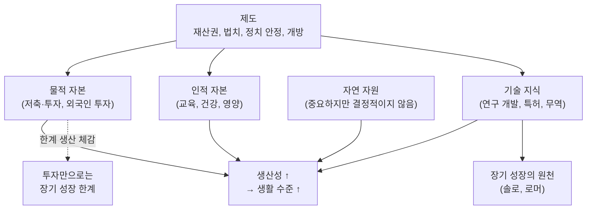

1988년 미국의 경제학자 **로버트 루커스**는 경제성장에 관한 강연에서 이렇게 말했다. "인도 정부가 인도네시아나 이집트처럼 성장하려면 무엇을 해야 하는가? 만약 그런 것이 있다면 무엇인가? 이런 질문들이 인간의 복지에 미치는 결과는 그야말로 엄청나다. 일단 이런 문제를 생각하기 시작하면 다른 것은 생각하기 어려워진다."

루커스가 놀란 것은 나라 사이의 생활 수준 차이가 너무도 크고, 그 차이가 성장률의 작은 차이에서 비롯된다는 사실이었다. 한국은 그 대표적인 예다. 6·25 전쟁이 끝난 1953년, 한국은 세계에서 가장 가난한 나라 가운데 하나였다. 1960년대 초 한국의 1인당 소득은 아프리카의 가나와 비슷한 수준이었다는 이야기가 자주 인용된다. 그러나 60여 년이 지난 오늘, 한국의 1인당 소득은 가나의 10배를 훌쩍 넘는다. 같은 한반도에서 출발한 북한과의 차이는 더 극적이다.

이 강의에서는 장기적으로 나라마다 생활 수준이 왜 이렇게 다른지, 그리고 어떤 나라는 왜 빠르게 성장하는지 살펴본다. 1강에서 '생활 수준은 생산성에 달려 있다'고 했던 그 생산성을 무엇이 결정하는지, 그리고 정부의 정책은 성장을 어떻게 도울 수 있는지 알아본다.

> [!핵심] 이 강의의 질문
> 1. 나라마다 생활 수준과 성장률은 얼마나 다르며, 작은 성장률의 차이는 왜 큰 차이를 만드는가?
> 2. 생산성을 결정하는 것은 무엇인가?
> 3. 어떤 정책과 제도가 경제성장을 돕는가?

```figure
src: asset:fae71b08bf1cbfd153a26eb979bc8b3b
caption: 1936년 미국 워싱턴주의 그랜드 쿨리 댐 건설 현장. 댐과 발전소, 도로 같은 물적 자본은 노동자 한 사람이 만들어 낼 수 있는 생산량을 크게 늘린다.
credit: 미국 개척국, 1936년 · 미국 의회도서관 소장
license: Public Domain (미국 의회도서관: 출판 제한 없음)
source: https://www.loc.gov/item/2004667708/
```

## 성장의 차이

### 복리의 마법: 70의 법칙

작은 성장률의 차이가 왜 그렇게 큰 차이를 만들까? 성장은 복리로 쌓이기 때문이다. 해마다 1% 성장하는 나라와 3% 성장하는 나라의 차이는 1년 뒤에는 2%포인트에 불과하지만, 70년 뒤에는 앞의 나라의 소득이 2배가 되는 동안 뒤의 나라의 소득은 8배가 된다.

어떤 수가 두 배가 되는 데 걸리는 시간을 간단히 계산하는 방법이 있다. 70을 연간 성장률(%)로 나누면 된다. 이를 **70의 법칙**이라고 한다.

| 연간 성장률 | 소득이 두 배가 되는 데 걸리는 시간 | 한 세대(35년) 뒤의 소득 |
|---|---|---|
| 1% | 약 70년 | 약 1.4배 |
| 2% | 약 35년 | 약 2배 |
| 3% | 약 23년 | 약 2.8배 |
| 7% | 약 10년 | 약 10배 |
| 10% | 약 7년 | 약 28배 |

표: 70의 법칙과 성장률에 따른 소득 증가

한국은 1960년대부터 1990년대 중반까지 30여 년 동안 연평균 8% 안팎으로 성장했다. 70의 법칙으로 보면 9년쯤마다 소득이 두 배가 된 셈이다. 한 사람이 어린 시절과 중년에 전혀 다른 나라에서 사는 경험을 한 것이다.

### 한반도의 자연 실험

```chart
{
  "type": "bar",
  "caption": "남한과 북한의 1인당 국민 총소득 (2023년, 만 원, 한국은행 추정을 바탕으로 한 대략적인 수치). 같은 민족, 같은 언어, 비슷한 자연환경에서 출발한 두 나라의 차이는 약 30배로 벌어졌다",
  "data": {
    "labels": ["남한", "북한"],
    "datasets": [{ "label": "1인당 국민 총소득(만 원)", "data": [4725, 159] }]
  },
  "options": { "scales": { "y": { "min": 0 } }, "plugins": { "legend": { "display": false } } }
}
```

남한과 북한은 경제성장을 공부하는 사람들에게 가장 극적인 '자연 실험'이다(2강). 1945년 분단될 때 두 지역은 같은 민족, 같은 언어와 문화를 가졌고, 오히려 공업 시설과 지하자원은 북쪽에 더 많았다. 그러나 남쪽은 시장 경제와 대외 개방을, 북쪽은 계획 경제와 폐쇄 경제를 택했다. 70여 년이 지난 지금 두 나라의 1인당 소득 차이는 약 30배에 이른다. 밤에 찍은 한반도의 위성 사진에서, 불빛으로 가득한 남쪽과 달리 북쪽은 평양 일부를 빼고 거의 캄캄하다. 이 차이를 만든 것은 자원이나 문화가 아니라 **제도**였다.

## 생산성은 무엇이 결정하나

### 생산성과 생활 수준

1강에서 우리는 한 나라의 생활 수준이 **생산성**, 곧 노동자 한 사람이 한 시간에 만들어 내는 재화와 서비스의 양에 달려 있다고 했다. 경제 전체로 보면 생산된 것이 곧 소득이기 때문이다(21강). 로빈슨 크루소가 혼자 사는 섬에서, 그가 잘 먹고 잘 살 수 있는지는 그가 하루에 물고기를 몇 마리 잡고 과일을 몇 개 따느냐에 달려 있다. 나라 경제도 다르지 않다.

### 생산성의 네 가지 결정 요인

| 결정 요인 | 뜻 | 예 |
|---|---|---|
| 물적 자본 | 생산에 쓰는 기계, 설비, 건물, 도로 | 반도체 공장, 항만, 고속도로, 컴퓨터 |
| 인적 자본 | 교육, 훈련, 경험으로 쌓은 노동자의 지식과 기술 | 대학 교육, 직업 훈련, 숙련 노동자의 경험 |
| 자연 자원 | 자연이 준 생산 요소 | 땅, 강, 광물, 석유 |
| 기술 지식 | 재화와 서비스를 만드는 가장 좋은 방법에 대한 이해 | 새 품종, 조립 라인, 반도체 공정, 인터넷 |

표: 생산성을 결정하는 네 가지 요인

이 관계를 **생산 함수**로 나타낼 수 있다. 생산량 Y는 노동(L), 물적 자본(K), 인적 자본(H), 자연 자원(N), 그리고 기술 수준(A)에 달려 있다. 12강에서 한 기업의 생산 함수를 보았다면, 여기서는 나라 경제 전체의 생산 함수다.

자연 자원은 중요하지만 결정적이지는 않다. 한국, 일본, 싱가포르, 홍콩은 자원이 거의 없는데도 부유해졌다. 반대로 석유나 다이아몬드 같은 자원이 풍부한 나라 가운데 일부는 오히려 성장이 더딘데, 이를 **자원의 저주**라고 부르기도 한다. 자원에서 나오는 큰 돈을 둘러싸고 부패와 분쟁이 생기기 쉽고, 다른 산업이 자라지 못하기 때문이다.

기술 지식과 인적 자본은 다르다는 점도 기억하자. 기술 지식은 사회 전체가 가진 '교과서의 내용'이고, 인적 자본은 그 교과서를 공부한 사람들의 '머리에 든 것'이다. 지식은 한번 만들어지면 누구나 쓸 수 있는 공공재의 성격을 갖지만(10강), 그 지식을 쓸 줄 아는 사람을 기르는 데는 오랜 투자가 필요하다.

```gallery
src: asset:ed958f21572b8e1b28155190d4a6aba7
caption: 제임스 와트가 1782년 특허를 낸 복동식 증기 기관의 도면(1822년 간행). 증기 기관은 사람과 동물의 힘에 의존하던 생산을 바꾸어 놓은 기술 지식이다.
credit: 존 로비슨, 『기계 철학 체계』 1822년 · 미국 의회도서관 소장
license: Public Domain (미국 의회도서관: 출판 제한 없음)
source: https://www.loc.gov/item/2006691752/
---
src: asset:6c492a258ebb5bf6d476ebc87341b03f
caption: 18세기 말 네덜란드 로테르담 근처에 세운 초기 증기 펌프 기관의 건물. 새로운 기술은 발명된 곳에서 다른 나라로 퍼져 나가며 생산성을 높였다.
credit: 작자 미상 네덜란드 판화, 1782~1816년 · 암스테르담 국립미술관 소장
license: Public Domain (레이크스 미술관: CC0)
source: https://www.rijksmuseum.nl/en/collection/RP-P-1938-1075
```

## 성장을 돕는 정책

### 저축과 투자

미래에 더 많이 생산하려면 오늘 생산한 것의 일부를 소비하지 않고 자본재를 만드는 데 써야 한다. 2강에서 본 '오늘의 소비냐, 내일의 성장이냐'의 선택이다. 한국의 고도성장기에는 국내총생산의 30~40%가 투자에 쓰였다.

그러나 자본을 늘리는 것만으로 끝없이 성장할 수는 없다. 12강에서 본 **한계 생산 체감** 때문이다. 노동자 한 사람이 쓰는 기계가 많아질수록, 기계 한 대를 더 늘려서 얻는 생산 증가는 줄어든다. 그래서 투자율을 높이면 한동안은 성장률이 높아지지만, 결국 성장률은 다시 낮아진다. 미국의 경제학자 **로버트 솔로**는 1956년 이 생각을 담은 성장 모형을 만들었고, 장기적인 생활 수준의 향상은 결국 **기술 진보**에서 나온다는 결론을 이끌어 냈다. 그는 이 공로로 1987년 노벨 경제학상을 받았다.

한계 생산 체감에서 또 하나의 결론이 나온다. 자본이 적은 가난한 나라일수록 자본을 조금만 늘려도 생산성이 크게 오른다. 그래서 다른 조건이 같다면 가난한 나라가 부유한 나라보다 빨리 성장하는 경향이 있다. 이것을 **따라잡기 효과**라고 한다. 한국과 대만, 중국의 고도성장에는 이 효과가 컸다. 반대로 1인당 소득이 높아질수록 성장률이 낮아지는 것은 자연스러운 일이기도 하다. 오늘날 한국의 성장률이 2% 안팎으로 낮아진 데에는 이런 이유도 있다.

> [!참고] '아시아의 기적'은 신화였을까?
> 1994년 미국의 경제학자 폴 크루그먼은 「아시아 기적의 신화」라는 글에서 도발적인 주장을 했다. 동아시아의 고도성장은 기술 진보보다 노동과 자본 투입을 크게 늘린 데서 나왔으므로, 한계 생산 체감 때문에 결국 느려질 것이라는 것이다. 옛 소련이 1950~60년대 엄청난 투자로 빠르게 성장하다가 정체한 것과 비슷하다고 보았다. 이 글은 큰 논쟁을 불러일으켰다. 실제로 한국의 성장률은 1990년대 후반부터 낮아졌지만, 한국은 소련과 달리 반도체와 자동차 등에서 세계적인 기술력을 쌓으며 성장을 이어 갔다. 투입 확대와 기술 진보의 몫을 어떻게 재느냐를 두고 연구자들의 평가는 지금도 엇갈린다.

### 해외에서의 투자

나라 안의 저축이 부족하면 외국의 자본을 끌어올 수 있다. 외국 기업이 직접 공장을 짓는 **외국인 직접 투자**와, 외국인이 주식이나 채권을 사는 **외국인 포트폴리오 투자**가 있다. 외국인 직접 투자는 자본과 함께 기술과 경영 노하우를 가져온다. 한국은 1960~70년대 외국에서 빌린 차관으로 공장과 사회 기반 시설을 지었다. 세계은행과 국제통화기금(IMF) 같은 국제기구도 개발도상국에 자금을 빌려준다.

### 교육과 건강

인적 자본에 대한 투자는 성장의 핵심이다. 교육은 또 긍정적 외부효과를 낳는다(9강). 교육받은 사람은 새로운 아이디어를 내고, 그 아이디어는 사회 전체의 지식이 된다. 한국의 교육열은 고도성장의 중요한 바탕이 되었다. 1945년 해방 무렵 성인의 상당수가 글을 읽지 못했지만, 1950~60년대 초등 교육의 빠른 보급으로 문맹은 크게 줄었다.

건강과 영양도 인적 자본이다. 미국의 경제사학자 **로버트 포겔**은 18세기 이후 영국의 경제성장 가운데 상당 부분이 영양 개선으로 사람들이 더 건강해지고 더 오래, 더 열심히 일할 수 있게 된 데서 비롯되었다고 주장했다. 그는 1993년 노벨 경제학상을 받았다.

```figure
src: asset:d8e98a7246e2b2f4028ac480c2392731
caption: 1938년 미국 조지아주 시골 학교의 어린이들. 교육은 노동자의 지식과 기술, 곧 인적 자본을 쌓는 가장 중요한 투자다.
credit: 존 바천 촬영, 1938년 · 미국 의회도서관 소장 (농업안정국·전시정보국 사진)
license: Public Domain (미국 농업안정국·전시정보국 사진, 미국 의회도서관)
source: https://www.loc.gov/item/2017762469/
```

### 재산권과 정치 안정

투자와 교육이 이루어지려면 그 성과를 지킬 수 있어야 한다. 내가 지은 공장을 정부나 다른 누군가가 빼앗을 수 있다면, 아무도 공장을 짓지 않을 것이다. 1강에서 본 것처럼 **재산권**과 계약을 지키는 법원, 부패하지 않은 정부, 정치적 안정은 성장의 기본 조건이다. 2024년 노벨 경제학상을 받은 **대런 애스모글루**, **사이먼 존슨**, **제임스 로빈슨**은 식민지 시기에 만들어진 제도의 차이가 오늘날 나라 사이의 소득 차이를 낳았다는 연구로, 소수가 부를 빼앗아 가는 '착취적 제도'와 많은 사람이 경제 활동에 참여하고 그 성과를 누리는 '포용적 제도'의 차이를 강조했다. 남한과 북한은 그들이 즐겨 드는 예다.

### 자유무역

3강과 8강에서 본 것처럼 무역은 기술 진보와 같은 효과를 낸다. 1950~60년대 많은 개발도상국은 수입을 막고 국내에서 만드는 **수입 대체** 정책을 폈지만, 성장은 더뎠다. 반면 한국과 대만 같은 나라는 세계 시장을 향한 **수출 지향** 정책으로 빠르게 성장했다. 세계 시장은 국내 시장보다 훨씬 크고, 수출 기업은 세계의 경쟁 기업과 겨루며 기술을 배워야 했다.

### 연구 개발

장기적인 성장의 원천은 기술 진보다. 그렇다면 기술은 어디서 오는가? 솔로의 모형에서 기술은 하늘에서 떨어지는 것처럼 주어진 것이었다. 미국의 경제학자 **폴 로머**는 1990년, 기술 진보가 기업과 사람들이 이윤을 위해 연구 개발에 투자한 결과라는 **내생적 성장 이론**을 내놓았다. 지식은 한 사람이 써도 다른 사람이 쓸 수 있는 비경합적인 재화이므로, 지식이 쌓일수록 성장은 계속될 수 있다는 것이다. 로머는 2018년 노벨 경제학상을 받았다. 지식이 공공재의 성격을 갖기 때문에 정부는 특허(14강)로 발명자를 보호하고, 기초 연구에 돈을 대며, 연구 개발에 세금 혜택을 준다. 한국은 국내총생산 대비 연구 개발 투자 비율이 5% 안팎으로 세계에서 가장 높은 나라 가운데 하나다.

### 인구

인구가 성장에 미치는 영향은 복잡하다. 맬서스는 인구 증가가 생활 수준을 끌어내린다고 비관했지만(12강), 그의 예측은 빗나갔다. 기술 진보가 인구 증가를 앞질렀기 때문이다. 오히려 사람이 많을수록 새로운 아이디어를 낼 사람도 많아진다는 견해도 있다. 오늘날 한국이 마주한 문제는 반대 방향이다. 합계 출산율이 1명에도 못 미치는 세계 최저 수준으로 떨어지면서, 일할 사람이 줄고 노인 부양 부담이 커지고 있다. 생산성을 높이지 않으면 인구 감소가 장기 성장률을 끌어내릴 것이라는 걱정이 크다.



## 한국의 고도성장

한국의 성장 이야기는 이 강의의 거의 모든 요인을 보여 준다. 1962년 정부는 제1차 경제 개발 5개년 계획을 시작했다. 처음에는 풍부한 노동력을 바탕으로 섬유와 가발 같은 경공업 제품을 수출했고(3강), 1973년부터는 철강, 조선, 화학, 기계, 전자 같은 중화학 공업을 집중적으로 키웠다. 높은 저축률과 투자, 뜨거운 교육열, 세계 시장을 향한 수출, 그리고 기업들의 끊임없는 기술 습득이 함께 작동했다. 1996년 한국은 선진국 모임인 경제협력개발기구(OECD)에 가입했다.

```figure
src: asset:bae395f9d412808ccb51eb69b317d4c7
caption: 1950년 10월 한국의 강에 임시 다리를 놓는 미군 공병. 전쟁으로 도로와 다리, 공장이 크게 파괴된 한국은 1950년대 세계에서 가장 가난한 나라 가운데 하나였다.
credit: 미 육군 제62 공병대대, 1950년 · 미국 국립문서보관소(NARA) 소장
license: Public Domain (미국 연방정부 저작물)
source: https://catalog.archives.gov/id/348338055
```

그러나 성장에는 그늘도 있었다. 정부가 소수의 대기업에 금융과 세제 혜택을 몰아주면서 재벌 중심의 경제 구조가 만들어졌고, 노동자들은 오랫동안 낮은 임금과 열악한 근로 조건을 견뎌야 했다(17강). 지나친 차입과 투자는 1997년 외환위기로 이어졌다(33강). 정부 주도의 성장 방식이 얼마나 성장에 기여했는지, 그리고 그 비용은 무엇이었는지는 지금도 경제학자와 역사학자들 사이에 논쟁이 이어지고 있다.

```timeline
1956 | 솔로, 성장 모형 | 장기 성장의 원천은 기술 진보
1962 | 한국, 제1차 경제 개발 5개년 계획 | 
1964 | 한국, 수출 1억 달러 | 수출 지향 공업화
1973 | 한국, 중화학 공업화 선언 | 
1977 | 한국, 수출 100억 달러 | 
1990 | 로머, 내생적 성장 이론 | 
1994 | 크루그먼, 「아시아 기적의 신화」 | 
1996 | 한국, OECD 가입 | 
2018 | 로머·노드하우스, 노벨 경제학상 | 
2024 | 애스모글루·존슨·로빈슨, 노벨 경제학상 | 제도와 번영
```

## 정리

> [!핵심] 23강 요약
> - 나라 사이의 생활 수준 차이는 매우 크며, 작은 성장률의 차이가 복리로 쌓여 생긴다(**70의 법칙**). 남한과 북한은 제도의 차이가 만든 극적인 예다.
> - 생활 수준은 **생산성**에 달려 있고, 생산성은 **물적 자본**, **인적 자본**, **자연 자원**, **기술 지식**이 결정한다.
> - 투자는 성장을 높이지만 **한계 생산 체감** 때문에 그 효과는 줄어들며, 가난한 나라는 **따라잡기 효과**로 빨리 성장할 수 있다. 장기 성장의 원천은 **기술 진보**다(솔로, 로머).
> - 성장을 돕는 정책에는 저축과 투자, 외국인 투자, 교육과 건강, **재산권과 정치 안정**(포용적 제도), 자유무역, 연구 개발이 있다.
> - 한국의 고도성장은 높은 투자, 교육, 수출 지향, 기술 습득이 함께 만든 결과이며, 재벌 중심 구조와 외환위기라는 그늘도 남겼다. 저출산과 인구 감소는 앞으로의 큰 과제다.

### 생각해 볼 질문

1. 어느 나라가 연평균 5%로 성장한다면 소득이 두 배가 되는 데 몇 년이 걸릴까? 지금의 한국(2% 안팎)과 비교해 보자.
2. 석유가 풍부한 나라 가운데 일부가 오히려 성장이 더딘 이유는 무엇일까? '자원의 저주'를 피하려면 어떻게 해야 할까?
3. 한국의 저출산 문제가 장기 경제성장에 미칠 영향을 생산 함수로 설명해 보자. 이를 극복하려면 어떤 요인을 키워야 할까?

### 다음 강 예고

24강 「저축, 투자와 금융 시스템」에서는 이 강의에서 성장의 열쇠로 꼽은 저축과 투자가 어떻게 이어지는지 살펴본다. 은행과 주식 시장, 채권 시장 같은 금융 시스템이 저축하는 사람의 돈을 투자하는 사람에게 어떻게 전달하는지, 그리고 대부 자금 시장에서 이자율이 어떻게 정해지는지를 배운다.
