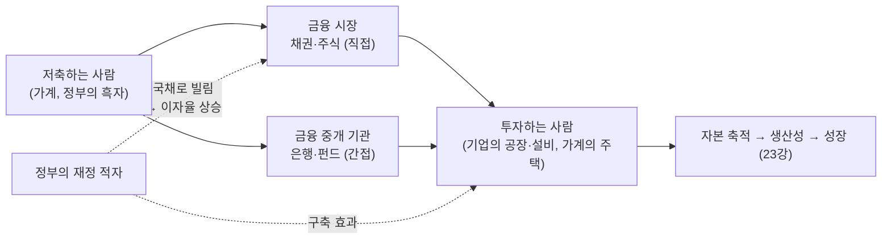

1602년 네덜란드에서 **동인도 회사**(VOC)가 세워졌다. 아시아에서 향신료를 실어 오는 항해는 엄청난 이익을 남길 수 있었지만, 배 한 척을 꾸리는 데 막대한 돈이 들었고 배가 폭풍이나 해적을 만나 돌아오지 못할 위험도 컸다. 동인도 회사는 이 문제를 새로운 방식으로 풀었다. 회사의 소유권을 잘게 나눈 **주식**을 일반 시민들에게 판 것이다. 상인뿐 아니라 하녀와 목수까지 1,000명이 넘는 사람이 주식을 샀다. 이들은 항해가 성공하면 이익을 나누어 받았고, 돈이 급해지면 암스테르담의 거래소에서 주식을 다른 사람에게 팔 수 있었다. 세계 최초의 근대적 주식 시장이 이렇게 생겨났다.

동인도 회사의 주식은 한 가지 근본적인 문제를 해결했다. 돈을 가진 사람과 돈이 필요한 사람을 잇는 것이다. 23강에서 우리는 저축과 투자가 경제성장의 열쇠라는 것을 배웠다. 그런데 저축하는 사람과 투자하는 사람은 대개 다르다. 월급의 일부를 모으는 회사원과, 공장을 짓고 싶은 기업가는 서로 모르는 사이다. 이 둘을 이어 주는 것이 **금융 시스템**이다. 이 강의에서는 금융 시스템을 이루는 시장과 기관, 저축과 투자의 관계, 그리고 이자율이 어떻게 정해지는지 살펴본다.

> [!핵심] 이 강의의 질문
> 1. 금융 시스템은 어떤 일을 하며, 어떤 시장과 기관으로 이루어져 있는가?
> 2. 경제 전체에서 저축과 투자는 어떤 관계인가?
> 3. 이자율은 어떻게 정해지며, 정부 정책은 저축과 투자에 어떤 영향을 주는가?

{{F:e24-opening}}

## 금융 시스템

### 금융 시장: 직접 빌려주고 빌리기

금융 시스템은 크게 두 갈래로 나뉜다. 하나는 저축하는 사람이 돈을 필요로 하는 기업이나 정부에 **직접** 빌려주거나 투자하는 **금융 시장**이고, 다른 하나는 은행처럼 중간에서 **간접적으로** 이어 주는 **금융 중개 기관**이다. 금융 시장의 대표는 채권 시장과 주식 시장이다.

**채권**은 돈을 빌렸다는 증서다. 채권을 사는 사람은 채권을 발행한 기업이나 정부에 돈을 빌려주고, 정해진 날(**만기**)에 원금을 돌려받으며 그동안 이자를 받는다. 채권의 이자율은 세 가지에 따라 달라진다.

- **만기**: 만기가 길수록 돈이 오래 묶이고 그사이 무슨 일이 생길지 모르므로 대개 이자율이 높다.
- **신용 위험**: 돈을 빌린 쪽이 갚지 못할(부도) 가능성이 클수록 이자율이 높다. 신용 평가 회사들이 채권의 위험을 등급으로 매긴다. 정부가 발행한 국채는 가장 안전한 축에 들어 이자율이 낮고, 위험한 기업의 채권은 이자율이 높다.
- **세금**: 이자에 붙는 세금이 다르면 이자율도 달라진다.

**주식**은 기업의 소유권 일부를 나타내는 증서다. 주식을 사는 사람은 그 기업의 주인 가운데 한 사람(주주)이 되어, 기업이 이윤을 내면 **배당**을 받고 주가가 오르면 그 차익을 얻는다. 채권은 기업이 망하지 않는 한 약속한 이자를 받지만, 주식은 기업의 성과에 따라 수익이 크게 달라진다. 그래서 주식은 채권보다 위험하지만 평균적으로 수익률이 높다. 한국의 주식은 한국거래소에서 거래되며, 전체 주식 시장의 흐름은 1980년 1월 4일의 주가를 100으로 놓은 **코스피 지수**로 나타낸다.

### 금융 중개 기관: 간접적으로 잇기

대부분의 사람은 기업의 채권이나 주식을 직접 고르는 대신 은행에 예금하거나 펀드에 돈을 맡긴다.

**은행**은 예금자들에게서 돈을 모아 돈이 필요한 가계와 기업에 빌려준다. 은행은 대출 이자를 예금 이자보다 높게 받아, 그 차이로 수익을 낸다. 은행이 하는 일은 단순한 중개 이상이다. 수많은 대출자의 신용을 조사하고 감시하는 일을 대신해 주고(20강의 정보 비대칭 해결), 언제든 찾을 수 있는 예금을 받아 오래 묶이는 대출을 해 주며, 예금은 그 자체로 물건을 살 수 있는 돈의 역할을 한다(27강). 은행이 망해도 예금자가 돈을 잃지 않도록 정부는 일정 금액까지 예금을 보호해 준다. 한국의 예금자 보호 한도는 오랫동안 금융 회사당 5,000만 원이었는데, 2025년 9월부터 1억 원으로 올랐다.

**펀드**(집합 투자 기구)는 많은 사람의 돈을 모아 여러 주식과 채권에 나누어 투자한다. 펀드를 사는 사람은 적은 돈으로도 여러 회사에 나누어 투자하는 효과를 얻는다(25강의 분산 투자). 주가 지수의 움직임을 그대로 따라가도록 만든 **인덱스 펀드**와 거래소에서 주식처럼 사고파는 **상장지수펀드**(ETF)가 널리 쓰인다.

| 금융 상품 | 성격 | 수익 | 위험 |
|---|---|---|---|
| 은행 예금 | 은행에 빌려줌 | 정해진 이자 (낮음) | 매우 낮음 (예금자 보호) |
| 국채 | 정부에 빌려줌 | 정해진 이자 (낮음) | 낮음 |
| 회사채 | 기업에 빌려줌 | 정해진 이자 (국채보다 높음) | 기업의 부도 위험 |
| 주식 | 기업의 소유권 | 배당과 주가 상승 (평균적으로 높음) | 높음 (주가 변동, 기업 파산) |
| 펀드·ETF | 여러 자산에 나누어 투자 | 담은 자산에 따라 다름 | 개별 주식보다 낮음 (분산 투자) |

표: 대표적인 금융 상품의 비교

{{F:e24-finance}}

## 저축과 투자의 관계

### 국민 소득 계정의 항등식

21강에서 GDP = 소비 + 투자 + 정부 구매 + 순수출(Y = C + I + G + NX)이라고 배웠다. 설명을 쉽게 하려고 외국과 거래하지 않는 **폐쇄 경제**를 생각하면, 순수출이 없으므로 Y = C + I + G가 된다. 이 식을 조금 바꾸면 다음과 같다.

**Y − C − G = I**

왼쪽은 경제 전체의 소득에서 소비와 정부 구매를 쓰고 남은 것, 곧 **국민 저축**(S)이다. 그러므로 경제 전체로 보면 **저축 = 투자**(S = I)가 언제나 성립한다. 한 사람이 저축한 돈은 금융 시스템을 거쳐 누군가의 투자가 된다.

국민 저축은 다시 둘로 나눌 수 있다. 세금(T)을 넣어 쓰면 S = (Y − T − C) + (T − G)다. 앞의 것은 가계가 소득에서 세금과 소비를 빼고 남긴 **민간 저축**, 뒤의 것은 정부가 걷은 세금에서 정부 구매를 빼고 남긴 **공공 저축**이다. 정부가 세금보다 많이 쓰면 공공 저축은 마이너스가 되는데, 이것이 **재정 적자**다. 세금이 더 많으면 **재정 흑자**다.

> [!주의] 개인의 '투자'와 경제학의 '투자'
> 일상에서는 주식을 사는 것을 '투자'라고 한다. 그러나 거시경제학에서 투자는 공장, 기계, 주택 같은 새로운 자본재를 사는 것만을 뜻한다(21강). 내가 이미 발행된 주식을 다른 사람에게서 사는 것은 내 돈이 그 사람에게 넘어갈 뿐, 경제 전체의 자본이 늘어나지 않는다. 경제학에서는 이를 '저축'의 한 형태로 본다. 그 기업이 새 주식을 발행해 모은 돈으로 공장을 지을 때 비로소 '투자'가 일어난다.

## 대부 자금 시장

### 저축과 투자가 만나는 시장

저축과 투자가 어떻게 같아지는지 알아보려면, 경제의 모든 금융 시장을 하나로 묶은 **대부 자금 시장**을 생각하면 편리하다. 이 시장에서 돈을 빌려주려는 사람(저축하는 사람)이 공급을, 돈을 빌리려는 사람(투자하는 사람)이 수요를 이룬다. 대부 자금의 '가격'은 **실질 이자율**이다(22강).

- **대부 자금의 공급**은 저축에서 나온다. 이자율이 높을수록 저축의 대가가 커지므로 사람들은 더 많이 저축한다. 공급 곡선은 오른쪽 위로 기운다. (다만 19강에서 본 것처럼 소득 효과 때문에 저축이 이자율에 크게 반응하지 않을 수도 있다.)
- **대부 자금의 수요**는 투자에서 나온다. 기업은 새 공장에서 기대되는 수익률이 빌리는 이자율보다 높을 때만 투자한다. 이자율이 낮을수록 수익을 낼 수 있는 투자 계획이 많아지므로 수요 곡선은 오른쪽 아래로 기운다.

두 곡선이 만나는 곳에서 **균형 이자율**과 저축·투자의 양이 정해진다. 4강의 수요와 공급 모형이 금융에도 그대로 쓰이는 것이다.

### 정책 1: 저축을 늘리는 세금 혜택

정부가 저축에 붙는 세금을 깎아 주면(예: 일정 금액까지 이자에 세금을 매기지 않는 비과세 저축 상품), 같은 이자율에서도 저축이 늘어나 대부 자금의 공급 곡선이 오른쪽으로 이동한다. 그러면 균형 이자율이 내려가고, 낮은 이자율 덕분에 투자가 늘어난다. 장기적으로는 자본이 쌓여 경제성장에 도움이 된다(23강).

### 정책 2: 투자를 늘리는 세금 혜택

정부가 기업의 투자에 세금을 깎아 주면(투자 세액 공제), 같은 이자율에서도 투자하려는 기업이 늘어나 대부 자금의 수요 곡선이 오른쪽으로 이동한다. 균형 이자율은 올라가고, 높아진 이자율이 저축을 늘려 저축과 투자가 모두 늘어난다.

### 정책 3: 정부의 재정 적자와 구축 효과

정부가 세금보다 더 많이 쓰면 그 차이를 국채를 팔아 빌려야 한다. 재정 적자는 공공 저축을 줄이므로 대부 자금의 공급이 줄어든다(공급 곡선이 왼쪽으로 이동). 그러면 이자율이 오르고, 높아진 이자율 때문에 민간 기업의 투자가 줄어든다. 정부가 돈을 빌리면서 민간의 투자를 밀어내는 이 현상을 **구축 효과**라고 한다. 재정 적자가 오래 이어지면 투자가 줄어 장기 성장에 해로울 수 있다는 것이 경제학자들의 일반적인 걱정이다. 반대로 재정 흑자는 공공 저축을 늘려 이자율을 낮추고 투자를 늘린다.

```chart
{
  "type": "scatter",
  "caption": "대부 자금 시장과 재정 적자의 구축 효과 (가상의 예). 원래 균형은 실질 이자율 4%, 저축·투자 100조 원이다. 정부가 20조 원의 재정 적자를 내면 대부 자금의 공급이 줄어(점선) 이자율이 5%로 오르고, 민간 투자는 90조 원으로 줄어든다",
  "height": 360,
  "data": {
    "datasets": [
      { "label": "대부 자금 수요 (투자)", "showLine": true, "pointRadius": 0, "data": [{"x":60,"y":8},{"x":140,"y":0}] },
      { "label": "대부 자금 공급 (저축)", "showLine": true, "pointRadius": 0, "data": [{"x":60,"y":2},{"x":140,"y":6}] },
      { "label": "재정 적자 뒤의 공급", "showLine": true, "pointRadius": 0, "borderDash": [6, 4], "data": [{"x":40,"y":2},{"x":120,"y":6}] },
      { "label": "원래 균형 (100조, 4%)", "pointRadius": 7, "data": [{"x":100,"y":4}] },
      { "label": "새 균형 (90조, 5%)", "pointRadius": 8, "pointStyle": "star", "data": [{"x":90,"y":5}] }
    ]
  },
  "options": { "scales": { "x": { "title": { "display": true, "text": "대부 자금의 양 (조 원)" }, "min": 30, "max": 150 }, "y": { "title": { "display": true, "text": "실질 이자율 (%)" }, "min": 0, "max": 8 } } }
}
```

### 나랏빚은 얼마나 위험한가

정부의 빚(국가 채무)이 쌓이면 그 이자를 갚는 데 세금을 써야 하고, 미래 세대가 그 부담을 지게 된다. 그래서 많은 나라는 재정 적자와 국가 채무를 일정 수준 아래로 관리하려 한다. 한국의 국가 채무는 2020년대 들어 국내총생산의 40%대 중후반으로, 일본(200%가 넘음)이나 미국(100%가 넘음)보다 훨씬 낮다. 그러나 고령화로 연금과 의료 지출이 빠르게 늘어날 것이므로, 지금부터 재정을 어떻게 관리할지가 중요한 과제로 꼽힌다.

나랏빚이 늘 나쁜 것은 아니다. 전쟁이나 경제 위기, 감염병처럼 갑자기 큰돈이 필요할 때 빚을 내 대응하는 것은 합리적이다. 미래 세대도 혜택을 누릴 도로와 연구에 빚을 내는 것도 정당화될 수 있다. 경기가 나쁠 때 재정 지출을 늘리는 정책은 31강에서 다룬다.



```timeline
1602 | 네덜란드 동인도 회사 | 세계 최초의 근대적 주식회사, 암스테르담 거래소
1694 | 영국 은행(잉글랜드 은행) 설립 | 정부에 돈을 빌려주려고 세워짐
1878 | 일본 제일은행 부산 지점 | 한국 땅의 첫 근대 은행 점포
1897 | 한성은행 설립 | 한국인이 세운 초기 근대 은행
1950 | 한국은행 설립 | 
1956 | 대한증권거래소 개장 | 
1980 | 코스피 지수 기준일(1월 4일 = 100) | 
1996 | 코스닥 시장 개설, 예금보험공사 설립 | 
2025 | 예금자 보호 한도 1억 원으로 상향 | 
```

## 정리

> [!핵심] 24강 요약
> - **금융 시스템**은 저축하는 사람과 투자하는 사람을 잇는다. **채권 시장**과 **주식 시장** 같은 금융 시장은 직접, **은행**과 **펀드** 같은 금융 중개 기관은 간접적으로 돈을 전달한다.
> - 채권의 이자율은 **만기**, **신용 위험**, 세금에 따라 다르다. 주식은 기업의 소유권으로, 채권보다 위험하지만 평균 수익이 높다.
> - 폐쇄 경제에서 **국민 저축 = 투자**다. 국민 저축은 **민간 저축**과 **공공 저축**(세금 − 정부 구매)으로 나뉜다. 경제학의 투자는 새 자본재를 사는 것이다.
> - **대부 자금 시장**에서 저축(공급)과 투자(수요)가 만나 **실질 이자율**이 정해진다. 저축과 투자에 대한 세금 혜택은 각각 공급과 수요를 늘린다.
> - **재정 적자**는 공공 저축을 줄여 이자율을 올리고 민간 투자를 밀어낸다(**구축 효과**). 나랏빚은 위기 대응에는 유용하지만 장기적인 관리가 필요하다.

### 생각해 볼 질문

1. 내가 은행에 100만 원을 예금했다. 이 돈은 금융 시스템을 거쳐 어디로 갈 수 있을까? 그 길을 따라가 보자.
2. 같은 회사가 발행한 채권과 주식 가운데 어느 쪽이 더 위험할까? 그 회사가 망하면 채권 보유자와 주주는 각각 어떻게 될까?
3. 정부가 경기를 살리려고 재정 적자를 크게 늘리면 이자율과 민간 투자는 어떻게 될까? 경기가 아주 나쁠 때도 구축 효과가 크게 일어날까?

### 다음 강 예고

25강 「금융의 기초: 현재가치와 위험」에서는 금융 시장의 사람들이 쓰는 기본 도구를 배운다. 미래의 돈을 오늘의 가치로 바꾸는 **현재가치**, 사람들이 위험을 싫어하는 이유와 보험, **분산 투자**, 그리고 주식의 가치는 어떻게 매겨지며 주가를 예측할 수 있는지(효율적 시장 가설)와 거품을 다룬다.
