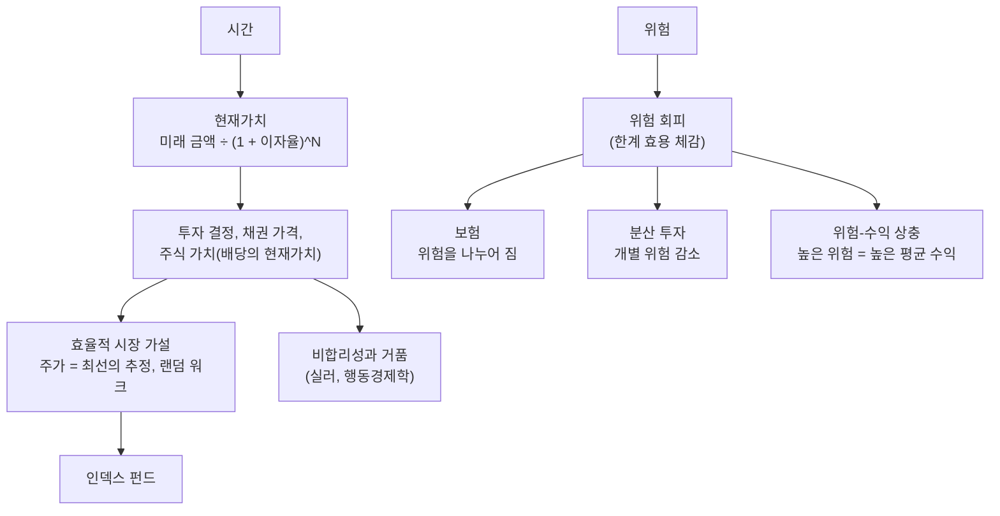

1637년 2월 초, 네덜란드 하를럼의 한 술집에서 튤립 알뿌리 경매가 열렸다. 당시 네덜란드에서는 희귀한 줄무늬 튤립이 큰 인기를 끌었다. 가장 귀하다는 '셈페르 아우구스투스' 품종의 알뿌리 하나가 암스테르담의 집 한 채 값에 거래되었다는 기록까지 전한다. 사람들은 알뿌리를 땅에 심기도 전에 사고팔았고, 값은 몇 주 만에 몇 배로 뛰었다. 그런데 그날 하를럼의 경매에서 갑자기 아무도 값을 부르지 않았다. 그 소식이 퍼지자 며칠 사이에 튤립 값은 무너져 내렸다. 이른바 **튤립 광풍**이다.

튤립 광풍은 오랫동안 인간의 어리석음과 투기 거품의 상징으로 이야기되어 왔다. 다만 최근의 역사 연구는 그 규모와 피해가 흔히 알려진 것보다 훨씬 작았다고 보기도 한다. 어쨌든 이 이야기는 금융 시장의 근본적인 질문을 던진다. 자산의 '올바른' 값은 얼마인가? 사람들은 위험을 어떻게 다루는가? 그리고 시장 가격은 믿을 만한가?

24강에서 금융 시스템이 저축과 투자를 잇는다는 것을 보았다. 이 강의에서는 금융 시장의 사람들이 쓰는 기본 도구를 배운다. 미래의 돈을 오늘의 가치로 바꾸는 **현재가치**, 사람들이 위험을 다루는 방법인 **보험**과 **분산 투자**, 그리고 주식의 가치를 매기는 방법과 **효율적 시장 가설**, 거품을 차례로 살펴본다.

> [!핵심] 이 강의의 질문
> 1. 오늘의 돈과 미래의 돈은 어떻게 비교하는가?
> 2. 사람들은 위험을 왜 싫어하며, 위험을 어떻게 줄이는가?
> 3. 자산의 가치는 어떻게 매겨지며, 주가를 예측할 수 있는가?

{{F:e25-opening}}

## 현재가치: 시간의 가치

### 오늘의 100만 원과 10년 뒤의 100만 원

오늘 100만 원을 받을래, 10년 뒤에 100만 원을 받을래? 누구나 오늘을 고를 것이다. 오늘 받은 100만 원을 은행에 넣어 두면 10년 뒤에는 이자가 붙어 100만 원보다 많아지기 때문이다. 연 5%의 이자율이라면, 오늘의 100만 원은 1년 뒤 105만 원, 2년 뒤 110만 2,500원(105만 원의 5% 이자가 다시 붙는다)이 된다. 이자에 다시 이자가 붙는 것을 **복리**라고 한다. N년 뒤의 금액(미래가치)은 다음과 같다.

**미래가치 = 오늘의 금액 × (1 + 이자율)^N**

연 5%의 복리라면 오늘의 100만 원은 10년 뒤 약 163만 원이 된다. 거꾸로 생각하면, 10년 뒤의 100만 원은 오늘의 돈으로 얼마의 가치가 있을까? 오늘 얼마를 넣어 두면 10년 뒤 100만 원이 되는지 계산하면 된다. 이것을 **현재가치**라고 하며, 미래의 금액을 현재가치로 바꾸는 것을 **할인**한다고 한다.

**현재가치 = 미래의 금액 ÷ (1 + 이자율)^N**

| 받는 시점 | 이자율 3%일 때 현재가치 | 이자율 5%일 때 현재가치 | 이자율 10%일 때 현재가치 |
|---|---|---|---|
| 1년 뒤 100만 원 | 97.1만 원 | 95.2만 원 | 90.9만 원 |
| 10년 뒤 100만 원 | 74.4만 원 | 61.4만 원 | 38.6만 원 |
| 30년 뒤 100만 원 | 41.2만 원 | 23.1만 원 | 5.7만 원 |

표: 미래 100만 원의 현재가치

먼 미래의 돈일수록, 이자율이 높을수록 현재가치는 작아진다. 23강의 70의 법칙도 복리에서 나왔다. 연 7%로 불어나는 돈은 10년마다 두 배가 된다.

### 현재가치의 쓰임

현재가치는 금융의 거의 모든 결정에 쓰인다.

- **복권 당첨금**: 미국의 복권에서는 당첨금을 30년 동안 나누어 받거나, 그보다 훨씬 적은 금액을 한 번에 받는 것 가운데 고를 수 있다. 한 번에 받는 금액은 대략 나누어 받을 금액 전체의 현재가치에 맞추어 정해진다.
- **기업의 투자 결정**: 기업은 새 공장이 앞으로 벌어들일 수익의 현재가치가 지금 드는 비용보다 클 때만 공장을 짓는다. 이자율이 오르면 미래 수익의 현재가치가 작아지므로 수익을 낼 수 있는 투자 계획이 줄어든다. 24강에서 대부 자금의 수요 곡선이 오른쪽 아래로 기운 이유가 이것이다.
- **채권의 가격**: 채권의 가격은 앞으로 받을 이자와 원금의 현재가치다. 그래서 시장 이자율이 오르면 이미 발행된 채권의 가격은 내려가고, 이자율이 내리면 채권 가격은 오른다.

> [!참고] 복리는 정말 '인류 최고의 발명'일까?
> "복리는 인류 최고의 발명이다" 또는 "복리는 우주에서 가장 강력한 힘이다"라는 말이 흔히 아인슈타인의 말로 인용되지만, 그가 실제로 이런 말을 했다는 믿을 만한 기록은 없다. 그래도 복리의 힘은 진짜다. 연 7%로 40년 동안 불어나면 돈은 약 15배가 된다. 젊을 때 조금씩이라도 일찍 저축을 시작하는 것이 중요한 이유다. 반대로 카드 대금을 연체해 연 20%에 가까운 이자가 복리로 붙으면 빚은 4년 안에 두 배가 된다.

{{F:e25-bubbles}}

## 위험의 관리

### 사람들은 왜 위험을 싫어하나

동전을 던져 앞면이 나오면 100만 원을 받고, 뒷면이 나오면 100만 원을 내는 내기가 있다. 평균적으로는 본전이지만, 대부분의 사람은 이 내기를 하지 않으려 한다. 사람들은 대개 **위험 회피적**이기 때문이다. 이유는 1강의 한계 효용 체감에 있다. 이미 가진 돈이 많을수록 돈 1원의 가치는 줄어든다. 그래서 100만 원을 잃는 고통은 100만 원을 얻는 기쁨보다 크다. 20강의 손실 회피는 이 성향이 더 강하게 나타나는 경우다.

### 보험: 위험을 나누기

위험 회피적인 사람은 위험을 줄이기 위해 돈을 낼 용의가 있다. 그것이 **보험**이다. 보험에 드는 사람은 정해진 보험료를 내는 대신, 큰 사고가 났을 때 보험금을 받는다. 보험 회사는 수많은 가입자의 보험료를 모아 그 가운데 사고를 당한 사람에게 지급한다. 한 사람에게는 감당하기 어려운 위험이, 수많은 사람에게 나누어지면 감당할 만한 비용이 된다. 보험은 위험을 없애지 못하지만 위험을 **나누어** 진다.

다만 20강에서 본 것처럼 보험 시장에는 **역선택**과 **도덕적 해이**라는 문제가 따른다. 위험이 높은 사람일수록 보험에 들려 하고, 보험에 든 뒤에는 조심을 덜 하기도 한다. 보험 회사가 가입 심사를 하고 자기 부담금을 두는 것은 이 때문이다.

### 분산 투자: 계란을 한 바구니에 담지 마라

위험을 줄이는 또 다른 방법은 **분산 투자**다. 한 회사의 주식에 돈을 모두 넣으면 그 회사가 망할 때 모두 잃는다. 그러나 서로 다른 여러 회사의 주식에 나누어 넣으면, 어떤 회사가 망해도 다른 회사들의 성과가 그 손실을 메워 준다. 이렇게 서로 관계가 적은 여러 자산에 나누어 투자하면, 평균 수익은 크게 줄이지 않으면서 위험을 줄일 수 있다.

```chart
{
  "type": "line",
  "caption": "포트폴리오에 담은 주식의 수와 위험 (수익률의 표준 편차, %, 미국 주식 연구를 바탕으로 한 대략적인 모습). 주식 수를 늘리면 처음에는 위험이 빠르게 줄지만, 20~30개를 넘으면 더 이상 크게 줄지 않는다. 남는 위험은 경제 전체에 영향을 주는 '시장 위험'이다",
  "data": {
    "labels": ["1", "2", "4", "6", "8", "10", "20", "30", "40"],
    "datasets": [{ "label": "위험(표준 편차, %)", "data": [49, 37, 29, 26, 25, 24, 22, 21, 21] }]
  },
  "options": { "scales": { "x": { "title": { "display": true, "text": "담은 주식의 수" } }, "y": { "min": 0 } }, "plugins": { "legend": { "display": false } } }
}
```

분산 투자로 줄일 수 있는 위험은 한 회사에만 일어나는 **개별 위험**(예: 그 회사의 신제품 실패)이다. 그러나 경기 침체나 금융 위기처럼 거의 모든 회사에 함께 영향을 주는 **시장 위험**은 분산 투자로도 없앨 수 없다. 1952년 미국의 경제학자 **해리 마코위츠**는 분산 투자의 원리를 수학적으로 정리한 '포트폴리오 이론'을 내놓아 1990년 노벨 경제학상을 받았다.

### 위험과 수익의 상충

위험한 자산일수록 평균 수익률은 높다. 그렇지 않다면 아무도 위험한 자산을 사지 않을 것이기 때문이다. 높은 수익은 위험을 감수한 데 대한 보상이다.

| 자산 (미국, 1928~2023년) | 연평균 수익률 (명목, 대략) | 특징 |
|---|---|---|
| 단기 국채 | 약 3% | 가장 안전하지만 수익이 낮다 |
| 장기 국채 | 약 4.5% | 이자율이 바뀌면 값이 오르내린다 |
| 주식 (S&P 500) | 약 10% | 해마다 크게 오르내리며, 몇 년 동안 손실이 나기도 한다 |

표: 위험과 수익의 상충 (미국 자료를 바탕으로 한 대략적인 장기 평균)

그래서 투자자는 자기가 감당할 수 있는 위험의 크기에 맞게 자산을 섞는다. 은퇴가 먼 젊은 사람은 주식의 비중을 높이고, 은퇴가 가까운 사람은 안전한 채권과 예금의 비중을 높이는 것이 일반적인 권고다.

## 자산의 가치 평가

### 기본적 분석

주식의 '올바른' 가격은 얼마일까? 주식을 사는 사람은 그 회사가 앞으로 줄 배당과, 나중에 그 주식을 팔 때 받을 가격을 기대한다. 그러므로 주식의 가치는 그 회사가 앞으로 벌어들일 이윤에서 나오는 모든 배당의 **현재가치**다. 회사의 재무 상태와 미래 전망을 분석해 이 가치를 추정하는 것을 **기본적 분석**이라고 한다. 주가가 이 가치보다 낮으면 싸게 사는 것이고, 높으면 비싸게 사는 것이다.

### 효율적 시장 가설

그렇다면 열심히 분석하면 싼 주식을 찾아 남보다 높은 수익을 낼 수 있을까? 미국의 경제학자 **유진 파마**는 1970년, 주식 시장이 **효율적**이라면 그럴 수 없다고 주장했다. 이것을 **효율적 시장 가설**이라고 한다. 주식 시장에서는 수많은 전문가가 모든 정보를 분석해 사고판다. 그래서 어떤 회사에 대해 공개된 정보는 순식간에 주가에 반영된다. 싼 주식이 있다면 이미 누군가 사서 값이 올라 있을 것이다. 따라서 주가는 언제나 그 회사의 가치를 가장 잘 추정한 값이다.

효율적 시장 가설이 맞다면, 주가는 새로운 정보가 나올 때만 움직인다. 새로운 정보는 말 그대로 미리 알 수 없으므로, 주가의 움직임도 예측할 수 없다. 술 취한 사람의 걸음처럼 무작위로 움직인다는 뜻에서 이를 **랜덤 워크**라고 한다. 미국의 경제학자 버턴 맬킬은 1973년 『월가에서의 랜덤 워크』에서 "눈을 가린 원숭이가 신문의 주식 면에 다트를 던져 고른 주식도 전문가가 고른 주식만큼 잘할 것"이라고 썼다.

### 인덱스 펀드

효율적 시장 가설의 실천적인 결론은 **인덱스 펀드**다. 시장을 이기려 애쓰기보다, 코스피나 S&P 500 같은 주가 지수에 들어 있는 주식을 모두 조금씩 사서 시장 전체의 수익을 따라가자는 것이다. 미국의 존 보글은 1976년 일반인을 위한 첫 인덱스 펀드를 내놓았다. 처음에는 '평균에 만족하는 바보의 투자'라는 조롱을 받았지만, 지금은 세계에서 가장 많은 돈이 몰리는 투자 방식이 되었다. 실제로 전문가가 종목을 골라 운용하는 펀드의 대부분이 장기적으로 수수료를 빼고 나면 지수를 따라가는 펀드보다 낮은 수익을 냈다는 조사가 해마다 나온다.

### 시장은 비합리적일 수도 있다

그러나 시장이 언제나 효율적인 것은 아니라는 반론도 강하다. 미국의 경제학자 **로버트 실러**는 주가가 배당 같은 기본 가치로 설명할 수 있는 것보다 훨씬 크게 오르내린다는 것을 보였다. 사람들이 다른 사람들의 열광을 따라 움직이고(20강의 행동경제학), 주가가 오를 것이라는 기대만으로 주식을 사면, 자산 가격이 기본 가치에서 크게 벗어나는 **거품**이 생긴다. 거품은 언젠가 터지고, 그때 많은 사람이 큰 손실을 본다. 흥미롭게도 2013년 노벨 경제학상은 효율적 시장을 주장한 파마와, 비합리적 거품을 경고한 실러가 함께 받았다. 시장이 대체로 효율적이지만 때로는 크게 비합리적일 수 있다는 것이 오늘날 많은 경제학자의 생각이다.

| 거품 | 시기 | 무슨 일이 있었나 |
|---|---|---|
| 튤립 광풍 | 1636~1637 | 네덜란드에서 튤립 알뿌리 값이 폭등했다가 폭락 |
| 남해 회사 거품 | 1720 | 영국 남해 회사의 주가가 몇 달 만에 10배 가까이 올랐다가 폭락. 뉴턴도 큰돈을 잃었다고 전한다 |
| 미국 주가 폭락 | 1929 | 대공황의 시작(26강, 33강) |
| 일본 자산 거품 | 1980년대 후반~1990 | 주가와 땅값이 폭등했다가 폭락, '잃어버린 10년'으로 |
| 닷컴 거품 | 1990년대 후반~2000 | 인터넷 기업 주가 폭등. 미국 나스닥 지수는 2000년 3월 정점에서 2년 반 만에 약 78% 하락. 한국의 코스닥 지수도 2000년 3월 정점 뒤 크게 폭락 |
| 미국 주택 거품 | 2000년대 중반 | 주택 가격 폭락이 2008년 세계 금융위기로(33강) |

표: 역사 속의 자산 거품



## 정리

> [!핵심] 25강 요약
> - 오늘의 돈은 미래의 같은 금액보다 가치가 크다. **복리**로 미래가치를 구하고, 미래의 금액을 **할인**해 **현재가치**를 구한다. 현재가치는 투자 결정, 채권 가격, 주식 가치 평가의 기초다.
> - 사람들은 대개 **위험 회피적**이다. **보험**은 위험을 많은 사람에게 나누고, **분산 투자**는 개별 위험을 줄인다. 분산 투자로도 **시장 위험**은 없앨 수 없다.
> - 위험한 자산일수록 평균 수익이 높다(**위험-수익의 상충**).
> - 주식의 가치는 미래 배당의 현재가치다(**기본적 분석**). **효율적 시장 가설**에 따르면 주가는 모든 공개 정보를 반영하며 예측할 수 없게 움직인다(**랜덤 워크**). 그 실천적 결론이 **인덱스 펀드**다.
> - 그러나 사람들의 비합리성 때문에 자산 가격이 기본 가치에서 크게 벗어나는 **거품**이 생기기도 한다.

### 생각해 볼 질문

1. 복권에 당첨되어 '20년 동안 해마다 1억 원씩' 받거나 '지금 12억 원'을 받는 것 가운데 하나를 골라야 한다. 이자율이 5%라면 어느 쪽이 나을까? 이자율이 2%라면?
2. 회사원이 자기가 다니는 회사의 주식에 저축의 대부분을 넣는 것은 왜 위험할까? 분산 투자의 관점에서 설명해 보자.
3. 어떤 주식이 '반드시 오를 것'이라는 소문을 들었다. 효율적 시장 가설의 관점에서 이 소문을 어떻게 받아들여야 할까?

### 다음 강 예고

26강 「실업」에서는 일하고 싶은데 일자리를 찾지 못하는 사람들의 문제를 다룬다. 실업률은 어떻게 재는지, 경제가 좋을 때도 실업이 사라지지 않는 이유(마찰적 실업, 구조적 실업), 그리고 최저임금, 노동조합, 효율 임금이 실업에 미치는 영향을 살펴본다.
