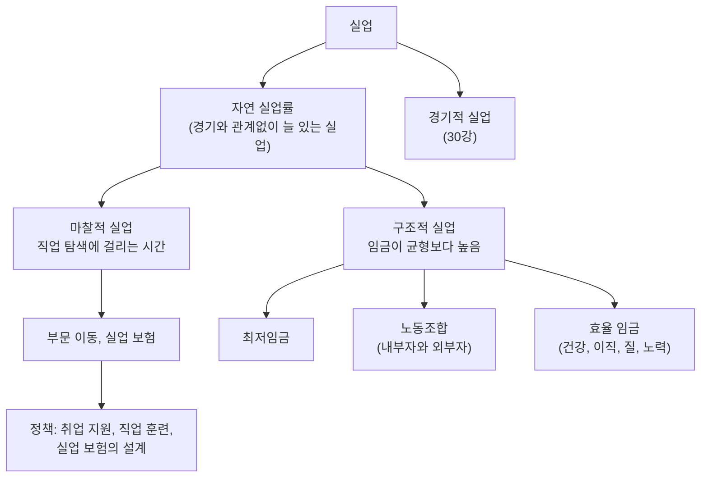

1914년 1월 5일, 포드 자동차 회사가 하루 임금을 5달러로 올린다고 발표하자(17강), 이튿날 아침 디트로이트 하이랜드 파크 공장 앞에는 1만 명이 넘는 사람이 몰려들었다. 며칠 사이 그 수는 더 늘었다. 한겨울 추위 속에 공장 문 앞에서 밤을 새운 사람들도 있었다. 일자리는 수천 개뿐이었고, 몰려든 사람들이 문을 밀고 들어오려 하자 회사는 소방 호스로 찬물을 뿌려 사람들을 쫓아냈다.

이 장면은 이상하다. 4강에서 배운 대로라면, 일하려는 사람이 일자리보다 많으면 임금이 내려가 결국 일하고 싶은 사람은 모두 일자리를 찾아야 한다. 그런데 포드 공장 앞에는 지금 받는 임금에 기꺼이 일하겠다는 사람이 넘쳐났는데도 일자리를 얻지 못했다. 이렇게 일할 뜻과 능력이 있는데 일자리를 찾지 못한 상태가 **실업**이다.

실업은 경제 문제 가운데 사람들에게 가장 직접적인 고통을 준다. 일자리를 잃으면 소득이 끊길 뿐 아니라, 자존감과 건강, 가족 관계까지 흔들린다는 연구가 많다. 이 강의에서는 실업을 어떻게 재는지, 그리고 경기가 좋을 때도 실업이 사라지지 않는 이유를 살펴본다. 경기가 나빠질 때 늘어나는 실업은 30강에서 다룬다.

> [!핵심] 이 강의의 질문
> 1. 실업률은 어떻게 재며, 그 숫자는 무엇을 놓치는가?
> 2. 경제가 좋을 때도 왜 실업자가 있는가?
> 3. 최저임금, 노동조합, 효율 임금은 실업과 어떤 관계가 있는가?

{{F:e26-opening}}

## 실업을 재는 방법

### 누가 실업자인가

한국의 실업률은 통계청이 매달 약 3만 6,000가구를 조사하는 **경제활동인구조사**로 잰다. 조사원은 15세 이상의 가구원 한 사람 한 사람을 다음 세 무리 가운데 하나로 나눈다.

| 구분 | 기준 | 예 |
|---|---|---|
| **취업자** | 조사 대상 주간에 수입을 목적으로 1시간 이상 일했거나, 일시적으로 쉬고 있는 사람 | 회사원, 자영업자, 주 몇 시간 일하는 아르바이트생, 가족 가게에서 주 18시간 이상 무급으로 일한 사람 |
| **실업자** | 일하지 않았고, 지난 4주 동안 일자리를 적극적으로 찾았으며, 일자리가 있으면 바로 일할 수 있는 사람 | 이력서를 내고 면접을 보는 사람 |
| **비경제활동인구** | 취업자도 실업자도 아닌 사람 | 학생, 전업 주부, 은퇴한 노인, 일을 찾다가 포기한 사람 |

표: 경제활동인구조사의 분류

취업자와 실업자를 합친 것이 **경제활동인구**, 곧 일하고 있거나 일하려는 사람들이다. 이를 바탕으로 세 가지 중요한 비율을 계산한다.

- **실업률** = 실업자 ÷ 경제활동인구 × 100
- **경제활동 참가율** = 경제활동인구 ÷ 15세 이상 인구 × 100
- **고용률** = 취업자 ÷ 15세 이상 인구 × 100

```chart
{
  "type": "doughnut",
  "caption": "2024년 한국의 15세 이상 인구 약 4,550만 명의 구성 (만 명, 통계청 경제활동인구조사를 바탕으로 한 대략적인 수치). 실업률은 약 2.8%(82 ÷ 2,940), 경제활동 참가율은 약 64.6%, 고용률은 약 62.8%다",
  "height": 300,
  "data": {
    "labels": ["취업자 약 2,858만", "실업자 약 82만", "비경제활동인구 약 1,610만"],
    "datasets": [{ "data": [2858, 82, 1610] }]
  }
}
```

### 실업률이 놓치는 것

실업률은 경제를 보여 주는 가장 중요한 숫자 가운데 하나지만, 한계도 분명하다.

첫째, **구직 단념자**가 빠진다. 오랫동안 일자리를 찾다가 지쳐 포기한 사람은 '지난 4주 동안 일자리를 찾지 않았으므로' 실업자가 아니라 비경제활동인구로 분류된다. 그래서 경기가 아주 나쁠 때 일을 포기하는 사람이 늘면, 오히려 실업률이 내려가는 일도 생긴다.

둘째, 원하는 만큼 일하지 못하는 사람이 빠진다. 일주일에 몇 시간 아르바이트를 하면서 더 오래 일하고 싶은 사람도 취업자다. 시험을 준비하며 일자리를 찾고 있는 '취업 준비생'의 상당수도 비경제활동인구로 잡힌다.

그래서 통계청은 2015년부터 이런 사람들까지 넓게 포함한 **고용 보조 지표**(이른바 '확장 실업률')를 함께 발표한다. 공식 실업률이 2~3%대일 때도 고용 보조 지표 3은 10% 안팎이다. 청년층(15~29세)은 이 차이가 더 커서, 공식 실업률은 5~7%대지만 확장 실업률은 그 세 배에 가깝다.

이런 이유로 많은 경제학자는 실업률과 함께 **고용률**을 중요하게 본다. 고용률은 일할 나이의 사람 가운데 실제로 일하는 사람의 비율이어서, 구직 단념자 문제의 영향을 덜 받는다. 한국의 15~64세 고용률은 2024년 약 69.5%로 역대 가장 높은 수준이지만, 경제협력개발기구(OECD) 회원국 평균과 비슷하거나 조금 낮다. 특히 청년과 여성의 고용률이 선진국보다 낮은 편이다.

```chart
{
  "type": "line",
  "caption": "한국의 실업률 (%, 1990~2024년, 통계청 자료를 바탕으로 한 대략적인 수치). 평소 2~4%대이던 실업률이 1997년 외환위기 직후인 1998년 연평균 7.0%로 치솟았다(1999년 초에는 한때 8%대). 그 뒤로는 3%대 안팎에서 오르내렸다",
  "data": {
    "labels": ["1990","1992","1994","1996","1998","2000","2002","2004","2006","2008","2010","2012","2014","2016","2018","2020","2022","2024"],
    "datasets": [{ "label": "실업률(%)", "data": [2.4, 2.5, 2.5, 2.0, 7.0, 4.4, 3.3, 3.7, 3.5, 3.2, 3.7, 3.2, 3.5, 3.7, 3.8, 4.0, 2.9, 2.8] }]
  },
  "options": { "scales": { "y": { "min": 0 } }, "plugins": { "legend": { "display": false } } }
}
```

### 실업은 얼마나 오래가나

실업에 대한 또 하나의 중요한 사실이 있다. 실업자는 대부분 짧은 기간 실업 상태에 있다가 일자리를 찾는다. 그러나 특정 시점에 실업 상태인 사람들을 보면, 오래 일자리를 찾지 못하고 있는 **장기 실업자**의 비중이 생각보다 크다. 짧은 실업은 자주 생겼다가 금방 끝나고, 긴 실업은 드물지만 오래 남아 있기 때문이다. 장기 실업자는 기술이 녹슬고 경력의 공백이 커져 점점 더 일자리를 찾기 어려워진다. 그래서 정책은 장기 실업을 줄이는 데 특히 신경을 쓴다.

## 자연 실업률

### 실업이 사라지지 않는 이유

경기가 아주 좋을 때도 실업률은 0이 되지 않는다. 경제가 정상적인 상태에서도 존재하는 실업률을 **자연 실업률**이라고 한다. '자연'이라는 말은 좋다거나 피할 수 없다는 뜻이 아니라, 경기의 좋고 나쁨과 관계없이 늘 있는 실업이라는 뜻이다. 실제 실업률이 자연 실업률보다 높거나 낮은 부분은 경기 변동에 따라 생기는 **경기적 실업**이다(30강).

자연 실업률이 있는 이유는 크게 두 가지다. 하나는 사람들이 자기에게 맞는 일자리를 찾는 데 시간이 걸리기 때문이고(**마찰적 실업**), 다른 하나는 일자리의 수가 일하려는 사람의 수보다 적기 때문이다(**구조적 실업**).

| 실업의 종류 | 원인 | 예 |
|---|---|---|
| 마찰적 실업 | 노동자와 일자리를 맞추는 데 시간이 걸린다 | 더 나은 직장을 찾아 회사를 그만둔 사람, 갓 졸업해 첫 직장을 찾는 사람 |
| 구조적 실업 | 임금이 균형보다 높아 일자리가 모자란다. 산업 구조가 바뀌어 기술이 맞지 않는다 | 최저임금, 노동조합, 효율 임금 때문에 생기는 실업. 쇠퇴하는 산업에서 밀려난 노동자 |
| 경기적 실업 | 경기 침체로 노동 수요가 줄어든다 | 불황에 해고된 노동자(30강) |

표: 실업의 세 가지 종류

{{F:e26-search}}

## 직업 탐색과 마찰적 실업

### 맞는 짝을 찾는 데는 시간이 걸린다

노동자와 일자리는 서로 다르다. 노동자마다 기술과 원하는 일, 사는 곳이 다르고, 일자리마다 필요한 기술과 근무 조건, 위치가 다르다. 그래서 일자리를 찾는 사람과 사람을 찾는 회사가 서로를 알아보고 짝을 맞추는 데는 시간이 걸린다. 이 과정을 **직업 탐색**이라고 하며, 그동안 생기는 실업이 마찰적 실업이다.

경제는 늘 변한다. 어떤 산업은 커지고 어떤 산업은 줄어든다. 스마트폰이 나오자 디지털카메라와 MP3 플레이어를 만들던 공장은 일자리를 줄이고, 앱을 만드는 회사는 사람을 뽑았다. 어떤 지역은 성장하고 어떤 지역은 쇠퇴한다. 이런 변화를 **부문 이동**이라고 하는데, 이 과정에서 일자리를 옮기는 사람이 늘 생긴다. 미국에서는 해마다 노동자의 상당수가 일자리를 잃거나 옮기는데, 그만큼 새 일자리도 만들어진다. 이렇게 일자리가 끊임없이 없어지고 생기는 것은 역동적인 경제의 자연스러운 모습이다. 마찰적 실업은 그 과정에서 생기는 비용이다.

### 정부는 무엇을 할 수 있나

정부는 직업 탐색을 돕고 실업자의 생활을 지원한다.

- **취업 지원**: 고용센터(한국은 전국의 고용복지플러스센터)와 온라인 구인 구직 사이트(고용24)는 일자리 정보를 모아 탐색 시간을 줄인다. 직업 훈련은 쇠퇴하는 산업의 노동자가 새로운 기술을 배우도록 돕는다.
- **실업 보험**: 일자리를 잃은 노동자에게 일정 기간 이전 임금의 일부를 준다. 한국은 1995년 **고용보험**을 도입했고, 비자발적으로 일자리를 잃은 가입자는 구직 급여(흔히 '실업 급여')를 받는다.

실업 보험은 실업자의 고통을 덜어 주지만, 경제학자들은 그것이 마찰적 실업을 조금 늘린다는 점도 지적한다. 급여를 받는 동안에는 일자리를 서둘러 찾을 유인이 줄기 때문이다. 미국의 연구들은 실업 급여가 끝날 무렵에 일자리를 찾는 사람이 눈에 띄게 늘어난다는 것을 보여 준다. 20강의 도덕적 해이의 한 예다.

그렇다고 실업 보험이 나쁜 제도라는 뜻은 아니다. 실업 보험은 소득이 갑자기 끊기는 위험을 줄여 주는 보험이며(25강), 실업자가 생계에 쫓겨 맞지 않는 첫 일자리를 덥석 잡는 대신 자기에게 맞는 일자리를 찾을 시간을 준다. 노동자와 일자리가 더 잘 맞으면 생산성도 높아진다. 문제는 실업 보험을 없애는 것이 아니라, 일자리를 찾을 유인을 너무 해치지 않도록 설계하는 것이다.

## 임금이 균형보다 높을 때: 구조적 실업

구조적 실업은 일자리의 수가 일하려는 사람보다 적어서 생긴다. 노동 시장에서 임금이 수요와 공급이 같아지는 균형 수준보다 높게 유지되면, 노동 공급량이 노동 수요량보다 많아진다. 그 차이만큼의 사람은 지금 임금에 기꺼이 일하려 하는데도 일자리를 얻지 못한다. 포드 공장 앞에 몰려든 사람들이 바로 이런 경우였다.

```chart
{
  "type": "scatter",
  "caption": "임금이 균형보다 높을 때의 실업. 균형 임금(W*)에서는 노동 수요량과 공급량이 100으로 같다. 임금이 W1으로 높게 유지되면 노동 공급량(120)이 노동 수요량(80)보다 많아져, 그 차이인 40만큼 실업이 생긴다",
  "data": {
    "datasets": [
      { "label": "노동 수요", "showLine": true, "pointRadius": 0, "data": [{"x":40,"y":16},{"x":160,"y":4}] },
      { "label": "노동 공급", "showLine": true, "pointRadius": 0, "data": [{"x":40,"y":4},{"x":160,"y":16}] },
      { "label": "높은 임금 W1", "showLine": true, "pointRadius": 0, "borderDash": [6,4], "data": [{"x":40,"y":12},{"x":160,"y":12}] },
      { "label": "균형 (W* = 10)", "pointRadius": 7, "data": [{"x":100,"y":10}] },
      { "label": "W1에서의 수요량(80)과 공급량(120)", "pointRadius": 6, "pointStyle": "rectRot", "data": [{"x":80,"y":12},{"x":120,"y":12}] }
    ]
  },
  "options": { "scales": { "x": { "title": { "display": true, "text": "노동의 양" }, "min": 40, "max": 160 }, "y": { "title": { "display": true, "text": "임금" }, "min": 0, "max": 20 } } }
}
```

임금이 균형보다 높게 유지되는 이유로는 세 가지가 꼽힌다. **최저임금법**, **노동조합**, 그리고 **효율 임금**이다.

### 최저임금

6강에서 본 것처럼, 최저임금이 균형 임금보다 높으면 노동 공급량이 수요량보다 많아진다. 대부분의 노동자는 최저임금보다 훨씬 많이 벌기 때문에 최저임금의 영향을 받지 않는다. 최저임금의 영향을 크게 받는 사람은 기술과 경력이 적은 노동자, 특히 청년과 고령자다. 그래서 최저임금이 실업에 주는 영향은 이들에게 집중된다.

한국의 최저임금은 1988년 처음 시행되었다. 2018년에는 16.4%, 2019년에는 10.9%가 오르며 큰 논쟁이 벌어졌고, 2025년 시간당 10,030원으로 처음 1만 원을 넘었다. 2026년은 10,320원이다.

| 연도 | 시간당 최저임금 | 인상률 |
|---|---|---|
| 2010 | 4,110원 | 2.75% |
| 2015 | 5,580원 | 7.1% |
| 2018 | 7,530원 | 16.4% |
| 2019 | 8,350원 | 10.9% |
| 2022 | 9,160원 | 5.05% |
| 2025 | 10,030원 | 1.7% |
| 2026 | 10,320원 | 2.9% |

표: 한국의 최저임금 (최저임금위원회 자료)

최저임금이 일자리를 얼마나 줄이는지는 경제학에서 가장 뜨거운 논쟁 가운데 하나다. 전통적인 생각은 최저임금이 일자리, 특히 청년의 일자리를 줄인다는 것이었다. 그런데 1994년 미국의 경제학자 **데이비드 카드**와 **앨런 크루거**는 뉴저지주가 최저임금을 올렸을 때 이웃한 펜실베이니아주와 패스트푸드점 고용을 비교해, 고용이 줄지 않았다는 결과를 내놓았다. 17강에서 본 수요 독점처럼 고용주가 임금을 정할 힘이 있는 시장에서는, 최저임금이 적당히 오르면 오히려 고용이 늘 수도 있다. 카드는 이런 '자연 실험' 연구로 2021년 노벨 경제학상을 받았다. 오늘날 많은 경제학자는 최저임금이 완만하게 오를 때는 고용에 주는 영향이 크지 않지만, 너무 빠르게 크게 오르면 일자리가 줄어들 수 있다고 본다.

{{F:e26-wage}}

### 노동조합과 단체 교섭

**노동조합**은 노동자들이 모여 임금과 근로 조건을 사용자와 함께 협상하는 조직이고, 이 협상을 **단체 교섭**이라고 한다. 협상이 결렬되면 노동조합은 함께 일을 멈추는 **파업**을 할 수 있다. 노동조합은 16강의 카르텔처럼 노동 공급을 한데 묶어 임금을 균형보다 높인다.

노동조합에 든 노동자는 비슷한 일을 하는 조합에 들지 않은 노동자보다 대체로 임금이 높다. 그러나 임금이 높아지면 기업은 고용을 줄인다. 그래서 노동조합은 안에 있는 사람(**내부자**)의 임금을 높이는 대신, 밖에 있는 사람(**외부자**)이 일자리를 얻기 어렵게 만든다. 외부자는 실업 상태로 남거나, 노동조합이 없는 부문으로 가 그곳의 임금을 낮춘다. 한국에서 대기업 정규직과 중소기업·비정규직 노동자 사이의 큰 임금 격차, 이른바 **노동 시장의 이중 구조**도 이런 관점에서 논의된다.

노동조합의 역할에 대한 평가는 엇갈린다. 비판하는 쪽은 노동조합이 일자리를 줄이고 노동 시장을 경직시킨다고 본다. 옹호하는 쪽은 노동조합이 고용주의 큰 힘(수요 독점)에 맞서는 균형추이며, 노동자의 불만을 회사에 전달해 이직을 줄이고 생산성을 높이기도 한다고 본다. 한국의 노동조합 조직률은 2023년 약 13%이며, 주로 대기업과 공공 부문에 집중되어 있다.

### 효율 임금

세 번째 이유는 기업 스스로 임금을 균형보다 높게 주는 것이다. 이상하게 들리지만 그렇게 하는 것이 기업에 이익이 될 때가 있다. 이렇게 생산성을 높이기 위해 주는 높은 임금을 **효율 임금**이라고 한다. 경제학자들은 그 이유를 네 가지로 설명한다.

1. **건강**: 가난한 나라에서는 임금이 너무 낮으면 노동자가 충분히 먹지 못해 일을 잘할 수 없다. 높은 임금은 노동자를 더 건강하고 생산적으로 만든다.
2. **이직**: 노동자가 회사를 자주 그만두면 새 사람을 뽑고 가르치는 데 비용이 든다. 높은 임금을 주면 노동자가 회사를 떠날 유인이 줄어든다.
3. **노동자의 질**: 높은 임금을 내걸면 더 유능한 사람들이 지원한다. 20강의 역선택을 피하는 방법이다.
4. **노력**: 회사가 노동자를 늘 감시할 수는 없다. 임금이 높으면 일을 게을리하다 해고될 때 잃는 것이 커지므로 노동자가 더 열심히 일한다. 20강의 도덕적 해이를 줄이는 방법이다.

포드의 5달러 임금이 바로 효율 임금이었다. 1913년 포드 공장의 노동자 이직률은 한 해에 370%에 이르렀다. 단조롭고 고된 조립 라인 일을 견디지 못한 노동자들이 금방 그만두었기 때문이다. 공장을 계속 돌리려면 한 해에 전체 노동자 수의 몇 배를 새로 뽑아야 했다. 5달러 임금이 시행되자 이직률과 결근율이 크게 떨어지고 생산성이 높아졌다. 경제학자 대니얼 라프와 로런스 서머스는 1987년 포드의 기록을 분석해 높은 임금이 생산성 향상으로 상당 부분 보상되었다고 결론지었다. 헨리 포드는 훗날 하루 5달러 임금이 "우리가 한 비용 절감 가운데 가장 훌륭한 것"이었다고 말했다.

그러나 그 대가로, 공장 문 앞에서 찬물을 맞은 수많은 사람은 일자리를 얻지 못했다. 효율 임금은 기업과 일자리를 가진 노동자에게는 이롭지만, 그 결과로 구조적 실업이 생긴다.



## 정리

> [!핵심] 26강 요약
> - 15세 이상 인구는 **취업자**, **실업자**, **비경제활동인구**로 나뉜다. **실업률**은 경제활동인구 가운데 실업자의 비율이다. 실업률은 **구직 단념자**와 원하는 만큼 일하지 못하는 사람을 놓치므로 **고용률**과 **고용 보조 지표**를 함께 본다.
> - 경기가 좋을 때도 존재하는 실업이 **자연 실업률**이다. 그 원인은 **마찰적 실업**과 **구조적 실업**이다.
> - 마찰적 실업은 노동자와 일자리를 맞추는 **직업 탐색**에 시간이 걸려 생긴다. 실업 보험은 실업자의 고통을 덜지만 마찰적 실업을 조금 늘릴 수 있다.
> - 구조적 실업은 임금이 균형보다 높아 일자리가 모자라 생긴다. 그 원인은 **최저임금**, **노동조합**(내부자와 외부자), **효율 임금**(건강, 이직, 노동자의 질, 노력)이다.

### 생각해 볼 질문

1. 경기가 아주 나빠질 때 실업률이 오히려 잠시 내려갈 수 있는 이유는 무엇일까? 이럴 때 함께 봐야 할 지표는 무엇인가?
2. 실업 급여를 받는 기간을 늘리면 실업률은 어떻게 될까? 그것이 꼭 나쁜 일일까?
3. 대기업이 같은 일을 하는 다른 회사보다 높은 임금을 주는 이유를 효율 임금 이론으로 설명해 보자.

### 다음 강 예고

27강 「화폐 제도와 중앙은행」에서는 거시 경제의 또 다른 주인공인 **돈**을 다룬다. 돈이란 무엇이고 어떤 역할을 하는지, 금화에서 지폐로 돈의 모습은 어떻게 바뀌었는지, 은행은 어떻게 돈을 만들어 내는지, 그리고 한국은행 같은 중앙은행은 돈의 양을 어떻게 조절하는지 살펴본다.
