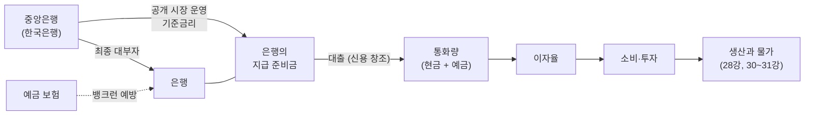

태평양 서쪽 미크로네시아의 작은 섬 **야프**에는 독특한 돈이 있다. '라이(rai)'라고 불리는 돌로 만든 바퀴 모양의 돈이다. 가운데 구멍이 뚫린 이 돌 가운데 큰 것은 지름이 3미터를 넘고 무게가 몇 톤에 이른다. 야프 사람들은 이 돌을 400킬로미터 넘게 떨어진 팔라우에서 캐어 와 카누와 뗏목에 싣고 바다를 건너 날랐다.

라이는 너무 무거워 거의 옮기지 않는다. 주인이 바뀌어도 돌은 원래 있던 자리에 그대로 서 있고, 마을 사람들이 '이 돌은 이제 누구의 것'이라고 기억할 뿐이다. 1910년 이 섬을 찾은 미국의 인류학자 윌리엄 퍼니스는 놀라운 이야기를 전했다. 오래전 한 가족의 조상이 팔라우에서 큰 돌을 싣고 오다가 폭풍을 만나 돌이 바다 밑으로 가라앉았다. 아무도 그 돌을 다시 본 적이 없었다. 그런데도 섬사람들은 그 돌이 여전히 그 가족의 재산이라고 인정했고, 그 가족은 바다 밑의 돌로 물건을 살 수 있었다.

미국의 경제학자 밀턴 프리드먼은 이 이야기를 소개하며, 야프 섬의 돌 돈이 우리의 돈과 그리 다르지 않다고 말했다. 오늘날 우리가 가진 돈의 대부분은 은행 컴퓨터 속의 숫자일 뿐이다. 우리가 그 숫자로 물건을 살 수 있는 것은, 모두가 그것을 돈으로 받아들이기 때문이다. 이 강의부터 거시 경제의 또 다른 주인공인 **돈**을 다룬다. 돈이란 무엇이고, 은행은 어떻게 돈을 만들며, 중앙은행은 돈의 양을 어떻게 조절하는지 살펴본다.

> [!핵심] 이 강의의 질문
> 1. 돈이란 무엇이며, 어떤 역할을 하는가?
> 2. 은행은 어떻게 돈을 만들어 내는가?
> 3. 중앙은행은 어떤 도구로 돈의 양과 이자율을 조절하는가?

```figure
src: asset:df0cee0d7fe86dc1736949515a46f492
caption: 1776년 미국 대륙 회의가 발행한 '대륙 지폐'를 자르기 전의 인쇄 전지. 종이에 찍은 숫자가 돈이 되려면, 사람들이 그 종이를 돈으로 받아들여야 한다.
credit: 홀 & 셀러스 인쇄, 필라델피아 1776년 · 메트로폴리탄 미술관 소장
license: Public Domain (메트로폴리탄 미술관: CC0)
source: https://www.metmuseum.org/art/collection/search/733828
```

## 돈이란 무엇인가

### 돈의 세 가지 역할

경제학에서 **돈**(화폐)이란 사람들이 물건과 서비스를 살 때 늘 받아들이는 자산을 말한다. 일상에서 "그 사람은 돈이 많다"고 할 때의 돈은 재산 전체를 뜻하지만, 경제학의 돈은 그 가운데 거래에 바로 쓸 수 있는 자산만을 가리킨다. 돈은 세 가지 역할을 한다.

| 역할 | 뜻 | 예 |
|---|---|---|
| **교환의 매개** | 물건과 서비스를 살 때 건네는 것 | 빵을 사며 1만 원을 낸다 |
| **가치의 척도** | 값을 매기고 빚을 기록하는 단위 | 빵 한 개 3,000원, 자동차 한 대 3,000만 원 |
| **가치의 저장** | 오늘의 구매력을 미래로 옮기는 수단 | 월급을 받아 다음 달에 쓴다 |

표: 돈의 세 가지 역할

돈이 없다면 사람들은 물건과 물건을 직접 바꾸는 **물물 교환**을 해야 한다. 물물 교환이 이루어지려면 내가 원하는 것을 상대가 가지고 있고, 동시에 상대가 원하는 것을 내가 가지고 있어야 한다. 이것을 **욕구의 이중 일치**라고 한다. 빵을 원하는 구두장이는 마침 구두가 필요한 빵 장수를 찾아야 한다. 돈은 이런 번거로움을 없애 준다. 구두장이는 구두를 아무에게나 팔고 받은 돈으로 아무 빵 가게에서 빵을 사면 된다. 돈 덕분에 3강에서 본 분업과 전문화가 가능해진다.

돈은 가치 저장 수단으로서는 완벽하지 않다. 주식이나 채권, 부동산도 가치를 저장한다. 그러나 돈은 다른 자산보다 **유동성**이 높다. 유동성이란 어떤 자산을 얼마나 쉽고 빠르게, 손해 없이 거래에 쓸 수 있는 형태로 바꿀 수 있는지를 말한다. 돈은 그 자체가 거래 수단이므로 유동성이 가장 높다. 집이나 그림은 팔려면 시간이 걸리고 급하게 팔면 손해를 본다. 다만 물가가 오르면 돈의 가치는 떨어진다. 그래서 사람들은 필요한 만큼만 돈으로 갖고 나머지는 다른 자산으로 갖는다.

### 상품 화폐와 명목 화폐

역사 속에서 돈은 여러 모습이었다. 조개껍데기, 소금, 쌀과 베, 소, 담배, 그리고 금과 은. 이처럼 그 자체로도 가치가 있는 물건이 돈으로 쓰이는 것을 **상품 화폐**라고 한다. 금이 돈으로 쓰일 때 경제는 **금본위 제도**를 따른다고 한다. 금본위 제도에서는 지폐를 은행이나 정부에 가져가면 정해진 양의 금으로 바꿔 주었다.

> [!사료] 포로수용소의 담배 돈
> 제2차 세계대전 중 독일의 포로수용소에 갇혔던 영국의 경제학자 리처드 래드퍼드는 1945년 수용소의 경제를 기록한 논문을 썼다. 포로들은 적십자에서 보내 준 꾸러미의 통조림, 초콜릿, 설탕, 담배를 서로 바꾸었다. 곧 **담배**가 돈이 되었다. 모든 물건의 값이 담배 몇 개비로 매겨졌고, 담배를 피우지 않는 사람도 담배를 받았다. 담배는 고르고, 쉽게 나눌 수 있고, 잘 상하지 않으며, 누구나 그 가치를 알았기 때문이다. 적십자 꾸러미가 끊겨 담배가 모자라면 모든 물건의 값이 떨어지고, 꾸러미가 한꺼번에 들어오면 값이 올랐다. 돈의 양이 물가를 움직인 것이다(28강).

오늘날의 돈은 그 자체로는 거의 가치가 없다. 만 원짜리 지폐를 만드는 데 드는 비용은 몇십 원에 불과하다. 그런데도 우리가 지폐를 받는 것은 정부가 그것을 돈으로 정했고(법정 통화), 다른 사람들도 그것을 받을 것이라고 믿기 때문이다. 이처럼 정부의 명령으로 돈이 된 화폐를 **명목 화폐**(불환 화폐)라고 한다. 세계의 돈은 1971년 미국이 달러를 금으로 바꿔 주는 것을 멈추면서(29강) 완전히 명목 화폐의 시대로 들어섰다.

명목 화폐의 가치는 결국 **믿음**에 달려 있다. 정부가 돈을 너무 많이 찍어 믿음이 무너지면, 사람들은 그 돈을 받지 않으려 하고 돈의 가치는 폭락한다(28강). 야프 섬의 바다 밑 돌이 돈으로 쓰일 수 있었던 것도 섬사람들이 서로를 믿었기 때문이다.

```timeline
기원전 7세기 | 리디아, 세계 최초의 주화 | 금과 은의 합금인 호박금으로 만듦
996 | 고려, 건원중보 발행 | 한국 최초의 금속 화폐로 알려짐
1024 | 송나라, 정부가 교자 발행 | 세계 최초의 정부 지폐
1661 | 스웨덴 스톡홀름 은행, 지폐 발행 | 유럽 최초의 은행권
1678 | 조선, 상평통보 유통 | 전국에 널리 쓰인 동전
1694 | 영국은행 설립 | 근대 중앙은행의 모델
1913 | 미국, 연방준비제도 설립 | 
1950 | 한국은행 설립 | 6월 12일
1971 | 미국, 달러의 금 교환 정지 | 명목 화폐 시대
2009 | 비트코인 등장 | 중앙은행 없는 디지털 화폐 실험
```

```gallery
src: asset:49bb5f27d864feb3da451c64e98df976
caption: 1777년 발행된 대륙 지폐 2달러. '스페인 은화 2달러'를 받을 권리를 약속했지만, 독립 전쟁의 전비를 대려고 너무 많이 찍은 탓에 가치가 폭락했다. '대륙 지폐만큼도 값어치가 없다'는 말이 생길 정도였다.
credit: 홀 & 셀러스 인쇄, 1777년 · 메트로폴리탄 미술관 소장
license: Public Domain (메트로폴리탄 미술관: CC0)
source: https://www.metmuseum.org/art/collection/search/732318
---
src: asset:46d81b89fc59e78cdf300f473c6ac290
caption: 1861년 미국 남부 연합이 발행한 5달러 지폐. 남북 전쟁 동안 남부 정부가 지폐를 마구 찍자 남부의 물가는 수십 배로 뛰었고, 전쟁에서 지자 이 돈은 휴지 조각이 되었다(28강).
credit: 에번스 & 코그스웰 석판 인쇄, 1861년 · 미국 의회도서관 소장
license: Public Domain (미국 의회도서관: 출판 제한 없음)
source: https://www.loc.gov/item/2023638883/
---
src: asset:c6fc35d62a2d68cb0acd72b52a176761
caption: 1828~1831년 무렵 뉴욕 그리니치 은행의 1,000달러 은행권 견본(애셔 B. 듀랜드 판각). 19세기 미국에서는 수많은 민간 은행이 저마다 은행권을 발행했다. 미국에 중앙은행이 없던 시절의 모습이다.
credit: 애셔 브라운 듀랜드, 1828~1831년 · 메트로폴리탄 미술관 소장
license: Public Domain (메트로폴리탄 미술관: CC0)
source: https://www.metmuseum.org/art/collection/search/369614
```

### 돈의 양을 재기

경제에는 돈이 얼마나 있을까? 지갑 속의 현금은 분명히 돈이다. 그런데 은행의 요구불 예금(언제든 찾을 수 있는 보통 예금)도 체크카드나 계좌 이체로 바로 쓸 수 있으므로 현금과 다를 바 없다. 그래서 돈의 양, 곧 **통화량**을 잴 때는 현금과 함께 예금을 넣는다. 어디까지를 돈으로 볼지에 따라 여러 지표가 있다.

| 지표 | 포함하는 것 | 특징 |
|---|---|---|
| **M1** (협의 통화) | 현금 + 요구불 예금 + 수시 입출식 저축성 예금 | 바로 쓸 수 있는 돈 |
| **M2** (광의 통화) | M1 + 정기 예금·적금, 시장형 금융 상품, 실적 배당형 상품 등 (만기 2년 미만) | 조금만 노력하면 쓸 수 있는 돈까지 |

표: 한국은행의 통화 지표

한국의 M2는 2024년 말 4,000조 원을 넘었다. 이 가운데 지폐와 동전 같은 현금은 일부에 불과하고, 대부분은 은행 계좌 속의 숫자다. 신용카드는 돈이 아니다. 신용카드로 결제하는 것은 카드 회사에서 잠시 돈을 빌리는 것이고, 나중에 예금에서 그 빚을 갚는다.

## 은행과 돈의 창조

### 100% 지급 준비

예금이 돈이라면, 예금을 받는 은행은 돈의 양에 어떤 영향을 줄까? 먼저 은행이 받은 예금을 모두 금고에 보관만 하는 경우를 생각해 보자. 은행이 금고에 보관하는 돈을 **지급 준비금**이라고 하는데, 이 경우 지급 준비금은 예금의 100%다. 사람들이 현금 100만 원을 은행에 맡기면 현금 100만 원이 예금 100만 원으로 바뀔 뿐, 돈의 양은 그대로다.

```figure
src: asset:943b5b6a2740e5830b10e2d2a333a085
caption: 1611년 암스테르담 담 광장. 왼쪽의 옛 시청 건물에 1609년 세운 암스테르담 환은행(비셀방크)이 있었다. 이 은행은 맡은 금화와 은화를 원칙적으로 모두 금고에 보관하는, 100% 지급 준비에 가까운 은행이었다.
credit: 클라스 얀스 피셔르 2세, 1611년 · 암스테르담 국립미술관 소장
license: Public Domain (레이크스 미술관: CC0)
source: https://id.rijksmuseum.nl/200428017
width: wide
```

### 부분 지급 준비 제도와 신용 창조

실제 은행은 예금의 일부만 지급 준비금으로 남기고 나머지는 빌려준다. 모든 예금자가 한꺼번에 돈을 찾으러 오지는 않기 때문이다. 이것을 **부분 지급 준비 제도**라고 하며, 예금 가운데 지급 준비금으로 남기는 비율을 **지급 준비율**이라고 한다.

지급 준비율이 10%라고 하자. A 은행이 예금 100만 원을 받으면 10만 원은 남기고 90만 원을 빌려준다. 돈을 빌린 사람은 그 돈으로 물건을 사고, 물건을 판 사람은 받은 90만 원을 B 은행에 예금한다. 이제 예금은 모두 190만 원이 되었다. B 은행은 이 가운데 9만 원을 남기고 81만 원을 빌려주고, 이 돈은 다시 C 은행에 예금된다. 이렇게 은행이 대출을 통해 돈을 늘리는 과정을 **신용 창조**라고 한다.

| 은행 | 새 예금 | 지급 준비금 (10%) | 대출 |
|---|---|---|---|
| A 은행 | 100만 원 | 10만 원 | 90만 원 |
| B 은행 | 90만 원 | 9만 원 | 81만 원 |
| C 은행 | 81만 원 | 8.1만 원 | 72.9만 원 |
| … | … | … | … |
| 합계 | **1,000만 원** | 100만 원 | 900만 원 |

표: 신용 창조 (지급 준비율 10%)

처음 100만 원의 지급 준비금이 결국 1,000만 원의 예금을 만들어 낸다. 지급 준비금 1원이 만들어 내는 돈의 양을 **통화 승수**라고 하며, 단순한 모형에서는 지급 준비율의 역수(1 ÷ 지급 준비율)와 같다. 지급 준비율이 10%면 통화 승수는 10, 지급 준비율이 5%면 20이다. 은행은 부를 새로 만드는 것이 아니라 돈을 만드는 것이다. 예금자는 예금이라는 자산을, 대출받은 사람은 그만큼의 빚을 갖게 된다.

현실의 통화 승수는 이 단순한 계산보다 훨씬 작다. 사람들이 돈의 일부를 현금으로 들고 있고, 은행도 법이 정한 것보다 지급 준비금을 더 남기며, 대출을 원하는 사람이 늘 충분하지는 않기 때문이다.

### 은행 자본과 레버리지

현실의 은행은 예금만으로 돈을 빌려주지 않는다. 주주가 낸 **은행 자본**도 있다. 자기 자본보다 훨씬 큰 돈을 빌려 투자하는 것을 **레버리지**라고 하는데, 은행은 대표적으로 레버리지가 높은 기업이다. 자산이 1,000억 원이고 자본이 50억 원인 은행의 레버리지 비율은 20이다. 이 은행의 자산 가치가 5%만 떨어져도 자본이 모두 사라진다. 그래서 각국의 금융 당국은 은행이 일정 비율 이상의 자본을 갖도록 요구한다(**자본 요건**). 2008년 세계 금융위기에서 높은 레버리지가 얼마나 위험한지 드러났다(33강).

### 뱅크런

부분 지급 준비 제도의 약점은 **뱅크런**(예금 인출 사태)이다. 은행이 위험하다는 소문이 돌면 예금자들은 돈을 먼저 찾으려고 몰려든다. 은행은 예금의 일부만 가지고 있으므로 모든 예금자에게 돈을 돌려줄 수 없다. 늦게 온 사람이 돈을 못 받을까 두려워 모두가 몰려들면, 멀쩡하던 은행도 쓰러질 수 있다. 16강의 죄수의 딜레마와 비슷하다. 모두가 기다리면 은행은 무사하지만, 각자에게는 먼저 찾는 것이 최선이다.

1930~1933년 미국에서는 뱅크런이 꼬리를 물어 약 9,000개의 은행이 문을 닫았다. 은행이 무너지자 예금이 사라지고 대출이 끊겨 통화량이 3분의 1가량 줄었고, 이것이 대공황을 깊게 만들었다(33강). 2023년 3월에는 미국의 실리콘밸리 은행에서 단 하루 동안 약 420억 달러의 예금이 빠져나갔다. 스마트폰으로 순식간에 돈을 옮길 수 있는 시대의 뱅크런이었다.

뱅크런을 막기 위해 각국은 **예금 보험**을 운영한다. 은행이 망해도 일정 금액까지는 예금 보험 기관이 예금을 돌려준다. 예금자가 돈을 잃을 걱정이 없으면 뱅크런을 할 이유도 없다. 한국은 예금보험공사가 은행마다 1인당 원금과 이자를 합쳐 5,000만 원까지 보호해 왔고, 2025년 9월부터 그 한도를 1억 원으로 올렸다. 다만 예금 보험은 은행이 위험한 투자를 해도 예금자가 신경 쓰지 않게 만든다는 점에서 도덕적 해이를 낳을 수 있다(20강).

```gallery
src: asset:ddf023df570c7451649e472fd1b028cd
caption: 1873년 공황 때 뉴욕 나소 거리의 제4 국민은행으로 몰려든 예금자들. 철도 회사에 돈을 빌려준 은행이 무너지자 공황이 번졌다.
credit: 『프랭크 레슬리스 일러스트레이티드 뉴스페이퍼』 1873년 10월 4일 · 미국 의회도서관 소장
license: Public Domain (미국 의회도서관: 출판 제한 없음)
source: https://www.loc.gov/item/2002723398/
---
src: asset:9b8ac485ad468e0e2a25978cbdbe5255
caption: 1914년 제1차 세계대전이 터진 직후 미국의 저먼 아메리칸 은행 앞에 늘어선 예금자들. 불안이 퍼지면 멀쩡한 은행에도 뱅크런이 일어날 수 있다.
credit: 베인 뉴스 서비스, 1914년 · 미국 의회도서관 소장
license: Public Domain (미국 의회도서관: 출판 제한 없음)
source: https://www.loc.gov/item/2014696885/
```

## 중앙은행

### 중앙은행이 하는 일

**중앙은행**은 한 나라의 통화 제도를 관리하는 기관이다. 한국의 중앙은행은 1950년 6월 12일 세운 **한국은행**이고, 미국은 **연방준비제도**(연준), 유로를 쓰는 나라들은 **유럽중앙은행**이다. 중앙은행은 크게 세 가지 일을 한다.

1. **화폐 발행**: 지폐와 동전을 발행한다. 한국의 지폐 앞면에 '한국은행'이라고 쓰여 있는 것은 이 때문이다.
2. **은행의 은행**: 은행들의 예금을 받고, 은행에 돈을 빌려준다. 금융 위기 때 다른 곳에서 돈을 구할 수 없는 은행에 돈을 빌려주는 **최종 대부자**의 역할을 한다.
3. **통화 정책**: 통화량과 이자율을 조절해 물가를 안정시키고 경제를 안정시킨다. 한국은행법은 한국은행의 첫째 목적을 '물가 안정'으로 정하고 있다.

한국은행의 통화 정책은 총재를 포함한 7명으로 이루어진 **금융통화위원회**가 결정한다. 금융통화위원회는 1년에 여덟 번 회의를 열어 **기준금리**를 정한다. 중앙은행이 정부로부터 독립되어 있어야 한다는 생각이 널리 받아들여지는 것은, 선거를 앞둔 정치인들이 경기를 띄우려고 돈을 너무 많이 풀도록 압력을 넣을 수 있기 때문이다(28강).

### 통화 정책의 도구

중앙은행은 직접 돈을 찍어 사람들에게 나누어 주지 않는다. 대신 은행들의 지급 준비금을 늘리거나 줄여 통화량과 이자율에 영향을 준다.

| 도구 | 방법 | 통화량을 늘리려면 |
|---|---|---|
| **공개 시장 운영** | 중앙은행이 시장에서 국채 같은 증권을 사고판다 | 증권을 사들이고 그 대금을 은행에 지급한다 |
| **중앙은행 대출** | 은행에 돈을 빌려준다 | 대출 금리를 낮추고 대출을 늘린다 |
| **지급 준비율** | 은행이 의무적으로 남겨야 하는 비율을 정한다 | 지급 준비율을 낮춘다 |
| **지급 준비금 이자** | 은행이 중앙은행에 맡긴 지급 준비금에 이자를 준다 | 이자율을 낮춘다 |

표: 중앙은행의 통화 정책 도구

가장 자주 쓰는 도구는 **공개 시장 운영**이다. 한국은행은 통화안정증권을 발행하거나 환매 조건부 증권(RP)을 사고팔아 시장의 돈의 양을 조절한다. 한국은행이 증권을 사들이면 그 대금이 은행으로 흘러 들어가 지급 준비금이 늘고, 은행은 대출을 늘린다. 반대로 증권을 팔면 시장의 돈이 한국은행으로 빨려 들어가 통화량이 줄어든다.

### 기준금리

오늘날 대부분의 중앙은행은 통화량을 직접 목표로 삼지 않고, 단기 **이자율**을 목표로 정한다. 한국은행의 기준금리는 한국은행이 은행들과 7일짜리 환매 조건부 증권(RP)을 거래할 때 적용하는 금리다. 한국은행은 공개 시장 운영으로 시장의 단기 금리가 기준금리 근처에 머물도록 한다. 기준금리가 바뀌면 은행 사이의 금리, 예금과 대출 금리, 채권 금리가 차례로 움직이고, 결국 소비와 투자, 물가가 영향을 받는다. 기준금리를 내리는 것은 통화량을 늘리는 것과 같은 방향의 정책이다(31강).

```chart
{
  "type": "line",
  "caption": "한국은행 기준금리 (%, 2008~2024년, 해마다 연말 기준, 한국은행 자료). 2008년 세계 금융위기 때 5.25%에서 2.00%로 크게 내렸고, 코로나19 위기 때인 2020년 5월에는 사상 최저인 0.50%까지 내렸다. 물가가 뛰자 2021년 8월부터 올리기 시작해 2023년 1월 3.50%에 이르렀고, 2024년 10월부터 다시 내리기 시작했다",
  "data": {
    "labels": ["2008","2009","2010","2011","2012","2013","2014","2015","2016","2017","2018","2019","2020","2021","2022","2023","2024"],
    "datasets": [{ "label": "기준금리(%)", "stepped": true, "data": [3.0, 2.0, 2.5, 3.25, 2.75, 2.5, 2.0, 1.5, 1.25, 1.5, 1.75, 1.25, 0.5, 1.0, 3.25, 3.5, 3.0] }]
  },
  "options": { "scales": { "y": { "min": 0 } }, "plugins": { "legend": { "display": false } } }
}
```

```figure
src: asset:a7747f72808f555949c0abdb0c427922
caption: 1808년 영국은행의 그레이트 홀. 1694년 정부에 돈을 빌려주려고 세운 영국은행은 점차 은행들의 은행, 최종 대부자의 역할을 맡으며 근대 중앙은행의 모델이 되었다.
credit: 토머스 롤런드슨·오거스터스 퓨진, 『런던의 축소판』 1808년 · 메트로폴리탄 미술관 소장
license: Public Domain (메트로폴리탄 미술관: CC0)
source: https://www.metmuseum.org/art/collection/search/392948
```



## 정리

> [!핵심] 27강 요약
> - **돈**은 거래에 늘 받아들여지는 자산으로, **교환의 매개**, **가치의 척도**, **가치의 저장** 역할을 한다. 돈은 **욕구의 이중 일치** 문제를 없애고, **유동성**이 가장 높은 자산이다.
> - 그 자체로 가치가 있는 **상품 화폐**(금, 담배)와 정부의 명령과 믿음으로 가치를 갖는 **명목 화폐**가 있다.
> - 통화량은 현금과 예금을 합쳐 잰다(**M1**, **M2**). 신용카드는 돈이 아니다.
> - **부분 지급 준비 제도**에서 은행은 대출을 통해 돈을 만든다(**신용 창조**). **통화 승수**는 단순한 모형에서 지급 준비율의 역수다. 은행은 **레버리지**가 높고 **뱅크런**에 약하므로 **자본 요건**과 **예금 보험**이 있다.
> - **중앙은행**은 화폐를 발행하고, 은행의 은행이자 **최종 대부자**이며, **공개 시장 운영** 등으로 통화량과 **기준금리**를 조절한다.

### 생각해 볼 질문

1. 2009년 등장한 비트코인은 돈의 세 가지 역할을 얼마나 잘하고 있을까? 값이 하루에도 크게 오르내린다는 점을 생각해 보자.
2. 지급 준비율이 5%에서 10%로 오르면 통화 승수와 통화량은 어떻게 될까?
3. 예금 보험의 한도를 무한으로 하면 어떤 장점과 단점이 있을까?

### 다음 강 예고

28강 「화폐 증가와 인플레이션」에서는 돈의 양과 물가의 관계를 다룬다. 돈을 많이 찍으면 왜 물가가 오르는지(화폐 수량설), 1923년 독일과 2000년대 짐바브웨는 왜 하이퍼인플레이션을 겪었는지, 그리고 인플레이션은 사회에 어떤 비용을 주는지 살펴본다.
