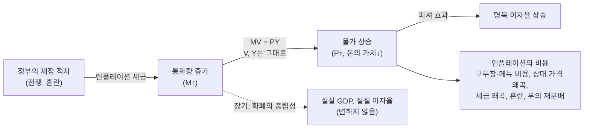

1923년 가을, 독일 베를린의 노동자들은 하루에 두 번 임금을 받았다. 점심때 받은 돈을 아내에게 건네면 아내는 곧장 가게로 달려갔다. 저녁이 되면 같은 돈으로 살 수 있는 빵이 줄어들기 때문이었다. 카페에서 커피 두 잔을 주문하고 나서 한 잔을 다 마시고 나면 다음 잔의 값이 올라 있었다는 이야기도 전한다. 1923년 1월 250마르크 정도이던 빵 한 덩이의 값은 11월에 2,000억 마르크에 이르렀다. 사람들은 손수레와 빨래 바구니에 지폐 다발을 싣고 장을 보러 갔고, 아이들은 지폐 다발로 블록 쌓기를 했으며, 땔감보다 지폐가 싸서 지폐를 난로에 태우기도 했다.

물가가 이렇게 미친 듯이 오르는 것을 **하이퍼인플레이션**(초인플레이션)이라고 한다. 독일 정부는 왜 이런 일을 막지 못했을까? 답은 간단하다. 정부가 쓸 돈을 마련하려고 중앙은행에서 돈을 끝없이 찍어 냈기 때문이다. 1923년 독일 중앙은행은 130곳이 넘는 인쇄소의 인쇄기 1,700여 대를 밤낮없이 돌려 지폐를 찍었다.

22강에서 물가를 재는 법을, 27강에서 돈이 무엇인지를 배웠다. 이 강의에서는 둘을 잇는다. 돈의 양과 물가는 어떤 관계가 있는가? 왜 어떤 나라는 물가가 안정되고 어떤 나라는 물가가 폭등하는가? 그리고 인플레이션은 사회에 어떤 비용을 주는가?

> [!핵심] 이 강의의 질문
> 1. 돈의 양이 늘면 왜 물가가 오르는가?
> 2. 정부는 왜 돈을 지나치게 찍어 내는가?
> 3. 인플레이션은 사회에 어떤 비용을 주는가?

{{F:e28-opening}}

## 고전적 인플레이션 이론

### 물가가 오르면 돈의 가치는 떨어진다

물가가 오른다는 것은 무엇을 뜻할까? 빵의 값이 1,000원에서 2,000원으로 올랐다면, 빵이 더 귀해졌다고 볼 수도 있지만, 돈의 가치가 떨어졌다고 볼 수도 있다. 같은 1,000원으로 예전에는 빵 한 개를 샀지만 이제 반 개밖에 못 산다. 모든 물건의 값이 함께 오르는 인플레이션은 무엇보다 **돈의 가치가 떨어지는 현상**이다. 물가 수준을 P라고 하면, 돈의 가치(돈 1원으로 살 수 있는 물건의 양)는 1/P이다.

그렇다면 돈의 가치는 무엇이 결정할까? 다른 모든 것의 값처럼 **수요와 공급**이다.

### 돈의 공급과 수요

**돈의 공급**은 중앙은행이 정한다(27강). 단순하게 생각하면 돈의 공급량은 돈의 가치와 관계없이 중앙은행이 정한 양으로 고정되어 있다. 그래프에서는 수직선이다.

**돈의 수요**는 사람들이 재산 가운데 얼마를 현금이나 바로 쓸 수 있는 예금으로 갖고 싶어 하는가이다. 사람들은 물건을 사기 위해 돈을 갖고 있으므로, 물가가 높을수록(돈의 가치가 낮을수록) 같은 물건을 사는 데 더 많은 돈이 필요하다. 그래서 돈의 수요량은 돈의 가치가 낮을수록 많아진다.

```chart
{
  "type": "scatter",
  "caption": "돈의 공급과 수요, 그리고 통화량 증가의 효과. 가로축은 돈의 양, 세로축은 돈의 가치(1/P)다. 처음에는 돈의 공급(MS1 = 100)과 수요가 만나는 A점에서 돈의 가치가 1/2(물가 2)로 정해진다. 중앙은행이 돈의 공급을 200으로 늘리면 균형이 B점으로 옮겨 가 돈의 가치는 1/4로 떨어지고, 물가는 4로 두 배가 된다",
  "data": {
    "datasets": [
      { "label": "돈의 수요", "showLine": true, "pointRadius": 0, "data": [{"x":50,"y":1},{"x":66.7,"y":0.75},{"x":100,"y":0.5},{"x":133.3,"y":0.375},{"x":200,"y":0.25},{"x":250,"y":0.2}] },
      { "label": "돈의 공급 MS1", "showLine": true, "pointRadius": 0, "data": [{"x":100,"y":0},{"x":100,"y":1.1}] },
      { "label": "돈의 공급 MS2", "showLine": true, "pointRadius": 0, "borderDash": [6,4], "data": [{"x":200,"y":0},{"x":200,"y":1.1}] },
      { "label": "A (돈의 가치 1/2, 물가 2)", "pointRadius": 7, "data": [{"x":100,"y":0.5}] },
      { "label": "B (돈의 가치 1/4, 물가 4)", "pointRadius": 7, "pointStyle": "rectRot", "data": [{"x":200,"y":0.25}] }
    ]
  },
  "options": { "scales": { "x": { "title": { "display": true, "text": "돈의 양" }, "min": 0, "max": 260 }, "y": { "title": { "display": true, "text": "돈의 가치 (1/P)" }, "min": 0, "max": 1.1 } } }
}
```

중앙은행이 돈을 두 배로 늘렸다고 하자. 돈의 공급이 늘면 사람들은 원하는 것보다 많은 돈을 갖게 된다. 남는 돈으로 물건을 사거나 채권을 사거나 남에게 빌려준다. 그런데 경제가 만들 수 있는 물건의 양은 그대로이므로, 물건에 대한 수요가 늘어 값이 오른다. 물가가 올라 사람들이 원하는 돈의 양이 새 공급량과 같아질 때 비로소 경제는 새 균형에 이른다. 결국 돈의 양이 늘면 돈의 가치는 떨어지고 물가는 오른다. 이것이 **화폐 수량설**의 핵심이다.

### 고전적 이분법과 화폐의 중립성

18세기 영국의 철학자 **데이비드 흄**은 돈의 양이 바뀌면 물가 같은 '명목' 변수는 바뀌지만, 생산량이나 실질 임금, 실질 이자율 같은 '실질' 변수는 바뀌지 않는다고 보았다. 경제의 변수를 명목 변수와 실질 변수로 나누는 이런 생각을 **고전적 이분법**이라고 하고, 돈의 양이 실질 변수에 영향을 주지 않는다는 생각을 **화폐의 중립성**이라고 한다.

비유하자면 돈은 경제의 '눈금'이다. 1미터를 100센티미터로 재든 1,000밀리미터로 재든 물건의 실제 길이는 같다. 돈의 양을 두 배로 늘리면 모든 값과 임금이 두 배가 될 뿐, 사람들이 실제로 만들고 쓰는 물건의 양은 그대로다. 대부분의 경제학자는 **장기적으로는** 화폐의 중립성이 대체로 맞다고 본다. 그러나 1~2년의 **단기**에는 돈의 양이 생산과 고용에 큰 영향을 준다(30~32강).

### 화폐 수량 방정식

**화폐의 유통 속도**(V)는 돈 1원이 1년 동안 몇 번 주인을 바꾸며 거래에 쓰이는지를 말한다. 1년 동안 경제에서 거래된 물건의 총액, 곧 명목 GDP(P × Y)를 돈의 양(M)으로 나누면 유통 속도가 나온다. 이것을 바꿔 쓰면 다음 식이 된다.

**M × V = P × Y** (돈의 양 × 유통 속도 = 물가 × 실질 GDP)

이 식을 **화폐 수량 방정식**이라고 한다. 이 식 자체는 정의일 뿐이지만, 몇 가지 사실과 합치면 강력한 이론이 된다.

1. 유통 속도(V)는 오랜 기간 비교적 안정적이다.
2. 실질 GDP(Y)는 노동, 자본, 기술 같은 실물 요인이 결정하며(23강), 돈의 양과 관계없다.
3. 그러므로 중앙은행이 돈의 양(M)을 늘리면, 그 변화는 대부분 물가(P)의 변화로 나타난다.
4. 따라서 돈의 양이 빠르게 늘면 인플레이션이 생긴다.

미국의 경제학자 밀턴 프리드먼은 이를 "인플레이션은 언제 어디서나 화폐적 현상"이라는 말로 요약했다. 실제로 여러 나라의 장기 자료를 보면, 통화량이 빠르게 늘어난 나라일수록 물가 상승률도 높다.

> [!더알아보기] 16세기의 가격 혁명
> 화폐 수량설은 근대 경제학보다 오래되었다. 16세기 스페인이 아메리카 대륙의 포토시 은광 등에서 엄청난 양의 은을 들여오자, 은이 유럽 전체로 퍼져 나가며 물가가 100여 년 동안 서너 배로 올랐다. 이것을 **가격 혁명**이라고 한다. 1568년 프랑스의 사상가 장 보댕은 물가가 오른 주된 이유가 금과 은의 유입이라고 지적했다. 귀금속이 '돈의 양'이었던 시절의 화폐 수량설이다.

{{F:e28-history}}

## 인플레이션 세금과 하이퍼인플레이션

### 정부는 왜 돈을 찍어 내나

물가가 크게 오르는 것이 나쁘다는 것을 알면서도 정부는 왜 돈을 지나치게 찍어 낼까? 정부가 쓸 돈을 마련하는 방법은 세금을 걷거나(11강), 돈을 빌리거나(24강), 돈을 찍는 것이다. 세금을 올리기 어렵고 돈을 빌려주는 사람도 없을 때, 정부는 돈을 찍는 쉬운 길을 택한다.

정부가 돈을 찍어 쓰면 물가가 오르고, 사람들이 가진 돈의 가치가 떨어진다. 사람들은 세금을 낸 적이 없지만, 결과적으로 돈을 가진 모든 사람에게서 정부로 구매력이 옮겨 간다. 그래서 이것을 **인플레이션 세금**이라고 한다.

전쟁과 혁명, 정치적 혼란으로 정부의 지출이 세금보다 훨씬 많아질 때 하이퍼인플레이션이 일어나곤 했다. 제1차 세계대전에서 진 독일은 막대한 배상금을 물어야 했다. 1923년 프랑스와 벨기에가 배상금을 받아 내려고 독일의 공업 지대 루르를 점령하자, 독일 정부는 파업하는 노동자들의 임금까지 돈을 찍어 주었다. 그 결과가 처음에 본 하이퍼인플레이션이다.

```chart
{
  "type": "line",
  "caption": "미국 1달러로 바꿀 수 있는 독일 마르크 (마르크, 로그 눈금, 1914~1923년, 대략적인 수치). 세로축의 한 칸은 10배를 뜻한다. 1914년 4.2마르크이던 1달러는 1923년 11월 4조 2,000억 마르크가 되었다",
  "data": {
    "labels": ["1914.7", "1919.1", "1920.1", "1921.1", "1922.1", "1922.7", "1923.1", "1923.7", "1923.8", "1923.9", "1923.10", "1923.11"],
    "datasets": [{ "label": "1달러 = ? 마르크", "data": [4.2, 8.9, 64.8, 64.9, 191.8, 493.2, 17972, 353412, 4620455, 98860000, 25260208000, 4200000000000] }]
  },
  "options": { "scales": { "y": { "type": "logarithmic" } }, "plugins": { "legend": { "display": false } } }
}
```

1923년 11월 독일은 1조 마르크를 새 돈 1렌텐마르크로 바꾸는 화폐 개혁을 하고, 새 돈의 발행량을 엄격히 제한했다. 정부가 돈 찍기를 멈추자 하이퍼인플레이션은 몇 주 만에 끝났다. 하이퍼인플레이션은 언제나 돈을 지나치게 찍어서 시작되고, 돈 찍기를 멈춰야 끝난다.

| 나라 | 시기 | 가장 심할 때의 물가 상승 |
|---|---|---|
| 독일 | 1922~1923 | 1923년 10월 한 달 동안 약 300배 |
| 헝가리 | 1945~1946 | 1946년 7월 한 달 동안 약 400조 배. 물가가 15시간마다 두 배로 오름. 역사상 최악 |
| 짐바브웨 | 2007~2009 | 2008년 11월 한 달 동안 약 8억 배. 100조 짐바브웨 달러 지폐 발행 |
| 베네수엘라 | 2016~2019 | 2018년 한 해 동안 약 13만% (중앙은행 발표) |

표: 역사 속의 하이퍼인플레이션 (Hanke & Krus 2012 등을 바탕으로 한 대략적인 수치)

> [!참고] 한국의 인플레이션과 화폐 개혁
> 한국도 높은 인플레이션을 겪었다. 광복과 한국전쟁을 거치며 정부가 전비와 복구 비용을 마련하려고 돈을 대량으로 찍자 물가가 폭등했다. 정부는 1953년 2월 100원을 1환으로 바꾸는 화폐 개혁을 했고, 1962년 6월에는 10환을 1원으로 바꾸는 화폐 개혁을 다시 했다. 1970년대까지도 한국의 물가 상승률은 연 10~20%대인 해가 많았다. 1980년대 이후 정부가 물가 안정을 경제 정책의 중요한 목표로 삼고, 1998년 한국은행이 물가 안정 목표제를 도입하면서 물가 상승률은 크게 낮아졌다.

{{F:e28-hyper}}

## 피셔 효과

24강과 22강에서 **실질 이자율 = 명목 이자율 − 인플레이션율**이라는 것을 배웠다. 이것을 바꿔 쓰면 **명목 이자율 = 실질 이자율 + 인플레이션율**이다.

화폐의 중립성에 따르면, 돈의 양이 늘어 인플레이션이 높아져도 장기적으로 실질 이자율은 그대로다. 실질 이자율은 대부 자금 시장의 저축과 투자가 결정하기 때문이다(24강). 그러므로 인플레이션율이 1%포인트 오르면 명목 이자율도 1%포인트 오른다. 이처럼 명목 이자율이 인플레이션율에 맞추어 함께 움직이는 것을 미국의 경제학자 어빙 피셔의 이름을 따서 **피셔 효과**라고 한다. 물가가 연 20%씩 오르던 1970~80년대 한국의 은행 예금 금리가 연 20%를 넘었던 것도, 물가가 안정된 2010년대에 예금 금리가 1~2%대로 낮아진 것도 이 때문이다.

## 인플레이션의 비용

인플레이션은 왜 나쁠까? 흔히 사람들은 "물가가 오르면 내 월급으로 살 수 있는 것이 줄어 생활 수준이 떨어진다"고 생각한다. 그러나 이것은 오해다. 물가가 오를 때는 대개 임금도 함께 오르기 때문이다. 상품의 값이 오르면 그 상품을 판 사람의 소득도 오른다. 장기적으로 생활 수준은 물가가 아니라 생산성이 결정한다(23강). 그렇다고 인플레이션에 비용이 없는 것은 아니다. 경제학자들은 다음과 같은 비용을 꼽는다.

| 비용 | 내용 |
|---|---|
| **구두창 비용** | 인플레이션이 높으면 사람들은 현금을 적게 들고 다니려고 은행을 자주 오가야 한다. 구두창이 닳는다는 뜻에서 붙은 이름이다. 하이퍼인플레이션 때는 하루에 몇 번씩 장을 봐야 한다 |
| **메뉴 비용** | 값이 자주 바뀌면 가게는 가격표와 메뉴판을 자주 바꿔야 한다 |
| **상대 가격의 왜곡** | 가게마다 값을 바꾸는 시점이 달라, 상품 사이의 상대 가격이 뒤틀리고 시장의 자원 배분이 비효율적이 된다 |
| **세금의 왜곡** | 세금은 명목 소득에 매겨지므로, 인플레이션으로 생긴 겉보기 이익에도 세금이 붙는다. 실질 세 부담이 커져 저축이 줄어든다 |
| **혼란과 불편** | 돈이라는 '눈금'이 계속 변하면, 기업의 이윤을 계산하고 미래를 계획하기 어려워진다 |
| **예상하지 못한 부의 재분배** | 예상보다 물가가 많이 오르면 빌려준 사람은 손해를 보고 빌린 사람은 이득을 본다. 반대로 예상보다 물가가 덜 오르면 빌린 사람이 손해를 본다 |

표: 인플레이션의 비용

마지막 비용은 특히 중요하다. 인플레이션이 높은 나라에서는 물가 상승률 자체가 크게 오르내리기 때문에 미래를 예측하기 어렵다. 그래서 사람들은 돈을 오래 빌려주려 하지 않고, 장기 투자가 줄어든다.

### 디플레이션은 좋은가

물가가 내려가는 **디플레이션**은 소비자에게 좋은 일일까? 꼭 그렇지 않다. 프리드먼은 실질 이자율만큼 물가가 완만하게 내려가는 것이 좋다고 했지만(그러면 명목 이자율이 0이 되어 구두창 비용이 사라진다), 현실의 디플레이션은 대개 경기 침체와 함께 온다. 물가가 내리면 빚의 실질 부담이 커져 빌린 사람들이 소비를 줄이고, 사람들이 값이 더 내릴 때까지 소비를 미루면서 경기가 더 나빠진다. 1930년대 대공황(33강)과 1990년대 이후 일본의 장기 침체가 그런 예다. 그래서 오늘날 대부분의 중앙은행은 물가 상승률 0%가 아니라 **2%** 정도를 목표로 삼는다. 한국은행의 물가 안정 목표도 소비자 물가 상승률 2%다.

> [!사료] 『오즈의 마법사』와 은 논쟁
> 19세기 말 미국은 반대로 디플레이션에 시달렸다. 금본위 제도 아래에서 금의 양이 경제 성장을 따라가지 못해 물가가 해마다 조금씩 내렸다. 빚을 진 농민들은 농산물 값이 내려 빚 갚기가 점점 힘들어지자, 은도 돈으로 써서 돈의 양을 늘리자고 요구했다. 1896년 대통령 선거에서 은화의 자유로운 주조를 내건 민주당 후보 윌리엄 제닝스 브라이언은 "인류를 황금 십자가에 못 박지 말라"고 외쳤다. 그러나 선거에서 졌고, 이후 금광 발견과 새로운 금 정련법으로 금의 양이 늘면서 물가는 다시 올랐다. 1900년 출간된 『오즈의 마법사』를 이 논쟁의 우화로 읽는 해석이 있다. 도로시의 은 구두와 노란 벽돌 길(금)이 상징이라는 것이다. 다만 작가 프랭크 바움이 정말 그런 뜻으로 썼는지는 확실하지 않다.



## 정리

> [!핵심] 28강 요약
> - 인플레이션은 **돈의 가치가 떨어지는 현상**이다. 돈의 가치는 돈의 수요와 공급이 결정한다. 중앙은행이 돈의 공급을 늘리면 물가가 오른다(**화폐 수량설**).
> - **고전적 이분법**과 **화폐의 중립성**: 장기적으로 돈의 양은 명목 변수만 바꾸고 실질 변수는 바꾸지 않는다.
> - **화폐 수량 방정식** M × V = P × Y. 유통 속도와 실질 GDP가 안정적이면 통화량 증가는 물가 상승으로 나타난다.
> - 정부가 돈을 찍어 지출하면 **인플레이션 세금**을 걷는 셈이다. 돈을 지나치게 찍으면 **하이퍼인플레이션**이 일어난다(1923년 독일, 1946년 헝가리, 2008년 짐바브웨).
> - **피셔 효과**: 명목 이자율은 인플레이션율에 맞추어 움직인다.
> - 인플레이션의 비용에는 **구두창 비용**, **메뉴 비용**, 상대 가격의 왜곡, 세금의 왜곡, 혼란, **예상하지 못한 부의 재분배**가 있다. 디플레이션도 해롭기 때문에 중앙은행은 대개 2%의 물가 상승률을 목표로 한다.

### 생각해 볼 질문

1. 통화량이 연 10% 늘고 실질 GDP가 연 3% 성장하며 유통 속도가 변하지 않는다면, 물가 상승률은 대략 얼마일까?
2. 예상하지 못한 인플레이션이 일어나면 주택 담보 대출을 받은 사람과 은행 가운데 누가 이득을 볼까? 연금으로 사는 노인은 어떨까?
3. 하이퍼인플레이션을 겪는 나라에서 사람들이 미국 달러를 쓰려고 하는 이유는 무엇일까?

### 다음 강 예고

29강 「개방 경제」에서는 나라 밖으로 눈을 돌린다. 한 나라가 다른 나라와 물건과 돈을 주고받는 흐름을 기록하는 국제 수지, 순수출과 해외 투자의 관계, 환율이 어떻게 정해지고 무엇을 뜻하는지, 그리고 빅맥 지수로 알려진 구매력 평가 이론을 살펴본다.
