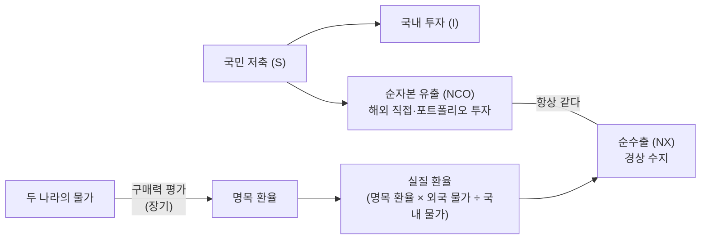

1944년 7월, 제2차 세계대전이 아직 끝나지 않았을 때 44개 연합국의 대표 700여 명이 미국 뉴햄프셔주의 산골 휴양지 **브레턴우즈**의 마운트 워싱턴 호텔에 모였다. 3주 동안 이어진 회의에서 그들은 전쟁이 끝난 뒤의 세계 경제 질서를 설계했다. 1930년대 대공황 때 나라들이 앞다투어 관세를 올리고 자기 나라 돈의 가치를 깎아 수출을 늘리려다 세계 무역이 무너졌던 일을 되풀이하지 않기 위해서였다.

회의를 이끈 사람은 영국의 경제학자 **존 메이너드 케인스**와 미국 재무부의 **해리 덱스터 화이트**였다. 그 결과 미국 달러를 금 1온스에 35달러로 고정하고, 다른 나라들의 돈은 달러에 고정하는 **브레턴우즈 체제**가 생겨났다. 국제통화기금(IMF)과 세계은행도 이때 만들어졌다. 이 체제는 1971년 미국이 달러를 금으로 바꿔 주는 것을 멈출 때까지 25년 남짓 세계 경제의 틀이 되었다.

지금까지 거시 경제를 배울 때는 대부분 한 나라 안만 보았다. 그러나 한국처럼 수출과 수입이 경제에서 큰 비중을 차지하는 나라에서는 나라 밖과의 거래를 빼고 경제를 이해할 수 없다. 이 강의에서는 한 나라가 다른 나라들과 물건과 돈을 주고받는 흐름, 그리고 서로 다른 나라의 돈을 바꾸는 비율인 **환율**을 살펴본다.

> [!핵심] 이 강의의 질문
> 1. 한 나라가 다른 나라와 주고받는 물건의 흐름과 돈의 흐름은 어떤 관계가 있는가?
> 2. 환율이란 무엇이며, 환율이 오르고 내린다는 것은 무엇을 뜻하는가?
> 3. 환율은 장기적으로 어떻게 정해지는가?

{{F:e29-opening}}

## 국제적 흐름: 물건과 돈

### 순수출

다른 나라에 판 물건과 서비스를 **수출**, 다른 나라에서 사 온 것을 **수입**이라고 한다. 수출에서 수입을 뺀 것을 **순수출**(무역 수지)이라고 한다. 21강에서 GDP의 한 부분으로 만났던 그 순수출이다. 순수출이 플러스이면 **무역 흑자**, 마이너스이면 **무역 적자**, 0이면 **무역 균형**이라고 한다.

순수출에 영향을 주는 요인은 여러 가지다.

- **소비자의 취향**: 한국 드라마와 화장품이 세계적으로 인기를 끌면 한국의 수출이 는다.
- **국내외의 물가와 환율**: 한국 상품이 외국 상품보다 상대적으로 싸지면 수출은 늘고 수입은 준다.
- **국내외의 소득**: 외국 경제가 좋아지면 한국 상품을 더 많이 산다. 한국 경제가 좋아지면 수입이 는다.
- **운송비와 무역 정책**: 컨테이너선과 항공 운송으로 운송비가 내려가고(8강), 관세가 낮아지면 무역이 는다.

한국은 대표적인 **무역 의존** 경제다. 수출과 수입을 합친 금액이 GDP의 70~90%에 이르는데, 미국(20%대)이나 일본(30~40%대)보다 훨씬 높다. 1962년 5,000만 달러를 조금 넘던 한국의 수출은 2024년 약 6,800억 달러로 1만 배 넘게 늘었고, 한국은 세계 6~8위권의 수출국이 되었다.

### 순자본 유출

물건만 나라 사이를 오가는 것이 아니다. 돈도 오간다. 한국 사람이 미국 회사의 주식을 사거나, 한국 기업이 베트남에 공장을 짓거나, 외국 은행이 한국 국채를 사는 것이 그런 예다. 한국 사람이 외국 자산을 사는 것에서 외국 사람이 한국 자산을 사는 것을 뺀 것을 **순자본 유출**(순해외 투자)이라고 한다.

해외 투자에는 두 가지가 있다. 외국에 공장이나 회사를 직접 세우거나 사들여 경영하는 것을 **해외 직접 투자**, 외국 회사의 주식이나 채권을 사기만 하는 것을 **해외 포트폴리오 투자**(간접 투자)라고 한다. 삼성전자가 미국 텍사스에 반도체 공장을 짓는 것은 직접 투자이고, 국민연금이 미국 기업 주식을 사는 것은 포트폴리오 투자다.

### 순수출 = 순자본 유출

여기에 경제학의 중요한 항등식이 있다. **순수출은 언제나 순자본 유출과 같다.**

**순수출(NX) = 순자본 유출(NCO)**

왜 그럴까? 한국의 자동차 회사가 미국에 자동차를 팔고 달러를 받았다고 하자. 한국의 순수출이 늘었다. 그런데 이 회사는 받은 달러로 무엇을 할까? 달러를 그대로 갖고 있으면 한국이 미국 자산(달러 현금)을 산 것이다. 달러를 미국 은행에 예금하거나 미국 주식을 사도 마찬가지다. 달러를 한국의 은행에 팔아 원화로 바꾸면, 그 은행이 달러라는 미국 자산을 갖게 된다. 은행이 그 달러로 미국 상품을 수입하는 사람에게 팔면, 이번에는 수입이 늘어 순수출이 원래대로 돌아간다. 어떤 경우든 국제 거래의 양쪽은 맞아떨어진다. 물건을 팔고 그만큼 상대의 자산(돈 포함)을 받는 것이다.

이 항등식은 무역 흑자국과 적자국의 모습을 잘 보여 준다. 무역 흑자를 내는 나라(한국, 중국, 독일, 일본)는 그만큼 외국 자산을 사 모으고, 무역 적자를 내는 나라(미국)는 그만큼 외국에 자산을 팔거나 빚을 진다. 한국은 2014년 무렵부터 외국에 진 빚보다 외국에 가진 자산이 더 많은 **순대외 채권국**이 되었다.

### 저축, 투자, 그리고 국제적 흐름

21강의 GDP 항등식 Y = C + I + G + NX에서 출발해 보자. 국민 저축(S)은 소득에서 소비와 정부 지출을 뺀 것(S = Y − C − G)이므로, S = I + NX이다. 그런데 NX = NCO이므로 다음 식이 된다.

**저축(S) = 국내 투자(I) + 순자본 유출(NCO)**

24강의 폐쇄 경제에서는 저축이 모두 국내 투자로 갔다. 개방 경제에서는 저축이 국내 투자와 해외 투자로 나뉜다. 저축이 국내 투자보다 많은 나라는 남는 저축을 외국에 빌려주고(무역 흑자), 저축이 국내 투자보다 적은 나라는 모자라는 만큼 외국에서 빌린다(무역 적자). 1980년대 이후 미국의 무역 적자는 미국 사람과 정부의 저축이 국내 투자보다 적었기 때문이고, 한국의 경상 수지 흑자는 한국의 저축이 국내 투자보다 많기 때문이다.

> [!참고] 무역 적자는 나쁜가
> 무역 적자는 흔히 나쁜 것으로 여겨지지만 꼭 그렇지 않다. 무역 적자가 국내 투자가 늘어서 생긴 것이라면, 외국 돈을 빌려 미래의 생산 능력을 키우는 것이므로 나쁘지 않다. 19세기의 미국과 1960~70년대의 한국은 외국에서 돈을 빌려 철도와 공장을 지었고, 그 덕분에 빠르게 성장했다. 반대로 저축이 줄어서 생긴 무역 적자는 미래 세대에 빚을 넘기는 것일 수 있다. 무역 적자 자체보다 그 원인이 무엇인지가 중요하다. 8강에서 본 것처럼 무역은 두 나라 모두에 이익이 되며, 양자 간 무역 적자는 경제적으로 큰 의미가 없다.

### 국제 수지

한 나라가 일정 기간 다른 나라와 주고받은 모든 거래를 기록한 것이 **국제 수지**다. 한국은 한국은행이 매달 발표한다.

| 항목 | 내용 | 2024년 한국 (대략) |
|---|---|---|
| **경상 수지** | 물건과 서비스의 수출입, 해외에서 번 소득, 대가 없이 주고받은 돈 | 약 990억 달러 흑자 |
| └ 상품 수지 | 물건의 수출 − 수입 | 약 1,000억 달러 흑자 |
| └ 서비스 수지 | 여행, 운송, 지식 재산권 사용료 등 | 약 240억 달러 적자 (여행 수지 적자가 큼) |
| └ 본원 소득 수지 | 해외 투자에서 받은 배당·이자, 해외 근로 소득 | 흑자 |
| **금융 계정** | 직접 투자, 증권 투자, 외환 보유액 등 자산의 순증가 | 경상 수지와 비슷한 크기의 순자산 증가 |

표: 국제 수지의 구성 (한국은행 국제 수지 통계를 바탕으로 한 대략적인 수치)

경상 수지는 넓은 의미의 순수출이고, 금융 계정은 순자본 유출이다. 통계의 오차를 빼면 두 숫자는 같아야 한다.

{{F:e29-trade}}

## 환율

### 명목 환율

서로 다른 나라의 돈을 바꾸는 비율을 **환율**이라고 한다. 1달러가 1,400원이라면, 원/달러 환율은 1,400원이다. 한국에서는 보통 외국 돈 한 단위를 사는 데 필요한 원화의 양으로 환율을 나타낸다.

환율이 1,200원에서 1,400원으로 오르면, 1달러를 사는 데 원화가 더 많이 필요하다. 원화의 가치가 떨어진 것이다. 이것을 **원화 절하**(원화 약세)라고 한다. 반대로 환율이 내리면 원화의 가치가 오른 것이고 **원화 절상**(원화 강세)이라고 한다. "환율이 오른다"는 말과 "원화 가치가 떨어진다"는 말이 같은 뜻이어서 헷갈리기 쉽다.

| 환율의 변화 | 원화의 가치 | 수출 기업 | 수입 기업·해외여행 | 외화 빚이 있는 사람 |
|---|---|---|---|---|
| 상승 (1,200원 → 1,400원) | 하락 (절하, 약세) | 유리 | 불리 | 불리 (갚을 원화가 늘어남) |
| 하락 (1,400원 → 1,200원) | 상승 (절상, 강세) | 불리 | 유리 | 유리 |

표: 환율 변화의 영향

```chart
{
  "type": "line",
  "caption": "원/달러 환율 (원, 연평균, 1990~2024년, 한국은행 자료를 바탕으로 한 대략적인 수치). 1997년 외환위기 때 원화 가치가 폭락해 1997년 12월 하루 사이 한때 1,960원대까지 올랐다(33강). 2008년 세계 금융위기, 2022년 이후 미국의 금리 인상 때도 환율이 크게 올랐다",
  "data": {
    "labels": ["1990","1995","1996","1997","1998","2000","2005","2007","2008","2009","2010","2015","2020","2022","2023","2024"],
    "datasets": [{ "label": "원/달러", "data": [708, 771, 805, 951, 1399, 1131, 1024, 929, 1103, 1276, 1156, 1132, 1180, 1292, 1306, 1364] }]
  },
  "options": { "scales": { "y": { "min": 600 } }, "plugins": { "legend": { "display": false } } }
}
```

### 실질 환율

명목 환율만으로는 두 나라 물건의 값을 비교할 수 없다. 두 나라의 물가도 생각해야 하기 때문이다. 한 나라의 물건을 다른 나라의 물건으로 바꾸는 비율을 **실질 환율**이라고 한다.

**실질 환율 = (명목 환율 × 외국의 물가) ÷ 국내 물가**

예를 들어 미국의 햄버거가 5달러, 한국의 햄버거가 5,600원이고 환율이 1,400원이라고 하자. 미국 햄버거 한 개의 값은 원화로 7,000원(5 × 1,400)이므로, 미국 햄버거 한 개로 한국 햄버거 1.25개를 살 수 있다. 실질 환율은 1.25다. 실질 환율이 높을수록 외국 물건이 상대적으로 비싸고 한국 물건이 싸므로, 한국의 수출은 늘고 수입은 준다. 그래서 실질 환율은 순수출을 결정하는 가장 중요한 요인 가운데 하나다.

{{F:e29-fx}}

## 구매력 평가

### 일물일가의 법칙

환율은 장기적으로 무엇이 결정할까? 가장 단순한 이론이 **구매력 평가** 이론이다. 그 바탕에는 **일물일가의 법칙**이 있다. 같은 물건은 어디서나 같은 값에 팔려야 한다는 것이다. 서울에서 커피 원두가 부산보다 싸다면, 상인들은 서울에서 원두를 사서 부산에 팔아 이익을 남길 것이다(이를 **차익 거래**라고 한다). 그러면 서울의 원두값은 오르고 부산의 원두값은 내려, 결국 두 곳의 값이 같아진다.

이 법칙을 나라 사이에 적용하면, 1달러는 미국에서든 한국에서든 같은 양의 물건을 살 수 있어야 한다. 그러려면 명목 환율은 두 나라 물가의 비율과 같아야 한다.

**명목 환율 = 국내 물가 ÷ 외국 물가**

구매력 평가 이론에 따르면, 한 나라의 물가가 빠르게 오르면 그 나라 돈의 가치는 떨어지고 환율은 오른다. 28강에서 본 것처럼 돈을 많이 찍는 나라는 물가가 오르므로, 결국 그 나라 돈은 외환 시장에서도 가치가 떨어진다. 1923년 독일 마르크의 환율이 폭등한 것이 그 극단적인 예다.

### 빅맥 지수

영국의 경제지 『이코노미스트』는 1986년부터 **빅맥 지수**를 발표한다. 세계 여러 나라에서 팔리는 맥도날드 빅맥 햄버거의 값을 비교해, 구매력 평가에 따른 환율과 실제 환율을 견주어 보는 것이다. 빅맥이 미국에서 5.79달러, 한국에서 5,500원이라면, 구매력 평가 환율은 약 950원(5,500 ÷ 5.79)이다. 실제 환율이 1,400원이라면, 빅맥으로 본 원화의 가치는 구매력 평가보다 30% 넘게 낮은(저평가된) 셈이다.

### 구매력 평가의 한계

현실의 환율은 구매력 평가에서 오랫동안 크게 벗어나기도 한다. 이유는 두 가지다.

첫째, 많은 물건과 서비스는 나라 사이에 쉽게 거래할 수 없다. 서울의 이발 값이 뉴욕보다 싸다고 해서 뉴요커가 머리를 깎으러 서울에 오지는 않는다. 빅맥도 마찬가지다. 빅맥 값에는 가게 임대료와 직원 임금처럼 거래할 수 없는 서비스의 값이 많이 들어 있다. 그래서 임금이 낮은 가난한 나라일수록 물가가 싸고, 그 나라 돈은 구매력 평가보다 저평가된 것처럼 보인다. 21강에서 1인당 GDP를 비교할 때 구매력 평가 기준(PPP)으로 다시 계산하는 것은 이 때문이다.

둘째, 거래할 수 있는 물건도 나라마다 완전히 같지 않다. 독일 자동차와 한국 자동차는 같은 물건이 아니다.

그럼에도 구매력 평가는 장기적인 환율 움직임의 방향을 잘 설명한다. 특히 물가 상승률이 매우 높은 나라에서는 환율이 거의 구매력 평가대로 움직인다. 단기의 환율은 이자율, 자본의 흐름, 사람들의 기대와 불안에 따라 크게 출렁인다.

```timeline
1944 | 브레턴우즈 회의 | 금 1온스 = 35달러, 각국 돈은 달러에 고정. IMF·세계은행 설립
1971 | 닉슨 쇼크 | 미국, 달러의 금 교환 정지
1973 | 변동 환율제로 이행 | 주요 선진국의 환율이 시장에서 정해짐
1985 | 플라자 합의 | 선진 5개국, 달러 가치를 낮추기로 합의. 엔화 가치 급등
1997 | 한국, 자유 변동 환율제 | 외환위기 속에 12월 16일 환율 변동폭 제한 폐지
1999 | 유로 출범 | 11개국이 하나의 돈을 씀
```



## 정리

> [!핵심] 29강 요약
> - **순수출**(수출 − 수입)은 언제나 **순자본 유출**(외국 자산 구입 − 외국인의 국내 자산 구입)과 같다. 무역 흑자국은 외국 자산을 사 모으고, 무역 적자국은 자산을 팔거나 빚을 진다.
> - 개방 경제에서 **저축 = 국내 투자 + 순자본 유출**이다. 무역 적자 자체보다 그 원인이 중요하다.
> - **국제 수지**는 경상 수지와 금융 계정으로 이루어진다. 한국은 큰 경상 수지 흑자를 내는 순대외 채권국이다.
> - **명목 환율**은 두 나라 돈의 교환 비율이다. 원/달러 환율 상승은 **원화 절하**다. **실질 환율**은 두 나라 물건의 교환 비율로 순수출을 좌우한다.
> - **구매력 평가** 이론에 따르면 장기적으로 환율은 두 나라 물가의 비율이 결정한다(**일물일가의 법칙**, **빅맥 지수**). 거래할 수 없는 서비스와 상품의 차이 때문에 현실의 환율은 구매력 평가에서 벗어나기도 한다.

### 생각해 볼 질문

1. 한국의 국민연금이 미국 주식을 대규모로 사들이면 한국의 순자본 유출과 순수출은 어떻게 될까? 원/달러 환율에는 어떤 영향을 줄까?
2. 원/달러 환율이 1,200원에서 1,500원으로 오르면, 미국으로 유학 간 학생의 부모와 반도체를 수출하는 기업은 각각 어떤 영향을 받을까?
3. 빅맥 지수로 보면 스위스 프랑은 늘 고평가되고 인도 루피는 저평가된 것처럼 보인다. 그 이유는 무엇일까?

### 다음 강 예고

30강 「총수요와 총공급」에서는 경제가 왜 호황과 불황을 되풀이하는지 다룬다. 경기 변동에 관한 사실들, 경제 전체의 수요(총수요)와 공급(총공급) 곡선, 그리고 1970년대 석유 파동과 2020년 코로나19 같은 충격이 생산과 물가에 어떤 영향을 주는지 살펴본다.
