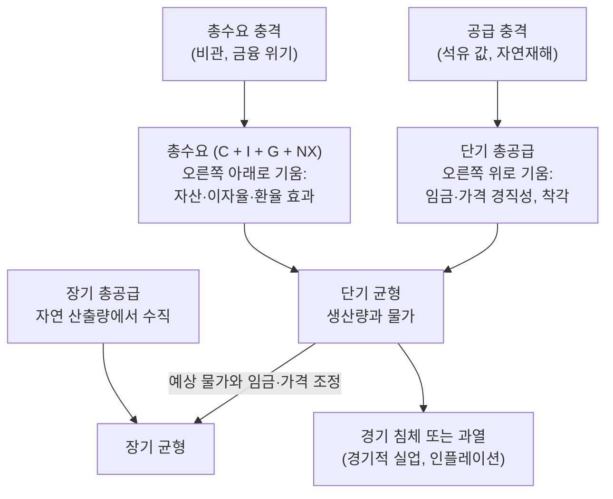

1973년 10월, 이집트와 시리아가 이스라엘을 공격하며 제4차 중동 전쟁이 일어났다. 아랍의 산유국들은 이스라엘을 지원하는 미국과 네덜란드 등에 석유 수출을 끊고, 생산량을 줄였다. 석유 수출국 기구(OPEC)는 원유 값을 잇달아 올렸고, 배럴당 3달러 남짓이던 원유 값은 몇 달 만에 12달러 가까이로 네 배가 되었다. 이것이 **제1차 석유 파동**이다.

미국의 주유소 앞에는 자동차 행렬이 몇 블록씩 늘어섰다. '오늘은 기름 없음'이라는 팻말을 내건 주유소가 줄을 이었고, 여러 주는 자동차 번호판의 끝자리가 홀수인지 짝수인지에 따라 기름을 넣을 수 있는 날을 나누었다. 석유를 거의 모두 수입하던 한국은 더 큰 충격을 받았다. 1974년 한국의 소비자 물가는 24% 넘게 올랐다.

그런데 이때 경제학자들을 당황하게 한 것은, 물가가 뛰는 동시에 경기가 나빠지고 실업이 늘었다는 사실이다. 그때까지는 경기가 나쁘면 물가는 안정되고, 물가가 오르면 경기는 좋은 것이 보통이었다. 경기 침체(stagnation)와 인플레이션(inflation)이 함께 오는 이 현상에는 **스태그플레이션**이라는 새 이름이 붙었다.

지금까지 우리는 장기적으로 경제가 어떻게 움직이는지 보았다. 생산량은 노동, 자본, 기술이 결정하고(23강), 물가는 돈의 양이 결정한다(28강). 그러나 1~2년의 짧은 기간에는 경제가 장기 추세에서 크게 벗어나 오르내린다. 이 강의에서는 이런 **단기 경기 변동**을 설명하는 **총수요·총공급 모형**을 배운다.

> [!핵심] 이 강의의 질문
> 1. 경기 변동에는 어떤 특징이 있는가?
> 2. 경제 전체의 수요와 공급은 어떻게 생겼으며, 왜 그런 모양인가?
> 3. 수요와 공급의 충격은 생산과 물가에 어떤 영향을 주는가?

```gallery
src: asset:39e35be8709ae3ff76073af493a170a3
caption: 1973년 가을 미국 오리건주 주유소 창문에 붙은 '죄송합니다… 오늘은 기름 없음' 팻말. 석유 파동 때 이런 팻말이 흔했다.
credit: 미국 환경보호청 '도큐메리카' 사진 사업, 1973년 · 미국 국립문서보관소(NARA) 소장
license: Public Domain (미국 연방정부 저작물)
source: https://catalog.archives.gov/id/555416
---
src: asset:d8948d00b90e16853e4fea18ded22d11
caption: 1974년 1월 미국 오리건주의 주유소에서 홀짝제 휘발유 배급을 알리는 신문을 읽는 사람. 번호판 끝자리가 홀수인 차는 홀수 날, 짝수인 차는 짝수 날에만 기름을 넣을 수 있었다.
credit: 미국 환경보호청 '도큐메리카' 사진 사업, 1974년 · 미국 국립문서보관소(NARA) 소장
license: Public Domain (미국 연방정부 저작물)
source: https://catalog.archives.gov/id/555474
```

## 경기 변동에 관한 세 가지 사실

### 경기 변동은 불규칙하고 예측하기 어렵다

경제 활동이 활발해지는 시기를 **확장**(호황), 줄어드는 시기를 **수축**(불황)이라고 한다. 실질 GDP가 줄어드는 시기를 **경기 침체**라고 부르는데, 흔히 실질 GDP가 두 분기 연속 줄어들면 경기 침체로 본다. 침체가 아주 깊고 길면 **불황**(공황)이라고 한다. 경기 변동은 '변동'이라는 말과 달리 일정한 주기로 되풀이되지 않는다. 언제 침체가 올지, 얼마나 깊을지 미리 알기 어렵다.

### 대부분의 거시 경제 변수는 함께 움직인다

경기가 나빠지면 실질 GDP만 줄어드는 것이 아니다. 소비, 투자, 기업의 이윤, 산업 생산, 주택 건설, 수입이 함께 줄어든다. 그 가운데서도 **투자**는 경기에 따라 특히 크게 오르내린다. 경기가 나빠지면 기업들은 공장을 짓거나 기계를 사는 계획부터 미룬다.

### 생산이 줄면 실업은 늘어난다

생산이 줄면 기업은 일할 사람을 덜 필요로 하므로 실업이 늘어난다. 미국의 경제학자 아서 오쿤은 1962년, 실업률이 1%포인트 오를 때 실질 GDP는 잠재 수준보다 2% 정도 줄어든다는 경험 법칙을 찾아냈다. 이것을 **오쿤의 법칙**이라고 한다. 이때 늘어나는 실업이 26강에서 미뤄 둔 **경기적 실업**이다.

```chart
{
  "type": "bar",
  "caption": "한국의 실질 GDP 성장률(막대, 왼쪽 축)과 실업률(선, 오른쪽 축) (%, 1996~2024년, 한국은행·통계청 자료를 바탕으로 한 대략적인 수치). 1998년 외환위기 때 성장률이 약 -5%로 떨어지자 실업률은 2%대에서 7%로 치솟았다. 2009년 세계 금융위기와 2020년 코로나19 때도 성장률이 떨어지고 실업률이 올랐다",
  "height": 340,
  "data": {
    "labels": ["1996","1997","1998","1999","2000","2001","2002","2003","2004","2005","2006","2007","2008","2009","2010","2011","2012","2013","2014","2015","2016","2017","2018","2019","2020","2021","2022","2023","2024"],
    "datasets": [
      { "label": "실질 GDP 성장률(%)", "yAxisID": "y", "data": [7.9, 6.2, -5.1, 11.5, 9.1, 4.9, 7.7, 3.1, 5.2, 4.3, 5.3, 5.8, 3.0, 0.8, 7.0, 3.7, 2.4, 3.2, 3.2, 2.8, 2.9, 3.2, 2.9, 2.2, -0.7, 4.6, 2.7, 1.4, 2.0] },
      { "type": "line", "label": "실업률(%)", "yAxisID": "y1", "data": [2.0, 2.6, 7.0, 6.3, 4.4, 4.0, 3.3, 3.6, 3.7, 3.7, 3.5, 3.2, 3.2, 3.6, 3.7, 3.4, 3.2, 3.1, 3.5, 3.6, 3.7, 3.7, 3.8, 3.8, 4.0, 3.7, 2.9, 2.7, 2.8] }
    ]
  },
  "options": { "scales": { "y": { "position": "left", "title": { "display": true, "text": "성장률(%)" } }, "y1": { "position": "right", "min": 0, "max": 8, "grid": { "drawOnChartArea": false }, "title": { "display": true, "text": "실업률(%)" } } } }
}
```

## 총수요·총공급 모형

### 고전 경제학은 왜 단기를 설명하지 못하나

28강의 고전적 이분법에 따르면 돈의 양은 실질 변수에 영향을 주지 않는다. 이것은 장기에는 대체로 맞지만, 현실의 단기에는 맞지 않는다. 예를 들어 중앙은행이 돈의 양을 줄이면, 물가가 곧바로 내리는 대신 생산이 줄고 실업이 늘어난다. 단기의 경기 변동을 이해하려면 명목 변수와 실질 변수가 서로 영향을 주는 모형이 필요하다.

그런 모형이 **총수요·총공급 모형**이다. 이 모형은 4강의 수요·공급 모형과 닮았지만, 다루는 대상은 사과나 커피 같은 한 상품이 아니라 경제 전체의 생산물이다. 가로축은 경제 전체의 생산량(실질 GDP), 세로축은 전체 물가 수준이다.

- **총수요 곡선**: 각 물가 수준에서 가계, 기업, 정부, 외국이 사려고 하는 물건과 서비스의 양
- **총공급 곡선**: 각 물가 수준에서 기업들이 생산해 팔려고 하는 물건과 서비스의 양

### 총수요 곡선은 왜 오른쪽 아래로 기우는가

21강에서 GDP는 소비(C), 투자(I), 정부 구매(G), 순수출(NX)의 합이라는 것을 배웠다. 물가 수준이 내려가면 이 가운데 소비, 투자, 순수출이 늘어난다. 그 이유는 세 가지다.

| 효과 | 물가가 내리면 | 그래서 |
|---|---|---|
| **자산 효과** | 사람들이 가진 돈의 실질 가치가 커진다 | 더 부유해졌다고 느껴 **소비**를 늘린다 |
| **이자율 효과** | 거래에 필요한 돈이 줄어 남는 돈을 빌려주거나 저축한다. 이자율이 내린다 | 낮은 이자율에 **투자**(와 내구재 소비)가 는다 |
| **환율 효과** | 이자율이 내리면 돈이 외국으로 빠져나가 원화 가치가 떨어진다(29강) | 한국 물건이 싸져 **순수출**이 는다 |

표: 총수요 곡선이 오른쪽 아래로 기우는 이유

물가가 아닌 다른 이유로 소비, 투자, 정부 구매, 순수출이 바뀌면 총수요 곡선 전체가 이동한다. 주가가 올라 사람들이 부자가 된 기분에 소비를 늘리거나, 기업들이 미래를 낙관해 투자를 늘리거나, 정부가 지출을 늘리거나, 외국의 경기가 좋아져 수출이 늘면 총수요 곡선은 오른쪽으로 이동한다. 중앙은행이 돈의 양을 늘려 이자율을 낮추어도 총수요가 늘어난다.

### 장기 총공급 곡선은 수직이다

장기적으로 경제가 생산하는 양은 노동, 자본, 자원, 기술이 결정하며 물가와는 관계가 없다(고전적 이분법). 그래서 **장기 총공급 곡선**은 수직선이다. 이 수직선이 놓인 생산량을 **자연 산출량**(잠재 GDP)이라고 한다. 실업률이 자연 실업률(26강)일 때의 생산량이다. 인구가 늘고 자본이 쌓이고 기술이 발전하면 장기 총공급 곡선은 오른쪽으로 이동한다. 이것이 23강의 경제 성장이다.

### 단기 총공급 곡선은 오른쪽 위로 기운다

그러나 1~2년의 단기에는 물가가 오르면 생산량도 늘어난다. 물가가 예상보다 높을 때 기업들이 생산을 늘리기 때문이다. 경제학자들은 그 이유를 세 가지로 설명한다.

1. **임금 경직성 이론**: 임금은 1년에 한 번쯤 계약으로 정해져 쉽게 바뀌지 않는다. 물가가 예상보다 오르면 상품의 값은 올랐는데 임금은 그대로이므로, 기업은 이윤이 늘어 생산과 고용을 늘린다.
2. **가격 경직성 이론**: 28강의 메뉴 비용 때문에 모든 기업이 곧바로 값을 바꾸지는 않는다. 물가가 예상보다 내리면 값을 미처 내리지 못한 기업의 물건은 상대적으로 비싸져 판매와 생산이 줄어든다.
3. **착각 이론**: 물가 전체가 오른 것을 자기 상품의 값만 오른 것으로 착각한 생산자들이 생산을 늘린다.

세 이론 모두 공통점이 있다. 실제 물가가 사람들이 **예상한 물가**와 다를 때 생산량이 자연 산출량에서 벗어난다는 것이다. 시간이 지나 사람들이 예상을 고치고 임금과 가격을 조정하면, 생산량은 자연 산출량으로 돌아간다. 그래서 사람들의 **예상 물가**가 오르면 단기 총공급 곡선은 왼쪽(위)으로 이동한다.

```figure
src: asset:ed2dc1bca083b1539e9377c62530c54b
caption: 1937년 미국 샌프란시스코 하워드 거리의 실업자들. 1937~1938년 정부가 지출을 줄이고 연준이 긴축하자 회복하던 미국 경제는 다시 침체에 빠졌다. 총수요가 줄면 생산과 고용이 함께 줄어든다.
credit: 도러시아 랭 촬영, 1937년 · 미국 의회도서관 소장 (농업안정국·전시정보국 사진)
license: Public Domain (미국 농업안정국·전시정보국 사진, 미국 의회도서관)
source: https://www.loc.gov/item/2017769705/
```

## 경기 변동의 두 가지 원인

### 총수요의 감소

경제가 장기 균형에 있다가, 갑자기 사람들이 미래를 비관해 소비와 투자를 줄였다고 하자. 총수요 곡선이 왼쪽으로 이동한다. 단기에는 물가가 조금 내리고 생산량이 크게 줄어 경기 침체가 온다. 기업들은 노동자를 해고하고 실업이 늘어난다.

그러나 시간이 지나면 사람들은 물가가 내린 것에 맞추어 예상 물가를 낮추고, 임금과 가격도 내려간다. 단기 총공급 곡선이 오른쪽으로 이동해, 경제는 결국 낮은 물가 수준에서 다시 자연 산출량으로 돌아간다. 장기적으로 총수요의 감소는 물가만 낮출 뿐 생산량에는 영향을 주지 않는다(화폐의 중립성).

문제는 이 '장기'가 얼마나 긴가이다. 1923년 케인스는 이렇게 썼다. "장기란 지금의 일을 판단하기에 그릇된 길잡이다. 장기적으로 우리는 모두 죽는다." 경제가 스스로 회복하기를 기다리는 동안 수많은 사람이 일자리를 잃고 고통을 겪는다. 그래서 케인스와 그의 생각을 따르는 경제학자들은 정부와 중앙은행이 총수요를 늘려 침체를 줄여야 한다고 주장했다(31강). 1929년에 시작된 대공황은 총수요가 크게 줄어든 대표적인 경우다(33강).

### 총공급의 감소

이번에는 경제가 장기 균형에 있을 때 석유 값이 갑자기 네 배로 올랐다고 하자. 생산 비용이 오르면 같은 물가 수준에서 기업들이 생산하려는 양이 줄어든다. 단기 총공급 곡선이 왼쪽으로 이동한다. 그 결과 생산량은 줄고 물가는 오른다. **스태그플레이션**이다.

```chart
{
  "type": "scatter",
  "caption": "불리한 공급 충격(석유 파동)의 효과. 처음 경제는 총수요 곡선과 단기 총공급 곡선 SRAS1, 장기 총공급 곡선(자연 산출량 100)이 만나는 A점에 있다. 석유 값이 뛰어 단기 총공급 곡선이 SRAS2로 왼쪽 이동하면 균형은 B점으로 옮겨 간다. 생산량은 100에서 90으로 줄고 물가는 100에서 110으로 오른다(스태그플레이션)",
  "data": {
    "datasets": [
      { "label": "총수요 AD", "showLine": true, "pointRadius": 0, "data": [{"x":70,"y":130},{"x":130,"y":70}] },
      { "label": "단기 총공급 SRAS1", "showLine": true, "pointRadius": 0, "data": [{"x":70,"y":70},{"x":130,"y":130}] },
      { "label": "단기 총공급 SRAS2 (석유 파동 뒤)", "showLine": true, "pointRadius": 0, "borderDash": [6,4], "data": [{"x":70,"y":90},{"x":125,"y":145}] },
      { "label": "장기 총공급 LRAS", "showLine": true, "pointRadius": 0, "data": [{"x":100,"y":60},{"x":100,"y":150}] },
      { "label": "A (생산 100, 물가 100)", "pointRadius": 7, "data": [{"x":100,"y":100}] },
      { "label": "B (생산 90, 물가 110)", "pointRadius": 7, "pointStyle": "rectRot", "data": [{"x":90,"y":110}] }
    ]
  },
  "options": { "scales": { "x": { "title": { "display": true, "text": "실질 GDP (생산량)" }, "min": 60, "max": 140 }, "y": { "title": { "display": true, "text": "물가 수준" }, "min": 60, "max": 150 } } }
}
```

공급 충격은 정책 당국을 어려운 선택 앞에 세운다. 그대로 두면 시간이 지나 임금과 가격이 조정되며 경제가 자연 산출량으로 돌아오지만, 그동안 높은 실업을 견뎌야 한다. 총수요를 늘려 생산을 지키면 물가가 더 오른다. 1970년대 많은 나라가 총수요를 늘려 생산을 지키는 쪽을 택했는데, 그 결과 물가가 더 크게 올랐다(32강).

| 사건 | 충격의 종류 | 결과 |
|---|---|---|
| 1929~1933년 대공황 | 총수요 감소 (주가 폭락, 은행 파산, 통화량 감소) | 미국 실질 GDP 약 27% 감소, 실업률 25%, 물가 약 25% 하락 |
| 1941~1945년 제2차 세계대전 | 총수요 증가 (전쟁 물자를 위한 정부 지출) | 미국 생산 급증, 실업률 1%대 |
| 1973~1975년, 1979~1980년 석유 파동 | 총공급 감소 | 스태그플레이션. 한국 1974년 물가 24%, 1980년 물가 약 29%와 성장률 -1.6% |
| 2008~2009년 세계 금융위기 | 총수요 감소 (주택 가격 폭락, 금융 위기) | 세계적인 경기 침체 |
| 2020년 코로나19 | 총수요와 총공급 함께 감소, 뒤이은 공급망 혼란 | 급격한 침체 뒤, 2021~2022년 높은 인플레이션 |

표: 역사 속의 총수요·총공급 충격

반대로 유리한 공급 충격도 있다. 1990년대 후반 정보 기술 혁명으로 생산성이 높아지자, 미국은 물가가 안정된 채 빠르게 성장했다. 1980년대 중반 국제 원유 값이 크게 내리고 달러와 이자율이 함께 낮았던 이른바 '3저 호황'(저유가·저달러·저금리) 때 한국 경제도 연 10%가 넘는 성장을 하면서 처음으로 큰 무역 흑자를 냈다.

```gallery
src: asset:ee177515a5efed4f5e9f7011fec570f2
caption: 1942년 미국 시애틀의 보잉 공장에서 완성을 앞둔 B-17F 폭격기. 제2차 세계대전 동안 정부의 군수품 주문으로 총수요가 폭발적으로 늘자 생산이 급증하고 실업이 사라졌다.
credit: 안드레아스 파이닝어 촬영, 1942년 · 미국 의회도서관 소장 (농업안정국·전시정보국 사진)
license: Public Domain (미국 농업안정국·전시정보국 사진, 미국 의회도서관)
source: https://www.loc.gov/item/2017696027/
---
src: asset:e069215545252e2d9f67a552370abff2
caption: 1936년 미국 오클라호마의 모래 폭풍. 1930년대 가뭄과 무리한 경작으로 대평원의 흙이 바람에 날려 간 '더스트 볼'은 농업 생산을 크게 줄인 공급 충격이었다.
credit: 아서 로스스타인 촬영, 1936년 · 미국 의회도서관 소장 (농업안정국·전시정보국 사진)
license: Public Domain (미국 농업안정국·전시정보국 사진, 미국 의회도서관)
source: https://www.loc.gov/item/2017760354/
```



## 정리

> [!핵심] 30강 요약
> - 경기 변동은 **불규칙하고 예측하기 어렵다**. 대부분의 거시 변수가 **함께 움직이며**, 특히 투자가 크게 변동한다. 생산이 줄면 **실업이 늘어난다**(오쿤의 법칙).
> - **총수요 곡선**은 자산 효과, 이자율 효과, 환율 효과 때문에 오른쪽 아래로 기운다. 소비, 투자, 정부 구매, 순수출의 변화와 통화 정책이 총수요 곡선을 이동시킨다.
> - **장기 총공급 곡선**은 자연 산출량에서 수직이다. **단기 총공급 곡선**은 임금·가격 경직성과 착각 때문에 오른쪽 위로 기운다. 예상 물가가 오르면 단기 총공급 곡선은 왼쪽으로 이동한다.
> - **총수요 감소**는 단기에 생산을 줄이고 실업을 늘린다. 장기에는 임금과 가격이 조정되어 생산이 자연 산출량으로 돌아온다.
> - **총공급 감소**(석유 파동)는 생산 감소와 물가 상승이 함께 오는 **스태그플레이션**을 낳는다.

### 생각해 볼 질문

1. 주식 시장이 폭락하면 총수요와 총공급 가운데 어느 곡선이 어떻게 움직일까? 단기와 장기의 생산량과 물가는 어떻게 될까?
2. 큰 지진으로 공장과 도로가 파괴되면 어떤 충격이 일어날까? 장기 총공급 곡선도 움직일까?
3. 2021~2022년의 높은 인플레이션은 총수요 요인과 총공급 요인 가운데 어느 쪽이 더 컸을까? 두 가지 근거를 찾아보자.

### 다음 강 예고

31강 「통화 정책과 재정 정책」에서는 정부와 중앙은행이 총수요를 어떻게 움직이는지 다룬다. 기준금리를 바꾸는 통화 정책이 경제에 전달되는 과정, 정부 지출과 세금을 바꾸는 재정 정책의 승수 효과와 구축 효과, 그리고 경기 안정화 정책을 둘러싼 논쟁을 살펴본다.
