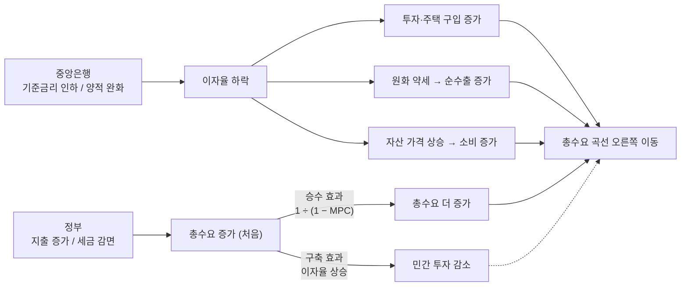

2020년 봄, 코로나19가 세계로 번지자 경제는 순식간에 얼어붙었다. 사람들은 집에 머물렀고, 식당과 상점, 여행사와 항공사의 손님이 사라졌다. 미국에서는 4월 한 달 만에 실업률이 3%대에서 14.7%로 치솟았다. 각국의 정부와 중앙은행은 전례 없는 속도로 움직였다. 한국은행은 3월에 기준금리를 1.25%에서 0.75%로 한꺼번에 0.5%포인트 내렸고, 5월에는 다시 0.5%로 내려 사상 최저 수준을 만들었다. 한국 정부는 그해 네 차례의 추가 경정 예산을 편성했고, 5월에는 모든 가구에 긴급재난지원금(4인 이상 가구 100만 원, 모두 약 14조 원)을 지급했다. 미국 정부는 국민 한 사람에게 1,200달러씩 수표를 보냈고, 미국 연방준비제도는 몇 달 사이에 3조 달러 가까운 돈을 풀었다.

정부와 중앙은행이 경기를 살리려고 이렇게 적극적으로 나서는 것은 비교적 새로운 일이다. 1929년 대공황이 시작되었을 때 많은 정부는 오히려 지출을 줄이고 균형 재정을 지키려 했다. 이런 생각을 바꾼 것이 1936년 출간된 케인스의 『고용, 이자 및 화폐에 관한 일반 이론』이다. 케인스는 경기 침체의 원인이 총수요의 부족이며, 정부가 총수요를 늘려 침체를 줄일 수 있다고 주장했다.

30강에서 총수요가 줄면 단기적으로 생산이 줄고 실업이 늘어난다는 것을 보았다. 이 강의에서는 중앙은행의 **통화 정책**과 정부의 **재정 정책**이 총수요를 어떻게 움직이는지, 그리고 그런 정책을 두고 경제학자들이 어떤 논쟁을 벌여 왔는지 살펴본다.

> [!핵심] 이 강의의 질문
> 1. 중앙은행이 금리를 내리면 경제에 어떤 경로로 영향이 퍼지는가?
> 2. 정부 지출을 늘리면 총수요는 그보다 더 늘어날까, 덜 늘어날까?
> 3. 정부와 중앙은행은 경기 변동을 적극적으로 줄여야 하는가?

{{F:e31-opening}}

## 통화 정책이 총수요에 미치는 영향

### 유동성 선호 이론: 단기의 이자율

28강에서 장기적으로 돈의 양은 물가를 결정한다고 했다. 그러나 단기에는 물가가 잘 움직이지 않는다. 케인스는 단기에는 돈의 수요와 공급이 **이자율**을 결정한다고 보았다. 이것을 **유동성 선호 이론**이라고 한다.

돈은 유동성이 가장 높지만 이자가 붙지 않는다(27강). 그래서 이자율은 돈을 갖고 있는 것의 기회비용이다. 이자율이 높으면 사람들은 돈을 적게 갖고 이자가 붙는 채권이나 예금을 많이 갖는다. 그러므로 돈의 수요량은 이자율이 높을수록 적다. 중앙은행이 돈의 공급을 늘리면, 사람들이 남는 돈으로 채권을 사려 하면서 채권 값은 오르고 이자율은 내린다. 이자율이 내려 사람들이 더 많은 돈을 갖고 싶어 할 때까지 내려간다.

### 금리가 경제에 전달되는 경로

중앙은행이 기준금리를 내리면(27강), 그 효과는 여러 경로를 거쳐 경제 전체로 퍼진다. 이것을 통화 정책의 **전달 경로**라고 한다.

| 경로 | 금리를 내리면 | 결과 |
|---|---|---|
| **금리 경로** | 대출 금리가 내려간다 | 기업의 투자와 가계의 주택 구입, 내구재 소비가 는다 |
| **자산 가격 경로** | 주식과 부동산 값이 오른다 | 부자가 된 기분에 소비가 는다(자산 효과). 기업은 주식을 발행해 투자하기 쉬워진다 |
| **환율 경로** | 돈이 외국으로 빠져나가 원화 가치가 떨어진다 | 수출이 늘고 수입이 준다(29강) |
| **신용 경로** | 은행이 대출을 늘리고, 빌리는 사람의 담보 가치가 오른다 | 돈을 빌리기 쉬워져 소비와 투자가 는다 |
| **기대 경로** | 사람들이 경기가 좋아지리라 기대한다 | 소비와 투자를 미리 늘린다 |

표: 통화 정책의 전달 경로

이 경로들을 통해 금리 인하는 총수요 곡선을 오른쪽으로 이동시킨다. 반대로 물가가 너무 빠르게 오를 때 중앙은행은 금리를 올려 총수요를 줄인다. 2022년 물가가 치솟자 미국 연준은 1년 남짓 사이에 기준금리를 0~0.25%에서 5.25~5.5%로 올렸고, 한국은행도 기준금리를 3.5%까지 올렸다(27강).

다만 통화 정책의 효과는 시간이 걸린다. 금리를 바꾸고 나서 그 효과가 생산과 물가에 충분히 나타나기까지는 대개 1년 안팎, 길게는 2년 가까이 걸린다고 알려져 있다. 그래서 중앙은행은 지금의 경제가 아니라 1~2년 뒤의 경제를 내다보고 정책을 정해야 한다.

### 금리가 0에 닿으면: 양적 완화

금리를 내리는 데는 한계가 있다. 명목 금리가 0 아래로 크게 내려가면 사람들은 은행에 예금하는 대신 현금을 금고에 쌓아 둘 것이기 때문이다. 이것을 **제로 금리 하한**이라고 한다. 2008년 세계 금융위기 때 미국 연준은 기준금리를 0~0.25%까지 내렸는데도 경기가 살아나지 않자, 새로운 방법을 썼다. 시장에서 국채와 주택 담보 증권을 대량으로 사들여 장기 금리를 낮추고 돈을 푸는 것이다. 이것을 **양적 완화**라고 한다. 일본은행은 그보다 먼저 2001년부터 양적 완화를 시도했고, 유럽중앙은행과 일본은행은 한때 금리를 마이너스로 내리기도 했다.

```chart
{
  "type": "line",
  "caption": "미국 연방준비제도의 총자산 (조 달러, 연말 기준, 2007~2024년, 연준 자료를 바탕으로 한 대략적인 수치). 양적 완화로 연준이 국채 등을 사들이면 총자산이 늘어난다. 2008년 금융위기와 2020년 코로나19 때 크게 늘었다가, 2022년부터 물가를 잡기 위해 줄이고 있다(양적 긴축)",
  "data": {
    "labels": ["2007","2008","2009","2010","2011","2012","2013","2014","2015","2016","2017","2018","2019","2020","2021","2022","2023","2024"],
    "datasets": [{ "label": "연준 총자산(조 달러)", "data": [0.89, 2.24, 2.24, 2.42, 2.93, 2.91, 4.03, 4.50, 4.49, 4.45, 4.45, 4.08, 4.17, 7.36, 8.76, 8.55, 7.71, 6.85] }]
  },
  "options": { "scales": { "y": { "min": 0 } }, "plugins": { "legend": { "display": false } } }
}
```

{{F:e31-fed}}

## 재정 정책이 총수요에 미치는 영향

**재정 정책**은 정부가 지출과 세금을 바꾸어 경제에 영향을 주는 것이다. 23강에서 본 것처럼 재정 정책은 장기적으로 저축과 투자, 경제 성장에 영향을 준다. 단기적으로는 총수요를 움직인다.

### 승수 효과

정부가 도로 건설에 1조 원을 더 쓴다고 하자. 총수요는 얼마나 늘어날까? 처음에는 1조 원만큼 늘어난다. 그런데 이야기는 여기서 끝나지 않는다. 도로를 짓는 건설 회사의 노동자와 주주는 소득이 1조 원 늘었으므로 그 가운데 일부로 옷과 음식을 산다. 옷 가게와 식당 주인의 소득이 늘고, 그들도 다시 소비를 늘린다. 이렇게 처음의 지출이 꼬리를 물고 소비를 늘려, 총수요는 처음 지출보다 더 크게 늘어난다. 이것을 **승수 효과**라고 한다.

늘어난 소득 가운데 소비하는 비율을 **한계 소비 성향**(MPC)이라고 한다. MPC가 0.75라면, 소득이 1조 원 늘어난 사람들은 7,500억 원을 소비한다. 그 7,500억 원은 다시 누군가의 소득이 되어 5,625억 원의 소비를 낳는다. 이 과정이 끝없이 이어지면 총수요는 모두 다음만큼 늘어난다.

**지출 승수 = 1 ÷ (1 − MPC)**

MPC가 0.75면 승수는 4다. 정부 지출 1조 원이 총수요를 4조 원 늘린다. MPC가 클수록 승수가 크다. 승수 효과는 정부 지출에만 있는 것이 아니다. 기업의 투자나 외국의 수입 수요가 늘어도 승수 효과가 생긴다.

```chart
{
  "type": "bar",
  "caption": "승수 효과 (한계 소비 성향 0.75, 정부 지출 1조 원). 처음 1조 원의 지출이 차례로 0.75조, 0.56조, 0.42조 원의 소비를 낳는다. 모든 단계를 더하면 총수요는 4조 원 늘어난다(실제 경제의 승수는 이보다 훨씬 작다)",
  "data": {
    "labels": ["1단계 (정부 지출)", "2단계", "3단계", "4단계", "5단계", "6단계", "그 뒤 모두", "합계"],
    "datasets": [{ "label": "총수요 증가 (조 원)", "data": [1.0, 0.75, 0.56, 0.42, 0.32, 0.24, 0.71, 4.0] }]
  },
  "options": { "plugins": { "legend": { "display": false } }, "scales": { "y": { "min": 0 } } }
}
```

### 구축 효과

그러나 총수요가 정부 지출보다 덜 늘어나게 하는 힘도 있다. 정부 지출이 늘어 소득이 늘면, 사람들은 거래를 위해 돈을 더 필요로 한다. 돈의 공급이 그대로라면 이자율이 오른다. 이자율이 오르면 기업의 투자와 가계의 주택 구입이 줄어든다. 이처럼 정부 지출이 이자율을 높여 민간 지출을 밀어내는 것을 **구축 효과**라고 한다. 24강에서 정부의 재정 적자가 대부 자금 시장의 이자율을 높여 민간 투자를 줄이는 것을 본 것과 같은 원리다.

결국 정부 지출이 총수요를 얼마나 늘리는지는 승수 효과와 구축 효과 가운데 어느 쪽이 더 큰지에 달려 있다. 실제로 경제학자들이 추정한 정부 지출 승수는 대개 0.5에서 2 사이로, 연구마다 크게 다르다. 경기 침체가 깊어 금리가 0에 가깝고 중앙은행이 금리를 올리지 않을 때는 구축 효과가 작아 승수가 크고, 경기가 좋을 때는 승수가 작다는 연구가 많다.

### 세금의 변화

정부가 세금을 깎아도 총수요가 늘어난다. 세금이 줄면 가계의 처분 가능 소득이 늘어 소비가 늘기 때문이다. 다만 세금 감면의 효과는 사람들이 그것을 일시적인 것으로 보는지, 영구적인 것으로 보는지에 따라 다르다. 1년만 세금을 깎아 준다면 사람들은 늘어난 소득의 상당 부분을 저축할 것이다. 2020년 한국의 긴급재난지원금에 대한 한국개발연구원(KDI)의 분석에 따르면, 지원금이 쓸 수 있는 곳이 지역과 업종으로 제한되었는데도 늘어난 카드 매출은 지급액의 26~36% 정도였다. 나머지는 원래 하려던 소비를 대신하거나 저축으로 돌아간 셈이다.

{{F:e31-fiscal}}

## 경기 안정화 정책 논쟁

### 적극적인 안정화 정책을 지지하는 쪽

케인스의 생각을 따르는 경제학자들은 정부와 중앙은행이 총수요를 적극적으로 관리해 경기 변동을 줄여야 한다고 주장한다. 경기 침체 때는 금리를 내리고 정부 지출을 늘리며, 경기 과열 때는 반대로 해야 한다. 미국은 1946년 고용법으로 연방 정부가 "최대 고용, 생산, 구매력을 촉진할" 책임이 있음을 법으로 정했다. 미국 연준은 '물가 안정과 최대 고용'이라는 두 가지 목표를 함께 추구한다.

### 적극적인 정책을 비판하는 쪽

밀턴 프리드먼 같은 비판자들은 적극적인 안정화 정책이 오히려 경제를 불안정하게 만들 수 있다고 주장한다.

- **시차의 문제**: 경기 침체를 알아채는 데 시간이 걸리고(인식 시차), 정책을 결정하고 시행하는 데 시간이 걸리며(실행 시차), 정책이 효과를 내는 데 다시 시간이 걸린다(효과 시차). 특히 재정 정책은 국회에서 예산을 통과시키는 데 몇 달이 걸린다. 정책의 효과가 나타날 때쯤에는 이미 경기가 회복되어, 오히려 경기를 과열시킬 수도 있다.
- **정치의 문제**: 정치인들은 선거 전에 돈을 풀고 싶어 한다. 경기가 좋을 때 지출을 줄이기는 어렵다. 그래서 재정 적자와 나랏빚이 쌓이기 쉽다. 한국의 국가 채무는 2024년 GDP의 약 46%로 선진국 평균보다 낮지만, 고령화로 복지 지출이 빠르게 늘고 있어 앞으로의 재정 건전성이 중요한 과제로 꼽힌다.
- **예측의 어려움**: 경제를 정확히 예측하기 어려우므로, 잘못된 예측에 따른 정책은 오히려 해롭다.

그래서 비판자들은 그때그때의 판단에 따른 재량적 정책보다, 미리 정한 규칙(예: 통화량을 해마다 일정하게 늘리기)에 따르는 정책이 낫다고 주장했다.

### 자동 안정화 장치

정부가 따로 결정하지 않아도 경기 변동을 줄여 주는 제도도 있다. 이것을 **자동 안정화 장치**라고 한다.

- **누진적인 소득세**: 경기가 나빠져 소득이 줄면 세금이 소득보다 더 크게 줄어, 처분 가능 소득이 덜 줄어든다. 경기가 좋을 때는 반대로 세금이 크게 늘어 과열을 막는다.
- **실업 보험과 복지 지출**: 경기가 나빠져 실업자가 늘면 실업 급여 지출이 저절로 늘어 소비를 받쳐 준다(26강).

자동 안정화 장치는 시차의 문제가 없다는 장점이 있다. 다만 그 크기는 경기 변동을 완전히 없애기에는 부족하다.

> [!더알아보기] 뉴딜은 대공황을 끝냈을까
> 1933년 취임한 프랭클린 루스벨트 대통령은 **뉴딜** 정책으로 테네시강 유역 개발 공사(TVA), 공공사업 진흥국(WPA) 같은 대규모 공공사업을 벌였다. WPA는 활동 기간 동안 모두 850만 명 가까운 사람을 고용해 도로, 다리, 학교, 공원을 지었다. 그런데 많은 경제학자는 뉴딜의 재정 지출이 대공황을 끝내기에는 너무 작았다고 본다. 루스벨트 정부는 균형 재정에 대한 미련을 버리지 못했고, 1937년에는 지출을 줄이고 연준이 긴축하면서 경기가 다시 꺾였다. 미국 경제가 대공황에서 완전히 벗어난 것은 제2차 세계대전으로 정부 지출이 GDP의 40% 넘게 폭증한 뒤였다. 케인스의 처방이 맞았다는 증거로도, 평시에 그만큼의 지출은 어렵다는 증거로도 읽힌다.



## 정리

> [!핵심] 31강 요약
> - **유동성 선호 이론**: 단기의 이자율은 돈의 수요와 공급이 결정한다. 중앙은행이 금리를 내리면 **금리·자산 가격·환율·신용·기대 경로**를 거쳐 총수요가 늘어난다. 효과가 나타나기까지 1년 안팎이 걸린다.
> - 금리가 0에 닿으면(**제로 금리 하한**) 중앙은행은 **양적 완화**로 장기 금리를 낮추고 돈을 푼다.
> - **재정 정책**: 정부 지출 증가는 **승수 효과**(1 ÷ (1 − MPC)) 때문에 총수요를 더 크게 늘리지만, 이자율을 높여 민간 투자를 줄이는 **구축 효과**도 있다. 일시적인 세금 감면은 효과가 작다.
> - 적극적인 안정화 정책을 두고 **케인스 학파**와 비판자들(프리드먼) 사이에 논쟁이 있다. 비판의 근거는 **시차**, 정치, 예측의 어려움이다.
> - **자동 안정화 장치**(누진세, 실업 보험)는 정부의 결정 없이 경기 변동을 줄여 준다.

### 생각해 볼 질문

1. 한계 소비 성향이 0.8이면 지출 승수는 얼마일까? 사람들이 수입품을 많이 산다면 승수는 어떻게 달라질까?
2. 경기 침체 때 정부가 소득 하위 계층에 돈을 주는 것과 고소득층의 세금을 깎는 것 가운데 어느 쪽이 총수요를 더 늘릴까? 그 이유는?
3. 물가가 빠르게 오르는데 경기는 나빠지고 있다면, 중앙은행은 금리를 올려야 할까, 내려야 할까?

### 다음 강 예고

32강 「인플레이션과 실업의 단기 상충 관계」에서는 물가와 실업 사이의 관계를 보여 주는 필립스 곡선을 다룬다. 1960년대에 정책 당국은 물가를 조금 올리면 실업을 줄일 수 있다고 믿었다. 그런데 1970년대에 그 믿음은 왜 무너졌을까? 사람들의 기대가 경제에 어떤 힘을 갖는지, 그리고 1980년대 초 볼커의 연준이 어떻게 인플레이션을 잡았는지 살펴본다.
