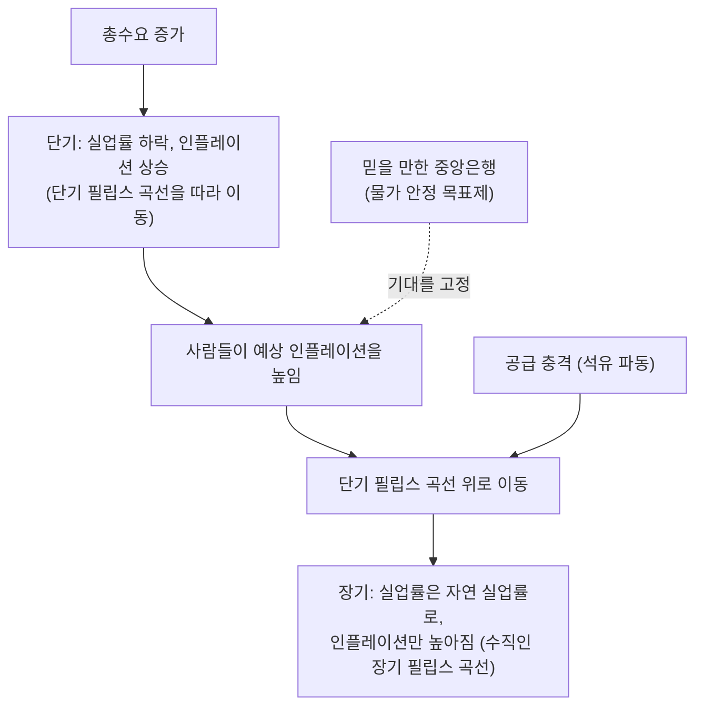

1949년, 런던 정치경제대학(LSE)의 한 지하 작업실에서 뉴질랜드 출신의 대학원생 **빌 필립스**가 기묘한 기계를 만들었다. 높이 2미터쯤 되는 나무판에 투명한 플라스틱 관과 물탱크를 이리저리 연결한 장치였다. 붉게 물들인 물이 관을 따라 흐르며 소득, 소비, 저축, 투자, 세금, 수출입의 흐름을 보여 주었다. 밸브를 돌려 세율을 올리면 소비로 가는 물줄기가 가늘어지는 식이었다. '모니악(MONIAC)'이라 불린 이 수력 컴퓨터는 영국과 미국의 대학, 영국은행 등에 팔려 나갔다.

엔지니어 출신의 이 괴짜 경제학자는 1958년 또 하나의 유명한 업적을 남겼다. 1861년부터 1957년까지 거의 100년 동안의 영국 자료를 분석해, 실업률이 낮은 해에는 명목 임금이 빠르게 오르고 실업률이 높은 해에는 명목 임금이 천천히 오른다는 것을 발견한 것이다. 이 관계를 나타낸 곡선에는 그의 이름이 붙었다. **필립스 곡선**이다.

30강과 31강에서 정부와 중앙은행이 총수요를 움직여 생산과 고용에 영향을 줄 수 있다는 것을 보았다. 그런데 총수요를 늘리면 물가도 오른다. 그렇다면 정책 당국은 실업과 물가 가운데 하나를 골라야 하는 것일까? 이 강의에서는 필립스 곡선을 둘러싼 반세기의 논쟁을 따라가며, 사람들의 **기대**가 경제에서 얼마나 큰 힘을 갖는지 살펴본다.

> [!핵심] 이 강의의 질문
> 1. 단기에 인플레이션과 실업 사이에는 왜 상충 관계가 있는가?
> 2. 그 상충 관계는 장기에도 유지되는가? 1970년대에는 무엇이 잘못되었는가?
> 3. 인플레이션을 낮추려면 어떤 대가를 치러야 하는가?

{{F:e32-opening}}

## 필립스 곡선

### 실업과 인플레이션의 메뉴

필립스의 발견이 알려지자, 1960년 미국의 경제학자 **폴 새뮤얼슨**과 **로버트 솔로**는 미국 자료에서도 비슷한 관계를 찾아냈다. 그들은 임금 상승률 대신 물가 상승률(인플레이션율)을 써서, 실업률이 낮으면 인플레이션율이 높고 실업률이 높으면 인플레이션율이 낮다는 곡선을 그렸다. 그리고 이 곡선이 정책 당국에 일종의 **메뉴**를 준다고 했다. 물가가 조금 오르는 것을 참으면 실업을 줄일 수 있고, 실업을 조금 참으면 물가를 안정시킬 수 있다는 것이다.

이 관계는 30강의 총수요·총공급 모형으로 쉽게 설명할 수 있다. 정부나 중앙은행이 총수요를 늘리면 단기 총공급 곡선을 따라 생산량이 늘고 물가가 오른다. 생산이 늘면 기업은 노동자를 더 뽑으므로 실업률은 내려간다. 총수요가 크게 늘수록 실업률은 더 낮아지고 물가는 더 오른다. 그러므로 총수요의 변화는 경제를 필립스 곡선을 따라 움직이게 한다.

1960년대 미국의 경제는 이 메뉴대로 움직이는 듯했다. 케네디와 존슨 정부는 세금을 깎고, 베트남 전쟁과 '위대한 사회' 복지 정책에 돈을 썼다. 실업률은 1961년 6.7%에서 1969년 3.5%로 내려갔고, 인플레이션율은 1%대에서 5%대로 올라갔다. 점들이 아름답게 하나의 곡선을 그렸다.

### 프리드먼과 펠프스의 경고

그런데 바로 이때 두 경제학자가 필립스 곡선이 영원하지 않다고 경고했다. 1967년 12월 미국 경제학회 회장 연설(이듬해 논문으로 출간)에서 **밀턴 프리드먼**은, 그리고 그보다 조금 앞서 **에드먼드 펠프스**는 다음과 같이 주장했다.

28강의 화폐의 중립성에 따르면, 장기적으로 돈의 양은 실업률 같은 실질 변수에 영향을 주지 않는다. 그러므로 장기적으로 실업률은 인플레이션율과 관계없이 **자연 실업률**(26강)로 돌아간다. 장기 필립스 곡선은 30강의 장기 총공급 곡선처럼 자연 실업률에서 **수직**이다.

단기 필립스 곡선이 생기는 것은 사람들의 **예상 인플레이션**이 금방 바뀌지 않기 때문이다. 물가가 예상보다 많이 오르면 임금은 아직 그대로이므로 기업은 고용을 늘린다. 그러나 사람들은 곧 높아진 인플레이션에 익숙해져 예상을 고치고, 그만큼 높은 임금을 요구한다. 그러면 기업의 고용은 다시 줄고, 실업률은 자연 실업률로 돌아간다. 이제 경제는 같은 실업률에 더 높은 인플레이션을 겪게 된다. 단기 필립스 곡선이 위로 이동한 것이다.

이 생각을 식으로 쓰면 다음과 같다.

**실업률 = 자연 실업률 − a × (실제 인플레이션 − 예상 인플레이션)**

실제 인플레이션이 예상보다 높을 때만 실업률이 자연 실업률보다 낮아진다. 정책 당국이 실업률을 자연 실업률보다 계속 낮게 유지하려면, 사람들의 예상보다 계속 더 높은 인플레이션을 만들어야 한다. 결국 인플레이션은 점점 가속될 뿐이다. 그래서 이 이론을 **자연 실업률 가설**이라고 한다. 프리드먼과 펠프스는 이 경고를 1960년대 자료만 보고 했다. 그리고 1970년대에 그 예언이 실현되었다.

```chart
{
  "type": "scatter",
  "caption": "미국의 실업률과 인플레이션율 (%, 1961~1984년, 미국 노동통계국 자료를 바탕으로 한 대략적인 연평균 수치). 1960년대의 점(파랑)은 하나의 필립스 곡선을 그린다. 1970년대(주황)에는 같은 실업률에서 인플레이션이 훨씬 높아졌다. 1980년대 초(초록) 볼커의 연준이 인플레이션을 잡는 동안 실업률은 10% 가까이 치솟았다",
  "height": 360,
  "data": {
    "datasets": [
      { "label": "1961~1969년", "showLine": true, "data": [{"x":6.7,"y":1.0},{"x":5.5,"y":1.0},{"x":5.7,"y":1.3},{"x":5.2,"y":1.3},{"x":4.5,"y":1.6},{"x":3.8,"y":2.9},{"x":3.8,"y":3.1},{"x":3.6,"y":4.2},{"x":3.5,"y":5.5}] },
      { "label": "1970~1979년", "showLine": true, "data": [{"x":4.9,"y":5.7},{"x":5.9,"y":4.4},{"x":5.6,"y":3.2},{"x":4.9,"y":6.2},{"x":5.6,"y":11.0},{"x":8.5,"y":9.1},{"x":7.7,"y":5.8},{"x":7.1,"y":6.5},{"x":6.1,"y":7.6},{"x":5.8,"y":11.3}] },
      { "label": "1980~1984년", "showLine": true, "data": [{"x":7.1,"y":13.5},{"x":7.6,"y":10.3},{"x":9.7,"y":6.2},{"x":9.6,"y":3.2},{"x":7.5,"y":4.3}] }
    ]
  },
  "options": { "scales": { "x": { "title": { "display": true, "text": "실업률 (%)" }, "min": 3, "max": 10 }, "y": { "title": { "display": true, "text": "인플레이션율 (%)" }, "min": 0, "max": 14 } } }
}
```

## 1970년대: 필립스 곡선의 붕괴

### 기대가 바뀌다

1960년대 말부터 계속된 높은 인플레이션에 사람들은 익숙해졌다. 노동자들은 해마다 물가가 5% 넘게 오를 것으로 예상하고 그만큼 임금 인상을 요구했다. 단기 필립스 곡선이 위로 이동하기 시작했다. 1971년 8월 15일, 닉슨 대통령은 물가를 잡겠다며 90일 동안 모든 임금과 가격을 동결했다. 같은 날 달러의 금 교환도 정지했다(29강). 그러나 가격 통제는 6강에서 본 것처럼 물자 부족을 낳았고, 통제를 풀자 물가는 다시 뛰었다.

### 공급 충격

여기에 30강에서 본 **석유 파동**이 겹쳤다. 1973년과 1979년 원유 값이 폭등하자 생산 비용이 올라 단기 총공급 곡선이 왼쪽으로 이동했다. 필립스 곡선의 관점에서 보면, 같은 실업률에서 인플레이션이 더 높아진 것, 곧 단기 필립스 곡선이 위로 이동한 것이다.

공급 충격은 정책 당국을 어려운 선택 앞에 세운다. 총수요를 줄여 물가를 잡으면 실업이 더 늘어나고, 총수요를 늘려 고용을 지키면 물가가 더 오른다. 1970년대의 연준은 대체로 총수요를 늘려 고용을 지키는 쪽을 택했다. 그러자 사람들은 앞으로도 높은 인플레이션이 계속될 것으로 예상하게 되었고, 인플레이션은 점점 더 굳어졌다. 1979년 미국의 인플레이션율은 11%를 넘었고, 1980년에는 13.5%에 이르렀다.

{{F:e32-stagflation}}

## 인플레이션을 잡는 대가

### 희생률

인플레이션을 낮추려면 중앙은행은 통화 긴축으로 총수요를 줄여야 한다. 그러면 단기적으로 경제는 단기 필립스 곡선을 따라 내려가며, 인플레이션은 낮아지지만 실업은 늘어난다. 시간이 지나 사람들의 예상 인플레이션이 낮아지면 단기 필립스 곡선이 아래로 이동하고, 경제는 낮은 인플레이션과 자연 실업률로 돌아간다.

인플레이션을 1%포인트 낮추기 위해 잃어야 하는 연간 생산량의 비율(%)을 **희생률**이라고 한다. 1970년대 말 미국의 희생률은 5 정도로 추정되었다. 그 추정대로라면 10%의 인플레이션을 4%로 낮추려면 연간 생산량의 30%를 희생해야 한다. 2년에 걸쳐 한다면 해마다 15%씩 생산이 줄어드는 것이다. 대공황에 버금가는 고통이다.

### 합리적 기대

1970년대에 로버트 루커스, 토머스 사전트 같은 경제학자들은 **합리적 기대** 이론을 내세워, 인플레이션을 잡는 대가가 그렇게 클 필요는 없다고 주장했다. 사람들은 과거의 인플레이션만 보고 기계적으로 예상하는 것이 아니라, 정부와 중앙은행의 정책을 포함해 쓸 수 있는 모든 정보를 이용해 미래를 합리적으로 예상한다는 것이다. 그렇다면 중앙은행이 인플레이션을 낮추겠다고 **믿을 만하게** 약속하면, 사람들은 곧바로 예상 인플레이션을 낮출 것이다. 단기 필립스 곡선이 빠르게 아래로 이동하므로, 실업이 크게 늘지 않고도 인플레이션을 낮출 수 있다. 사전트는 1920년대 유럽의 하이퍼인플레이션이 정부의 재정 개혁과 화폐 개혁이 믿을 만하게 이루어지자 생산의 큰 손실 없이 순식간에 끝났다는 것을 보였다(28강).

### 볼커의 디스인플레이션

1979년 8월 미국 연준 의장이 된 **폴 볼커**는 인플레이션을 잡겠다고 선언하고 통화 긴축에 나섰다. 연방 기금 금리는 1981년 한때 20%에 이르렀다. 주택 담보 대출 금리가 18%를 넘자 집을 팔지 못한 건설업자들은 연준에 항의하는 뜻으로 팔지 못한 집의 나무토막을 연준에 우편으로 보냈고, 농민들은 트랙터를 몰고 연준 건물 앞으로 몰려왔다.

결과는 어땠을까? 인플레이션은 1980년 13.5%에서 1983년 3.2%로 떨어졌다. 그러나 그 대가로 미국 경제는 1980년과 1981~1982년 두 차례 깊은 침체에 빠졌고, 실업률은 1982년 말 10.8%로 대공황 이후 가장 높았다. 볼커의 디스인플레이션의 희생률은 예전의 추정치보다는 작았지만, 합리적 기대 이론이 약속한 것처럼 고통 없는 디스인플레이션은 아니었다. 사람들은 연준이 정말로 끝까지 긴축할 것인지 처음에는 믿지 않았던 것이다.

{{F:e32-volcker}}

볼커의 성공 이후 많은 나라의 중앙은행은 물가 안정을 가장 중요한 목표로 삼고, 중앙은행의 **독립성**과 **신뢰**를 쌓는 데 힘을 쏟았다. 1990년 뉴질랜드가 처음 도입한 **물가 안정 목표제**는 중앙은행이 목표 인플레이션율을 미리 공표하고 그것을 지키려고 노력하는 제도다. 한국은 1998년에 도입했고, 지금의 목표는 소비자 물가 상승률 2%다. 목표를 공표하면 사람들의 예상 인플레이션이 그 목표 근처에 묶이므로(기대의 **고정**), 단기 필립스 곡선이 쉽게 움직이지 않는다.

| 시기 | 사건 | 필립스 곡선의 모습 |
|---|---|---|
| 1958 | 필립스, 영국의 실업과 임금 상승률 관계 발표 | |
| 1960 | 새뮤얼슨·솔로, 미국의 '정책 메뉴' 제시 | 하나의 안정적인 곡선처럼 보임 |
| 1967~1968 | 펠프스·프리드먼, 자연 실업률 가설 | 장기 필립스 곡선은 수직 |
| 1970년대 | 높은 예상 인플레이션, 석유 파동 | 단기 필립스 곡선이 위로 이동, 스태그플레이션 |
| 1979~1983 | 볼커의 통화 긴축 | 큰 실업을 치르고 인플레이션 하락 |
| 1990년대 이후 | 물가 안정 목표제와 중앙은행 독립성 | 기대가 고정되어 곡선이 평평하고 안정됨 |
| 2021~2022 | 코로나19 이후 공급 충격과 대규모 경기 부양 | 인플레이션 급등. 각국 중앙은행의 급격한 금리 인상 |

표: 필립스 곡선의 역사

> [!참고] 평평해진 필립스 곡선과 2021년의 인플레이션
> 2010년대에는 실업률이 크게 내려가도 인플레이션이 거의 오르지 않았다. 필립스 곡선이 아주 평평해진 것이다. 중앙은행에 대한 신뢰로 기대 인플레이션이 2% 근처에 묶였기 때문이라는 해석이 많다. 그러나 2021~2022년 공급망 혼란, 에너지 가격 급등, 대규모 경기 부양이 겹치자 미국의 인플레이션율은 2022년 6월 9.1%로 40년 만에 가장 높아졌다. 각국 중앙은행은 기대 인플레이션이 풀려 1970년대가 되풀이되지 않도록 금리를 빠르게 올렸다. 다행히 기대 인플레이션이 크게 흔들리지 않아, 인플레이션은 큰 실업 없이 비교적 빠르게 내려왔다.



## 정리

> [!핵심] 32강 요약
> - **필립스 곡선**은 실업률과 인플레이션율 사이의 단기 상충 관계를 보여 준다. 총수요의 변화가 경제를 단기 필립스 곡선을 따라 움직이게 한다.
> - **프리드먼과 펠프스**: 장기적으로 실업률은 인플레이션과 관계없이 **자연 실업률**로 돌아가므로 **장기 필립스 곡선은 수직**이다. 단기 상충 관계는 **예상 인플레이션**이 금방 바뀌지 않기 때문에 생긴다.
> - 1970년대에는 높아진 예상 인플레이션과 **공급 충격**(석유 파동)으로 단기 필립스 곡선이 위로 이동해 **스태그플레이션**이 일어났다.
> - 인플레이션을 낮추려면 실업이라는 대가를 치러야 한다(**희생률**). **합리적 기대** 이론은 믿을 만한 정책이 그 대가를 줄일 수 있다고 본다.
> - **볼커의 디스인플레이션**(1979~1983)은 큰 실업을 치르고 인플레이션을 잡았다. 이후 **중앙은행의 독립성**과 **물가 안정 목표제**가 기대를 고정하는 수단이 되었다.

### 생각해 볼 질문

1. 중앙은행이 실업률을 자연 실업률보다 낮게 유지하려고 계속 돈을 풀면 어떤 일이 일어날까?
2. 같은 크기의 인플레이션 하락이라도, 중앙은행에 대한 신뢰가 높은 나라와 낮은 나라 가운데 어느 쪽이 실업의 대가를 덜 치를까? 그 이유는?
3. 중앙은행 총재를 대통령이 마음대로 바꿀 수 있다면 기대 인플레이션은 어떻게 될까?

### 다음 강 예고

마지막 33강 「경제 위기의 역사」에서는 지금까지 배운 도구들로 세 번의 큰 경제 위기를 되짚는다. 1929년의 대공황, 1997년 한국의 외환위기, 2008년의 세계 금융위기는 왜 일어났고, 사람들은 그 위기에서 무엇을 배웠을까?
