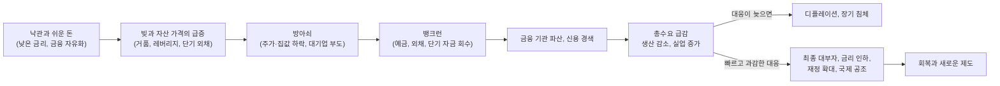

1998년 1월, 한국의 은행과 농협 앞에는 긴 줄이 늘어섰다. 사람들은 장롱 속에 넣어 두었던 돌 반지와 결혼반지, 금 열쇠와 금메달을 들고 왔다. 나라가 갚아야 할 달러가 모자라 국제통화기금(IMF)에서 돈을 빌렸다는 소식에, 금을 모아 수출해 달러를 벌자는 **금 모으기 운동**이 벌어진 것이다. 몇 달 동안 약 350만 명이 참여해 227톤의 금을 모았다. 이 금은 대부분 수출되어 20억 달러 남짓을 벌어들였다.

금 모으기 운동은 위기 앞에서 하나로 뭉친 한국 사람들의 모습을 세계에 보여 주었다. 그러나 외환위기의 고통은 금 모으기로 덜어 낼 수 있는 것보다 훨씬 컸다. 1998년 한국의 실질 GDP는 5% 가까이 줄었고, 실업자는 1년 사이에 세 배 가까이 늘었다. 30대 재벌 가운데 대우를 비롯한 여러 그룹이 무너졌고, 수많은 가장이 직장을 잃었다.

경제 위기는 갑자기 찾아오는 것처럼 보이지만, 대개 그 전에 오랫동안 쌓인 원인이 있다. 그리고 위기가 닥친 뒤 정부와 중앙은행이 어떻게 대응하느냐에 따라 그 고통의 크기가 크게 달라진다. 이 마지막 강의에서는 지금까지 배운 도구들, 곧 총수요와 총공급, 은행과 중앙은행, 환율과 국제 수지, 기대와 거품으로 20세기 이후의 세 가지 큰 경제 위기를 되짚어 본다. 1929년의 **대공황**, 1997년 한국의 **외환위기**, 2008년의 **세계 금융위기**다.

> [!핵심] 이 강의의 질문
> 1. 대공황은 왜 그렇게 깊고 길었는가?
> 2. 1997년 한국은 왜 외환위기를 맞았는가?
> 3. 2008년 세계 금융위기는 어떻게 일어났으며, 세계는 대공황의 교훈을 어떻게 활용했는가?

```figure
src: asset:7399d92899c3538634bc0a743508c3bb
caption: 제임스 N. 로젠버그의 석판화 「10월 29일, 분노의 날」(1929년). 주가가 폭락한 '검은 화요일'에 뉴욕의 마천루가 무너져 내리고 군중이 비명을 지르는 모습을 그렸다. 작가는 변호사이자 화가로, 폭락을 직접 겪었다.
credit: 제임스 N. 로젠버그, 1929년 · 미국 의회도서관 소장
license: Public Domain (미국 의회도서관: 출판 제한 없음)
source: https://www.loc.gov/item/96516489/
width: narrow
```

## 1929년 대공황

### 거품과 폭락

1920년대의 미국은 '광란의 20년대'라 불릴 만큼 번영했다. 자동차와 라디오, 전기 제품이 보급되고, 사람들은 할부로 물건을 샀다. 주가도 치솟았다. 다우 존스 산업 평균 지수는 1924년 초부터 1929년 9월까지 네 배 가까이 올랐다. 많은 사람이 주식 값의 10~20%만 내고 나머지는 빌린 돈으로 주식을 샀다. 주가가 계속 오를 것이라는 믿음이 다시 주가를 끌어올리는 전형적인 **거품**이었다(25강).

1929년 10월 24일 '검은 목요일'과 10월 29일 '검은 화요일', 주가가 폭락했다. 빚을 내 주식을 산 사람들은 빚을 갚으려고 주식을 팔았고, 그것이 주가를 더 떨어뜨렸다. 다우 지수는 1929년 9월의 381에서 1932년 7월 41까지, 89% 떨어졌다.

### 주가 폭락이 대공황이 되기까지

그러나 주가 폭락만으로 대공황이 일어난 것은 아니다. 주가 폭락은 총수요를 줄였지만(30강의 자산 효과), 진짜 재앙은 그 뒤에 왔다.

- **은행의 연쇄 파산**: 1930년부터 1933년까지 네 차례의 은행 공황으로 미국 은행의 약 3분의 1인 9,000여 개가 문을 닫았다(27강). 예금 보험이 없었으므로 예금자들은 돈을 잃었고, 살아남은 은행도 대출을 줄였다.
- **통화량의 급감과 디플레이션**: 은행이 무너지며 통화량이 3분의 1가량 줄었다. 그런데 연준은 이를 막지 않았다. 물가는 1933년까지 25% 가까이 떨어졌다. 물가가 떨어지자 빚의 실질 부담이 커져, 농민과 기업이 줄줄이 파산했다(28강의 디플레이션).
- **금본위 제도**: 금본위 제도 아래에서 각국의 중앙은행은 금이 빠져나가는 것을 막으려고 오히려 금리를 올렸다. 금본위 제도가 대공황을 세계로 퍼뜨린 통로가 되었다. 일찍 금본위 제도를 버린 나라(1931년 영국)일수록 빨리 회복했다.
- **보호 무역**: 1930년 미국은 스무트-홀리 관세법으로 2만여 품목의 관세를 크게 올렸다. 다른 나라들이 보복 관세로 맞서자 세계 무역은 1929년부터 1933년 사이에 3분의 2가량 줄었다(8강).
- **긴축 재정**: 세금 수입이 줄자 정부들은 균형 재정을 지키려고 지출을 줄이고 세금을 올려, 총수요를 더 줄였다.

그 결과 1929년부터 1933년까지 미국의 실질 GDP는 27% 가까이 줄었고, 실업률은 25%에 이르렀다. 미국의 대공황 연구자이자 훗날 연준 의장이 된 **벤 버냉키**는 2002년 프리드먼의 90세 생일 기념 강연에서 이렇게 말했다. "대공황에 대해 당신(프리드먼과 슈워츠)이 옳았습니다. 우리(연준)가 그렇게 했습니다. 정말 죄송합니다. 그러나 당신 덕분에 우리는 그런 일을 다시는 되풀이하지 않을 것입니다."

```chart
{
  "type": "line",
  "caption": "미국의 실업률 (%, 1929~1945년, 미국 노동통계국 자료를 바탕으로 한 대략적인 수치). 1929년 3%대이던 실업률이 1933년 25%에 이르렀다. 뉴딜로 조금씩 내려가다가 1937~1938년 긴축으로 다시 올랐고, 제2차 세계대전으로 정부 지출이 폭증하자 1%대로 떨어졌다",
  "data": {
    "labels": ["1929","1930","1931","1932","1933","1934","1935","1936","1937","1938","1939","1940","1941","1942","1943","1944","1945"],
    "datasets": [{ "label": "실업률(%)", "data": [3.2, 8.7, 15.9, 23.6, 24.9, 21.7, 20.1, 16.9, 14.3, 19.0, 17.2, 14.6, 9.9, 4.7, 1.9, 1.2, 1.9] }]
  },
  "options": { "scales": { "y": { "min": 0 } }, "plugins": { "legend": { "display": false } } }
}
```

```gallery
src: asset:e518af923aac0f30a6229e7096239955
caption: 1933년 문을 닫은 저축 은행 앞에서 경찰이 예금자들에게 은행이 폐쇄되었다고 알리고 있다. 1930~1933년 미국에서는 9,000여 개의 은행이 무너졌다.
credit: 『뉴욕 월드텔레그램』 사진 기자, 1933년 · 미국 의회도서관 소장
license: Public Domain (미국 의회도서관: 출판 제한 없음)
source: https://www.loc.gov/item/2002709319/
---
src: asset:c73947b304bbc316ef7d1641e56dcc58
caption: 1938년 미국 캘리포니아의 주립 직업 안정소에서 실업 급여를 받으려고 줄을 선 사람들. 1935년 사회보장법으로 생긴 실업 보험의 급여 지급이 막 시작된 때였다.
credit: 도러시아 랭 촬영, 1938년 · 미국 의회도서관 소장 (농업안정국·전시정보국 사진)
license: Public Domain (미국 농업안정국·전시정보국 사진, 미국 의회도서관)
source: https://www.loc.gov/item/2017770698/
```

### 대응과 회복

1933년 3월 취임한 프랭클린 루스벨트 대통령은 취임 이틀 만에 전국의 은행 문을 닫는 '은행 휴일'을 선포하고, 건전한 은행만 다시 열게 했다. 그리고 라디오 연설 '노변담화'로 국민에게 은행이 안전하다고 설득했다. 은행이 다시 문을 열자 사람들은 돈을 찾는 대신 예금을 다시 맡겼다. 같은 해 연방 예금 보험 공사(FDIC)가 만들어져 은행 예금을 보호하기 시작했고, 이후 미국에서 뱅크런은 거의 사라졌다. 미국은 1933년 금본위 제도에서도 사실상 벗어나 통화량을 늘렸고, 뉴딜의 공공사업을 벌였다(31강).

대공황은 경제학을 바꾸었다. 케인스의 『일반 이론』(1936)이 나와 총수요의 중요성을 일깨웠고, 정부가 경기 변동에 적극적으로 대응해야 한다는 생각이 퍼졌다. 예금 보험, 은행 규제, 실업 보험, 사회 보장 연금 같은 제도도 이때 자리를 잡았다.

```figure
src: asset:d4023bdc4b4cc23a310b9b2331e80615
caption: 라디오 마이크 앞에 앉은 프랭클린 루스벨트 대통령(1936년). 1933년 3월 12일 첫 '노변담화'에서 그는 은행 휴일과 은행 재개의 뜻을 설명하며 국민에게 은행에 돈을 다시 맡겨도 안전하다고 설득했다.
credit: 해리스 & 유잉 촬영, 1936년 · 미국 의회도서관 소장
license: Public Domain (미국 의회도서관: 출판 제한 없음)
source: https://www.loc.gov/item/2016883684/
```

## 1997년 한국 외환위기

### 위기 전의 한국 경제

1990년대 중반의 한국 경제는 겉으로는 순조로워 보였다. 해마다 7~9% 성장했고, 1996년에는 선진국 모임인 경제협력개발기구(OECD)에 가입했다. 1인당 국민 소득은 1만 달러를 넘었다. 그러나 그 안에는 위험이 쌓이고 있었다.

- **과잉 투자와 높은 부채**: 재벌 대기업들은 '대마불사(大馬不死)', 곧 덩치가 크면 정부가 망하게 두지 않을 것이라는 믿음 아래 빚을 내 몸집을 불렸다. 1997년 30대 재벌의 평균 부채 비율은 500%를 넘었다(20강의 도덕적 해이).
- **단기 외채**: 1990년대 금융 자유화로 종합 금융 회사(종금사) 등이 외국에서 금리가 낮은 단기 자금을 빌려 국내 기업에 장기로 빌려주었다. 1997년 9월 한국의 총외채 가운데 절반 가까이가 1년 안에 갚아야 하는 단기 외채였다.
- **경상 수지 적자**: 1996년 한국의 경상 수지 적자는 230억 달러로 GDP의 4%를 넘었다. 반도체 값이 폭락하고 원화 가치가 높게 유지되어 수출이 부진했다(29강).
- **허술한 금융 감독**: 은행과 종금사가 위험을 제대로 관리하는지 감독하는 체계가 약했다.

### 위기의 전개

1997년 1월 재계 14위의 한보철강이 부도를 냈고, 이어 삼미, 진로, 기아 같은 대기업들이 차례로 무너졌다. 7월 2일에는 태국이 바트화의 고정 환율을 포기하며 외환위기에 빠졌고, 위기는 인도네시아, 말레이시아, 필리핀으로 번졌다. 외국 금융 기관들은 아시아 전체를 위험하게 보고 한국에서도 돈을 빼 가기 시작했다. 만기가 된 단기 외채의 연장을 거부한 것이다.

27강에서 본 뱅크런이 나라 전체에 일어난 것과 같았다. 한국 정부는 환율을 지키려고 외환 보유액을 쏟아부었지만, 실제로 쓸 수 있는 외환 보유액은 바닥을 향해 갔다. 1997년 11월 21일 정부는 IMF에 구제 금융을 신청했고, 12월 3일 IMF와 세계은행, 아시아개발은행, 주요국들이 모두 550억 달러 규모를 지원하는 데 합의했다. 그래도 불안은 가라앉지 않아 12월 18일 무렵에는 쓸 수 있는 외환 보유액이 40억 달러 아래로 떨어졌다. 원/달러 환율은 위기 전 800원대에서 12월 23일 한때 1,960원대까지 치솟았다.

### IMF 프로그램과 구조 조정

IMF는 돈을 빌려주는 대신 엄격한 조건을 내걸었다. 외국 자본이 빠져나가지 않도록 금리를 크게 올리고(한때 콜금리 30% 안팎), 정부 지출을 줄이며, 부실 금융 기관을 정리하고, 기업의 부채 비율을 낮추고, 자본 시장을 더 열라는 것이었다. 높은 금리와 긴축으로 많은 기업이 쓰러졌고, 1998년 한국의 실질 GDP는 약 5% 줄었으며 실업률은 2%대에서 7%로 치솟았다(26강, 30강). 종금사 대부분과 여러 은행이 문을 닫거나 합병되었고, 1999년에는 재계 2위이던 대우 그룹이 해체되었다.

IMF의 처방이 옳았는지에 대해서는 지금도 논쟁이 있다. 위기의 원인이 정부의 방만한 재정이 아니라 민간의 단기 외채였는데, 지나친 긴축과 고금리가 침체를 필요 이상으로 깊게 했다는 비판이 많다. 조지프 스티글리츠 같은 경제학자들이 대표적인 비판자다. 반면 고금리와 구조 조정이 외국 자본의 신뢰를 되찾고, 대마불사의 관행을 깨뜨려 한국 경제를 더 튼튼하게 만들었다는 평가도 있다.

한국 경제는 1999년 10%가 넘는 성장으로 빠르게 회복했고, 2001년 8월 IMF에서 빌린 돈을 예정보다 3년 일찍 모두 갚았다. 그러나 외환위기는 한국 사회에 깊은 흔적을 남겼다. 평생직장의 개념이 무너지고 비정규직이 크게 늘었으며, 소득 불평등이 커졌다(18강). 한국은 이후 외환 보유액을 크게 늘려 2020년대에는 4,000억 달러 안팎을 유지하고 있다. 위기 때 쓸 수 있는 '달러의 저수지'를 마련한 것이다.

```timeline
1996.12 | 한국, OECD 가입 | 
1997.1 | 한보철강 부도 | 이어 삼미, 진로, 기아 등 대기업 부도
1997.7 | 태국 바트화 폭락 | 아시아 외환위기 시작
1997.11.21 | 한국, IMF에 구제 금융 신청 | 
1997.12.3 | IMF와 양해 각서 체결 | 총 550억 달러 규모 지원
1997.12.23 | 원/달러 환율 한때 1,960원대 | 위기 전 800원대
1998.1 | 금 모으기 운동 | 약 350만 명, 227톤
1998 | 실질 GDP 약 -5%, 실업률 7% | 금융·기업 구조 조정
2001.8 | IMF 차입금 조기 상환 | 
```

## 2008년 세계 금융위기

### 미국의 주택 거품

2000년대 초 미국은 닷컴 거품 붕괴와 2001년 9·11 테러 뒤 경기를 살리려고 금리를 크게 낮추었다. 금리가 낮아지자 집을 사려는 사람이 늘었고, 집값이 오르기 시작했다. 집값이 오르자 은행들은 소득이 낮거나 신용이 나쁜 사람들에게도 주택 담보 대출을 내주었다. 이런 대출을 **서브프라임 모기지**(비우량 주택 담보 대출)라고 한다. 집값이 계속 오르기만 하면 빚을 갚지 못해도 집을 팔아 갚으면 되므로 위험해 보이지 않았다.

여기에 금융 혁신이 더해졌다. 대출을 해 준 은행은 대출을 직접 갖고 있지 않고, 투자 은행에 팔았다. 투자 은행은 수많은 대출을 한데 묶어 **주택 담보 증권**이라는 새로운 금융 상품으로 만들어 세계의 투자자들에게 팔았다. 신용 평가 회사들은 이런 증권에 최고 등급을 주었다. 대출을 해 준 은행은 대출을 팔아 넘기면 그만이므로 빌리는 사람의 신용을 꼼꼼히 따질 유인이 줄었다(20강의 정보 비대칭과 도덕적 해이). 투자 은행들은 자기 자본의 30배가 넘는 돈을 빌려 이런 증권에 투자했다(27강의 레버리지).

```chart
{
  "type": "line",
  "caption": "미국의 집값 (S&P 케이스-실러 미국 전국 주택 가격 지수, 2000년 1월 = 100, 연평균, 대략적인 수치). 2000년부터 2006년까지 80% 넘게 오른 집값은 2006년 정점에서 2012년까지 약 27% 떨어졌다",
  "data": {
    "labels": ["2000","2001","2002","2003","2004","2005","2006","2007","2008","2009","2010","2011","2012","2013","2014"],
    "datasets": [{ "label": "주택 가격 지수", "data": [102, 109, 118, 129, 145, 165, 183, 177, 159, 145, 142, 136, 138, 152, 160] }]
  },
  "options": { "scales": { "y": { "min": 80 } }, "plugins": { "legend": { "display": false } } }
}
```

### 거품이 터지다

2006년 집값이 떨어지기 시작하자 모든 것이 거꾸로 돌았다. 서브프라임 대출을 받은 사람들이 빚을 갚지 못했고, 수백만 채의 집이 압류되었다. 주택 담보 증권의 값이 폭락하자 이를 많이 갖고 있던 금융 기관들이 큰 손실을 보았다. 레버리지가 높은 금융 기관은 자산 값이 조금만 떨어져도 자본이 모두 사라졌다.

2008년 3월 미국의 5대 투자 은행 가운데 하나인 베어스턴스가 무너져 JP모건에 팔렸다. 9월 15일에는 158년 역사의 투자 은행 **리먼 브러더스**가 파산했다. 미국 역사상 가장 큰 파산이었다. 금융 기관들은 서로를 믿지 못해 돈을 빌려주지 않았고, 세계 금융 시장이 얼어붙었다. 바로 다음 날 미국 정부는 세계 최대의 보험 회사 AIG에 850억 달러를 지원해 살려야 했다. 위기는 순식간에 세계로 번졌다. 2009년 세계 경제는 제2차 세계대전 이후 처음으로 뒷걸음질했다.

### 대공황의 교훈

이번에는 각국의 정책 당국이 대공황의 교훈을 활용했다. 대공황 연구자였던 버냉키가 이끄는 미국 연준은 기준금리를 0 근처까지 내리고, 양적 완화로 2조 달러가 넘는 돈을 풀었으며(31강), 금융 기관에 최종 대부자로서 돈을 빌려주었다(27강). 미국 의회는 2008년 10월 7,000억 달러 규모의 **부실 자산 구제 프로그램**(TARP)을 통과시켜 은행에 자본을 넣었고, 2009년에는 7,870억 달러 규모의 경기 부양책을 내놓았다. 예금 보험 한도도 1인당 10만 달러에서 25만 달러로 올렸다. 주요 20개국(G20)은 정상 회의를 열어 함께 금리를 내리고 재정 지출을 늘렸으며, 대공황 때와 달리 보호 무역을 자제하기로 약속했다.

한국도 큰 충격을 받았다. 외국 자본이 빠져나가며 원/달러 환율이 2009년 3월 한때 1,570원대까지 올랐고, 1997년의 악몽이 되살아나는 듯했다. 그러나 이번에는 2,000억 달러가 넘는 외환 보유액이 있었고, 2008년 10월 30일 미국 연준과 300억 달러 규모의 **통화 스와프**를 맺으면서 시장이 안정되었다. 한국은행은 기준금리를 5.25%에서 2%로 내렸고, 정부는 재정 지출을 크게 늘렸다. 한국은 2009년 0.8% 성장으로 OECD 국가 가운데 드물게 플러스 성장을 지켰다.

세계 금융위기는 대공황 같은 파국으로 이어지지는 않았다. 그러나 회복은 느렸다. 미국의 실업률은 2009년 10월 10%에 이르렀고, 위기 이전 수준으로 돌아가는 데 여러 해가 걸렸다. 금융 기관을 구하는 데 세금을 쓴 것에 대한 분노는 2011년 '월가를 점령하라' 시위로 터져 나왔다. 위기 뒤 각국은 은행의 자본과 유동성 기준을 크게 강화했다(바젤 III).

```gallery
src: asset:cc52ddc68ae7f65e3aa57ebaa0cc2392
caption: 2010년 미국 메릴랜드주 애너폴리스의 '압류 매물' 팻말. 집값이 떨어지고 대출을 갚지 못한 수백만 가구가 집을 잃었다.
credit: 미국 주택도시개발부, 2010년 · 미국 국립문서보관소(NARA) 소장
license: Public Domain (미국 연방정부 저작물)
source: https://catalog.archives.gov/id/24128100
---
src: asset:8913bd739a74787e5301431bc1da6398
caption: 2007년 9월 미국 의회 청문회에 나온 벤 버냉키 연준 의장. 대공황을 연구한 경제학자였던 그는 2008년 위기 때 금리 인하와 양적 완화, 최종 대부자 역할로 대공황의 재현을 막으려 했다.
credit: 미국 주택도시개발부, 2007년 · 미국 국립문서보관소(NARA) 소장
license: Public Domain (미국 연방정부 저작물)
source: https://catalog.archives.gov/id/24081838
---
src: asset:45a75b1d7e70e5ebf32d4975845c2337
caption: 2008년 11월 미국 재무부 계단에서 헨리 폴슨 재무 장관과 악수하는 조지 W. 부시 대통령. 폴슨은 7,000억 달러 규모의 부실 자산 구제 프로그램(TARP)을 이끌었다.
credit: 백악관 사진사, 2008년 · 미국 국립문서보관소(NARA) 소장
license: Public Domain (미국 연방정부 저작물)
source: https://catalog.archives.gov/id/176892330
```

## 위기에서 배운 것

| | 대공황 (1929~1933) | 한국 외환위기 (1997~1998) | 세계 금융위기 (2007~2009) |
|---|---|---|---|
| 앞선 거품 | 주식 | 과잉 투자, 단기 외채 | 주택, 금융 상품 |
| 위기의 방아쇠 | 주가 폭락, 은행 공황 | 대기업 부도, 외국 자본 이탈 | 서브프라임 부실, 리먼 파산 |
| 뱅크런의 모습 | 예금자의 은행 인출 | 외국 금융 기관의 단기 외채 회수 | 금융 기관 사이의 단기 자금 회수 |
| 통화 정책 | 통화량 급감 방치 | 고금리 (외국 자본 붙잡기) | 금리 0, 양적 완화, 최종 대부자 |
| 재정 정책 | 균형 재정 집착 | 긴축 뒤 확대 | 대규모 경기 부양 |
| 국제 공조 | 보호 무역, 금본위 | IMF 구제 금융 | G20 공조, 통화 스와프 |
| 남긴 제도 | 예금 보험, 은행 규제, 사회 보장 | 외환 보유액 확충, 금융 감독 통합, 기업 투명성 | 은행 자본 규제 강화, 거시 건전성 정책 |

표: 세 가지 경제 위기의 비교

세 위기에는 공통점이 있다. 위기 전에는 언제나 빚과 자산 가격이 함께 빠르게 늘었고, 사람들은 "이번에는 다르다"고 믿었다. 미국의 경제학자 하이먼 민스키는 경제가 안정적일 때 사람들이 위험을 잊고 빚을 늘려 결국 불안정해진다고 했다. "안정이 불안정을 낳는다." 그리고 위기는 언제나 어떤 형태의 **뱅크런**, 곧 짧게 빌린 돈을 한꺼번에 돌려 달라는 요구로 터졌다. 마지막으로, 위기의 고통의 크기는 정부와 중앙은행이 얼마나 빨리, 얼마나 과감하게 대응하느냐에 크게 달려 있었다.



## 정리

> [!핵심] 33강 요약
> - **대공황**은 주가 폭락에서 시작했지만, 은행의 연쇄 파산과 통화량 급감, 디플레이션, 금본위 제도, 보호 무역, 긴축 재정이 겹쳐 깊고 길어졌다. 은행 휴일과 예금 보험, 금본위 이탈, 뉴딜, 그리고 전쟁 지출로 회복했다.
> - **1997년 한국 외환위기**는 재벌의 과잉 투자와 높은 부채, 단기 외채, 경상 수지 적자, 허술한 금융 감독 위에서 아시아 위기가 번지며 외국 자본이 빠져나가 일어났다. IMF 구제 금융과 고금리, 구조 조정을 거쳐 빠르게 회복했지만 사회에 깊은 흔적을 남겼다.
> - **2008년 세계 금융위기**는 미국의 주택 거품과 서브프라임 대출, 증권화와 높은 레버리지에서 비롯되었다. 리먼 브러더스 파산으로 세계 금융이 얼어붙었으나, 각국은 대공황의 교훈을 살려 금리 인하, 양적 완화, 구제 금융, 재정 확대, 국제 공조로 대응했다.
> - 세 위기의 공통점은 **빚과 자산 가격의 급증**, 어떤 형태의 **뱅크런**, 그리고 **정책 대응의 속도와 과감함**이 고통의 크기를 좌우했다는 것이다.

### 생각해 볼 질문

1. 1997년 한국에 단기 외채가 아니라 같은 금액의 외국인 직접 투자(공장 건설)가 들어왔다면 위기가 그렇게 커졌을까? 그 이유는?
2. 2008년 미국 정부가 리먼 브러더스를 구했다면 위기를 막을 수 있었을까? 구했다면 어떤 문제가 생겼을까(도덕적 해이)?
3. 다음 경제 위기는 어디서 올까? 지금 빚과 자산 가격이 빠르게 늘고 있는 곳이 있는지 찾아보자.

### 강좌를 마치며

33강에 걸쳐 경제학원론의 여정을 마쳤다. 1강에서 경제학은 희소한 자원을 어떻게 쓸지 선택하는 학문이라고 했다. 그 뒤 시장의 수요와 공급, 시장이 잘 작동할 때와 실패할 때, 기업과 노동 시장, 그리고 한 나라 경제 전체의 성장과 돈, 경기 변동을 차례로 살펴보았다. 경제학은 정답을 외우는 학문이 아니라 세상을 보는 방법이다. 뉴스에서 금리, 환율, 물가, 실업률이라는 말을 들을 때, 그 숫자 뒤에서 수많은 사람이 선택하고 서로 영향을 주고받는 모습을 떠올릴 수 있다면 이 강좌의 목적은 이루어진 것이다.
