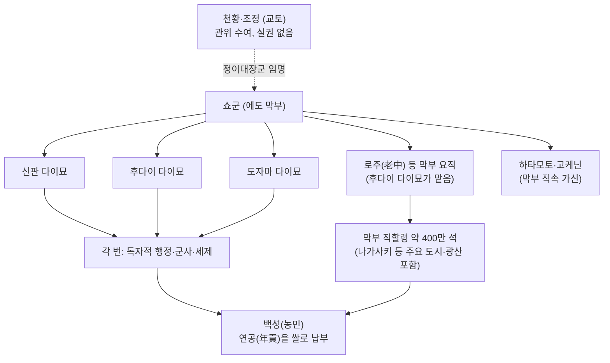
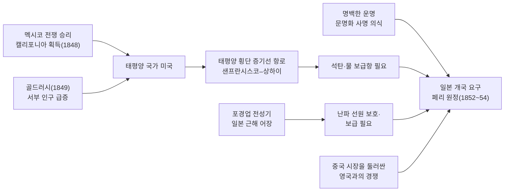
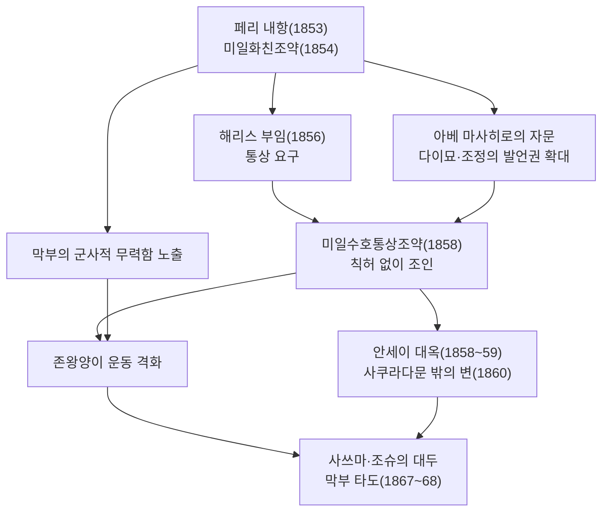

1853년 7월 8일(일본 달력으로 가에이(嘉永) 6년 6월 3일) 오후, 에도만 입구의 항구 우라가(浦賀) 앞바다에 검은 선체의 배 네 척이 닻을 내렸다. 두 척은 돛 없이도 바람을 거슬러 나아가는 증기선이었고, 나머지 두 척의 범선을 밧줄로 끌고 들어왔다. 해안의 주민과 경비 무사들은 굴뚝에서 뿜어 나오는 검은 연기와 거대한 외륜(外輪)이 물을 치는 소리를 처음 보고 들었다. 사람들은 이 배들을 **구로후네**(黒船), 곧 '흑선'이라 불렀다.

이 강의는 그날로 가는 길과 그 뒤 1년을 다룬다. 흑선은 하늘에서 갑자기 떨어진 사건이 아니었다. 일본은 반세기 넘게 러시아·영국·미국 배의 접근을 겪었고, 이웃 청나라가 영국에 패하는 과정도 지켜보고 있었다. 그럼에도 페리 함대의 등장이 일본 근대사의 출발점으로 꼽히는 까닭은, 이 사건을 계기로 250년 가까이 이어진 도쿠가와 막부의 대외 체제가 무너지고, 그 균열이 결국 막부 자체의 붕괴(1867)와 메이지 유신으로 이어졌기 때문이다.

> [!핵심] 이 강의의 질문
> 1. 페리가 오기 전 일본은 어떤 나라였고, 바깥 세계와 어떻게 관계를 맺고 있었는가?
> 2. 미국은 왜 1850년대에 일본을 '열어야' 했는가?
> 3. 막부는 흑선 앞에서 무엇을 선택했고, 그 선택은 일본 정치에 어떤 변화를 불러왔는가?

```figure
src: asset:337dec323b03caa6d390ca08fe0a26a6
caption: 1854년 흑선 내항을 알린 인쇄물. 위쪽 칸에는 에도만 해안의 지점마다 경비를 맡은 다이묘의 이름과 가문 문장이, 왼쪽 아래에는 함대가 떠 있는 에도만 지도가, 오른쪽 아래에는 연기를 뿜는 증기선과 미국인의 모습이 실려 있다. 이런 인쇄물이 팔리면서 흑선 소식이 빠르게 퍼졌다.
credit: 작자 미상, 1854년
license: Public Domain
source: https://commons.wikimedia.org/wiki/File:Japanese_1854_print_Commodore_Perry.jpg
width: wide
```

## 흑선 이전의 일본: 막번 체제

### 쇼군과 다이묘, 석고로 짜인 나라

1600년 세키가하라(関ヶ原) 전투에서 승리한 도쿠가와 이에야스(徳川家康)는 1603년 조정(천황)으로부터 정이대장군(征夷大将軍)에 임명되어 에도(江戸, 지금의 도쿄)에 막부(幕府)를 열었다. 1615년 오사카 여름 전투로 도요토미 가문을 멸망시킨 뒤로는 막부에 맞설 세력이 사라졌고, 이후 1867년 대정봉환까지 약 260년 동안 도쿠가와 가문의 쇼군 15대가 일본을 다스렸다. 이 시기를 **에도 시대**라 부른다.

에도 시대의 정치 구조를 흔히 **막번 체제**(幕藩体制)라 한다. 전국의 땅은 크게 두 종류로 나뉘었다. 하나는 막부가 직접 다스리는 직할령(천령, 天領)과 막부 직속 가신(하타모토, 旗本)의 영지이고, 다른 하나는 1만 석 이상의 영지를 받은 영주, 곧 **다이묘**(大名)가 다스리는 **번**(藩)이다. 막말 무렵 번은 260~270개 정도였다.

땅의 크기와 가치는 면적이 아니라 **석고**(石高), 즉 그 땅에서 거둘 수 있다고 공인된 쌀 수확량으로 매겼다. 1석은 성인 한 사람이 1년 동안 먹는 쌀의 양(약 180리터)에 해당한다. 전국의 석고는 19세기 전반에 약 3,000만 석이었는데, 막부 직할령이 그중 약 400만 석, 하타모토 영지까지 합치면 약 700만 석으로 전국의 4분의 1 가까이를 차지했다. 어떤 다이묘도 혼자서는 막부에 견줄 수 없었다.

```chart
{
  "type": "bar",
  "caption": "막부 직할령과 주요 번의 석고 비교 (단위: 만 석, 공식 석고인 표고(表高) 기준 근사치, 막말 무렵). 막부 직할령은 하타모토 영지를 제외한 수치",
  "height": 380,
  "data": {
    "labels": ["막부 직할령", "가가(마에다)", "사쓰마(시마즈)", "센다이(다테)", "오와리(도쿠가와)", "기이(도쿠가와)", "구마모토(호소카와)", "후쿠오카(구로다)", "히로시마(아사노)", "조슈(모리)", "사가(나베시마)"],
    "datasets": [{ "label": "석고(만 석)", "data": [400, 102.5, 77, 62.5, 61.9, 55.5, 54, 47.3, 42.6, 36.9, 35.7] }]
  },
  "options": { "indexAxis": "y", "plugins": { "legend": { "display": false } } }
}
```

다이묘는 도쿠가와 가문과의 관계에 따라 세 부류로 나뉘었고, 막부는 이 구분에 따라 배치와 대우를 달리했다.

| 구분 | 뜻 | 대표적 예 | 막부의 대우 |
|---|---|---|---|
| 신판(친번)親藩 | 도쿠가와 일족 | 오와리·기이·미토의 고산케(御三家) | 쇼군 후계자 배출, 요지에 배치 |
| 후다이(譜代) | 세키가하라 이전부터의 가신 | 이이(히코네), 사카이, 아베 등 | 석고는 작지만 로주(老中) 등 막부 요직 독점 |
| 도자마(外様) | 세키가하라 전후에 복속한 다이묘 | 시마즈(사쓰마), 모리(조슈), 마에다(가가), 다테(센다이) | 석고는 크지만 막부 정치에서 배제, 주로 변방에 배치 |

표: 다이묘의 세 부류

이 표에서 눈여겨볼 것은 **도자마 대번**이다. 사쓰마와 조슈는 큰 영지와 독자적 재정, 그리고 세키가하라에서 진 쪽이라는 오래된 기억을 지닌 채 막부 정치에서 소외되어 있었다. 흑선 이후 막부의 권위가 흔들리자 이들이 정치 무대 한가운데로 걸어 나오게 된다. 이 이야기는 뒤의 강의에서 이어진다.

### 다이묘를 묶어 두는 장치

막부는 군사력만으로 다이묘를 통제하지 않았다. 1615년 처음 반포된 **무가제법도**(武家諸法度)는 성의 신축·무단 수리 금지, 다이묘 사이의 사사로운 혼인 금지 등을 규정했고, 같은 해의 **일국일성령**(一国一城令)은 다이묘가 영지 안에 성을 하나만 두게 했다. 무엇보다 강력했던 것은 3대 쇼군 도쿠가와 이에미쓰(徳川家光)가 1635년 제도화한 **산킨코타이**(参勤交代)였다.

산킨코타이에 따라 다이묘는 원칙적으로 1년은 에도에, 1년은 자기 영지에 머물러야 했고, 정실 부인과 후계자는 에도에 상주했다. 사실상의 인질이다. 다이묘 행렬은 수백에서 수천 명에 이르렀고, 에도의 저택 유지비까지 합치면 번 재정의 상당 부분이 여기에 들어갔다. 이 제도는 다이묘의 반란 능력을 꺾는 동시에, 전국을 잇는 가도(街道)와 숙박 도시를 발달시키고 에도를 인구 100만 안팎의 거대 소비 도시로 키웠다.

```figure
src: asset:2926ad9842ac705caa5f08883b9ddcd0
caption: 우타가와 히로시게, 『도카이도 53역참』 중 「니혼바시 아침 풍경」. 새벽에 에도 니혼바시를 건너 길을 떠나는 다이묘 행렬의 선두(창과 짐을 멘 수행원들)를 그렸다. 니혼바시는 전국 가도의 출발점이었다.
credit: 우타가와 히로시게(歌川広重), 1833~34년경
license: Public Domain
source: https://commons.wikimedia.org/wiki/File:Hiroshige01_nihonbashi.jpg
width: wide
```



### 신분과 쌀의 경제

사회는 원칙적으로 무사·백성(주로 농민)·조닌(町人, 상인과 수공업자) 등의 신분으로 나뉘었다. 일본 인구는 18세기 이후 대략 3,000만 명 안팎에서 정체되어 있었는데, 무사와 그 가족은 그중 6~7% 정도였고 인구의 80% 이상이 농촌에 살았다. 무사는 성 아래 마을(조카마치, 城下町)에 모여 살며 주군에게서 쌀로 녹봉을 받았고, 농민은 수확의 40~50%에 이르는 연공을 쌀로 바쳤다.

문제는 이 '쌀 경제'가 시간이 갈수록 현실과 어긋났다는 점이다. 평화가 오래 이어지자 상품 생산과 화폐 경제가 발달했고, 오사카는 전국의 쌀과 물산이 모이는 '천하의 부엌'이 되었다. 무사는 받은 쌀을 팔아 돈으로 바꿔 생활해야 했으므로 쌀값이 떨어지면 살림이 쪼들렸고, 많은 번과 무사가 상인에게 빚을 졌다. 막부는 18~19세기에 세 차례 큰 개혁(교호(享保) 개혁 1716~, 간세이(寛政) 개혁 1787~, 덴포(天保) 개혁 1841~)을 벌였지만 구조적인 재정난을 끝내 해결하지 못했다. 흑선이 도착했을 때 막부는 이미 돈도, 바다를 지킬 근대적 군함도 없는 상태였다.

### '쇄국'과 네 개의 창구

막부는 1630년대에 일련의 법령으로 일본인의 해외 도항과 귀국을 금지하고, 크리스트교를 엄금했다. 1637~38년 규슈 시마바라·아마쿠사에서 일어난 대규모 농민 봉기(시마바라의 난)에 크리스트교도가 많이 가담하자, 막부는 1639년 포르투갈 배의 내항을 금지했다. 1641년에는 히라도에 있던 네덜란드 상관을 나가사키 앞바다의 부채꼴 인공섬 **데지마**(出島)로 옮겼다. 이렇게 완성된 대외 체제를 흔히 **쇄국**(鎖国)이라 부른다.

```figure
src: asset:b35a6230a83d8974fb40b3bb7f6f4d90
caption: 가와하라 게이가, 「나가사키항 데지마 조망도」 병풍. 아래 왼쪽의 부채꼴 인공섬이 데지마다. 네덜란드인은 이 좁은 섬 안에서만 생활하고 거래할 수 있었다.
credit: 가와하라 게이가(川原慶賀), 1836년경
license: CC BY-SA 4.0
source: https://commons.wikimedia.org/wiki/File:View_of_Dejima_in_Nagasaki_Bay_Folding_Screen_by_Kawahara_Keiga_c1836.jpg
width: wide
```

그런데 '쇄국'이라는 말 자체는 당시 막부가 쓴 용어가 아니다. 1801년 나가사키의 통역관 출신 학자 시즈키 다다오(志筑忠雄)가 독일인 의사 엥겔베르트 켐퍼의 『일본지』 부록을 번역하면서 붙인 제목 『쇄국론』에서 비롯되었다. 실제 일본은 나라 문을 완전히 닫은 것이 아니라, 막부가 통제하는 네 개의 창구로만 바깥과 통했다. 오늘날 일본 역사학계는 이를 **'네 개의 창구'**(四つの口) 라 부르며, '쇄국'보다 막부가 대외 관계를 독점·관리한 체제로 이해하는 경향이 강하다.

| 창구 | 관리자 | 상대 | 성격 |
|---|---|---|---|
| 나가사키 | 막부(나가사키 부교) | 네덜란드, 중국(청) | 통상만 허용(통상국). 네덜란드인은 데지마, 중국인은 도진야시키(唐人屋敷)에 거주 |
| 쓰시마 | 쓰시마번(소 가문) | 조선 | 국교가 있는 통신국. 부산 왜관에서 무역, 쇼군 교체 때 조선통신사 방문 |
| 사쓰마 | 사쓰마번(시마즈 가문) | 류큐 왕국 | 1609년 사쓰마가 류큐를 침공해 지배. 류큐를 통해 청과의 간접 무역 |
| 마쓰마에 | 마쓰마에번 | 아이누(에조치) | 아이누와의 교역 독점. 북방 정보의 창구 |

표: 에도 시대의 '네 개의 창구'

이 체제에서 특히 중요한 것은 **정보**였다. 네덜란드 상관장은 배가 들어올 때마다 해외 소식을 정리한 보고서, 곧 **오란다 풍설서**(和蘭風説書)를 막부에 제출해야 했다. 막부는 이를 통해 프랑스 혁명과 나폴레옹 전쟁, 아편전쟁 같은 세계정세를 꽤 정확히 알고 있었다. 18세기 후반부터는 네덜란드어 서적으로 서양 학문을 배우는 **난학**(蘭学)도 퍼졌다. 1774년 스기타 겐파쿠(杉田玄白) 등이 네덜란드어 해부학 책을 번역한 『해체신서』(解体新書)가 대표적이다.

> [!참고] 조선과 일본
> 조선은 '네 개의 창구' 가운데 유일하게 막부와 정식 국교를 맺은 나라였다. 1607년부터 1811년까지 조선통신사가 12차례 일본을 방문했다. 마지막 통신사(1811)는 에도까지 가지 않고 쓰시마에서 국서를 교환했는데, 막부의 재정난과 외교 의례 간소화가 겹친 결과였다.

## 다가오는 외압, 1792~1846

18세기 말부터 일본 근해에 이국선(異国船)이 잇따라 나타났다. 처음 온 것은 시베리아를 거쳐 태평양으로 내려온 러시아였고, 이어 나폴레옹 전쟁 중의 영국, 그리고 포경선을 앞세운 미국이 뒤따랐다.

```timeline
1792 | 러시아 사절 락스만, 네무로 내항 | 일본인 표류민 다이코쿠야 고다유(大黒屋光太夫)를 송환하며 통상 요구. 막부는 나가사키 입항 허가증(신패, 信牌)을 주고 돌려보냄
1804 | 러시아 사절 레자노프, 나가사키 내항 | 신패를 들고 왔으나 반년을 기다린 끝에 통상 거절당함
1806~07 | 러시아 군인의 사할린·에토로후 습격(분카(文化) 러시아 사건) | 레자노프의 부하들이 보복으로 일본 거점을 공격. 막부, 에조치를 직할령으로 삼고 북방 경비 강화
1808 | 페이튼호 사건 | 영국 군함이 네덜란드 배를 찾아 나가사키항에 침입, 인질을 잡고 물자 요구. 나가사키 부교 마쓰다이라 야스히데가 책임지고 할복
1811 | 골로브닌 사건 | 쿠릴 열도를 측량하던 러시아 함장 골로브닌을 막부가 붙잡아 2년간 억류
1825 | 이국선 타불령(異国船打払令) | 청·네덜란드 외의 외국 배는 '두 번 생각 말고(無二念)' 포격해 쫓아내라고 명령
1837 | 모리슨호 사건 | 일본인 표류민 7명을 송환하러 온 미국 상선 모리슨호를 우라가와 가고시마에서 포격해 쫓아냄
1839 | 반샤의 옥(蛮社の獄) | 모리슨호 대응을 비판한 난학자 와타나베 가잔·다카노 조에이 등을 처벌
1840~42 | 아편전쟁 | 청이 영국에 패하고 난징조약(1842)으로 홍콩 할양·5개 항구 개항
1842 | 덴포 신수급여령(天保薪水給与令) | 타불령을 철회하고, 표착한 외국 배에 땔감과 물(薪水)·식량을 주어 돌려보내도록 완화
1844 | 네덜란드 국왕 빌럼 2세의 친서 | 개국을 권고. 막부는 이듬해 "조법(祖法)을 바꿀 수 없다"며 거절
1846 | 미국 동인도함대 사령관 비들, 우라가 내항 | 군함 2척으로 통상을 요청했으나 거절당하자 순순히 철수
1852 | 네덜란드 풍설서, 미국 함대의 내항 예고 | 막부는 페리 함대가 올 것을 1년 전에 알고 있었음
```

### 아편전쟁의 충격

이 연표에서 분수령은 **아편전쟁**이다. 동아시아의 중심이라 여겨지던 청나라가 영국 해군에 일방적으로 패배했다는 소식은 풍설서와 중국 상인들을 통해 일본에 전해졌다. 특히 영국 동인도회사의 철제 증기선 네메시스호가 청나라 수군의 정크선을 압도하는 장면은 '서양 증기 군함'이라는 새로운 위협을 상징했다.

```figure
src: asset:d3b5165ffe124be2c2bbaf09aab10045
caption: 에드워드 덩컨, 「청나라 전투 정크선을 파괴하는 네메시스호」. 1841년 1월 7일 광저우 근처 전투를 그렸다. 오른쪽 뒤의 검은 철제 증기선이 영국 동인도회사의 네메시스호다.
credit: 에드워드 덩컨(Edward Duncan), 1843년
license: Public Domain
source: https://commons.wikimedia.org/wiki/File:Destroying_Chinese_war_junks,_by_E._Duncan_(1843).jpg
width: wide
```

막부의 반응은 빨랐다. 1842년, 전쟁이 끝나기도 전에 막부는 17년간 유지해 온 이국선 타불령을 거두고 신수급여령으로 바꿨다. 외국 배를 무조건 포격하다가 청나라처럼 전쟁의 구실을 주어서는 안 된다는 판단이었다. 동시에 서양식 포술을 연구하던 다카시마 슈한(高島秋帆)의 시범 포격(1841)을 허가하는 등 군사 개혁도 모색했다.

> [!사료] 이국선 타불령 (1825, 분세이(文政) 8년)
> "이후로는 어느 해안에서든 이국선이 다가오는 것을 보면, 그곳에 있는 자들이 함께 나서서 두 번 생각할 것 없이(無二念) 쳐서 물리치라. 만일 상륙하는 자가 있으면 붙잡거나 죽여도 상관없다."
> — 막부 법령의 요지를 우리말로 옮김

그러나 신수급여령은 '물과 식량은 주되, 통상과 국교는 허락하지 않는다'는 원칙의 연장이었다. 1844년 네덜란드 국왕이 "이제는 문을 열어야 전쟁을 피할 수 있다"고 권고했을 때도, 1846년 미국의 비들 제독이 통상을 요청했을 때도 막부는 거절했다. 비들은 명령에 따라 무력을 쓰지 않고 물러갔는데, 이 일은 미국 해군 안에서 '정중하게 부탁해서는 일본이 움직이지 않는다'는 교훈으로 남았다. 7년 뒤의 페리는 정확히 그 교훈 위에서 행동했다.

## 미국은 왜 일본으로 왔나

1840년대 후반 미국은 대서양 국가에서 태평양 국가로 바뀌었다. 1846년 영국과의 협정으로 오리건을 확보했고, 1848년 멕시코와의 전쟁에서 이겨 캘리포니아를 손에 넣었다. 곧이어 캘리포니아에서 금광이 발견되자(골드러시, 1849) 서부 해안의 인구가 폭증했다. 미국인들은 대륙을 가로질러 태평양까지 뻗어 나가는 것을 신이 준 사명이라 여겼고, 이를 **'명백한 운명Manifest Destiny'** 이라 불렀다.

태평양 건너편에는 거대한 중국 시장이 있었다. 영국이 인도와 수에즈를 거치는 서쪽 항로를 장악하고 있었다면, 미국은 샌프란시스코에서 상하이로 곧장 가는 태평양 증기선 항로를 꿈꿨다. 문제는 당시 증기선이 석탄을 많이 먹는다는 점이었다. 태평양을 한 번에 건널 만큼 석탄을 싣기 어려웠으므로, 중간에 석탄과 물을 보급할 항구가 필요했다. 그 위치에 있는 나라가 바로 일본이었다.

또 하나의 동기는 **포경업**이다. 1840~50년대 미국 포경업은 전성기를 맞아 수백 척의 포경선이 전 세계 바다를 누볐다. 고래기름은 등불과 기계 윤활유로 쓰였고, 북태평양 일본 근해는 '재팬 그라운드Japan Ground'라 불리는 주요 어장이었다. 포경선이 폭풍으로 난파하면 선원들이 일본 해안에 표착했는데, 일본은 이들을 엄격히 억류했다가 나가사키를 통해 네덜란드 배에 넘겼다. 1849년 미국 군함 프레블호가 나가사키에서 억류 선원을 인수해 간 일은 미국 언론에서 '일본의 학대'로 크게 보도되었다.



> [!참고] 미국이 처음부터 '통상'을 노렸을까?
> 필모어 대통령 국서에는 통상이 분명히 들어 있었다. 그러나 당시 미국의 대일 무역 규모는 미미했고, 실제로 절박했던 것은 보급항과 선원 보호였다. 페리가 1854년 협상에서 통상을 끝내 고집하지 않고 개항과 보급만으로 조약을 맺은 것도 이런 우선순위를 보여 준다.

### 매슈 페리라는 인물

원정 책임자로 뽑힌 **매슈 캘브레이스 페리Matthew Calbraith Perry**(1794~1858)는 로드아일랜드의 해군 가문 출신이다. 형 올리버 해저드 페리는 1812년 전쟁의 이리호 전투에서 영국 함대를 격파한 국민 영웅이었다. 매슈 페리는 미국 해군 최초의 증기 군함 중 하나인 풀턴 2세호의 함장을 지냈고, 해군 공병 교육과 증기 해군 도입에 힘써 '증기 해군의 아버지'라 불렸다. 멕시코 전쟁에서는 멕시코만 함대를 지휘했다.

```figure
src: asset:13d2f18bb314c560d3065fe4e48ecf07
caption: 매슈 C. 페리(1794~1858). 일본 원정에서 돌아온 뒤 촬영한 사진이다.
credit: 매슈 B. 브래디(Mathew B. Brady) 촬영, 1856년경 · 미국 국립초상화미술관 소장
license: CC0 (퍼블릭 도메인)
source: https://commons.wikimedia.org/wiki/File:Matthew_Calbraith_Perry_by_Mathew_B._Brady,_c._1856,_salted_paper_print,_from_the_National_Portrait_Gallery_-_NPG-9101248C_1.jpg
width: narrow
```

1852년 동인도함대 사령관에 임명된 페리는 출항 전 일본에 관한 서양 서적을 모조리 구해 읽었다. 나가사키 데지마에서 의사로 일했던 독일인 필리프 프란츠 폰 지볼트의 저작이 대표적이다. 그가 내린 결론은 셋이었다. 첫째, 나가사키로 가지 말고 쇼군이 있는 에도 가까이 갈 것. 둘째, 하급 관리는 상대하지 말고 최고위 관리에게만 국서를 넘길 것. 셋째, 증기 군함의 위력을 보여 주되 먼저 발포하지는 말 것. 대통령에게 선전포고 권한이 없었기 때문에, 페리는 실제로 싸울 수는 없었다. 그러나 싸울 수도 있다는 인상을 주는 것은 그의 재량이었다.

페리는 1852년 11월 24일 미 동부의 노퍽을 출발해 대서양을 건너 마데이라, 희망봉(케이프타운), 실론, 싱가포르, 홍콩, 상하이를 거쳤다. 1853년 5월 류큐 왕국의 나하에 들러 수리(首里)성을 방문하고, 오가사와라 제도를 조사한 뒤 에도만으로 향했다. 류큐에 먼저 간 것은 일본이 거부할 경우 류큐를 거점으로 삼을 수 있는지 살피기 위해서였다.

## 1853년 7월, 우라가

### 네 척의 흑선

| 배 이름 | 종류 | 특징 |
|---|---|---|
| 서스케해나Susquehanna | 증기 외륜 프리깃 | 페리가 탄 기함. 범선 새러토가호를 끌고 입항 |
| 미시시피Mississippi | 증기 외륜 프리깃 | 멕시코 전쟁 때 페리의 기함. 범선 플리머스호를 끌고 입항 |
| 플리머스Plymouth | 범장 슬루프(소형 군함) | 돛으로 움직이는 범선 |
| 새러토가Saratoga | 범장 슬루프 | 돛으로 움직이는 범선 |

표: 1853년 페리 함대의 구성. 승무원은 모두 합쳐 약 1,000명이었다

일본인의 눈에 가장 충격적이었던 것은 증기선이 바람과 상관없이 움직인다는 사실이었다. 범선 시대의 상식으로는 바람이 반대 방향이면 배가 만으로 들어올 수 없었다. 그런데 이 검은 배들은 역풍 속에서도 연기를 뿜으며 들어와, 막부가 정해 둔 경계선을 넘어 우라가 바로 앞에 닻을 내렸다. 함대는 포문을 해안 쪽으로 열고 전투 준비 태세를 갖췄다.

```figure
src: asset:2ee87b47b280ee3f6866beddd70c139c
caption: 페리 함대의 기함 서스케해나호. 돛대 사이의 굴뚝과, 선체 옆 외륜을 덮은 커다란 상자 모양의 덮개가 보인다. 1930년대 일본 간행물에 실린 사진이다.
credit: 도요분카쿄카이(東洋文化協会) 간행, 1933~34년
license: Public Domain
source: https://commons.wikimedia.org/wiki/File:Kurofune.jpg
```

### "I can speak Dutch!"

일본 측 경비선들이 서스케해나호를 에워쌌다. 우라가 부교쇼의 요리키(与力, 하급 관리) 나카지마 사부로스케(中島三郎助)와 네덜란드어 통역 호리 다쓰노스케(堀達之助)가 작은 배를 타고 기함에 다가갔다. 이때 호리가 외쳤다고 전하는 첫마디가 "I can speak Dutch!"(나는 네덜란드어를 할 수 있다)이다. 일본과 미국의 첫 공식 대화는 영어 한 문장으로 시작해 네덜란드어로 이어졌다. 미국 측에도 네덜란드어 통역이 있었기 때문이다.

페리는 하급 관리를 만나 주지 않았다. 부하를 시켜 "대통령의 국서를 쇼군에게 전달하러 왔으며, 고위 관리가 아니면 넘기지 않겠다. 나가사키로 가라는 요구에는 응하지 않는다. 받아 주지 않으면 무력으로 상륙해 직접 전달하겠다"고 통고했다. 이튿날에는 우라가 부교를 자처한 가야마 에이자에몬(香山栄左衛門)이 협상에 나섰지만 같은 답을 들었다. 그사이 미국 측량선들은 막부의 항의를 무시하고 에도만 안쪽 깊숙이 들어가 수심을 쟀다. 에도의 시민들이 바다 쪽에서 들려오는 예포 소리에 놀라 피난 짐을 싸는 소동도 벌어졌다.

### 구리하마의 국서 전달

막부의 최고 책임자는 로주 수좌(老中首座) **아베 마사히로**(阿部正弘, 1819~1857)였다. 쇼군 도쿠가와 이에요시(徳川家慶)는 마침 병석에 있었다. 아베는 전쟁을 피하는 것을 최우선으로 삼아, 국서를 '받기만 하고 회답은 나중에 하는' 길을 택했다. 수령 장소로는 우라가 남쪽의 작은 해변 구리하마(久里浜)가 정해졌다.

1853년 7월 14일(가에이 6년 6월 9일), 페리는 장교·수병·해병대 약 300명을 거느리고 군악대의 연주 속에 구리하마에 상륙했다. 급히 지은 응접소에서 우라가 부교 도다 우지요시(戸田氏栄)와 이도 히로미치(井戸弘道)가 필모어 대통령의 국서와 페리의 서한을 받았다. 회견은 30분도 안 걸렸고, 일본 측은 한마디도 하지 않은 채 수령증만 건넸다. 해변 뒤에는 막부의 명을 받은 여러 번의 병력 수천 명이 진을 쳤지만, 대부분 칼과 창, 구식 화승총으로 무장한 상태였다.

> [!사료] 필모어 대통령이 쇼군에게 보낸 국서 (1852년 11월 13일 자)
> "나는 페리 제독에게, 우리가 폐하와 폐하의 제국을 향해 가장 우호적인 감정을 품고 있으며, 이 원정의 목적은 오로지 미국과 일본이 우호를 맺고 서로 통상하기를 제안하는 것임을 확언하라고 명하였습니다. … 우리는 우호, 통상, 석탄과 식량의 공급, 그리고 난파한 우리 국민의 보호를 바랍니다."
> — 국서 영문본의 일부를 우리말로 옮김

페리는 국서를 넘기면서 "내년 봄, 더 큰 함대를 이끌고 회답을 받으러 다시 오겠다"고 통고했다. 그리고 7월 17일 에도만을 떠났다. 그가 머문 것은 열흘이 채 안 되었지만, 그 열흘은 일본 사회 전체를 뒤흔들었다.

> [!더알아보기] 흑선을 노래한 교카(狂歌)
> "태평한 잠을 깨우는 조키센(上喜撰), 겨우 네 잔에 밤에도 잠 못 이루네(泰平の眠りをさます上喜撰 たった四杯で夜も寝られず)." '조키센'은 고급 녹차 이름인데 증기선(蒸気船, 조키센)과 소리가 같고, '네 잔'은 네 척의 배를 가리킨다. 차를 넉 잔 마시고 잠을 못 자듯 증기선 네 척에 나라가 잠 못 든다는 풍자다. 흑선 사건을 상징하는 노래로 유명하지만, 당대에 지어진 것인지는 의문이 제기되어 있고 후대에 만들어졌다는 견해도 있다.

### 흑선은 어떻게 그려졌나

흑선과 '이국인'의 모습은 곧바로 목판 인쇄물과 가와라반(瓦版, 한 장짜리 소식지)으로 퍼져 나갔다. 화가들은 대부분 실물을 직접 보지 못했기 때문에 전해 들은 이야기를 바탕으로 그렸고, 그래서 증기선은 연기를 뿜는 괴물처럼, 페리는 매부리코에 험상궂은 얼굴로 과장되곤 했다. 이 그림들은 정확한 기록이라기보다 당시 일본인이 흑선을 어떻게 '상상'했는지 보여 주는 사료다.

```figure
src: asset:9ddd82da479afe77c6643c7efcf4c498
caption: 일본에서 찍은 페리 초상 판화. 오른쪽 위에 '寅六十才'(인년, 60세)라고 적혀 있어 1854년(갑인년)의 모습을 상상해 그린 것으로 보인다. 화가는 페리를 직접 보지 못한 채 서양인에 대한 소문을 바탕으로 그렸다.
credit: 작자 미상, 1854년경 · 미국 국립초상화미술관 소장
license: CC0 (퍼블릭 도메인)
source: https://commons.wikimedia.org/wiki/File:Matthew_Calbraith_Perry_by_an_unidentified_artist,_c._1854,_colored_woodblock_print,_from_the_National_Portrait_Gallery_-_NPG-NPG_77_1Perry-000001.jpg
width: narrow
```

## 막부의 선택: 아베 마사히로의 '자문'

### 전례 없는 의견 수렴

페리가 떠나고 열흘 뒤인 7월 27일(6월 22일), 쇼군 이에요시가 세상을 떠났다. 뒤를 이은 13대 쇼군 도쿠가와 이에사다(徳川家定)는 병약해 정치를 이끌 수 없었다. 1년 뒤 다시 올 페리에게 어떤 답을 줄지는 고스란히 아베 마사히로의 몫이 되었다.

아베는 이 문제를 혼자 결정하지 않았다. 1853년 7월(가에이 6년 7월), 그는 필모어 국서를 번역해 다이묘 전원과 하타모토 등 막신에게 회람하고 의견서를 제출하게 했다. 국서는 조정에도 보고되었다. 다이묘에게 정책 의견을 묻는 것은 막부 260년 역사에 거의 없던 일이었다. 막부의 정책은 쇼군과 후다이 출신 로주들이 정하고, 다른 다이묘는 따르기만 하는 것이 원칙이었기 때문이다. 의견서는 수백 통이 모였고, 그 가운데에는 하급 막신이었던 가쓰 린타로(勝麟太郎, 훗날의 가쓰 가이슈, 勝海舟)의 해방(海防) 의견서도 있었다. 가쓰는 이를 계기로 발탁되어 나중에 막부 해군의 중심인물이 된다.

| 입장 | 요지 | 대표적 인물·세력 |
|---|---|---|
| 거부·주전론 | 국서를 물리치고 필요하면 싸워야 한다 | 미토번 전 번주 도쿠가와 나리아키(徳川斉昭) 등 |
| 일시 회피론 (다수) | 지금은 싸울 힘이 없으니 답을 미루거나 일부만 들어주고, 그사이 군비를 갖춘다 | 대다수 다이묘 |
| 개국·통상론 (소수) | 통상을 통해 부를 쌓고 서양 기술을 배워 나라를 강하게 해야 한다 | 일부 다이묘와 난학 지식을 가진 막신 |

표: 다이묘·막신 의견서의 대체적 경향

> [!핵심] 왜 '자문'이 중요한가
> 아베의 의견 수렴은 위기를 넘기려는 현실적 선택이었다. 국론을 모아야 책임도 나눌 수 있었다. 그러나 그 결과 막부가 외교를 독점해 온 원칙에 금이 갔다. 한 번 의견을 말할 기회를 얻은 다이묘들, 그리고 국서 보고를 받은 천황의 조정은 이후 외교 문제에 계속 목소리를 내게 된다. 1858년 통상조약을 둘러싸고 조정의 허가(칙허)가 정치 쟁점이 되는 것도 이 흐름의 연장선에 있다.

아베는 강경파의 반발을 다독이기 위해 도쿠가와 나리아키를 해방참여(海防参与)로 막부 정치에 끌어들였다. 동시에 개혁도 서둘렀다. 1853년 9월, 막부는 1635년 이래 다이묘가 큰 배를 만드는 것을 막아 온 **대선건조 금지령**을 풀었고, 네덜란드에 증기 군함을 주문했다. 1855년에는 네덜란드 해군 교관을 초빙해 나가사키에 **해군 전습소**를 열었다.

### 에도만의 포대, 다이바

가장 눈에 보이는 대응은 에도 앞바다에 인공섬 포대를 쌓은 것이다. 이즈 니라야마의 대관(代官)으로 서양 포술을 연구한 에가와 히데타쓰(江川英龍, 에가와 다로자에몬)의 설계에 따라 1853년 8월 공사가 시작되었다. 바다를 메워 만든 섬 위에 대포를 늘어놓아, 적함이 에도 앞바다로 들어오지 못하게 하려는 것이었다. 처음에는 11기를 계획했지만 재정난으로 6기만 완성되었다. 이것이 **시나가와 다이바**(品川台場)이며, 오늘날 도쿄의 '오다이바'라는 지명이 여기서 나왔다. 제3 다이바와 제6 다이바는 지금도 남아 국가 사적으로 지정되어 있다.

## 1854년, 다시 온 함대와 미일화친조약

### 예상보다 빠른 귀환

페리는 약속보다 이른 1854년 2월 13일(가에이 7년 1월 16일) 다시 에도만에 나타났다. 이번에는 증기선 3척을 포함한 7척이었고, 나중에 2척이 더 합류해 9척이 되었다. 쇼군의 죽음을 알고 막부가 정비할 시간을 주지 않으려 했다는 해석도 있고, 러시아(푸차친 함대가 1853년 8월 나가사키에 와 있었다)나 프랑스가 먼저 일본과 조약을 맺을까 봐 서둘렀다는 해석도 있다.

막부는 우라가에서 협상하자고 했고, 페리는 에도로 가겠다고 맞섰다. 결국 두 곳의 중간에 있는 작은 어촌 **요코하마촌**이 협상 장소로 정해졌다. 3월 8일 페리는 약 500명을 거느리고 요코하마에 상륙했다. 일본 측 전권은 막부의 유학(儒學) 최고 책임자인 대학두(大学頭) 하야시 아키라(林韑, 하야시 후쿠사이)였다.

```figure
src: asset:49ad1871f3b82d00f6850272e0db2557
caption: 빌헬름 하이네, 「요코하마에서 일본 전권과 만나기 위해 상륙하는 페리 제독과 함대 장병들」(1854년 3월 8일). 하이네는 원정에 동행한 화가였다. 앞바다에 페리의 함대가, 해안에 급히 지은 응접소가 보인다.
credit: 빌헬름 하이네(Wilhelm Heine) 원화, 뉴욕 E. Brown, Jr. 간행 석판화
license: Public Domain
source: https://commons.wikimedia.org/wiki/File:Commodore-Perry-Visit-Kanagawa-1854.jpg
width: wide
```

### 협상: 무엇을 주고 무엇을 지켰나

하야시는 노련한 협상가였다. 그는 표류민 구조와 땔감·물·식량·석탄 공급은 이미 신수급여령에서 인정한 일이라며 받아들였지만, **통상만은 단호히 거부**했다. 미국이 내세운 것이 인명 보호라면 그것은 이미 들어주었으니, 이익을 위한 통상까지 함께 요구할 까닭은 없다는 것이 하야시의 논리였다. 페리는 통상을 다음 단계로 미루는 대신 개항장과 영사 주재 조항을 얻어 내는 쪽을 택했다.

협상 중에는 문화 교류의 장면도 있었다. 미국 측은 실물의 약 4분의 1 크기인 증기기관차 모형과 원형 선로, 전신기, 망원경, 농기구, 무기 등을 선물했다. 요코하마 해변에 깔린 선로 위를 기관차 모형이 달리자, 일본 관리들이 객차 지붕에 걸터앉아 타 보기도 했다. 약 1킬로미터 떨어진 두 건물 사이에 전신선을 깔고 신호를 주고받는 시연도 벌어졌다. 일본 측은 칠기·비단·도자기와 쌀 200표(俵)를 답례로 주었고, 스모 선수들이 쌀가마니를 번쩍 들어 나르고 시합을 벌여 미국인들을 놀라게 했다.

### 미일화친조약 (가나가와 조약)

1854년 3월 31일(가에이 7년 3월 3일), 요코하마에서 **미일화친조약**(日米和親条約)이 조인되었다. 조약은 모두 12개조다.

| 조항 | 내용 |
|---|---|
| 제1조 | 미국과 일본 사이의 영구적인 평화와 우호 |
| 제2조 | 시모다(下田, 즉시)와 하코다테(箱館, 1년 뒤)를 개항해 미국 배에 땔감·물·식량·석탄 등을 공급 |
| 제3조 | 일본 해안에 표착한 미국 선원을 구조해 시모다나 하코다테로 보내 인도 |
| 제4조 | 표류민 등 미국인을 다른 나라 사람처럼 자유롭게 대하되, 정당한 법에는 따르게 함 |
| 제5조 | 시모다와 하코다테에서 미국인이 일정 범위(시모다는 약 7리) 안을 자유롭게 다닐 수 있음 |
| 제6조 | 그 밖에 필요한 물품과 사항은 양국이 협의해 정함 |
| 제7조 | 미국 배는 금화·은화나 물품으로 필요한 물건을 살 수 있음(일본 관리가 정한 규칙에 따름) |
| 제8조 | 땔감·물·식량·석탄 등은 일본 관리를 통해서만 공급 |
| 제9조 | **일본이 앞으로 다른 나라에 더 유리한 조건을 주면 미국에도 똑같이 적용(편무적 최혜국 대우)** |
| 제10조 | 미국 배는 조난 등 부득이한 경우 외에는 시모다·하코다테 이외의 항구에 들어가지 못함 |
| 제11조 | **조약 조인 18개월 뒤, 필요할 경우 미국 영사를 시모다에 둘 수 있음** |
| 제12조 | 조약은 18개월 안에 양국 비준서를 교환함 |

표: 미일화친조약의 조항 요지

이 조약에는 **통상 조항이 없다.** 그래서 막부는 이 조약을 '쇄국의 원칙은 지키면서 신수급여령을 조약으로 확인한 것'으로 해석하려 했다. 그러나 두 조항이 훗날 큰 의미를 갖게 된다.

첫째, **제9조의 편무적 최혜국 대우**다. 일본이 다른 나라에 무엇이든 더 주면 미국도 자동으로 같은 혜택을 받지만, 그 반대는 없다. 이후 일본이 맺는 모든 조약의 이익이 미국에도 흘러가는 구조였다.

둘째, **제11조의 영사 주재**다. 이 조항은 영어본과 일본어본의 뜻이 달랐다. 영어본은 '양국 정부 중 어느 한쪽이(either of the two governments)' 필요하다고 보면 영사를 둘 수 있다고 썼고, 일본어본(한문본)은 양국이 모두 부득이하다고 인정할 때로 읽힐 여지가 있었다. 막부는 영사를 받아들일 생각이 없었지만, 1856년 8월 미국 총영사 **타운센드 해리스**가 시모다에 도착해 영어본을 근거로 부임을 밀어붙였다. 해리스는 2년 뒤 통상조약을 맺는다. 그 이야기가 2강의 주제다.

```figure
src: asset:f80abe268664334c3dd84d6848f0dfc7
caption: 미일화친조약의 일본어 정본(비준서). 오른쪽 면에는 일본 측 전권인 하야시 대학두 등의 이름이, 왼쪽 면에는 '제1개조: 일본과 합중국은 그 인민이 영원히 변치 않는 화친을 맺고…'로 시작하는 본문이 보인다.
credit: 1855년 2월 21일 비준 · World Imaging 촬영, 2009년
license: CC BY-SA 3.0
source: https://commons.wikimedia.org/wiki/File:Ratification_of_the_Japan_USA_Treaty_of_Peace_and_Amity_21_February_1855.jpg
```

### 다른 나라들도 뒤따르다

미국과의 조약은 곧 다른 나라의 선례가 되었다. 제9조 최혜국 대우 때문에, 일본이 다른 나라와 맺는 조약도 미국과의 조약을 기준으로 삼을 수밖에 없었다.

```compare
항목 | 미국 | 영국 | 러시아 | 네덜란드
조약 | 미일화친조약 | 영일화친약정 | 러일화친조약 | 네덜란드와의 화친조약
체결 | 1854년 3월 | 1854년 10월 | 1855년 2월 | 1856년 1월
장소 | 가나가와(요코하마) | 나가사키 | 시모다 | 나가사키
일본 측 개항지 | 시모다, 하코다테 | 나가사키, 하코다테 | 시모다, 하코다테, 나가사키 | 기존 데지마 무역을 조약으로 정리
특기 사항 | 최혜국 대우, 영사 주재 | 영국 동인도함대 스털링 제독 | 에토로후 이남은 일본, 우루프 이북은 러시아, 사할린은 경계를 두지 않음 | 데지마의 네덜란드인 행동 제한 완화
```

러시아와의 조약은 오늘날까지 이어지는 국경 문제의 출발점이라는 점에서도 중요하다. 러시아 사절 푸차친은 1853년 페리와 거의 같은 시기에 나가사키에 와서 국경 획정과 통상을 요구했고, 1855년 2월 7일(안세이(安政) 원년 12월 21일) 시모다에서 조약을 맺었다. 이 조약에서 쿠릴 열도의 에토로후섬과 우루프섬 사이에 국경선이 그어졌다. 일본이 오늘날 '북방 영토'의 근거로 드는 것이 바로 이 선이다.

## 개국은 무엇을 바꾸었나

### '전쟁 없는 개국'

흑선 사건을 아편전쟁과 비교해 보면 일본의 개국이 지닌 특징이 드러난다.

```compare
항목 | 청 (아편전쟁) | 일본 (페리 내항)
개항의 계기 | 전쟁 패배(1840~42) | 무력 시위 속의 협상(1853~54)
첫 조약 | 난징조약(1842): 홍콩 할양, 5개 항 개항, 배상금 | 미일화친조약(1854): 2개 항 개항(보급용), 배상금·영토 할양 없음
통상 | 즉시 개시 | 화친조약에는 없음(1858 통상조약에서 개시)
사전 정보 | 서양 사정에 대한 체계적 정보 부족 | 풍설서로 아편전쟁과 페리 내항을 미리 파악
직후의 정치 | 청 조정의 권위는 유지되었으나 내란(태평천국) 발생 | 막부의 외교 독점이 무너지고 조정·대번의 발언권 확대
```

일본은 청처럼 전쟁에 지고 문을 연 것이 아니었다. 막부는 풍설서로 바깥 정세를 미리 알았고, 싸우면 진다는 현실을 받아들여 협상을 택했으며, 협상에서도 통상을 1차로 막아 냈다. 이 점에서 막부의 대응은 흔히 생각하는 것만큼 무력하지 않았다. 최근 연구에서는 막부 관리들의 외교 능력을 다시 평가하는 경향이 강하다.

### 그러나 흔들리기 시작한 막부

그럼에도 흑선은 막부 체제의 약점을 드러냈다. 정리하면 다음과 같다.

1. **군사적 무력함의 노출**: '오랑캐를 물리친다'는 무가 정권이 정작 외국 군함 앞에서 국서를 받을 수밖에 없었다. 무사 계급의 존재 이유가 흔들렸다.
2. **외교 독점의 붕괴**: 아베의 자문 이후 다이묘와 조정이 외교 문제에 발언하기 시작했다. 막부가 혼자 결정하던 시대가 끝났다.
3. **조정의 부상**: 국서가 조정에 보고되면서, 교토의 천황이 정치적 상징으로 떠올랐다. 이는 훗날 '천황을 받들고 오랑캐를 물리치자'는 **존왕양이**(尊王攘夷) 운동으로 이어진다.
4. **개혁의 시작**: 대선 건조 해금, 해군 전습소, 서양 학문 연구 기관(번서조소(蕃書調所), 1856) 설립 등 '안세이 개혁'이 시작되었다. 개국은 위기이자 근대화의 출발점이기도 했다.



> [!주의] 사료를 읽을 때
> 흑선에 관한 이야기는 대부분 미국 측의 공식 기록인 『페리 함대 일본 원정기』(1856)에 기대고 있다. 이 책은 페리의 단호함과 일본인의 놀라움을 강조하는 경향이 있다. 같은 장면을 막부의 외교 문서(『막말 외국관계 문서』)나 일본 측 견문기와 겹쳐 읽으면, 막부 관리들이 훨씬 침착하게 계산하며 협상했다는 사실이 드러난다. 한쪽 기록만으로 '깨어난 미개한 나라'라는 그림을 그리지 않도록 주의해야 한다.

## 정리

> [!핵심] 1강 요약
> - 에도 시대의 일본은 쇼군이 약 260개 번의 다이묘를 거느리는 **막번 체제**였고, 막부는 '네 개의 창구'를 통해 대외 관계와 해외 정보를 독점했다.
> - 18세기 말부터 러시아·영국·미국 배가 접근했고, 막부는 타불령(1825)에서 신수급여령(1842)으로 정책을 바꿨다. **아편전쟁**이 그 전환점이었다.
> - 미국은 캘리포니아 획득 이후 태평양 항로의 **석탄 보급항**과 포경선원 보호를 위해 일본의 개국을 원했다.
> - **페리**는 1853년 7월 증기 군함 2척을 포함한 4척으로 우라가에 와서 국서를 전달했고, 1854년 다시 와서 **미일화친조약**(시모다·하코다테 개항, 최혜국 대우, 영사 주재)을 맺었다.
> - 아베 마사히로가 다이묘에게 의견을 물은 일은 **막부 외교 독점의 붕괴**와 조정·대번의 정치 참여로 이어졌다.

### 생각해 볼 질문

1. 막부가 1846년 비들에게는 통상을 거절할 수 있었는데, 1853년 페리의 국서는 받을 수밖에 없었던 까닭은 무엇일까? 두 사람의 태도와 함대 구성, 그사이 일본이 얻은 정보를 함께 생각해 보자.
2. 아베 마사히로의 의견 수렴은 '현명한 위기관리'였을까, '막부 몰락의 시작'이었을까? 두 평가가 모두 가능한 이유를 정리해 보자.
3. 미일화친조약에 통상 조항이 없었다는 사실은 일본에 유리했을까? 제9조와 제11조를 함께 놓고 생각해 보자.

### 다음 강 예고

2강에서는 시모다에 부임한 미국 총영사 해리스가 통상조약을 요구하는 과정, 쇼군 후계 문제와 얽힌 정쟁, 그리고 대로(大老) 이이 나오스케가 천황의 허가 없이 **미일수호통상조약**(1858)을 맺으면서 벌어진 정치적 폭풍을 다룬다.
