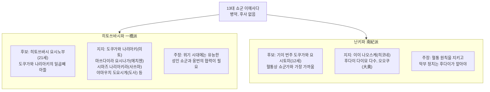
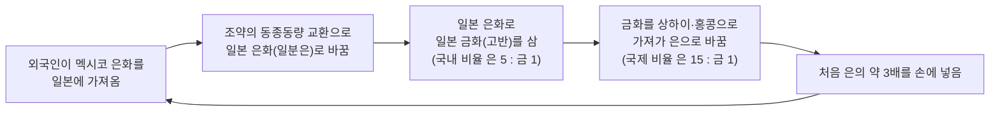
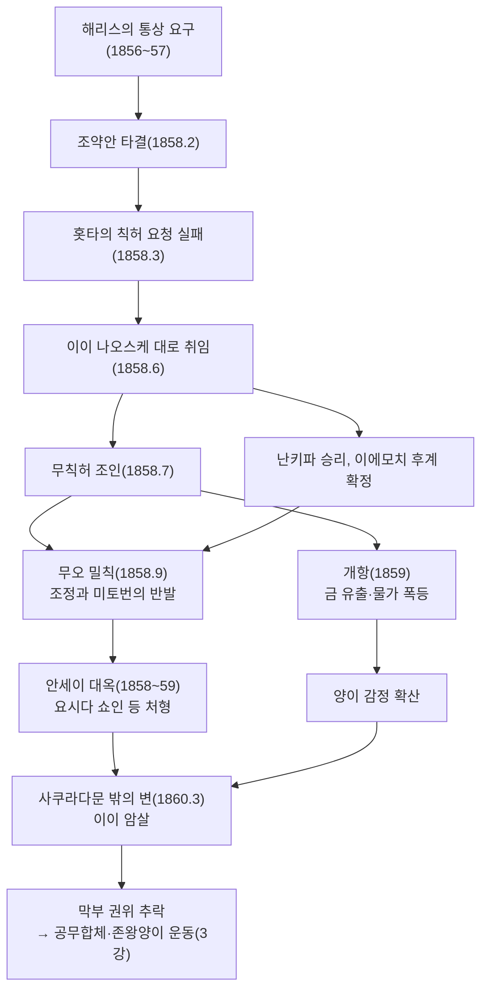

1856년 8월 21일, 이즈반도 끝의 작은 항구 시모다(下田)에 미국 군함 한 척이 들어왔다. 배에서 내린 사람은 미국 초대 주일 총영사 **타운센드 해리스Townsend Harris**와 통역 겸 비서 헨리 휴스컨, 그리고 몇 명의 하인이 전부였다. 2년 전의 페리처럼 함대를 거느리지도 않았다. 그러나 이 고집 센 뉴욕 상인 출신 외교관은 이후 2년 동안 막부를 끈질기게 몰아붙여, 일본을 본격적인 세계 무역 체제 속으로 끌어들이는 **미일수호통상조약**(1858)을 받아 낸다.

1강의 화친조약이 '문을 조금 연 것'이었다면, 통상조약은 '문을 활짝 연 것'이었다. 그리고 그 문을 여는 방식, 곧 **천황의 허락(칙허, 勅許) 없이** 조약에 서명했다는 사실이 일본 정치를 둘로 쪼갰다. 이 강의는 통상조약이 어떻게 맺어졌는지, 그 조약이 무엇을 담고 있었는지, 그리고 조약을 둘러싼 갈등이 어떻게 대로(大老) 이이 나오스케의 암살(1860)로 끝나는지를 따라간다.

> [!핵심] 이 강의의 질문
> 1. 해리스는 어떤 논리로 막부를 설득했고, 막부는 왜 통상을 받아들였는가?
> 2. 미일수호통상조약은 왜 '불평등조약'이라 불리는가?
> 3. 칙허 문제와 쇼군 후계 문제는 어떻게 얽혀 막부 정치를 뒤흔들었는가?
> 4. 개항과 무역은 일본 경제와 사회에 어떤 충격을 주었는가?

```timeline
1856.8 | 해리스, 시모다 도착 | 교쿠센지(玉泉寺)에 미국 총영사관 개설
1857.6 | 시모다 협약 | 나가사키 개항, 미국인의 시모다·하코다테 거주 허용 등 화친조약 보완
1857.12 | 해리스, 에도성 등성 | 쇼군 도쿠가와 이에사다 알현. 이어 로주 홋타 마사요시에게 통상의 필요를 장시간 연설
1858.1~2 | 통상조약 교섭 타결 | 이노우에 기요나오·이와세 다다나리가 해리스와 15차례 이상 협상
1858.3~5 | 홋타의 칙허 요청 실패 | 고메이 천황이 조약 승인을 거부. 공가 88명이 집단으로 반대 의사 표시
1858.6 | 이이 나오스케, 대로 취임 | 막부의 비상 최고직. 쇼군 후계와 조약 문제 처리를 떠맡음
1858.7.29 | 미일수호통상조약 조인 | 칙허 없이 가나가와 앞바다 미국 군함 포해탄호 함상에서 서명
1858.8 | 쇼군 후계 발표, 이에사다 사망 | 도쿠가와 요시토미(이에모치)가 14대 쇼군으로
1858.8~10 | 네덜란드·러시아·영국·프랑스와 조약 | '안세이 5개국 조약' 완성
1858.9 | 무오 밀칙, 안세이 대옥 시작 | 조정이 미토번에 막부 비판 칙서를 내리고, 이이가 반대파를 대대적으로 탄압
1859.7.1 | 요코하마·나가사키·하코다테 개항 | 자유무역 시작
1860.2~11 | 견미사절단 | 비준서 교환을 위해 워싱턴 방문. 간린마루가 태평양 횡단
1860.3.24 | 사쿠라다문 밖의 변 | 대로 이이 나오스케, 에도성 앞에서 미토·사쓰마 낭사들에게 암살됨
```

## 해리스, 시모다에 오다

### 화친조약 제11조와 '불청객'

1강에서 보았듯 미일화친조약 제11조는 "조약 조인 18개월 뒤, 필요할 경우 영사를 둘 수 있다"고 정했다. 영어본은 '두 정부 중 어느 한쪽이' 필요하다고 보면 된다고 썼고, 막부는 '양쪽 모두'가 인정해야 한다고 이해했다. 해리스는 영어본을 근거로 부임했고, 막부는 돌려보내려 했지만 결국 시모다 교외의 절 교쿠센지를 영사관으로 내줄 수밖에 없었다.

```figure
src: asset:4b673b5d1042c3778724d36c8b3a6e7e
caption: 타운센드 해리스(1804~1878). 미국 초대 주일 총영사이자 초대 공사로, 1862년까지 일본에 머물렀다.
credit: 매슈 B. 브래디 스튜디오 촬영, 촬영 연도 미상 · 미국 의회도서관 브래디-핸디 컬렉션
license: Public Domain (미국 의회도서관: 출판 제한 없음)
source: https://www.loc.gov/item/2017896748/
width: narrow
```

해리스(1804~1878)는 뉴욕에서 도자기 수입상을 하다가 사업이 기울자 아시아 무역에 뛰어든 인물이다. 정규 외교관 교육을 받지 않았지만, 1856년 일본 부임 도중 시암(태국)에 들러 통상조약을 맺는 데 성공한 경험이 있었다. 그는 일본을 세계 무역에 끌어들이는 일을 자기 생애의 업적으로 삼겠다는 각오로 부임했다.

시모다에서의 첫 1년은 고립과의 싸움이었다. 본국과의 연락은 1년 넘게 끊겼고, 막부는 시모다 부교를 통해서만 그를 상대하며 에도 방문 요청을 계속 미뤘다. 해리스는 이 시기에 1857년 6월의 **시모다 협약**을 맺어 나가사키 개항, 미국인의 개항장 거주, 일본 화폐와 외국 화폐의 교환 비율, 미국인 범죄자의 영사 재판 등을 먼저 확보했다. 통상조약의 주요 내용 일부가 여기서 미리 시험된 셈이다.

### 에도 등성과 '세계정세' 연설

1857년 12월 7일(안세이 4년 10월 21일), 해리스는 마침내 에도성에 올라 13대 쇼군 도쿠가와 이에사다를 알현했다. 서양 나라의 외교관이 에도성에서 쇼군을 알현한 것은 네덜란드 상관장의 정례 참부(參府)를 빼면 처음이었다. 닷새 뒤 그는 로주 수좌 **홋타 마사요시**(堀田正睦)의 저택에서 두 시간에 걸쳐 연설했다.

```figure
src: asset:b83e3bca785ab90f1632e2ffdf55d914
caption: 에도성에서 막부 측 인사들과 마주한 해리스와 미시시피호 장교들을 그린 일본 측 스케치. 위쪽에 막부 인사들이, 오른쪽에 서양식 군복을 입은 미국인들이 서 있다. 미국 의회도서관은 통상조약 조인 뒤의 알현 장면으로 설명한다.
credit: 작자 미상, 1858년 · 『미국인과 일본인의 첫 공식 접촉에 관한 스케치북』 중 · 미국 의회도서관 소장
license: Public Domain (미국 의회도서관: 출판 제한 없음)
source: https://www.loc.gov/item/2022650225/
```

해리스의 논리는 간단하고 강력했다.

1. 증기선의 발달로 세계는 하나로 묶이고 있으며, 어떤 나라도 무역을 거부한 채 고립될 수 없다.
2. 영국은 지금 청나라와 두 번째 전쟁(애로호 전쟁, 1856~60)을 벌이고 있고, 그 전쟁이 끝나면 함대를 이끌고 일본에 와서 통상을 요구할 것이다. 영국은 아편 무역도 강요할 것이다.
3. 그러니 미국과 먼저 '평화적으로' 공정한 조약을 맺어라. 그러면 그 조약이 다른 나라와의 선례가 되어 일본을 지켜 줄 것이다. 미국은 아편 무역을 금지하겠다.

> [!사료] 해리스가 홋타 마사요시에게 한 연설 (1857년 12월, 요지)
> "일본이 지금 우리와 조약을 맺는다면, 그것은 대포 앞에서 강요된 것이 아니라 스스로 맺은 것이 됩니다. 영국이 대함대를 이끌고 와서 맺게 하는 조약보다 이쪽이 일본의 명예에도, 이익에도 훨씬 낫습니다."
> — 해리스의 일기와 막부 측 기록을 바탕으로 요지를 우리말로 옮김

막부의 실무 관료들은 이 논리를 진지하게 받아들였다. 아편전쟁과 애로호 전쟁 소식은 풍설서로 이미 들어와 있었고, 무엇보다 막부 안에는 '어차피 열어야 한다면 주도권을 쥐고 열자'는 개국파 관료들이 자라나 있었다. 1857년 8월 세상을 떠난 아베 마사히로가 발탁한 인재들이었다.

## 조약 교섭: 막부 관료들의 계산

### 이노우에 기요나오와 이와세 다다나리

통상조약 교섭은 1858년 1월부터 약 한 달 반 동안 에도의 해리스 숙소에서 열렸다. 막부 측 전권은 시모다 부교 **이노우에 기요나오**(井上清直)와 메쓰케(目付, 감찰관) **이와세 다다나리**(岩瀬忠震)였다. 두 사람은 15차례 이상의 회담에서 해리스의 초안을 조항별로 따지며 수정을 요구했다.

| 쟁점 | 해리스의 요구 | 막부의 대응 | 결과 |
|---|---|---|---|
| 개항지 | 여러 항구의 즉시 개항, 교토·오사카 개방 | 교토는 절대 불가, 개항 시기 분산 | 교토 제외, 개항·개시 시기를 1859~1863년으로 나눔 |
| 외국인 활동 범위 | 국내 여행·통상의 자유 | 거류지 밖 활동 제한 | 개항장 주변 약 10리(약 40km) 이내로 제한 |
| 공사 주재 | 에도에 외교 대표 상주 | 수용 | 에도에 공사, 개항장에 영사 주재 |
| 관세 | 낮은 관세 | 수입품에 상당한 관세 | 수입 평균 약 20%, 수출 5% (협정 관세) |
| 아편 | 미국은 금지 제안 | 적극 찬성 | 아편 수입 금지 명문화 |

표: 통상조약 교섭의 주요 쟁점

이 표에서 보듯 막부 관료들은 무조건 끌려가지 않았다. 교토를 지켰고, 외국인을 거류지에 묶어 두었으며, 아편을 막았다. 처음 정한 수입 관세(평균 약 20%)도 청나라가 난징조약으로 받아들인 5%보다 훨씬 높았다. 그러나 그들이 놓친 것도 있었다. 관세율을 **일본이 스스로 바꿀 수 없게** 조약에 묶어 버린 것, 그리고 외국인 범죄를 **일본 법정이 재판할 수 없게** 한 것이다. 당시 막부 관료들은 이 두 조항이 훗날 얼마나 큰 문제가 될지 충분히 알지 못했다. 국제법 지식이 부족했고, 오히려 외국인 재판을 외국 영사에게 맡기는 편이 골치 아픈 문제를 피하는 길이라고 생각한 측면도 있었다.

## 칙허 문제와 쇼군 후계 문제

### 왜 천황의 허락이 필요했나

조약안이 타결되자 막부는 뜻밖의 결정을 내렸다. 조약에 서명하기 전에 **교토의 천황에게 허락(칙허)을 받기로** 한 것이다. 에도 시대 260년 동안 막부가 외교에 관해 조정의 허락을 구한 적은 없었다. 그런데도 홋타가 칙허를 구한 데에는 이유가 있었다. 1853년 아베 마사히로가 페리의 국서를 조정에 보고하고 다이묘들의 의견을 물은 뒤로, 외교 문제에 대한 반대 여론이 커져 있었다. 특히 미토번의 도쿠가와 나리아키 같은 강경파는 통상을 '나라를 파는 일'이라며 맹렬히 반대했다. 홋타는 천황의 권위를 빌려 반대파의 입을 막으려 했다. 조정은 막부가 하자는 대로 따를 것이라고 낙관했다.

1858년 3월, 홋타는 직접 교토로 가서 칙허를 청했다. 그러나 결과는 정반대였다. 고메이 천황(孝明天皇, 재위 1846~1866)은 외국인을 몹시 싫어했고, 통상조약은 '신국'(神國) 일본을 더럽히는 일이라고 여겼다. 조정의 관백 구조 히사타다가 막부 쪽으로 기운 칙답 초안을 만들자, 이와쿠라 도모미(岩倉具視) 등 중하급 공가(公家) 88명이 궁중에 몰려가 집단으로 항의하는 사건(정신(廷臣) 88경 열참 사건)까지 일어났다. 결국 5월 초(안세이 5년 3월 20일) 천황은 "다시 고산케와 다이묘들의 의견을 들어 보고하라"며 사실상 칙허를 거부했다.

> [!핵심] 칙허 거부의 의미
> 막부는 스스로 '조정의 허락이 필요하다'는 선례를 만들어 놓고, 그 허락을 얻지 못했다. 이제 조약에 서명하면 천황의 뜻을 거스르는 것이 되고, 서명하지 않으면 해리스와 영국·프랑스 함대를 상대해야 했다. 어느 쪽을 택하든 막부의 권위는 상처를 입을 수밖에 없는 덫이었다.

### 쇼군 후계를 둘러싼 두 파벌

같은 시기 막부는 또 하나의 난제를 안고 있었다. 13대 쇼군 이에사다는 병약하고 자식이 없었다. 누구를 다음 쇼군으로 세울 것인가를 두고 다이묘들이 두 파로 갈렸다.



이 대립은 단순한 후계 다툼이 아니었다. 히토쓰바시파는 사쓰마·에치젠처럼 큰 번의 '유능한 다이묘'들이 막부 정치에 참여해 나라를 개혁해야 한다고 보았다. 반대로 난키파는 막부 정치는 전통대로 쇼군과 후다이 다이묘가 맡아야 하며, 도자마나 신판 다이묘가 끼어들어서는 안 된다고 보았다. 곧 **'누가 일본을 다스릴 것인가'** 를 놓고 벌어진 싸움이었다. 히토쓰바시파는 교토 조정에도 손을 써서, 칙허 문제와 후계 문제를 함께 움직이려 했다. 에치젠의 하시모토 사나이(橋本左内), 사쓰마의 사이고 다카모리(西郷隆盛) 같은 젊은 번사들이 교토를 오가며 공작을 벌였다.

## 이이 나오스케와 무칙허 조인

### 대로 취임

1858년 6월 4일(안세이 5년 4월 23일), 히코네 번주 **이이 나오스케**(井伊直弼, 1815~1860)가 대로(大老)에 임명되었다. 대로는 비상시에만 두는 막부의 최고직으로, 로주 위에서 정치를 총괄했다. 히코네의 이이 가문은 후다이 다이묘의 필두이자 여러 차례 대로를 배출한 가문이었다. 이이의 등장은 난키파의 승리를 뜻했다.

이이는 원래 칙허를 받은 뒤 조약에 서명하자는 입장이었다. 그러나 상황이 그를 기다려 주지 않았다. 7월 하순, 청나라에서 영국·프랑스가 톈진조약(1858년 6월)을 맺었다는 소식이 들어왔다. 해리스는 "영국과 프랑스 함대가 곧 일본으로 올 것이다. 그 전에 미국과 조약을 맺어야 한다"고 압박했다. 이노우에와 이와세는 "부득이한 경우 서명해도 좋은가"라고 물었고, 이이는 "가능한 한 미루되, 부득이하면 어쩔 수 없다"고 답했다고 한다.

1858년 7월 29일(안세이 5년 6월 19일), 이노우에와 이와세는 가나가와 앞바다에 정박한 미국 군함 **포해탄호** 위에서 해리스와 함께 **미일수호통상조약**에 서명했다. 천황의 허락은 없었다.

### 미일수호통상조약의 내용

조약은 본문 14개조와 부속 무역장정 7칙으로 이루어졌다.

| 구분 | 내용 |
|---|---|
| 외교 대표 | 미국 공사의 에도 주재, 영사의 개항장 주재. 일본도 미국에 외교관을 둘 수 있음 |
| 개항·개시 | 가나가와·나가사키(1859), 니가타(1860), 효고(1863) 개항, 시모다는 가나가와 개항 뒤 폐쇄. 에도(1862)·오사카(1863)에서 상업 활동 허용(개시, 開市) |
| 거류지 | 개항장에 외국인 거류지를 두고, 그 밖으로의 이동은 약 10리 이내로 제한 |
| 자유무역 | 일본 관리가 개입하지 않는 상인 사이의 자유로운 거래 |
| **영사재판권** | 일본에서 죄를 지은 미국인은 미국 영사가 미국 법으로 재판 (제6조) |
| **협정 관세** | 관세율은 부속 무역장정으로 정하며, 일본이 단독으로 바꿀 수 없음 (관세자주권 없음) |
| 화폐 | 외국 화폐와 일본 화폐를 같은 종류·같은 무게로 교환(동종동량 교환) |
| 기타 | 아편 수입 금지, 미국인의 신앙 자유와 거류지 내 교회 설립, 1872년 이후 개정 협의 가능 |

표: 미일수호통상조약의 주요 내용

| | 미일화친조약 (1854) | 미일수호통상조약 (1858) |
|---|---|---|
| 성격 | 보급·구조 협정 | 본격적인 통상·외교 조약 |
| 개항지 | 시모다, 하코다테 (보급용) | 가나가와(요코하마), 나가사키, 하코다테, 니가타, 효고 (무역항) |
| 무역 | 없음 (필요 물품만 관리를 통해 구입) | 자유무역 |
| 외교관 | 시모다 영사 | 에도 공사 + 각 개항장 영사 |
| 불평등 요소 | 편무적 최혜국 대우 | 편무적 최혜국 대우 + **영사재판권 + 관세자주권 결여** |

표: 화친조약과 통상조약의 비교

### '불평등조약'이라 불리는 까닭

이 조약이 '불평등조약'이라 불리는 핵심은 두 가지다.

첫째, **영사재판권**(치외법권)이다. 미국인이 일본에서 일본인을 해쳐도 일본 법정은 재판할 수 없었다. 미국 영사가 미국 법에 따라 재판했고, 일본인 피해자에게 불리한 판결이 나와도 막을 방법이 없었다. 이는 일본이 '문명국의 법체계를 갖추지 못한 나라'로 취급받는다는 뜻이기도 했다.

둘째, **관세자주권의 결여**다. 관세율이 조약에 묶여 있어 일본은 국내 산업을 보호하기 위해 관세를 올릴 수 없었다. 처음에는 수입 관세가 평균 약 20%로 낮지 않았지만, 1866년 영국·프랑스·미국·네덜란드의 압력으로 맺은 개세약서(改税約書)로 대부분 5%로 떨어졌다. 그 뒤로 값싼 외국 면직물이 쏟아져 들어왔다.

여기에 화친조약 때부터의 **편무적 최혜국 대우**가 더해져, 한 나라에 준 특권은 자동으로 모든 조약국에 돌아갔다. 이 불평등조약을 고치는 일, 곧 **조약 개정**은 메이지 정부가 약 40년 동안 매달린 최대의 외교 과제가 된다. 영사재판권은 1894년(1899년 시행), 관세자주권은 1911년에야 완전히 되찾는다.

### 안세이 5개국 조약

미국과의 조약에 이어, 막부는 두 달 사이에 네덜란드·러시아·영국·프랑스와도 같은 내용의 조약을 맺었다. 이를 묶어 **안세이 5개국 조약**이라 부른다.

```compare
나라 | 조인일(양력) | 일본 측 상대 | 비고
미국 | 1858년 7월 29일 | 해리스 총영사 | 기준이 된 조약
네덜란드 | 1858년 8월 18일 | 동크르 쿠르티우스 | 데지마 무역을 대체
러시아 | 1858년 8월 19일 | 푸차친 | 화친조약에 이은 통상조약
영국 | 1858년 8월 26일 | 엘긴 경 | 청에서 톈진조약을 맺고 온 사절. 군함을 선물
프랑스 | 1858년 10월 9일 | 그로 남작 | 역시 청에서 온 사절
```

## 정치의 폭풍: 무오 밀칙과 안세이 대옥

### 반발하는 히토쓰바시파

무칙허 조인 소식이 알려지자 반발이 터져 나왔다. 조인 닷새 뒤, 도쿠가와 나리아키와 오와리 번주 도쿠가와 요시카쓰, 에치젠 번주 마쓰다이라 요시나가 등이 정해진 날이 아닌데도 에도성에 몰려가 이이를 힐책했다(부시등성, 不時登城). 이이는 꿈쩍하지 않았다. 다음 날 그는 기이의 요시토미를 쇼군 후계자로 공식 발표했고, 며칠 뒤 정해진 날을 어기고 등성했다는 이유로 나리아키에게 근신, 요시나가에게 은거를 명했다. 쇼군 이에사다는 그 직후인 8월 14일 세상을 떠났고, 요시토미가 이름을 이에모치(家茂)로 바꿔 14대 쇼군이 되었다. 그는 아직 열두 살이었다.

### 무오 밀칙

분노한 것은 조정도 마찬가지였다. 1858년 9월(안세이 5년 8월), 고메이 천황은 막부를 건너뛰고 미토번에 직접 칙서를 내렸다. 무칙허 조인을 꾸짖고, 다이묘들이 힘을 합쳐 막부를 도와 정치를 바로잡으라는 내용이었다. 이를 **무오 밀칙**(戊午の密勅)이라 한다. 천황이 막부를 거치지 않고 한 번(藩)에 명령을 내린 것은 막부 체제의 근본을 흔드는 일이었다. 막부의 눈에 이것은 미토번과 조정의 반대파가 손잡은 '음모'였다.

### 안세이 대옥

이이 나오스케는 대대적인 탄압으로 맞섰다. 1858년 가을부터 1859년에 걸쳐 조정의 반막부 공가, 히토쓰바시파 다이묘와 그 가신, 존왕양이를 외치던 지사(志士)들을 잇달아 처벌했다. 이를 **안세이 대옥**(安政の大獄)이라 한다. 처벌받은 사람은 100명이 넘었다.

| 인물 | 신분 | 처분 |
|---|---|---|
| 도쿠가와 나리아키 | 미토번 전 번주 | 영구 칩거 |
| 히토쓰바시 요시노부 | 히토쓰바시가 당주 | 은거·근신 |
| 마쓰다이라 요시나가 | 에치젠 번주 | 은거·근신 |
| 야마우치 도요시게 | 도사 번주 | 은거·근신 |
| 하시모토 사나이 | 에치젠 번사, 히토쓰바시파 공작의 중심 | 사형 (1859) |
| 요시다 쇼인(吉田松陰) | 조슈 번사, 쇼카손주쿠 주재 | 사형 (1859) |
| 라이 미키사부로 | 유학자 | 사형 (1859) |
| 우메다 운핀 | 존왕양이 지사 | 옥중 병사 (1859) |

표: 안세이 대옥의 주요 처벌자

> [!참고] 요시다 쇼인과 쇼카손주쿠
> 요시다 쇼인(1830~1859)은 1854년 페리 함대에 몰래 올라 미국으로 밀항하려다 붙잡힌 인물이다. 고향 조슈 하기에서 사설 학당 **쇼카손주쿠**(松下村塾)를 열어 신분을 가리지 않고 젊은이들을 가르쳤는데, 그 제자 가운데 다카스기 신사쿠, 구사카 겐즈이, 이토 히로부미, 야마가타 아리토모 등 막부 타도와 메이지 국가 건설의 주역이 쏟아져 나왔다. 쇼인의 처형은 조슈의 젊은 무사들을 반막부로 돌아서게 한 결정적 계기가 되었다.

이이의 탄압은 일시적으로 반대파를 침묵시켰다. 그러나 그 대가로 막부는 '천황의 뜻을 거스르고 충신을 죽인 정권'이라는 낙인을 얻었다. 탄압은 원한을 낳았고, 원한은 칼이 되어 돌아왔다.

## 개항과 무역의 충격

### 요코하마의 탄생

1859년 7월 1일(안세이 6년 6월 2일), 가나가와(요코하마)·나가사키·하코다테가 문을 열었다. 조약에 적힌 개항지는 도카이도의 역참 마을 '가나가와'였지만, 막부는 외국인과 일본인 여행자가 섞이는 것을 피하려고 가나가와에서 만을 사이에 두고 떨어진 한적한 어촌 **요코하마**에 서둘러 항구와 거류지를 만들었다. 해리스와 영국 영사 올콕은 조약 위반이라고 항의했지만, 상인들은 이미 요코하마에 자리를 잡기 시작했고 결국 요코하마가 개항장으로 굳어졌다. 몇 해 만에 작은 어촌은 일본 최대의 무역항이 되었다.

```figure
src: asset:1afb3730efa89271d43c0d8f7aedf09d
caption: 우타가와 사다히데, 「요코하마 교역 서양인 화물 운송도」 다섯 폭 연작 중 한 장. 요코하마항에 정박한 미국 상선의 갑판 위로 거룻배가 실어 온 화물이 올라가고 있다.
credit: 우타가와 사다히데(歌川貞秀), 1861년 · 미국 의회도서관 소장
license: Public Domain (미국 의회도서관: 출판 제한 없음)
source: https://www.loc.gov/item/2002700055/
width: narrow
```

요코하마의 낯선 풍경, 곧 서양식 건물과 배, 이국의 옷차림을 한 남녀는 에도의 판화가들에게 새로운 소재가 되었다. 1860~61년 무렵 우타가와 사다히데, 우타가와 요시카즈 같은 화가들이 그린 이른바 **요코하마에**(横浜絵)는 수백 종이 팔려 나갔다. 직접 가 볼 수 없는 사람들은 이 그림으로 '외국'을 구경했다.

```figure
src: asset:653816889617fcfda8d482074cfdf052
caption: 우타가와 요시카즈, 「요코하마 견물도회」 중 한 장. 서양식 실내에 앉아 악기를 든 여성과 총을 멘 군인을 그렸다. 판화가들도 실물을 자세히 보지 못한 채 그린 경우가 많아, 옷차림과 실내가 실제와 꼭 같지는 않다.
credit: 우타가와 요시카즈(歌川芳員), 1860년 · 미국 의회도서관 소장
license: Public Domain (미국 의회도서관: 출판 제한 없음)
source: https://www.loc.gov/item/2002700283/
width: narrow
```

```figure
src: asset:1a0e3a7bd56c73ce593968ca07455f20
caption: 우타가와 요시카즈, 「요코하마 외국인 행렬도」(세 폭). 국기를 앞세우고 군악을 울리며 행진하는 외국인 행렬과 마차, 거류지의 서양식 건물을 그렸다.
credit: 우타가와 요시카즈(歌川芳員), 1861년 · 미국 의회도서관 소장
license: Public Domain (미국 의회도서관: 출판 제한 없음)
source: https://www.loc.gov/item/2002700281/
```

### 무역의 규모와 구성

무역은 빠르게 늘었다. 거래의 대부분(8할 이상)은 요코하마에서, 상대국 가운데서는 영국이 압도적이었다. 미국은 1861년 남북전쟁이 터지면서 일본 무역에서 크게 밀려났다.

```chart
{
  "type": "bar",
  "caption": "개항 이후 일본의 수출입액 변화 (단위: 만 달러). 1860년대 중반까지는 수출이 수입보다 많았지만, 1866년 관세 인하 뒤 수입이 급증했다. 수치는 이시이 다카시 등의 막말 무역사 연구에서 통설로 쓰이는 값",
  "data": {
    "labels": ["1860년", "1865년", "1867년"],
    "datasets": [
      { "label": "수출", "data": [471, 1849, 1212] },
      { "label": "수입", "data": [166, 1514, 2167] }
    ]
  }
}
```

무엇을 팔고 무엇을 샀을까? 1865년의 무역품 구성을 보면 당시 일본 경제의 모습이 드러난다.

```chart
{
  "type": "doughnut",
  "caption": "1865년 일본의 수출품 구성 (%). 생사(누에고치에서 뽑은 실)가 수출의 약 8할을 차지했다",
  "height": 320,
  "data": {
    "labels": ["생사", "차", "누에알을 붙인 종이(잠란지)", "해산물", "기타"],
    "datasets": [{ "label": "비율(%)", "data": [79.4, 10.5, 3.9, 2.9, 3.3] }]
  },
  "options": { "plugins": { "legend": { "position": "right" } } }
}
```

```chart
{
  "type": "doughnut",
  "caption": "1865년 일본의 수입품 구성 (%). 영국산 모직물과 면직물이 7할 이상이었고, 내전에 대비한 무기와 함선 수입도 컸다",
  "height": 320,
  "data": {
    "labels": ["모직물", "면직물", "무기", "함선", "면사", "기타"],
    "datasets": [{ "label": "비율(%)", "data": [40.3, 33.5, 7.0, 6.3, 5.8, 7.1] }]
  },
  "options": { "plugins": { "legend": { "position": "right" } } }
}
```

생사는 마침 유럽에서 누에 전염병이 돌아 프랑스·이탈리아의 비단 산업이 원료난에 빠져 있었기 때문에 날개 돋친 듯 팔렸다. 생사를 생산하는 간토·신슈(나가노)의 농촌은 호황을 맞았다. 반면 생사가 해외로 빠져나가자 국내 원료가 모자라 교토 니시진 같은 견직물 산지는 큰 타격을 입었다. 막부는 1860년 생사·잡곡·수유(식물성 기름)·납·의복 다섯 품목은 반드시 에도의 도매상을 거쳐 수출하도록 하는 **오품 에도 회송령**(五品江戸廻送令)을 내려 무역을 통제하려 했지만, 외국 상인과 산지 상인의 반발로 효과는 크지 않았다.

### 금 유출과 물가 폭등

개항 직후 일본 경제를 가장 크게 흔든 것은 **금의 대량 유출**이었다. 원인은 금과 은의 교환 비율 차이였다.

```chart
{
  "type": "bar",
  "caption": "개항 당시 금과 은의 교환 비율 (금 1에 대한 은의 무게). 일본에서는 은 약 5로 금 1을 살 수 있었지만, 국제 시장에서는 은 약 15가 필요했다",
  "height": 240,
  "data": {
    "labels": ["일본 국내", "국제 시장"],
    "datasets": [{ "label": "금 1에 대한 은의 양", "data": [5, 15] }]
  },
  "options": { "indexAxis": "y", "plugins": { "legend": { "display": false } } }
}
```



외국 상인과 외교관, 선원들까지 이 '돈 복사' 거래에 뛰어들었다. 짧은 기간에 10만 냥이 넘는 금화가 해외로 빠져나갔다고 추정된다. 막부는 1860년 금화의 크기와 금 함량을 크게 줄인 **만엔 고반**(万延小判)을 새로 발행해 국내 금은 비율을 국제 수준으로 맞췄다. 금 유출은 멈췄지만, 화폐 가치가 떨어지면서 물가가 치솟았다. 여기에 생사 수출로 인한 품귀까지 겹쳐 쌀값과 생활필수품 값이 몇 년 사이에 두세 배로 뛰었다.

> [!핵심] 무역과 양이 감정
> 물가 폭등으로 가장 고통받은 것은 고정된 녹봉으로 사는 하급 무사와 도시 서민이었다. 그들의 눈에 생활고의 원인은 '외국과의 무역'과 '그것을 허락한 막부'였다. 경제적 불만은 외국인을 몰아내자는 **양이**(攘夷) 감정과 결합해, 1860년대 초 외국인 습격 사건이 잇따르는 배경이 되었다. 1861년 해리스의 통역 휴스컨이 에도에서 살해된 것도 그 하나다.

## 태평양을 건넌 사절단

통상조약 제14조는 비준서를 워싱턴에서 교환하도록 정했다. 1860년 2월, 막부는 정사 신미 마사오키(新見正興), 부사 무라가키 노리마사(村垣範正), 감찰 오구리 다다마사(小栗忠順)를 비롯한 77명의 사절단을 미국 군함 포해탄호에 태워 보냈다. 일본의 공식 사절이 서양 국가를 방문한 것은 처음이었다.

```figure
src: asset:07aeb4ecf56373566117fb5ba6ceaf7f
caption: 1860년 워싱턴 해군 조선소에서 촬영한 견미사절단. 앞줄에 칼을 찬 사절단원들이 앉아 있고, 뒤에 미국 해군 장교들이 서 있다.
credit: 매슈 B. 브래디(Mathew B. Brady) 촬영, 1860년 · 메트로폴리탄 미술관 소장
license: Public Domain (메트로폴리탄 미술관 오픈 액세스)
source: https://www.metmuseum.org/art/collection/search/286097
width: wide
```

이와 함께 막부의 군함 **간린마루**(咸臨丸)가 호위함으로 태평양을 건넜다. 가쓰 가이슈(勝海舟)가 지휘를 맡았고, 미국 해군 대위 브룩과 수병들이 함께 탔으며, 젊은 후쿠자와 유키치(福沢諭吉)와 표류 끝에 미국에서 자란 존 만지로(나카하마 만지로)도 승선했다. 일본인이 운항한 배로서는 첫 태평양 횡단이었다. 후쿠자와는 이 경험을 바탕으로 훗날 『서양사정』(西洋事情)을 써서 서양 문명을 일본에 소개한다.

사절단은 5월 워싱턴에서 비준서를 교환하고 뷰캐넌 대통령을 만났다. 6월 뉴욕에서는 수십만 명의 시민이 브로드웨이에 나와 퍼레이드를 구경했다. 칼을 찬 사무라이들의 행렬은 미국 언론의 큰 화제가 되었다.

```figure
src: asset:955692bbd88687486f51d515c48b2b7d
caption: 1860년 6월 16일 뉴욕 브로드웨이의 견미사절단 환영 행렬을 위에서 찍은 입체 사진. 길 양옆과 건물 창문에 구경꾼이 가득하다.
credit: 조지 스테이시(George Stacy) 간행 입체 사진, 1860년 · 미국 의회도서관 소장
license: Public Domain (미국 의회도서관: 출판 제한 없음)
source: https://www.loc.gov/item/2017645262/
```

사절단원들은 미국에서 증기기관, 조선소, 조폐국, 의회와 신문을 보았다. 오구리 다다마사는 워싱턴 해군 조선소에서 나사 하나를 가지고 돌아와 "일본도 이것을 만들 수 있어야 한다"고 말했다는 일화를 남겼고, 귀국 뒤 요코스카 제철소(조선소) 건설을 이끌었다. 그러나 그들이 돌아왔을 때, 일본은 떠날 때와 다른 나라가 되어 있었다.

## 사쿠라다문 밖의 변

1860년 3월 24일(안세이 7년 3월 3일), 에도에는 철 늦은 눈이 내리고 있었다. 이날은 다이묘들이 3월 명절 인사를 위해 에도성에 오르는 날이었다. 아침 9시 무렵, 대로 이이 나오스케의 가마 행렬이 히코네번 저택을 나와 에도성의 **사쿠라다문**(桜田門)으로 향했다. 행렬 앞에 한 사내가 소장을 내미는 척 다가섰고, 총성을 신호로 숨어 있던 무리가 일제히 칼을 빼 들고 달려들었다. 호위 무사들은 눈 때문에 칼집에 덮개를 씌우고 있어 제때 칼을 뽑지 못했다. 이이는 가마 안에서 총탄을 맞고 끌려 나와 목이 베였다.

습격자는 미토번을 떠난 낭사 17명과 사쓰마 번사 1명, 모두 18명이었다. 그들은 소지한 취지서에서 이이가 칙허 없이 조약을 맺고 존왕의 뜻을 품은 사람들을 탄압했다고 비난했다. 무오 밀칙을 둘러싼 이이의 압박이 미토번을 직접 겨냥했던 것이 결정적인 계기였다.



> [!핵심] 사쿠라다문 밖의 변이 남긴 것
> 막부의 최고 권력자가 에도성 바로 앞에서, 그것도 대낮에 낭사들의 칼에 쓰러졌다. 막부가 더는 자기 수도에서조차 질서를 지킬 수 없다는 사실이 만천하에 드러났다. 이 사건 이후 막부는 이이식의 강압을 버리고 조정과 손잡는 길(공무합체, 公武合体)을 찾게 되고, 반대편에서는 '천황을 받들고 외국을 물리치자'는 존왕양이 운동이 테러와 정변의 형태로 격렬해진다. 일본 정치의 중심은 서서히 에도에서 교토로 옮겨 가기 시작했다.

## 정리

> [!핵심] 2강 요약
> - 화친조약 제11조에 따라 부임한 **해리스**는 애로호 전쟁 등 국제 정세를 들어 막부를 설득했고, 막부 관료들은 주도권을 쥐고 개국하자는 계산으로 통상 교섭에 응했다.
> - **미일수호통상조약**(1858)은 요코하마 등의 개항과 자유무역을 정했지만, **영사재판권**과 **관세자주권 결여**, 편무적 최혜국 대우를 담은 불평등조약이었다. 같은 내용의 조약이 5개국과 맺어졌다.
> - 막부는 스스로 칙허를 구했다가 거부당했고, **이이 나오스케**는 칙허 없이 조약에 서명했다. 쇼군 후계 문제(히토쓰바시파 대 난키파)와 얽힌 이 결정은 **무오 밀칙**과 **안세이 대옥**으로 이어졌다.
> - 개항 뒤 생사 수출이 급증했지만, 금은 비율 차이로 **금이 대량 유출**되고 화폐 개주로 물가가 폭등해 양이 감정이 커졌다.
> - 1860년 **사쿠라다문 밖의 변**으로 이이가 암살되면서 막부의 권위는 돌이킬 수 없이 추락했다.

### 생각해 볼 질문

1. 막부 관료들은 교섭에서 교토 개방을 막고 아편을 금지시켰지만, 영사재판권과 협정 관세는 받아들였다. 그들이 무엇을 중요하게 여겼고 무엇을 몰랐는지 정리해 보자.
2. 홋타 마사요시가 칙허를 구한 결정은 막부 정치에 어떤 결과를 가져왔을까? 1853년 아베 마사히로의 의견 수렴과 비교해 보자.
3. 개항으로 이익을 본 사람과 손해를 본 사람은 각각 누구였을까? 생사 산지 농민, 니시진 직물업자, 하급 무사, 외국 상인의 처지를 비교해 보자.

### 다음 강 예고

3강에서는 이이 암살 이후 막부가 고메이 천황의 누이 가즈노미야를 쇼군 이에모치와 혼인시키는 **공무합체** 정책, 존왕양이를 내건 조슈번의 교토 장악, 그리고 사쓰에이 전쟁(1863)과 시모노세키 전쟁(1863~64)을 거치며 사쓰마와 조슈가 '양이는 불가능하다'는 현실을 깨닫는 과정을 다룬다.
