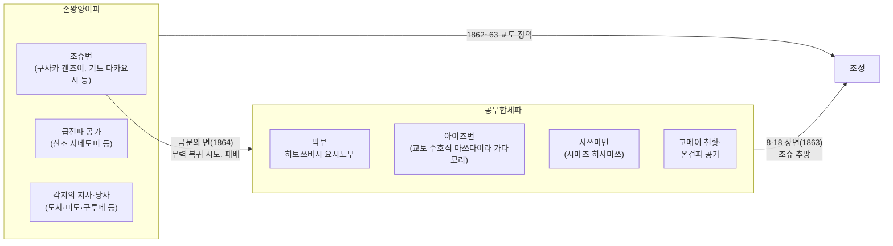

1860년 봄 사쿠라다문 밖에서 대로 이이 나오스케가 쓰러지자, 막부는 더 이상 혼자 힘으로 나라를 끌고 갈 수 없다는 사실을 인정해야 했다. 이후 4년 동안 일본 정치의 무대는 에도에서 교토로 옮겨 간다. 천황이 있는 교토에는 막부와 손잡으려는 사람들, 막부를 넘어서려는 사람들, 외국인을 칼로 몰아내자는 사람들이 몰려들었다. 이 시기를 꿰뚫는 구호가 **존왕양이尊王攘夷**, 곧 '천황을 받들고 오랑캐를 물리치자'였다.

그러나 이 강의의 결말은 역설적이다. 가장 격렬하게 양이를 외친 두 번, 사쓰마와 조슈는 실제로 서양 군함과 싸워 본 뒤 **양이는 불가능하다**는 결론에 이른다. 그리고 바로 그 깨달음이 두 번을 '막부를 무너뜨리고 서양을 배우는' 쪽으로 돌려세운다.

> [!핵심] 이 강의의 질문
> 1. 존왕양이 사상은 어디서 왔고, 왜 1860년대에 폭발적으로 퍼졌는가?
> 2. 막부의 '공무합체' 정책은 무엇을 노렸고, 왜 실패했는가?
> 3. 사쓰마와 조슈는 어떻게 양이에서 개국·부국강병으로 방향을 틀었는가?

```figure
src: asset:972d48a1e28007d7f1ec20767d840cfe
caption: 칼을 찬 무사. 펠리체 베아토가 요코하마에서 촬영한 초상이다. 베아토는 1863년부터 일본에 머물며 막말의 풍경과 사람들을 기록한 대표적인 사진가다.
credit: 펠리체 베아토(Felice Beato) 촬영, 1864~65년 · 메트로폴리탄 미술관 소장
license: CC0 (메트로폴리탄 미술관 오픈 액세스)
source: https://www.metmuseum.org/art/collection/search/285902
width: narrow
```

```timeline
1860.3 | 사쿠라다문 밖의 변 | 대로 이이 나오스케 암살
1861.1 | 휴스컨 암살 | 미국 공사관 통역이 에도에서 양이파 무사에게 살해됨
1861.7 | 제1차 도젠지 사건 | 미토 낭사들이 에도의 영국 공사관(도젠지)을 습격
1862.2 | 사카시타문 밖의 변 | 공무합체를 추진하던 로주 안도 노부마사가 습격받아 부상, 실각
1862.3 | 가즈노미야, 쇼군 이에모치와 혼인 | 공무합체의 상징
1862.5 | 데라다야 사건 | 시마즈 히사미쓰가 교토의 사쓰마 과격파를 진압
1862.7~ | 분큐 개혁 | 칙사와 히사미쓰의 압력으로 막부 인사·제도 개편, 산킨코타이 완화
1862.9 | 나마무기 사건 | 히사미쓰 행렬을 가로지른 영국인을 사쓰마 무사가 살상
1863.4 | 쇼군 이에모치 상경 | 쇼군의 교토행은 229년 만. 양이 실행을 약속
1863.6.25 | 조슈의 외국선 포격 | '양이 기일'에 시모노세키 해협을 지나던 미국 상선을 포격
1863.8 | 사쓰에이 전쟁 | 영국 함대가 가고시마를 포격
1863.9.30 | 8·18 정변 | 사쓰마·아이즈가 조슈 세력과 급진파 공가를 교토에서 몰아냄
1864.7 | 이케다야 사건 | 신센구미가 교토의 존왕양이 지사들을 습격
1864.8.20 | 금문의 변 | 조슈군이 교토로 진격했다가 패배, 조슈는 '조정의 적'이 됨
1864.9 | 시모노세키 전쟁 | 영·프·미·네 4개국 연합함대가 조슈 포대를 점령
```

## 존왕양이 사상의 뿌리

### 미토학과 『신론』

'존왕'과 '양이'라는 말을 하나로 묶은 것은 19세기 전반의 **미토학水戸学**이다. 미토번은 도쿠가와 고산케의 하나이면서, 17세기부터 『대일본사大日本史』라는 거대한 역사서를 편찬하며 '천황을 정점으로 하는 일본의 올바른 질서'를 탐구해 왔다. 1825년 미토의 학자 아이자와 세이시사이会沢正志斎는 이국선 타불령이 나온 바로 그해에 『신론新論』을 썼다. 그는 일본을 천황이 다스리는 신국으로 규정하고, 서양 세력이 크리스트교로 민심을 빼앗아 나라를 삼키려 한다고 경고했다. 해법은 천황을 중심으로 민심을 하나로 모으고(존왕), 해안 방비를 굳혀 외적을 물리치는 것(양이)이었다.

원래 미토학의 존왕은 막부를 부정하는 사상이 아니었다. 천황이 쇼군에게 정치를 맡겼으니, 쇼군이 천황을 받들어 외적을 물리치면 된다는 논리였다. 그러나 1858년 막부가 천황의 뜻을 어기고 통상조약을 맺자 사정이 달라졌다. **천황의 뜻을 따르지 않는 막부는 정당한가?** 이 질문이 던져지는 순간, 존왕양이는 막부 비판의 무기가 되었다.

### 국학과 '지사'의 등장

여기에 18세기 이래의 **국학国学**이 더해졌다. 모토오리 노리나가 등이 일으킨 국학은 유교·불교 이전의 일본 고유의 정신을 『고사기』 같은 고전에서 찾으려 했고, 그 중심에 천황이 있었다. 히라타 아쓰타네의 국학은 농촌의 촌장과 부유한 농민층에게까지 퍼졌다.

1860년대에 존왕양이를 외치며 교토로 몰려든 사람들을 **지사志士**라 부른다. 그들 상당수는 하급 무사이거나, 번을 이탈한 **낭사浪士**, 혹은 부유한 농민·상인 출신이었다. 신분 질서 속에서 출세의 길이 막혀 있던 이들에게 존왕양이는 '천황을 위해 나라를 구한다'는 거대한 명분을 주었다. 2강에서 본 물가 폭등과 외국인에 대한 반감은 그 열기를 더 키웠다.

## 공무합체: 막부와 조정의 결혼

### 가즈노미야의 혼인

이이 이후 막부를 이끈 로주 안도 노부마사安藤信正와 구제 히로치카久世広周는 강압 대신 **공무합체公武合体**, 곧 조정(공公)과 막부(무武)가 손잡는 길을 택했다. 그 상징이 고메이 천황의 누이동생 **가즈노미야和宮**를 쇼군 이에모치에게 시집보내는 혼인이었다. 천황가의 공주가 쇼군에게 출가하면 막부는 천황의 권위를 빌릴 수 있었다.

가즈노미야에게는 이미 약혼자(아리스가와노미야 다루히토 친왕)가 있었고, 본인과 천황 모두 처음에는 반대했다. 고메이 천황은 결국 **막부가 몇 년 안에 양이를 실행해 조약 이전 상태로 되돌린다**는 약속을 받고 혼인을 허락했다. 1862년 3월 혼례가 치러졌다. 그러나 이 거래는 막부에 치명적인 족쇄가 되었다. 실행할 수 없는 '양이'를 조정에 약속해 버렸기 때문이다.

존왕양이파는 이 혼인을 '막부가 공주를 인질로 삼았다'고 보았다. 1862년 2월 13일, 안도 노부마사는 에도성 사카시타문 밖에서 미토 낭사들의 습격을 받아 부상했고 곧 로주에서 물러났다(사카시타문 밖의 변). 이이에 이어 2년 만에 다시 막부 최고 책임자가 습격당한 것이다.

### 양이 테러의 시대

외국인을 향한 칼부림도 이어졌다. 1861년 1월 해리스의 통역 휴스컨이 살해되었고, 같은 해 7월과 이듬해 6월에는 에도 다카나와의 영국 공사관(도젠지東禅寺)이 두 차례 습격당했다. 1863년 1월에는 시나가와 고텐야마에 짓고 있던 영국 공사관 건물이 불탔는데, 불을 지른 것은 조슈의 다카스기 신사쿠, 구사카 겐즈이, 그리고 훗날 초대 총리가 되는 이토 히로부미 등이었다.

```figure
src: asset:7f4d2387734e669a2044af85f930d595
caption: 요코하마 외국인 거류지의 상관 앞을 걷는 서양인들을 그린 판화. 양이 테러가 잇따르던 시기에도 요코하마의 외국인 사회는 빠르게 커졌다.
credit: 우타가와 요시토라(歌川芳虎), 1866년 · 미국 의회도서관 소장
license: Public Domain (미국 의회도서관: 출판 제한 없음)
source: https://www.loc.gov/item/2002700290/
width: narrow
```

교토에서는 '천주天誅', 곧 하늘을 대신해 벌한다는 명목으로 막부 편에 선 관리와 공가의 가신들이 잇달아 살해되었다. 잘린 머리가 강변에 내걸리는 일이 1862~63년 교토의 일상이 되었다.

## 사쓰마의 등장: 시마즈 히사미쓰

### 히사미쓰의 상경과 분큐 개혁

이 혼란 속에 새로운 정치 세력이 무대에 올랐다. 사쓰마의 **시마즈 히사미쓰島津久光**다. 그는 1858년 죽은 명군 시마즈 나리아키라의 이복동생이자 새 번주 다다요시의 아버지로, 번의 실권을 쥐고 있었다. 히사미쓰는 형의 뜻을 이어 공무합체로 막부를 개혁하고, 그 과정에서 사쓰마의 발언권을 키우려 했다.

```figure
src: asset:34bbfdb9c4d57e999ae94d30426b034f
caption: 사쓰마번 다이묘 저택을 둘러싼 긴 외곽 건물(나가야)과 그 앞길. 다이묘 저택은 가신들이 사는 이런 나가야로 둘러싸여 있었다. 정확한 장소는 확인되지 않았다.
credit: 펠리체 베아토 촬영으로 전함, 1867년 무렵 · 레이크스 미술관 소장
license: Public Domain (레이크스 미술관)
source: https://www.rijksmuseum.nl/en/collection/RP-F-F80211
```

1862년 5월, 히사미쓰는 군사 1,000명을 이끌고 교토에 들어갔다. 사쓰마의 과격한 존왕양이파 번사들은 이 기회에 거병해 막부 편 공가를 치려고 후시미의 여관 데라다야寺田屋에 모였다. 히사미쓰는 진압대를 보내 자기 번의 무사들을 베었다(데라다야 사건). 그는 존왕양이파가 아니라 '질서 있는 개혁'을 원했던 것이다. 이 일로 조정의 신임을 얻은 히사미쓰는 칙사 오하라 시게토미를 호위해 에도로 가서 막부에 개혁을 요구했다.

| 개혁 내용 | 의미 |
|---|---|
| 히토쓰바시 요시노부를 쇼군 후견직에 임명 | 안세이 대옥으로 밀려난 히토쓰바시파의 복권 |
| 마쓰다이라 요시나가를 정사총재직에 임명 | 신판 다이묘가 막부 정치의 중심으로 |
| 교토 수호직 신설, 아이즈 번주 마쓰다이라 가타모리 임명 | 교토의 치안을 막부가 직접 장악 |
| 산킨코타이 완화 (3년에 1회, 처자의 귀국 허용) | 다이묘 통제의 핵심 장치를 스스로 늦춤 |
| 서양식 군제 도입 | 육군·해군 개편 시작 |

표: 분큐 개혁(1862)의 주요 내용

**외부 다이묘의 압력으로 막부 인사가 바뀌었다**는 사실은 결정적이었다. 막부 260년 동안 없던 일이다. 산킨코타이가 느슨해지자 에도에 머물던 다이묘의 가족들이 고향으로 돌아갔고, 에도는 한때 활기를 잃었다. 막부의 중심성은 눈에 띄게 약해졌다.

### 나마무기 사건

```figure
src: asset:1bb1b8a48d2ce28cda361c47dc35f4a9
caption: 소나무 가로수가 늘어선 도카이도. 에도와 교토를 잇는 이 길 위에서 1862년 나마무기 사건이 일어났다.
credit: 펠리체 베아토 촬영으로 전함, 1865년 무렵 · 레이크스 미술관 소장
license: Public Domain (레이크스 미술관)
source: https://www.rijksmuseum.nl/en/collection/RP-F-F80216
```

1862년 9월 14일, 에도에서 돌아가던 히사미쓰의 행렬이 요코하마 근처 도카이도의 나마무기촌生麦村을 지날 때였다. 말을 탄 영국인 남녀 네 명이 행렬과 마주쳤다. 일본의 관습상 다이묘 행렬 앞에서는 길을 비키고 말에서 내려야 했지만, 그들은 그대로 행렬 속으로 들어왔다. 사쓰마 무사들이 칼을 뽑았고, 상하이에서 온 상인 찰스 리처드슨이 죽고 두 명이 다쳤다. 이것이 **나마무기 사건生麦事件**이다.

영국은 막부에 사죄와 배상금 10만 파운드를, 사쓰마에는 범인 처벌과 배상금 2만 5,000파운드를 요구했다. 막부는 결국 배상금을 냈지만, 사쓰마는 거부했다. 이 거부가 이듬해의 전쟁으로 이어진다.

## 1863년: 양이 실행의 해

### 쇼군의 상경과 '양이 기일'

1862년 후반부터 교토의 주도권은 조슈번에 넘어갔다. 조슈는 원래 나가이 우타의 '항해원략책'(개국하여 해외로 진출하자는 공무합체론)을 번의 방침으로 삼았지만, 1862년 여름 구사카 겐즈이 등 요시다 쇼인의 제자들이 주도해 **존왕양이로 번론을 바꾸었다**. 조슈는 산조 사네토미三条実美 등 급진파 공가와 손잡고 조정을 움직여, 막부에 양이를 실행하라고 압박했다.

1863년 4월, 쇼군 이에모치가 교토에 올라왔다. 쇼군이 교토에 간 것은 3대 이에미쓰 이후 229년 만이었다. 쇼군은 천황 앞에서 양이 실행을 약속해야 했고, 막부는 마지못해 **1863년 6월 25일(분큐 3년 5월 10일)** 을 '양이 기일'로 정했다. 막부는 이를 '외국과 교섭해 항구를 닫는 날'로 해석했지만, 조슈는 문자 그대로 받아들였다.

### 조슈, 외국선을 포격하다

양이 기일 당일, 조슈는 시모노세키 해협(간몬 해협)을 지나던 미국 상선 펨브로크호를 포격했다. 이어 프랑스와 네덜란드의 군함에도 포탄을 퍼부었다. 그러나 보복은 곧바로 왔다. 7월 미국 군함 와이오밍호가 조슈의 군함을 격침했고, 프랑스 함대는 포대를 점령해 파괴하고 돌아갔다.

```figure
src: asset:14c4abc30f705f62dce988f5ab6fa18b
caption: 1863년 7월 11일 시모노세키 해협에서 조슈의 포대가 네덜란드 증기 코르벳함 메두사호를 포격하는 장면을 그린 석판화. 해안을 따라 포연이 피어오른다.
credit: 마르턴 보스(Maarten Bos), 1863년 · 레이크스 미술관 소장
license: Public Domain (레이크스 미술관)
source: https://www.rijksmuseum.nl/en/collection/RP-P-OB-86.512
width: wide
```

이 패배는 조슈 안에서 중요한 변화를 낳았다. 다카스기 신사쿠高杉晋作는 기존의 무사 부대만으로는 서양 군대를 막을 수 없다고 보고, 1863년 여름 **기병대奇兵隊**를 만들었다. 기병대는 신분을 따지지 않고 무사·농민·상인·승려 등 지원자를 받아 서양식 총으로 무장시킨 부대였다. '무사만 싸운다'는 에도 시대의 원칙이 처음으로 깨진 것이다.

### 사쓰에이 전쟁

같은 해 8월 15일, 나마무기 사건의 배상을 받으러 온 영국 군함 7척이 가고시마만에서 사쓰마와 충돌했다. 영국 함대가 사쓰마의 기선 세 척을 나포하자, 사쓰마의 해안 포대가 먼저 포문을 열었다. 이틀에 걸친 포격전으로 가고시마 시가지의 상당 부분이 불탔고, 사쓰마가 근대화의 상징으로 세운 공업 단지 슈세이칸集成館도 큰 피해를 입었다. 영국 측도 기함의 함장과 부함장이 전사하는 등 적지 않은 손실을 입고 물러났다. 이것이 **사쓰에이 전쟁薩英戦争**이다.

```figure
src: asset:029902c351305d9b4ffafef8c429fa09
caption: 사쓰에이 전쟁 때 폭풍우 속에서 가고시마를 포격하는 영국 함대를 그린 그림을 사진으로 복제한 것. 해안 위로 연기가 피어오른다. 사건 현장 사진이 아니라 당시 그림의 복제본이다.
credit: 작자 미상, 1863년~1880년 무렵 · 레이크스 미술관 소장
license: Public Domain (레이크스 미술관)
source: https://www.rijksmuseum.nl/en/collection/RP-F-2013-22-186
width: wide
```

결과는 뜻밖이었다. 석 달 뒤 사쓰마는 영국과 강화하고, 배상금(막부에서 빌린 돈으로 지불했다)을 냈다. 그리고 영국에 **군함 구입을 주선해 달라**고 요청했다. 서양의 힘을 직접 겪은 사쓰마는 싸우기보다 배우는 쪽을 택했다. 영국도 막부보다 결단력 있는 사쓰마에 주목하기 시작했다. 1865년 사쓰마는 막부의 금지를 무릅쓰고 젊은 번사 19명을 영국에 유학 보낸다.

### 8·18 정변: 조슈의 추방

그사이 교토에서는 반전이 일어났다. 조슈와 급진파 공가는 천황이 직접 양이 전쟁을 지휘하러 나서는 '양이 친정' 계획까지 밀어붙였다. 그러나 고메이 천황은 외국인을 싫어하면서도 막부를 무너뜨릴 생각은 없었고, 조슈의 과격함을 불안하게 여겼다.

1863년 9월 30일(분큐 3년 8월 18일) 새벽, 사쓰마와 아이즈의 병력이 궁궐의 문을 장악했다. 천황의 뜻에 따라 조슈번의 궁궐 경비 임무가 해제되고, 산조 사네토미 등 급진파 공가 7명은 조슈로 달아났다(7경 낙향). 이것이 **8·18 정변**이다. 교토의 주도권은 하룻밤 사이에 공무합체파로 넘어갔다.



## 1864년: 조슈의 몰락

### 이케다야 사건과 금문의 변

교토에서 쫓겨난 조슈와 존왕양이파 지사들은 반격을 노렸다. 1864년 7월 8일 밤, 교토 산조의 여관 이케다야池田屋에 모여 있던 지사들을 교토 수호직 휘하의 경비 조직 **신센구미新選組**가 습격해, 여러 명을 죽이고 붙잡았다(이케다야 사건). 이 소식은 조슈의 강경파에 불을 붙였다.

1864년 8월 20일(겐지 원년 7월 19일), 조슈군은 교토로 진격해 궁궐의 하마구리고몬蛤御門 일대에서 아이즈·사쓰마 군과 격돌했다. 이것이 **금문의 변禁門の変**(하마구리고몬의 변)이다. 조슈군은 하루 만에 패했고, 구사카 겐즈이는 자결했다. 전투 중 일어난 불은 사흘 동안 교토를 태워 약 3만 호가 잿더미가 되었다.

무엇보다 조슈는 **궁궐을 향해 총을 쏜 '조정의 적(조적朝敵)'** 이 되었다. 조정은 막부에 조슈 정벌을 명했다. 존왕을 가장 앞장서 외치던 번이 천황의 적이 된 것이다.

### 시모노세키 전쟁

불행은 겹쳐 왔다. 조슈의 해협 봉쇄로 무역에 피해를 본 영국·프랑스·미국·네덜란드는 1864년 9월, 군함 17척의 연합함대를 시모노세키로 보냈다. 연합군은 사흘 만에 조슈의 포대를 모두 점령하고 대포를 끌어갔다. 이것이 **시모노세키 전쟁**(4국 함대 시모노세키 포격 사건)이다.

```gallery
src: asset:2bad93bf4f08c709137f7f39ce9566df
caption: 1864년 9월 시모노세키 전쟁에서 연합군이 점령한 조슈의 해안 포대. 줄지어 놓인 조슈의 대포 위아래에 영국 병사와 수병들이 모여 있다. 연합군을 따라간 베아토가 찍은 사진이다.
credit: 펠리체 베아토 촬영, 1864년 · 레이크스 미술관 소장
license: Public Domain (레이크스 미술관)
source: https://www.rijksmuseum.nl/en/collection/RP-F-2013-22-188
---
src: asset:36efe7d05b67441ab6754b2b46434fd2
caption: 네덜란드 군함 메두사호가 시모노세키 해협에서 해안 포대와 포격전을 벌이는 모습을 그린 유화. 메두사호는 1863년 조슈의 포격을 받았고, 1864년에는 4개국 연합함대의 일원으로 다시 해협에 들어갔다.
credit: J.E. 반 헤임스케르크 반 베이스트(J.E. van Heemskerck van Beest), 1864년 · 레이크스 미술관 소장
license: Public Domain (레이크스 미술관)
source: https://www.rijksmuseum.nl/en/collection/SK-A-2725
```

강화 교섭에 나선 것은 감옥에서 막 풀려난 다카스기 신사쿠였다. 그는 연합국이 요구한 히코시마 조차를 끝내 거절하면서도 해협 통행의 자유를 약속했고, 배상금 300만 달러는 "양이를 명한 것은 막부"라며 막부에 떠넘겼다. 막부는 이 거액을 떠안았고, 일부는 메이지 정부가 갚았다.

| | 사쓰에이 전쟁 (1863) | 시모노세키 전쟁 (1863~64) |
|---|---|---|
| 상대 | 영국 | 미국·프랑스(1863), 영·프·미·네 연합(1864) |
| 원인 | 나마무기 사건 배상 거부 | 조슈의 외국선 포격, 해협 봉쇄 |
| 결과 | 가고시마 시가지·공장 피해, 영국 함대도 손실 | 포대 전부 점령·파괴 |
| 배상 | 2만 5,000파운드 (막부에서 빌려 지불) | 300만 달러 (막부가 부담) |
| 그 뒤 | 영국과 화해, 군함 구입·유학생 파견 | 양이 포기, 다카스기 등 개혁파가 번을 장악하는 계기 |

표: 두 번의 전쟁과 그 결과

## 양이에서 개국으로

### 런던에 간 조슈의 젊은이들

사실 조슈 안에도 일찍부터 '양이는 불가능하다'고 본 사람들이 있었다. 1863년 6월, 양이 기일 직후 조슈는 몰래 다섯 명의 젊은 번사를 영국으로 보냈다. 이노우에 가오루, 이토 히로부미, 엔도 긴스케, 야마오 요조, 이노우에 마사루다. 이들을 흔히 **조슈 파이브**라 부른다. 런던에 도착한 그들은 공장과 철도, 조선소, 거대한 도시를 보고 큰 충격을 받았다.

```gallery
src: asset:17247f3fd6e2b4d7167b5f288ef14b4f
caption: 젊은 시절의 이토 히로부미(1841~1909). 조슈 파이브의 한 사람으로, 훗날 초대 내각 총리대신이 된다.
credit: 촬영자·연도 미상(1860년대로 추정) · 국립국회도서관 「근대일본인의 초상」
license: Public Domain (국립국회도서관: 저작권 보호 기간 만료)
source: https://www.ndl.go.jp/portrait/datas/12/
---
src: asset:4264ac1acb73d70770afee2429a8f5d7
caption: 젊은 시절의 이노우에 가오루(1836~1915). 이토와 함께 영국에서 급히 돌아와 시모노세키 전쟁을 막으려 했다.
credit: 촬영자·연도 미상(1860년대로 추정) · 국립국회도서관 「근대일본인의 초상」
license: Public Domain (국립국회도서관: 저작권 보호 기간 만료)
source: https://www.ndl.go.jp/portrait/datas/18/
```

1864년 봄 런던의 신문에서 4개국 함대가 조슈를 공격하려 한다는 소식을 읽은 이토와 이노우에 가오루는 급히 귀국해 전쟁을 막으려 했지만 실패했다. 나머지 세 명은 영국에 남아 철도·조폐·조선을 배웠고, 훗날 각각 '일본 조폐의 아버지', '공학의 아버지', '철도의 아버지'로 불리게 된다.

> [!핵심] 양이의 역설
> 1863~64년의 두 전쟁은 사쓰마와 조슈에 같은 교훈을 남겼다. 칼과 구식 대포로는 서양을 이길 수 없다. 서양을 물리치려면 먼저 **서양을 배워 강해져야 한다**. 이후 두 번은 양이 대신 부국강병을 목표로 삼고, 영국에서 무기와 군함을 사들이며 군대를 서양식으로 바꾼다. 그리고 그 길을 막는 것은 외국이 아니라, 무능한 막부라고 보게 된다. 존왕양이는 이렇게 **존왕도막尊王倒幕**(천황을 받들고 막부를 쓰러뜨림)으로 바뀌어 간다.

### 막부의 결정적 기회

1864년 말의 상황만 보면 막부가 이긴 것처럼 보였다. 조슈는 조적이 되어 교토에서 쫓겨났고, 외국 함대에 포대를 잃었으며, 막부는 조슈 정벌군을 일으켰다. 1864년 12월, 정벌군 앞에서 조슈는 금문의 변을 책임진 가로 세 명을 할복시키고 항복했다(제1차 조슈 정벌). 그러나 이 '승리'는 오래가지 않았다. 정벌군의 참모로 무혈 해결을 이끈 사쓰마의 **사이고 다카모리西郷隆盛**는 이 과정에서 조슈를 완전히 짓밟는 것이 사쓰마에도 이롭지 않다고 판단하고 있었다. 이 판단이 4강의 이야기, 곧 어제의 적 사쓰마와 조슈가 손을 잡는 **삿초 동맹**으로 이어진다.

## 정리

> [!핵심] 3강 요약
> - **존왕양이**는 미토학과 국학에서 나온 사상으로, 막부가 칙허 없이 조약을 맺은 뒤 막부 비판의 무기가 되었다. 하급 무사와 낭사 출신 **지사**들이 그 주역이었다.
> - 막부는 가즈노미야와 이에모치의 혼인으로 **공무합체**를 꾀했지만, 그 대가로 실행할 수 없는 양이를 약속했다.
> - 사쓰마의 **시마즈 히사미쓰**는 분큐 개혁으로 막부 인사를 바꾸게 했고, 그의 행렬이 일으킨 **나마무기 사건**은 **사쓰에이 전쟁**으로 이어졌다.
> - 조슈는 교토를 장악하고 **양이 기일**에 외국선을 포격했지만, **8·18 정변**과 **금문의 변**으로 조적이 되고 **시모노세키 전쟁**에서 포대를 잃었다.
> - 두 번은 서양과의 싸움에서 양이의 불가능을 깨닫고, **개국·부국강병**과 막부 타도의 길로 돌아섰다.

### 생각해 볼 질문

1. 미토학의 존왕은 원래 막부를 받치는 사상이었다. 그것이 막부를 공격하는 사상으로 바뀐 계기는 무엇이었을까?
2. 시마즈 히사미쓰는 데라다야에서 자기 번의 과격파를 베면서도 막부에 개혁을 강요했다. 그가 원한 정치 질서는 무엇이었을까?
3. 사쓰에이 전쟁 뒤 사쓰마가 영국과 가까워진 것을 '굴복'으로 볼 수 있을까, '현실적인 선택'으로 볼 수 있을까?

### 다음 강 예고

4강에서는 조슈 내부의 정변과 다카스기 신사쿠의 거병, 사카모토 료마의 중개로 이루어진 **삿초 동맹**(1866), 막부의 제2차 조슈 정벌 실패와 쇼군 이에모치의 죽음, 마지막 쇼군 도쿠가와 요시노부의 개혁과 **대정봉환**(1867), 그리고 **왕정복고의 대호령**까지를 다룬다.
