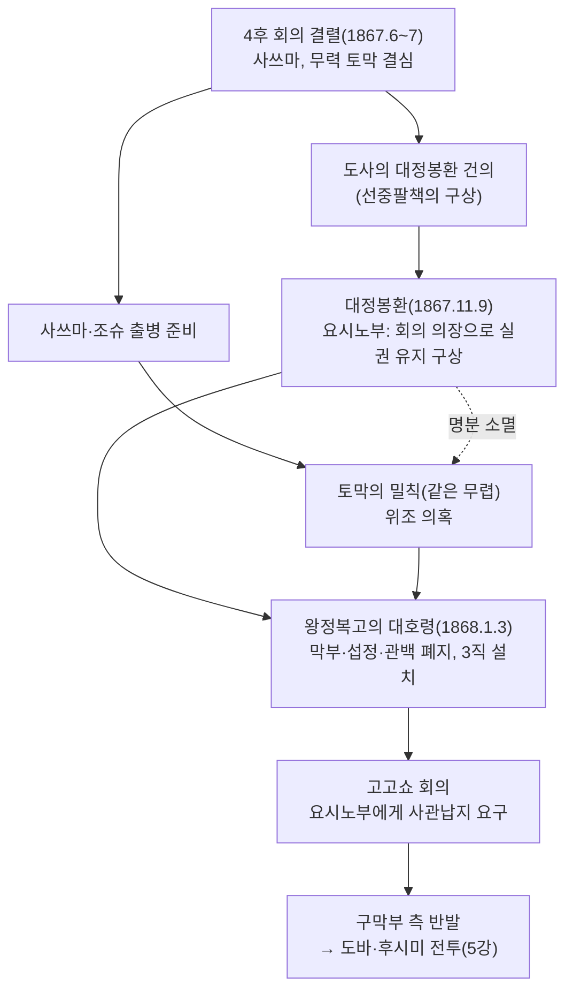

1864년 말, 조슈는 바닥에 있었다. '조정의 적'이 되어 교토에서 쫓겨났고, 4개국 함대에 포대를 빼앗겼으며, 막부의 정벌군 앞에 가로 세 명의 목을 바치고 항복했다. 그런데 불과 3년 뒤인 1867년 말, 쓰러진 것은 조슈가 아니라 260년 동안 일본을 다스린 도쿠가와 막부였다.

무엇이 이 역전을 가능하게 했을까? 이 강의는 조슈 내부의 혁명, 어제의 적이던 사쓰마와 조슈의 동맹, 막부의 제2차 조슈 정벌 실패, 그리고 마지막 쇼군 **도쿠가와 요시노부**가 스스로 정권을 천황에게 돌려준 **대정봉환**과, 그 직후 막부를 완전히 없앤 **왕정복고의 대호령**까지를 따라간다.

> [!핵심] 이 강의의 질문
> 1. 서로 칼을 겨누던 사쓰마와 조슈는 왜, 어떻게 손을 잡았는가?
> 2. 막부는 왜 조슈 하나를 이기지 못했는가?
> 3. 요시노부는 왜 스스로 정권을 내놓았고, 토막파는 왜 그것으로 만족하지 않았는가?

```timeline
1864.12 | 제1차 조슈 정벌 종결 | 조슈가 가로 3명을 할복시키고 항복. 번 안에서는 보수파(속론당)가 집권
1865.1 | 다카스기 신사쿠의 거병 | 시모노세키 고잔지功山寺에서 군사를 일으켜 보수파를 몰아냄
1865.6 | 가메야마 샤추 결성 | 사카모토 료마 등이 나가사키에서 무역·해운 결사를 만듦
1865.11 | 조약 칙허 | 4개국 함대의 압박 속에 고메이 천황이 통상조약을 마침내 승인
1866.3.7 | 삿초 동맹 | 교토에서 사이고 다카모리와 기도 다카요시가 비밀 동맹을 맺음. 료마가 입회
1866.7 | 제2차 조슈 정벌 시작 | 막부군이 네 방면에서 조슈를 공격했으나 연패
1866.8.29 | 쇼군 이에모치 사망 | 오사카성에서 21세로 병사. 막부는 휴전
1867.1.10 | 요시노부, 15대 쇼군 취임 | 프랑스의 지원을 받아 군제·행정 개혁(게이오 개혁)
1867.1.30 | 고메이 천황 사망 | 14세의 메이지 천황 즉위
1867.6~7 | 4후 회의 결렬, 효고 개항 칙허 | 요시노부가 사쓰마 등을 정치적으로 압도
1867.8~ | '에에자나이카' 소동 | 하늘에서 부적이 내려왔다며 민중이 춤추고 돌아다니는 집단 열광이 각지로 번짐
1867.11.9 | 대정봉환 | 요시노부가 정권 반환을 조정에 상주. 같은 무렵 사쓰마·조슈에 '토막의 밀칙'
1867.12.10 | 사카모토 료마 암살 | 교토 오미야近江屋에서 나카오카 신타로와 함께 피습
1868.1.3 | 왕정복고의 대호령 | 막부·섭정·관백을 폐지하고 천황 중심의 새 정부 선언. 그날 밤 요시노부의 관직 사퇴와 영지 반납 결정
```

## 조슈의 재기: 다카스기 신사쿠와 기병대

제1차 조슈 정벌에 항복한 뒤 조슈의 실권은 막부에 순종하자는 보수파, 이른바 **속론당俗論党**에게 넘어갔다. 그들은 존왕양이파의 지도자들을 처형하고, 기병대 같은 제대諸隊를 해산하려 했다.

이때 몸을 숨겼던 다카스기 신사쿠가 돌아왔다. 1865년 1월 12일(겐지 원년 12월 15일) 밤, 다카스기는 시모노세키의 절 고잔지에서 겨우 80여 명으로 거병했다. 처음에는 무모해 보였지만, 기병대를 비롯한 제대가 잇달아 호응했다. 농민과 상인 출신이 섞인 이 부대들은 두 달 만에 번의 정규군을 꺾고 보수파를 몰아냈다. 이후 조슈의 번론은 **겉으로는 막부에 순종하되, 속으로는 군비를 갖춰 맞설 준비를 한다**(무비공순武備恭順)로 정리되었다.

조슈의 군제 개혁을 이끈 사람은 난학자 출신의 **오무라 마스지로大村益次郎**였다. 그는 서양 병서를 번역해 가르치며, 신분과 상관없이 모은 병사들을 최신식 소총과 산병 전술로 훈련시켰다. 조슈군은 무사의 군대에서 '국민군'의 원형으로 바뀌어 갔다.

{{F:l4-kido}}

정치를 맡은 것은 **기도 다카요시木戸孝允**(당시 이름 가쓰라 고고로)였다. 금문의 변 뒤 교토와 다지마에 숨어 지내다 돌아온 그는, 조슈를 살리려면 고립에서 벗어나야 한다고 보았다. 문제는 손잡을 상대였다. 8·18 정변과 금문의 변에서 조슈를 짓밟은 것은 다름 아닌 사쓰마였다. 조슈 사람들은 사쓰마를 '사쓰마 도적薩賊'이라 부르며 원수로 여겼다.

## 삿초 동맹

### 사쓰마의 방향 전환

한편 사쓰마도 변하고 있었다. 사쓰에이 전쟁 뒤 영국과 가까워진 사쓰마에서는 **사이고 다카모리**와 **오쿠보 도시미치大久保利通**가 번정의 중심에 섰다. 두 사람은 가고시마의 같은 하급 무사 마을(가지야초) 출신의 오랜 동료였다.

{{F:l4-saigo}}

{{F:l4-okubo}}

사쓰마는 처음에 공무합체를 통해 막부 정치에 참여하려 했다. 그러나 1864년 무렵부터 막부, 특히 히토쓰바시 요시노부가 웅번의 발언을 견제하며 막부 중심의 정치를 되살리려 하자 생각이 바뀌었다. 제1차 조슈 정벌 때 사이고가 조슈를 끝까지 몰아붙이지 않은 것도, 조슈가 사라지면 다음 차례는 사쓰마일 수 있다는 계산이 있었기 때문이다. 막부가 제2차 조슈 정벌을 준비하자, 사쓰마는 출병을 거부했다.

### 사카모토 료마와 가메야마 샤추

원수 사이인 두 번을 이어 준 것은 도사번을 탈번한 낭사 **사카모토 료마坂本龍馬**와 나카오카 신타로中岡慎太郎였다. 료마는 막부 해군의 가쓰 가이슈 밑에서 항해술을 배운 뒤, 1865년 사쓰마의 후원으로 나가사키에 무역·해운 결사 **가메야마 샤추亀山社中**(뒤의 가이엔타이海援隊)를 세웠다.

{{F:l4-ryoma}}

당시 조슈는 막부의 압력으로 외국 상인에게서 직접 무기를 살 수 없었다. 료마는 여기에 착안했다. **사쓰마의 명의로 조슈가 무기를 사고, 그 대가로 조슈는 사쓰마에 쌀을 보낸다.** 1865년 여름, 나가사키의 영국 상인 토머스 글로버를 통해 미니에 소총 4,300정과 게베르 소총 3,000정이 사쓰마 명의로 조슈에 넘어갔다. 무기 거래가 신뢰를 쌓았다.

### 교토의 밀약

1866년 3월 7일(게이오 2년 1월 21일), 교토의 사쓰마 가로 고마쓰 다테와키 저택에서 사이고와 기도가 마주 앉았다. 둘 다 체면 때문에 먼저 동맹을 말하지 않아 회담이 열흘 가까이 공전하다, 료마가 사이고를 설득해 마침내 6개조의 약속이 이루어졌다. 이것이 **삿초 동맹薩長同盟**이다. 기도는 내용을 글로 정리해 료마에게 보냈고, 료마는 그 뒷면에 붉은 글씨로 "틀림없다"고 보증하는 글을 써서 돌려보냈다. 이 문서가 지금도 남아 있다.

| 조항 | 내용 (요지) |
|---|---|
| 1 | 막부와 조슈가 전쟁을 벌이면, 사쓰마는 곧바로 군사 2,000명을 교토·오사카에 보내 압박한다 |
| 2 | 조슈가 이길 기미가 보이면, 사쓰마는 조정에 조슈를 위해 힘써 교섭한다 |
| 3 | 조슈가 지더라도 1년이나 반년 안에 무너지지는 않을 것이니, 그사이 사쓰마는 반드시 힘을 다한다 |
| 4 | 막부군이 그대로 물러나면, 사쓰마는 조슈의 누명(조적)을 벗기도록 조정에 교섭한다 |
| 5 | 히토쓰바시·아이즈·구와나 세력이 조정을 끼고 사쓰마의 교섭을 방해하면, 결전도 불사한다 |
| 6 | 누명이 벗겨진 뒤에는 두 번이 힘을 합쳐 천황의 위광을 되살리기 위해 진력한다 |

표: 삿초 동맹의 6개조

동맹의 내용은 아직 '막부를 무너뜨리자'가 아니었다. 사쓰마가 조슈의 조적 누명을 벗기도록 돕는다는 '조슈 구원 협정'에 가까웠다. 그러나 막부에 맞서는 두 웅번이 손을 잡았다는 사실은 정치 판도를 결정적으로 바꾸었다.

## 제2차 조슈 정벌의 실패

### 네 방면의 패배

막부는 1866년 7월, 마침내 제2차 조슈 정벌을 시작했다. 막부군은 조슈를 네 방면에서 포위했기 때문에, 조슈 사람들은 이 전쟁을 '네 국경의 전쟁'이라는 뜻으로 **사경四境 전쟁**이라 불렀다. 숫자로만 보면 막부의 압승이 당연해 보였다. 막부와 여러 번의 동원 병력은 10만 명이 넘었고, 조슈는 수천 명에 불과했다.

| 방면 | 전개 | 결과 |
|---|---|---|
| 오시마구치 (세토 내해의 섬) | 막부 함대가 상륙해 점령 | 다카스기의 군함 기습과 반격으로 탈환 |
| 게이슈구치 (아키 방면) | 막부의 서양식 부대가 격전 | 교착. 조슈 우세 속에 휴전 |
| 세키슈구치 (이와미 방면) | 오무라 마스지로가 지휘 | 조슈군이 하마다성까지 진격해 함락 |
| 고쿠라구치 (규슈 방면) | 다카스기와 기병대가 해협을 건너 공격 | 막부 측 총사령관이 이탈하자 고쿠라번이 성에 불을 지르고 퇴각 |

표: 사경 전쟁의 네 전선

{{F:l4-soldiers}}

막부군이 진 이유는 여럿이다. 첫째, **무기와 전술**의 차이다. 조슈군은 최신 미니에 소총으로 무장하고 흩어져 싸우는 산병 전술을 익혔지만, 많은 번의 군대는 여전히 갑옷과 구식 화승총, 진법에 의지했다. 둘째, **사기**의 차이다. 조슈는 번의 존망을 걸고 싸웠지만, 막부에 동원된 다이묘들은 싸울 의욕이 없었다. 사쓰마는 동맹에 따라 출병을 거부했고, 다른 번들도 군비 부담과 물가 폭등에 시달리며 소극적으로 움직였다. 셋째, **민심**이다. 1866년은 흉작으로 쌀값이 폭등해, 오사카와 에도에서 대규모 우치코와시打ちこわし(쌀가게 등을 부수는 도시 폭동)가 일어나고 농촌에서는 '세상을 바로잡자(요나오시世直し)'를 외치는 잇키가 잇따랐다. 전쟁을 위한 쌀 매점이 그 불길에 기름을 부었다.

### 이에모치의 죽음

전쟁이 한창이던 1866년 8월 29일(게이오 2년 7월 20일), 출진 본부가 있던 오사카성에서 쇼군 이에모치가 21세로 숨을 거두었다. 막부는 쇼군의 죽음을 핑계로 휴전했다. 사실상의 패배였다. 막부가 다이묘 하나를 굴복시키지 못했다는 사실은, 막부의 군사적 권위가 끝났음을 온 나라에 알렸다.

## 마지막 쇼군, 도쿠가와 요시노부

### 게이오 개혁

이에모치의 후계자는 히토쓰바시 요시노부였다. 그는 쇼군 자리를 바로 받지 않고 몇 달을 버티다, 1867년 1월 10일(게이오 2년 12월 5일) 15대 쇼군에 올랐다. 모두가 원해서 쇼군이 된다는 모양새를 만들기 위해서였다.

{{F:l4-yoshinobu}}

요시노부는 유능했다. 그는 프랑스 공사 **레옹 로슈**의 조언과 지원을 받아 막부를 근대 국가 정부처럼 개조하려 했다. 이를 **게이오 개혁**이라 한다.

{{F:l4-roches}}

- **행정**: 로주들에게 국내·회계·외국·육군·해군 사무를 나누어 맡겨, 내각의 장관처럼 운영했다.
- **군사**: 1867년 프랑스 군사고문단을 초빙해 보병·포병·기병을 서양식으로 훈련시켰다. 요코스카 제철소(조선소)도 프랑스의 도움으로 세워지고 있었다.
- **외교**: 1867년 파리 만국박람회에 동생 도쿠가와 아키타케를 보내, 막부가 일본의 정부임을 유럽에 보여 주려 했다.

영국은 반대편에 섰다. 1865년 부임한 영국 공사 **해리 파크스**와 통역관 어니스트 사토는 막부가 아니라 사쓰마·조슈 같은 웅번이 일본의 미래를 쥐고 있다고 판단하고, 그들과 가까이 지냈다. 막말의 정쟁은 프랑스 대 영국의 경쟁이라는 국제적 성격도 띠게 되었다.

{{F:l4-parkes}}

```compare
항목 | 막부 측 | 사쓰마·조슈 측
지도자 | 쇼군 도쿠가와 요시노부, 오구리 다다마사 | 사이고 다카모리·오쿠보 도시미치(사쓰마), 기도 다카요시(조슈), 이와쿠라 도모미(공가)
후원 외국 | 프랑스 (공사 레옹 로슈) | 영국 (공사 해리 파크스, 통역관 어니스트 사토)
군사 | 프랑스 군사고문단, 서양식 보병 육성, 해군력 우세 | 영국제 소총, 기병대 등 신분 혼성 부대
정치 구상 | 쇼군 중심의 근대적 행정 + 다이묘 회의 | 막부 없는 천황 중심 정부
약점 | 다이묘들의 이탈, 재정난, 민심 이반 | 병력 규모가 작고, 조정을 움직일 명분이 필요
```

### 고메이 천황의 죽음

1867년 1월 30일, 고메이 천황이 36세로 갑자기 세상을 떠났다. 천연두라고 발표되었지만 독살설도 나돌았다. 고메이 천황은 외국인을 싫어했지만, 막부를 무너뜨리는 데에는 끝까지 반대했다. 막부를 지켜 주던 가장 큰 방패가 사라진 것이다. 뒤를 이은 메이지 천황은 아직 14세 소년이었고, 조정 안에서는 이와쿠라 도모미岩倉具視 등 토막파와 가까운 공가들이 힘을 얻었다.

{{F:l4-komei}}

### 요시노부의 정치적 승리

그럼에도 1867년 상반기의 정국은 요시노부에게 유리하게 흘렀다. 사쓰마의 히사미쓰, 에치젠의 마쓰다이라 요시나가, 도사의 야마우치 도요시게, 우와지마의 다테 무네나리가 교토에 모여 효고 개항과 조슈 처분 문제를 논의했지만(4후 회의), 요시노부는 이들을 노련하게 따돌리고 조정에서 효고 개항 칙허를 받아 냈다. 사쓰마는 '말로는 요시노부를 이길 수 없다'는 결론에 이르렀다. 사이고와 오쿠보는 이때부터 **무력으로 막부를 무너뜨리는 길(무력 토막)** 을 본격적으로 준비했다.

## 대정봉환

### 도사의 구상: 평화적 정권 반환

사쓰마·조슈와 막부가 무력 충돌로 치닫자, 그 사이에서 다른 길을 제시한 것이 도사번이었다. 료마가 1867년 여름 도사의 고토 쇼지로에게 건넨 것으로 전하는 8개 항목의 구상을 **선중팔책船中八策**이라 부른다. 그 첫머리가 "천하의 정권을 조정에 봉환하고, 정령은 조정에서 나오게 할 것"이었다. 쇼군이 스스로 정권을 천황에게 돌려주고, 다이묘와 인재들이 모이는 의회(상하 의정국)를 만들어 나라를 운영하자는 것이었다. 전쟁 없이 막부를 끝내자는 구상이었다.

도사의 전 번주 야마우치 도요시게는 이 구상을 받아들여 1867년 10월 요시노부에게 대정봉환을 건의했다.

### 요시노부의 계산

1867년 11월 8일(게이오 3년 10월 13일), 요시노부는 교토 **니조성二条城**에 여러 번의 중신들을 불러 대정봉환에 관한 의견을 물었다. 그리고 이튿날인 11월 9일, 조정에 정권 반환을 상주했다. 조정은 그다음 날 이를 받아들였다. 1603년 이에야스가 막부를 연 지 264년 만이었다.

{{F:l4-nijo}}

요시노부가 정권을 순순히 내놓은 것은 패배를 인정해서가 아니었다. 조정에는 나라를 다스릴 행정 조직도, 군대도, 재정도 없었다. 정권을 돌려받아도 결국 요시노부에게 실무를 맡길 수밖에 없을 것이었다. 요시노부는 다이묘들의 회의를 만들고 자신이 그 **의장**이 되어, 이름만 바꾼 채 실권을 쥐려 했다. 무엇보다 대정봉환은 사쓰마·조슈가 내세우던 '막부 타도'의 명분을 하루아침에 없애 버렸다.

> [!사료] 토막의 밀칙과 대정봉환은 같은 때였다
> 대정봉환 상주와 같은 무렵(게이오 3년 10월 13~14일), 조정의 이와쿠라 도모미 등은 사쓰마와 조슈에 "적신 요시노부를 토벌하라"는 내용의 밀칙을 내렸다(토막의 밀칙). 그러나 이 칙서에는 천황의 친필 재가 표시나 섭정의 서명 등 정식 절차가 빠져 있어, 이와쿠라와 오쿠보 등이 꾸민 위조 문서라는 견해가 유력하다. 요시노부의 대정봉환으로 이 밀칙은 실행할 명분을 잃었다.

### 료마의 죽음

대정봉환 한 달 뒤인 1867년 12월 10일(게이오 3년 11월 15일), 사카모토 료마는 교토의 간장 가게 오미야 2층에서 나카오카 신타로와 함께 괴한들의 습격을 받아 목숨을 잃었다. 33세 생일이었다고 전한다. 범인은 교토 순찰을 맡던 막부 측 경비 조직 미마와리구미의 대원들이라는 설이 유력하지만, 지금도 여러 설이 엇갈린다.

## 왕정복고의 대호령

토막파는 요시노부가 새 체제의 중심에 서는 것을 받아들일 수 없었다. 1868년 1월 3일(게이오 3년 12월 9일), 사쓰마·도사·에치젠·오와리·아키 다섯 번의 병력이 궁궐의 문을 장악한 가운데, 메이지 천황의 이름으로 **왕정복고의 대호령王政復古の大号令**이 선포되었다.

| 폐지된 것 | 새로 생긴 것 |
|---|---|
| 막부 (쇼군) | **총재**: 아리스가와노미야 다루히토 친왕 |
| 섭정·관백 (천황을 대신하던 조정의 최고직) | **의정**: 황족·공가와 웅번 다이묘 (마쓰다이라 요시나가, 야마우치 도요시게, 시마즈 다다요시 등) |
| 교토 수호직·교토 쇼시다이 | **참여**: 공가와 각 번의 실무 인재 (이와쿠라 도모미, 사이고 다카모리, 오쿠보 도시미치, 고토 쇼지로 등) |

표: 왕정복고로 바뀐 정부 조직 (3직제)

그날 밤 궁궐 안 고고쇼小御所에서 열린 첫 회의에서, 요시노부의 처우를 둘러싸고 격론이 벌어졌다. 도사의 야마우치 도요시게는 "요시노부를 이 자리에 부르지도 않고 처분을 논하는 것은 음험하다. 몇몇 공가가 어린 천황을 끼고 권력을 훔치려는 것"이라고 몰아붙였다. 이와쿠라는 "어린 천황이라니 무례하다"고 맞섰다. 회의가 쉬는 동안 사이고가 "단도 한 자루면 끝날 일"이라고 말했다는 이야기가 전해지고, 이 말을 전해 들은 야마우치는 결국 물러섰다. 회의는 요시노부에게 **관직(내대신)을 사퇴하고 영지를 반납하라(사관납지辞官納地)** 고 요구하기로 결정했다.



요시노부는 교토의 니조성을 떠나 오사카성으로 물러나, 외국 공사들에게 "외교권은 여전히 내게 있다"고 선언하며 버텼다. 도쿠가와 가문은 여전히 일본 최대의 영지와 군대를 가지고 있었다. 정권은 바뀌었지만, 승부는 아직 나지 않았다. 마지막 결판은 칼과 총으로 내려지게 된다.

## 정리

> [!핵심] 4강 요약
> - 제1차 조슈 정벌 뒤 **다카스기 신사쿠**의 거병으로 조슈는 개혁파가 장악했고, **오무라 마스지로**가 신분 혼성 부대를 서양식으로 훈련시켰다.
> - **사카모토 료마**의 중개로 사쓰마 명의의 무기 거래가 이루어졌고, 1866년 사이고와 기도가 **삿초 동맹**을 맺었다.
> - **제2차 조슈 정벌**(사경 전쟁)에서 막부군은 무기·사기·민심 모두에서 밀려 패했고, 쇼군 이에모치가 죽으면서 막부의 군사적 권위가 무너졌다.
> - 마지막 쇼군 **요시노부**는 프랑스의 지원으로 개혁을 추진했고, 영국은 사쓰마·조슈 쪽에 섰다.
> - 요시노부는 **대정봉환**(1867.11)으로 실권을 지키려 했지만, 토막파는 **왕정복고의 대호령**(1868.1)으로 막부를 폐지하고 요시노부에게 관직과 영지의 반납을 요구했다.

### 생각해 볼 질문

1. 삿초 동맹의 6개조에는 '막부 타도'라는 말이 없다. 그런데도 이 동맹이 막부 몰락의 결정적 계기로 꼽히는 까닭은 무엇일까?
2. 10만이 넘는 막부군이 수천의 조슈군을 이기지 못한 이유 가운데, 가장 근본적인 것은 무엇이라고 생각하는가?
3. 요시노부의 대정봉환은 '패배의 인정'이었을까, '정치적 묘수'였을까? 토막파가 왕정복고를 서두른 이유와 함께 생각해 보자.

### 다음 강 예고

5강에서는 도바·후시미 전투로 시작된 **보신 전쟁**, 에도성 무혈 개성, 5개조 서문과 메이지 신정부의 출범, 동북 지방과 아이즈의 비극, 하코다테 고료카쿠의 최후, 그리고 **판적봉환**까지 새 국가가 첫발을 내딛는 과정을 다룬다.
