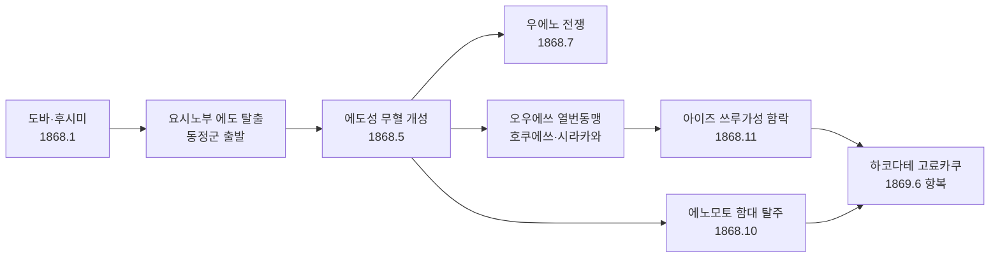

왕정복고의 대호령으로 막부는 문서상 사라졌다. 그러나 도쿠가와 가문은 여전히 일본에서 가장 넓은 영지와 가장 큰 군대, 그리고 서양식 함대를 가지고 있었다. 새 정부는 군대도 돈도 거의 없는 '종이 위의 정부'였다. 이 불균형을 무너뜨린 것이 1868년 1월부터 1869년 6월까지 이어진 내전, **보신 전쟁戊辰戦争**이다. '보신'은 전쟁이 시작된 1868년의 간지인 무진戊辰을 일본식으로 읽은 것이다.

이 강의는 교토 남쪽 도바·후시미에서 시작된 전쟁이 에도, 동북 지방의 아이즈, 그리고 홋카이도의 하코다테까지 북상하는 과정을 따라간다. 동시에 전쟁의 포성 속에서 새 정부가 **5개조 서문**으로 국가의 방향을 밝히고, 수도를 도쿄로 옮기고, **판적봉환**으로 다이묘의 땅과 백성을 거두어들이는 과정을 함께 살핀다.

> [!핵심] 이 강의의 질문
> 1. 병력이 적었던 신정부군은 어떻게 도바·후시미에서 이길 수 있었는가?
> 2. 에도성은 어떻게 싸움 없이 넘어갔고, 동북 지방은 왜 끝까지 저항했는가?
> 3. 새 정부는 전쟁 중에 어떤 국가를 만들겠다고 약속했는가?

```timeline
1868.1.27~30 | 도바·후시미 전투 | 교토 남쪽에서 구막부군과 신정부군 충돌. '관군의 깃발' 등장, 구막부군 패주
1868.1.31 | 요시노부, 오사카에서 에도로 탈출 | 군함 가이요마루를 타고 밤중에 오사카성을 빠져나감
1868.2 | 요시노부 추토령, 동정군 출발 | 아리스가와노미야 다루히토가 동정 대총독, 사이고 다카모리가 참모
1868.4.6 | 5개조 서문 | 천황이 신들에게 새 정치의 기본 방침을 맹세하는 형식으로 발표
1868.5.3 | 에도성 무혈 개성 | 사이고와 가쓰 가이슈의 회담으로 전투 없이 에도성을 넘김
1868.6 | 정체서 반포, 오우에쓰 열번동맹 결성 | 태정관 중심의 정부 조직을 정함. 동북·호쿠에쓰의 31번이 동맹
1868.7.4 | 우에노 전쟁 | 에도 우에노에 버티던 쇼기타이를 오무라 마스지로가 하루 만에 진압
1868.9.3 | 에도를 '도쿄'로 개칭 | 동쪽의 서울이라는 뜻
1868.10.23 | 연호를 '메이지'로 | 천황 한 명에 연호 하나(일세일원제)를 정함
1868.11.6 | 아이즈 항복 | 한 달간의 쓰루가성 농성 끝에 항복
1868.11.26 | 천황, 도쿄에 도착 | 에도성을 도쿄성으로 이름을 바꾸어 거처로 삼음
1868.12 | 에노모토 다케아키, 하코다테 점령 | 구막부 함대가 에조치(홋카이도)로 건너가 고료카쿠에 입성
1869.6.27 | 고료카쿠 항복 | 하코다테 전쟁 종결, 보신 전쟁 끝남
1869.7 | 판적봉환 | 모든 다이묘가 영지(판)와 백성(적)을 천황에게 반환하고 지번사가 됨
```

## 도바·후시미 전투

### 사쓰마의 도발

왕정복고 뒤 오사카성으로 물러난 요시노부는 서두르지 않았다. 신정부 안에서도 도사·에치젠 등은 요시노부를 새 정부에 받아들이자는 쪽이었고, 시간이 흐를수록 사쓰마·조슈가 고립될 수 있었다. 사이고 다카모리는 이를 깨뜨릴 방법을 찾았다. 그는 에도의 사쓰마 번저에 낭사들을 모아 에도 시내에서 약탈과 방화를 일삼게 했다. 구막부 측을 자극해 먼저 칼을 뽑게 하려는 것이었다.

1868년 1월 19일(게이오 3년 12월 25일), 참다못한 쇼나이번 등 구막부 측이 에도의 사쓰마 번저를 불태웠다. 이 소식이 오사카에 전해지자 구막부 측 장병들은 격분했고, 요시노부도 더 이상 그들을 누를 수 없었다. 구막부군은 "사쓰마를 토벌하자(토살討薩)"며 교토로 진군했다.

### 관군의 깃발

1868년 1월 27일(게이오 4년 1월 3일) 저녁, 교토 남쪽의 도바와 후시미에서 양측이 충돌했다. 구막부군은 약 1만 5,000명, 신정부군(사쓰마·조슈 중심)은 약 5,000명이었다.

```chart
{
  "type": "bar",
  "caption": "도바·후시미 전투의 병력 비교 (단위: 명, 통설로 쓰이는 대략적인 수치). 수적 열세에도 신정부군이 이겼다",
  "height": 220,
  "data": {
    "labels": ["구막부군 (막부 보병, 아이즈·구와나 등)", "신정부군 (사쓰마·조슈 등)"],
    "datasets": [{ "label": "병력(명)", "data": [15000, 5000] }]
  },
  "options": { "indexAxis": "y", "plugins": { "legend": { "display": false } } }
}
```

그러나 구막부군은 좁은 가도를 따라 긴 행렬로 행군하다 신정부군의 집중 사격을 받았다. 지휘 체계도 엉성했다. 이튿날 신정부군 진영에 **비단 깃발(니시키노미하타錦の御旗)**, 곧 천황의 군대임을 나타내는 깃발이 올랐다. 이 깃발은 이와쿠라 도모미와 오쿠보 도시미치가 미리 준비해 둔 것이었다. 깃발 하나로 신정부군은 '관군官軍'이 되고, 구막부군은 천황에게 활을 겨누는 '적군'이 되었다.

효과는 즉각적이었다. 구막부 편에 섰던 요도번은 성문을 닫아 패주하는 구막부군을 받아 주지 않았고, 쓰번은 아예 신정부 쪽으로 돌아서 구막부군에게 포격을 퍼부었다. 나흘 만에 구막부군은 오사카로 무너져 내렸다.

### 요시노부의 탈출

1월 31일(1월 6일) 밤, 요시노부는 "끝까지 싸우겠다"고 장병들 앞에서 말한 직후, 아이즈 번주 마쓰다이라 가타모리 등 몇 사람만 데리고 몰래 오사카성을 빠져나가 군함 **가이요마루開陽丸**를 타고 에도로 돌아갔다. 남겨진 장병들은 망연자실했다. 요시노부가 왜 도망쳤는지는 지금도 논쟁거리다. '조적'이 되는 것을 무엇보다 두려워한 미토 출신다운 존왕 의식 때문이라는 해석, 내전이 길어져 외국이 개입하는 것을 막으려 했다는 해석 등이 있다.

### 신정부의 첫 외교 시험

교토를 손에 넣은 신정부가 먼저 부딪친 것은 외교였다. 새 정부의 주축은 몇 년 전까지 '양이'를 외치던 사람들이었으므로, 외국 공사들은 새 정권이 조약을 지킬지 의심했다. 1868년 2월 4일, 고베에서 행군하던 비젠번(오카야마) 병사들이 행렬을 가로지른 외국 수병들에게 총을 쏘는 **고베 사건**이 일어났다. 외국 군대가 고베 거류지를 점령하는 사태 속에서, 신정부는 발포를 명령한 장교 다키 젠자부로에게 외국 대표들 앞에서 할복하게 하고서야 사태를 수습했다. 3월에는 사카이에서 도사번 병사들이 프랑스 수병 11명을 살해하는 **사카이 사건**이 터졌고, 이번에도 도사 병사 11명이 할복했다.

신정부는 이 사건들을 겪으며 "막부가 맺은 조약을 이어받고, 외국과 화친한다"는 방침을 공식으로 선포했다. 1868년 3월에는 메이지 천황이 교토 궁궐에서 처음으로 서양 외교관들을 맞았다. 영국 공사 파크스는 알현하러 가는 길에 양이파 무사 두 명에게 습격당했지만 호위병들이 막아 냈고, 알현은 사흘 뒤 다시 이루어졌다. 양이를 외치던 세력이 세운 정부가 개국과 화친의 정부임을 스스로 증명해야 했던 셈이다.

### '가짜 관군' 적보대

동정군의 선봉에는 사가라 소조相楽総三가 이끄는 **적보대赤報隊**가 있었다. 그들은 도산도(나카센도)를 따라 진군하며 "새 정부는 연공을 반으로 줄인다"고 선전해 농민들의 지지를 모았다. 그러나 재정이 바닥난 신정부는 이 약속을 지킬 수 없었다. 신정부는 적보대를 '관군을 사칭한 가짜 관군'으로 몰아 붙잡았고, 1868년 3월 사가라 등 간부들을 처형했다. 새 정부를 위해 앞장선 이들을 새 정부가 지운 이 사건은, 유신이 농민의 해방을 약속한 혁명이 아니었음을 보여 준다.

## 에도성 무혈 개성

### 동정군과 공순

신정부는 요시노부 추토령을 내리고, 아리스가와노미야 다루히토 친왕을 대총독으로, 사이고 다카모리를 참모로 하는 **동정군**을 에도로 보냈다. 에도에 돌아온 요시노부는 프랑스 공사 로슈가 재기를 권했지만 거절하고, 우에노의 간에이지에 들어가 근신하며 **공순恭順**, 곧 새 정부에 순종하겠다는 뜻을 밝혔다.

### 에도성 안의 논쟁

요시노부가 돌아온 에도성 안에서는 끝까지 싸우자는 주전론과 순순히 따르자는 공순론이 맞섰다. 주전론의 선봉은 막부의 재정과 군제 개혁을 이끌어 온 간조 부교 **오구리 다다마사**였다. 그는 육군으로 하코네에서 동정군을 막고, 우세한 막부 함대로 스루가만에 들어가 적의 보급로를 끊으면 이길 수 있다고 주장했다. 군사적으로는 근거가 있는 계획이었다. 그러나 요시노부는 오구리를 파면했다. 영지로 물러난 오구리는 1868년 5월 신정부군에 붙잡혀 제대로 된 심문도 없이 처형되었다. 2강에서 워싱턴 해군 조선소의 나사를 들고 돌아왔다는 그 오구리다.

에도성 안의 여성들도 움직였다. 14대 쇼군 이에모치의 부인이었던 **가즈노미야**와, 13대 쇼군 이에사다의 부인이자 사쓰마 시마즈 가문 출신인 **덴쇼인**(아쓰히메)은 각각 친정인 조정과 사쓰마에 편지를 보내 도쿠가와 가문을 살려 달라고 호소했다. 공무합체의 상징으로 에도에 시집온 황녀와, 사쓰마가 막부에 들여보낸 여성이, 이제 그 조정과 사쓰마를 향해 도쿠가와 가문의 존속을 탄원한 것이다.

### 사이고와 가쓰의 회담

이제 문제는 인구 100만의 도시 에도였다. 동정군은 1868년 4월 7일(3월 15일)을 에도성 총공격일로 정했다. 구막부 측에서 교섭을 맡은 것은 육군 총재 **가쓰 가이슈**였다. 그는 협상이 결렬되면 에도에 불을 질러 동정군을 불길 속에 가두고, 시민들은 배로 피난시킨다는 '초토 작전'까지 준비해 두었다고 한다.

1868년 4월 5~6일(3월 13~14일), 에도 다마치의 사쓰마 번저에서 사이고와 가쓰가 마주 앉았다. 두 사람은 1864년 오사카에서 처음 만나 서로를 깊이 인정한 사이였다. 가쓰는 요시노부를 미토에서 근신시키고, 에도성과 무기·군함을 넘기겠다는 조건을 내놓았다. 사이고는 총공격을 중지했다. 영국 공사 파크스가 "항복한 자를 공격하는 것은 국제법에 어긋난다"며 신정부에 압력을 넣은 것도 영향을 주었다. 1868년 5월 3일(4월 11일), 에도성은 전투 없이 신정부군에게 넘어갔다. 이것이 **에도성 무혈 개성**이다.

> [!참고] 무혈 개성 뒤에도 남은 불씨
> 개성에 반대한 구막부 장병 일부는 에도 우에노의 간에이지에 모여 **쇼기타이彰義隊**를 만들었다. 1868년 7월 4일, 조슈 출신의 오무라 마스지로가 지휘한 신정부군은 사가번의 최신식 암스트롱포를 동원해 하루 만에 이들을 진압했다(우에노 전쟁). 한편 구막부 해군 부총재 에노모토 다케아키는 군함 인도를 거부하고 함대를 이끌고 에도만을 빠져나갔다.

도쿠가와 가문은 살아남았다. 신정부는 1868년 6월, 다야스 가문의 어린 가메노스케(뒤의 도쿠가와 이에사토)에게 도쿠가와 종가를 잇게 하고, 슨푸(시즈오카)에 70만 석의 영지를 주었다. 한때 700만 석을 거느리던 가문이 10분의 1로 줄어든 것이다. 수많은 막신들이 녹봉을 잃고 시즈오카로 따라가 차밭을 일구거나 학교를 세웠고, 일부는 새 정부의 관료로 들어갔다.

## 5개조 서문: 새 나라의 약속

### 천황의 맹세

에도 총공격 예정일 하루 전인 1868년 4월 6일(3월 14일), 교토의 궁궐에서 메이지 천황은 공가와 다이묘들을 거느리고 천지의 신들에게 새 정치의 방침을 맹세했다. 이것이 **5개조 서문五箇条の御誓文**이다. 초안은 에치젠의 유리 기미마사가 쓰고, 도사의 후쿠오카 다카치카와 조슈의 기도 다카요시가 다듬었다.

| 조 | 원문 (요지) | 우리말 풀이 |
|---|---|---|
| 1 | 広ク会議ヲ興シ万機公論ニ決スヘシ | 널리 회의를 열어 모든 일을 공론에 따라 결정한다 |
| 2 | 上下心ヲ一ニシテ盛ニ経綸ヲ行フヘシ | 위아래가 마음을 하나로 하여 나라 다스리는 일을 힘써 행한다 |
| 3 | 官武一途庶民ニ至ル迄各其志ヲ遂ケ人心ヲシテ倦マサラシメン事ヲ要ス | 관리와 무사, 서민에 이르기까지 각자 뜻을 이루어 사람들의 마음이 지치지 않게 한다 |
| 4 | 旧来ノ陋習ヲ破リ天地ノ公道ニ基クヘシ | 낡은 나쁜 관습을 깨고 천지의 바른 도리에 따른다 |
| 5 | 智識ヲ世界ニ求メ大ニ皇基ヲ振起スヘシ | 지식을 세계에서 구하여 천황 나라의 기틀을 크게 일으킨다 |

표: 5개조 서문

여기서 '회의'와 '공론'은 아직 국민이 뽑은 의회를 뜻하지 않았다. 처음 구상은 다이묘들의 회의였다. 그러나 이 문구는 훗날 자유민권운동가들이 "국회를 열라"고 요구할 때 근거로 삼는 조문이 된다. 제4조와 제5조는 양이를 버리고 서양 문명을 받아들이겠다는 선언이었다. 5년 전까지 '양이'를 외치던 사람들이 이제 '지식을 세계에서 구하자'고 맹세한 것이다.

### 5방의 게시와 정체서

그러나 새 정부가 처음부터 '자유'를 약속한 것은 아니었다. 5개조 서문 다음 날, 정부는 전국의 길목에 다섯 장의 게시판(**5방의 게시五榜の掲示**)을 세웠다. 유교 도덕을 지킬 것, 무리를 지어 호소하거나 고향을 떠나지 말 것, **크리스트교를 계속 금지한다**는 것 등 내용은 에도 막부의 법령과 거의 같았다. 크리스트교 금지 게시는 서양 각국의 거센 항의를 받고 1873년에야 철거된다.

1868년 6월에는 **정체서政体書**로 정부 조직을 정했다. 미국 헌법을 참고해 태정관太政官 아래 입법·행정·사법을 나누는 형식을 취했지만, 실제로는 사쓰마·조슈·도사·히젠 출신 인사와 공가들이 요직을 나누어 맡았다.

| 기관 | 성격 |
|---|---|
| 태정관太政官 | 국가 권력의 최고 기관. 그 아래 7관을 둠 |
| 의정관 (상국·하국) | 입법. 상국은 의정·참여, 하국은 각 번에서 보낸 대표(공사貢士) |
| 행정관·신기관·회계관·군무관·외국관 | 행정. 신기관은 신도 제사를 맡아 천황 중심 국가의 성격을 드러냄 |
| 형법관 | 사법 |

표: 정체서(1868)가 정한 정부 조직

### 신불분리와 크리스트교 탄압

새 정부는 천황의 권위를 신도神道로 뒷받침하려 했다. 1868년 봄, 정부는 신사와 절을 엄격히 나누고 신사에서 불상과 승려를 몰아내라는 **신불분리령**을 내렸다. 천 년 넘게 신과 부처를 함께 모셔 온 일본의 종교 전통이 하루아침에 뒤집힌 것이다. 이를 계기로 각지에서 절과 불상, 경전을 부수는 **폐불훼석廃仏毀釈** 운동이 일어나, 수많은 문화재가 사라졌다.

같은 해 나가사키 우라카미에서는 에도 시대 내내 몰래 신앙을 지켜 온 '잠복 크리스천' 수천 명이 체포되어 전국 각지로 유배되었다(우라카미 4번 붕괴). 서양 각국은 이를 강하게 항의했고, 이와쿠라 사절단이 구미를 돌며 가는 곳마다 이 문제로 비판을 받은 뒤인 1873년에야 크리스트교 금지 게시가 철거되었다. 5개조 서문의 '천지의 공도'와 5방의 게시가 공존하던 새 정부의 모순이 여기서도 드러난다.

### 돈이 없는 정부

신정부의 가장 큰 약점은 재정이었다. 막부의 직할령을 몰수했지만, 전쟁 중에 세금을 제대로 거둘 수는 없었다. 정부는 미쓰이 같은 교토·오사카의 거상들에게 막대한 헌금과 대출을 받아 군비를 마련했고, 1868년에는 에치젠 출신 유리 기미마사의 건의로 종이 돈인 **태정관찰太政官札**을 대량으로 찍어 냈다. 금화나 은화로 바꿔 주지 않는 이 지폐는 신용이 낮아 시중에서 액면보다 싸게 거래되었다. 보신 전쟁은 칼과 총의 싸움이었을 뿐 아니라, 돈의 싸움이기도 했다.

## 동북의 저항과 아이즈의 비극

### 오우에쓰 열번동맹

에도가 넘어간 뒤 전쟁터는 동북 지방으로 옮겨 갔다. 신정부는 교토 수호직으로 존왕양이파를 탄압했던 **아이즈번**과, 에도의 사쓰마 번저를 불태운 **쇼나이번**을 '조적'으로 지목하고 동북의 다른 번들에 토벌을 명했다. 그러나 센다이·요네자와 등 동북의 번들은 아이즈를 위해 사면을 탄원했다. 신정부 측 참모가 이를 오만하게 거절하자 반발이 커졌고, 1868년 6월 동북과 호쿠에쓰(니가타 일대)의 31개 번이 **오우에쓰 열번동맹奥羽越列藩同盟**을 맺었다.

| 지역 | 주요 전투 | 결과 |
|---|---|---|
| 호쿠에쓰 | 나가오카 전투: 가와이 쓰구노스케가 개틀링포까지 동원해 저항 | 나가오카성이 두 번 함락된 끝에 패배 |
| 시라카와·니혼마쓰 | 동맹군과 신정부군의 격전. 니혼마쓰번 소년대의 전사 | 신정부군이 동북의 관문을 돌파 |
| 아이즈 | 쓰루가성 농성 | 한 달 농성 끝에 항복 |
| 쇼나이 | 쇼나이번은 전투에서 우세 | 동맹 붕괴 뒤 항복, 비교적 관대한 처분 |

표: 동북 전쟁의 주요 전선

동맹은 에도 간에이지에 있던 황족 린노지노미야 요시히사 친왕(뒤의 기타시라카와노미야)을 맹주로 받들었다. 천황을 앞세운 신정부에 맞서, 동맹 쪽도 황족의 권위를 내세운 것이다. 동맹이 그를 '동쪽의 천황'으로 즉위시키려 했다는 설까지 있을 만큼, 이 전쟁은 단순한 '관군 대 적군'의 싸움이 아니었다.

호쿠에쓰 전선의 나가오카번은 처음에 어느 편에도 서지 않는 무장 중립을 꿈꾸었다. 가로 **가와이 쓰구노스케河井継之助**는 1868년 6월 오지야에서 신정부군 군감 이와무라 세이이치로와 만나 중립을 인정하고 시간을 달라고 호소했지만, 20대 초반의 이와무라는 이를 탄원서조차 받지 않고 물리쳤다(오지야 담판). 결렬 직후 나가오카는 동맹에 가담했고, 가와이는 프랑스제 무기와 개틀링 기관포로 무장한 번병을 이끌고 신정부군을 크게 괴롭혔다. 가와이는 이 전투에서 입은 상처로 세상을 떠났다.

### 아이즈 전쟁과 백호대

1868년 10월, 신정부군이 아이즈 와카마쓰의 성하 마을로 밀려들었다. 아이즈번은 16~17세의 무사 자제로 **백호대白虎隊**를 편성해 싸우게 했다. 전투에서 밀려 이이모리산에 올라간 백호대원 20명은 성하 마을이 불타는 연기를 보고 성이 함락되었다고 생각해 집단으로 자결했고, 그중 한 명만 살아남았다. 그러나 실제로는 성은 아직 버티고 있었다.

쓰루가성鶴ヶ城은 한 달 동안 포위된 채 신정부군의 포격을 견뎠다. 성안에서는 무사의 가족들도 탄약을 만들고 부상자를 돌보았으며, 성 밖에서는 가로의 가족 등 많은 여성과 노인이 적에게 욕을 당하지 않으려고 스스로 목숨을 끊었다. 1868년 11월 6일(메이지 원년 9월 22일), 아이즈는 항복했다. 전후 아이즈번은 영지를 몰수당하고, 혹독한 땅인 혼슈 북단의 시모키타반도로 옮겨져 도나미번이 되었다. 아이즈의 비극과 원한은 이후 오랫동안 지역의 기억으로 남았다.

```figure
src: asset:480da375610d65bfdaf4cdf036c08ebb
caption: 아이즈 번주 마쓰다이라 가타모리(1836~1893). 교토 수호직으로 신센구미를 거느리고 존왕양이파를 단속했기 때문에, 신정부는 그를 '조적'의 우두머리로 지목했다.
credit: 촬영자·연도 미상 · 국립국회도서관 「근대일본인의 초상」
license: Public Domain (국립국회도서관: 저작권 보호 기간 만료)
source: https://www.ndl.go.jp/portrait/datas/334/
width: narrow
```

## 하코다테의 마지막 싸움

### 에노모토 함대와 '에조 공화국'

에도를 빠져나간 에노모토 다케아키榎本武揚는 기함 가이요마루를 비롯한 구막부 함대를 이끌고 북으로 향했다. 그는 동북의 패잔병과 신센구미의 부장이던 **히지카타 도시조土方歳三**, 그리고 막부의 군사고문으로 왔다가 본국의 철수 명령을 거부하고 남은 프랑스 군인 **쥘 브뤼네** 등을 태우고 1868년 12월 에조치(지금의 홋카이도)에 상륙해 하코다테의 서양식 별 모양 요새 **고료카쿠五稜郭**를 점령했다.

```figure
src: asset:e35663ae2bfb14c3bc4d15bc0335da5e
caption: 에노모토 다케아키(1836~1908). 상투를 튼 젊은 시절의 모습이다.
credit: 촬영자 미상, 1860년대로 추정 · 국립국회도서관 「근대일본인의 초상」
license: Public Domain (국립국회도서관: 저작권 보호 기간 만료)
source: https://www.ndl.go.jp/portrait/datas/28/
width: narrow
```

```figure
src: asset:d608c1e791cb25874ca7656f62c43273
caption: 1860년대 후반 하코다테의 시가와 항구. 1854년 미일화친조약으로 개항한 하코다테는 보신 전쟁의 마지막 무대가 되었다. 고료카쿠는 이 시가지 북쪽에 있다.
credit: V. V. 라닌 촬영, 1865~71년 무렵 · 미국 의회도서관 소장
license: Public Domain (미국 의회도서관: 출판 제한 없음)
source: https://www.loc.gov/item/2018683742/
```

에노모토 일파는 사관 이상의 투표로 에노모토를 총재로 뽑았다. 외국인들은 이를 '에조 공화국'이라 부르기도 했다. 그들은 도쿠가와 가신들이 에조치를 개척하며 북방을 지키게 해 달라고 신정부에 탄원했다. 그러나 1868년 12월 기함 가이요마루가 에사시 앞바다에서 폭풍에 좌초해 가라앉으면서 해군력의 우위를 잃었다.

```figure
src: asset:f0d7d80606932e06a35a9e6c7054b41f
caption: 히지카타 도시조(1835~1869). 신센구미의 부장으로 교토에서 존왕양이 지사들을 단속했고, 하코다테에서 전사했다. 서양식 군복 차림의 이 사진은 하코다테에서 찍은 것으로 전한다.
credit: 다모토 겐조 촬영으로 전함, 1868~69년 · 국립국회도서관 「근대일본인의 초상」
license: Public Domain (국립국회도서관: 저작권 보호 기간 만료)
source: https://www.ndl.go.jp/portrait/datas/316/
width: narrow
```

고료카쿠는 원래 막부가 1850년대에 하코다테 개항과 북방 경비를 위해 지은 요새였다. 난학자 다케다 아야사부로가 유럽의 성곽 축조법을 참고해 설계했고, 1864년 완공되었다. 다섯 개의 뾰족한 돌출부를 가진 별 모양은 어느 방향에서 공격해 와도 사각지대 없이 포격할 수 있도록 고안된 것이다. 막부가 근대화를 위해 지은 요새가, 막부의 마지막 지지자들이 버티는 최후의 거점이 된 것이다.

### 고료카쿠 함락

1869년 봄, 신정부군은 미국에서 사들인 철갑함 고테쓰甲鉄(뒤의 아즈마)를 앞세워 에조치에 상륙했다. 구막부 측은 미야코만에서 고테쓰를 빼앗으려고 기습했지만 실패했다(미야코만 해전). 1869년 6월 20일 히지카타 도시조가 하코다테 시가에서 전사했고, 6월 27일(메이지 2년 5월 18일) 에노모토는 고료카쿠를 내주고 항복했다. 1년 반에 걸친 보신 전쟁이 끝났다.

> [!참고] 에노모토 다케아키의 그 뒤
> 반역의 우두머리였던 에노모토는 사형을 면하고 감옥에서 풀려나, 뒷날 메이지 정부의 해군경, 주러시아 공사, 문부대신, 외무대신을 지냈다. 1875년 러시아와 사할린·쿠릴 교환 조약을 맺은 것도 그였다. 그를 살리는 데에는 신정부 측 참모 구로다 기요타카가 앞장섰다. 신정부는 패자 가운데 쓸모 있는 인재를 적극적으로 끌어들였다.

```figure
src: asset:2371137f0e9eb1ae1be262e164005bc2
caption: 1865년 무렵 네덜란드에서 찍은 막부 유학생들. 에노모토 다케아키는 1862년 막부가 네덜란드에 보낸 유학생으로 해군 기술과 국제법을 배우고, 막부가 주문한 군함 가이요마루를 타고 1867년 귀국했다.
credit: 촬영자 미상, 1865년 무렵 · 국립국회도서관 소장 원본(미국 의회도서관 세계디지털도서관 공개본)
license: Public Domain (미국 의회도서관: 알려진 저작권 제한 없음)
source: https://www.loc.gov/item/2021668785/
```


### 보신 전쟁의 규모

보신 전쟁의 전사자는 양측을 합쳐 8,000여 명으로 추정된다. 비슷한 시기의 미국 남북전쟁(1861~65)에서 60만 명 이상이 죽은 것과 비교하면, 정권 교체를 가져온 내전치고는 희생이 적은 편이었다. 에도 무혈 개성처럼 양측 지도자가 타협한 장면이 있었고, 영국을 비롯한 열강이 국외 중립을 지키며 어느 한쪽에 군대를 보내지 않은 것도 이유였다. 그러나 아이즈와 나가오카처럼 끝까지 싸운 지역은 깊은 상처를 입었다.



## 새 국가의 출발

### 메이지와 도쿄

전쟁이 이어지는 동안 새 국가의 모습도 조금씩 드러났다. 1868년 9월 3일 에도는 '동쪽의 서울'이라는 뜻의 **도쿄東京**로 이름이 바뀌었다. 10월 23일에는 연호를 '메이지明治'로 고치면서, 앞으로는 천황 한 명의 재위 동안 하나의 연호만 쓰기로 했다(일세일원제). 그 전까지 연호는 재해나 길흉에 따라 수시로 바뀌었다.

수도를 어디에 둘지는 처음부터 논쟁거리였다. 1868년 초 오쿠보 도시미치는 낡은 관습에 묶인 교토를 떠나 **오사카로 천도**하자고 건의했다. 공가와 교토 사람들의 반대로 이 안이 무산되자, 이번에는 막신 출신 관료 마에지마 히소카 등이 에도를 수도로 삼자고 주장했다. 에도에는 넓은 대명 저택과 행정 시설이 남아 있었고, 무엇보다 동북 지방을 다스리고 민심을 안정시키려면 천황이 동쪽으로 와야 했다. 결국 신정부는 에도를 도쿄로 바꾸고 천황을 그곳으로 모시는 길을 택했다.

1868년 11월, 메이지 천황은 3,000명이 넘는 행렬을 거느리고 교토를 떠나 도카이도를 따라 도쿄로 갔다. 천황이 바다를 보고, 연도의 백성들이 천황의 행렬을 본 것은 처음 있는 일이었다. 천황은 에도성을 도쿄성(뒤의 황거)으로 삼았고, 이듬해 다시 도쿄로 옮겨 온 뒤로는 교토로 돌아가지 않았다. 천도를 공식으로 선언하지는 않았지만, 이로써 정치의 중심은 다시 도쿄로 돌아왔다.

```figure
src: asset:cafdca1956828eb8fa5a89da4979e848
caption: 서양식 대례복을 입은 메이지 정부 고관들을 그린 판화(세 폭 가운데 한 장). 10년 전까지 칼을 차고 다니던 무사와 공가들이 새 국가의 관료가 되었음을 보여 준다.
credit: 야마자키 도시노부(山崎年信), 1877년 · 미국 의회도서관 소장
license: Public Domain (미국 의회도서관: 출판 제한 없음)
source: https://www.loc.gov/item/2021668779/
width: narrow
```

### 판적봉환

보신 전쟁이 끝나도 전국은 여전히 270여 개의 번으로 나뉘어 있었다. 다이묘들은 각자 군대와 세금을 가지고 있었고, 새 정부가 직접 다스리는 땅은 몰수한 구막부령뿐이었다. 오쿠보와 기도는 번을 그대로 두고서는 중앙집권 국가를 만들 수 없다고 보았다.

1869년 3월, 사쓰마·조슈·도사·히젠(사가) 네 번의 번주가 연명으로 **판적봉환版籍奉還**을 상표했다. '판版'은 영지, '적籍'은 백성(호적)을 뜻한다. 원래 땅과 백성은 천황의 것이니 돌려드린다는 논리였다. 신정부를 이끄는 네 번이 앞장서자 다른 번들도 잇달아 뒤따랐고, 1869년 7월(메이지 2년 6월) 정부는 이를 모두 받아들였다. 옛 번주들은 그대로 **지번사知藩事**에 임명되어 번을 다스렸지만, 이제 그것은 자기 영지가 아니라 정부가 맡긴 관직이었다. 같은 때 공가와 다이묘는 **화족華族**, 무사는 **사족士族**이라는 새 신분으로 정리되었다.

| | 에도 시대의 번 | 판적봉환 뒤 (1869~1871) |
|---|---|---|
| 번의 주인 | 다이묘 (세습 영주) | 지번사 (정부가 임명하는 지방관, 실제로는 옛 번주) |
| 땅과 백성 | 다이묘의 소유 | 원칙상 천황(국가)의 것 |
| 군대·세금 | 각 번이 보유 | 여전히 각 번이 보유 (실질적 변화는 제한적) |
| 신분 | 다이묘·공가·무사 | 화족·사족으로 재편 |

표: 판적봉환이 바꾼 것과 바꾸지 못한 것

판적봉환은 형식을 바꾼 것이었을 뿐, 번의 군대와 재정은 그대로 남았다. 번을 완전히 없애는 일, 곧 **폐번치현**은 2년 뒤인 1871년, 사쓰마·조슈·도사의 병력 1만 명을 도쿄에 모아 놓은 뒤에야 단행된다.

## 정리

> [!핵심] 5강 요약
> - 사쓰마의 도발로 시작된 **도바·후시미 전투**(1868.1)에서 신정부군은 수적 열세에도 **비단 깃발**로 '관군'이 되어 이겼고, 요시노부는 에도로 탈출해 공순했다.
> - **사이고와 가쓰의 회담**으로 에도성이 무혈 개성되었지만, 쇼기타이와 동북의 **오우에쓰 열번동맹**이 저항했고, **아이즈**는 한 달 농성 끝에 항복했다.
> - **에노모토 다케아키**의 구막부 함대는 하코다테 **고료카쿠**에서 버티다 1869년 6월 항복해, 보신 전쟁이 끝났다.
> - 새 정부는 **5개조 서문**으로 공론 정치와 개국·문명 수용을 약속했지만, **5방의 게시**로 크리스트교 금지 등 옛 질서도 이어 갔다.
> - 에도는 **도쿄**가 되고 연호는 **메이지**로 바뀌었으며, **판적봉환**(1869)으로 다이묘의 영지와 백성이 형식상 천황에게 돌아갔다.

### 생각해 볼 질문

1. 비단 깃발 하나가 도바·후시미 전투의 판도를 바꾼 까닭은 무엇일까? 3강의 존왕양이 사상과 연결해 생각해 보자.
2. 에도성 무혈 개성은 누구의 공이라고 볼 수 있을까? 사이고, 가쓰, 요시노부, 파크스 각각의 역할을 따져 보자.
3. 5개조 서문과 5방의 게시가 하루 차이로 나온 것은 새 정부의 어떤 성격을 보여 줄까?

### 다음 강 예고

6강에서는 1871년의 **폐번치현**으로 번이 사라지는 과정, 이와쿠라 사절단의 구미 시찰, 징병령·학제·지조 개정으로 대표되는 메이지 정부의 3대 개혁, 그리고 신분제 해체가 무사와 농민의 삶을 어떻게 바꾸었는지를 다룬다.
