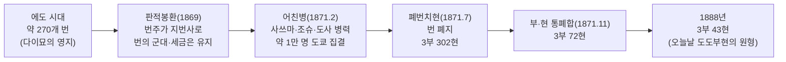

1871년 8월 29일(메이지 4년 7월 14일), 도쿄의 황거에 옛 다이묘인 지번사들이 불려 왔다. 그들 앞에서 한 장의 조서가 낭독되었다. "번을 폐하고 현을 둔다." 260여 개의 번이 이날 하루아침에 사라졌다. 칼 한 번 부딪치지 않고, 1,000년 가까이 이어진 영주 지배가 끝난 것이다. 영국 공사 파크스는 유럽이었다면 몇 년에 걸친 전쟁으로도 이루지 못했을 일이라며 놀라워했다고 한다.

이 강의는 이 **폐번치현**에서 시작해, 정부 수뇌부의 절반이 2년 가까이 나라를 비우고 구미를 돌아본 **이와쿠라 사절단**, 그리고 그사이 남은 사람들이 밀어붙인 **학제·징병령·지조 개정**이라는 3대 개혁을 다룬다. 이 몇 년 동안 일본 사회의 뼈대가 통째로 바뀌었다. 무사는 사라지고, 농민은 병사가 되고, 쌀로 내던 세금은 돈으로 바뀌었으며, 모든 아이가 학교에 가야 했다.

> [!핵심] 이 강의의 질문
> 1. 메이지 정부는 어떻게 저항 없이 번을 없앨 수 있었는가?
> 2. 이와쿠라 사절단은 구미에서 무엇을 보고 무엇을 배웠는가?
> 3. 3대 개혁은 일본 사회를 어떻게 바꾸었고, 사람들은 왜 그것에 저항했는가?

```figure
src: asset:e1d49738711e60471058cd1bc0b55d95
caption: 서양식 대례복을 입은 메이지 천황(1852~1912). 1872년 정부는 천황에게 서양식 군복과 예복을 입히고 머리를 자르게 했다. 이 사진은 외국 원수와 교환하기 위해 촬영되었다.
credit: 우치다 구이치(内田九一) 촬영, 1873년 · 메트로폴리탄 미술관 소장
license: Public Domain (메트로폴리탄 미술관 오픈 액세스)
source: https://www.metmuseum.org/art/collection/search/264743
width: narrow
```

```timeline
1869.7 | 판적봉환 | 다이묘가 영지와 백성을 천황에게 반환, 지번사가 됨
1869 | 도쿄–요코하마 전신 개통 | 일본 최초의 공중 전신
1871.2 | 어친병 설치 | 사쓰마·조슈·도사의 병력 약 1만 명을 천황 직속 군대로 도쿄에 모음
1871.4 | 우편 제도 시작 | 도쿄–교토–오사카 사이에 근대 우편
1871.6 | 신화 조례 | 화폐 단위를 엔·센·린으로 통일
1871.8.29 | 폐번치현 | 번을 폐지하고 부·현을 둠
1871.10 | '해방령' | 에타·히닌 등의 천칭을 폐지하고 평민과 같게 함
1871.12 | 이와쿠라 사절단 출발 | 정부 수뇌부와 유학생 등 100여 명이 요코하마를 떠나 구미로
1872.9 | 학제 반포 | 국민 모두가 학교에 다니는 근대 교육 제도
1872.10 | 신바시–요코하마 철도 개통, 도미오카 제사장 가동 | 문명개화와 식산흥업의 상징
1873.1.1 | 태양력 시행 | 메이지 5년 12월 3일을 메이지 6년 1월 1일로
1873.1 | 징병령 | 만 20세 남자에게 병역 의무
1873.7 | 지조 개정 조례 | 토지에 매긴 값의 3%를 현금으로 내는 새 지세
1873.9 | 이와쿠라 사절단 귀국 | 1년 10개월 만의 귀국. 곧 정한론 정변으로(7강)
```

## 폐번치현: 번이 사라진 날

### 판적봉환의 한계

5강에서 보았듯 1869년의 판적봉환은 형식을 바꾸었을 뿐이었다. 옛 번주가 그대로 지번사가 되었고, 번은 여전히 자기 군대를 거느리고 세금을 거두었다. 정부가 직접 세금을 거둘 수 있는 땅은 옛 막부령을 중심으로 한 전국의 4분의 1 남짓에 불과했다. 이래서는 군대도, 학교도, 철도도 만들 수 없었다.

번들의 사정도 나빴다. 많은 번이 에도 시대부터 쌓인 빚과 보신 전쟁의 군비로 파산 직전이었고, 녹봉을 받는 무사들을 먹여 살릴 여력이 없었다. 몇몇 작은 번은 스스로 번을 없애 달라고 정부에 청원하기도 했다. 다른 한편으로 정부 지도자들은 사쓰마의 시마즈 히사미쓰처럼 개혁에 불만을 품은 대번의 실력자가 군대를 거느리고 반기를 들까 봐 두려워했다.

### 어친병과 비밀 회의

오쿠보 도시미치, 기도 다카요시, 사이고 다카모리 등은 극비리에 번을 없앨 준비를 했다. 1871년 2월, 사쓰마·조슈·도사 세 번의 병력 약 1만 명이 천황 직속 군대인 **어친병**(御親兵)으로 도쿄에 모였다. 고향 사쓰마로 돌아가 있던 사이고도 이 병력을 이끌고 상경했다. 만일 어느 번이 반발하면 이 군대로 누르겠다는 것이었다.

1871년 7월, 기도와 오쿠보, 사이고 등 사쓰마·조슈 출신 지도자 몇 사람이 기도의 집에 모여 폐번치현을 결정했다. 반대가 예상되는 도사와 히젠 출신에게는 결정 직전에야 알렸다. 이 회의에서 사이고가 "반란이 일어나면 내가 진압하겠다"고 한마디 하자 논의가 끝났다는 이야기가 전한다. 그리고 7월 14일, 조서가 발표되었다.



### 왜 저항이 없었나

번이 하루아침에 사라졌는데도 반란은 일어나지 않았다. 몇 가지 이유가 있다.

| 이유 | 내용 |
|---|---|
| 군사적 압력 | 어친병 1만 명이 도쿄에 있었고, 번의 군대는 보신 전쟁 뒤 대부분 지쳐 있었다 |
| 번의 빚 인수 | 정부가 번의 빚과 번이 발행한 지폐(번찰)를 대신 떠맡았다 |
| 옛 번주의 대우 | 지번사들은 면직되어 도쿄로 이주했지만, 화족으로서 영지 수입의 10분의 1에 해당하는 가록을 계속 받았다 |
| 무사의 녹봉 유지 | 무사들의 녹봉(가록)은 당분간 정부가 대신 지급했다 |
| 기세의 흐름 | 이미 많은 번이 스스로 번 폐지를 원할 만큼 재정이 무너져 있었다 |

표: 폐번치현이 순조롭게 이루어진 이유

다만 불만이 없었던 것은 아니다. 사쓰마의 시마즈 히사미쓰는 폐번치현 소식에 크게 노해, 그날 밤 저택 정원에서 밤새 불꽃놀이를 하며 분을 삭였다고 전한다. 히사미쓰의 불만은 몇 년 뒤 사쓰마가 정부와 등을 지는 배경 가운데 하나가 된다.

새로 생긴 부와 현에는 중앙 정부가 임명한 지사(부지사·현령)가 파견되었다. 대개 그 지역 출신이 아닌 사람이었다. 일본은 이제 비로소 하나의 중앙 정부가 전국을 직접 다스리는 **중앙집권 국가**가 되었다. 같은 해 정부 조직도 태정관 아래에 정원·좌원·우원을 두는 3원제로 바뀌었고, 요직은 사쓰마·조슈·도사·히젠 출신이 차지했다. 이를 흔히 **번벌(藩閥) 정부**라 부른다.

## 이와쿠라 사절단

### 정부의 절반이 떠나다

폐번치현 넉 달 뒤인 1871년 12월 23일, 요코하마항에서 미국 우편 증기선 아메리카호가 출항했다. 배에는 특명전권대사 **이와쿠라 도모미**와 부사 **기도 다카요시, 오쿠보 도시미치, 이토 히로부미, 야마구치 나오요시**를 비롯한 사절 46명, 수행원 18명, 그리고 유학생 43명이 타고 있었다. 정부의 최고 지도자 절반이 한꺼번에 나라를 떠난 것이다.

```figure
src: asset:0f6e5eac271d2b1b69872a274fe37514
caption: 특명전권대사 이와쿠라 도모미(1825~1883). 사절단 출발 때 그는 상투를 튼 일본식 복장이었지만, 미국에 머무는 동안 머리를 자르고 양복으로 갈아입었다.
credit: 촬영자·연도 미상 · 국립국회도서관 「근대일본인의 초상」
license: Public Domain (국립국회도서관: 저작권 보호 기간 만료)
source: https://www.ndl.go.jp/portrait/datas/23/
width: narrow
```

사절단의 목적은 셋이었다. 첫째, 조약을 맺은 나라들의 원수에게 새 정부의 국서를 전하는 것. 둘째, 1872년부터 개정 협의가 가능한 불평등조약을 고치기 위한 예비 교섭. 셋째, 서양 문명의 제도와 산업을 직접 보고 배우는 것이었다.

| 기간 | 방문지 | 주요 일정 |
|---|---|---|
| 1872.1~8 | 미국 | 샌프란시스코 도착, 대륙 횡단 철도로 워싱턴까지. 조약 개정 교섭 시도 |
| 1872.8~12 | 영국 | 런던, 맨체스터·리버풀의 공장과 조선소, 스코틀랜드 |
| 1872.12~1873.2 | 프랑스·벨기에·네덜란드 | 파리 시가, 베르사유 |
| 1873.3~4 | 독일 | 베를린에서 비스마르크와 만남 |
| 1873.4~7 | 러시아·덴마크·스웨덴·이탈리아·오스트리아·스위스 | 빈 만국박람회 시찰 |
| 1873.9 | 귀국 | 요코하마 도착 |

표: 이와쿠라 사절단의 여정 (모두 12개국)

### 실패한 교섭, 얻은 깨달음

미국에서 사절단은 환영 분위기에 들떠 조약 개정을 본격적으로 교섭하려 했다. 그러나 미국 측은 교섭하려면 천황의 전권 위임장이 있어야 한다고 했다. 오쿠보와 이토가 위임장을 받으러 일본까지 되돌아갔다가 다시 워싱턴으로 오는 데 넉 달이 걸렸고, 그사이 다른 나라들과 한꺼번에 교섭해야 한다는 판단에 이르러 교섭은 중단되었다. 조약 개정은 아무 성과도 없었다.

그러나 사절단이 얻은 것은 적지 않았다. 그들은 거대한 공장과 철도, 의회와 신문, 학교와 박물관을 보았다. 특히 1873년 3월 베를린에서 만난 독일 재상 **비스마르크**의 말은 오쿠보 등에게 깊은 인상을 남겼다. 비스마르크는 국제 사회에서 '만국공법(국제법)'이란 강대국에게만 유리한 것이며, 약소국이 믿을 것은 결국 자기 힘뿐이라고 말했다. 약소국 프로이센이 독일 제국으로 일어서는 과정은 일본이 걸어갈 길의 본보기처럼 보였다.

사절단의 기록 담당 구메 구니타케는 귀국 뒤 100권에 이르는 보고서 『미구회람실기』(米欧回覧実記, 1878)를 펴냈다. 그는 서양의 부강이 하늘에서 떨어진 것이 아니라 불과 40~50년 사이에 이룩된 것이라고 적었다. 일본도 지금 시작하면 따라잡을 수 있다는 뜻이었다.

> [!참고] 여섯 살의 유학생
> 사절단과 함께 간 유학생 43명 가운데에는 여자아이 5명이 있었다. 가장 어린 **쓰다 우메코**(津田梅子)는 만 6세였다. 그는 미국 가정에서 11년을 자라고 돌아와, 1900년 여성 고등교육 기관인 여자영학숙(지금의 쓰다주쿠 대학)을 세웠다. 같은 배에는 훗날 프랑스 사상을 소개한 나카에 조민, 메이지 헌법 기초에 참여한 가네코 겐타로, 미쓰이 재벌을 이끈 단 다쿠마 등도 있었다.

## 유수 정부의 3대 개혁

사절단이 떠나 있는 동안 나라를 맡은 것은 사이고 다카모리, 이타가키 다이스케, 오쿠마 시게노부, 에토 신페이, 오키 다카토 등 이른바 **유수(留守) 정부**였다. 출발 전 양측은 "큰 개혁은 사절단이 돌아온 뒤에 한다"고 약속했다. 그러나 유수 정부는 이 약속을 지키지 않았다. 근대 국가의 뼈대를 이루는 개혁들이 바로 이 시기에 잇달아 쏟아져 나왔다.

### 학제: 모든 아이를 학교로

1872년 9월(메이지 5년 8월) 정부는 **학제**(学制)를 반포했다. 전국을 8개 대학구로 나누고, 대학구마다 32개 중학구, 중학구마다 210개 소학구를 두어, 이론상 전국에 소학교 5만 3,760곳을 세운다는 거대한 계획이었다. 프랑스의 학구 제도를 본뜬 것이었다.

학제의 정신은 함께 나온 포고문(학사장려에 관한 피앙출서)에 잘 드러난다. "앞으로는 마을에 배우지 않는 집이 없고, 집에 배우지 않는 사람이 없게 하겠다." 학문은 무사가 나라를 위해 하는 것이 아니라 **각자가 몸을 세우고 재산을 일구어 출세하기 위한 것**이라고 했다. 신분이 아니라 배움이 사람의 자리를 정하는 사회로 가겠다는 선언이었다.

그러나 현실은 쉽지 않았다. 학교 건물을 짓는 비용과 수업료는 대부분 주민이 부담해야 했다. 농가로서는 일손인 아이를 학교에 보내는 것 자체가 손해였다. 1873년의 취학률은 30%에도 미치지 못했고, 학교를 불태우는 반대 소동이 일어나기도 했다. 취학률은 수업료가 폐지되는 1900년 무렵에야 크게 오른다.

```chart
{
  "type": "line",
  "caption": "의무교육(소학교) 취학률의 변화 (%, 남녀 평균). 학제 반포 직후에는 30%에 못 미쳤지만, 1900년 소학교 수업료가 폐지된 뒤 급상승해 1910년에는 거의 모든 아이가 학교에 다니게 되었다. 문부성 통계에 근거해 널리 쓰이는 수치",
  "data": {
    "labels": ["1873", "1880", "1890", "1900", "1910"],
    "datasets": [{ "label": "취학률(%)", "data": [28.1, 41.1, 48.9, 81.5, 98.1], "fill": true, "tension": 0.3 }]
  },
  "options": { "scales": { "y": { "min": 0, "max": 100 } }, "plugins": { "legend": { "display": false } } }
}
```

### 징병령: 농민이 병사가 되다

1873년 1월 **징병령**이 공포되었다. 신분과 관계없이 만 20세가 된 남자는 신체검사를 받고 3년 동안 군대에 복무해야 했다. 사민평등의 원칙에 따라 무사가 독점하던 싸움의 역할을 모든 남자에게 나누어 맡긴 것이다. 이 제도를 설계한 것은 조슈의 **야마가타 아리토모**(山県有朋)였다. 그 원형을 구상한 오무라 마스지로는 1869년 개혁에 반대한 무사들에게 습격당해 세상을 떠났다.

```figure
src: asset:99cf9e7e798f0883b86a8c501d3ee74a
caption: 요코하마 근교에 줄지어 선 일본 보병. 삿갓 모양의 모자에 서양식 소총을 메고 있다. 징병령 이전, 번병과 서양식 군대가 뒤섞여 있던 메이지 초기의 모습이다.
credit: 촬영자 미상, 1869년 무렵 · 메트로폴리탄 미술관 소장
license: Public Domain (메트로폴리탄 미술관 오픈 액세스)
source: https://www.metmuseum.org/art/collection/search/764802
```

```figure
src: asset:3e1adef85018114d430b95bac2987174
caption: 도쿄 아오야마 연병장에서 천황이 군대를 사열하는 모습을 그린 판화. 서양식 군복의 장교와 기병, 욱일기를 단 천황의 마차가 보인다. 징병령으로 만든 군대는 20년 뒤 이렇게 국가 의례의 중심이 되었다.
credit: 이노우에 야스지(井上安治), 1888년 · 메트로폴리탄 미술관 소장
license: Public Domain (메트로폴리탄 미술관 오픈 액세스)
source: https://www.metmuseum.org/art/collection/search/55255
width: wide
```

징병령에는 면제 규정이 많았다. 한 집안의 호주와 대를 이을 아들, 관리, 관립 학교 학생, 그리고 대인료(代人料) 270엔을 내는 사람은 병역을 면제받았다. 270엔은 당시 쌀 수십 섬 값에 해당하는 큰돈이었다. 결국 부자와 장남은 빠지고, 가난한 농가의 둘째·셋째 아들이 군대에 갔다.

> [!사료] 징병 고유(徴兵告諭) (1872년 11월, 일부)
> "무릇 천지 사이에 한 가지 일, 한 가지 물건도 세금이 없는 것이 없다. … 서양 사람들은 이를 **혈세**(血税)라 부른다. 그 생혈로써 나라에 보답한다는 뜻이다."
> — 징병령에 앞서 나온 포고문의 일부를 우리말로 옮김

'혈세'라는 말은 농민들 사이에 엉뚱한 소문을 퍼뜨렸다. 군대에 가면 정말로 피를 뽑아 간다는 것이었다. 1873년 서일본 각지에서 징병에 반대하는 **혈세 잇키**가 일어났고, 호조현(지금의 오카야마현 북부), 나가와현(지금의 가가와현), 돗토리현 등에서는 수만 명이 관청과 학교, 호적 사무소를 습격했다. 소문은 핑계였을 뿐, 그 밑바닥에는 일손을 빼앗기고 새 제도의 부담을 떠안게 된 농민들의 분노가 있었다.

징병 기피는 오랫동안 이어졌다. 면제 규정을 노려 남의 집 양자로 들어가 '호주'가 되거나, 일부러 몸을 상하게 하는 사람도 있었다. 1873년 무렵 실제로 군대에 간 사람은 해당 연령 남자의 몇 퍼센트에 지나지 않았다. 정부는 1879년, 1883년, 1889년에 걸쳐 징병령을 고쳐 면제 범위를 차례로 줄였고, 1889년 개정으로 대인료 제도와 호주 면제를 대부분 없앴다. 이로써 원칙적으로 모든 남자가 병역을 지는 **국민개병**(皆兵) 체제가 갖추어졌다. 군대는 농촌 청년들에게 처음으로 고향 밖의 세계와 표준어, 시계에 맞춘 규율을 가르치는 학교이기도 했다. 1882년 천황이 군인에게 내린 「군인칙유」는 충절과 복종을 군인의 본분으로 정하고, 군인은 정치에 관여하지 말라고 가르쳤다.

### 지조 개정: 쌀에서 돈으로

세 번째 개혁은 국가 재정의 뿌리를 바꾸는 일이었다. 에도 시대의 세금은 수확한 쌀의 일정 비율을 쌀로 내는 연공이었다. 해마다 수확량과 쌀값이 달라 국가 수입이 들쭉날쭉했고, 지역마다 세율도 제각각이었다. 근대 국가를 운영하려면 안정된 현금 수입이 필요했다.

정부는 1872년 토지의 매매를 허용하고, 토지마다 소유자와 땅값을 적은 증서인 **지권**(地券)을 발행했다. 그리고 1873년 7월 **지조 개정 조례**로 세금의 원칙을 바꾸었다.

| | 에도 시대의 연공 | 지조 개정 뒤의 지조 |
|---|---|---|
| 과세 기준 | 그해의 수확량 | 토지에 매긴 값(지가) |
| 세율 | 지역마다 다름 (수확의 40~50% 안팎) | 지가의 3% (전국 통일) |
| 납부 방법 | 쌀(현물) | 현금 |
| 납세자 | 경작하는 농민(마을 단위로 연대 책임) | 지권을 가진 토지 소유자 |
| 국가에 대한 효과 | 수입이 풍흉과 쌀값에 따라 변동 | 해마다 일정한 현금 수입 |

표: 연공과 지조의 비교

지조 개정으로 정부는 안정된 재원을 얻었다. 1870년대 지조는 정부 조세 수입의 대부분을 차지했다. 그러나 정부는 옛 연공 수입을 줄이지 않는 선에서 땅값을 매겼기 때문에, 농민의 부담은 그다지 가벼워지지 않았다. 게다가 쌀값이 떨어져도 세금은 그대로였다. 또 지권을 가진 사람이 납세자가 되면서, 땅을 빌려 짓는 소작농은 지주에게 수확의 절반 가까이를 소작료로 내야 했다. 지주와 소작농의 격차는 이후 근대 일본 농촌의 큰 문제가 된다.

1876년 미에현과 이바라키현 등에서 지조 개정에 반대하는 대규모 농민 봉기가 일어나자, 정부는 이듬해 세율을 지가의 2.5%로 낮추었다. 사람들은 이를 두고 "죽창으로 푹 찔러 2분 5리"라고 노래했다. 농민의 죽창이 세율을 0.5%포인트 끌어내렸다는 뜻이다.

## 신분제의 해체와 문명개화

### 사민평등

정부는 에도 시대의 신분 질서를 차례로 허물었다. 공가와 다이묘는 **화족**, 무사는 **사족**, 농민·상인 등은 **평민**이 되었고, 평민도 성을 쓰고(1870), 신분이 다른 사람과 결혼하고, 직업과 사는 곳을 자유롭게 고를 수 있게 되었다. 1871년에는 상투를 자르는 것을 허용하는 산발탈도령이 나왔다. 같은 해 정부는 에타·히닌 등의 천민 신분을 폐지하는 포고(이른바 '해방령')를 내렸다. 그러나 차별은 법령 하나로 사라지지 않았다. 호적에 '신평민'이라 적히는 등 차별은 이어졌고, 이 문제는 1922년 수평사 창립으로 이어지는 부락 해방 운동의 과제가 된다.

### 식산흥업

정부는 서양의 산업을 일본에 옮겨 심기 위해 직접 공장과 기간 시설을 세웠다. 이를 **식산흥업**(殖産興業)이라 한다. 공부성(1870)과 내무성(1873)이 그 중심이었고, 수많은 외국인 기술자와 교사(오야토이 외국인)가 높은 급료를 받고 초빙되었다.

```figure
src: asset:13f77336fa336993273cc2f9a5383007
caption: 도쿄 시오도메(신바시) 부근을 달리는 증기기관차를 그린 판화. 철도 개통은 문명개화를 상징하는 사건이었고, 판화가들은 앞다투어 기차를 그렸다.
credit: 3대 우타가와 구니테루(歌川国輝), 1872년 · 메트로폴리탄 미술관 소장
license: Public Domain (메트로폴리탄 미술관 오픈 액세스)
source: https://www.metmuseum.org/art/collection/search/55512
width: wide
```

1872년 10월에는 신바시와 요코하마 사이 약 29km에 일본 최초의 철도가 개통했다. 영국인 기사 에드먼드 모렐이 건설을 지휘했고, 기관차와 레일은 모두 영국에서 들여왔다. 걸어서 하루 걸리던 길이 53분으로 줄었다. 같은 달 군마현에서는 프랑스인 폴 브뤼나의 지도로 관영 **도미오카 제사장**이 가동을 시작했다. 생사는 2강에서 보았듯 일본의 최대 수출품이었고, 정부는 서양식 기계로 품질 좋은 생사를 대량으로 만들어 외화를 벌고자 했다. 전국에서 모인 무사 집안의 딸들이 여공이 되어 기술을 배우고 고향으로 돌아가 퍼뜨렸다.

| 분야 | 주요 내용 |
|---|---|
| 통신 | 도쿄–요코하마 전신(1869), 마에지마 히소카의 근대 우편(1871) |
| 교통 | 신바시–요코하마 철도(1872), 오사카–고베 철도(1874) |
| 화폐·금융 | 신화 조례로 엔 단위 도입(1871), 국립은행 조례(1872) |
| 관영 공장 | 도미오카 제사장(1872), 군수 공장, 광산 |
| 개척 | 홋카이도 개척사(1869), 둔전병 제도(1874) |

표: 식산흥업의 주요 사업

### 오야토이 외국인

식산흥업과 문명개화를 실제로 떠받친 것은 정부가 비싼 급료로 고용한 외국인 전문가, 이른바 **오야토이(御雇い) 외국인**이었다. 1870년대 중반 관청에 고용된 외국인은 한때 500명을 넘었다. 그들 가운데 상당수는 총리급 관료보다 많은 월급을 받았다.

| 인물 | 나라 | 분야 | 업적 |
|---|---|---|---|
| 에드먼드 모렐 | 영국 | 철도 | 신바시–요코하마 철도 건설 지휘 |
| 폴 브뤼나 | 프랑스 | 제사 | 도미오카 제사장 설립 |
| 조사이어 콘더 | 영국 | 건축 | 로쿠메이칸 설계, 도쿄 대학에서 일본 건축가 양성 |
| 윌리엄 클라크 | 미국 | 농학·교육 | 삿포로 농학교 교감. "소년이여, 야망을 가져라" |
| 에르빈 벨츠 | 독일 | 의학 | 도쿄 대학에서 27년간 근대 의학 교육 |
| 귀스타브 보아소나드 | 프랑스 | 법학 | 형법·민법 초안 작성, 법학 교육 |

표: 대표적인 오야토이 외국인

정부는 처음부터 이들을 '일시적인 선생'으로 여겼다. 외국인에게 배운 일본인 기술자와 학자가 자라나자 정부는 고용 계약을 차례로 끝냈고, 1890년대에는 대부분의 자리를 일본인이 대신했다. 외국의 힘을 빌리되 외국에 의존하지 않는다는 것이 메이지 정부의 일관된 원칙이었다.

### 홋카이도 개척과 아이누

1869년 정부는 에조치를 **홋카이도**로 이름을 바꾸고 개척사를 두었다. 러시아의 남하에 대비하고, 일자리를 잃은 사족에게 새 땅을 마련해 주려는 것이었다. 1874년에는 평소에는 농사를 짓고 유사시에는 군인이 되는 **둔전병**(屯田兵) 제도가 만들어져, 각지의 사족과 농민이 가족을 데리고 홋카이도로 건너갔다. 미국인 고문 케프론의 조언에 따라 미국식 대규모 농업이 시험되었고, 삿포로에는 바둑판 모양의 계획도시가 세워졌다.

그러나 이 땅에는 오래전부터 **아이누** 사람들이 살고 있었다. 정부는 아이누가 살던 땅을 '주인 없는 땅'으로 취급해 이주민에게 나누어 주었고, 아이누의 전통적인 사냥과 연어잡이를 제한했으며, 일본식 이름과 생활을 강요했다. 1899년의 '홋카이도 구토인 보호법'은 이름은 '보호'였지만 실제로는 동화 정책을 법으로 굳힌 것이었다. 일본 정부가 아이누를 선주민족으로 공식 인정한 것은 2008년 국회 결의, 법으로 명시한 것은 2019년에 이르러서였다.

### 문명개화

도시의 풍경도 빠르게 바뀌었다. 1872년 큰불로 타 버린 도쿄 긴자에는 영국인 건축가의 설계로 붉은 벽돌 거리가 들어섰고, 요코하마에는 가스등이 켜졌다. 사람들은 양복과 모자를 쓰고, 쇠고기 전골을 먹고, 시계와 우산을 들고 다녔다. "산발한 머리를 두드려 보면 문명개화의 소리가 난다"는 노래가 유행했다. 이런 변화를 **문명개화**(文明開化)라 불렀다.

```figure
src: asset:aeb8b732bbecdea9cb53ba1480d47252
caption: 1870년대 요코하마의 거리. 넓은 길 양쪽에 서양식 2층 건물(시청, 전신국, 우체국)과 가스등이 늘어서 있다.
credit: 촬영자 미상, 1870년대 · 메트로폴리탄 미술관 소장
license: Public Domain (메트로폴리탄 미술관 오픈 액세스)
source: https://www.metmuseum.org/art/collection/search/288557
```

1872년 말에는 달력까지 바뀌었다. 정부는 메이지 5년 12월 3일을 메이지 6년 1월 1일로 삼아 서양과 같은 태양력을 쓰기로 했다. 갑작스러운 개력의 숨은 이유 가운데 하나는 재정이었다. 옛 달력대로라면 1873년에 윤달이 들어 관리들에게 13개월치 월급을 주어야 했는데, 개력으로 12월이 이틀만 남게 되자 정부는 12월 월급도 주지 않았다.

사상의 변화를 이끈 것은 **후쿠자와 유키치**였다. 그는 1872년부터 펴낸 『학문의 권유』(学問のすゝめ) 첫머리에 "하늘은 사람 위에 사람을 만들지 않고, 사람 아래 사람을 만들지 않는다고 한다"고 썼다. 사람의 귀천은 태어날 때 정해지는 것이 아니라 배우느냐 배우지 않느냐에 달렸다는 것이었다. 이 책은 모두 합쳐 300만 부 넘게 팔렸다고 한다. 1873년에는 후쿠자와, 모리 아리노리, 니시 아마네, 나카무라 마사나오 등이 학술 결사 **명육사**(明六社)를 만들어 서양 사상을 소개했다.

> [!주의] 문명개화의 그늘
> 문명개화는 도쿄·요코하마 같은 대도시와 관리·지식인 사이에서 먼저 일어났다. 농촌의 생활은 크게 바뀌지 않았고, 오히려 학교 비용과 징병, 지조 같은 새 부담이 먼저 찾아왔다. 정부는 또 서양인의 눈에 '미개'해 보이는 관습, 예컨대 혼욕이나 문신, 거리에서 벌거벗고 다니는 일 등을 경범죄로 단속했다. 문명개화는 서양의 시선을 의식한 '위로부터의 개조'이기도 했다.

## 정리

> [!핵심] 6강 요약
> - **폐번치현**(1871)으로 번이 사라지고 중앙 정부가 임명한 지사가 다스리는 부·현이 생겼다. 어친병의 무력, 번 부채 인수, 화족·사족 대우가 순조로운 전환을 뒷받침했다.
> - **이와쿠라 사절단**(1871~73)은 조약 개정에는 실패했지만, 12개국을 돌며 서양 문명과 국제 정치의 현실을 배웠다.
> - 유수 정부는 **학제**(1872), **징병령**(1873), **지조 개정**(1873)의 3대 개혁을 밀어붙였다. 각각 근대적 교육·군대·재정의 토대가 되었지만, 혈세 잇키와 지조 개정 반대 봉기 같은 저항을 불렀다.
> - **사민평등**으로 신분제가 해체되고, **식산흥업**과 **문명개화**로 철도·공장·우편과 서양식 생활이 들어왔지만, 그 혜택과 부담은 고르지 않았다.

### 생각해 볼 질문

1. 폐번치현이 '칼 한 번 부딪치지 않고' 이루어진 이유 가운데 가장 결정적인 것은 무엇이라고 생각하는가?
2. 3대 개혁은 모두 '국가'를 위한 것이었다. 그 개혁이 농민 개인에게는 어떤 의미였을지, 혜택과 부담을 나누어 정리해 보자.
3. 학제 포고문은 배움을 '출세를 위한 것'이라고 했다. 이 생각은 에도 시대의 학문관과 어떻게 다른가?

### 다음 강 예고

7강에서는 귀국한 사절단과 유수 정부가 조선 문제를 둘러싸고 정면충돌한 **메이지 6년 정변**(정한론 정변), 이에 반발한 사족들의 반란, 그리고 사이고 다카모리가 최후를 맞는 **세이난 전쟁**(1877)과 오쿠보 도시미치의 암살까지를 다룬다.
