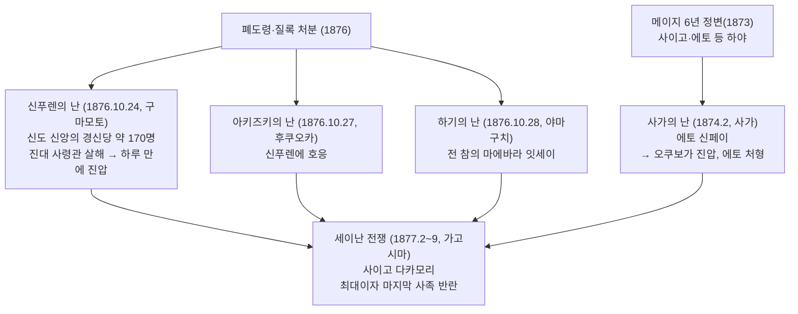

1873년 9월, 1년 10개월 만에 이와쿠라 사절단이 돌아왔다. 그들을 기다리고 있던 것은 예상하지 못한 결정이었다. 유수 정부가 **사이고 다카모리를 조선에 사절로 보내기로** 이미 정해 둔 것이다. 사절단의 오쿠보와 이와쿠라는 이를 뒤집으려 했고, 유수 정부의 사이고와 이타가키는 물러서지 않았다. 한 달 뒤 정부는 둘로 쪼개졌다. 메이지 유신을 함께 이끈 동지들이 갈라선 이 사건을 **메이지 6년 정변**, 또는 **정한론 정변**이라 한다.

정부를 떠난 사람들은 두 갈래 길을 걸었다. 하나는 칼을 드는 길, 곧 사족 반란이었고, 다른 하나는 말과 글로 싸우는 길, 곧 자유민권운동이었다. 이 강의는 앞의 길을 따라간다. 사가의 난에서 시작된 사족 반란은 1877년 사이고 다카모리가 이끈 **세이난 전쟁**에서 절정에 이르고, 이듬해 오쿠보 도시미치의 암살로 막을 내린다. 그사이 일본은 처음으로 바다 건너 군대를 보내고, 조선에 불평등조약을 강요하는 나라가 된다.

> [!핵심] 이 강의의 질문
> 1. 정한론을 둘러싼 대립의 진짜 쟁점은 무엇이었는가?
> 2. 사족들은 왜 칼을 들었고, 정부는 그들을 어떻게 꺾었는가?
> 3. 1870년대 일본의 대외 정책은 어떤 방향으로 움직였는가?

```timeline
1873.8 | 사이고의 조선 파견 내정 | 유수 정부 각의가 사이고를 조선에 보내기로 함
1873.10 | 메이지 6년 정변 | 파견이 무기 연기되자 사이고·이타가키·에토·고토·소에지마가 참의를 사직
1873.11 | 내무성 설치 | 오쿠보 도시미치가 내무경으로 정부의 중심에
1874.1 | 민선의원 설립 건백서 | 이타가키 등이 국회 개설을 요구(8강)
1874.2 | 사가의 난 | 에토 신페이 등 사가의 사족 반란. 오쿠보가 진압
1874.5 | 대만 출병 | 류큐 표류민 살해를 이유로 대만에 군대를 보냄
1875.5 | 사할린·쿠릴 교환 조약 | 사할린을 러시아에, 쿠릴 열도 전체를 일본에
1875.9 | 운요호 사건 | 일본 군함이 조선 강화도 앞에서 포격전을 벌임
1876.2 | 조일수호조규(강화도 조약) | 조선에 강요한 불평등조약
1876.3·8 | 폐도령, 질록 처분 | 사족의 대도 금지, 가록 지급 폐지
1876.10 | 신푸렌·아키즈키·하기의 난 | 구마모토·후쿠오카·야마구치에서 잇따른 사족 반란
1877.2~9 | 세이난 전쟁 | 사이고 다카모리를 받든 사쓰마 사족의 반란. 9월 사이고 자결
1878.5 | 오쿠보 암살 | 도쿄 기오이자카에서 이시카와현 사족들에게 피살
1879.4 | 류큐 처분 | 류큐 왕국을 폐지하고 오키나와현 설치
```

## 메이지 6년 정변

### 조선 문제의 시작

갈등의 씨앗은 1868년에 뿌려졌다. 새 정부는 쓰시마번을 통해 조선에 왕정복고를 알리는 외교 문서를 보냈다. 그런데 이 문서에는 '황皇', '칙勅'처럼 중국 황제만 쓸 수 있다고 여겨지던 글자가 들어 있었다. 일본의 천황을 조선 국왕보다 위에 두는 표현이었다. 당시 조선의 실권자인 흥선대원군 정권은 서양을 배척하는 쇄국 정책을 펴고 있었고, 서양식으로 옷을 바꾼 일본을 '서양 오랑캐와 다름없다'고 보았다. 조선은 문서의 수리를 거부했다.

이후 몇 년 동안 교섭은 제자리걸음을 했다. 1873년에는 부산의 왜관(초량왜관) 앞에 일본을 '법이 없는 나라(무법지국)'라 비난하는 게시문이 붙었다는 보고가 도쿄에 전해졌다. 유수 정부 안에서는 군대를 보내 조선을 굴복시키자는 **정한론征韓論**이 거세졌다.

### 사이고의 '사절론'

이때 사이고 다카모리가 나섰다. 그는 곧바로 군대를 보내는 데 반대하고, 먼저 자신이 전권 사절로 조선에 가겠다고 했다. 이타가키 다이스케에게 보낸 편지에서 사이고는 "사절이 폭살당하면 그것이 출병의 명분이 된다"는 취지로 쓰기도 했다. 이 때문에 사이고의 진의를 두고는 지금도 논쟁이 있다. 스스로 죽어 전쟁의 구실을 만들려 했다는 해석이 있는가 하면, 편지는 강경파인 이타가키를 설득하기 위한 것이었을 뿐 진심은 평화적 교섭에 있었다는 해석도 있다.

```gallery
src: asset:db680d23746110b69ad34fffb66427b4
caption: 사이고 다카모리(1828~1877). 사진을 남기지 않은 사이고의 모습은 그가 죽은 뒤 키오소네가 그린 이 초상으로 전한다.
credit: 에도아르도 키오소네(Edoardo Chiossone), 1883년 · 국립국회도서관 「근대일본인의 초상」
license: Public Domain (국립국회도서관: 저작권 보호 기간 만료)
source: https://www.ndl.go.jp/portrait/datas/85/
---
src: asset:d41c05e2d10e7bc7e6c54a92af9a9238
caption: 이타가키 다이스케(1837~1919). 정한론 정변으로 하야한 뒤 자유민권운동의 지도자가 되었다. 사진은 노년의 모습이다.
credit: 촬영자·연도 미상 · 국립국회도서관 「근대일본인의 초상」
license: Public Domain (국립국회도서관: 저작권 보호 기간 만료)
source: https://www.ndl.go.jp/portrait/datas/10/
```

1873년 8월, 유수 정부 각의는 사이고의 파견을 결정했다. 천황은 "이와쿠라가 돌아온 뒤 다시 논의하라"며 최종 결정을 미루었다.

### 사절단의 반대와 정부의 분열

9월에 귀국한 오쿠보, 이와쿠라, 기도는 사이고의 파견에 반대했다. 그들의 논리는 **내치 우선론內治優先論**이었다.

| | 파견 찬성 (유수 정부 중심) | 파견 반대 (사절단 중심) |
|---|---|---|
| 주요 인물 | 사이고 다카모리, 이타가키 다이스케, 에토 신페이, 고토 쇼지로, 소에지마 다네오미 | 오쿠보 도시미치, 이와쿠라 도모미, 기도 다카요시, 오쿠마 시게노부, 오키 다카토 |
| 출신 | 사쓰마·도사·히젠 | 사쓰마·조슈·공가·히젠 |
| 주장 | 조선의 '무례'를 바로잡아 국위를 세워야 한다 | 지금은 국력을 기르는 것이 먼저다. 전쟁은 재정을 무너뜨리고 러시아·영국에 개입의 빌미를 준다 |
| 숨은 배경 | 일자리를 잃은 사족의 불만을 밖으로 돌리려는 의도 | 사절단이 없는 동안 유수 정부가 주도권을 쥔 데 대한 반발 |

표: 정한론을 둘러싼 대립

10월 14~15일의 각의는 격론 끝에 다시 사이고 파견을 확인했다. 그러나 두 진영 사이에서 고민하던 태정대신 산조 사네토미가 쓰러지자, 태정대신 대리가 된 이와쿠라는 각의의 결정과 함께 자신의 반대 의견을 천황에게 올렸다. 천황은 이와쿠라의 의견을 받아들여 파견을 무기한 연기했다. 1873년 10월 24~25일, 사이고, 이타가키, 에토, 고토, 소에지마 다섯 참의가 일제히 사직했다. 사이고를 따르는 근위병 장교와 관리 600여 명도 함께 관직을 버리고 고향으로 돌아갔다.

> [!핵심] 정한론 정변의 본질
> 이 대립은 '조선을 칠 것인가 말 것인가'의 싸움이 아니었다. 반대파도 조선 진출 자체를 부정하지 않았고, 3년 뒤 실제로 조선에 군함을 보내 조약을 강요한 것은 바로 그들이었다. 진짜 쟁점은 **언제, 누가 주도하느냐**, 그리고 그 사이 정부의 권력을 누가 쥐느냐였다. 정변 뒤 정부는 오쿠보를 중심으로 다시 짜였다.

### 오쿠보 정권

1873년 11월, 오쿠보는 새로 만든 **내무성**의 장관(내무경)이 되었다. 내무성은 지방 행정, 경찰, 식산흥업을 한 손에 쥔 거대한 부처였다. 오쿠보는 이 자리를 통해 사실상 정부를 이끌었다. 그는 공장과 광산, 농업 시험장을 세우고, 1877년에는 도쿄 우에노에서 제1회 내국 권업 박람회를 열어 산업을 장려했다. 반대파는 오쿠보 정권을 소수의 관료가 나라를 마음대로 주무른다는 뜻으로 **유사 전제有司専制**라 비판했다.

## 사족 반란의 시대

### 사족은 누구였나

에도 시대의 무사는 메이지 시대에 '사족'이 되었다. 1870년대 사족과 그 가족은 약 190만 명, 인구의 5~6%였다. 그들은 폐번치현 뒤에도 정부에서 가록(가문의 녹봉)을 받았는데, 이것이 정부 세출의 약 30%를 차지할 만큼 큰 부담이었다. 정부는 1873년부터 가록을 줄여 나갔고, 1876년 8월에는 **질록 처분秩禄処分**으로 가록을 완전히 폐지했다. 대신 가록 몇 해 치에 해당하는 금록공채증서를 주었다. 상층 사족은 이 공채를 밑천으로 은행이나 사업을 벌일 수 있었지만, 대다수 하급 사족에게 돌아간 공채의 이자는 생활비에도 못 미쳤다.

같은 해 3월에는 **폐도령廃刀令**이 나왔다. 군인과 경찰, 정복을 입은 관리가 아니면 칼을 차고 다닐 수 없게 된 것이다. 칼은 무사의 신분과 명예를 상징하는 '혼'이었다. 녹봉과 칼, 그리고 싸움의 독점권(징병령)까지 빼앗긴 사족들의 불만은 폭발 직전이었다.

| 연도 | 정책 | 사족에게 미친 영향 |
|---|---|---|
| 1869 | 판적봉환, 화족·사족 신분 신설 | 번주와의 주종 관계가 형식상 끊어짐 |
| 1871 | 폐번치현, 산발탈도령 | 섬길 번이 사라짐. 칼을 차지 않아도 되게 함 |
| 1873 | 징병령 | 싸움이 무사의 독점이 아니게 됨 |
| 1876.3 | 폐도령 | 칼을 차고 다니는 것을 금지 |
| 1876.8 | 질록 처분 | 녹봉이 완전히 끊김 |

표: 사족의 특권이 사라진 과정

### 사족 수산: 무사에게 일을 주어라

정부도 사족을 내버려 두지는 않았다. 몰락한 사족에게 생계 수단을 마련해 주려는 정책을 **사족 수산士族授産**이라 한다. 정부는 사족에게 낮은 이자로 돈을 빌려주어 개간이나 양잠, 직물업을 하게 했고, 홋카이도의 둔전병으로 이주하도록 권했다. 화족과 상층 사족의 금록공채를 모아 은행을 세우게도 했는데, 화족들이 세운 제15국립은행은 훗날 철도 회사에 투자하는 큰 은행이 되었다.

하지만 대부분의 사족은 장사에 서툴렀다. 녹봉을 받으며 살던 사람들이 갑자기 가게를 차려 실패하는 일이 흔해, '사족의 장사士族の商法'라는 말은 서투른 장사를 비웃는 표현이 되었다. 한편 학문을 익힌 사족 출신은 교사, 관리, 경찰관, 군인, 신문 기자가 되어 새 국가의 중간층을 이루었다. 메이지 시대 관리와 교사 가운데 사족 출신의 비율은 인구 비율보다 훨씬 높았다. 칼을 잃은 무사들은 붓과 제복으로 새 시대에 살아남은 것이다.

### 사가의 난

첫 반란은 정변 넉 달 뒤인 1874년 2월 히젠 사가에서 일어났다. 사직하고 고향에 돌아간 전 참의 **에토 신페이江藤新平**는 사법경으로서 근대 사법 제도를 세운 인물이었다. 그는 정한론을 주장하는 사족들의 우두머리로 추대되어 반란을 일으켰다. 오쿠보는 스스로 현지에 내려가 군대와 사법권을 쥐고 반란을 진압했다. 에토는 도망치다 붙잡혀 간단한 재판 끝에 처형되었고, 그의 목은 효수되었다. 근대 사법의 설계자가 법의 이름으로 효수당한 것이다. 오쿠보의 가혹한 처분은 정부에 맞서는 자에게 어떤 운명이 기다리는지를 보여 주려는 것이었다.

### 1876년의 반란들

```figure
src: asset:09f09e0972e23b519f0eb26a74646c5d
caption: 에토 신페이(1834~1874). 사법경으로 근대 사법 제도의 기초를 놓았지만, 사가의 난을 일으켜 처형되었다.
credit: 촬영자·연도 미상 · 국립국회도서관 「근대일본인의 초상」
license: Public Domain (국립국회도서관: 저작권 보호 기간 만료)
source: https://www.ndl.go.jp/portrait/datas/242/
width: narrow
```

1876년 10월, 폐도령과 질록 처분에 대한 분노가 한꺼번에 터졌다.



구마모토의 **신푸렌神風連**(경신당)은 서양 문물을 극도로 싫어한 신도 신앙 결사였다. 그들은 전깃줄 밑을 지날 때 부채로 머리를 가렸다고 할 만큼 서양의 모든 것을 부정했다. 약 170명이 칼과 창만으로 구마모토 진대(정부군 주둔지)를 기습해 사령관을 죽였지만, 하루 만에 진압되었다. 이에 호응한 후쿠오카의 아키즈키의 난, 조슈 출신 전 참의 마에바라 잇세이가 이끈 야마구치의 하기의 난도 곧 진압되었다. 이 반란들은 서로 연결되지 못했고, 징병된 평민 병사들로 이루어진 정부군을 이기지 못했다. 그러나 모두가 한 사람의 움직임을 지켜보고 있었다. 가고시마의 사이고 다카모리였다.

## 세이난 전쟁

### 사학교와 봉기

정부를 떠나 가고시마로 돌아간 사이고는 1874년 사족 자제들을 위한 **사학교私学校**를 세웠다. 사학교는 총포술과 한학을 가르치는 학교였지만, 가고시마 곳곳에 분교를 두고 현의 행정까지 좌우하는 거대한 사족 조직이 되었다. 가고시마현은 정부의 지조 개정이나 질록 처분도 제대로 따르지 않는 '독립국' 같은 곳이 되어 갔다.

1877년 1월, 정부가 가고시마의 무기와 탄약을 오사카로 옮기려 하자 사학교 학생들이 화약고를 습격했다. 때마침 정부가 보낸 경찰관이 사이고를 암살하려 했다는 '자백'이 나오면서 분위기는 걷잡을 수 없게 되었다. 사이고는 "내 몸을 너희에게 맡기겠다"며 봉기를 받아들였다. 1877년 2월 15일, 50년 만의 큰 눈이 내린 가고시마에서 사쓰마군 약 1만 3,000명이 북쪽으로 출발했다. 명분은 "정부에 따질 것이 있다"는 것이었다.

```figure
src: asset:b9f46b641d8982e04ddbc08b0d0e8867
caption: 「가고시마 적도 격전도」. 서양식 군복을 입은 정부군이 숲속에서 사쓰마군과 싸우는 장면을 그린 판화. 가운데 흰 말을 탄 지휘관이 보인다. 세이난 전쟁은 신문과 판화로 실시간에 가깝게 전해진 첫 전쟁이었다.
credit: 작자 미상, 1877년 · 레이크스 미술관 소장
license: Public Domain (레이크스 미술관)
source: https://www.rijksmuseum.nl/en/collection/RP-P-1985-487
width: wide
```

### 구마모토성과 다바루자카

사쓰마군의 첫 목표는 정부군의 규슈 거점인 **구마모토성**이었다. 사쓰마 사족들은 농민 출신 징병 병사들을 얕보며 단숨에 함락시킬 수 있다고 믿었다. 그러나 사령관 다니 다테키가 이끄는 약 4,000명의 진대 병력은 50일 넘게 성을 지켜 냈다. 개전 직전 성의 천수각이 원인 모를 불로 타 버렸지만, 성벽은 무너지지 않았다.

구마모토성을 구하려는 정부군과 이를 막으려는 사쓰마군은 3월, 성 북쪽의 고갯길 **다바루자카田原坂**에서 17일 동안 격전을 벌였다. 비 오는 날 하루에 수십만 발의 총탄이 오갔다고 한다. 사쓰마군의 칼 돌격에 정부군이 밀리자, 정부는 사족 출신 경찰관들로 칼을 쓰는 **발도대抜刀隊**를 만들어 맞섰다. 옛 사쓰마 번사와 옛 아이즈 번사가 정부군 경찰관으로 사쓰마군과 칼을 맞대는 일도 있었다. 보신 전쟁의 원한이 여기서 되갚아졌다고 말하는 사람도 있었다.

### 시로야마의 최후

다바루자카가 뚫리고 구마모토성의 포위가 풀리자 사쓰마군은 밀리기 시작했다. 그들은 규슈 남부를 떠돌며 싸우다가, 9월 초 마지막 수백 명이 가고시마로 돌아와 시로야마城山에 들어갔다. 1877년 9월 24일 새벽, 정부군의 총공격 속에서 총탄을 맞은 사이고는 부하에게 목을 치게 했다. 만 마흔아홉의 나이였다.

```chart
{
  "type": "bar",
  "caption": "세이난 전쟁의 동원 병력과 전사자 (단위: 명, 대략적인 통설 수치). 정부군은 징병 병사와 경찰관을 합쳐 약 6만 명을 동원했고, 양측 전사자는 모두 1만 3,000명이 넘었다",
  "data": {
    "labels": ["정부군", "사쓰마군"],
    "datasets": [
      { "label": "동원 병력", "data": [60000, 30000] },
      { "label": "전사자", "data": [6400, 6800] }
    ]
  }
}
```

전쟁은 메이지 정부에도 큰 상처를 남겼다. 전비는 약 4,100만 엔으로 한 해 국가 예산에 맞먹었고, 정부는 이를 지폐를 찍어 메웠다. 그 결과 물가가 치솟았고, 이 인플레이션을 잡으려는 긴축 정책(마쓰카타 재정)이 1880년대 농촌을 휩쓸게 된다(8강).

```figure
src: asset:f1ca623d2e1cec6b7ccf56e8c91b3c86
caption: 세이난 전쟁을 진압한 정부군 지휘관들이 천황에게서 술잔을 받으며 승리를 축하하는 장면을 그린 판화.
credit: 요슈 지카노부(楊洲周延), 1877년 · 메트로폴리탄 미술관 소장
license: Public Domain (메트로폴리탄 미술관 오픈 액세스)
source: https://www.metmuseum.org/art/collection/search/55261
width: wide
```

> [!핵심] 세이난 전쟁이 남긴 것
> - **징병제 군대의 승리**: 농민 출신 병사들이 일본 최강의 무사 집단을 이겼다. '싸움은 무사의 일'이라는 생각은 완전히 끝났다.
> - **무력 저항의 종언**: 이후 정부에 대한 저항은 칼이 아니라 말과 글, 곧 **자유민권운동**의 형태로 이어졌다.
> - **영웅 사이고**: 사이고는 '역적'으로 죽었지만 민중 사이에서는 비극의 영웅이 되었다. 1889년 헌법 반포 때 사면되어 명예를 되찾았고, 1898년 도쿄 우에노에 동상이 세워졌다.

### 신문이 전한 전쟁

세이난 전쟁은 일본에서 처음으로 **신문이 실시간에 가깝게 전한 전쟁**이었다. 『유빈호치신문』의 젊은 기자 이누카이 쓰요시(뒤의 총리)는 전장을 돌며 '전지직보戦地直報'를 써 보냈고, 독자들은 전신으로 전해진 소식을 날마다 기다렸다. 전쟁 동안 신문의 발행 부수는 크게 늘었다. 도쿄의 판화가들은 전황을 그린 니시키에를 앞다투어 찍어 냈는데, 정부군보다 사이고와 사쓰마군을 영웅처럼 그린 그림이 더 잘 팔렸다. 1877년 여름 밤하늘에 붉게 빛난 화성을 사람들이 '사이고 별'이라 부르며, 별 속에 군복 차림의 사이고가 보인다는 소문이 돌기도 했다.

### 유신 3걸의 퇴장

세이난 전쟁이 한창이던 1877년 5월, 기도 다카요시가 교토에서 병으로 세상을 떠났다. 마지막 순간 그는 "사이고야, 이제 그만해라"라고 중얼거렸다고 전한다. 그리고 1878년 5월 14일 아침, 출근하던 오쿠보 도시미치가 도쿄 기오이자카에서 이시카와현 사족 등 6명의 습격을 받아 숨졌다. 그는 며칠 전 "메이지 30년을 셋으로 나누어, 처음 10년은 혼란의 시기, 다음 10년은 내치를 다지는 시기, 마지막 10년은 후계자들이 지키는 시기"라는 구상을 말했다고 한다. 이제 막 두 번째 10년이 시작되는 때였다.

```figure
src: asset:97e3de7811f2c4c4d66cafcb06ad783f
caption: 오쿠보 도시미치(1830~1878). 메이지 6년 정변 뒤 내무경으로 정부를 이끌다 1878년 암살되었다.
credit: 촬영자 미상, 1870년대 · 국립국회도서관 「근대일본인의 초상」
license: Public Domain (국립국회도서관: 저작권 보호 기간 만료)
source: https://www.ndl.go.jp/portrait/datas/32/
width: narrow
```

암살자들은 거사 뒤 스스로 자수하며 「참간장斬奸状」이라는 취지서를 내놓았다. 그들은 오쿠보 정권의 죄로 다섯 가지를 들었다. 공의를 막고 민권을 억눌러 정치를 사사로이 한 것, 법령을 함부로 바꾸어 관리들의 출세 수단으로 삼은 것, 쓸데없는 토목 공사와 장식에 나랏돈을 낭비한 것, 충성스러운 지사들을 내쫓아 내란을 부른 것, 외교를 그르쳐 국권을 잃은 것이었다. 칼로 일어선 마지막 사족들의 목소리가, 동시에 '공의'와 '민권'이라는 자유민권운동의 언어를 쓰고 있었다는 점은 흥미롭다. 시대의 저항은 이미 칼에서 말로 옮겨 가고 있었다.

1년 사이에 사이고, 기도, 오쿠보, 이른바 **유신 3걸**이 모두 세상을 떠났다. 그 뒤를 이은 것은 이토 히로부미, 오쿠마 시게노부, 야마가타 아리토모 같은 다음 세대였다.

## 대외 팽창의 첫걸음

### 대만 출병

정한론을 물리친 오쿠보 정권은 역설적이게도 곧바로 해외에 군대를 보냈다. 1871년 류큐 미야코섬의 주민들이 탄 배가 대만에 표착해, 54명이 현지 원주민에게 살해된 사건이 있었다. 일본은 류큐 사람이 일본 국민이라고 주장하며, 청나라에 책임을 물었다. 청이 대만 원주민은 '교화가 미치지 않는 백성(화외의 민)'이라고 답하자, 일본은 이를 '청의 통치가 미치지 않는 땅'이라는 뜻으로 받아들여 1874년 5월 사이고 다카모리의 동생 사이고 쓰구미치가 이끄는 약 3,600명의 군대를 대만에 보냈다.

전투로 죽은 병사는 열 명 남짓이었지만, 말라리아 등 풍토병으로 500명 넘게 목숨을 잃었다. 오쿠보는 직접 베이징에 가서 교섭했고, 영국 공사의 중재로 청은 일본의 출병을 '백성을 보호하기 위한 의거'로 인정하고 50만 냥을 지불했다. 이 합의는 류큐가 일본에 속한다는 근거로 쓰였다. 일본은 1879년 군대와 경찰을 보내 류큐 왕국을 폐지하고 **오키나와현**을 설치했다(류큐 처분). 450년 넘게 이어진 왕국이 이렇게 사라졌다. 이 출병에 반대한 기도 다카요시는 한때 정부를 떠나기도 했다.

### 류큐 처분

류큐 왕국은 17세기 초부터 사쓰마의 지배를 받으면서도, 중국(명·청)의 책봉을 받아 조공을 바치는 '양속' 상태에 있었다. 메이지 정부는 1872년 일방적으로 류큐 국왕 쇼타이를 '류큐 번왕'으로 삼아 류큐 번을 설치하고, 1875년에는 청과의 책봉·조공 관계를 끊으라고 명령했다. 류큐 측은 청에 도움을 요청하며 버텼다.

1879년 3월, 정부는 처분관 마쓰다 미치유키에게 군인과 경찰 약 600명을 딸려 보내 슈리성을 접수했다. 국왕 쇼타이는 도쿄로 옮겨졌고, 4월 **오키나와현**이 설치되었다. 청은 이를 인정하지 않았고, 미국의 전 대통령 그랜트가 중재에 나서 류큐를 나누는 안까지 논의되었지만 결론이 나지 않았다. 류큐의 귀속 문제는 청일전쟁에서 청이 패하면서 사실상 일본의 것으로 굳어졌다. 오키나와에서는 이후에도 옛 지배층의 토지 제도와 세제가 한동안 유지되었고, 본토와의 차별은 오래 이어졌다.

### 북방의 국경

같은 시기 일본은 러시아와의 국경도 정리했다. 1855년 러일화친조약에서 국경을 정하지 못하고 두 나라 사람이 섞여 살던 사할린에서는 분쟁이 끊이지 않았다. 1875년 주러 공사 에노모토 다케아키(5강의 그 에노모토다)는 상트페테르부르크에서 **사할린·쿠릴 교환 조약**을 맺어, 사할린을 러시아 영토로 인정하는 대신 쿠릴 열도 전체를 일본 영토로 했다. 홋카이도 개척에 힘을 모으기 위한 선택이었다. 1876년에는 오가사와라 제도의 영유도 각국에 알렸다.

### 강화도 조약

조선 문제는 결국 무력으로 '해결'되었다. 1875년 9월, 일본 군함 **운요호**가 조선 서해안을 측량하며 강화도 앞까지 들어갔다. 식수를 구한다며 작은 배를 내려 해협으로 들어가자 강화도의 포대가 포격했고, 운요호는 반격해 포대를 파괴하고 영종도에 상륙해 주민들을 죽였다(운요호 사건). 일본은 이 사건을 구실로 이듬해 군함과 병력을 거느린 구로다 기요타카와 이노우에 가오루를 강화도에 보내 조약을 강요했다. 일찍이 페리가 일본에 했던 방식 그대로였다.

1876년 2월에 맺은 **조일수호조규**(강화도 조약)의 주요 내용은 다음과 같다.

| 조항 | 내용 | 의미 |
|---|---|---|
| 제1관 | 조선은 자주의 나라로서 일본과 평등한 권리를 가진다 | 청과 조선의 종속 관계를 부정하려는 의도 |
| 제4·5관 | 부산 외에 두 항구를 개항한다 | 원산(1880), 인천(1883) 개항 |
| 제7관 | 일본은 조선의 해안을 자유롭게 측량할 수 있다 | 군사적 진출의 발판 |
| 제10관 | 개항장에서 일본인이 죄를 지으면 일본 관원이 재판한다 | 영사재판권(치외법권) |
| 부속 조약·무역 규칙 | 일본 화폐 유통, 일본 상품의 무관세 | 일본 상인에게 일방적으로 유리 |

표: 조일수호조규(1876)의 주요 내용

20여 년 전 미국과 서양 열강에게 불평등조약을 강요당한 일본이, 이제 이웃 나라에 같은 불평등조약을 강요한 것이다. 이 조약은 조선을 세계 자본주의 체제로 끌어들인 첫 조약이자, 이후 청과 일본이 조선을 두고 다투는 출발점이 되었다(9강).

## 정리

> [!핵심] 7강 요약
> - 조선 파견을 둘러싼 대립으로 **메이지 6년 정변**(1873)이 일어나 사이고·이타가키·에토 등이 하야하고, **오쿠보**가 내무경으로 정부의 중심이 되었다.
> - **폐도령**과 **질록 처분**(1876)으로 특권을 잃은 사족들은 **사가의 난**, **신푸렌·아키즈키·하기의 난**을 일으켰지만 모두 진압되었다.
> - 1877년 **세이난 전쟁**에서 징병제 군대가 사이고의 사쓰마군을 이겼고, 무력 저항의 시대는 끝났다. 1877~78년 기도·사이고·오쿠보가 모두 세상을 떠났다.
> - 일본은 **대만 출병**(1874)과 **류큐 처분**(1879)으로 남쪽 국경을, **사할린·쿠릴 교환 조약**(1875)으로 북쪽 국경을 정하고, **강화도 조약**(1876)으로 조선에 불평등조약을 강요했다.

### 생각해 볼 질문

1. 정한론에 반대한 오쿠보 정권이 1874년 대만에, 1875~76년 조선에 군대를 보낸 것은 모순일까? 그들이 반대한 것이 무엇이었는지 다시 생각해 보자.
2. 세이난 전쟁에서 정부군이 이긴 가장 큰 이유는 무엇일까? 병력, 무기, 보급, 통신(전신), 해군을 함께 따져 보자.
3. 강화도 조약을 미일화친조약·미일수호통상조약과 비교해 보자. 일본은 페리에게서 무엇을 배웠는가?

### 다음 강 예고

8강에서는 칼 대신 말과 글로 정부에 맞선 **자유민권운동**, 국회 개설을 약속한 **메이지 14년 정변**, 정당의 탄생과 농민들의 격화 사건, 그리고 이토 히로부미가 만든 **대일본제국헌법**(1889)과 첫 제국의회(1890)까지를 다룬다.
