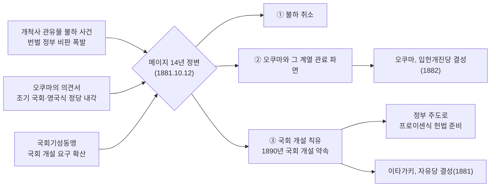
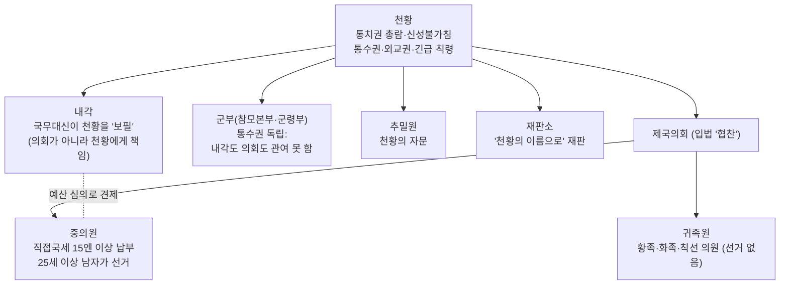

1882년 4월 6일, 기후의 한 연설회장. 연설을 마치고 나오던 자유당 총리 **이타가키 다이스케**에게 한 청년이 단도를 휘둘렀다. 피를 흘리며 쓰러진 이타가키가 외쳤다고 전하는 말이 있다. "이타가키는 죽어도 자유는 죽지 않는다." 실제로 이 말을 누가 했는지는 확실하지 않지만, 이 문장은 곧 전국에 퍼져 한 시대의 구호가 되었다.

7강에서 사족 반란이 칼로 정부에 맞섰다면, 이 강의의 주인공들은 **말과 글**로 맞섰다. 1874년의 민선의원 설립 건백서에서 시작된 **자유민권운동**은 국회 개설과 헌법 제정, 지조 경감, 언론·집회의 자유를 요구하며 전국으로 번졌다. 정부는 탄압과 양보를 번갈아 쓰면서, 결국 1889년 천황이 국민에게 내려 주는 형식의 **대일본제국헌법**을 만들었다. 일본은 아시아에서 처음으로 헌법과 의회를 가진 나라가 되었다. 그러나 그 헌법은 민권파가 꿈꾼 것과는 크게 달랐다.

> [!핵심] 이 강의의 질문
> 1. 자유민권운동은 누가, 무엇을 요구한 운동이었는가?
> 2. 정부는 왜 1881년에 국회 개설을 약속했고, 그 헌법은 왜 독일(프로이센)식이 되었는가?
> 3. 대일본제국헌법은 어떤 국가를 설계했는가? 그 안에서 국민은 어떤 위치에 있었는가?

```timeline
1874.1 | 민선의원 설립 건백서 | 이타가키 등 8명이 좌원에 국회 개설을 요구
1874.4 | 입지사 결성 | 고치에서 이타가키·가타오카 겐키치 등
1875.2 | 애국사 결성, 오사카 회의 | 전국 민권 결사의 연합. 오쿠보·기도·이타가키의 타협
1875.4 | 점진적 입헌정체 수립의 조서 | 원로원·대심원·지방관회의 설치
1875.6 | 참방률·신문지 조례 | 정부 비판 언론 단속
1878.7 | 지방 3신법 | 부현회 설치 등 지방 제도 정비
1880.3 | 국회기성동맹 | 전국 민권 결사가 국회 개설 청원 운동
1881.10 | 메이지 14년 정변, 국회 개설 칙유 | 오쿠마 파면, 1890년 국회 개설 약속. 자유당 결성
1882.3 | 입헌개진당 결성, 이토의 유럽 헌법 조사 출발 | 오쿠마 중심의 영국식 정당
1882.4 | 이타가키 습격 사건 | 기후에서 피습
1881~85 | 마쓰카타 재정 | 디플레이션으로 농촌 몰락
1884.11 | 지치부 사건 | 사이타마 지치부 농민들의 무장 봉기
1885.12 | 내각 제도 | 이토 히로부미가 초대 내각총리대신
1887.12 | 보안 조례 | 민권파 570명을 도쿄에서 추방
1889.2.11 | 대일본제국헌법 반포 | 흠정 헌법, 같은 날 황실전범 제정
1890.7 | 제1회 중의원 총선거 | 유권자는 인구의 약 1.1%
1890.10 | 교육칙어 | 천황 중심의 국민 도덕
1890.11 | 제1회 제국의회 개원 | 아시아 최초의 근대 의회
```

## 민권운동의 시작

### 민선의원 설립 건백서

1874년 1월 17일, 메이지 6년 정변으로 정부를 떠난 이타가키 다이스케, 고토 쇼지로, 에토 신페이, 소에지마 다네오미 등 8명이 정부의 입법 자문 기관인 좌원에 한 통의 건의서를 냈다. **민선의원 설립 건백서民撰議院設立建白書**다. 건백서는 다음 날 영국인이 발행하던 신문 『닛신신지시日新真事誌』에 실려 세상에 알려졌다.

> [!사료] 민선의원 설립 건백서 (1874, 일부)
> "신들이 엎드려 지금의 정권이 어디에 있는지를 살펴보건대, 위로는 황실에 있지 않고 아래로는 인민에게 있지 않으며, 오로지 **유사有司**(관료)에게 돌아가 있습니다. … 이를 구할 길은 오직 천하의 공의를 펴는 데 있을 뿐이며, 천하의 공의를 펴는 길은 **민선의원을 세우는 것**뿐입니다."
> — 건백서의 일부를 우리말로 옮김

건백서의 논리는 7강에서 본 '유사 전제' 비판 그대로였다. 오쿠보를 중심으로 한 몇몇 관료가 천황도 국민도 아닌 자기들 뜻대로 나라를 움직이고 있으니, 국민이 뽑은 의회를 만들어 이를 견제해야 한다는 것이다. 다만 건백서가 말한 '인민'은 실제로는 '세금을 내는 사족과 호농·호상'이었다. 건의자들 스스로가 정권에서 밀려난 사람들이었으므로, 이 요구에는 권력을 되찾으려는 의도도 섞여 있었다.

정부 안에서는 학자 가토 히로유키가 "아직 국민의 지식이 깨이지 않았으니 의회는 시기상조"라고 반박했고, 이를 두고 신문 지상에서 논쟁이 벌어졌다. 이 논쟁 자체가 '공론'의 시대가 열렸음을 보여 주었다.

### 입지사와 애국사

건백서를 낸 이타가키는 고향 도사(고치)로 돌아가 1874년 **입지사立志社**를 세웠다. 입지사는 정치 결사이자, 생계가 막막해진 사족들에게 일자리와 교육을 마련해 주는 단체였다. 이듬해 1875년에는 오사카에서 전국의 민권 결사를 묶은 **애국사愛国社**가 만들어졌다.

정부는 운동을 분열시키는 데 나섰다. 1875년 초 오사카에서 오쿠보는 기도, 이타가키와 만나 타협했다(오사카 회의). 그 결과 4월 '점진적으로 입헌 정체를 세운다'는 천황의 조서가 나오고, 입법 자문 기관인 **원로원**, 최고 법원인 **대심원**, 지방관들이 모이는 **지방관회의**가 설치되었다. 이타가키와 기도는 정부에 돌아왔다. 그러나 정부는 같은 해 6월 **참방률讒謗律**과 **신문지 조례**를 만들어 정부를 비판하는 신문을 엄하게 처벌했다. 1875~76년 사이에만 수십 명의 기자가 감옥에 갔다. 양보와 탄압을 함께 쓰는 정부의 수법은 이후 내내 되풀이된다. 애국사는 이타가키가 정부에 들어가면서 곧 흐지부지되었다.

## 국회를 열라: 운동의 확대

### 호농과 지방의 참여

세이난 전쟁이 끝난 1878년 무렵부터 민권운동은 성격이 바뀌었다. 사족 중심의 운동에서 **지방의 부유한 농민(호농)과 상인**이 주도하는 운동으로 넓어진 것이다. 그 배경에는 지조가 있었다. 지조를 내는 땅 주인들은 "세금을 내는 사람이 나라의 일에 참여해야 한다"고 생각하기 시작했다. 정부가 1878년 지방 3신법으로 만든 **부현회**(도·도·부·현 의회)도 그들에게 정치 경험을 쌓는 무대가 되었다.

각지에서 학습 결사와 연설회가 생겨났다. 농민들은 밤에 모여 루소의 『사회계약론』(나카에 조민이 1882년 『민약역해』로 번역), 밀의 『자유론』, 스펜서의 저작을 읽고 토론했다. 연설회는 오늘날의 정치 집회와 같았다. 연사가 정부를 비판하면 감시하던 경찰관이 "중지!", "해산!"을 외쳤고, 청중은 박수와 야유로 맞섰다.

### 국회기성동맹

1880년 3월, 다시 일으킨 애국사의 대회에서 전국의 민권 결사가 모여 **국회기성동맹国会期成同盟**을 결성했다. 그들은 전국을 돌며 국회 개설 청원 서명을 모았고, 수만 명이 이름을 올렸다. 정부는 청원서를 받지 않았고, 4월에는 **집회 조례**를 만들어 정치 집회를 경찰에 신고하게 하고 군인·교원·학생의 참여를 금지했다.

### 민간의 헌법 초안

민권파는 요구에 그치지 않고 직접 헌법을 써 보았다. 1880~81년 전국에서 수십 종의 헌법 초안이 만들어졌는데, 이를 **사의 헌법私擬憲法**이라 부른다.

| 초안 | 작성자 | 특징 |
|---|---|---|
| 동양대일본국 국헌안 | 우에키 에모리 (입지사) | 연방제, 일원제 의회, 정부가 폭정을 하면 국민이 저항하고 정부를 갈아치울 권리(저항권·혁명권) 명기 |
| 일본헌법 미코미안日本憲法見込案 | 입지사 | 국민 주권에 가까운 구상 |
| 사의 헌법안 | 교순사(후쿠자와 유키치 계열) | 영국식 의원내각제, 이원제 |
| 일본제국 헌법(이쓰카이치 헌법) | 지바 다쿠사부로 (도쿄 다마 지방의 학습 결사) | 204조에 이르는 상세한 기본권 규정. 1968년 농가의 창고에서 발견 |

표: 대표적인 사의 헌법

특히 이쓰카이치 헌법은 도쿄 서쪽 산골 마을의 청년들이 학습 모임에서 토론하며 만든 것이다. 민권운동이 도시의 지식인만이 아니라 농촌의 젊은이들에게까지 깊이 뿌리내렸음을 보여 준다.

> [!참고] 여성과 민권운동
> 민권운동의 연단에는 여성도 섰다. 교토 출신의 **기시다 도시코**는 1882~83년 각지를 돌며 남녀평등과 여성 교육을 호소하는 연설을 해 큰 반향을 일으켰고, "상자 속의 딸"이라는 연설 때문에 체포되기도 했다. 그의 연설을 듣고 운동에 뛰어든 후쿠다(가게야마) 히데코는 오사카 사건에 연루되어 투옥되었다. 그러나 1890년의 집회 및 정사법은 여성이 정치 집회에 참여하고 정당에 가입하는 것 자체를 금지했다. 근대 의회가 열린 바로 그해, 여성은 정치 무대에서 법적으로 밀려난 것이다.

## 메이지 14년 정변

### 개척사 관유물 불하 사건

1881년 여름, 한 스캔들이 터졌다. 홋카이도 개척을 맡은 개척사 장관 **구로다 기요타카**(사쓰마)가, 10년 동안 1,400만 엔 넘게 들여 만든 관영 공장과 선박, 토지를 같은 사쓰마 출신 상인 고다이 도모아쓰 등이 관련된 회사에 39만 엔에, 그것도 30년 무이자 분할로 팔아넘기려 한 것이다(개척사 관유물 불하 사건). 신문들은 번벌 정부의 부패라며 맹렬히 공격했고, 민권운동은 절정에 이르렀다.

### 오쿠마의 추방과 국회 개설 칙유

정부 안에서도 갈등이 있었다. 그해 3월, 참의 **오쿠마 시게노부**(히젠)는 "1882년에 선거를 하고 1883년에 국회를 열며, 영국처럼 의회 다수당이 내각을 만드는 정당 내각제를 하자"는 급진적인 의견서를 몰래 천황에게 올렸다. 이토 히로부미 등 사쓰마·조슈 출신 지도자들은 이에 크게 반발했다. 그들은 오쿠마가 후쿠자와 유키치 계열 인사들과 손잡고 불하 사건 반대 여론을 부추긴다고 의심했다.

```figure
src: asset:21451448982fa2c9f77bf16f486d1ee6
caption: 오쿠마 시게노부(1838~1922). 메이지 14년 정변으로 정부에서 쫓겨난 뒤 입헌개진당을 만들고, 1882년 도쿄전문학교(지금의 와세다 대학)를 세웠다. 사진은 노년의 모습이다.
credit: 촬영자·연도 미상 · 국립국회도서관 「근대일본인의 초상」
license: Public Domain (국립국회도서관: 저작권 보호 기간 만료)
source: https://www.ndl.go.jp/portrait/datas/33/
width: narrow
```

1881년 10월 12일, 정부는 세 가지를 한꺼번에 발표했다.



국회 개설을 9년 뒤로 약속해 운동의 예봉을 꺾는 동시에, 영국식 정당 내각론자를 정부에서 몰아내고, 헌법은 정부가 주도해 만든다는 방침을 굳힌 것이다. 이 정변으로 사쓰마·조슈 출신 중심의 **삿초 번벌 정권**이 확고해졌고, 그 중심에는 이토 히로부미가 섰다. 헌법의 방향을 설계한 것은 이토의 참모인 법제관 **이노우에 고와시**였다. 그는 군주의 권한이 강한 프로이센 헌법을 모델로 삼아야 한다고 주장했다.

### 정당의 탄생

국회 개설이 약속되자 민권파는 정당을 만들었다.

| 정당 | 결성 | 지도자 | 성격 | 지지층 |
|---|---|---|---|---|
| 자유당 | 1881.10 | 이타가키 다이스케 | 프랑스식 급진주의, 주권재민·일원제 지향 | 사족, 지방의 호농 |
| 입헌개진당 | 1882.3 | 오쿠마 시게노부 | 영국식 온건 입헌주의, 이원제·정당 내각 | 도시의 지식인, 실업가 |
| 입헌제정당 | 1882.3 | 후쿠치 겐이치로 | 정부를 지지하는 어용 정당, 흠정 헌법 지지 | 관료, 신관 등 |

표: 1880년대 초의 정당

## 마쓰카타 재정과 격화 사건

### 디플레이션의 폭풍

1881년 대장경이 된 **마쓰카타 마사요시**(사쓰마)는 세이난 전쟁 뒤의 인플레이션을 잡기 위해 강력한 긴축 정책을 폈다. 정부 지출을 줄이고 세금을 늘려 남은 돈으로 시중의 불환 지폐를 회수·소각했고, 1882년 중앙은행인 **일본은행**을 세워 1885년부터 은과 바꿀 수 있는 지폐(은행권)를 발행했다. 화폐 가치는 안정되었다. 그러나 그 대가는 컸다.

물가, 특히 쌀과 생사의 값이 몇 년 사이에 절반 가까이로 떨어졌다. 그런데 지조는 땅값을 기준으로 정해진 현금이었기 때문에 그대로였다. 농민들은 같은 세금을 내기 위해 전보다 두 배 가까운 쌀을 팔아야 했다. 빚을 갚지 못한 자작농들이 땅을 잃고 소작농으로 떨어졌고, 땅은 지주와 고리대금업자에게 모였다. 반대로 땅을 사 모은 지주는 소작료를 받으며 '기생 지주'로 성장했다. 근대 일본 농촌의 지주제는 이 시기에 굳어졌다.

### 격화 사건

생활이 무너진 농민들과 자유당의 급진파가 결합하면서, 민권운동은 일부 지역에서 무장 봉기로 치달았다. 이를 **격화 사건激化事件**이라 한다.

| 사건 | 연도 | 지역 | 내용 |
|---|---|---|---|
| 후쿠시마 사건 | 1882 | 후쿠시마 | 현령 미시마 미치쓰네의 도로 공사 강제 동원에 맞선 농민과 자유당원(고노 히로나카 등) 대량 검거 |
| 다카다 사건 | 1883 | 니가타 | 정부 요인 암살 모의 혐의로 자유당원 검거 |
| 가바산 사건 | 1884.9 | 이바라키 | 자유당 급진파가 가바산에서 거병, 진압됨 |
| **지치부 사건** | 1884.11 | 사이타마 | 빚에 시달린 농민 수천 명이 '곤민당'을 조직해 봉기. 군대까지 출동해 진압 |
| 오사카 사건 | 1885 | 오사카·나가사키 | 오이 겐타로 등이 조선에 건너가 정변을 일으키려다 사전 검거 |

표: 주요 격화 사건

가장 큰 것은 1884년 11월의 **지치부 사건秩父事件**이었다. 생사 값 폭락으로 빚더미에 앉은 지치부 산골의 양잠 농민들이 '곤민당困民党'을 만들어, 빚 상환 연기와 세금 감면, 학교 운영비 절감 등을 요구하며 봉기했다. 그들은 고리대금업자의 집과 관청을 습격하고 한때 지치부 일대를 장악했지만, 경찰과 헌병, 군대의 진압으로 열흘 만에 무너졌다. 지도자들은 사형당했다. 정부는 이들을 '폭도'로 처리했지만, 오늘날에는 민중의 생존을 건 저항으로 다시 평가받고 있다.

격화 사건이 잇따르자 자유당 지도부는 통제력을 잃었고, 1884년 10월 자유당은 스스로 해산했다. 입헌개진당도 오쿠마가 탈당하며 활력을 잃었다. 민권운동은 1880년대 중반 크게 가라앉았다.

### 다시 타오른 불길과 보안 조례

국회 개설이 가까워진 1886~87년, 고토 쇼지로를 중심으로 옛 민권파가 다시 뭉쳤다(대동단결 운동). 마침 외무대신 이노우에 가오루의 조약 개정안이 외국인 판사를 일본 법정에 두는 굴욕적인 내용이라는 사실이 알려지자(9강), 민권파는 **지조 경감, 언론·집회의 자유, 외교 실책의 만회**를 요구하는 '3대 사건 건백 운동'을 벌였다. 정부는 1887년 12월 **보안 조례**를 공포해, 민권파 570명을 하루아침에 도쿄 황거로부터 3리(약 12km) 밖으로 추방했다.

## 헌법을 만들다

### 이토 히로부미의 유럽 조사

국회 개설을 약속한 정부는 서둘러 헌법을 준비했다. 1882년 3월, 이토 히로부미는 1년 반에 걸친 유럽 헌법 조사를 떠났다. 그는 베를린에서 법학자 **그나이스트**에게, 빈에서 **슈타인**에게 배웠다. 그들은 의회의 권한을 제한하고 군주와 행정부의 권력을 강하게 하는 프로이센식 입헌 군주제를 권했다. 이토는 특히 슈타인의 강의에 감명을 받아, 헌법만이 아니라 그것을 운영할 행정 조직과 관료를 함께 만들어야 한다는 것을 깨달았다.

```figure
src: asset:4d5660bcfdc7f59bf323fd6f76f0494d
caption: 이토 히로부미(1841~1909). 헌법 제정과 내각 제도를 주도하고 네 차례 총리를 지냈다. 사진은 노년의 모습이다.
credit: 촬영자·연도 미상 · 국립국회도서관 「근대일본인의 초상」
license: Public Domain (국립국회도서관: 저작권 보호 기간 만료)
source: https://www.ndl.go.jp/portrait/datas/12/
width: narrow
```

### 국가 제도의 정비

귀국한 이토는 헌법보다 먼저 국가의 골격을 차례로 세웠다. 의회가 생기기 전에, 의회가 흔들 수 없는 권력 구조를 만들어 두려는 것이었다.

| 연도 | 제도 | 목적 |
|---|---|---|
| 1884 | 화족령 | 옛 공가·다이묘에 더해 유신 공신을 화족으로 삼음. 장래의 귀족원 의원 확보 |
| 1885 | **내각 제도** | 태정관제 폐지. 이토가 초대 내각총리대신. 출신과 관계없이 능력 있는 각료를 모음 |
| 1886 | 제국대학령 | 도쿄 제국대학을 국가 엘리트 관료 양성 기관으로 |
| 1887 | 문관 시험 제도 | 관리를 시험으로 뽑는 근대 관료제 |
| 1888 | **추밀원** | 헌법 초안을 심의하는 천황의 자문 기관. 이토가 초대 의장 |
| 1888·1890 | 시제·정촌제, 부현제·군제 | 독일인 고문 모세의 조언에 따른 지방 자치 제도 |

표: 헌법에 앞선 국가 제도의 정비

```figure
src: asset:e861e1e5c80df29cdd7de513f8d1351b
caption: 1888년 헌법 초안을 심의하는 추밀원 회의를 그린 판화. 녹색 천을 덮은 타원형 탁자에 고문관들이 둘러앉아 있다. 실제 회의는 비공개였으므로 화가의 상상이 들어간 그림이다.
credit: 요슈 지카노부(楊洲周延), 1888년 · 미국 의회도서관 소장
license: Public Domain (1880년대 촬영, 촬영자 사망 후 100년 이상 경과 · 미국 의회도서관)
source: https://www.loc.gov/item/2021668780/
width: wide
```

헌법 초안은 이토와 이노우에 고와시, 이토 미요지, 가네코 겐타로가 독일인 법률 고문 **뢰슬러**의 조언을 받으며, 요코스카 앞바다 나쓰시마의 이토 별장 등에서 극비리에 작성했다. 초안은 1888년 추밀원에서 천황이 참석한 가운데 심의되었다.

### 대일본제국헌법의 반포

1889년 2월 11일, 일본 건국 기념일로 정해진 기원절에 황거의 새 궁전에서 **대일본제국헌법**이 반포되었다. 메이지 천황이 내각총리대신 구로다 기요타카에게 헌법을 건네주는 형식이었다. 천황이 만들어 국민에게 내려 주는 헌법, 곧 **흠정 헌법欽定憲法**이었다. 도쿄 시내는 축제 분위기였다. 그러나 같은 날 아침, 서양화 정책을 대표하던 문부대신 모리 아리노리가 국수주의자 청년에게 습격당해 이튿날 숨졌다.

```figure
src: asset:74f6b9ba7469b74c617fe8be472f5bb6
caption: 1889년 2월 11일 황거 정전에서 열린 대일본제국헌법 반포식을 그린 판화. 단 위의 천황이 총리 구로다 기요타카에게 헌법을 건네주고 있다.
credit: 아다치 긴코(安達吟光), 1889년 · 메트로폴리탄 미술관 소장
license: Public Domain (메트로폴리탄 미술관 오픈 액세스)
source: https://www.metmuseum.org/art/collection/search/55232
width: wide
```

> [!더알아보기] "헌법이 무엇인지도 모르고"
> 일본에 머물던 독일인 의사 에르빈 벨츠는 헌법 반포 전날의 일기에 이렇게 적었다. "도쿄 전체가 형언할 수 없는 소동이다. 곳곳에 축하 문이 서고 등불이 걸리고 행렬이 준비되고 있다. 그런데 우습게도 누구도 헌법의 내용을 모른다." 많은 서민은 '헌법(겐포)'을 '견포絹布'(비단옷)를 하사받는 것으로 알았다는 이야기도 전한다.

## 대일본제국헌법의 구조

헌법은 7장 76조로 이루어졌다. 그 핵심은 **천황 주권**이었다.

| 조문 | 내용 |
|---|---|
| 제1조 | 대일본제국은 만세일계의 천황이 이를 통치한다 |
| 제3조 | 천황은 신성하여 침범할 수 없다 |
| 제4조 | 천황은 국가의 원수로서 통치권을 총람하며, 이 헌법의 조규에 따라 이를 행한다 |
| 제8조 | 의회가 열리지 않을 때 천황은 법률을 대신하는 긴급 칙령을 낼 수 있다 |
| 제11조 | 천황은 육해군을 통수한다 (**통수권의 독립**) |
| 제13조 | 천황은 전쟁을 선포하고 강화하며 조약을 맺는다 |
| 제29조 | 일본 신민은 **법률의 범위 안에서** 언론·저작·출판·집회·결사의 자유를 가진다 |
| 제55조 | 국무 각 대신은 천황을 보필하고 그 책임을 진다 |

표: 대일본제국헌법의 주요 조문



이 구조에서 눈여겨볼 점은 셋이다.

첫째, **내각은 의회가 아니라 천황에게 책임을 진다.** 의회의 다수당이 내각을 만드는 영국식 정당 내각이 아니었다. 실제로 초기 내각은 정당과 상관없이 번벌 출신 지도자들이 번갈아 맡았다.

둘째, **군대의 지휘(통수권)는 내각에서도 독립되어 있었다.** 육군 참모본부와 해군 군령부는 천황에게 직접 보고했고, 총리도 의회도 군의 작전에 개입할 수 없었다. 이 '통수권의 독립'은 1930년대 군부가 정부의 통제를 벗어나 폭주하는 법적 근거가 된다.

셋째, **국민의 권리는 '법률의 범위 안에서'만 인정되었다.** 의회가 만든 법률로 언제든 제한할 수 있는 권리였다. 국민은 '주권자'가 아니라 천황의 '신민臣民'이었다.

그렇다고 의회가 아무 힘도 없었던 것은 아니다. 법률과 예산은 의회의 '협찬(동의)'이 있어야 했다. 정부가 의회의 반대로 새 예산을 통과시키지 못하면 전년도 예산을 그대로 쓸 수 있다는 규정(제71조)이 있었지만, 군비 확장처럼 새로 돈이 드는 일은 의회를 무시할 수 없었다. 이 예산 심의권이 1890년대 의회 정치의 무기가 된다.

## 첫 선거와 첫 의회

### 유권자 45만 명

1890년 7월 1일, 제1회 중의원 의원 총선거가 치러졌다. 선거권은 **직접 국세 15엔 이상을 내는 만 25세 이상의 남자**에게만 주어졌다. 유권자는 약 45만 명, 전체 인구의 약 1.1%였다. 대부분은 지조를 많이 내는 지주였다. 그런데도 투표율은 90%를 넘었다.

```chart
{
  "type": "bar",
  "caption": "중의원 선거 유권자가 인구에서 차지하는 비율의 변화 (%). 납세 자격이 낮아지다가 1925년 남자 보통선거법(1928년 첫 시행)으로 크게 늘었고, 여성은 1945년에야 선거권을 얻었다",
  "data": {
    "labels": ["1890 (15엔 이상)", "1902 (10엔 이상)", "1920 (3엔 이상)", "1928 (남자 보통선거)", "1946 (남녀 보통선거)"],
    "datasets": [{ "label": "인구 대비 유권자(%)", "data": [1.1, 2.2, 5.5, 19.8, 48.7] }]
  },
  "options": { "plugins": { "legend": { "display": false } } }
}
```

선거 결과는 정부의 예상을 뒤엎었다. 300석 가운데 옛 자유당 계열과 입헌개진당 등 **민당民党**이 과반을 차지한 것이다. 정부를 지지하는 세력은 '이당吏党'이라 불렸다.

### 제1회 제국의회

1890년 11월 29일, 제1회 제국의회가 열렸다. 총리 **야마가타 아리토모**는 첫 시정 연설에서, 국가의 독립을 지키려면 국경인 '주권선'뿐 아니라 그 안전과 밀접한 지역인 '이익선'까지 지켜야 하며, 그 이익선의 중심은 조선이라고 말했다. 그러기 위해 군비를 늘려야 한다는 것이었다. 민당은 "민력 휴양, 정비 절감"(백성의 힘을 쉬게 하고 정부 비용을 줄이라)을 내세워 예산 삭감을 요구했다. 정부는 민당 일부를 회유해 겨우 예산을 통과시켰다. 이후 1890년대 전반의 의회는 군비를 늘리려는 정부와 지조 경감을 요구하는 민당의 충돌로 날이 저물었다. 이 대립은 청일전쟁이 터지면서 단번에 멈춘다(9강).

```figure
src: asset:f5ac15c9041c780e10e1bcf2cf3e6866
caption: 1890년 첫 제국의회의 중의원 본회의장을 그린 판화. 위쪽에 의원 명단이 적혀 있다.
credit: 3대 도요하라 구니테루(豊原国輝), 1890년 · 메트로폴리탄 미술관 소장
license: Public Domain (메트로폴리탄 미술관 오픈 액세스)
source: https://www.metmuseum.org/art/collection/search/55267
width: wide
```

### 교육칙어

헌법과 의회가 국가의 '제도'를 만들었다면, 국민의 '마음'을 만드는 장치도 함께 준비되었다. 1890년 10월 30일, 천황이 국민에게 내리는 형식으로 **교육칙어**가 발표되었다. 이노우에 고와시와 유학자 모토다 나가자네가 기초한 이 칙어는, 충효를 국민 도덕의 근본으로 삼고 "일단 위급한 일이 생기면 의용을 다해 공公에 봉사하여, 천양무궁의 황운을 받들라"고 가르쳤다.

교육칙어의 등본과 천황·황후의 사진(어진영)은 전국의 학교에 배포되어, 의식 때마다 교장이 엄숙하게 낭독했다. 1891년 제일고등중학교 교사이자 크리스트교인 우치무라 간조가 교육칙어 봉독식에서 깊이 절하지 않았다는 이유로 '불경'하다는 비난을 받고 학교를 떠나야 했다(우치무라 간조 불경 사건). 교육칙어는 1948년 국회 결의로 효력을 잃을 때까지 일본인의 도덕과 애국심을 형성하는 기둥이 되었다.

## 정리

> [!핵심] 8강 요약
> - **민선의원 설립 건백서**(1874)로 시작된 **자유민권운동**은 사족에서 호농·호상, 농촌 청년으로 넓어지며 국회 개설·헌법 제정·지조 경감을 요구했다. 민간에서도 우에키 에모리의 초안, 이쓰카이치 헌법 같은 **사의 헌법**이 만들어졌다.
> - 정부는 참방률·신문지 조례·집회 조례로 탄압하는 한편, **메이지 14년 정변**(1881)으로 오쿠마를 몰아내고 1890년 국회 개설을 약속했다. 자유당·입헌개진당이 결성되었다.
> - **마쓰카타 디플레이션**으로 농촌이 무너지며 **지치부 사건** 등 격화 사건이 일어났고, 운동은 한때 가라앉았다.
> - 이토 히로부미는 독일·오스트리아에서 헌법을 배우고 **내각 제도**·추밀원을 만든 뒤, 1889년 **대일본제국헌법**을 흠정 헌법으로 반포했다. 천황 주권, 통수권 독립, '법률의 범위 안의' 권리가 특징이었다.
> - 1890년 유권자가 인구의 1.1%인 첫 총선거에서 **민당**이 과반을 차지했고, 제국의회가 열렸다. 같은 해 **교육칙어**가 반포되었다.

### 생각해 볼 질문

1. 민선의원 설립 건백서를 낸 사람들은 대부분 권력에서 밀려난 전직 참의였다. 그렇다면 자유민권운동은 '민권'을 위한 운동이었을까, '권력 투쟁'이었을까? 1878년 이후 운동의 변화와 함께 생각해 보자.
2. 우에키 에모리의 초안과 대일본제국헌법을 비교해 보자. 같은 시대에 왜 이렇게 다른 헌법이 구상되었을까?
3. 통수권의 독립 규정은 1889년에는 큰 문제가 되지 않았다. 그것이 1930년대에 문제가 된 까닭은 무엇일까?

### 다음 강 예고

9강에서는 불평등조약을 고치기 위한 30년의 노력, 조선을 둘러싼 청과 일본의 대립(임오군란·갑신정변·동학농민운동), 그리고 **청일전쟁**(1894~95)과 시모노세키 조약, 삼국간섭, 대만 식민지화까지를 다룬다.
