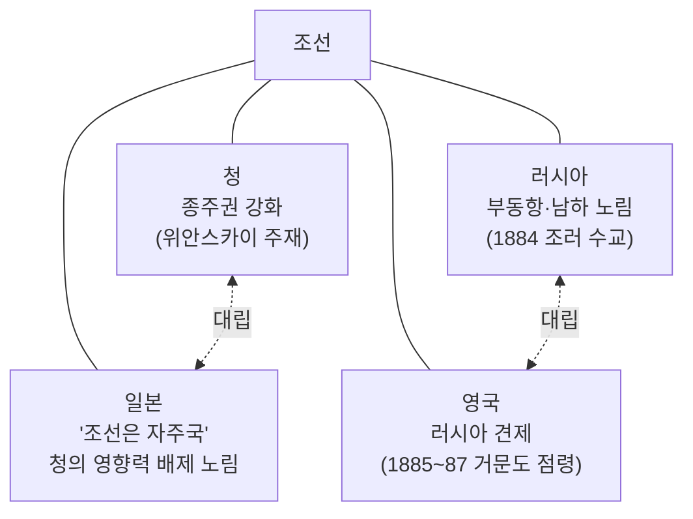

1887년, 요코하마에서 발행되던 풍자 잡지 『토바에』에 프랑스인 화가 조르주 비고가 그린 한 장의 만화가 실렸다. 다리 위에서 낚싯대를 드리운 사람은 러시아, 물가에서 낚싯대를 든 두 사람은 일본과 청나라다. 물속의 물고기에는 '조선'이라고 적혀 있다. 일본과 청이 서로 물고기를 낚으려 다투는 사이, 다리 위의 러시아가 그것을 가로채려 노리고 있다. 이 그림은 7년 뒤에 벌어질 전쟁과, 그 10년 뒤에 벌어질 또 다른 전쟁을 예언한 것처럼 보인다.

이 강의는 1880~90년대 일본 외교의 두 가지 큰 흐름을 다룬다. 하나는 서양 열강에 대해 **불평등조약을 고치는 일(조약 개정)** 이고, 다른 하나는 이웃 **조선을 둘러싸고 청나라와 다투는 일**이다. 두 흐름은 1894년 여름 한 지점에서 만난다. 영국과 영사재판권 철폐에 합의한 지 일주일 만에, 일본군은 조선의 왕궁을 점령하고 청나라와 전쟁을 시작했다.

> [!핵심] 이 강의의 질문
> 1. 불평등조약 개정은 왜 그토록 오래 걸렸고, 어떻게 이루어졌는가?
> 2. 일본과 청은 조선을 두고 어떻게 대립했으며, 그 사이 조선은 어떤 처지에 놓였는가?
> 3. 청일전쟁은 일본과 동아시아에 무엇을 바꾸었는가?

```timeline
1876 | 조일수호조규 | 일본이 조선에 불평등조약을 강요(7강)
1879~87 | 이노우에 가오루의 조약 개정 교섭 | 로쿠메이칸 외교, 외국인 판사 임용안으로 실패
1882.7 | 임오군란 | 조선 구식 군대의 봉기. 청이 군대를 보내 진압
1884.12 | 갑신정변 | 김옥균 등 개화파의 정변이 청군에 진압됨
1885.4 | 톈진 조약 | 이토 히로부미와 리훙장이 조선에서 양국 군대 철수에 합의
1886.10 | 노르만톤호 사건 | 영국 선박 침몰로 일본인 승객 전원 사망, 영사재판의 부당함이 드러남
1889.10 | 오쿠마 외무대신 피습 | 외국인 판사 임용안에 반대한 청년이 폭탄 투척
1891.5 | 오쓰 사건 | 러시아 황태자가 일본 순사에게 습격당함
1894.3~6 | 동학농민운동, 청·일 양군 조선 출병 | 전라도 농민군이 전주성 점령
1894.7.16 | 영일통상항해조약 | 영사재판권 철폐(1899년 시행)
1894.7.23 | 일본군, 경복궁 점령 | 이틀 뒤 풍도 해전으로 청일전쟁 시작
1894.8.1 | 선전포고 | 일본과 청이 서로 선전을 포고
1894.9 | 평양 전투, 황해 해전 | 일본군이 조선에서 청군을 몰아냄
1894.11~12 | 뤼순 점령, 동학농민군 우금치 패배 | 일본군이 랴오둥반도의 요새를 점령하고, 조선에서는 농민군을 토벌
1895.2 | 웨이하이웨이 함락 | 청 북양함대 항복
1895.4.17 | 시모노세키 조약 | 조선 독립 승인, 랴오둥반도·대만·펑후 제도 할양, 배상금 2억 냥
1895.4.23 | 삼국간섭 | 러시아·독일·프랑스가 랴오둥반도 반환을 요구
1895.10.8 | 을미사변 | 일본 공사 미우라 고로의 지휘 아래 명성황후 시해
```

## 불평등조약을 고쳐라

### 무엇을 고치려 했나

2강에서 보았듯 막부가 맺은 조약에는 두 가지 큰 불평등이 있었다. 외국인이 일본에서 죄를 지어도 일본 법정이 재판하지 못하는 **영사재판권(치외법권)**, 그리고 일본이 관세율을 스스로 정하지 못하는 **관세자주권의 결여**다. 메이지 정부는 이 두 가지를 되찾는 것을 외교의 최우선 과제로 삼았다. 그러나 열강의 반응은 냉담했다. 그들의 논리는 간단했다. 일본에 서양 수준의 법전과 재판 제도가 없는데 어떻게 자국민을 일본 법정에 맡기느냐는 것이었다.

| 시기 | 담당자 | 교섭 방침 | 결과 |
|---|---|---|---|
| 1871~73 | 이와쿠라 도모미 | 사절단의 예비 교섭 | 위임장 문제로 중단 (6강) |
| 1876~79 | 데라시마 무네노리 | 관세자주권 회복을 먼저 | 미국은 동의했으나 영국·독일 반대로 실패 |
| 1879~87 | 이노우에 가오루 | 서양화 정책(로쿠메이칸)과 함께 영사재판권 철폐를 교섭. 외국인 판사 임용, 내지 개방 | 정부 안팎의 반대로 사임 |
| 1888~89 | 오쿠마 시게노부 | 나라별 개별 교섭. 대심원에만 외국인 판사 | 내용이 알려져 반대 폭발, 피습으로 사임 |
| 1889~91 | 아오키 슈조 | 영국과 교섭 진전 | 오쓰 사건으로 사임 |
| 1892~96 | **무쓰 무네미쓰** | 법전 정비를 배경으로 영국과 대등한 조약 | **영일통상항해조약**(1894): 영사재판권 철폐 |
| 1908~11 | **고무라 주타로** | 관세자주권 회복 | **미일통상항해조약 개정**(1911): 관세자주권 완전 회복 |

표: 조약 개정 교섭의 역사

### 로쿠메이칸 외교

이노우에 가오루는 일본이 서양과 같은 '문명국'임을 보여 주면 조약 개정이 쉬워질 것이라고 생각했다. 1883년 도쿄 히비야에 영국인 건축가 조사이어 콘더가 설계한 2층 벽돌 건물 **로쿠메이칸鹿鳴館**이 문을 열었다. 이곳에서 정부 고관과 그 부인들이 연미복과 드레스 차림으로 외국 외교관들과 왈츠를 추는 무도회가 밤마다 열렸다. 1887년 이토 히로부미 총리 관저에서 열린 가장무도회는 장안의 화제가 되었다.

그러나 서양인들의 눈에 이 모습은 '서양 흉내'로 비쳤다. 비고는 거울 앞에서 양복을 입고 꾸미는 일본인 남녀를 그리며, 거울에는 원숭이가 비치게 했다. 국내에서도 지나친 서양화에 대한 반발이 커졌다. 무엇보다 이노우에의 개정안에는 외국인 판사를 일본 법정에 임용하고, 외국인에게 일본 국내 어디서나 살고 장사할 수 있는 권리(내지 잡거)를 준다는 내용이 들어 있었다. 정부의 법률 고문인 프랑스인 보아소나드와 농상무대신 다니 다테키가 이에 반대했고, 민권파도 들고일어났다. 1887년 이노우에는 물러났다.

### 노르만톤호 사건

조약 개정이 왜 절실한지를 국민에게 뼈저리게 알린 사건이 있었다. 1886년 10월, 요코하마에서 고베로 가던 영국 화물선 **노르만톤호**가 와카야마 앞바다에서 침몰했다. 영국인 선장과 선원들은 구명보트로 탈출해 살아남았지만, 배에 타고 있던 일본인 승객 25명은 모두 목숨을 잃었다. 고베의 영국 영사 재판소는 선장에게 무죄를 선고했다. 일본 여론이 들끓자 재심이 열렸지만, 선장은 금고 3개월을 받았을 뿐 배상은 없었다.

"일본인이었기 때문에 구하지 않았다"는 분노가 전국을 휩쓸었고, 영사재판권 철폐를 요구하는 목소리는 정부의 외교 과제에서 국민적 요구로 바뀌었다.

### 피습과 오쓰 사건

이노우에의 뒤를 이은 오쿠마 시게노부는 나라별로 교섭해 미국·독일·러시아와 새 조약을 맺는 데까지 갔다. 그러나 1889년 영국 신문 『타임스』가 오쿠마 안에도 대심원에 외국인 판사를 둔다는 내용이 있다고 보도하자 반대 여론이 다시 폭발했다. 그해 10월, 국수주의 단체 겐요샤의 청년이 오쿠마의 마차에 폭탄을 던졌고, 오쿠마는 오른쪽 다리를 잃고 물러났다.

1891년 5월에는 일본을 방문한 러시아 황태자 니콜라이(뒤의 니콜라이 2세)가 시가현 오쓰에서 경비를 서던 순사 쓰다 산조의 칼에 머리를 다쳤다(**오쓰 사건**). 대국 러시아의 보복을 두려워한 정부는 황족에 대한 범죄 조항을 적용해 쓰다를 사형에 처하라고 재판소에 압력을 넣었다. 그러나 대심원장 **고지마 이켄**은 법대로 일반인 살인 미수죄를 적용해 무기징역을 선고하게 했다. 이 판결은 '사법권의 독립'을 지킨 사례로 서양에서도 높이 평가받았고, 역설적으로 일본의 사법을 믿을 수 있다는 인상을 주었다. 외무대신 아오키 슈조는 이 사건의 책임을 지고 물러났다.

### 무쓰 무네미쓰와 영일통상항해조약

그사이 일본은 조약 개정의 조건을 하나씩 갖추어 갔다. 헌법과 의회가 생겼고(8강), 보아소나드 등의 도움으로 형법(1880)과 민법·상법 등 근대 법전이 만들어지고 있었다. 영국의 태도도 바뀌었다. 러시아가 시베리아 철도 건설(1891 착공)로 동아시아 진출을 노리자, 영국은 일본을 러시아를 견제할 파트너로 보기 시작한 것이다.

```figure
src: asset:087af8fc858d35dbc7898638fb0272e6
caption: 무쓰 무네미쓰(1844~1897). 외무대신으로 영사재판권 철폐를 이루고 청일전쟁 외교를 이끌었다. 회고록 『건건록』을 남겼다.
credit: 촬영자·연도 미상 · 국립국회도서관 「근대일본인의 초상」
license: Public Domain (국립국회도서관: 저작권 보호 기간 만료)
source: https://www.ndl.go.jp/portrait/datas/199/
width: narrow
```

외무대신 **무쓰 무네미쓰**는 이 기회를 잡았다. 1894년 7월 16일 런던에서 **영일통상항해조약**이 조인되었다. 영사재판권을 철폐하고 관세율을 일부 올리는 내용이었다. 대신 일본은 외국인의 내지 잡거를 허용했다. 조약은 5년 뒤인 1899년에 시행되었고, 다른 나라들과도 같은 조약이 맺어졌다. 막부가 통상조약을 맺은 지 36년 만에 영사재판권이 사라진 것이다. 관세자주권은 1911년 외무대신 고무라 주타로가 완전히 되찾는다.

영국 외무장관 킴벌리는 조인식에서 "이 조약은 일본에 청나라 군대 수만 명을 물리친 것보다 큰 의미가 있다"고 말했다고 한다. 그리고 바로 그 일주일 뒤, 일본은 청나라와 전쟁을 시작했다.

## 조선을 둘러싼 청과 일본

### 조선의 개항과 두 개의 길

7강의 강화도 조약(1876)으로 문을 연 조선은 이후 자기 길을 찾아 고민했다.

```gallery
src: asset:a99ecd801f84877904cdc87097c3cf6e
caption: 서른 살 무렵의 조선 국왕 고종(1852~1919). 미국 해군 무관 포크가 촬영한 사진으로, 갑신정변이 일어난 해의 모습이다.
credit: 조지 C. 포크(George C. Foulk) 촬영, 1884년 · 미국 의회도서관 소장
license: Public Domain (1880년대 촬영, 촬영자 사망 후 100년 이상 경과 · 미국 의회도서관)
source: https://www.loc.gov/item/2021670704/
---
src: asset:25c69d92449e7871823ed8867c3e446d
caption: 1880년대 서울 창덕궁의 기와지붕. 1884년 갑신정변 때 고종은 창덕궁과 경우궁 사이를 오가며 정변의 한가운데 놓였다.
credit: 조지 C. 포크 촬영, 1885년 무렵 · 미국 의회도서관 소장
license: Public Domain (1880년대 촬영, 촬영자 사망 후 100년 이상 경과 · 미국 의회도서관)
source: https://www.loc.gov/item/2021670702/
```

1880년대 조선 정부 안에는 청의 지도 아래 점진적으로 개혁하자는 온건 개화파와, 일본의 메이지 유신을 본받아 청에서 벗어나 급진적으로 개혁하자는 급진 개화파가 있었다. 한편 청은 조선을 전통적인 조공 질서 속의 '속국'으로 묶어 두려 했고, 일본은 강화도 조약 제1관처럼 조선이 '자주국'이라 주장하며 청의 영향력을 끊으려 했다. 일본의 '자주국' 주장은 조선의 독립을 위한 것이 아니라 일본의 영향력을 넓히기 위한 것이었다.



### 임오군란

1882년 7월, 서울에서 구식 군대의 병사들이 봉기했다. 일본인 교관이 훈련하는 신식 군대(별기군)에 비해 차별을 받고, 13개월이나 밀린 급료로 받은 쌀에 모래와 겨가 섞여 있었던 것이 직접적인 원인이었다. 성난 병사들과 도시 빈민은 민씨 정권의 고관들을 죽이고, 일본인 교관을 살해했으며, 일본 공사관을 습격했다. 일본 공사 하나부사 요시모토는 인천으로 탈출했다. 이것이 **임오군란**이다.

청은 재빨리 군대를 보내 군란을 진압하고, 군란의 배후로 지목한 흥선대원군을 톈진으로 납치해 갔다. 이후 청은 군대를 서울에 남겨 두고, 「조청상민수륙무역장정」으로 조선이 청의 속방임을 명문화하며 내정에 깊이 개입했다. 일본은 조선과 **제물포 조약**을 맺어 배상금과 함께 공사관을 지킬 군대를 서울에 둘 권리를 얻었다. 이제 서울에 청과 일본, 두 나라의 군대가 함께 머물게 되었다.

### 갑신정변과 톈진 조약

1884년 12월, 김옥균·박영효 등 급진 개화파는 청이 베트남을 두고 프랑스와 전쟁(청불전쟁)을 벌이는 틈을 타 정변을 일으켰다. 우정국 개국 축하연을 틈타 수구파 대신들을 죽이고 새 정부를 세운 것이다. 일본 공사 다케조에 신이치로는 일본군 150명으로 그들을 지원하기로 약속했다. 그러나 1,500명의 청군이 왕궁으로 밀고 들어오자 일본군은 물러났고, 정변은 사흘 만에 무너졌다(**갑신정변**). 김옥균 등은 일본으로 망명했다.

이 사건으로 청과 일본의 군사 충돌 위기가 높아지자, 1885년 4월 이토 히로부미가 톈진에 가서 청의 실력자 **리훙장**과 **톈진 조약**을 맺었다. 두 나라는 조선에서 군대를 철수하고, 앞으로 조선에 군대를 보낼 때는 **미리 서로에게 알리기로** 했다. 이 조항이 9년 뒤 전쟁의 도화선이 된다.

> [!사료] 후쿠자와 유키치, 「탈아론」 (1885년 3월, 일부)
> "우리나라는 이웃 나라의 개명을 기다려 함께 아시아를 일으킬 여유가 없다. 오히려 그 대열에서 벗어나 서양의 문명국과 진퇴를 같이하고, 지나(중국)와 조선을 대하는 방법도 … 서양 사람이 그들을 대하는 방식에 따라 처분해야 할 뿐이다."
> — 갑신정변이 실패한 직후 『지지신포』에 실린 사설의 일부를 우리말로 옮김. 후쿠자와는 김옥균 등 조선 개화파를 지원해 왔다.

### 전쟁 준비

톈진 조약 뒤 일본은 군비를 크게 늘렸다. 1886년 청의 북양함대가 나가사키에 들렀을 때, 상륙한 청 수병들과 일본 경찰이 충돌해 양측에 사상자가 났다(나가사키 사건). 북양함대의 주력함 정원定遠과 진원鎭遠은 독일에서 만든 7,000톤급 철갑함으로, 당시 일본 해군에는 이에 맞설 배가 없었다. 일본인들은 이 거함들을 보며 위협을 느꼈다. 1890년 야마가타 총리는 '이익선' 연설(8강)로 조선을 일본의 안보선으로 규정했고, 1893년 천황은 궁중 비용을 줄이고 관리들의 봉급 10분의 1을 6년 동안 거두어 군함 건조비에 보태라는 조서를 내렸다.

## 청일전쟁

### 동학농민운동과 두 나라의 출병

1894년 봄, 조선 전라도에서 큰 농민 봉기가 일어났다. 관리들의 수탈과 일본 상인의 곡물 반출로 고통받던 농민들이, 동학의 접주 **전봉준**을 중심으로 "폐정 개혁"과 "외세 배격"을 외치며 일어선 것이다(**동학농민운동**, 갑오농민전쟁). 농민군은 관군을 잇달아 격파하고 5월 31일 전라도의 중심인 전주성을 점령했다.

당황한 조선 정부는 청에 군대를 요청했다. 청군이 6월 초 충청도 아산에 상륙하자, 일본도 톈진 조약을 근거로 곧바로 약 8,000명의 대군을 인천에 상륙시켰다. 그러자 농민군은 외국 군대가 들어올 구실을 없애기 위해 6월 11일 정부와 화약을 맺고 전주성에서 물러났다(전주화약). 출병의 명분은 사라졌다. 그러나 일본은 군대를 물리지 않았다.

### 경복궁 점령과 개전

외무대신 무쓰 무네미쓰는 훗날 회고록 『건건록蹇蹇録』에서, 이때 일본의 목표는 어떻게든 청과 전쟁을 벌일 구실을 찾는 것이었다고 솔직하게 적었다. 일본은 청에 조선의 내정을 함께 개혁하자고 제안했다. 청이 거절하자 일본은 단독으로 조선 정부에 개혁을 요구하고, 청과의 종속 관계를 끊으라고 압박했다.

```figure
src: asset:6a2d1977e369e8d3d6855977ccdce3fb
caption: 「조선 경성의 소전」. 1894년 7월 일본군이 대포를 앞세워 서울에서 조선 군대와 싸우는 장면을 그린 판화. 일본군의 경복궁 점령을 다룬 것이다.
credit: 작자 미상, 1894년 · 레이크스 미술관 소장
license: Public Domain (레이크스 미술관)
source: https://www.rijksmuseum.nl/en/collection/RP-P-2010-310-1
width: wide
```

1894년 7월 23일 새벽, 일본군이 서울의 **경복궁**을 기습 점령했다. 일본군은 고종을 사실상 붙잡아 두고, 흥선대원군을 앞세운 새 정권을 세웠다. 그리고 이 정권으로 하여금 청군을 몰아내 달라고 일본에 '요청'하게 했다. 영일통상항해조약이 조인된 지 일주일 뒤였다. 이틀 뒤인 7월 25일, 아산만 앞 풍도 앞바다에서 일본 함대가 청의 군함과 병력 수송선을 공격했다(풍도 해전). 일본은 8월 1일에야 정식으로 선전을 포고했다.

### 전쟁의 전개

```compare
시기 | 전장 | 내용
1894.7.25 | 풍도 | 일본 함대가 청 군함과 영국 국적 수송선 고승호를 격침
1894.7.29 | 성환·아산 | 일본군이 청군을 격파
1894.9.15~16 | 평양 | 일본군이 평양의 청군 주력을 몰아내고 조선 전역을 장악
1894.9.17 | 황해(압록강 하구) | 일본 연합함대가 청 북양함대에 큰 타격. 제해권 장악
1894.10~11 | 랴오둥반도 | 일본군이 압록강을 건너 청 본토로. 11월 21일 뤼순 점령
1895.2 | 웨이하이웨이 | 북양함대 항복. 제독 딩루창 자결
1895.3 | 펑후 제도 | 대만 공략을 위해 점령
```

```figure
src: asset:1d7584927a130793b0419451f47f89d3
caption: 「평양 함락 아군 대승리」. 1894년 9월 평양의 청군 진지를 공격하는 일본군을 그린 세 폭 판화. 청일전쟁 동안 이런 전쟁 판화가 수천 종 찍혀 팔렸다.
credit: 우타가와 고쿠니마사(歌川小国政), 1894년 · 미국 의회도서관 소장
license: Public Domain (미국 의회도서관: 출판 제한 없음)
source: https://www.loc.gov/item/2008660405/
width: wide
```

```gallery
src: asset:ffdc92a4df8091f88bd6b3fab122546c
caption: 황해 해전(압록강 하구 해전)을 그린 판화. 욱일기를 단 일본 군함이 불타며 가라앉는 청 군함에 포격을 퍼붓고 있다.
credit: 작자 미상, 1894년 · 레이크스 미술관 소장
license: Public Domain (레이크스 미술관)
source: https://www.rijksmuseum.nl/en/collection/RP-P-2010-310-40
---
src: asset:cbf177d48eabe81f5c8df6b46222b71f
caption: 「평양 포위전의 전기 사용」. 밤하늘을 가르는 탐조등 불빛과 포화가 평양성을 비추는 가운데 강가에 선 일본군을 그렸다. 근대 기술을 앞세운 일본군의 모습을 강조한 그림이다.
credit: 고바야시 기요치카(小林清親), 1894년 · 메트로폴리탄 미술관 소장
license: Public Domain (메트로폴리탄 미술관 오픈 액세스)
source: https://www.metmuseum.org/art/collection/search/73581
---
src: asset:b5253fbee5f9ed577d5317b1beb2ec0d
caption: 「웨이하이웨이 함락, 북양함대 제독 정여창 항복도」. 딩루창(정여창)이 보낸 사자가 일본 군함 위에서 항복하는 장면을 그린 판화. 실제로 딩루창은 항복 문서를 보낸 뒤 자결했다.
credit: 미기타 도시히데(右田年英), 1895년 · 미국 의회도서관 소장
license: Public Domain (미국 의회도서관: 출판 제한 없음)
source: https://www.loc.gov/item/91725297/
```

일본군이 예상보다 쉽게 이긴 데에는 이유가 있었다. 청의 군대는 지방별로 나뉘어 통일된 지휘가 없었고, 북양함대는 정원·진원 같은 거함을 가졌지만 탄약 보급과 훈련이 부실했다. 반면 일본은 징병제로 길러 낸 근대식 군대와 철도·전신으로 연결된 동원 체계를 가지고 있었다. 다만 일본군의 피해 대부분은 전투가 아니라 질병에서 나왔다.

```chart
{
  "type": "bar",
  "caption": "청일전쟁 일본군의 사망 원인 (단위: 명, 대략적인 통설 수치). 전투로 죽은 병사보다 각기병·콜레라·이질·말라리아 등으로 죽은 병사가 훨씬 많았다. 특히 대만 점령 과정에서 병사자가 많이 나왔다",
  "height": 240,
  "data": {
    "labels": ["전사·전상사", "병사(질병)"],
    "datasets": [{ "label": "사망자(명)", "data": [1400, 11900] }]
  },
  "options": { "indexAxis": "y", "plugins": { "legend": { "display": false } } }
}
```

전쟁의 그늘도 짙었다. 1894년 11월 뤼순을 점령한 일본군은 며칠에 걸쳐 포로와 시민 다수를 살해했다(뤼순 학살). 종군한 서양 기자들의 보도로 이 사실이 알려지면서, 미국에서는 막 조인된 미일 신조약의 비준을 미루자는 목소리가 나오기도 했다.

### 전쟁과 국민

전쟁은 일본 국내 정치의 풍경도 바꾸었다. 개전 직전까지 정부와 격렬하게 맞서던 의회의 민당은 전쟁이 시작되자 태도를 바꾸었다. 1894년 10월, 천황이 머무는 대본영이 있던 히로시마에서 임시 제국의회가 열렸고, 의원들은 1억 5,000만 엔에 이르는 임시 군사비를 만장일치로 통과시켰다. '민력 휴양'을 외치던 목소리는 사라졌다.

국민들은 신문의 전황 보도와 전쟁 판화, 군가에 열광했다. 각 신문사는 종군 기자와 화가를 전장에 보냈고, 승전 소식이 전해질 때마다 도시에서는 제등 행렬이 벌어졌다. 전사자를 위한 장례와 위령제가 마을마다 치러지면서, 국가를 위해 죽는 것을 명예로 여기는 감정이 사람들 사이에 퍼져 나갔다. 동시에 청나라 사람을 비하하는 말이 노래와 그림, 일상의 말 속에 흔하게 쓰이기 시작했다. 청일전쟁은 일본인에게 '국민'이라는 의식을 심어 준 전쟁이었지만, 그 국민 의식은 이웃 나라에 대한 멸시와 한 몸이었다.

### 동학농민군의 2차 봉기

조선 땅에서는 또 다른 전쟁이 있었다. 일본군의 경복궁 점령과 내정 간섭에 분노한 동학농민군은 1894년 가을 다시 일어섰다. 이번에는 '반외세', 곧 일본군을 몰아내는 것이 목표였다. 전봉준이 이끄는 농민군은 서울로 향했지만, 12월 초 충청도 공주의 **우금치**에서 근대식 소총과 대포로 무장한 일본군과 조선 관군의 연합 부대에 크게 패했다. 이후 일본군은 남쪽으로 내려가며 농민군을 철저히 토벌했다. 체포된 전봉준은 1895년 4월 서울에서 처형되었다. 이 과정에서 목숨을 잃은 조선 농민은 수만 명에 이른다고 추정된다. 청일전쟁은 청과 일본의 전쟁인 동시에, 조선 민중에 대한 일본군의 전쟁이기도 했다.

## 시모노세키 조약과 삼국간섭

### 시모노세키 조약

1895년 3월, 청의 리훙장이 강화 전권으로 시모노세키에 왔다. 회담 장소는 시모노세키의 요릿집 슌판로春帆楼였고, 일본 측 전권은 총리 이토 히로부미와 외무대신 무쓰 무네미쓰였다. 회담 도중 리훙장이 숙소로 돌아가다 일본 청년의 총격을 받아 얼굴을 다치는 사건이 일어났다. 국제 여론이 나빠질 것을 우려한 일본은 서둘러 휴전에 응했다.

```figure
src: asset:119eede43bd40d7c361ce8753912e79a
caption: 1895년 시모노세키의 강화 회의를 그린 판화. 리훙장 등 청 사절과 서양식 예복을 입은 일본 측 대표가 탁자를 사이에 두고 앉아 있다.
credit: 후엔켄 쓰네시게, 1895년 · 메트로폴리탄 미술관 소장
license: Public Domain (메트로폴리탄 미술관 오픈 액세스)
source: https://www.metmuseum.org/art/collection/search/55546
width: wide
```

1895년 4월 17일 **시모노세키 조약**이 조인되었다.

| 조항 | 내용 | 의미 |
|---|---|---|
| 제1조 | 청은 조선이 완전한 자주 독립국임을 인정한다 | 청과 조선의 조공·책봉 관계 종식. 일본의 조선 진출을 막는 장벽 제거 |
| 제2조 | 랴오둥반도, 대만, 펑후 제도를 일본에 할양한다 | 일본의 첫 해외 식민지 |
| 제4조 | 배상금 2억 냥(약 3억 1,000만 엔)을 지불한다 | 당시 일본 국가 예산의 4배가 넘는 액수 |
| 제6조 | 사스·충칭·쑤저우·항저우를 개항·개시하고, 일본에 청과 같은 불평등조약 특권을 준다 | 일본이 서양 열강과 같은 자리에 섬 |

표: 시모노세키 조약(1895)의 주요 내용

### 삼국간섭과 '와신상담'

기쁨은 엿새 만에 끝났다. 1895년 4월 23일, 러시아·독일·프랑스 세 나라의 공사가 일본 외무성을 찾아와, 랴오둥반도를 청에 돌려주라고 '권고'했다(**삼국간섭**). 일본이 랴오둥반도를 차지하면 청의 수도 베이징을 위협하고 조선의 독립을 유명무실하게 만든다는 이유였다. 실제 이유는 만주와 조선으로 남하하려던 러시아의 이해였다. 세 나라는 극동에 함대를 집결시켜 압박했다.

전쟁으로 지친 일본에 세 열강과 싸울 힘은 없었다. 영국과 미국도 일본을 돕지 않았다. 일본은 추가 배상금 3,000만 냥을 받고 랴오둥반도를 돌려주었다. 국민의 분노는 하늘을 찔렀다. 정부와 언론은 "섶 위에서 자고 쓸개를 핥으며(**와신상담臥薪嘗膽**)" 힘을 길러 언젠가 복수하자고 외쳤다. 그런데 3년 뒤인 1898년, 러시아는 바로 그 랴오둥반도의 뤼순과 다롄을 청에게서 빌려(조차) 군항과 철도를 건설했다. 일본인들의 분노는 러시아를 향했고, 이것이 10강의 러일전쟁으로 이어진다.

### 배상금은 어디에 쓰였나

일본은 막대한 배상금을 손에 넣었다. 그 대부분인 8할 이상이 군비 확장과 전쟁 비용에 쓰였다. 러시아를 상대로 한 다음 전쟁을 준비하기 위해서였다. 나머지는 황실 재산, 교육 기금, 그리고 규슈의 관영 **야하타 제철소**(1901년 조업) 건설 등에 쓰였다. 배상금은 영국 파운드로 런던에서 받았는데, 일본은 이를 바탕으로 1897년 **금본위제**를 시작했다. 일본은 세계 경제의 중심인 금본위 국가들의 대열에 들어섰다.

## 첫 식민지 대만과 을미사변

### 대만 점령

조약으로 대만을 넘겨받았지만, 대만 사람들은 순순히 받아들이지 않았다. 1895년 5월 대만의 관리와 신사층은 '대만민주국'을 선포하며 저항했다. 일본군은 근위사단 등 대군을 보내 5개월에 걸친 전쟁 끝에 11월 '평정'을 선언했지만, 그 뒤에도 각지의 항일 무장 투쟁은 오랫동안 이어졌다. 일본은 해군 대장 가바야마 스케노리를 초대 대만 총독으로 보내고, 총독에게 법률과 같은 효력을 가진 명령을 내릴 권한까지 주었다. 1898년 민정장관이 된 고토 신페이는 토지 조사와 철도·항만 건설, 아편 전매 등으로 식민지 경영의 틀을 만들었다. 대만은 일본이 식민지를 다스리는 방법을 실험하는 곳이 되었고, 그 경험은 훗날 조선 지배에 이어진다.

### 을미사변

조선에서는 청이 물러나자 일본의 간섭이 노골화되었다. 일본의 강요 속에 추진된 갑오개혁은 신분제 폐지 같은 근대적 내용도 담았지만, 일본의 내정 간섭과 함께 진행되었다. 그러나 삼국간섭으로 일본의 힘이 꺾인 것을 본 고종과 명성황후는 러시아에 다가가 일본을 견제하려 했다.

1895년 10월 8일 새벽, 새로 부임한 일본 공사 **미우라 고로**의 지휘 아래 일본군 수비대와 일본인 낭인들이 경복궁에 침입해 명성황후를 시해하고 그 시신을 불태웠다(**을미사변**). 일국의 공사가 주재국의 왕비를 살해한 전대미문의 사건이었다. 국제적 비난이 일자 일본 정부는 미우라 등을 소환해 재판에 넘겼지만, 히로시마 지방재판소는 증거 불충분을 이유로 모두 석방했다. 이듬해 1896년 2월 고종은 러시아 공사관으로 거처를 옮겼다(아관파천). 일본의 조선 지배 기도는 다시 러시아라는 벽에 부딪혔다.

## 청일전쟁이 바꾼 것

> [!핵심] 청일전쟁의 의미
> - **동아시아 질서의 붕괴**: 수백 년 이어진 청 중심의 조공·책봉 질서가 무너졌다. 청은 '잠자는 사자'가 아니라 종이호랑이로 드러났고, 열강의 중국 분할이 가속되었다.
> - **제국 일본의 출발**: 일본은 대만을 식민지로 얻고 청에 불평등조약 특권을 확보해, 서양 열강과 같은 '제국'의 자리에 섰다.
> - **국민 의식의 형성**: 전쟁 보도와 전쟁 판화, 개선 행렬이 사람들을 '일본 국민'으로 묶었다. 동시에 중국과 조선에 대한 멸시가 대중 속에 깊이 퍼졌다.
> - **의회 정치의 변화**: 개전과 함께 정부와 민당의 대립은 멈추었고, 전쟁 뒤에는 정당이 정부와 손잡고 권력에 다가서는 길이 열렸다.
> - **다음 전쟁의 씨앗**: 삼국간섭과 러시아의 남하는 일본을 러시아와의 대결로 몰아갔다.

## 정리

> [!핵심] 9강 요약
> - 불평등조약 개정은 이노우에의 **로쿠메이칸 외교**, 오쿠마 피습, 오쓰 사건을 거쳐, 1894년 무쓰 무네미쓰의 **영일통상항해조약**으로 영사재판권을 철폐하고 1911년 관세자주권을 완전히 되찾았다. **노르만톤호 사건**은 영사재판의 부당함을 알린 계기였다.
> - 조선을 둘러싸고 청과 일본이 대립했다. **임오군란**(1882)과 **갑신정변**(1884) 뒤 **톈진 조약**(1885)으로 양국은 군대를 물렸다.
> - 1894년 **동학농민운동**을 계기로 출병한 일본은 **경복궁을 점령**하고 **청일전쟁**을 일으켜 승리했다. 동학농민군은 우금치에서 패하고 토벌당했다.
> - **시모노세키 조약**(1895)으로 일본은 대만·펑후 제도와 막대한 배상금을 얻었지만, **삼국간섭**으로 랴오둥반도를 돌려주어야 했다.
> - 일본은 **대만**을 첫 식민지로 삼았고, 조선에서는 **을미사변**으로 명성황후를 시해했다.

### 생각해 볼 질문

1. 영일통상항해조약 조인과 경복궁 점령이 일주일 간격으로 일어난 것은 우연일까? 영국이 일본의 조약 개정에 응한 국제적 배경과 연결해 생각해 보자.
2. 일본이 조선에 대해 내세운 '자주 독립'이라는 말은 실제로 무엇을 뜻했을까? 강화도 조약 제1관과 시모노세키 조약 제1조를 비교해 보자.
3. 청일전쟁을 '청과 일본의 전쟁'으로만 보면 무엇을 놓치게 될까? 동학농민군과 대만 주민의 경험을 떠올려 보자.

### 다음 강 예고

10강에서는 삼국간섭 뒤 '와신상담'의 10년, 의화단 사건과 **영일동맹**(1902), **러일전쟁**(1904~05)과 포츠머스 조약, 히비야 방화 사건, 그리고 을사조약과 통감부 설치를 거쳐 **한국 병합**(1910)과 메이지 시대의 끝(1912)까지를 다룬다.
