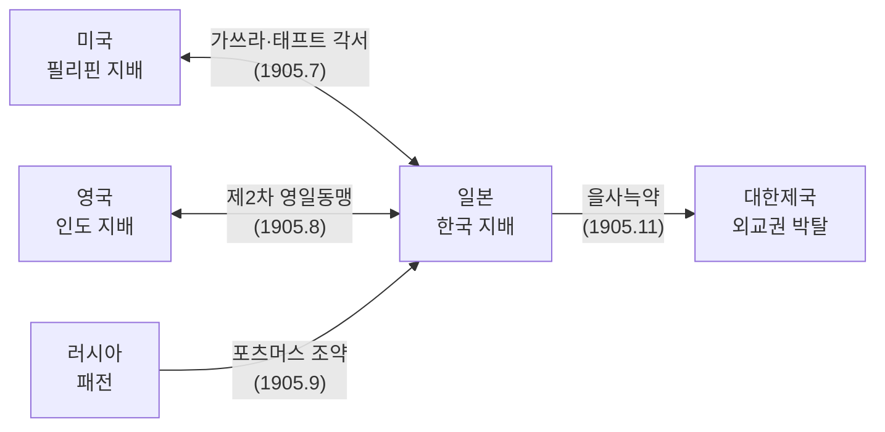

1905년 5월 27일 새벽, 쓰시마 해협. 일본 연합함대 사령장관 **도고 헤이하치로**의 기함 미카사에 신호기가 올랐다. "황국의 흥폐가 이 일전에 달렸다. 각원은 한층 분발 노력하라." 반년이 넘는 항해 끝에 지구를 반 바퀴 돌아온 러시아 발트 함대가 그 앞에 나타났다. 이틀 뒤, 러시아 함대는 거의 전멸했다. 아시아의 신흥국이 유럽의 대국을 이긴 이 해전은 세계를 놀라게 했다.

그러나 이 승리의 뒷면에는 또 다른 역사가 있었다. 일본이 러시아와 싸운 가장 큰 이유는 **한국(대한제국)과 만주를 둘러싼 이해**였고, 전쟁이 끝나자 일본은 곧바로 한국의 외교권을 빼앗았다. 5년 뒤인 1910년, 대한제국은 일본에 병합되어 사라졌다. 이 강의는 청일전쟁 뒤 '와신상담'의 10년에서 시작해, 러일전쟁과 포츠머스 조약, 한국 병합, 그리고 메이지 천황의 죽음(1912)까지를 다룬다. 일본근대사 전반부의 마지막 장이다.

> [!핵심] 이 강의의 질문
> 1. 일본은 왜, 어떻게 대국 러시아와 전쟁을 벌일 수 있었는가?
> 2. 러일전쟁의 승리는 일본 국민에게 무엇을 남겼는가?
> 3. 대한제국은 어떤 과정을 거쳐 일본에 병합되었고, 한국인은 어떻게 저항했는가?

```figure
src: asset:8e0c754e63801b1244bfa8129caca5cc
caption: 「일러 뤼순 대격전도」. 포연 속에서 일본군이 러시아군에 돌격하는 장면을 그린 세 폭 판화.
credit: 작자 미상, 1904년 · 레이크스 미술관 소장
license: Public Domain (레이크스 미술관)
source: https://www.rijksmuseum.nl/en/collection/RP-P-2010-310-71
width: wide
```

```timeline
1897.10 | 대한제국 선포 | 고종이 황제로 즉위, 국호를 대한제국으로
1898 | 러시아의 뤼순·다롄 조차 | 삼국간섭으로 일본이 돌려준 랴오둥반도를 러시아가 차지
1900 | 의화단 사건과 8개국 연합군 | 일본군이 연합군의 주력으로 참가. 러시아는 만주를 점령
1902.1 | 영일동맹 | 러시아를 견제하기 위한 영국과의 동맹
1904.2 | 러일전쟁 시작, 한일의정서 | 일본이 뤼순·인천을 기습하고 한국에 군사 기지 사용을 강요
1904.8 | 제1차 한일협약 | 일본이 추천한 재정·외교 고문을 한국 정부에 둠
1905.1 | 뤼순 함락 | 5개월의 포위 끝에 러시아 요새 항복
1905.3 | 펑톈 회전 | 러일전쟁 최대의 육상 전투
1905.5 | 쓰시마 해전(동해 해전) | 러시아 발트 함대 궤멸
1905.7 | 가쓰라·태프트 각서 | 미국의 필리핀 지배와 일본의 한국 지배를 서로 인정
1905.9 | 포츠머스 조약, 히비야 방화 사건 | 배상금 없는 강화에 분노한 도쿄 민중의 폭동
1905.11 | 을사늑약(제2차 한일협약) | 한국의 외교권 박탈, 통감부 설치
1907.6~8 | 헤이그 특사, 고종 퇴위, 군대 해산 | 한일신협약(정미7조약)으로 내정까지 장악
1909.10 | 안중근의 이토 히로부미 저격 | 하얼빈역
1910.8 | 한국 병합 | 대한제국 소멸, 조선총독부 설치
1911 | 관세자주권 회복 | 조약 개정 완료
1912.7 | 메이지 천황 사망 | 다이쇼 시대 시작
```

## 와신상담의 10년

### 러시아의 남하

9강에서 보았듯 삼국간섭으로 랴오둥반도를 돌려준 일본은 "와신상담"을 외치며 군비를 늘렸다. 그 사이 러시아는 동쪽으로 빠르게 뻗어 나갔다. 1896년 청과 비밀 동맹을 맺어 만주를 가로지르는 동청 철도의 부설권을 얻었고, 1898년에는 일본이 돌려준 바로 그 랴오둥반도의 뤼순과 다롄을 빌려 해군 기지를 세웠다. 독일은 자오저우만을, 영국은 웨이하이웨이와 주룽반도를, 프랑스는 광저우만을 조차했다. 청나라는 열강에게 조각조각 나뉘고 있었다.

조선에서는 1896년 고종이 러시아 공사관으로 거처를 옮긴 아관파천(9강) 뒤 러시아의 영향력이 커졌다. 1897년 경운궁(덕수궁)으로 돌아온 고종은 나라 이름을 **대한제국**으로 바꾸고 황제에 즉위해, 청과도 일본과도 대등한 자주국임을 선포했다. 대한제국은 광무개혁으로 근대화를 추진했지만, 일본과 러시아 사이에서 자주를 지키기에는 힘이 부족했다.

### 의화단 사건과 만주 점령

1899~1900년, 중국 화베이 지방에서 '부청멸양扶淸滅洋'(청을 도와 서양을 멸한다)을 외치는 의화단이 일어나 교회와 철도를 파괴하고 베이징의 외국 공사관 구역을 포위했다. 청 정부가 의화단 편에 서서 열강에 선전을 포고하자, 일본·러시아·영국·미국·프랑스·독일·이탈리아·오스트리아의 8개국이 연합군을 보내 베이징을 점령했다. 일본은 가까운 거리를 살려 연합군 가운데 가장 많은 병력을 보냈다. '극동의 헌병'으로서 열강의 일원이 된 것이다.

문제는 러시아였다. 러시아는 의화단 진압을 구실로 대군을 보내 만주 전역을 점령했고, 사건이 끝난 뒤에도 철수하지 않았다. 만주를 차지한 러시아가 다음에는 한국으로 내려올 것이라는 두려움이 일본을 사로잡았다.

### 영일동맹

일본 정부 안에서는 두 가지 길이 논의되었다. 이토 히로부미와 이노우에 가오루는 러시아와 협상해, 만주는 러시아가 한국은 일본이 차지하는 것으로 서로 인정하자고 했다(**만한 교환론**). 반면 총리 가쓰라 다로와 외무대신 고무라 주타로는 영국과 손잡아 러시아를 견제해야 한다고 주장했다. 영국도 러시아의 남하를 막을 동아시아의 파트너가 필요했다. 남아프리카에서 보어 전쟁을 치르느라 여력이 없었던 영국은 '영광스러운 고립'을 버리고 일본과 손잡았다.

1902년 1월 **영일동맹**이 맺어졌다. 영국은 청에서, 일본은 청과 한국에서 가진 이익을 서로 인정하고, 한쪽이 다른 나라와 전쟁을 하면 다른 한쪽은 중립을 지키며, 상대가 두 나라 이상이 되면 함께 싸우기로 했다. 러시아가 프랑스나 독일을 끌어들이는 것을 막는 장치였다. 세계 최강의 해군국과 동맹을 맺었다는 사실에 일본은 열광했다.

### 주전론과 비전론

러시아는 만주 철병 약속을 지키지 않았고, 압록강 하류 한국 땅에까지 진출했다. 1903년 일본과 러시아의 협상은 평행선을 달렸다. 도쿄 제국대학 교수 7명이 정부에 즉각 개전을 촉구하는 의견서를 내고, 신문들은 연일 전쟁을 부추겼다.

물론 반대 목소리도 있었다. 크리스트교인 **우치무라 간조**는 "전쟁은 사람을 죽이는 것이며, 사람을 죽이는 것은 큰 죄악"이라며 절대 평화를 주장했다. 사회주의자 **고토쿠 슈스이**와 **사카이 도시히코**는 『평민신문』을 창간해 전쟁에 반대했다. 그러나 이들의 목소리는 전쟁 열기에 묻혔다.

```figure
src: asset:9f2e1c95675d8bf5a69dd286eedb4c27
caption: 고바야시 기요치카의 풍자화 연작 『일본 만세 백전백소』 중 한 장. 털외투를 입고 거대하게 부풀어 오른 러시아인을 조롱하고 있다. 이런 풍자화가 전쟁 열기를 부추겼다.
credit: 고바야시 기요치카(小林清親), 1904~05년 · 메트로폴리탄 미술관 소장
license: Public Domain (메트로폴리탄 미술관 오픈 액세스)
source: https://www.metmuseum.org/art/collection/search/55196
width: narrow
```

## 러일전쟁

### 개전

1904년 2월 8일, 일본 해군은 뤼순항의 러시아 함대를 기습하고, 인천 앞바다에서 러시아 군함 두 척을 공격했다. 선전 포고는 이틀 뒤인 2월 10일이었다. 대한제국은 개전 직전 중립을 선언했지만, 일본군은 이를 무시하고 서울에 들어왔다. 2월 23일 일본은 **한일의정서**를 강요해 한국 땅을 군사적으로 쓸 권리를 얻었고, 8월에는 **제1차 한일협약**으로 일본이 추천한 재정 고문(메가타 다네타로)과 외교 고문(미국인 스티븐스)을 한국 정부에 두게 했다. 전쟁은 처음부터 한국을 손에 넣는 과정이기도 했다.

### 뤼순과 펑톈

```compare
시기 | 전장 | 내용
1904.2 | 뤼순·인천 | 일본 해군의 기습으로 개전
1904.5 | 압록강·랴오둥반도 | 일본 육군이 한국을 거쳐 만주로 진격
1904.8~9 | 랴오양 | 대규모 회전. 일본군이 승리했으나 러시아군 주력은 후퇴
1904.8~1905.1 | **뤼순 요새** | 노기 마레스케의 제3군이 5개월 동안 공격. 1904년 12월 203고지 점령, 1905년 1월 1일 러시아군 항복
1905.3 | **펑톈(묵덴)** | 양측 합쳐 60만 명 가까이 맞선 러일전쟁 최대의 회전. 일본군 승리, 그러나 추격할 힘이 남지 않음
1905.5.27~28 | **쓰시마 해협** | 도고 헤이하치로의 연합함대가 러시아 발트 함대를 궤멸
```

가장 처절한 싸움은 **뤼순 요새** 공방전이었다. 러시아가 콘크리트 보루와 기관총으로 무장한 언덕 위의 요새에 일본군은 거듭 정면 돌격을 감행했고, 그때마다 수천 명이 쓰러졌다. 뤼순 공략에서만 일본군 사상자가 6만 명 가까이 나왔다. 사령관 **노기 마레스케** 대장 자신도 두 아들을 이 전쟁에서 잃었다. 항구를 내려다보는 203고지를 빼앗은 뒤에야 일본군은 항구 안의 러시아 함대를 포격으로 가라앉힐 수 있었다.

```gallery
src: asset:1a43220cf4382ca6d73c7dadadb9743f
caption: 노기 마레스케(1849~1912). 뤼순 공략을 지휘한 제3군 사령관. 1912년 메이지 천황의 장례 날 아내와 함께 자결했다.
credit: 촬영자·연도 미상 · 국립국회도서관 「근대일본인의 초상」
license: Public Domain (국립국회도서관: 저작권 보호 기간 만료)
source: https://www.ndl.go.jp/portrait/datas/160/
---
src: asset:86959462f90d0e18a8369d2e14319269
caption: 뤼순 총공격 명령을 기다리며 언덕에 앉아 있는 일본군 예비 병력. 미국에서 팔린 입체 사진 카드다.
credit: 그리피스 앤드 그리피스(Griffith & Griffith) 간행 입체 사진, 1905년 · 미국 의회도서관 소장
license: Public Domain (미국 의회도서관: 출판 제한 없음)
source: https://www.loc.gov/item/2024631485/
```

1905년 3월의 **펑톈 회전**에서 일본군은 러시아군을 물리쳤지만, 이미 병력과 탄약, 장교가 바닥나 있었다. 반면 러시아는 시베리아 철도로 계속 증원군을 보낼 수 있었다. 일본에게는 더 이상 싸울 힘이 없었다.

### 쓰시마 해전

러시아는 전세를 뒤집기 위해 유럽의 발트 함대를 동아시아로 보냈다. 1904년 10월 발트해를 떠난 함대는 아프리카 남단을 돌아 7개월에 걸친 대항해 끝에 1905년 5월 쓰시마 해협에 이르렀다. 영일동맹 때문에 영국이 지배하는 항구에서 석탄 보급을 받지 못한 것도 함대를 지치게 했다.

```figure
src: asset:daf4697275a36ffa95d2c38995e4a2c5
caption: 도고 헤이하치로(1848~1934). 연합함대 사령장관으로 쓰시마 해전을 지휘했다.
credit: 촬영자·연도 미상 · 국립국회도서관 「근대일본인의 초상」
license: Public Domain (국립국회도서관: 저작권 보호 기간 만료)
source: https://www.ndl.go.jp/portrait/datas/141/
width: narrow
```

5월 27~28일의 **쓰시마 해전**(한국에서는 동해 해전이라고도 한다)에서 도고의 연합함대는 러시아 함대를 거의 전멸시켰다. 러시아 함선 38척 가운데 블라디보스토크에 도착한 것은 소형 함정 세 척뿐이었다. 일본의 손실은 어뢰정 세 척이었다. 이 해전에 앞서 일본은 1905년 2월, 대한제국의 영토인 독도를 '다케시마'라는 이름으로 시마네현에 편입한다고 일방적으로 고시했다. 해전에 필요한 망루를 세우려는 군사적 목적이 컸다. 한국은 이 편입이 국권 침탈 과정에서 이루어진 불법 조치라고 본다.

### 전쟁의 규모

러일전쟁은 청일전쟁과는 비교할 수 없는 규모의 전쟁이었다.

```chart
{
  "type": "bar",
  "caption": "청일전쟁과 러일전쟁의 비교 (일본 측, 대략적인 통설 수치). 러일전쟁의 전비는 청일전쟁의 약 8배, 동원 병력은 약 4.5배였다",
  "data": {
    "labels": ["전비 (억 엔)", "동원 병력 (만 명)", "사망자 (만 명)"],
    "datasets": [
      { "label": "청일전쟁 (1894~95)", "data": [2.0, 24, 1.3] },
      { "label": "러일전쟁 (1904~05)", "data": [17.2, 109, 8.4] }
    ]
  }
}
```

전비 약 17억 엔은 당시 한 해 국가 예산의 6~7배에 이르렀다. 정부는 증세와 국채로 이를 메웠는데, 그 가운데 약 7억 엔은 외국에서 빌린 돈이었다. 일본은행 부총재 **다카하시 고레키요**가 런던과 뉴욕을 돌며 외채를 모았고, 러시아 제국의 유대인 박해에 분노한 미국의 유대계 은행가 제이컵 시프가 큰 힘을 보탰다. 국민들은 무거운 세금과 전사 통지서를 견뎌야 했다. 시인 **요사노 아키코**는 뤼순 포위전에 나간 동생에게 "님이여, 죽지 마오"라는 시를 바쳐, 천황을 위해 죽으라는 시대의 요구에 정면으로 맞섰다.

## 포츠머스 조약과 히비야 방화 사건

### 루스벨트의 중재

1905년 1월 러시아에서는 '피의 일요일' 사건으로 혁명이 일어나, 러시아도 전쟁을 계속하기 어려웠다. 일본은 미국 대통령 **시어도어 루스벨트**에게 중재를 부탁했다. 강화 회의는 1905년 8월부터 미국 동부의 군항 포츠머스에서 열렸다. 일본 측 전권은 외무대신 **고무라 주타로**, 러시아 측은 전 재무장관 **비테**였다.

```figure
src: asset:77478ce5f99736a62bf47fd3e0c6b0a9
caption: 포츠머스 해군 조선소에서 열린 러일 강화 회의. 탁자 왼쪽에 일본 대표(사토, 다카히라, 고무라 등), 오른쪽에 러시아 대표(비테 등)가 앉아 있다. 회의를 취재한 기자가 보낸 사진엽서다.
credit: 촬영자 미상, 1905년 · 미국 의회도서관 소장
license: Public Domain (미국 의회도서관: 출판 제한 없음)
source: https://www.loc.gov/item/2005680017/
```

```gallery
src: asset:d7ae6a863739632c8d3f063010700288
caption: 포츠머스 강화 회의의 주역들을 담은 1905년 엽서. 가운데가 시어도어 루스벨트, 위쪽 두 사람이 러시아의 비테와 로젠, 아래쪽이 일본의 고무라와 다카히라다. '우리는 평화를 위해 싸우는 사람들'이라는 문구가 적혀 있다.
credit: 간행자 미상, 1905년 · 미국 의회도서관 소장
license: Public Domain (미국 의회도서관: 출판 제한 없음)
source: https://www.loc.gov/item/2005680008/
---
src: asset:a3768653ac697a7464aef66870af26ef
caption: 고무라 주타로(1855~1911). 외무대신으로 영일동맹과 포츠머스 조약, 한국 병합, 관세자주권 회복을 이끌었다.
credit: 촬영자·연도 미상 · 국립국회도서관 「근대일본인의 초상」
license: Public Domain (국립국회도서관: 저작권 보호 기간 만료)
source: https://www.ndl.go.jp/portrait/datas/83/
```

비테는 "러시아는 진 것이 아니다"라며 배상금과 영토 할양을 완강히 거부했다. 일본은 더 싸울 힘이 없다는 사실을 알고 있었다. 결국 일본은 배상금을 포기하고 사할린의 남쪽 절반만 받는 선에서 타협했다. 1905년 9월 5일 **포츠머스 조약**이 조인되었다.

| 조항 | 내용 |
|---|---|
| 한국 | 러시아는 일본이 한국에서 정치·군사·경제상의 우월한 이익을 가지며, 지도·보호·감리할 권리가 있음을 인정한다 |
| 랴오둥반도 | 뤼순·다롄의 조차권을 일본에 넘긴다 |
| 만주 철도 | 창춘 이남의 철도(뒤의 남만주 철도)와 그 부속 이권을 일본에 넘긴다 |
| 사할린 | 북위 50도 이남의 사할린을 일본에 할양한다 |
| 어업 | 연해주·캄차카 연안의 어업권을 일본에 준다 |
| 배상금 | **없음** |

표: 포츠머스 조약(1905)의 주요 내용

### 열강의 승인

포츠머스 조약에 앞서 일본은 한국 지배에 대한 열강의 승인을 차례로 받아 두었다. 1905년 7월 미국 육군장관 태프트와 총리 가쓰라 다로는 도쿄에서 비밀 각서를 교환해, 미국의 필리핀 지배와 일본의 한국 지배를 서로 인정했다(**가쓰라·태프트 각서**). 8월에는 영일동맹을 개정해(제2차 영일동맹) 영국이 일본의 한국 지배를 인정하는 대신, 일본은 영국의 인도 지배를 인정했다. 열강은 저마다의 식민지를 지키는 대가로 한국을 일본에 넘긴 것이다.



### 히비야 방화 사건

조약 내용이 알려지자 일본 국민은 분노했다. 국민들은 전쟁의 실상을 잘 몰랐다. 신문은 연전연승만 보도했고, 막대한 희생과 세금을 치른 만큼 거액의 배상금과 넓은 영토를 얻을 것이라 믿었다. 1905년 9월 5일, 조약 조인 날 도쿄 히비야 공원에서 열린 강화 반대 국민대회에 모인 군중은 폭도로 변해, 정부 지지 신문사와 내무대신 관저, 파출소 등을 불태웠다(**히비야 방화 사건**). 정부는 계엄령을 내리고 군대를 동원해 진압했다.

> [!핵심] 히비야 방화 사건의 의미
> 이 사건은 처음으로 도시의 민중이 거리에서 정치를 움직이려 한 사건이었다. 그러나 그들이 요구한 것은 평화가 아니라 **더 많은 전리품**이었다. 민중의 정치적 각성과 제국주의적 욕망이 한 몸에 담겨 있었던 것이다. 이후 도시 민중의 시위는 1910년대 '다이쇼 데모크라시'의 원동력이 된다.

### 아시아가 본 러일전쟁

유색 인종의 나라가 백인의 대국을 이겼다는 소식은 아시아 곳곳에 충격을 주었다. 중국의 쑨원은 훗날 이 승리가 아시아 민족의 독립에 큰 희망을 주었다고 회고했고, 베트남의 판보이쩌우는 젊은이들을 일본에 유학 보내는 동유東遊 운동을 시작했다. 인도의 소년 네루도 이 소식에 흥분했다고 훗날 적었다. 1905년 이후 수천 명의 중국 유학생이 도쿄로 몰려들었고, 쑨원은 1905년 도쿄에서 혁명 단체 중국동맹회를 결성했다.

그러나 그 희망은 곧 배신으로 바뀌었다. 판보이쩌우의 유학생들은 일본 정부가 프랑스와 협약을 맺으면서 1909년 추방되었고, 일본은 러시아를 대신해 만주의 권익을 차지했다. 그리고 가장 가까운 이웃 한국에 대해, 일본은 '아시아의 해방자'가 아니라 새로운 지배자로 나타났다.

## 대한제국의 국권 침탈

### 을사늑약과 통감부

포츠머스 조약 두 달 뒤인 1905년 11월, 특명전권대사 **이토 히로부미**가 서울에 왔다. 그는 일본군이 궁궐을 둘러싼 가운데 고종 황제와 대신들에게 한국의 외교권을 일본에 넘기는 조약을 강요했다. 고종은 끝까지 재가를 거부했고, 대신들 가운데서도 참정대신 한규설 등이 반대했다. 그러나 이토는 외부대신 박제순 등 다섯 대신(뒤에 '을사오적'이라 불렸다)의 찬성을 근거로 11월 17일 밤 조약이 성립되었다고 선언했다. 이것이 **을사늑약**(제2차 한일협약, 을사보호조약)이다. '늑약'은 강제로 맺은 조약이라는 뜻이다.

조약에 따라 한국은 외국과 조약을 맺을 권리를 잃었고, 서울에는 한국의 외교를 맡는 일본의 **통감부**가 설치되었다. 초대 통감은 이토 히로부미였다. 사실상 보호국이 된 것이다.

```figure
src: asset:4d5660bcfdc7f59bf323fd6f76f0494d
caption: 통감 시절 무렵의 이토 히로부미. 1905년 을사늑약을 강요하고 초대 통감이 되었으며, 1909년 하얼빈에서 안중근에게 저격당했다.
credit: 촬영자·연도 미상 · 국립국회도서관 「근대일본인의 초상」
license: Public Domain (국립국회도서관: 저작권 보호 기간 만료)
source: https://www.ndl.go.jp/portrait/datas/12/
width: narrow
```

> [!사료] 장지연, 「시일야방성대곡是日也放聲大哭」 (『황성신문』, 1905년 11월 20일, 일부)
> "아, 원통하고 분하도다. 우리 2천만 동포여, 노예가 된 동포여! 살았는가, 죽었는가? 단군·기자 이래 4천 년 국민 정신이 하룻밤 사이에 홀연 망하고 말 것인가. 원통하고 원통하도다. 동포여, 동포여!"
> — 을사늑약을 규탄한 논설의 일부를 오늘날의 말로 옮김

시종무관장 민영환은 자결로 항거했고, 전국에서 의병이 다시 일어났다. 고종은 조약이 무효라는 친서를 외국에 보내며 저항했다.

### 헤이그 특사와 군대 해산

```figure
src: asset:d30231084dbccda8cf1a5d86c57bf80b
caption: 군복 차림의 대한제국 황제 고종. 러일전쟁이 시작된 1904년의 사진이다. 고종은 을사늑약이 무효라며 끝까지 재가를 거부했고, 1907년 강제로 퇴위당했다.
credit: 촬영자 미상, 1904년 · 미국 의회도서관 소장
license: Public Domain (미국 의회도서관: 출판 제한 없음)
source: https://www.loc.gov/item/2003666654/
width: narrow
```

1907년 6월, 고종은 네덜란드 헤이그에서 열린 만국평화회의에 이준·이상설·이위종 세 특사를 몰래 보내 을사늑약의 부당함을 호소하게 했다. 그러나 일본과 영국 등의 방해로 특사들은 회의장에 들어가지도 못했고, 이준은 헤이그에서 세상을 떠났다.

일본은 이를 구실로 고종에게 황제 자리를 내놓으라고 압박해, 7월 고종을 강제로 퇴위시키고 순종을 즉위시켰다. 곧이어 **한일신협약**(정미7조약)을 맺어 통감이 한국의 내정까지 지휘하고, 각 부의 차관에 일본인을 임명하게 했다. 8월에는 대한제국 군대를 해산했다. 해산에 반대한 시위대 대대장 박승환이 자결하자, 군인들이 일본군과 시가전을 벌였고, 흩어진 군인들은 지방의 의병에 합류했다.

| 연도 | 조약·조치 | 빼앗긴 것 |
|---|---|---|
| 1904.2 | 한일의정서 | 군사 요지 사용권 |
| 1904.8 | 제1차 한일협약 | 재정·외교에 일본 추천 고문 (고문 정치) |
| 1905.11 | 을사늑약 (제2차 한일협약) | **외교권**, 통감부 설치 |
| 1907.7 | 한일신협약 (정미7조약) | **내정권**, 일본인 차관 임명 (차관 정치) |
| 1907.8 | 군대 해산 | **군대** |
| 1909.7 | 기유각서 | **사법권·감옥 사무** |
| 1910.6 | 경찰권 위탁 | **경찰권** |
| 1910.8 | 한국 병합 조약 | **국권 전체** |

표: 대한제국의 국권이 빼앗긴 과정

### 의병 전쟁과 애국 계몽 운동

해산된 군인들이 합류하면서 의병 투쟁은 전국적인 전쟁으로 커졌다(정미의병). 1907년 말에는 각지의 의병이 연합해 **13도 창의군**을 만들고 서울 진공 작전을 펼쳤지만 실패했다. 일본군은 1909년 전라도 일대에서 대규모 '남한 대토벌 작전'을 벌여 의병을 무자비하게 진압했다. 일본 측 기록만으로도 1907~1910년 사이 1만 7,000명이 넘는 의병이 목숨을 잃었다. 살아남은 의병의 상당수는 만주와 연해주로 건너가 독립군의 뿌리가 되었다.

한편 국내에서는 교육과 산업을 일으켜 실력을 기르자는 **애국 계몽 운동**이 일어났다. 신민회(1907)는 학교를 세우고 회사를 만들었으며, 국채 보상 운동(1907)은 일본에 진 나랏빚을 국민의 성금으로 갚자는 운동으로 전국에 퍼졌다.

### 안중근의 하얼빈 의거

1909년 10월 26일, 만주 하얼빈역. 러시아 재무장관과 회담하러 온 **이토 히로부미**가 열차에서 내려 러시아 의장대를 사열하는 순간, 군중 속에서 한 청년이 권총을 쏘았다. 이토는 그 자리에서 숨졌다. 청년은 "코레아 우라(대한 만세)"를 외치며 붙잡혔다. 그는 연해주에서 의병 활동을 하던 **안중근**이었다.

뤼순의 일본 법정에서 안중근은 자신이 대한의군 참모중장으로서 적장을 처단한 것이라며 이토의 죄 15가지를 들었다. 그 첫째가 명성황후를 시해한 죄였다. 그는 옥중에서 한·중·일 세 나라가 대등하게 협력해 서양 제국주의에 맞서자는 『동양평화론』을 쓰다가, 1910년 3월 26일 처형되었다. 그를 지켜본 일본인 간수와 검찰관 가운데에는 그의 인품에 감복해 글씨를 받아 간 사람도 있었다고 전한다.

### 한국 병합

이토의 죽음은 오히려 일본의 병합 계획을 앞당겼다. 1910년 육군대신 **데라우치 마사타케**가 통감을 겸해 서울에 부임해, 헌병 경찰을 동원해 한국인의 저항을 누르고 신문을 폐간시켰다. 1910년 8월 22일, 총리대신 이완용과 데라우치 사이에 **한국 병합 조약**이 조인되었고, 8월 29일 공포되었다. 한국 사람들은 이날을 **경술국치庚戌國恥**라 부른다.

대한제국은 사라지고, 한반도는 '조선'이라는 이름의 일본 식민지가 되었다. 서울에는 조선총독부가 설치되었고, 데라우치가 초대 총독이 되었다. 총독은 현역 육해군 대장 가운데서 임명되어 천황에게 직속하며, 입법·행정·사법·군사의 권한을 한 손에 쥐었다. 헌병이 경찰을 맡는 무단 통치가 시작되었고, 1910년부터 시작된 토지 조사 사업으로 많은 땅이 총독부와 일본인 지주에게 넘어갔다. 그 뒤 35년에 걸친 식민 지배의 역사는 이 강좌의 뒷부분에서 다시 다룬다.

## 메이지의 끝

### 산업 혁명과 그 그늘

러일전쟁 무렵 일본은 산업 혁명을 이루고 있었다. 1890년대 방적업이 크게 발전해 1897년에는 면사 수출이 수입을 넘어섰다. 청일전쟁 배상금으로 세운 관영 야하타 제철소는 1901년 조업을 시작했고, 1906년에는 주요 사철을 국유화했다(철도 국유법). 전쟁으로 얻은 남만주 철도는 1906년 설립된 **남만주 철도 주식회사**(만철)가 경영하며 만주 진출의 거점이 되었다.

그러나 그늘도 깊었다. 방적 공장의 어린 여공들은 하루 12시간이 넘는 노동과 결핵에 시달렸다. 도치기현 아시오 구리 광산에서 흘러나온 독은 와타라세강 유역의 논밭을 망쳤고, 중의원 의원 **다나카 쇼조**는 의원직을 버리고 1901년 천황에게 직소하려 할 만큼 피해 농민 편에 섰다(아시오 광독 사건). 최초의 노동 보호법인 공장법은 1911년에야 만들어졌다.

### 대역 사건

전쟁 뒤 사회주의 운동이 커지자 정부는 강하게 탄압했다. 1910년, 천황 암살을 계획했다는 혐의로 고토쿠 슈스이 등 사회주의자·무정부주의자 수백 명이 검거되었다. 실제로 계획에 관여한 사람은 몇 명뿐이었지만, 이듬해 1월 비공개 재판 끝에 고토쿠를 포함한 12명이 처형되었다(**대역 사건**). 이후 사회주의 운동은 한동안 '겨울의 시대'를 맞는다. 이 해는 한국 병합의 해이기도 했다. 밖으로는 제국을 넓히고, 안으로는 비판의 목소리를 누르는 일이 같은 해에 일어난 것이다.

### 조약 개정의 완성

1911년 외무대신 고무라 주타로는 미국과 새 통상항해조약을 맺어 **관세자주권**을 완전히 되찾았다. 1858년 미일수호통상조약 이래 53년, 일본은 마침내 서양 열강과 대등한 조약을 갖게 되었다. 같은 해 중국에서는 신해혁명이 일어나 이듬해 청나라가 무너졌다.

### 메이지 천황의 죽음

1912년 7월 30일, 메이지 천황이 59세로 세상을 떠났다. 열네 살에 즉위해 45년 동안 재위한 그의 시대에, 일본은 쇄국의 막번 국가에서 헌법과 의회, 식민지를 가진 제국으로 바뀌었다. 9월 13일 장례 행렬이 황거를 떠나는 시각을 알리는 포성이 울리자, 러일전쟁의 노기 마레스케 대장이 아내와 함께 자결했다. 천황의 뒤를 따르는 '순사殉死'였다.

```figure
src: asset:5bc22fd181f1a15b1500192e1fbeef49
caption: 1912년 9월 도쿄에서 치러진 메이지 천황의 장례 행렬. 길가에 군중과 등롱이 늘어서 있다.
credit: 베인 통신사(Bain News Service), 1912년 · 미국 의회도서관 소장
license: Public Domain (미국 의회도서관: 출판 제한 없음)
source: https://www.loc.gov/item/2014691631/
width: wide
```

노기의 순사는 한 시대의 끝을 상징하는 사건으로 받아들여졌다. 작가 나쓰메 소세키는 소설 『마음』(1914)에서 주인공이 "메이지의 정신이 천황과 함께 끝났다"고 느끼는 장면을 그렸다. 그러나 메이지가 남긴 것, 곧 천황 중심의 국가 체제와 군부의 독립, 식민지 제국과 대외 팽창의 길은 끝나지 않았다. 그것들은 다이쇼와 쇼와 시대로 이어지며, 결국 1945년의 패전으로 귀결된다.

## 정리

> [!핵심] 10강 요약
> - 삼국간섭 뒤 러시아는 뤼순·다롄을 조차하고 **의화단 사건**(1900) 뒤 만주를 점령했다. 일본은 **영일동맹**(1902)을 맺어 러시아에 맞섰다.
> - **러일전쟁**(1904~05)에서 일본은 뤼순·펑톈·**쓰시마 해전**에서 이겼지만, 국력을 모두 쏟아부어 더 싸울 힘이 없었다. **포츠머스 조약**에는 배상금이 없었고, 이에 분노한 민중이 **히비야 방화 사건**을 일으켰다.
> - 일본은 가쓰라·태프트 각서와 제2차 영일동맹으로 열강의 승인을 얻은 뒤, **을사늑약**(1905)으로 대한제국의 외교권을 빼앗고 통감부를 설치했다. 헤이그 특사, 고종 퇴위, 군대 해산을 거쳐 1910년 **한국을 병합**했다.
> - 한국인은 **의병 전쟁**과 **애국 계몽 운동**으로 저항했고, **안중근**은 1909년 하얼빈에서 이토 히로부미를 저격했다.
> - 1911년 관세자주권 회복으로 조약 개정이 완성되었고, 1912년 **메이지 천황**이 세상을 떠나며 한 시대가 끝났다.

### 생각해 볼 질문

1. 러일전쟁은 흔히 '아시아가 유럽을 이긴 전쟁'으로 기억된다. 그러나 같은 시기 한국인에게 이 전쟁은 무엇이었을까? 두 관점을 비교해 보자.
2. 히비야 방화 사건에 나선 민중은 무엇을 요구했는가? 그것은 민주주의의 성장일까, 제국주의의 대중화일까?
3. 1853년 흑선이 온 뒤 1911년 관세자주권을 되찾기까지, 일본은 불평등조약을 강요당하는 나라에서 다른 나라에 강요하는 나라가 되었다. 1~10강을 돌아보며 그 전환점이 어디였는지 생각해 보자.

### 다음 강 예고

11강부터는 강좌의 후반부로, 다이쇼 시대를 다룬다. 제1차 세계대전과 21개조 요구, 쌀 소동과 하라 다카시의 정당 내각, 다이쇼 데모크라시와 보통선거, 그리고 3·1 운동과 식민지 지배 정책의 변화를 살펴본다.
