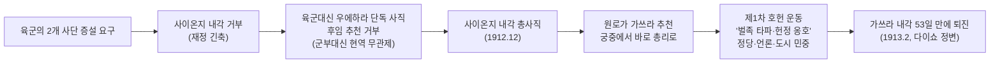

1913년 2월 10일, 도쿄 히비야의 제국의회 의사당은 수만 명의 군중에게 둘러싸여 있었다. 그들은 가슴에 흰 장미를 단 야당 의원들을 환호로 맞으며 "벌족 타도!", "헌정 옹호!"를 외쳤다. 그보다 닷새 앞서 의사당에서는 의원 오자키 유키오가 총리 가쓰라 다로를 향해 "그들은 옥좌를 방패로 삼고 조칙을 총알로 삼아 정적을 쓰러뜨리려 한다"고 탄핵 연설을 했다. 이튿날 가쓰라 내각은 총사직했다. 출범한 지 53일 만이었다. 민중의 힘이 내각을 무너뜨린 것은 일본 역사상 처음이었다. 이 사건을 **다이쇼 정변**이라 한다.

메이지 천황이 죽고 다이쇼 시대가 열린 지 반년. 이 강의는 다이쇼 정변에서 시작해, 일본이 유럽의 대전을 '하늘이 준 기회(천우)'로 삼아 중국에 21개조를 요구하고, 전쟁 경기로 공업국으로 뛰어오르는 과정을 따라간다. 그리고 그 번영의 끝에서 1918년 여름 전국을 휩쓴 **쌀 소동**이 터지며, 일본 정치는 새로운 시대, 곧 정당 내각의 시대로 넘어간다.

> [!핵심] 이 강의의 질문
> 1. 다이쇼 정변은 왜 일어났고, 메이지 시대의 정치와 무엇이 달랐는가?
> 2. 일본은 제1차 세계대전에서 무엇을 얻었고, 그것은 중국과의 관계를 어떻게 바꾸었는가?
> 3. 대전 경기는 일본 사회를 어떻게 바꾸었으며, 쌀 소동은 왜 일어났는가?

```figure
src: asset:3b2022c7d121eae6f989c4e4b7d10e14
caption: 군복 차림으로 마차를 탄 다이쇼 천황(1879~1926). 1912년 즉위했지만 병약해 1921년부터는 황태자 히로히토(뒤의 쇼와 천황)가 섭정을 맡았다.
credit: 베인 통신사(Bain News Service), 1915년 무렵 · 미국 의회도서관 소장
license: Public Domain (미국 의회도서관: 출판 제한 없음)
source: https://www.loc.gov/item/2014703917/
```

```timeline
1912.7 | 메이지 천황 사망, 다이쇼 시대 시작 | 다이쇼 천황 즉위
1912.12 | 제2차 사이온지 내각 붕괴 | 육군 2개 사단 증설 거부에 육군대신이 단독 사직
1912.12 | 제3차 가쓰라 내각 출범 | 제1차 호헌 운동 시작
1913.2 | 다이쇼 정변 | 민중 시위 속에 가쓰라 내각 53일 만에 총사직
1914.1 | 지멘스 사건 | 해군 고관의 독일 회사 뇌물 사건으로 야마모토 내각 붕괴
1914.7 | 제1차 세계대전 발발 | 
1914.8 | 일본, 독일에 선전 포고 | 영일동맹을 명분으로 참전
1914.10~11 | 남양 군도·칭다오 점령 | 독일의 태평양 섬들과 산둥반도 거점을 차지
1915.1 | 21개조 요구 | 중국 위안스카이 정부에 산둥·만주 등의 권익 요구
1915.5 | 21개조 요구 수락 | 최후통첩으로 수락시킴. 중국은 5월 9일을 '국치일'로
1917 | 니시하라 차관, 이시이·랜싱 협정 | 돤치루이 정권에 거액 차관. 미국이 중국에서 일본의 '특수 이익' 인정
1917.11 | 러시아 10월 혁명 | 
1918.8 | 시베리아 출병 | 연합국의 공동 출병에 일본은 최대 7만여 명 파병
1918.7~9 | 쌀 소동 | 도야마의 어촌에서 시작해 전국으로 번진 민중 봉기
1918.9 | 하라 다카시 내각 | 첫 본격 정당 내각(12강)
```

## 메이지에서 다이쇼로

### 원로와 번벌의 그늘

메이지 천황이 세상을 떠났을 때 일본의 실권은 여전히 몇몇 노정치가의 손에 있었다. 야마가타 아리토모, 이노우에 가오루, 마쓰카타 마사요시, 오야마 이와오 같은 **원로**(元老)들이었다. 원로는 헌법에 없는 지위였지만, 천황의 자문에 응해 다음 총리를 추천하는 실질적인 권한을 쥐고 있었다. 1909년 이토 히로부미가 죽은 뒤 원로 가운데 가장 큰 영향력을 가진 것은 육군과 관료 조직을 장악한 야마가타였다.

1901년부터 1913년까지 총리 자리는 야마가타의 후계자인 육군 출신 **가쓰라 다로**와, 이토가 만든 정당 입헌정우회의 총재 **사이온지 긴모치**가 번갈아 맡았다. 이 시기를 '게이엔 시대'(가쓰라의 '桂'와 사이온지의 '園'에서 한 글자씩)라 부른다. 번벌과 정당이 손을 잡고 권력을 나누는 체제였다.

```figure
src: asset:94b4dec611fa65a6c95d58bac04f2e45
caption: 가쓰라 다로(1848~1913). 세 차례 총리를 지낸 육군 출신 정치가. 다이쇼 정변으로 물러난 뒤 그해 가을 세상을 떠났다.
credit: 촬영자·연도 미상 · 국립국회도서관 「근대일본인의 초상」
license: Public Domain (국립국회도서관: 저작권 보호 기간 만료)
source: https://www.ndl.go.jp/portrait/datas/52/
width: narrow
```

새 천황 다이쇼(요시히토)는 어릴 때 앓은 뇌막염의 후유증으로 몸이 약했다. 정치에 대한 관심도 크지 않았다. 강력한 카리스마의 메이지 천황 시대가 끝나자, 천황의 권위를 빌려 정치를 움직이던 원로와 번벌의 힘도 흔들리기 시작했다.

### 2개 사단 증설 문제

위기의 발단은 군비였다. 러일전쟁 뒤 육군은 러시아의 복수전에 대비하고 새로 얻은 식민지 조선을 지키기 위해 2개 사단을 늘려 달라고 요구했다. 그러나 러일전쟁의 막대한 전비로 정부 재정은 바닥나 있었고, 해군도 미국을 가상 적으로 삼아 대함대 건설을 요구하고 있었다. 1912년 사이온지 내각은 재정 긴축을 이유로 사단 증설을 거부했다.

그러자 육군대신 우에하라 유사쿠가 천황에게 직접 사표를 내고 물러났다. 1900년 야마가타가 만든 **군부대신 현역 무관제**에 따라 육·해군 대신은 현역 대장·중장만 맡을 수 있었는데, 육군이 후임 대신을 추천하지 않자 사이온지 내각은 각료를 채우지 못해 총사직할 수밖에 없었다. 군대가 대신 자리를 비워 두는 것만으로 내각을 쓰러뜨릴 수 있다는 사실이 처음으로 드러난 것이다.

### 제1차 호헌 운동

원로들은 후임 총리로 다시 가쓰라를 추천했다. 가쓰라는 마침 천황의 측근인 내대신 겸 시종장으로 궁중에 들어가 있었는데, 그가 궁중에서 나와 곧바로 총리가 되자 "궁중과 정치의 구별을 어지럽혔다"는 비난이 쏟아졌다. 게다가 가쓰라는 해군이 대신을 내주지 않자 천황의 조칙을 받아 해군을 굴복시켰다. 천황의 이름을 빌려 반대를 누르는 것이었다.

정우회의 오자키 유키오, 입헌국민당의 이누카이 쓰요시가 앞장서 **"벌족 타파, 헌정 옹호"** 를 내건 **제1차 호헌 운동**이 일어났다. 도시의 신문 기자, 변호사, 상공업자, 학생들이 전국 각지에서 대회를 열었다. 가쓰라는 스스로 새 정당(입헌동지회)을 만들어 맞서려 했지만, 1913년 2월 의사당을 포위한 군중 앞에서 끝내 무너졌다. 분노한 군중은 정부 편 신문사와 파출소를 불태웠다.

```figure
src: asset:3b55d5a27a6b5730ccd035a65d183695
caption: 오자키 유키오(1858~1954). 제1차 호헌 운동을 이끌어 '헌정의 신'이라 불렸다. 1890년 첫 총선부터 60년 넘게 중의원 의원을 지냈다.
credit: 베인 통신사, 1915년 무렵 · 미국 의회도서관 소장
license: Public Domain (미국 의회도서관: 출판 제한 없음)
source: https://www.loc.gov/item/2014704049/
width: narrow
```

> [!핵심] 다이쇼 정변의 의미
> - 원로가 추천한 총리를 **의회와 도시 민중의 압력**이 물러나게 했다. 메이지 시대에는 없던 일이었다.
> - 이후 원로들도 의회의 다수 세력을 무시하고 총리를 고르기 어려워졌다. 정당 정치로 가는 길이 열린 것이다.
> - 동시에 이 사건은 **군부가 대신을 내주지 않는 방식으로 내각을 쓰러뜨릴 수 있다**는 위험도 보여 주었다. 다음 내각(야마모토 곤노효에)은 군부대신 자격을 예비역까지 넓혔지만, 이 제한은 1936년 다시 현역으로 되돌아간다(15강).

1914년에는 해군 고관들이 독일 지멘스사와 영국 비커스사에서 군함 주문의 대가로 뇌물을 받은 **지멘스 사건**이 터져, 해군 출신의 야마모토 내각도 민중의 항의 속에 물러났다. 원로들은 민중에게 인기 있는 노정치가 **오쿠마 시게노부**를 다시 총리로 불러냈다. 오쿠마는 76세였다.

## 제1차 세계대전과 일본



### '하늘이 준 기회'

1914년 7월 유럽에서 제1차 세계대전이 터지자, 원로 이노우에 가오루는 "다이쇼 신시대의 천우"(天佑)라고 말했다. 유럽 열강이 서로 싸우느라 아시아를 돌볼 여유가 없는 지금이야말로 일본이 중국에서 세력을 넓힐 기회라는 뜻이었다. 오쿠마 내각의 외무대신 가토 다카아키는 영국의 요청이 소극적이었음에도 **영일동맹**을 명분으로 1914년 8월 23일 독일에 선전을 포고했다.

일본군은 10월 적도 이북의 독일령 남양 군도(마리아나·캐롤라인·마셜 제도)를 점령하고, 11월에는 영국군과 함께 독일의 동아시아 거점인 산둥반도의 **칭다오**를 함락했다. 일본군의 피해는 크지 않았다. 일본 해군은 이후 지중해에 구축함 부대를 보내 연합국의 수송선을 호위하기도 했다.

```figure
src: asset:69536acaaf725ac86f009cf103a4b215
caption: 「만세 만세, 칭다오 함락」. 1914년 11월 독일의 산둥 거점 칭다오를 함락한 일본군을 축하하는 판화. 욱일기를 든 병사들이 포연 속에서 요새로 돌격하고 있다.
credit: 작자 미상, 1914년 · 미국 의회도서관 소장
license: Public Domain (미국 의회도서관: 출판 제한 없음)
source: https://www.loc.gov/item/2016651588/
width: wide
```

### 21개조 요구

칭다오를 손에 넣은 일본은 곧바로 중국에 손을 뻗었다. 1915년 1월, 일본 공사는 중화민국 대총통 **위안스카이**에게 다섯 부분, 21개 조항으로 이루어진 요구서를 들이밀었다.

| 호 | 주요 내용 |
|---|---|
| 제1호 | 독일이 산둥성에서 가졌던 권익을 일본이 물려받는 것을 인정할 것 |
| 제2호 | 뤼순·다롄 조차 기한과 남만주 철도 경영권을 99년으로 연장하고, 남만주·동부 내몽골에서 일본인의 토지 소유·거주·영업을 허용할 것 |
| 제3호 | 중국 최대의 제철 회사인 한야핑 공사를 중일 합작으로 할 것 |
| 제4호 | 중국 연안의 항만과 섬을 다른 나라에 넘기거나 빌려주지 말 것 |
| 제5호 (희망 조항) | 중국 정부에 일본인 정치·재정·군사 고문을 둘 것, 일부 지역의 경찰을 중일 합동으로 할 것, 일본산 무기를 사용할 것 등 |

표: 21개조 요구(1915)의 내용

특히 제5호는 중국을 사실상 일본의 보호국으로 만들려는 내용이었다. 일본은 이를 비밀에 부치려 했지만, 중국 측이 내용을 흘리면서 미국과 영국도 강한 우려를 나타냈다. 일본은 제5호를 뺀 뒤, 1915년 5월 7일 최후통첩을 보내 이틀 안에 수락하라고 압박했다. 위안스카이 정부는 5월 9일 이를 받아들였다.

중국 사람들은 이날을 **국치기념일**로 정했다. 일본 상품을 사지 않는 배일 운동이 중국 전역에 퍼졌다. 21개조 요구는 중국 민족주의가 일본을 '최대의 적'으로 보게 만든 결정적 사건이었고, 1919년의 5·4 운동(13강)으로 이어진다. 일본 국내에서도 원로 야마가타는 이 외교가 중국의 반감만 샀다며 가토 외무대신을 비판했다.

```figure
src: asset:355cd561e5309ba030bd55a93b8c244e
caption: 21개조 요구 당시의 총리 오쿠마 시게노부. 1914년 76세의 나이로 다시 총리가 되어 대전 참전을 결정했다.
credit: 촬영자·연도 미상 · 국립국회도서관 「근대일본인의 초상」
license: Public Domain (국립국회도서관: 저작권 보호 기간 만료)
source: https://www.ndl.go.jp/portrait/datas/33/
width: narrow
```

### 중국 정책의 전환과 미국

1916년 위안스카이가 죽은 뒤 중국은 각지의 군벌이 다투는 혼란에 빠졌다. 오쿠마의 뒤를 이은 데라우치 마사타케 내각(1916~18)은 노골적인 무력 압박 대신 돈으로 영향력을 넓히려 했다. 베이징의 군벌 정권인 돤치루이 정부에 1억 4,500만 엔에 이르는 차관을 빌려준 것이다. 중개자였던 니시하라 가메조의 이름을 따 **니시하라 차관**이라 부른다. 그러나 이 돈은 대부분 돌려받지 못했다.

미국은 일본의 중국 진출을 경계했다. 1917년 미국이 대전에 참전하자, 두 나라는 **이시이·랜싱 협정**을 맺어 미국은 중국에서 일본이 '특수한 이익'을 가진다는 것을 인정하고, 일본은 중국의 영토 보전과 문호 개방 원칙을 존중하기로 했다. 서로 다른 해석의 여지를 남긴 타협이었다. 이 협정은 1923년 워싱턴 체제 속에서 폐기된다(14강).

### 대전 속의 일본 사회

전쟁은 일본인의 생활에도 스며들었다. 칭다오 전투에서 붙잡힌 독일군 포로 약 4,700명은 일본 각지의 포로수용소에 수용되었다. 도쿠시마현의 반도 수용소에서는 소장이 포로들을 인도적으로 대우해, 포로들이 지역 주민과 교류하며 빵과 소시지 만드는 법, 음악을 가르쳤다. 1918년 6월 반도 수용소의 포로 오케스트라는 일본에서 처음으로 베토벤의 교향곡 9번 '합창'을 전곡 연주했다. 일본에서 연말마다 '제9'를 연주하는 전통의 먼 뿌리로 이야기되는 일이다.

전쟁은 또 일본이 '세계'를 실감하게 했다. 신문은 유럽 전선의 소식을 날마다 전했고, 비행기와 전차, 독가스 같은 새 무기가 등장한 총력전의 모습은 일본 육군에 깊은 인상을 남겼다. 육군의 젊은 장교들은 앞으로의 전쟁은 군대만이 아니라 국민과 산업 전체가 싸우는 '총력전'이 될 것이라 보고, 평소부터 국가 전체를 전쟁에 대비시켜야 한다고 생각하기 시작했다. 이 생각은 1930년대 군부가 추진하는 총력전 체제(15강)로 이어진다.

## 대전 경기: 채무국에서 채권국으로

### 전쟁이 만든 번영

전쟁은 일본 경제에 엄청난 호황을 가져왔다. 유럽의 공장이 전쟁 물자를 만드느라 아시아 시장에서 물러나자, 그 빈자리를 일본 상품이 메웠다. 면직물은 중국과 동남아시아로, 생사는 전쟁 특수를 누리던 미국으로 날개 돋친 듯 팔렸다. 연합국은 일본에 군수품을 주문했다. 세계적인 배 부족으로 운임이 폭등하면서 해운업과 조선업은 사상 최대의 호황을 맞았다. 일본은 영국, 미국에 이어 세계 3위의 해운국이 되었다.

```figure
src: asset:35d51fb9d7a79a144f3ea95b964b55ff
caption: 도쿄의 조선소에서 진수식을 맞은 구축함. 제1차 세계대전기 세계적인 배 부족으로 일본 조선업은 크게 성장했고, 1920년대에는 군함 건조로 이어졌다. 사진은 1926년의 것이다.
credit: 베인 통신사, 1926년 · 미국 의회도서관 소장
license: Public Domain (미국 의회도서관: 출판 제한 없음)
source: https://www.loc.gov/item/2014711149/
```

```chart
{
  "type": "bar",
  "caption": "제1차 세계대전 전후 일본의 대외 채권·채무 (단위: 억 엔, 대략적인 통설 수치). 1914년에는 약 11억 엔의 순채무국이었지만, 1920년에는 약 27억 엔의 순채권국이 되었다",
  "height": 280,
  "data": {
    "labels": ["1914년", "1920년"],
    "datasets": [{ "label": "순 대외 채권(+) / 채무(−) (억 엔)", "data": [-11, 27] }]
  },
  "options": { "plugins": { "legend": { "display": false } } }
}
```

러일전쟁 이후 외채에 시달리던 일본은 불과 몇 년 사이에 **채무국에서 채권국**으로 바뀌었다. 무역은 흑자로 돌아섰고, 공업은 눈부시게 성장했다. 1919년에는 공업 생산액이 처음으로 농업 생산액을 넘어섰다. 유럽에서 화학 제품과 기계를 수입할 수 없게 되자 염료·약품·비료 같은 화학 공업과 기계 공업도 국내에서 자라났다. 수력 발전이 늘어 도시와 공장에 전기가 들어갔다.

### 나리킨과 그 그늘

전쟁 경기는 하룻밤 사이에 큰돈을 번 벼락부자를 낳았다. 사람들은 이들을 장기의 졸이 적진에 들어가 금장으로 바뀌는 것에 빗대어 **나리킨**(成金)이라 불렀다. 배를 사들여 거부가 된 '선박 나리킨'이 대표적이었다. 어둑한 요정에서 신발을 찾지 못하는 손님에게 지폐에 불을 붙여 비춰 주었다는 나리킨의 이야기는 당시를 풍자하는 그림으로 유명하다.

그러나 번영의 열매는 고르게 돌아가지 않았다. 물가는 1914년부터 1918년 사이에 두 배 가까이 올랐는데, 노동자의 임금은 그만큼 오르지 않았다. 공장 노동자의 수는 크게 늘었지만, 그들의 실질 생활은 오히려 나빠졌다. 1917~18년에는 임금 인상을 요구하는 파업이 크게 늘었다. 무엇보다 사람들의 생활을 짓누른 것은 **쌀값**이었다.

## 시베리아 출병

1917년 러시아에서 혁명이 일어나 소비에트 정권이 들어서고 독일과 단독 강화를 맺자, 연합국은 혁명의 확산을 막고 러시아에 남은 연합국 물자와 체코 군단을 구출한다는 명분으로 시베리아에 군대를 보냈다. 미국은 일본에 각각 7,000명씩 보내자고 제안했다. 그러나 데라우치 내각은 1918년 8월 출병을 결정한 뒤 병력을 계속 늘려, 한때 7만 명이 넘는 군대를 보냈다. 시베리아와 북만주에 일본의 세력권을 만들려는 속셈이었다.

```gallery
src: asset:1a6a8b392a465869d6799639ed239293
caption: 연합국 국기 아래 블라디보스토크에 상륙하는 일본군을 그린 판화. '모든 나라의 환영을 받았다'는 제목이 붙어 있다. 실제로 일본은 연합국 가운데 가장 많은 병력을 보내 가장 오래 머물렀다.
credit: 작자 미상, 1919년 · 미국 의회도서관 소장
license: Public Domain (미국 의회도서관: 출판 제한 없음)
source: https://www.loc.gov/item/2005680022/
---
src: asset:4db1ed92b661da61ffe74ac3b95524b0
caption: 시베리아 출병군 사령관 오타니 기쿠조 대장과 참모들.
credit: 베인 통신사, 1918년 · 미국 의회도서관 소장
license: Public Domain (미국 의회도서관: 출판 제한 없음)
source: https://www.loc.gov/item/2014708709/
```

다른 연합국들은 1920년까지 모두 철수했지만, 일본군은 남아서 혁명군(빨치산)과 싸웠다. 1920년 아무르강 하구의 니콜라옙스크에서 빨치산이 일본군 수비대와 주민 수백 명을 살해하는 사건(니콜라옙스크 사건)이 일어나자, 일본은 이를 구실로 북사할린을 점령하기도 했다. 일본군은 1922년에야 시베리아에서, 1925년에야 북사할린에서 철수했다. 4년여 동안 약 10억 엔의 전비와 3,000명이 넘는 전사자를 냈지만 얻은 것은 없었다. 국내외의 불신만 남긴 '실패한 출병'이었다.

## 1918년 여름, 쌀 소동

### 쌀값 폭등

쌀값은 1917년부터 오르기 시작해 1918년에는 폭등했다. 전쟁 경기로 도시 인구가 늘어 쌀 소비가 늘었는데, 생산은 따라가지 못했다. 여기에 시베리아 출병 소식이 전해지자 군량미 수요를 노린 상인과 지주들이 쌀을 사재기했다. 도쿄의 쌀값은 1918년 1월 한 되에 약 20전이던 것이 8월 초에는 50전을 넘었다. 노동자 하루 품삯의 상당 부분이 쌀 한 되 값으로 사라졌다.

```chart
{
  "type": "line",
  "caption": "쌀 소동 전후 도쿄의 쌀값 (1석당 엔, 대략적인 수치). 1918년 여름 쌀값은 1년 반 만에 두 배 이상으로 뛰었다",
  "data": {
    "labels": ["1916.1", "1917.1", "1917.7", "1918.1", "1918.4", "1918.7", "1918.8"],
    "datasets": [{ "label": "쌀값(엔/석)", "data": [13, 17, 21, 24, 27, 32, 41], "fill": true, "tension": 0.3 }]
  },
  "options": { "plugins": { "legend": { "display": false } } }
}
```

### 어촌 여성들의 봉기

1918년 7월 하순, 도야마현 동쪽 해안의 어촌 우오즈에서 어부의 아내들이 쌀을 다른 지방으로 실어 내는 배를 막아섰다. 남편들이 홋카이도 등지로 고기잡이를 떠나 있는 동안 집을 지키던 여성들이었다. 8월 초 이웃 마을 나메리카와 등에서도 수백 명의 여성들이 쌀가게와 부잣집에 몰려가 쌀을 싸게 팔라고 요구했다. 신문은 이를 '엣추 여자 일규'(越中女一揆)라 보도했다.

소식이 신문을 통해 퍼지자 소동은 들불처럼 번졌다. 8월 중순에는 교토·오사카·고베·나고야·도쿄 등 대도시에서 수만 명의 군중이 쌀가게와 미곡 거래소, 고리대금업자, 나리킨의 저택을 습격하고 불을 질렀다. 탄광 지대에서는 광부들의 폭동으로 번졌다. 소동은 약 50일 동안 1도 3부 38현, 400곳이 넘는 곳에서 일어났고, 참가자는 수십만에서 100만 명에 이른다고 추정된다.

| 구분 | 내용 |
|---|---|
| 기간 | 1918년 7월 하순 ~ 9월 중순 (약 50일) |
| 범위 | 전국 1도 3부 38현, 400곳 이상 (도시·농촌·탄광) |
| 참가자 | 수십만~100만 명 정도로 추정 |
| 진압 | 경찰력으로 부족해 70곳 넘는 곳에 군대 출동. 2만 5,000명 이상 검거, 일부 사형 판결 |
| 결과 | 정부가 쌀 염매(싸게 팔기)와 외국쌀 수입으로 대응. 데라우치 내각 총사직 |

표: 쌀 소동(1918)의 규모

정부는 군대를 동원해 진압하는 한편, 천황의 하사금과 부자들의 기부금으로 쌀을 싸게 팔고, 신문에 소동 보도를 금지했다. 신문들은 보도 금지에 거세게 반발했다. 9월, 데라우치 내각은 책임을 지고 물러났다.

### 쌀 소동이 남긴 것

> [!핵심] 쌀 소동과 새로운 정치
> - **민중의 힘**: 다이쇼 정변이 도시 중산층과 언론의 운동이었다면, 쌀 소동은 노동자·어민·광부·도시 빈민까지 일어선 전국적 민중 봉기였다. 지배층은 큰 충격을 받았다.
> - **정당 내각의 탄생**: 원로 야마가타는 더 이상 번벌 출신 총리로는 민심을 다스릴 수 없다고 판단해, 의회 제1당인 정우회 총재 **하라 다카시**를 총리로 받아들였다. 첫 본격 정당 내각이다(12강).
> - **사회 운동의 성장**: 쌀 소동 뒤 노동 운동, 농민 운동, 부락 해방 운동, 여성 운동이 잇따라 조직되었다.
> - **식민지로 떠넘긴 해법**: 정부는 쌀 부족을 해결하려고 식민지 조선과 대만에서 쌀을 늘려 들여오는 정책을 폈다. 1920년 조선에서 시작된 **산미 증식 계획**은 조선 농민의 쌀을 일본으로 실어 가는 결과를 낳았다(13강).

## 정리

> [!핵심] 11강 요약
> - 2개 사단 증설 문제로 사이온지 내각이 무너지고 가쓰라가 다시 총리가 되자, **제1차 호헌 운동**이 일어나 1913년 **다이쇼 정변**으로 가쓰라 내각이 53일 만에 물러났다. 민중이 내각을 쓰러뜨린 첫 사건이었다.
> - 일본은 **제1차 세계대전**에 영일동맹을 명분으로 참전해 칭다오와 남양 군도를 점령하고, 1915년 중국에 **21개조 요구**를 강요해 중국 민족주의의 거센 반발을 샀다.
> - **대전 경기**로 일본은 채무국에서 채권국이 되고 공업국으로 성장했지만, 물가 폭등으로 서민의 생활은 어려워졌다. 나리킨이 시대의 상징이 되었다.
> - 러시아 혁명 뒤 **시베리아 출병**은 큰 희생만 남긴 채 실패했다.
> - 1918년 도야마 어촌 여성들에게서 시작된 **쌀 소동**이 전국으로 번져 데라우치 내각이 무너지고, **하라 다카시**의 정당 내각이 들어섰다.

### 생각해 볼 질문

1. 다이쇼 정변에서 군부대신 현역 무관제가 한 역할을 정리해 보자. 이 제도는 왜 위험했을까?
2. 21개조 요구는 일본에 단기적으로 무엇을 주었고, 장기적으로 무엇을 잃게 했을까?
3. 대전 경기로 나라 전체는 부유해졌는데 왜 쌀 소동 같은 대규모 봉기가 일어났을까? '누가' 부유해졌는지 생각해 보자.

### 다음 강 예고

12강에서는 하라 다카시의 정당 내각, 요시노 사쿠조의 민본주의와 미노베 다쓰키치의 천황 기관설, 노동·농민·여성·부락 해방 운동, 관동 대지진과 조선인 학살, 그리고 1925년의 **보통선거법**과 **치안유지법**까지 '다이쇼 데모크라시'의 빛과 그림자를 다룬다.
