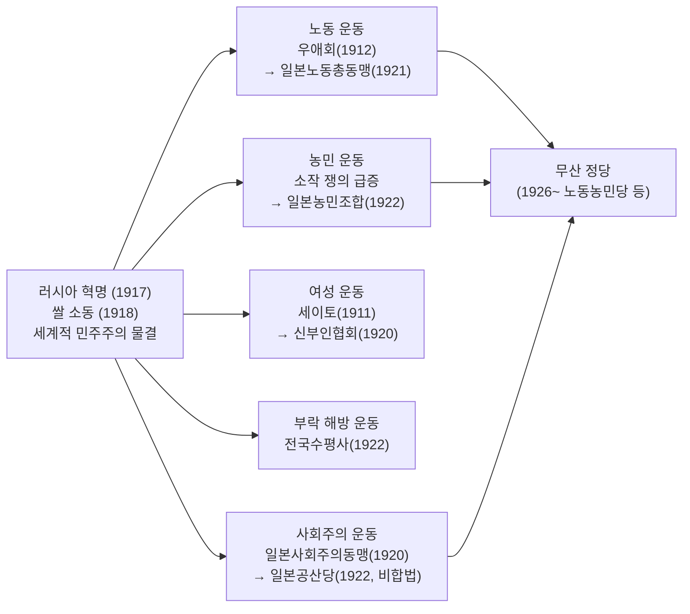

1918년 9월, 쌀 소동의 불길이 막 꺼진 도쿄에서 새 총리가 취임했다. 이와테현 모리오카 출신의 **하라 다카시**였다. 그는 작위가 없는 평민 출신으로 처음 총리가 된 사람이었고, 의회 제1당인 입헌정우회의 총재였다. 신문은 그를 '평민 재상'이라 부르며 환영했다. 외무·육군·해군대신을 뺀 모든 각료가 정우회 당원이었다. 일본 최초의 본격적인 **정당 내각**이 탄생한 것이다.

이 강의는 하라 내각에서 시작해 1925년 **보통선거법**이 만들어지기까지의 약 7년을 다룬다. 이 시기 일본에서는 민주주의를 요구하는 사상과 운동이 꽃피었다. 노동자와 농민, 여성, 피차별 부락민이 스스로 단체를 만들고 목소리를 냈다. 사람들은 이 시대의 분위기를 **다이쇼 데모크라시**라 불렀다. 그러나 같은 시기 일본은 관동 대지진의 혼란 속에서 수많은 조선인을 학살했고, 보통선거법과 함께 사상을 단속하는 **치안유지법**을 만들었다. 이 강의는 그 빛과 그림자를 함께 살핀다.

> [!핵심] 이 강의의 질문
> 1. 다이쇼 데모크라시를 이끈 사상은 무엇이었고, 그것은 대일본제국헌법과 어떻게 맞물렸는가?
> 2. 1920년대에는 어떤 사회 운동이 일어났고, 그들은 무엇을 요구했는가?
> 3. 보통선거법과 치안유지법이 같은 해에 만들어진 것은 무엇을 뜻하는가?

```timeline
1911 | 『세이토』 창간 | 히라쓰카 라이초 등 여성 문예지 "원시, 여성은 태양이었다"
1912 | 우애회 결성 | 스즈키 분지의 노동자 친목·상조 단체
1916 | 요시노 사쿠조의 민본주의론 | 『중앙공론』에 발표
1918.9 | 하라 다카시 내각 | 첫 본격 정당 내각
1918.12 | 신인회·여명회 결성 | 도쿄 제국대학 학생과 지식인의 민주주의 단체
1919 | 선거법 개정 | 납세 자격을 3엔 이상으로 낮춤
1920 | 첫 메이데이, 신부인협회 결성 | 보통선거 운동 고조
1921.10 | 일본노동총동맹 | 우애회가 계급 투쟁적 노동조합으로
1921.11 | 하라 총리 암살 | 도쿄역에서 청년에게 피살
1922 | 전국수평사, 일본농민조합, 일본공산당 | 부락 해방·농민·공산주의 운동의 조직화
1923.9.1 | 관동 대지진 | 사망·행방불명 약 10만 5,000명. 조선인 학살, 오스기 사카에 살해
1924 | 제2차 호헌 운동 | 기요우라 내각 타도, 호헌 3파 내각 출범
1925.3 | 라디오 방송 시작 | 도쿄 방송국 시험 방송
1925.4 | 치안유지법 | '국체 변혁'과 사유재산제 부정을 목적으로 한 결사 처벌
1925.5 | 보통선거법 | 25세 이상 모든 남자에게 선거권
```

## 하라 다카시의 정당 내각

### 평민 재상

하라 다카시(1856~1921)는 보신 전쟁에서 '조적'이 된 모리오카번(난부번)의 가로 집안에서 태어났다. 그는 사쓰마·조슈 출신이 주름잡는 번벌 세상에서 신문 기자, 외무 관료를 거쳐 정우회에 들어갔고, 이토 히로부미와 사이온지 밑에서 당을 조직하며 실력을 쌓았다. 그는 화족 작위를 끝까지 사양했다. 그래서 '평민 재상'이라 불렸다.

{{F:l12-hara}}

하라는 이상주의자가 아니라 노련한 현실 정치가였다. 그는 원로 야마가타와 군부, 귀족원과 충돌하기보다 그들과 타협하면서 정당의 힘을 넓히는 길을 택했다. 하라 내각은 '4대 정강'으로 교육 시설 확충, 교통 기관 정비, 산업·무역 진흥, 국방 충실을 내걸었다. 고등학교와 대학을 늘리고(1918 대학령으로 사립대학과 공립대학 인정), 지방에 철도와 도로, 항만을 깔았다. 이런 사업은 지방의 유력자와 유권자를 정우회 지지로 끌어들이는 수단이기도 했다. 철도를 놓아 줄 테니 표를 달라는 이른바 '아전인철我田引鉄' 정치였다.

### 보통선거를 거부한 정당 내각

정당 내각이 들어섰지만, 하라는 **보통선거**에 반대했다. 1919년 그는 선거법을 고쳐 선거권의 납세 자격을 직접 국세 10엔에서 3엔으로 낮추고, 정우회에 유리한 소선거구제를 도입했다. 유권자는 약 140만 명에서 약 300만 명으로 늘었지만, 여전히 인구의 약 5.5%였다.

1920년 초 야당과 노동 단체, 학생들이 보통선거를 요구하는 대규모 시위를 벌이자, 하라는 "보통선거는 계급 제도를 타파하려는 것이며 위험한 사상"이라며 의회를 해산했다. 총선거에서 정우회는 압승했다. 정당 내각이 오히려 민주화 요구를 누른 것이다.

하라 내각 시기에는 정우회와 관련된 비리 사건도 잇따랐다. 1921년 11월 4일, 하라는 교토로 가기 위해 도쿄역 개찰구로 걸어가다 철도 역무원 청년의 칼에 찔려 숨졌다. 청년은 정당 정치의 부패에 분노했다고 말했다. 오늘날 도쿄역 마루노우치 남쪽 출구 바닥에는 그가 쓰러진 자리를 표시한 동판이 박혀 있다.

## 다이쇼 데모크라시의 사상

### 요시노 사쿠조의 민본주의

다이쇼 데모크라시의 이론적 기둥은 도쿄 제국대학 교수 **요시노 사쿠조**였다. 1916년 그는 종합 잡지 『중앙공론』에 「헌정의 본의를 말하고 그 유종의 미를 거두는 길을 논함」이라는 긴 논문을 발표했다.

{{F:l12-yoshino}}

요시노는 '데모크라시'를 '민주주의'가 아니라 **민본주의民本主義**로 번역했다. 대일본제국헌법 아래에서 주권은 천황에게 있으므로, 주권이 국민에게 있다는 뜻의 '민주주의'를 주장하면 헌법과 충돌한다. 그래서 그는 주권이 누구에게 있느냐는 법적인 문제는 묻지 않고, **정치의 목적이 민중의 행복에 있으며, 정책은 민중의 뜻에 따라 정해져야 한다**는 정치 운영의 원칙을 강조했다. 그 구체적인 방법이 보통선거와 정당 내각이었다.

> [!사료] 요시노 사쿠조, 「헌정의 본의를 말하고…」 (1916, 요지)
> "민본주의란 법률 이론상 주권이 누구에게 있느냐를 묻지 않고, 그 주권을 행사할 때 주권자는 반드시 일반 민중의 이익과 행복, 그리고 그 의향을 중시하는 것을 방침으로 삼아야 한다는 주의다."
> — 논문의 핵심 정의를 우리말로 옮김

### 미노베 다쓰키치의 천황 기관설

헌법 해석에서 같은 방향을 제시한 것이 도쿄 제국대학의 헌법학자 **미노베 다쓰키치**였다. 그의 **천황 기관설**에 따르면 통치권은 법인인 국가에 속하고, 천황은 그 국가의 최고 '기관'으로서 헌법에 따라 통치권을 행사한다. 천황의 권력도 헌법의 제한을 받는다는 것이었다. 이 해석은 의회와 내각의 역할을 넓게 인정하는 근거가 되었고, 1910~20년대에는 학계와 관료 사회의 정설이었다. 그러나 1935년, 이 학설은 '국체를 모독한다'는 공격을 받게 된다(15강).

| 사상가 | 핵심 주장 | 헌법과의 관계 | 영향 |
|---|---|---|---|
| 요시노 사쿠조 | 민본주의: 정치는 민중의 이익과 뜻을 따라야 한다 | 주권 문제를 피해 천황 주권과 충돌하지 않음 | 보통선거·정당 내각 운동의 이론적 근거 |
| 미노베 다쓰키치 | 천황 기관설: 천황은 국가의 최고 기관 | 천황의 권한을 헌법 안에서 해석 | 의회·내각 중심 정치의 법적 근거 |

표: 다이쇼 데모크라시의 두 이론

### 언론과 잡지

이 시대의 사상은 신문과 잡지를 통해 퍼졌다. 『중앙공론』과 『개조』 같은 종합 잡지가 정치와 사회 문제를 논했고, 『오사카 아사히신문』 같은 대신문은 수십만 부를 찍었다. 1918년 데라우치 내각이 쌀 소동 보도를 금지하자 언론은 일제히 반발했고, 이를 비판한 『오사카 아사히신문』 기자들이 필화 사건(백홍 사건)으로 물러나기도 했다. 1918년 12월에는 요시노 등이 지식인 단체 '여명회'를, 그의 영향을 받은 도쿄 제국대학 학생들이 '신인회'를 만들었다.

## 일어서는 사람들: 1920년대의 사회 운동

1918년의 쌀 소동과 1917년 러시아 혁명, 그리고 대전 뒤 세계에 퍼진 민주주의와 민족 자결의 바람 속에서, 그동안 정치 바깥에 있던 사람들이 스스로 조직을 만들기 시작했다.



### 노동 운동

1912년 스즈키 분지는 노동자들의 친목과 상호 부조를 위한 **우애회**를 만들었다. 처음에는 노동자의 교양을 높이고 자본가와 협조하자는 온건한 단체였지만, 대전 경기 속에 노동자가 늘고 파업이 잇따르면서 성격이 바뀌었다. 1921년 우애회는 **일본노동총동맹**으로 이름을 바꾸고 계급 투쟁을 내세웠다. 1920년 5월 2일 도쿄 우에노 공원에서는 일본 최초의 **메이데이** 행사가 열려, 노동자들이 8시간 노동제와 실업 방지를 요구했다. 이듬해 1921년 고베의 가와사키·미쓰비시 조선소에서는 3만 명이 넘는 노동자가 참가한 대규모 쟁의가 벌어졌지만, 군대까지 출동해 진압되었다.

{{F:l12-labor}}

### 농민 운동

농촌에서는 소작농과 지주의 갈등이 깊어졌다. 6강에서 보았듯 지조 개정 이후 땅을 빌려 짓는 소작농은 수확의 절반 가까이를 소작료로 냈다. 1920년대에 들어 소작료 인하를 요구하는 **소작 쟁의**가 해마다 수천 건씩 일어났다. 1922년에는 크리스트교 사회 운동가 가가와 도요히코와 스기야마 모토지로 등이 **일본농민조합**을 만들었다.

```chart
{
  "type": "bar",
  "caption": "소작 쟁의 건수의 변화 (건, 농림성 통계에 근거한 대략적인 수치). 1920년대 초부터 크게 늘어 1930년대 쇼와 공황기에 정점에 이른다",
  "data": {
    "labels": ["1917", "1920", "1921", "1923", "1926", "1930", "1935"],
    "datasets": [{ "label": "소작 쟁의 건수", "data": [85, 408, 1680, 1917, 2751, 2478, 6824] }]
  },
  "options": { "plugins": { "legend": { "display": false } } }
}
```

### 여성 운동

1911년, 26세의 **히라쓰카 라이초**는 여성 문예지 『세이토青鞜』를 창간하며 그 첫머리에 이렇게 썼다. "원시, 여성은 실로 태양이었다. 진정한 사람이었다. 지금 여성은 달이다. 남에게 의지해 살고, 남의 빛으로 빛나는 병자처럼 창백한 얼굴의 달이다." 『세이토』는 여성의 자아와 연애, 정조, 낙태 같은 문제를 정면으로 다루어 사회에 충격을 주었다. 세상은 그들을 비웃는 뜻으로 '새로운 여자'라 불렀지만, 그들은 그 말을 스스로 내걸었다.

{{F:l12-hiratsuka}}

1920년 히라쓰카와 **이치카와 후사에**, 오쿠 무메오 등은 **신부인협회**를 만들어, 여성이 정치 집회에 참가하는 것을 금지한 치안경찰법 제5조의 개정 운동을 벌였다. 1922년 개정으로 여성도 정치 연설회를 열고 들을 수 있게 되었다. 그러나 여성의 정당 가입과 선거권은 여전히 인정되지 않았다. 이치카와는 1924년 부인참정권획득기성동맹회를 만들어 참정권 운동을 이어 갔다. 여성이 선거권을 얻은 것은 패전 뒤인 1945년이었다.

### 부락 해방 운동

1871년의 '해방령'(6강) 이후에도 옛 천민 신분 출신자에 대한 차별은 결혼, 취업, 거주 등 곳곳에서 이어졌다. 1922년 3월 교토에서 피차별 부락민들이 스스로의 힘으로 해방을 이루자며 **전국수평사**를 창립했다.

> [!사료] 수평사 선언 (1922, 일부)
> "전국에 흩어져 있는 우리 특수 부락민이여, 단결하라. … 우리는 반드시 경건하게 인간을 존경하는 것으로 스스로를 해방하고자 한다. … 인간 세상에 열이 있으라, 인간에게 빛이 있으라."
> — 일본 최초의 인권 선언으로 평가받는 수평사 선언의 일부를 우리말로 옮김

### 사회주의와 공산주의

1910년 대역 사건(10강) 이후 '겨울의 시대'를 보내던 사회주의자들도 활동을 재개했다. 1920년 여러 계파가 모인 일본사회주의동맹이 만들어졌다가 이듬해 금지되었고, 1922년에는 코민테른(국제 공산당)의 지도 아래 **일본공산당**이 비밀리에 결성되었다. 무정부주의자 오스기 사카에도 노동 운동에 큰 영향을 미쳤다. 정부는 이들을 체제를 위협하는 가장 위험한 세력으로 보았다.

## 관동 대지진

### 1923년 9월 1일 정오

1923년 9월 1일 오전 11시 58분, 사가미만을 진원으로 하는 규모 7.9의 대지진이 도쿄와 요코하마 일대를 덮쳤다. 마침 점심 준비로 집집마다 불을 쓰던 때였다. 무너진 목조 가옥에서 일어난 불은 강풍을 타고 사흘 동안 번져, 도쿄 시내의 절반 가까이를 태웠다. 도쿄 혼조의 육군 피복창 터에 피난했던 약 4만 명은 불길에 휩싸여 대부분 목숨을 잃었다. 사망자와 행방불명자는 모두 약 10만 5,000명에 이르렀다.

{{F:l12-earthquake}}

### 조선인 학살

재난의 혼란 속에서 "조선인이 우물에 독을 탔다", "조선인이 불을 지르고 폭동을 일으켰다"는 유언비어가 퍼졌다. 근거 없는 소문이었지만, 경찰과 군대의 일부가 이를 사실처럼 전파했고, 정부는 9월 2일 도쿄 일대에 계엄령을 내렸다. 주민들은 마을마다 **자경단**을 만들어 길목을 지키며 지나가는 사람에게 일본어 발음이 어려운 말을 시켜 보고, 조선인으로 의심되면 죽창과 일본도로 살해했다. 군대와 경찰이 학살에 가담한 경우도 있었다.

희생된 조선인의 수는 정확히 알 수 없다. 당시 일본 정부는 조사를 제대로 하지 않았고 오히려 사건을 축소했다. 상하이의 대한민국 임시정부 기관지 『독립신문』은 동포들의 조사를 바탕으로 6,000명이 넘는다고 보도했다. 중국인 노동자 수백 명도 살해되었고, 조선인으로 오인된 일본 지방 출신자들도 희생되었다. 학살에 가담한 자경단원 일부는 재판에 회부되었지만 대부분 가벼운 형을 받거나 곧 석방되었다.

> [!주의] 기억해야 할 사실
> 관동 대지진의 조선인 학살은 자연재해가 아니라 사람이 저지른 범죄였다. 그 배경에는 3·1 운동(13강) 이후 일본 사회에 퍼진 조선인에 대한 공포와 멸시, 그리고 식민 지배를 받는 사람들이 언제든 '반란'을 일으킬 수 있다는 지배자의 불안이 있었다. 오늘날에도 일본 정부는 학살에 관한 공식 기록이 없다는 입장을 보이고 있어, 진상 규명과 추모는 여전히 과제로 남아 있다.

### 사회주의자 살해

혼란은 사회주의자 탄압에도 이용되었다. 도쿄 가메이도 경찰서에서는 노동 운동가 10명이 군대에 살해되었다(가메이도 사건). 9월 16일에는 무정부주의자 **오스기 사카에**와 그의 동반자 이토 노에, 그리고 여섯 살 조카가 헌병 대위 아마카스 마사히코에게 연행되어 살해되었다(아마카스 사건). 아마카스는 징역 10년 형을 받았지만 3년 만에 풀려나, 훗날 만주국에서 요직을 맡았다.

## 보통선거법과 치안유지법

### 제2차 호헌 운동

하라가 암살된 뒤 정우회 내각이 잠깐 이어졌지만, 1922년부터는 다시 정당과 관계없는 해군 출신이나 귀족원 중심의 내각이 들어섰다. 1924년 1월, 원로 사이온지가 귀족원 의장 출신의 기요우라 게이고를 총리로 추천하자 정당들은 "특권 내각"이라며 반발했다. 헌정회(가토 다카아키), 정우회(다카하시 고레키요), 혁신구락부(이누카이 쓰요시)의 세 정당이 손잡고 **제2차 호헌 운동**을 벌였다.

5월 총선거에서 **호헌 3파**가 압승하자, 기요우라 내각은 물러나고 제1당 헌정회의 총재 **가토 다카아키**가 총리가 되었다. 이때부터 1932년 5·15 사건(15강)까지, 중의원 다수당의 총재가 총리가 되는 관행이 이어졌다. 사람들은 이를 '**헌정의 상도憲政の常道**'라 불렀다.

### 보통선거법

1925년 3월, 가토 내각은 마침내 **보통선거법**을 통과시켰다. 납세 자격을 없애고 **만 25세 이상의 모든 남자**에게 중의원 선거권을 준 것이다. 유권자는 약 330만 명에서 약 1,240만 명으로 네 배 가까이 늘었다. 노동자와 소작농도 처음으로 선거권을 얻었다. 1928년의 첫 보통선거에서는 무산 정당(노동자·농민의 정당)이 8석을 얻어 의회에 진출했다.

{{F:l12-suffrage}}

그러나 '보통'선거에는 한계가 있었다. 여성은 여전히 선거권이 없었다. 식민지 조선과 대만에는 중의원 선거 자체가 실시되지 않았다. 일본에 사는 조선인 남자는 선거권이 있었지만, 그것은 식민지 사람들에게 참정권을 주는 것과는 전혀 다른 문제였다. 또 생활 보호를 받는 빈곤층과 일정한 주거가 없는 사람도 제외되었다.

### 치안유지법

보통선거법보다 한 달 앞선 1925년 4월, 같은 가토 내각은 **치안유지법**을 공포했다. 그 제1조는 다음과 같았다.

> [!사료] 치안유지법 제1조 (1925)
> "국체를 변혁하거나 사유 재산 제도를 부인할 것을 목적으로 결사를 조직하거나 또는 그 사정을 알고 이에 가입한 자는 10년 이하의 징역 또는 금고에 처한다."
> — 법조문을 우리말로 옮김

'국체 변혁'은 천황제를 부정하는 것, '사유 재산 제도 부인'은 공산주의를 뜻했다. 선거권이 넓어지면 노동자와 농민이 공산주의·사회주의 정당에 몰려갈 것을 두려워한 정부가 '당근'과 함께 '채찍'을 준비한 것이다. 1925년 1월 일본이 소련과 국교를 맺어 공산주의 사상이 들어오는 것을 경계한 것도 배경이었다.

| | 보통선거법 (1925.5) | 치안유지법 (1925.4) |
|---|---|---|
| 내용 | 만 25세 이상 남자에게 선거권 | 국체 변혁·사유 재산 부인 목적의 결사 처벌 |
| 대상 | 납세액과 관계없는 모든 성인 남자 | 공산주의자, 무정부주의자, 뒤에는 자유주의자·종교인·식민지 독립운동가까지 |
| 그 뒤 | 1945년 여성 참정권, 1946년 남녀 보통선거 | 1928년 최고형을 사형으로 강화, 1941년 예방 구금 도입, 1945년 폐지 |

표: 같은 해의 두 법

치안유지법은 조선과 대만에도 적용되어, 독립운동을 '국체 변혁'으로 다스리는 무기가 되었다. 1928년에는 최고형이 사형으로 강화되고, 같은 해 3월 15일에는 공산당원과 지지자 1,600명 가까이가 한꺼번에 검거되었다(3·15 사건). 민주주의의 확대와 사상 통제의 강화가 한 몸으로 시작된 것, 이것이 다이쇼 데모크라시의 한계였다.

## 대중 사회의 등장

정치 밖에서도 일본 사회는 크게 바뀌고 있었다. 대도시에는 회사나 관청에 다니며 월급을 받는 **샐러리맨**과 '직업부인'이라 불린 타이피스트, 전화 교환수, 버스 차장 같은 일하는 여성이 늘었다. 도쿄 긴자의 거리에는 서양식 머리와 옷차림을 한 '모던 보이(모보)'와 '모던 걸(모가)'이 활보했다. 교외에는 문화 주택이 들어섰고, 사철 회사가 역에 백화점을 세웠다.

{{F:l12-modern}}

대중 매체도 폭발적으로 성장했다. 1925년 3월 라디오 방송이 시작되어 몇 년 만에 청취 계약자가 수십만 명에 이르렀다. 같은 해 창간된 대중 잡지 『킹』은 100만 부를 넘겼다. 1926년부터는 한 권에 1엔짜리 문학 전집, 이른바 '엔본円本'이 쏟아져 나와 독서 인구를 크게 넓혔다. 영화관과 카페, 야구와 스모 중계가 대중의 일상이 되었다. 이 대중 사회는 민주주의의 토양이었지만, 동시에 1930년대 국가가 라디오와 영화로 국민을 동원하는 토양이 되기도 했다.

## 정리

> [!핵심] 12강 요약
> - 쌀 소동 뒤 **하라 다카시**가 첫 본격 정당 내각을 이끌었지만, 보통선거에는 반대했고 1921년 암살되었다.
> - **요시노 사쿠조의 민본주의**와 **미노베 다쓰키치의 천황 기관설**은 천황 주권의 헌법 아래에서 민중 중심의 정치와 의회·내각 중심의 운영을 정당화했다.
> - 노동(**일본노동총동맹**)·농민(**일본농민조합**)·여성(**세이토**, **신부인협회**)·부락 해방(**전국수평사**)·사회주의 운동이 잇따라 조직되었다.
> - 1923년 **관동 대지진**의 혼란 속에 유언비어로 수천 명의 **조선인이 학살**되었고, 오스기 사카에 등 사회주의자도 살해되었다.
> - **제2차 호헌 운동**으로 가토 다카아키의 호헌 3파 내각이 들어서 '헌정의 상도'가 시작되었고, 1925년 **보통선거법**과 **치안유지법**이 함께 만들어졌다.

### 생각해 볼 질문

1. 요시노 사쿠조는 왜 '민주주의' 대신 '민본주의'라는 말을 썼을까? 그 선택은 다이쇼 데모크라시의 가능성과 한계를 어떻게 보여 주는가?
2. 관동 대지진 때의 조선인 학살은 왜 일어났을까? 유언비어를 믿게 만든 사회적 배경을 생각해 보자.
3. 보통선거법과 치안유지법은 서로 모순되는 법일까, 한 쌍의 정책일까?

### 다음 강 예고

13강에서는 같은 시기 식민지 조선과 대만에서 일어난 일을 다룬다. 무단 통치와 토지 조사 사업, **3·1 운동**과 대한민국 임시정부, 그리고 '문화 통치'로의 전환과 산미 증식 계획을 살펴본다.
