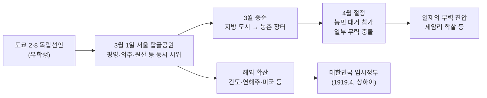

1919년 3월 1일 오후 2시, 서울 종로의 탑골공원. 수천 명의 학생과 시민 앞에서 한 청년이 팔각정 위에 올라 독립선언서를 읽어 내려갔다. "오등은 자에 아 조선의 독립국임과 조선인의 자주민임을 선언하노라." 낭독이 끝나자 군중은 태극기를 흔들며 "대한 독립 만세"를 외쳤고, 거리로 쏟아져 나왔다. 같은 시각 근처 요릿집 태화관에서는 민족 대표들이 선언서를 낭독한 뒤 스스로 일본 경찰에 연락해 체포되었다. 만세 소리는 몇 주 만에 한반도 전역과 만주, 연해주, 미국, 일본으로 번졌다. **3·1 운동**이다.

지금까지 이 강좌는 주로 일본 열도 안의 역사를 따라왔다. 그러나 1910년 이후의 일본은 조선과 대만, 사할린 남부와 남양 군도를 거느린 **식민지 제국**이었다. 일본 근대사는 식민지의 역사를 빼고는 온전히 이해할 수 없다. 이 강의는 1910년대 조선과 대만에서 일본이 펼친 통치, 그에 맞선 3·1 운동, 그리고 운동 이후 '문화 통치'로의 전환과 그 실체를 살펴본다. 12강의 다이쇼 데모크라시가 일본 본국에서 꽃피던 바로 그때, 식민지에서는 무엇이 일어나고 있었는가?

> [!핵심] 이 강의의 질문
> 1. 1910년대 일본은 조선과 대만을 어떤 방식으로 다스렸는가?
> 2. 3·1 운동은 어떻게 일어나 퍼졌고, 국내외에 어떤 영향을 미쳤는가?
> 3. '문화 통치'는 무엇이 바뀌었고, 무엇이 바뀌지 않았는가?

```timeline
1895 | 대만 식민지화 | 시모노세키 조약으로 대만 할양, 대만총독부 설치(9강)
1908 | 동양척식주식회사 설립 | 조선의 토지와 농업 이민을 위한 국책 회사
1910.8 | 한국 병합, 조선총독부 설치 | 초대 총독 데라우치 마사타케(10강)
1910~18 | 토지 조사 사업 | 근대적 토지 소유권 확정, 총독부 소유지 대폭 확대
1910 | 회사령 | 회사 설립을 총독의 허가제로
1911 | 105인 사건, 조선교육령 | 신민회 탄압. 일본어를 '국어'로 가르침
1912 | 조선 태형령 | 조선인에게만 태형 적용
1915 | 대만 타파니 사건 | 대만 최대의 무장 항일 봉기, 대규모 처형
1919.1 | 고종 사망 | 독살설 퍼짐
1919.2.8 | 도쿄 유학생 2·8 독립선언 | 
1919.3.1 | 3·1 운동 | 전국과 해외로 확산
1919.4 | 대한민국 임시정부 수립, 제암리 학살 | 상하이에서 민주공화제 임시정부
1919.5.4 | 중국 5·4 운동 | 
1919.8 | 사이토 마코토 총독 부임 | '문화 통치' 시작
1920 | 산미 증식 계획, 조선일보·동아일보 창간 | 봉오동·청산리 전투, 간도 참변
1921 | 대만의회설치청원운동 시작 | 대만문화협회 결성
1924 | 경성제국대학 개교 | 
1930 | 대만 우서 사건 | 원주민의 봉기와 독가스까지 동원한 진압
```

## 무단 통치의 10년

### 조선총독부

1910년 병합과 함께 서울(일제는 '경성'이라 불렀다)에 **조선총독부**가 설치되었다. 조선 총독은 현역 육해군 대장 가운데서 임명되어 천황에게 직속했다. 총독은 조선의 행정·입법·사법을 한 손에 쥐었을 뿐 아니라, 조선에 주둔한 군대를 지휘할 수도 있었다. 일본 본국의 제국의회가 만든 법률은 조선에 그대로 적용되지 않았고, 총독의 명령인 **제령**이 법률을 대신했다. 대일본제국헌법(8강)이 보장한 '신민의 권리'도, 의회 선거도 조선에는 없었다.

```figure
src: asset:393341552c62b3a70c128e4211514cac
caption: 서울 남산 기슭의 통감부 청사. 1910년 병합 뒤에는 조선총독부 청사로 쓰였고, 1926년 경복궁 안에 새 총독부 건물이 세워질 때까지 식민 통치의 중심이었다.
credit: 프랭크 G. 카펜터(Frank G. Carpenter) 수집 사진, 1910년 무렵 · 미국 의회도서관 소장
license: Public Domain (미국 의회도서관: 출판 제한 없음)
source: https://www.loc.gov/item/2023641128/
```

```figure
src: asset:1a99b745988c4e6f86dca15b7287834c
caption: 1910년 무렵 서울의 성문. 일제는 도시 개조를 내세워 서울 성곽과 성문 일부를 헐어 냈다.
credit: 프랭크 G. 카펜터 수집 사진, 1910년 무렵 · 미국 의회도서관 소장
license: Public Domain (미국 의회도서관: 출판 제한 없음)
source: https://www.loc.gov/item/2023641127/
```

1910년대의 통치를 흔히 **무단 통치**라 부른다. 그 핵심은 **헌병 경찰**이었다. 군대의 경찰인 헌병이 일반 경찰의 업무까지 맡아, 치안뿐 아니라 세금 징수, 위생, 호적, 일본어 보급, 심지어 부부 싸움까지 간섭했다. 헌병 경찰은 재판 없이 벌금과 구류, 태형을 매길 수 있는 즉결 처분권을 가졌다. 1912년의 **조선 태형령**은 일본인에게는 쓰지 않는 매질 형벌을 조선인에게만 적용했다. 관리뿐 아니라 학교 교원까지 제복을 입고 칼을 찼다.

| 분야 | 무단 통치기(1910~1919)의 정책 |
|---|---|
| 치안 | 헌병 경찰 제도, 즉결 처분권, 조선 태형령(1912) |
| 언론·결사 | 한국인 신문 대부분 폐간, 정치 단체 해산, 집회 금지 |
| 경제 | 토지 조사 사업, 회사령(회사 설립 허가제), 어업·삼림·광업령 |
| 교육 | 제1차 조선교육령(1911): 보통학교 4년, 일본어를 '국어'로, 실업 교육 중심 |
| 탄압 | 105인 사건(1911): 데라우치 총독 암살 모의를 조작해 신민회 등 민족 운동가 대량 검거 |

표: 무단 통치기의 주요 정책

### 토지 조사 사업

총독부가 가장 공들인 사업은 1910년부터 1918년까지 벌인 **토지 조사 사업**이었다. 전국의 모든 땅을 측량하고, 누가 주인인지를 확정해 토지 대장과 지적도를 만드는 사업이었다. 땅 주인은 정해진 기간 안에 직접 신고해야 소유권을 인정받았다(신고주의).

사업의 결과는 복잡했다. 근대적인 토지 소유 제도가 만들어지고 지세를 안정적으로 거둘 수 있게 되었다. 그러나 신고 절차를 잘 모르거나 일부러 신고하지 않은 땅, 마을이 함께 쓰던 공유지, 옛 왕실과 관청의 땅은 총독부 소유가 되었다. 총독부는 이렇게 얻은 땅의 일부를 **동양척식주식회사**와 일본인 이주민에게 싸게 넘겼다. 또 농민들이 관습적으로 가지고 있던 경작권은 인정되지 않아, 지주의 권리는 강해지고 소작농의 처지는 더 불안해졌다. 토지 조사 사업이 조선 농민의 땅을 대규모로 빼앗은 '수탈'이었는지, 근대적 소유권을 확립한 제도 개혁이었는지에 대해서는 학계에서 오랜 논쟁이 있다. 분명한 것은 이 사업이 식민 통치의 재정 기반과 일본인 지주의 진출을 뒷받침했다는 점이다.

### 대만의 식민 통치

일본의 첫 식민지 대만에서는 조선보다 15년 먼저 식민 통치가 시작되었다(9강). 대만 총독 역시 처음에는 무관이었고, 총독의 명령(율령)이 법률을 대신했다. 1898년 민정장관이 된 **고토 신페이**는 토지 조사, 인구 조사, 철도·항만 건설을 추진하는 한편, 주민을 10호 단위로 묶어 연대 책임을 지우는 **보갑 제도**로 치안을 다졌다. 아편은 총독부의 전매 사업으로 삼아 수입원으로 만들었다.

대만 사람들의 무장 저항은 오랫동안 이어졌다. 1915년 타이난 부근에서 일어난 **타파니 사건**(서래암 사건)은 한족 주민의 마지막 대규모 무장 봉기였다. 일본은 군대를 보내 진압하고, 임시 법원에서 800명이 넘는 사람에게 사형을 선고했다(국제적 비난으로 실제 처형은 100명 가까이로 줄었다). 이후 대만의 저항은 무장 투쟁에서 정치 운동으로 바뀌어 갔다.

### 1910년대 국내외의 독립운동

무단 통치 아래에서도 독립운동은 끊이지 않았다. 국내에서는 1912년 의병장 출신 임병찬이 고종의 밀명을 받아 독립의군부를 조직했고, 1915년 박상진 등은 공화제 국가를 목표로 내건 대한광복회를 만들어 군자금을 모으고 친일 부호를 처단했다. 그러나 헌병 경찰의 감시 속에서 국내 활동은 대부분 비밀 결사의 형태로 이루어질 수밖에 없었다.

국외에서는 독립운동의 기지가 세워졌다. 이회영 형제 등은 전 재산을 팔아 서간도로 건너가 1911년 신흥강습소(뒤의 신흥무관학교)를 세워 독립군을 길렀다. 연해주에서는 이상설과 이동휘 등이 1914년 대한광복군 정부를 세웠고, 미국에서는 안창호 등의 대한인국민회가 활동했다. 1917년 상하이의 독립운동가들은 「대동단결선언」을 발표해, 순종이 주권을 포기한 것은 곧 국민에게 주권을 넘겨준 것이라며 국민 주권의 공화국을 세우자고 주장했다. 3·1 운동과 대한민국 임시정부의 사상적 바탕은 이렇게 1910년대에 이미 준비되고 있었다.

## 3·1 운동

### 세계의 변화와 고종의 죽음

1918년 제1차 세계대전이 끝나 갈 무렵, 미국 대통령 윌슨은 '14개조 평화 원칙'에서 **민족 자결**의 원칙을 내세웠다. 각 민족은 자기 운명을 스스로 결정할 권리가 있다는 것이었다. 윌슨의 민족 자결은 사실 패전국인 독일·오스트리아·오스만 제국의 식민지와 영토를 염두에 둔 것이었지만, 식민 지배를 받던 전 세계 사람들에게 큰 희망을 주었다. 러시아 혁명 정부도 피압박 민족의 해방을 외쳤다.

조선인들은 이 기회를 놓치지 않으려 했다. 1919년 1월, 상하이의 신한청년당은 김규식을 파리 강화 회의에 대표로 보냈다. 그러던 1월 21일, 퇴위 뒤 덕수궁에 머물던 **고종**이 갑자기 세상을 떠났다. 일제가 독살했다는 소문이 삽시간에 퍼졌다. 조선인들의 슬픔과 분노가 끓어올랐다.

### 2·8 독립선언

먼저 움직인 것은 식민 지배의 본국 수도 도쿄에 있던 유학생들이었다. 1919년 2월 8일, 도쿄 간다의 조선기독교청년회관에서 유학생 수백 명이 모여 '조선청년독립단'의 이름으로 독립선언서를 발표했다(**2·8 독립선언**). 그들은 일본 경찰에 곧바로 체포되었지만, 그 소식은 국내의 민족 운동 지도자들을 자극했다.

### 3월 1일

국내에서는 천도교, 기독교, 불교의 종교계 지도자들이 손을 잡았다. 각 종교 조직은 일제가 정치 단체를 모두 해산시킨 뒤에도 남은 거의 유일한 전국 조직이었다. 손병희를 비롯한 33인이 **민족 대표**로 독립선언서에 서명했고, 천도교의 인쇄소에서 선언서 2만 1,000장이 몰래 인쇄되어 전국으로 퍼졌다. 거사일은 고종의 장례식(3월 3일)을 앞두고 많은 사람이 서울에 모이는 3월 1일로 정해졌다.

> [!사료] 기미 독립선언서 (1919, 첫머리와 공약 3장)
> "오등은 자에 아 조선의 독립국임과 조선인의 자주민임을 선언하노라. 차로써 세계 만방에 고하야 인류 평등의 대의를 극명하며, 차로써 자손만대에 고하야 민족 자존의 정권을 영유케 하노라. …
> 하나. 금일 오인의 차거는 정의·인도·생존·존영을 위하는 민족적 요구이니, 오직 자유적 정신을 발휘할 것이오, 결코 배타적 감정으로 일주하지 말라.
> 하나. 최후의 일인까지, 최후의 일각까지 민족의 정당한 의사를 쾌히 발표하라.
> 하나. 일체의 행동은 가장 질서를 존중하야, 오인의 주장과 태도로 하여금 어디까지든지 광명정대하게 하라."
> — 최남선이 기초하고 한용운이 공약 3장을 덧붙였다고 전한다. 일본을 미워하기보다 일본과 동양의 평화를 위해서도 조선의 독립이 필요하다고 설득하는 내용이 담겨 있다.

### 전국으로, 세계로

탑골공원에서 시작된 만세 시위는 서울 시내를 휩쓸었고, 같은 날 평양, 의주, 원산 등 북부의 도시들에서도 동시에 일어났다. 3월 중순부터는 장날을 이용해 농촌으로 번졌다. 처음에는 학생과 종교인이 중심이었지만, 상인들은 가게 문을 닫는 철시로, 노동자는 파업으로 동참했고, 농민들이 대거 참가하면서 시위는 점점 격렬해졌다. 일부 지역에서는 헌병 주재소와 면사무소를 습격하기도 했다. 만세 시위는 만주의 간도, 러시아 연해주, 미국 필라델피아 등 해외 동포 사회로도 퍼졌다.



| 항목 | 규모 (박은식 『한국독립운동지혈사』의 집계) |
|---|---|
| 집회 횟수 | 1,500회 이상 |
| 참가자 | 약 200만 명 |
| 사망자 | 7,509명 |
| 부상자 | 1만 5,961명 |
| 체포자 | 4만 6,948명 |

표: 3·1 운동의 규모 (1919년 3~5월). 일본 측 공식 집계는 이보다 훨씬 적다

### 무력 진압과 제암리 학살

총독부는 헌병과 경찰, 군대를 동원해 시위대에 총을 쏘았다. 일본 본국에서도 군대가 증파되었다. 1919년 4월 15일, 경기도 화성의 제암리에서는 일본군이 마을 주민 남자들을 교회에 모아 놓고 문을 잠근 뒤 총을 쏘고 불을 질러 20명이 넘게 학살했다(**제암리 학살**). 이 사실은 현장을 찾은 캐나다인 선교사 스코필드가 사진을 찍어 해외에 알리면서 국제적 비난을 받았다.

충청도 천안 아우내 장터에서 만세 시위를 이끌다 부모를 잃은 열일곱 살의 이화학당 학생 **유관순**은 체포된 뒤에도 서대문 감옥에서 만세를 외치다 1920년 옥중에서 세상을 떠났다. 그는 3·1 운동의 상징이 되었다.

```figure
src: asset:3dd0af6a59aeedb74c12d7f336a0931d
caption: 1919년 무렵 서울 거리의 여성들. 얼굴을 가리는 장옷 차림이다. 3·1 운동에는 이화학당 학생들을 비롯해 많은 여성이 참가했다.
credit: 키스톤 뷰 컴퍼니 간행, 1919년 · 미국 의회도서관 소장
license: Public Domain (미국 의회도서관: 출판 제한 없음)
source: https://www.loc.gov/item/2003666557/
```

### 대한민국 임시정부

3·1 운동은 독립을 바로 이루지는 못했지만, 독립운동을 하나로 모으는 계기가 되었다. 1919년 4월 11일, 중국 상하이에 모인 독립운동가들은 **대한민국 임시정부**를 세우고 「대한민국 임시헌장」을 발표했다. 그 제1조는 "대한민국은 민주공화제로 함"이었다. 군주의 나라 '대한제국'이 무너진 지 9년 만에, 국민이 주인인 공화국을 세우겠다고 선언한 것이다. 9월에는 서울과 연해주의 임시정부와 통합해, 이승만을 대통령, 이동휘를 국무총리로 하는 통합 임시정부가 출범했다.

### 일본과 세계의 반응

3·1 운동은 일본 사회에도 충격을 주었다. 대부분의 신문은 운동을 '폭동'으로 보도했지만, 요시노 사쿠조는 무단 통치의 잘못을 지적하며 조선인의 자치를 고려해야 한다고 주장했다. 미술 평론가 **야나기 무네요시**는 「조선인을 생각한다」(1919)에서 "반항하는 그들보다 어리석은 것은 압박하는 우리"라고 썼다. 그러나 이런 목소리는 소수였다.

같은 해 5월 4일, 중국 베이징에서는 파리 강화 회의가 독일의 산둥 권익을 일본에 넘기기로 결정한 데 항의하는 학생 시위가 일어났다(**5·4 운동**, 14강). 중국의 지식인들은 3·1 운동에 깊은 감명을 받았다고 밝혔다. 3·1 운동은 인도의 비폭력 저항, 이집트의 1919년 혁명과 함께 제1차 세계대전 뒤 아시아·아프리카에서 일어난 민족 운동의 물결 가운데 하나였다.

## '문화 통치'의 실체

### 사이토 마코토와 통치 방식의 전환

3·1 운동에 놀란 하라 다카시 내각은 조선 통치 방식을 바꾸기로 했다. 1919년 8월 새 총독으로 해군 대장 **사이토 마코토**가 부임했다. 서울역에 도착한 그를 향해 65세의 독립운동가 강우규가 폭탄을 던졌지만, 사이토는 무사했다. 사이토는 '문화의 발달과 민력의 충실'을 내세우며 이른바 **문화 통치**를 선언했다. 하라는 조선과 대만을 장기적으로 일본 본국과 같은 제도로 다스리겠다는 '내지 연장주의'를 내걸었다.

```figure
src: asset:e29132ecd7fdbe4790d6a9376c5ce1de
caption: 조선 총독 사이토 마코토(1858~1936). 3·1 운동 뒤 부임해 '문화 통치'를 내세웠다. 뒤에 총리와 내대신을 지냈고, 2·26 사건 때 살해되었다.
credit: 촬영자·연도 미상 · 국립국회도서관 「근대일본인의 초상」
license: Public Domain (국립국회도서관: 저작권 보호 기간 만료)
source: https://www.ndl.go.jp/portrait/datas/87/
width: narrow
```

```figure
src: asset:e79b3c0a2ca89faab2e715f61562fc23
caption: 미국 회사가 '서울의 공립학교'라는 제목으로 판매한 입체 사진의 한쪽. 바닥에 앉아 글을 배우는 모습은 서당에 가까워 보인다. 일제는 서당을 규제하고 일본어를 '국어'로 가르치는 보통학교를 늘려 갔다.
credit: 키스톤 뷰 컴퍼니 간행, 1919년 · 미국 의회도서관 소장
license: Public Domain (미국 의회도서관: 출판 제한 없음)
source: https://www.loc.gov/item/2003666559/
```

| 분야 | 겉으로 바뀐 것 | 실제 |
|---|---|---|
| 총독 | 문관도 총독이 될 수 있게 함 | 1945년까지 문관 총독은 한 명도 임명되지 않음 |
| 경찰 | 헌병 경찰을 **보통 경찰**로 바꿈 | 경찰관 수와 경찰서가 오히려 크게 늘어 감시망이 촘촘해짐 |
| 형벌 | 조선 태형령 폐지, 관리·교원의 칼 착용 폐지 | 1925년 치안유지법 적용으로 독립운동을 '국체 변혁'으로 처벌 |
| 언론 | 조선일보·동아일보 등 한글 신문 허가(1920) | 사전 검열, 기사 삭제, 압수, 정간이 일상적 |
| 교육 | 제2차 조선교육령(1922): 보통학교 6년, 대학 설립 허용 | 조선인의 민립 대학 설립 운동은 좌절시키고 경성제국대학(1924)을 관립으로 세움 |
| 정치 참여 | 도·부·면에 자문 기관(협의회) 설치 | 의결권 없는 자문 기관, 선거권은 일부 유산층과 일본인에게 유리 |
| 대응 방침 | '문화'와 '민의 존중' | 친일 세력을 키워 민족 운동을 분열시키는 정책 |

표: 문화 통치의 겉과 속

문화 통치는 탄압의 방식을 세련되게 바꾼 것이었다. 사이토가 측근에게 받은 의견서에는 민족 운동을 분열시키기 위해 친일 단체를 만들고 지원하라는 내용이 들어 있었다. 실제로 1920년대에는 일제의 지배를 인정하는 범위 안에서 자치를 얻자는 '자치론'이 일부 지식인 사이에 퍼지면서 민족 운동 안의 갈등이 깊어졌다. 이에 맞서 민족주의자와 사회주의자는 1927년 **신간회**를 만들어 협력했다.

### 산미 증식 계획

1918년 쌀 소동(11강)으로 쌀 부족의 심각성을 깨달은 일본 정부는, 식민지에서 쌀을 늘려 본국으로 가져오기로 했다. 1920년부터 조선에서 **산미 증식 계획**이 시작되었다. 수리 시설을 만들고 품종을 개량하고 비료를 늘려 쌀 생산을 늘리는 계획이었다.

쌀 생산은 어느 정도 늘었다. 그러나 늘어난 것보다 훨씬 많은 쌀이 일본으로 실려 나갔다. 그 결과 조선 사람 한 사람이 먹는 쌀의 양은 오히려 줄었고, 조선인들은 만주에서 들여온 조와 수수, 콩으로 끼니를 이어야 했다.

```chart
{
  "type": "bar",
  "caption": "조선인 1인당 연간 쌀 소비량의 변화 (단위: 석, 5년 평균, 대략적인 통설 수치). 산미 증식 계획으로 쌀 생산은 늘었지만 일본으로의 반출이 더 크게 늘면서 조선인의 쌀 소비는 오히려 줄었다",
  "data": {
    "labels": ["1912~16", "1917~21", "1922~26", "1927~31", "1932~36"],
    "datasets": [{ "label": "1인당 쌀 소비량(석)", "data": [0.72, 0.69, 0.59, 0.50, 0.40] }]
  },
  "options": { "plugins": { "legend": { "display": false } } }
}
```

수리 시설을 만드는 비용(수리조합비)과 비료 값은 농민에게 떠넘겨졌다. 빚을 진 자작농은 땅을 잃고 소작농으로 떨어졌고, 고향을 떠나 만주와 일본으로 건너가는 사람들이 늘었다. 일본에 사는 조선인은 1920년 약 3만 명에서 1930년 약 30만 명으로 늘었다. 그들 대부분은 탄광과 공사장, 공장에서 일본인보다 낮은 임금을 받으며 일했다. 12강에서 본 관동 대지진 때의 학살은 이렇게 일본으로 건너온 조선인들에게 일어난 일이었다.

## 계속되는 저항

### 무장 독립 투쟁

국외에서는 무장 독립 투쟁이 이어졌다. 1910년대부터 서간도와 북간도, 연해주에는 독립군 기지가 세워지고, 신흥무관학교 같은 군사 학교에서 독립군이 길러졌다. 1920년 6월 **홍범도**가 이끄는 대한독립군 등은 두만강 건너 봉오동에서 일본군을 크게 무찔렀고(**봉오동 전투**), 10월에는 김좌진의 북로군정서와 홍범도 부대가 청산리 일대에서 일본군과 엿새 동안 싸워 승리했다(**청산리 전투**).

일본군은 보복으로 간도의 조선인 마을을 습격해 수천 명을 학살하고 마을과 학교, 교회를 불태웠다(**간도 참변**, 경신 참변, 1920년 10~11월). 독립군은 러시아 영토로 이동했지만, 이후에도 만주 각지에서 투쟁을 이어 갔다.

### 대만의 정치 운동

대만에서는 1921년부터 지주이자 지식인인 린셴탕 등이 대만에도 의회를 설치해 달라고 일본 제국의회에 청원하는 **대만의회설치청원운동**을 벌였다. 청원은 1934년까지 15차례나 제출되었지만 모두 채택되지 않았다. 같은 해 결성된 대만문화협회는 강연회와 신문을 통해 대만인의 민족 의식을 일깨웠다.

1930년 대만 중부 산지의 우서(霧社)에서는 일본 경찰의 강제 노역과 차별에 시달리던 원주민 세디크족이 지도자 모나 루다오를 중심으로 봉기해, 운동회에 모인 일본인 130여 명을 살해했다(**우서 사건**). 일본군은 비행기와 대포, 그리고 국제법으로 금지된 독가스까지 동원해 진압했다. 봉기에 참가한 마을들은 거의 전멸했다. '문명화'를 내세운 식민 통치의 폭력이 가장 적나라하게 드러난 사건이었다.

## 정리

> [!핵심] 13강 요약
> - 병합 뒤 조선총독부는 **헌병 경찰**을 앞세운 **무단 통치**를 펴고, **토지 조사 사업**과 회사령, 조선교육령으로 식민 지배의 토대를 놓았다. 대만에서는 고토 신페이가 보갑 제도와 토지 조사로 통치 틀을 만들었고, **타파니 사건** 같은 무장 저항이 이어졌다.
> - 민족 자결의 국제 분위기와 고종의 죽음, 도쿄 유학생의 **2·8 독립선언**을 배경으로 1919년 **3·1 운동**이 일어나 약 200만 명이 참가했다. 일제는 **제암리 학살** 등 무력으로 진압했다.
> - 3·1 운동을 계기로 상하이에 민주공화제의 **대한민국 임시정부**가 세워졌고, 중국의 5·4 운동 등 아시아 민족 운동과도 이어졌다.
> - 사이토 총독의 **문화 통치**는 보통 경찰, 한글 신문 허가 등 겉모습을 바꾸었지만, 감시와 검열을 강화하고 친일 세력을 키워 민족 운동을 분열시키려 했다.
> - **산미 증식 계획**은 조선의 쌀을 일본으로 실어 가 조선인의 쌀 소비를 줄였고, 많은 농민이 만주와 일본으로 떠났다. 국외에서는 **봉오동·청산리 전투** 등 무장 투쟁이 이어졌다.

### 생각해 볼 질문

1. 12강의 다이쇼 데모크라시와 13강의 식민지 통치를 나란히 놓아 보자. 같은 하라 다카시 내각이 본국에서 한 일과 식민지에서 한 일은 어떻게 연결되는가?
2. 3·1 운동의 독립선언서가 일본을 '적'으로 몰아붙이기보다 설득하는 말투를 택한 이유는 무엇이었을까?
3. 문화 통치는 무단 통치보다 '부드러운' 통치였을까? 경찰 수, 검열, 친일 세력 육성을 근거로 따져 보자.

### 다음 강 예고

14강에서는 일본이 '5대국'의 하나로 참가한 파리 강화 회의와 **워싱턴 체제**, 시데하라 기주로의 협조 외교와 다나카 기이치의 강경 외교, 장쭤린 폭살 사건, 그리고 금융 공황과 세계 대공황이 겹친 **쇼와 공황**까지를 다룬다.
