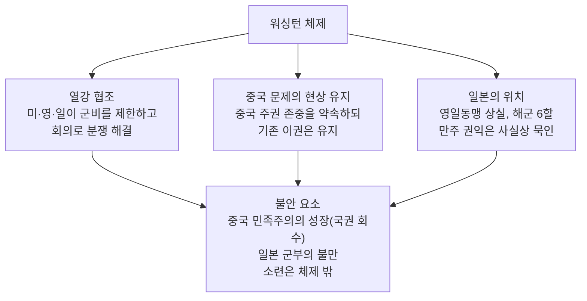

1919년 1월, 파리의 베르사유 궁전에서 제1차 세계대전의 강화 회의가 열렸다. 미국, 영국, 프랑스, 이탈리아와 함께 회의를 이끄는 '5대국' 가운데 아시아에서 온 나라는 일본뿐이었다. 페리가 흑선을 끌고 온 지 66년, 일본은 세계의 운명을 논의하는 자리에 앉아 있었다. 일본 대표단은 회의에서 국제연맹 규약에 **인종 차별 철폐** 조항을 넣자고 제안했다. 그러나 이 제안은 미국 대통령 윌슨이 "전원 일치가 아니다"라며 받아들이지 않아 무산되었다. 같은 자리에서 일본은 중국이 반대하는데도 독일의 산둥 권익을 손에 넣었다.

이 장면에는 1920년대 일본의 두 얼굴이 담겨 있다. 하나는 국제 협조의 질서 속에서 열강과 나란히 서려는 일본, 다른 하나는 중국에서의 이권을 결코 놓지 않으려는 일본이다. 이 강의는 1920년대의 국제 질서인 **워싱턴 체제**와 그 속에서 펼쳐진 **시데하라 협조 외교**, 이에 맞선 **다나카 강경 외교**와 장쭤린 폭살 사건, 그리고 잇따른 공황 끝에 일본 경제를 바닥으로 밀어 넣은 **쇼와 공황**을 다룬다. 이 강의의 끝은 15강의 만주사변으로 곧장 이어진다.

> [!핵심] 이 강의의 질문
> 1. 워싱턴 체제는 어떤 국제 질서였고, 일본은 그 안에서 무엇을 얻고 무엇을 양보했는가?
> 2. 시데하라 외교와 다나카 외교는 중국 문제를 어떻게 다르게 보았는가?
> 3. 1920년대의 잇따른 공황은 왜 일어났으며, 쇼와 공황은 일본 사회를 어떻게 바꾸었는가?

```timeline
1919.1~6 | 파리 강화 회의 | 일본은 5대국의 하나. 산둥 권익과 남양 군도 위임 통치 획득, 인종 차별 철폐안 부결
1919.5 | 중국 5·4 운동 | 산둥 문제 처리에 항의
1920.1 | 국제연맹 출범 | 일본은 상임이사국
1920.3 | 전후 공황 | 대전 경기의 거품이 꺼짐
1921.11~1922.2 | 워싱턴 회의 | 4개국 조약(영일동맹 폐기), 9개국 조약, 해군 군축 조약
1922 | 산둥 반환 | 
1923.9 | 진재 공황 | 관동 대지진으로 기업 도산, 진재 어음 문제
1924~27 | 시데하라 외교 (제1기) | 중국 내정 불간섭, 경제 중심의 협조 외교
1927.3~4 | 금융 공황 | 은행 예금 인출 사태, 스즈키 상점 파산, 대만은행 휴업
1927~28 | 다나카 외교, 산둥 출병 | 중국 국민혁명군의 북벌에 맞서 세 차례 출병, 지난 사건
1928.6 | 장쭤린 폭살 사건 | 관동군이 만주 군벌 장쭤린을 열차째 폭살
1928.8 | 부전 조약 | 전쟁 포기를 약속한 국제 조약에 서명
1929.10 | 세계 대공황 | 미국 뉴욕 주식 시장 폭락
1930.1 | 금 해금 | 금 수출 금지를 풀고 금본위제로 복귀
1930 | 쇼와 공황, 런던 해군 군축 조약 | 통수권 간범 문제, 11월 하마구치 총리 저격
```

## 파리 강화 회의와 '5대국' 일본

### 무엇을 얻었나

파리 강화 회의에서 일본은 전 총리 사이온지 긴모치를 수석 전권으로, 마키노 노부아키를 차석 전권으로 보냈다. 일본의 목표는 두 가지였다. 전쟁 중 점령한 **독일의 산둥 권익**과 **적도 이북의 독일령 남양 군도**를 공식적으로 넘겨받는 것이었다.

```gallery
src: asset:5a2f604ad884c91b954939b43f225ae1
caption: 일본의 강화 회의 대표단. 미국 의회도서관 목록에는 1915년으로 되어 있으나, 1919년 파리 강화 회의 대표단으로 추정된다.
credit: 베인 통신사 · 미국 의회도서관 소장
license: Public Domain (미국 의회도서관: 출판 제한 없음)
source: https://www.loc.gov/item/2014709002/
---
src: asset:049af05da6dcfc7cde1997495d04c10d
caption: 파리 강화 회의의 차석 전권 마키노 노부아키(1861~1949). 오쿠보 도시미치의 둘째 아들로, 회의에서 인종 차별 철폐 제안을 설명했다. 뒤에 내대신이 되어 2·26 사건 때 습격 대상이 되었다.
credit: 베인 통신사, 1919년 · 미국 의회도서관 소장
license: Public Domain (미국 의회도서관: 출판 제한 없음)
source: https://www.loc.gov/item/2014707091/
```

중국 대표단은 산둥이 원래 중국 땅이니 중국에 돌려달라고 호소했다. 그러나 일본은 전쟁 중 영국·프랑스 등과 맺은 비밀 협정과, 1915년의 21개조 요구, 1918년 돤치루이 정부와 맺은 협정을 근거로 내세웠다. 결국 베르사유 조약은 산둥의 독일 권익을 일본에 넘겼다. 남양 군도는 국제연맹의 **위임 통치령**이라는 형식으로 일본이 다스리게 되었다. 1920년 출범한 국제연맹에서 일본은 영국·프랑스·이탈리아와 함께 상임이사국이 되었다.

### 인종 차별 철폐 제안

일본 대표단은 국제연맹 규약에 '각국 국민은 인종이나 국적에 따라 법률상·사실상 차별받지 않는다'는 취지의 조항을 넣자고 제안했다. 그 배경에는 미국 캘리포니아주 등에서 일본인 이민자를 차별하는 법이 잇따라 만들어지고 있던 현실이 있었다. 표결에서는 과반수가 찬성했지만, 의장인 윌슨은 중요한 문제는 전원 일치가 필요하다며 이를 채택하지 않았다. 백인 이민을 지키려던 오스트레일리아와 미국 내 여론의 반대가 컸다.

> [!주의] '인종 평등'을 외친 식민지 제국
> 일본의 인종 차별 철폐 제안은 세계사에서 의미 있는 시도였다. 그러나 같은 해 일본은 조선의 3·1 운동을 총칼로 진압하고 있었고(13강), 회의장에서는 중국의 산둥 반환 요구를 물리쳤다. 일본이 요구한 '평등'은 일본인이 서양 열강과 대등한 대우를 받는 것이었지, 일본이 지배하는 아시아 민족의 평등은 아니었다.

산둥 문제 처리에 분노한 중국 베이징의 학생들은 1919년 5월 4일 대규모 시위를 벌였다(**5·4 운동**). 시위는 전국으로 번져 일본 상품 불매와 파업으로 이어졌고, 중국 정부는 베르사유 조약 서명을 거부했다. 5·4 운동은 중국에서 근대 민족주의와 새로운 문화 운동이 일어나는 출발점이 되었다.

## 워싱턴 체제

### 워싱턴 회의

대전이 끝나자 미국·영국·일본은 이번에는 서로를 상대로 해군 군비 경쟁을 벌이기 시작했다. 일본 해군은 전함 8척과 순양전함 8척으로 이루어진 '8·8 함대'를 만들려 했는데, 이를 위한 해군 예산이 국가 예산의 3분의 1에 이를 정도였다. 재정 부담을 견디기 어려웠던 것은 미국과 영국도 마찬가지였다. 미국은 태평양과 동아시아의 질서를 새로 짜기 위해 1921년 11월 워싱턴에서 국제회의를 열었다.

```gallery
src: asset:9a0d2931fcc85cc9f71571412cbd93bb
caption: 워싱턴 회의 중인 1921년 11월 29일, 워싱턴의 건물 앞에 선 일본 전권 가토 도모사부로 해군대신(가운데). 그는 해군 안의 반대를 무릅쓰고 주력함 대미 6할을 받아들였다.
credit: 내셔널 포토 컴퍼니(National Photo Co.), 1921년 · 미국 의회도서관 소장
license: Public Domain (미국 의회도서관: 출판 제한 없음)
source: https://www.loc.gov/item/2016831801/
---
src: asset:57bfd0baa02743797d5709f319dac267
caption: 워싱턴 회의 일본 대표단의 해군 수석 수행원 가토 간지 중장. 대미 7할을 고집하며 6할 수용에 강하게 반대했고, 뒤에 해군 강경파(함대파)의 중심이 되었다.
credit: 해리스 앤드 유잉(Harris & Ewing), 1921년 · 미국 의회도서관 소장
license: Public Domain (미국 의회도서관: 출판 제한 없음)
source: https://www.loc.gov/item/2016890814/
```

**워싱턴 회의**(1921~22)에서는 세 개의 중요한 조약이 맺어졌다.

| 조약 | 참가국 | 주요 내용 | 일본에 미친 영향 |
|---|---|---|---|
| **4개국 조약** (1921.12) | 미국·영국·일본·프랑스 | 태평양 섬들에 대한 서로의 권리 존중, 분쟁은 회의로 해결 | **영일동맹 폐기**. 20년 동맹의 끝 |
| **9개국 조약** (1922.2) | 위 4국 + 중국·이탈리아·벨기에·네덜란드·포르투갈 | 중국의 주권·독립·영토 보전 존중, 중국에서의 기회 균등·문호 개방 | 이시이·랜싱 협정 폐기. 산둥 권익을 중국에 반환 |
| **워싱턴 해군 군축 조약** (1922.2) | 미국·영국·일본·프랑스·이탈리아 | 주력함(전함 등) 보유 톤수 비율 미국 5 : 영국 5 : 일본 3 : 프랑스 1.67 : 이탈리아 1.67. 10년간 새 주력함 건조 중지 | 8·8 함대 계획 포기. 대신 미·영이 태평양 서부의 기지를 강화하지 않기로 약속 |

표: 워싱턴 회의의 세 조약

```chart
{
  "type": "bar",
  "caption": "워싱턴 해군 군축 조약(1922)이 정한 주력함 보유 톤수 비율. 일본은 대미 7할을 요구했지만 6할(5:3)을 받아들였다",
  "height": 260,
  "data": {
    "labels": ["미국", "영국", "일본", "프랑스", "이탈리아"],
    "datasets": [{ "label": "주력함 비율", "data": [5, 5, 3, 1.67, 1.67] }]
  },
  "options": { "plugins": { "legend": { "display": false } } }
}
```

일본 전권 가토 도모사부로(해군대신)는 해군 안의 반대를 무릅쓰고 대미 6할을 받아들였다. 그는 "국방은 군인의 독점물이 아니다"라며, 미국과 군비 경쟁을 해서는 일본이 재정적으로 견딜 수 없다고 판단했다. 그러나 해군 안에는 이 결정을 굴욕으로 여기는 강경파(함대파)가 자라났고, 이 불만은 10년 뒤 런던 회의에서 폭발한다.

### 워싱턴 체제란

이렇게 만들어진 1920년대 동아시아·태평양의 국제 질서를 **워싱턴 체제**라 부른다. 그 특징은 셋으로 정리할 수 있다.



일본에게 워싱턴 체제는 양날의 칼이었다. 군비 부담을 줄이고 미국·영국과의 충돌을 피할 수 있었지만, 오랜 동맹국 영국을 잃었고 중국에서의 팽창에 제동이 걸렸다. 무엇보다 이 체제는 성장하는 **중국의 민족주의**를 충분히 담아내지 못했다. 중국인들은 불평등조약을 없애고 열강에게 빼앗긴 이권을 되찾으려 했고(국권 회수 운동), 그 칼끝은 결국 일본의 만주 권익을 향하게 된다.

## 협조 외교와 강경 외교

### 시데하라 외교

1924년부터 1927년까지, 그리고 1929년부터 1931년까지 헌정회(뒤의 민정당) 내각에서 외무대신을 맡은 **시데하라 기주로**는 워싱턴 체제를 충실히 따르는 외교를 폈다. 그는 미국·영국과 협조하고, 중국의 내정에는 간섭하지 않으며, 군사력이 아니라 무역과 투자로 중국에서의 경제적 이익을 넓히는 것을 원칙으로 삼았다. 이를 **시데하라 외교**(협조 외교)라 한다.

```figure
src: asset:29806aa7482ee609cf2139d29d8ef508
caption: 시데하라 기주로(1872~1951). 1920년대 협조 외교를 이끈 외무대신. 패전 직후인 1945년 총리가 된다.
credit: 촬영자·연도 미상 · 국립국회도서관 「근대일본인의 초상」
license: Public Domain (국립국회도서관: 저작권 보호 기간 만료)
source: https://www.ndl.go.jp/portrait/datas/274/
width: narrow
```

시데하라 외교의 배경에는 일본 경제의 현실이 있었다. 일본의 최대 수출 시장은 미국(생사)과 중국(면직물)이었다. 중국과 싸우면 중국인의 일본 상품 불매가 일어나고, 미국과 다투면 생사 수출이 막힌다. 오사카의 방적 자본가들은 시데하라 외교를 지지했다. 1925년 일본은 소련과 국교를 맺었다(일소 기본조약).

### 북벌과 다나카 외교

1926년 중국 남부 광저우의 국민당 정부는 장제스를 총사령관으로 하는 국민혁명군을 일으켜, 각지의 군벌을 무너뜨리고 중국을 통일하기 위한 **북벌**을 시작했다. 1927년 3월 북벌군이 난징에 들어가면서 일본·영국·미국 영사관이 습격당하는 사건(난징 사건)이 일어났다. 영국과 미국은 군함으로 포격했지만, 시데하라는 무력 개입을 하지 않았다. 일본 국내의 군부와 야당 정우회는 이를 '연약 외교'라며 맹렬히 비난했다.

1927년 4월 정우회 총재인 육군 대장 **다나카 기이치**가 총리 겸 외무대신이 되자 외교 노선이 바뀌었다. 다나카는 만주와 몽골을 중국 본토와 분리해 일본의 특수 지역으로 지키겠다는 방침을 정하고, 북벌군이 산둥에 다가오자 일본 거류민 보호를 명분으로 1927~28년 세 차례에 걸쳐 산둥에 군대를 보냈다(**산둥 출병**). 1928년 5월 산둥의 지난에서는 일본군과 국민혁명군이 충돌해 수천 명의 중국 군민이 사망했다(지난 사건). 중국의 반일 감정은 한층 격렬해졌다.

```figure
src: asset:fda10a5dcf700982a1ad6de09d1c0a38
caption: 다나카 기이치(1864~1929). 육군 대장 출신의 정우회 총재로, 총리 겸 외무대신으로서 산둥 출병을 단행했다. 장쭤린 폭살 사건 처리로 천황의 질책을 받고 물러났다.
credit: 촬영자·연도 미상 · 국립국회도서관 「근대일본인의 초상」
license: Public Domain (국립국회도서관: 저작권 보호 기간 만료)
source: https://www.ndl.go.jp/portrait/datas/126/
width: narrow
```

| | 시데하라 외교 (1924~27, 1929~31) | 다나카 외교 (1927~29) |
|---|---|---|
| 담당 | 시데하라 기주로 (헌정회·민정당 내각) | 다나카 기이치 (정우회 내각, 총리 겸 외무대신) |
| 대미·대영 | 협조, 워싱턴 체제 존중 | 협조는 유지 |
| 대중국 | 내정 불간섭, 경제 진출 중심 | 무력을 써서라도 만몽(만주·몽골)의 권익 수호 |
| 대표적 행동 | 난징 사건 때 무력 불개입, 일소 국교 | 산둥 출병(3회), 동방 회의(1927) |
| 지지층 | 방적 자본, 무역업자 | 군부, 만주 권익 관계자 |

표: 시데하라 외교와 다나카 외교

### 장쭤린 폭살 사건

만주의 실력자는 군벌 **장쭤린**이었다. 일본은 오랫동안 그를 지원하며 만주 권익을 지켜 왔다. 그러나 장쭤린이 베이징으로 진출해 북벌군과 싸우다 패하자, 다나카 내각은 그에게 만주로 돌아가라고 권했다. 그런데 만주에 주둔한 일본군인 **관동군**의 참모 고모토 다이사쿠 대좌 등은 장쭤린이 일본의 말을 잘 듣지 않는다고 보고, 그를 없애고 그 혼란을 틈타 만주를 무력으로 점령하려 했다.

1928년 6월 4일 새벽, 베이징에서 펑톈(선양)으로 돌아오던 장쭤린의 특별 열차가 펑톈 교외의 황구툰에서 폭파되었다. 장쭤린은 숨졌다(**장쭤린 폭살 사건**). 관동군은 이를 국민혁명군의 소행으로 꾸몄지만, 진상은 곧 일본 정부에도 알려졌다. 일본 국내에서는 '만주 모 중대 사건'이라고만 보도되었다.

결과는 관동군의 기대와 정반대였다. 장쭤린의 아들 **장쉐량**은 아버지를 죽인 일본에 등을 돌리고, 1928년 말 국민당 정부의 깃발을 내걸었다(역치). 중국은 형식상 통일되었고, 만주에서는 일본의 철도에 맞서는 중국 측 철도 건설과 국권 회수 운동이 거세졌다.

다나카 총리는 쇼와 천황에게 범인을 엄벌하겠다고 보고했지만, 육군의 반대로 고모토를 가벼운 행정 처분(예비역 편입)으로 끝냈다. 천황이 이를 꾸짖자 다나카 내각은 1929년 7월 총사직했다. 군인이 정부의 명령 없이 일으킨 국제적 범죄가 제대로 처벌받지 않은 이 선례는, 3년 뒤 같은 관동군이 일으킨 만주사변으로 이어진다(15강).

### 런던 해군 군축 조약과 통수권 간범 문제

1930년 영국 런던에서 보조함(순양함·구축함·잠수함 등)을 제한하는 해군 군축 회의가 열렸다. 민정당의 **하마구치 오사치** 내각은 대미 약 7할의 보조함 비율을 받아들이는 **런던 해군 군축 조약**에 서명했다. 그러자 해군 군령부와 야당 정우회, 우익 단체들은 "군령부의 동의 없이 병력량을 정한 것은 천황의 **통수권을 침범**한 것"이라며 정부를 공격했다. 8강에서 본 헌법 제11조의 '통수권 독립'이 정쟁의 무기가 된 것이다.

하마구치는 조약 비준을 밀어붙였다. 1930년 11월 14일, 그는 도쿄역 플랫폼에서 우익 청년의 총에 맞아 중상을 입었고, 이듬해 그 후유증으로 숨졌다. 9년 전 하라 다카시가 쓰러진 바로 그 도쿄역이었다.

```figure
src: asset:fc28097e25ea0b204609ef4abdf63d41
caption: 하마구치 오사치(1870~1931). 민정당 총재로 금 해금과 런던 해군 군축 조약을 추진했다. 엄격한 얼굴 때문에 '라이온 재상'이라 불렸다.
credit: 촬영자·연도 미상 · 국립국회도서관 「근대일본인의 초상」
license: Public Domain (국립국회도서관: 저작권 보호 기간 만료)
source: https://www.ndl.go.jp/portrait/datas/168/
width: narrow
```

## 공황의 10년

### 대전 경기의 끝: 전후 공황과 진재 공황

화려한 대전 경기는 오래가지 않았다. 유럽의 공장들이 다시 돌아가고 전쟁 수요가 사라지자, 1920년 3월 주가가 폭락하며 **전후 공황**이 시작되었다. 생사와 면사 값이 반 토막 났고, 대전 중 부풀었던 기업들이 잇따라 무너졌다.

1923년 관동 대지진(12강)은 상처를 더 깊게 했다. 정부는 지진으로 돈을 받지 못하게 된 기업들의 어음을 일본은행이 대신 할인해 주는 특별 조치를 취했다. 그러나 이 '진재 어음' 가운데에는 지진과 상관없이 원래 부실했던 기업의 어음이 많이 섞여 있었고, 몇 년이 지나도 결제되지 않았다(**진재 공황**). 은행들은 부실 채권을 떠안은 채 겉으로만 버티고 있었다.

### 금융 공황 (1927)

1927년 3월, 의회에서 진재 어음 처리 법안을 심의하던 대장대신 가타오카 나오하루가 "오늘 정오, 도쿄 와타나베 은행이 결국 파탄했다"고 말해 버렸다. 실제로는 아직 파산하지 않은 은행이었다. 이 실언이 신문에 보도되자 예금자들이 은행으로 몰려가 돈을 찾으려 했고(예금 인출 사태), 은행들이 잇따라 문을 닫았다.

```figure
src: asset:4a1ffb529792f2aade2017240427fc0d
caption: 와카쓰키 레이지로(1866~1949). 1927년 금융 공황 때 대만은행 구제 긴급 칙령이 추밀원에서 거부되어 물러났고, 1931년 만주사변 때 다시 총리였다.
credit: 촬영자·연도 미상 · 국립국회도서관 「근대일본인의 초상」
license: Public Domain (국립국회도서관: 저작권 보호 기간 만료)
source: https://www.ndl.go.jp/portrait/datas/219/
width: narrow
```

4월에는 대전 경기 때 미쓰이·미쓰비시와 맞먹을 만큼 커졌던 무역 회사 **스즈키 상점**이 파산했고, 스즈키 상점에 거액을 빌려준 **대만은행**도 휴업에 들어갔다. 와카쓰키 레이지로 내각은 긴급 칙령으로 대만은행을 구제하려 했지만, 추밀원이 이를 거부해 내각이 물러났다. 뒤를 이은 다나카 내각의 대장대신 **다카하시 고레키요**는 3주 동안 모든 채무의 지급을 미루는 **모라토리엄**(지불 유예령)을 내리고, 일본은행이 거액의 돈을 풀어 공황을 진정시켰다. 서둘러 찍어 낸 뒷면이 인쇄되지 않은 200엔권이 은행 창구에 쌓였다.

금융 공황 뒤 많은 중소 은행이 사라지고, 예금은 미쓰이·미쓰비시·스미토모·야스다·다이이치 등 5대 은행에 집중되었다. **재벌**의 힘은 더욱 커졌다.

### 금 해금과 쇼와 공황

1929년 7월 들어선 하마구치 내각의 대장대신 **이노우에 준노스케**는 일본 경제를 근본부터 고치겠다며 강력한 긴축 정책을 폈다. 그 핵심이 **금 해금**이었다. 대전 중이던 1917년부터 금 수출을 금지해 온 일본은, 다른 열강처럼 금본위제로 돌아가 엔의 가치를 안정시키고 국제 경쟁력이 없는 기업을 정리하려 했다. 그는 옛 환율 그대로 금 해금을 단행해 엔의 가치를 실제보다 높게 매겼다.

문제는 시기였다. 1929년 10월 미국 뉴욕 월가의 주식 시장이 폭락하며 **세계 대공황**이 시작되었는데, 일본은 바로 그 석 달 뒤인 1930년 1월에 금 해금을 단행한 것이다. 이는 '폭풍우 속에 창문을 열어젖힌 것'에 비유되었다. 세계적인 불황과 일본의 긴축, 엔고가 한꺼번에 겹치자, 수출은 폭락하고 금은 해외로 빠져나갔다. 이것이 **쇼와 공황**이다.

```chart
{
  "type": "line",
  "caption": "쇼와 공황기의 생사·쌀 가격 변화 (1929년 = 100으로 한 지수, 대략적인 수치). 미국의 생사 수요가 급감하면서 생사 값이 절반 아래로 떨어졌고, 1930년 풍작이 겹친 쌀값도 폭락했다",
  "data": {
    "labels": ["1929", "1930", "1931", "1932"],
    "datasets": [
      { "label": "생사 가격 지수", "data": [100, 54, 45, 47], "tension": 0.2 },
      { "label": "쌀 가격 지수", "data": [100, 63, 63, 72], "tension": 0.2 }
    ]
  },
  "options": { "scales": { "y": { "min": 0 } } }
}
```

### 무너지는 농촌

가장 큰 타격을 입은 것은 농촌이었다. 일본 농가의 약 40%가 누에를 쳐서 생사를 만들어 팔았는데, 미국의 생사 수요가 사라지면서 고치 값이 폭락했다. 1930년에는 풍작으로 쌀값마저 떨어져 '풍작 기근'이라는 말이 생겼고, 1931년에는 반대로 도호쿠 지방과 홋카이도에 큰 흉작이 들었다.

도호쿠의 농촌에서는 끼니를 거르는 **결식아동**이 늘었고, 먹고살기 위해 딸을 도시의 유곽이나 공장에 팔아넘기는 일이 잇따랐다. 마을 사무소에 "딸을 팔 때는 상담하라"는 안내문이 붙었다는 이야기가 전한다. 도시에서도 기업 도산과 해고가 잇따라 실업자가 거리에 넘쳤다. 대학을 나와도 일자리를 구하기 어려워, "대학은 나왔지만"이라는 영화 제목이 유행어가 되었다.

| 분야 | 쇼와 공황의 영향 |
|---|---|
| 농촌 | 생사·쌀값 폭락, 농가 부채 급증, 결식아동·딸 매매, 소작 쟁의 격증 |
| 도시 | 기업 도산, 대량 해고, 임금 삭감, 노동 쟁의 증가 |
| 기업 | 중소기업 몰락, 재벌로의 집중, 산업 합리화(카르텔) |
| 정치 | 정당과 재벌에 대한 불신 폭발. 재벌의 달러 매입(엔 하락을 노린 투기)에 비난 집중 |
| 사상 | 국가 개조를 외치는 군인·우익 세력 성장. "만몽은 일본의 생명선" 주장 확산 |

표: 쇼와 공황이 남긴 것

### 왜 군부와 우익이 힘을 얻었나

공황의 고통 속에서 사람들의 분노는 정당과 재벌을 향했다. 정당은 재벌의 돈을 받아 선거를 치르고 부패 사건을 일으키며, 농민의 고통은 모른 척한다고 비난받았다. 1931년 말 엔화 가치가 떨어질 것을 예상하고 재벌이 대량으로 달러를 사들여 이익을 본 일(달러 매입 사건)은 이런 분노에 기름을 부었다.

이때 "썩은 정당과 재벌을 몰아내고 천황 중심의 새 국가를 만들자"고 외친 것이 군부의 청년 장교들과 우익 사상가들이었다. 육군의 장교 가운데에는 가난한 농촌 출신이 많았고, 그들이 거느린 병사들은 대부분 농민의 아들이었다. 고향의 비참한 소식은 그들을 분노하게 했다. 1931년 1월 의회에서 정우회의 마쓰오카 요스케가 "만몽(만주와 몽골)은 우리나라의 생명선"이라고 연설한 뒤, 이 말은 하나의 구호가 되었다. 관동군 참모 이시와라 간지는 만주를 손에 넣어 자원과 시장을 확보하고, 장차 미국과의 '최종 전쟁'에 대비해야 한다고 주장했다. 그리고 1931년 9월, 그들은 행동에 나섰다.

## 정리

> [!핵심] 14강 요약
> - **파리 강화 회의**(1919)에서 일본은 5대국의 하나로 산둥 권익과 남양 군도를 얻었지만, 인종 차별 철폐 제안은 부결되었다. 산둥 문제는 중국의 **5·4 운동**을 불렀다.
> - **워싱턴 회의**(1921~22)의 4개국 조약·9개국 조약·해군 군축 조약으로 **워싱턴 체제**가 성립했다. 일본은 영일동맹을 잃고 주력함을 대미 6할로 제한하며 산둥을 반환했다.
> - **시데하라 외교**는 미·영과 협조하고 중국 내정에 간섭하지 않았지만, **다나카 외교**는 산둥 출병으로 만몽 권익을 무력으로 지키려 했다. 1928년 관동군은 **장쭤린을 폭살**했다.
> - **런던 해군 군축 조약**(1930)은 '통수권 간범' 논란을 낳고, 하마구치 총리가 저격당했다.
> - 전후 공황, 진재 공황, **금융 공황**(1927)에 이어, 세계 대공황 속 **금 해금**(1930)이 **쇼와 공황**을 불러왔다. 농촌이 무너지고 정당·재벌에 대한 분노 속에 군부와 우익이 힘을 얻었다.

### 생각해 볼 질문

1. 워싱턴 체제는 일본에 이익이었을까, 손해였을까? 군비, 대미·대영 관계, 중국 문제로 나누어 평가해 보자.
2. 시데하라 외교를 '연약 외교'라 부른 사람들은 무엇을 원했을까? 그들의 주장이 1930년대에 힘을 얻은 이유는 무엇일까?
3. 장쭤린 폭살 사건의 범인을 엄하게 처벌하지 못한 것은 이후 일본에 어떤 결과를 가져왔을까?

### 다음 강 예고

15강에서는 관동군이 일으킨 **만주사변**(1931)과 만주국 건국, 국제연맹 탈퇴, 혈맹단 사건과 **5·15 사건**으로 무너진 정당 내각, 다카하시 재정과 사상 통제, 그리고 육군 청년 장교들의 쿠데타인 **2·26 사건**(1936)까지 군부가 정치의 중심으로 올라서는 과정을 다룬다.
