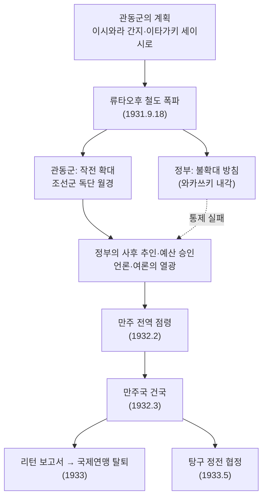
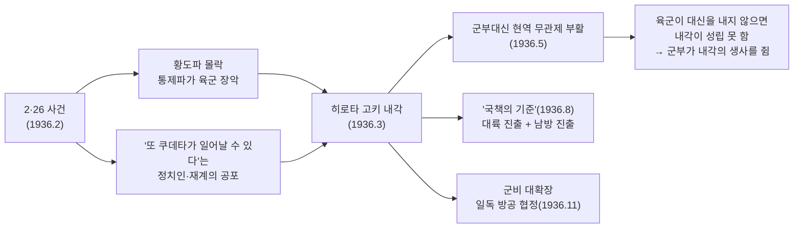

1931년 9월 18일 밤 10시 20분 무렵, 만주 펑톈(지금의 선양) 북쪽 교외의 류타오후. 일본이 경영하는 남만주 철도의 선로 위에서 폭약이 터졌다. 폭발은 크지 않아, 몇 분 뒤 열차가 아무 일 없이 그 위를 지나갔다. 그러나 관동군은 곧바로 "중국군이 철도를 폭파했다"고 발표하고, 근처의 중국군 병영과 펑톈 성을 공격했다. 폭약을 설치한 것은 관동군 자신이었다. 이 사건이 **만주사변**의 시작이다.

이 작은 폭발에서 일본의 '15년 전쟁'이 시작되었다고 보는 역사가들이 많다. 만주사변에서 중일전쟁(1937), 아시아·태평양 전쟁(1941)을 거쳐 1945년 패전까지 일본은 전쟁을 멈추지 않았다. 이 강의는 만주사변과 만주국 건국, 국제연맹 탈퇴로 일본이 워싱턴 체제(14강)를 스스로 깨뜨리는 과정, 그리고 국내에서 테러와 쿠데타가 잇따르며 정당 내각이 무너지고 군부가 정치의 중심으로 올라서는 과정을 따라간다. 그 끝에는 1936년 2월 눈 내리는 도쿄를 뒤흔든 **2·26 사건**이 있다.

> [!핵심] 이 강의의 질문
> 1. 관동군은 왜, 어떻게 만주사변을 일으켰고, 정부는 왜 이를 막지 못했는가?
> 2. 만주국은 어떤 나라였으며, 국제 사회는 이를 어떻게 보았는가?
> 3. 1930년대 전반 일본의 정당 정치는 어떻게 무너졌고, 군부는 어떻게 권력을 잡았는가?

{{F:l15-mukden}}

```timeline
1931.3 | 3월 사건 | 육군 장교 비밀 결사 사쿠라카이의 쿠데타 계획(미수)
1931.7 | 만보산 사건 | 만주에서 중국인·조선인 농민 충돌. 조선에서 화교 습격 사건으로 번짐
1931.9.18 | 류타오후 사건, 만주사변 시작 | 관동군의 자작극
1931.10 | 10월 사건 | 사쿠라카이의 두 번째 쿠데타 계획(미수)
1931.12 | 이누카이 내각, 금 수출 재금지 | 다카하시 고레키요 대장대신
1932.1 | 제1차 상하이 사변 | 
1932.2~3 | 혈맹단 사건 | 전 대장대신 이노우에 준노스케, 미쓰이 이사장 단 다쿠마 암살
1932.3.1 | 만주국 건국 | 청의 마지막 황제 푸이를 집정으로
1932.4.29 | 윤봉길 의거 | 상하이 훙커우 공원
1932.5.15 | 5·15 사건 | 해군 청년 장교들이 이누카이 총리 암살. 정당 내각 시대의 끝
1932.9 | 일만 의정서 | 일본이 만주국 승인
1932.10 | 리턴 보고서 발표 | 
1933.3 | 국제연맹 탈퇴 통고 | 
1933.5 | 탕구 정전 협정 | 만주사변의 일단락
1933 | 다키가와 사건, 공산당 간부의 전향 | 사상 통제 강화
1935 | 천황 기관설 사건, 국체 명징 성명 | 아이자와 사건(나가타 데쓰잔 참살)
1936.2.26 | 2·26 사건 | 육군 청년 장교 쿠데타. 다카하시·사이토 등 살해
1936.5 | 군부대신 현역 무관제 부활 | 히로타 고키 내각
1936.11 | 일독 방공 협정 | 
```

## 만주사변

### 왜 만주였나

러일전쟁(10강) 이후 일본은 남만주 철도와 랴오둥반도 남단의 관동주를 차지하고, 이를 지키는 군대로 **관동군**을 두었다. 만주는 석탄과 철, 콩 같은 자원이 풍부했고, 일본 상품의 시장이자 일본인과 조선인 이주민의 땅이었다. 일본 사람들은 러일전쟁에서 '10만의 영령과 20억의 국비'를 치르고 얻은 땅이라고 여겼다.

그러나 14강에서 보았듯 1928년 장쭤린 폭살 뒤 그의 아들 장쉐량이 국민당 정부와 손잡으면서, 만주에서는 일본의 철도와 나란히 달리는 중국 측 철도가 건설되고 일본 권익을 되찾으려는 국권 회수 운동이 거세졌다. 만철의 경영은 쇼와 공황까지 겹쳐 적자에 빠졌다. 관동군의 작전 주임 참모 **이시와라 간지**와 고급 참모 **이타가키 세이시로**는 외교로는 만주 문제를 해결할 수 없다고 보고, 무력으로 만주를 점령할 계획을 세웠다. 이시와라는 장차 일본과 미국 사이에 세계의 패권을 건 '최종 전쟁'이 일어날 것이며, 그에 대비하려면 만주의 자원이 반드시 필요하다고 믿었다.

### 만보산 사건

사변 두 달 전인 1931년 7월, 만주 창춘 교외의 만보산에서 수로 공사를 둘러싸고 조선인 농민과 중국인 농민이 충돌했다. 사상자는 거의 없었지만, 조선의 신문들이 '조선인이 다수 살해되었다'는 잘못된 보도를 하자, 서울과 평양 등지에서 조선인들이 화교를 습격해 100명이 넘는 중국인이 목숨을 잃었다. 일본 영사관과 경찰이 중국인과 조선인의 대립을 부추기거나 방관했다는 지적이 있다. 식민지 사람들이 서로를 미워하게 만든 이 사건은 만주의 긴장을 극도로 끌어올렸다.

### 정부의 '불확대' 방침과 군의 독주

류타오후 사건 다음 날, 와카쓰키 레이지로 내각은 각의에서 사태를 더 키우지 않는다는 **불확대 방침**을 정했다. 외무대신 시데하라 기주로는 관동군의 자작극을 의심했다. 그러나 관동군은 정부의 방침을 무시하고 작전을 넓혀 나갔다. 9월 21일에는 조선에 주둔한 일본군(조선군)의 사령관 하야시 센주로가 천황의 명령도, 정부의 승인도 없이 군대를 이끌고 압록강을 건너 만주로 들어갔다. 군대를 국외로 움직이려면 천황의 재가가 필요했으므로, 이는 명백한 군율 위반이었다.

그런데 정부는 이를 사후에 추인하고, 출병 비용까지 예산으로 승인했다. 신문들은 관동군의 '전과'를 대대적으로 보도하며 열광했고, 국민 여론도 관동군을 지지했다. 결국 와카쓰키 내각은 군을 통제하지 못한 채 12월에 물러났다. 관동군은 1932년 2월까지 하얼빈을 포함한 만주의 주요 지역을 거의 모두 점령했다. 1만 명 남짓한 관동군이 훨씬 많은 장쉐량 군대를 쉽게 몰아낼 수 있었던 것은, 장제스와 장쉐량이 공산당과의 내전에 힘을 쏟느라 일본군에 정면으로 맞서지 않는 '부저항' 방침을 택했기 때문이기도 했다.



### 제1차 상하이 사변과 윤봉길 의거

세계의 눈을 만주에서 돌리기 위해, 관동군과 연결된 일본 공사관 무관들은 1932년 1월 상하이에서 일본인 승려들이 중국인에게 습격당하는 사건을 꾸몄다. 이를 구실로 일본 해군 육전대와 중국군이 시가전을 벌였고, 일본은 육군까지 보냈다(**제1차 상하이 사변**). 중국군의 강한 저항과 열강의 압력으로 5월 정전 협정이 맺어졌다.

그 사이 1932년 4월 29일, 상하이의 훙커우 공원에서 열린 천황 생일 축하 겸 상하이 사변 전승 기념식장에서, 대한민국 임시정부의 한인애국단원 **윤봉길**이 단상에 폭탄을 던졌다. 상하이 파견군 사령관 시라카와 요시노리 대장 등이 숨지고 여러 고관이 다쳤다. 윤봉길은 그해 12월 일본 가나자와에서 처형되었다. 이 의거는 중국 국민당 정부가 대한민국 임시정부를 적극적으로 지원하게 되는 계기가 되었다.

{{F:l15-shanghai-1932}}

## 만주국

### '왕도낙토'와 '오족협화'

1932년 3월 1일, 관동군은 청나라의 마지막 황제 **푸이**를 집정(국가 원수)으로 내세워 **만주국**을 세웠다. 수도는 창춘을 이름을 바꾼 신징이었다. 만주국은 만주족·한족·몽골족·조선인·일본인의 다섯 민족이 화합하는 **오족협화**와, 덕으로 다스리는 이상향 **왕도낙토**를 건국 이념으로 내걸었다. 1934년 푸이는 황제로 즉위했다.

{{F:l15-manchukuo}}

그러나 만주국은 겉으로만 독립국이었다. 정부 각 부의 장관은 중국인이었지만, 실권은 차관 이하의 일본인 관료들이 쥐었고, 그 위에는 관동군 사령관이 있었다. 관동군 사령관은 만주국 주재 일본 대사와 관동주 장관을 겸했다. 1932년 9월 일본은 **일만 의정서**를 맺어 만주국을 승인했는데, 그 내용은 만주국이 일본의 기존 권익을 모두 인정하고 일본군이 만주국에 주둔한다는 것이었다. 국방과 철도·항만은 사실상 일본이 맡았다.

| 겉으로 내건 것 | 실제 |
|---|---|
| 독립 국가, 푸이를 원수로 | 관동군 사령관이 실질적 최고 권력자 |
| 오족협화 | 일본인이 관료·경제의 요직 독점. 중국인 농민의 토지를 수용해 일본인 개척민에게 |
| 왕도낙토 | 반만 항일 세력에 대한 대규모 토벌과 집단 부락 강제 이주 |
| 계획 경제로 산업 개발 | 관동군과 일본 신흥 재벌의 실험장. 뒤에 전쟁 물자 공급 기지로 |

표: 만주국의 겉과 속

일본 정부는 1936년부터 '20년 동안 100만 호(500만 명)를 만주로 보낸다'는 이민 계획을 세웠다. 쇼와 공황으로 고통받는 농촌의 '남는 인구'를 만주로 보내려는 것이었다. 10대 소년들로 이루어진 '만몽 개척 청소년 의용군'도 보내졌다. 1945년 패전 때 만주에는 약 27만 명의 일본인 개척민이 있었고, 소련군의 침공과 피란 과정에서 그 가운데 수만 명이 목숨을 잃었다. 만주에는 많은 조선인 농민도 이주해 있었다.

## 국제연맹 탈퇴

### 리턴 보고서

중국은 만주사변을 국제연맹에 제소했다. 국제연맹은 영국의 리턴 경을 단장으로 하는 조사단을 만주와 일본, 중국에 보냈다. 1932년 10월에 발표된 **리턴 보고서**는 다음과 같이 결론지었다.

- 9월 18일 밤 일본군의 군사 행동은 정당한 **자위 조치로 볼 수 없다**.
- 만주국은 주민의 자발적인 독립 운동으로 생긴 나라가 **아니다**.
- 다만 일본이 만주에 가진 특수한 권익은 인정되어야 하며, 사변 이전 상태로 단순히 돌아가는 것도 해결책은 아니다. 중국의 주권 아래 만주에 **자치 정부**를 세우고 국제 협력으로 운영하자.

{{F:l15-lytton}}

보고서는 일본의 체면을 어느 정도 배려한 타협안이었다. 그러나 일본은 이미 보고서가 나오기 전인 9월에 만주국을 승인해 버린 상태였다.

### "제네바를 떠나다"

1933년 2월 24일, 스위스 제네바의 국제연맹 총회는 리턴 보고서를 바탕으로 만주국을 인정하지 않고 일본군의 철수를 권고하는 안을 표결에 부쳤다. 결과는 찬성 42, 반대 1(일본), 기권 1(시암)이었다. 일본 전권 **마쓰오카 요스케**는 단상에 올라 연설한 뒤 대표단을 이끌고 회의장을 걸어 나갔다. 3월 27일 일본은 국제연맹 탈퇴를 통고했다.

{{F:l15-league-walkout}}

일본 국내의 신문들은 마쓰오카를 영웅으로 맞이했다. 「연맹이여 안녕! 우리 대표 당당히 퇴장」이라는 제목이 신문 1면을 장식했다. 일본은 이후 독일(1933년 탈퇴), 이탈리아(1937년 탈퇴)와 함께 국제 사회에서 고립되어 갔다. 1934년 일본은 워싱턴 해군 군축 조약의 폐기를 통고했고, 1936년 런던 군축 회의에서도 탈퇴했다. 이로써 워싱턴 체제는 완전히 무너졌다.

같은 1933년, 관동군은 만주국에 러허성을 편입하기 위해 만리장성을 넘어 베이징 근처까지 진격했다. 5월 중국과 **탕구 정전 협정**을 맺어 베이징 북쪽에 비무장 지대를 두는 것으로 만주사변은 일단락되었다. 그러나 일본군은 이후에도 화베이 지방을 중국 국민당 정부에서 떼어 내려는 공작(화베이 분리 공작)을 계속했고, 이것이 1937년 중일전쟁의 불씨가 된다.

## 테러와 정당 내각의 붕괴

### 잇따른 테러와 쿠데타 계획

만주에서 총성이 울리는 동안 일본 국내에서는 테러가 잇따랐다. 그 주역은 정당과 재벌, 이른바 '특권 계급'을 쓰러뜨리고 천황 중심의 새 국가를 만들자는 **국가 개조**를 외친 군인과 민간 우익이었다. 그들의 사상적 지도자 가운데 한 사람이 『일본 개조 법안 대강』을 쓴 **기타 잇키**였다.

| 시기 | 사건 | 내용 |
|---|---|---|
| 1930.11 | 하마구치 총리 저격 | 런던 군축 조약에 반대한 우익 청년의 범행(14강) |
| 1931.3 | 3월 사건 | 육군 장교 비밀 결사 사쿠라카이가 우가키 가즈시게를 총리로 내세우려 한 쿠데타 계획. 미수 |
| 1931.10 | 10월 사건 | 사쿠라카이가 만주사변에 맞춰 각료를 살해하고 군부 정권을 세우려 한 계획. 미수, 가벼운 처분 |
| 1932.2~3 | 혈맹단 사건 | 승려 이노우에 닛쇼가 이끈 혈맹단이 '한 사람이 한 사람을 죽인다'며 전 대장대신 이노우에 준노스케와 미쓰이 합명회사 이사장 단 다쿠마를 암살 |
| 1932.5.15 | **5·15 사건** | 해군 청년 장교와 육군 사관 후보생 등이 총리 관저를 습격해 이누카이 쓰요시 총리 암살 |
| 1935.8 | 아이자와 사건 | 황도파 장교 아이자와 사부로가 육군성 군무국장 나가타 데쓰잔을 칼로 살해 |
| 1936.2.26 | **2·26 사건** | 육군 청년 장교들이 1,400여 명의 병력으로 쿠데타. 각료·중신 살해 |

표: 1930년대 전반의 테러와 쿠데타

쿠데타 계획을 세운 장교들이 제대로 처벌받지 않았다는 점이 중요하다. 3월 사건과 10월 사건의 주모자들은 가벼운 근신 처분을 받는 데 그쳤다. 군 안에서 '애국적 동기'의 범행은 너그럽게 다루어졌고, 이것이 더 큰 테러를 불렀다.

### 5·15 사건

1931년 12월 총리가 된 정우회 총재 **이누카이 쓰요시**는 다이쇼 정변(11강) 때 '헌정의 신'이라 불린 노정치가였다. 그는 만주국 승인을 미루며 중국과 비밀 교섭으로 문제를 풀려 했다.

{{F:l15-inukai}}

1932년 5월 15일, 일요일 저녁. 해군 청년 장교들이 총리 관저에 들이닥쳤다. 76세의 이누카이는 그들을 응접실로 불러 "이야기하면 알 것이다(話せば分かる)"라고 말했다고 한다. 장교들은 "문답무용(問答無用)"이라 외치며 총을 쏘았다. 이누카이는 그날 밤 숨을 거두었다. 같은 날 그들은 내대신 관저와 정우회 본부, 변전소 등도 습격했다(**5·15 사건**).

사건 뒤의 반응은 더 충격적이었다. 재판이 열리자 전국에서 범인들의 감형을 요구하는 탄원서가 쏟아졌다. 서명자는 100만 명을 넘었고, 자기 손가락을 잘라 보낸 사람까지 있었다. 신문은 범인들의 '순수한 애국심'을 동정적으로 보도했다. 결국 주모자들은 사형을 면하고 비교적 가벼운 형을 받았다.

> [!핵심] '헌정의 상도'의 끝
> 5·15 사건 뒤 원로 사이온지 긴모치는 정당 총재가 아니라 해군 대장 출신의 온건파 **사이토 마코토**를 총리로 추천했다. 군부와 정당, 관료를 모두 끌어들인 '거국일치 내각'이었다. 1924년부터 8년 동안 이어진 중의원 다수당 총재가 총리가 되는 관행, 곧 **헌정의 상도**(12강)는 이렇게 끝났다. 정당 내각은 1945년 패전 때까지 다시 들어서지 못했다.

## 다카하시 재정과 경제 회복

### 공황에서 가장 먼저 벗어난 나라

이누카이 내각부터 대장대신을 맡은 **다카하시 고레키요**는 14강의 이노우에 재정과 정반대의 정책을 폈다. 1931년 12월 취임하자마자 **금 수출을 다시 금지**해 금본위제에서 벗어났고, 정부가 발행한 국채를 일본은행이 직접 사들이게 해 돈을 풀었다. 그 돈으로 군사비와 농촌 구제 토목 사업(시국 광구 사업)을 늘렸다. 오늘날의 말로 하면 적극적인 재정 확대와 금융 완화였다.

{{F:l15-takahashi}}

엔화 가치가 크게 떨어지자 일본 상품은 세계 시장에서 싸졌다. 특히 면직물 수출이 급증해 1933년에는 영국을 제치고 세계 1위가 되었다. 영국과 인도 등은 일본이 노동자의 낮은 임금을 무기로 '덤핑'을 한다며 관세를 높였다. 군수 산업이 자라면서 기계·금속·화학 같은 중화학 공업이 빠르게 성장했고, 1930년대 후반에는 중화학 공업 생산액이 경공업을 넘어섰다. 일본은 세계 대공황에서 가장 빨리 벗어난 나라 가운데 하나가 되었다.

### 신흥 재벌과 군사비

군수 산업과 만주·조선 개발에 뛰어든 새로운 기업 집단도 생겨났다. 아유카와 요시스케의 **닛산** 콘체른은 만주의 중공업 개발을 맡았고, 노구치 시타가우의 **닛치쓰**(일본질소)는 조선 북부 흥남에 거대한 화학 공장과 수력 발전소를 세웠다. 이들을 **신흥 재벌**이라 부른다. 군부는 미쓰이·미쓰비시 같은 기존 재벌보다 이들과 손잡기를 좋아했다.

```chart
{
  "type": "bar",
  "caption": "일본 정부 세출에서 군사비가 차지한 비율 (%, 대략적인 통설 수치). 만주사변 뒤 해마다 늘어 1936년에는 세출의 절반 가까이에 이르렀다",
  "data": {
    "labels": ["1931", "1932", "1933", "1934", "1935", "1936"],
    "datasets": [{ "label": "군사비 비율(%)", "data": [30.8, 35.2, 38.7, 43.8, 46.8, 47.2] }]
  },
  "options": { "scales": { "y": { "min": 0, "max": 60 } }, "plugins": { "legend": { "display": false } } }
}
```

그러나 다카하시는 인플레이션을 막기 위해 1934년부터 군사비를 억제하려 했다. 그는 예산은 국민의 소득에 맞추어야 하며, 국방만 생각해 국민 생활과 재정을 무너뜨려서는 안 된다는 취지로 군부의 예산 요구에 맞섰다. 이것이 그의 목숨을 앗아 가게 된다.

## 사상 통제와 천황 기관설 사건

군부가 힘을 얻는 동안, 자유주의와 사회주의 사상에 대한 탄압도 거세졌다.

- **공산당 탄압과 전향**: 1933년 2월 프롤레타리아 작가 고바야시 다키지가 특고(특별고등경찰)의 고문으로 숨졌다. 6월에는 옥중의 일본공산당 최고 간부 사노 마나부와 나베야마 사다치카가 공산주의를 버리고 천황 아래의 '일국 사회주의'를 지지한다는 성명을 냈다. 이후 수많은 공산주의자가 사상을 버리는 **전향**의 길을 걸었다.
- **다키가와 사건** (1933): 교토 제국대학 법학부 교수 다키가와 유키토키의 형법 학설이 '위험 사상'이라 하여 문부대신이 그를 휴직시켰다. 법학부 교수 전원이 사표를 내며 항의했지만 결국 무너졌다. 대학의 자치와 학문의 자유가 꺾였다.
- **천황 기관설 사건** (1935): 귀족원에서 군인 출신 의원이 미노베 다쓰키치의 천황 기관설(12강)을 "천황을 국가의 기관으로 보는 것은 국체에 반하는 반역 사상"이라고 공격했다. 30년 가까이 학계의 정설이던 학설이었다. 미노베는 귀족원 의원을 사직했고, 그의 책은 판매 금지되었다. 오카다 게이스케 내각은 군부와 우익의 압력에 밀려 두 차례 **국체 명징 성명**을 내, 천황이 통치권의 주체라는 것만이 올바른 해석이라고 선언했다.

> [!주의] 헌법 해석이 바뀐 날
> 천황 기관설 사건은 대일본제국헌법의 조문을 한 글자도 바꾸지 않고, 그 해석만으로 의회와 내각 중심의 정치를 정당화하던 논리를 무너뜨렸다. 이제 천황의 이름을 내세우는 자, 특히 천황의 통수권을 쥔 군부를 비판하기가 어려워졌다. 8강에서 본 헌법의 '통수권 독립' 조항과 '법률의 범위 안의 권리'는 이렇게 1930년대에 본래의 위험을 드러냈다.

## 2·26 사건

### 황도파와 통제파

육군 안에서도 노선 다툼이 벌어졌다. **황도파**는 아라키 사다오, 마자키 진자부로 등을 받드는 청년 장교들의 집단으로, 천황이 직접 다스리는 정치(천황 친정)를 내세우며 무력으로 '쇼와 유신'을 일으켜 정당·재벌·중신을 몰아내야 한다고 주장했다. 이에 맞선 **통제파**는 육군성·참모본부의 엘리트 막료들로, 군의 규율을 지키며 관료·재벌과 손잡고 합법적으로 국가 전체를 전쟁에 대비하는 체제(총력전 체제)로 바꾸려 했다. 통제파의 중심은 나가타 데쓰잔이었고, 도조 히데키도 이 계열이었다.

| | 황도파 | 통제파 |
|---|---|---|
| 중심 인물 | 아라키 사다오, 마자키 진자부로, 청년 장교들 | 나가타 데쓰잔, 도조 히데키 등 육군성·참모본부 막료 |
| 목표 | 천황 친정, 쇼와 유신. 소련과의 대결 중시 | 총력전 체제, 군부 주도의 국가 개조 |
| 방법 | 테러와 쿠데타도 불사 | 군기를 지키며 합법적으로, 관료·재벌과 제휴 |
| 결말 | 2·26 사건 실패로 몰락 | 사건 뒤 육군의 주도권 장악 |

표: 황도파와 통제파

1934년 황도파 청년 장교들의 쿠데타 모의가 적발되고(사관학교 사건), 1935년 황도파의 마자키가 교육총감에서 밀려나자, 그 보복으로 황도파 장교 아이자와 사부로가 백주에 육군성에서 통제파의 중심인 나가타 데쓰잔 군무국장을 칼로 베어 죽였다(아이자와 사건). 군 내부의 대립은 폭발 직전이었다.

### 1936년 2월 26일

1936년 2월 26일 새벽, 며칠 전 내린 기록적인 큰 눈이 아직 쌓여 있던 도쿄. 황도파 청년 장교들이 이끄는 근위사단과 제1사단 병력 약 1,400명이 병영을 나섰다. 그들은 '존황토간尊皇討奸'(천황을 받들고 간신을 친다)을 내걸고 정부 요인들의 관저를 일제히 습격했다.

{{F:l15-feb26}}

| 습격 대상 | 결과 |
|---|---|
| 총리 오카다 게이스케 | 처남인 마쓰오 대좌가 총리로 오인되어 살해됨. 오카다는 관저에 숨어 있다가 탈출 |
| 내대신 사이토 마코토 (전 총리, 13강의 조선 총독) | 살해 |
| 대장대신 다카하시 고레키요 | 살해 (군사비 억제에 대한 보복) |
| 교육총감 와타나베 조타로 | 살해 |
| 시종장 스즈키 간타로 | 중상 (뒤에 1945년 패전 때의 총리) |
| 전 내대신 마키노 노부아키 | 습격당했으나 탈출 |

표: 2·26 사건의 습격 대상

반란군은 국회 의사당과 총리 관저, 육군성이 있는 나가타초 일대를 나흘 동안 점거했다. 그들은 천황이 자신들의 '진심'을 알아주고 황도파 장군을 중심으로 새 정부를 세워 줄 것이라 기대했다. 육군 수뇌부 일부도 처음에는 그들에게 동정적인 태도를 보였다.

그러나 쇼와 천황의 태도는 단호했다. 믿고 의지하던 중신들이 살해된 데 격노한 천황은 "짐이 가장 신뢰하는 늙은 신하들을 죽이는 것은 짐의 목을 조르는 것과 같다. 짐이 직접 근위사단을 이끌고 진압하겠다"고 말했다고 전한다. 계엄령이 내려지고 정부군이 반란군을 포위했다. 2월 29일, 라디오와 애드벌룬으로 "병사들에게 고한다. 지금이라도 늦지 않으니 원대로 돌아가라"는 방송과 표어가 퍼지자, 사병들은 차례로 귀순했다. 장교들은 체포되거나 자결했다.

### 2·26 사건 이후

반란 주모자들은 비공개 군법 회의에서 서둘러 재판을 받고, 사상적 배후로 지목된 기타 잇키 등과 함께 처형되었다. 황도파는 몰락했다. 그러나 사건의 진짜 승자는 '군'이었다.



사건 뒤 들어선 히로타 고키 내각은 군부의 요구에 따라 1936년 5월 **군부대신 현역 무관제**를 부활시켰다(11강에서 본 그 제도다). 이제 육군이나 해군이 대신을 내주지 않으면 어떤 내각도 만들어질 수 없었다. 실제로 1937년 육군이 반대한 우가키 가즈시게는 육군대신을 구하지 못해 총리가 되지 못했다. 정치인들은 또 다른 쿠데타가 두려워 군부에 맞서지 못했다. 히로타 내각은 대륙과 남방으로 동시에 진출한다는 '국책의 기준'을 정하고, 군비를 크게 늘렸으며, 1936년 11월 나치 독일과 **일독 방공 협정**을 맺었다.

2·26 사건은 실패한 쿠데타였지만, 그 결과 군부는 테러가 아니라 제도를 통해 정치를 지배하게 되었다. 이듬해 1937년 7월, 베이징 교외의 루거우차오에서 총성이 울린다.

## 정리

> [!핵심] 15강 요약
> - 1931년 관동군은 **류타오후 사건**을 꾸며 **만주사변**을 일으켰다. 정부의 불확대 방침은 무시되었고, 조선군의 독단 월경까지 사후 추인되었다. 여론은 관동군에 열광했다.
> - 1932년 푸이를 내세운 **만주국**이 세워졌지만, 실권은 관동군과 일본인 관료가 쥐었다. 상하이에서는 **윤봉길 의거**가 일어났다.
> - **리턴 보고서**를 바탕으로 한 국제연맹 결의에 반발해 일본은 1933년 **국제연맹을 탈퇴**했고, 워싱턴 체제는 무너졌다.
> - **혈맹단 사건**과 **5·15 사건**(1932)으로 이누카이 총리가 암살되며 정당 내각이 끝났다. **다카하시 재정**은 공황 탈출을 이끌었지만 군사비가 급증했다.
> - 다키가와 사건, **천황 기관설 사건**(1935)으로 사상 통제가 강화되었고, 육군의 황도파가 일으킨 **2·26 사건**(1936)은 실패했지만 그 뒤 **군부대신 현역 무관제**가 부활해 군부가 정치를 장악했다.

### 생각해 볼 질문

1. 관동군의 독단적인 행동을 정부가 '사후 추인'한 것은 어떤 선례를 남겼을까? 14강의 장쭤린 폭살 사건 처리와 비교해 보자.
2. 5·15 사건의 범인들에게 100만 명이 넘는 사람이 감형 탄원을 한 이유는 무엇일까? 쇼와 공황기의 사회 분위기와 연결해 생각해 보자.
3. 2·26 사건은 '실패한 쿠데타'였는데, 왜 그 뒤 군부의 힘은 오히려 더 강해졌을까?

### 다음 강 예고

16강에서는 1937년 루거우차오 사건으로 시작된 **중일전쟁**, 난징 대학살, 국가총동원법과 총력전 체제, 그리고 식민지 조선에서 강화된 **황국 신민화 정책**(창씨개명, 징용과 징병, 일본군 '위안부' 동원)을 다룬다.
