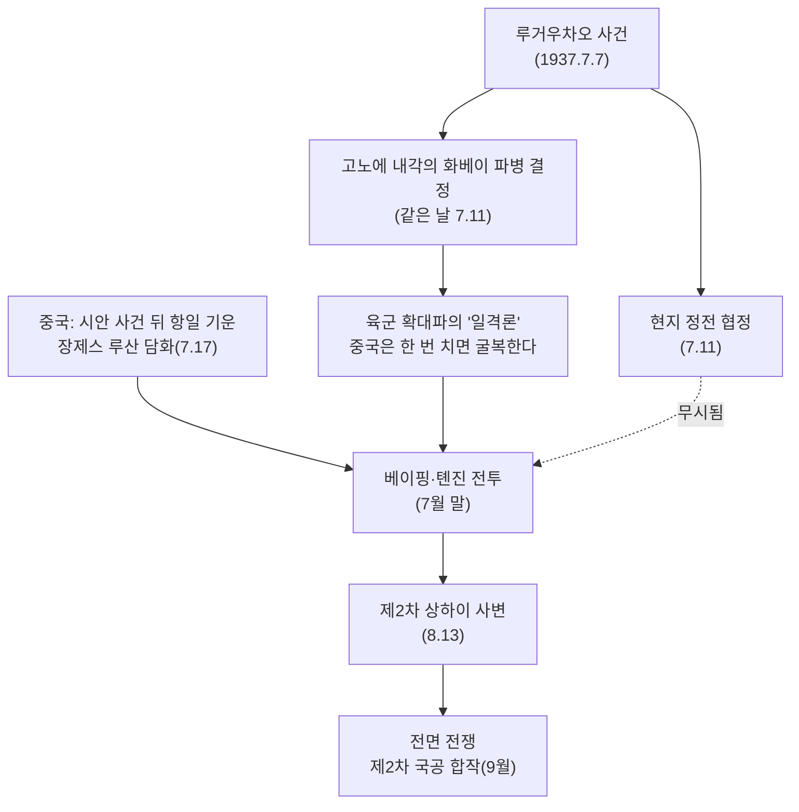
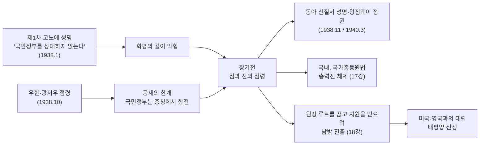

1937년 7월 7일 밤, 베이핑(지금의 베이징) 남서쪽 교외의 융딩허 강가. 마르코 폴로가 "세상에서 가장 아름다운 다리"라고 칭찬했다는 돌다리 **루거우차오** 근처에서 일본군 중대가 야간 훈련을 하고 있었다. 밤 10시 40분 무렵, 어둠 속에서 몇 발의 총성이 울렸다. 점호를 해 보니 병사 한 명이 보이지 않았다. 그 병사는 20분쯤 뒤 무사히 돌아왔지만, 일본군은 이미 중국군이 발포했다며 출동 태세에 들어갔다. 이튿날 새벽, 양쪽 군대 사이에 전투가 시작되었다.

처음 총을 쏜 쪽이 누구였는지는 지금도 분명하지 않다. 그러나 분명한 것은, 이 작은 충돌이 현지에서 정전 협정이 맺어졌는데도 전면 전쟁으로 번졌고, 그 전쟁이 8년 동안 계속되며 1,000만 명이 넘는 중국인의 목숨을 앗아 갔다는 사실이다. 일본은 이 전쟁을 끝까지 '전쟁'이라 부르지 않고 **지나사변**이라 불렀다. 이 강의는 중일전쟁이 어떻게 시작되어 확대되었는지, 난징에서 무슨 일이 일어났는지, 그리고 일본이 왜 이 전쟁을 끝내지 못하고 진흙탕 같은 장기전에 빠져들었는지를 살펴본다.

> [!핵심] 이 강의의 질문
> 1. 루거우차오의 작은 충돌은 왜 전면 전쟁으로 번졌는가?
> 2. 난징 대학살은 어떻게 일어났으며, 오늘날 어떻게 기억되고 있는가?
> 3. 일본은 왜 중국과의 전쟁을 끝내지 못했고, 그것은 이후 일본의 진로에 어떤 영향을 주었는가?

```figure
src: asset:21df748d971ed8f978aa517f4279f7ba
caption: 루거우차오를 건너 진군하는 일본군. 1938년 일본에서 펴낸 사진첩에 '사변이 일어난 땅, 루거우차오를 가는 정예 병사'라는 설명과 함께 실렸다. 사건 당일이 아니라 그 뒤의 모습이다.
credit: 도코샤(東光社) 편 『지나사변 사진첩』, 1938년 · 일본 국립국회도서관 디지털 컬렉션
license: Public Domain (1946년 이전 공표, 국립국회도서관 디지털 컬렉션 퍼블릭 도메인 표시)
source: https://dl.ndl.go.jp/pid/1112119/1/10
width: wide
```

```timeline
1935.11 | 기동 방공 자치 정부 수립 | 일본군의 화베이 분리 공작
1936.12 | 시안 사건 | 장쉐량이 장제스를 감금, 내전 중지와 항일을 요구
1937.6 | 제1차 고노에 후미마로 내각 | 
1937.7.7 | 루거우차오 사건 | 중일전쟁 시작
1937.7.11 | 현지 정전 협정 / 화베이 파병 결정 | 같은 날 일어난 두 가지 일
1937.8.13 | 제2차 상하이 사변 | 전쟁이 화중으로 확대
1937.9 | 제2차 국공 합작 성립 / '지나사변'으로 명칭 변경 | 
1937.11 | 대본영 설치, 국민정부 충칭 천도 선언 | 
1937.12.13 | 난징 함락 | 난징 대학살
1938.1.16 | 제1차 고노에 성명 | "이후 국민정부를 상대하지 않는다"
1938.4 | 국가총동원법 공포 | 
1938.5 | 쉬저우 점령 | 
1938.10 | 광저우·우한 점령 | 일본군의 공세가 한계에 이름
1938.11 | 제2차 고노에 성명 | '동아 신질서' 건설
1940.3 | 왕징웨이 정권 수립 | 난징 국민정부
```

## 전쟁의 시작

### 루거우차오에 이르는 길

15강에서 보았듯 1933년 탕구 정전 협정으로 만주사변은 일단락되었다. 그러나 일본군은 거기서 멈추지 않았다. 관동군과 톈진에 주둔한 일본군(지나 주둔군)은 베이핑과 톈진을 포함한 화베이 5성을 국민정부에서 떼어 내 일본의 영향 아래 두려는 **화베이 분리 공작**을 벌였다. 1935년 11월에는 베이핑 동쪽에 친일 정권인 기동 방공 자치 정부를 세웠다. 이 지역을 통한 일본 상품의 밀무역이 횡행해 중국의 관세 수입이 크게 줄었다.

중국 사람들의 분노는 커져 갔다. 1935년 12월 베이핑의 학생들은 "내전을 멈추고 일치하여 일본에 맞서자"며 시위를 벌였다(12·9 운동). 그러나 장제스는 '먼저 나라 안을 안정시킨 뒤 밖의 적을 물리친다(안내양외)'며 공산당 토벌을 계속했다. 그러던 1936년 12월, 공산당 토벌을 독려하러 시안에 간 장제스를 동북군 사령관 **장쉐량**이 감금하고 내전 중지와 항일을 요구했다(**시안 사건**). 장제스는 풀려났고, 국민당과 공산당은 내전을 멈추고 손을 잡는 쪽으로 나아갔다.

같은 무렵 일본에서는 1937년 6월 귀족 출신의 젊은 정치가 **고노에 후미마로**가 총리가 되었다. 고노에는 천황가와 가까운 명문 귀족 고노에 가문의 당주로, 군부와 정당, 국민 모두에게 인기가 높았다. 사람들은 그가 2·26 사건 이후의 어수선한 정치를 수습해 주리라 기대했다. 루거우차오에서 총성이 울린 것은 고노에 내각이 출범한 지 불과 한 달 만이었다.

```figure
src: asset:4da2ff6634af1b9fd96c0f71ccc8d174
caption: 고노에 후미마로(1891~1945). 명문 귀족 출신으로 세 차례 총리를 지냈다. 중일전쟁 개전, '국민정부를 상대하지 않는다'는 성명, 신체제 운동과 삼국 동맹이 모두 그의 내각에서 이루어졌다. 패전 뒤 전범 용의자로 체포 명령을 받자 음독자살했다.
credit: 촬영자·연도 미상 · 국립국회도서관 「근대일본인의 초상」
license: Public Domain (국립국회도서관: 저작권 보호 기간 만료)
source: https://www.ndl.go.jp/portrait/datas/81/
width: narrow
```

### 정전 협정과 파병 결정이 같은 날

사건 직후 현지의 일본군과 중국군은 교섭을 벌여 7월 11일 **현지 정전 협정**을 맺었다. 그런데 바로 그날 도쿄의 고노에 내각은 각의에서 화베이에 대규모 병력을 보내기로 결정하고, 이를 '북지사변'이라 부르며 성명을 발표했다. 고노에는 그날 밤 정계·재계·언론계 대표들을 총리 관저에 불러 '거국일치'의 협력을 요청했다.

육군 안에서도 의견은 갈렸다. 참모본부 작전부장 **이시와라 간지**는 진짜 적은 소련이며 중국과 전쟁을 하면 끝없는 수렁에 빠질 것이라며 확대에 반대했다(불확대파). 만주사변을 일으킨 장본인이 이번에는 확대를 막으려 한 것이다. 그러나 육군성과 참모본부의 다수는 "한 번 강하게 쳐서 중국을 굴복시키면 화베이 문제를 한꺼번에 해결할 수 있다"고 보았다(확대파, 일격론). 이들은 중국군의 저항력을 얕보았고, 전쟁은 몇 달이면 끝날 것이라 생각했다.

```figure
src: asset:ef8f75cdaea596eb7f89f344eec9a91a
caption: 장제스(1887~1975). 국민정부의 최고 지도자로 수도를 충칭으로 옮겨 가며 8년 동안 항전을 이끌었다. 촬영 연도는 분명하지 않다(목록상 1945년).
credit: 촬영자 미상 · 미국 의회도서관 소장
license: Public Domain (미국 의회도서관: 출판 제한 없음)
source: https://www.loc.gov/item/2004671923/
width: narrow
```

한편 장제스는 7월 17일 루산에서 "만약 피할 수 없는 마지막 고비에 이른다면, 우리는 오직 희생할 뿐이며 항전할 뿐이다"라는 담화를 발표했다. 중국은 더 이상 물러서지 않겠다는 뜻이었다. 7월 말 일본군은 총공격을 시작해 베이핑과 톈진을 점령했다.



```figure
src: asset:4e238a288963662f9283d82dcee08c40
caption: 1937년 10월 화베이의 정딩성을 점령하고 부서진 성문 누각 위에서 일장기를 흔들며 만세를 부르는 일본군. 『도쿄 아사히 신문』이 펴낸 사진첩에 '정딩성을 점령한 황군'이라는 제목으로 실렸다.
credit: 도쿄 아사히 신문사 편 『지나사변 사진첩』, 1937년 · 일본 국립국회도서관 디지털 컬렉션
license: Public Domain (1946년 이전 공표, 국립국회도서관 디지털 컬렉션 퍼블릭 도메인 표시)
source: https://dl.ndl.go.jp/pid/1112238/1/2
```

### 상하이에서 난징으로

8월 13일, 전쟁은 국제 도시 **상하이**로 번졌다. 일본 해군 육전대와 중국군 사이에 전투가 벌어지자 일본은 육군을 보냈다(**제2차 상하이 사변**). 장제스는 독일 군사 고문단이 훈련시킨 정예 부대를 상하이에 쏟아부었다. 일본 정부는 8월 15일 "지나군의 포악함을 응징한다"는 성명을 냈고, 같은 날 일본 해군 항공대는 나가사키와 타이완의 기지에서 바다를 건너 난징 등을 폭격했다. 일본 신문은 이를 '도양 폭격'이라며 크게 보도했다.

상하이 전투는 석 달 동안 이어졌다. 일본군은 4만 명이 넘는 사상자를 냈고, 중국군의 피해는 그보다 훨씬 컸다. 9월에는 국민당과 공산당이 정식으로 **제2차 국공 합작**을 이루어 공산당 군대가 국민혁명군 제8로군(팔로군) 등으로 편성되었다. 일본 정부는 9월 이 전쟁의 이름을 '북지사변'에서 **지나사변**으로 바꾸었다. 화베이만이 아니라 중국 전체와 싸우게 되었다는 뜻이었다.

```figure
src: asset:37a7a0ecfa8f719143ebd5571326cbf7
caption: 상하이 전선의 '크리크(운하) 전'. 상하이 주변에는 크고 작은 운하가 그물처럼 얽혀 있어, 일본군은 연기 속에서 물을 건너며 중국군의 방어선을 하나씩 뚫어야 했다.
credit: 도쿄 아사히 신문사 편 『지나사변 사진첩』, 1937년 · 일본 국립국회도서관 디지털 컬렉션
license: Public Domain (1946년 이전 공표, 국립국회도서관 디지털 컬렉션 퍼블릭 도메인 표시)
source: https://dl.ndl.go.jp/pid/1112238/1/14
```

> [!참고] 왜 '전쟁'이 아니라 '사변'이었을까?
> 일본과 중국은 1941년 12월까지 서로 선전 포고를 하지 않았다. 일본이 선전 포고를 하지 않은 데에는 이유가 있었다. 정식으로 '전쟁 상태'가 되면 미국의 **중립법**이 적용되어, 일본은 미국에서 석유와 고철 같은 전쟁 물자를 사들이기 어려워진다. 일본은 이 물자의 상당 부분을 미국에 의존하고 있었다. 또 '사변'이라 부르면 국제법상의 전쟁 규칙, 특히 포로 대우에 관한 규칙을 지키지 않아도 된다는 생각도 군 안에 있었다. 이것은 뒤에 포로 학살 문제로 이어진다.

11월 5일, 일본군의 새 부대가 상하이 남쪽 항저우만에 상륙해 중국군의 뒤를 찌르자 중국군은 무너지듯 물러났다. 11월 중순 상하이를 점령한 일본군은 원래 상하이 주변만 확보하라는 명령을 받고 있었다. 그러나 현지 사령관 **마쓰이 이와네**가 이끄는 중지나 방면군은 독단으로 수도 **난징**을 향해 추격을 시작했다. 도쿄의 참모본부는 12월 1일 이를 추인하는 난징 공략 명령을 내렸다. 만주사변 때와 똑같은 일이 되풀이된 것이다.

11월 20일, 일본은 전시에 천황 아래 육해군의 최고 통수 기관으로 두는 **대본영**을 설치했다. 같은 날 국민정부는 수도를 내륙 깊숙한 쓰촨의 **충칭**으로 옮긴다고 선언했다. 수도를 빼앗겨도 항전을 계속하겠다는 뜻이었다.

## 난징 대학살

### 1937년 12월의 난징

1937년 12월 13일 일본군은 난징을 점령했다. 그 뒤 몇 주 동안 난징 성 안팎에서 일본군은 항복한 중국군 포로와 민간인 옷으로 갈아입은 패잔병, 그리고 수많은 일반 시민을 학살했다. 강간과 약탈, 방화도 광범위하게 일어났다. 이것이 **난징 대학살**(난징 사건)이다.

왜 이런 일이 일어났을까? 역사가들은 몇 가지 원인을 든다.

- **무리한 추격과 보급의 무시**: 상하이에서 난징까지 300km 가까운 길을 일본군은 보급을 제대로 받지 못한 채 서둘러 진격했다. 식량은 현지에서 '징발'하라는 방침이었고, 이는 곧 약탈로 이어졌다.
- **포로를 받아들일 준비의 부재**: '사변'이라는 명분 아래 국제법상의 포로 대우를 무시했고, 수만 명의 포로를 먹이고 수용할 계획이 없었다. 일부 부대의 진중 일지에는 포로를 '처리'했다는 기록이 남아 있다.
- **상하이 전투의 복수심과 중국인 멸시**: 예상 밖의 큰 피해를 입은 병사들 사이에 복수심이 퍼져 있었고, 중국인을 낮추어 보는 의식이 폭력을 부추겼다.
- **군기의 붕괴와 지휘관의 방관**: 상급 지휘관들은 사태를 알고도 제대로 막지 않았다.

일본 국내에는 이 사실이 전해지지 않았다. 신문들은 난징 함락을 축하하는 제등 행렬을 보도했고, 두 장교가 누가 먼저 중국인 100명을 베는지 겨룬다는 이른바 '100인 베기 경쟁'을 무용담처럼 실었다. 국민들이 학살을 알게 된 것은 패전 뒤 도쿄 재판에서였다.

```gallery
src: asset:05204f9e6c5529706d2331ea32c2e998
caption: 1937년 12월, 무너진 난징 성벽 위에서 일장기를 흔드는 일본군. 사진첩에는 '난징 함락'이라는 제목이 붙어 있다. 이런 승전 사진은 일본에서 크게 보도되었지만, 그 뒤 성 안팎에서 벌어진 학살은 보도되지 않았다.
credit: 도코샤(東光社) 편 『지나사변 사진첩』, 1938년 · 일본 국립국회도서관 디지털 컬렉션
license: Public Domain (1946년 이전 공표, 국립국회도서관 디지털 컬렉션 퍼블릭 도메인 표시)
source: https://dl.ndl.go.jp/pid/1112119/1/64
---
src: asset:03ab504b89e00ec8b8d370bce424fdda
caption: 난징 성문을 지나 시내로 들어가는 일본군 보병과 기마 장교들. 성벽이 포격으로 크게 부서져 있다.
credit: 촬영자 미상, 1937년 12월 · 오스트레일리아 전쟁기념관(AWM) 소장 (영국 제국전쟁박물관 사진의 사본)
license: Public Domain (오스트레일리아 전쟁기념관: 저작권 만료)
source: https://www.awm.gov.au/collection/C296753
```

### 난징 안전구와 외국인들

학살의 한가운데에서 시민을 지키려 한 사람들도 있었다. 난징에 남아 있던 20여 명의 서양인들은 **난징 안전구 국제위원회**를 만들어, 성 안의 한 구역을 피란민 보호 구역으로 정했다. 위원장은 독일 기업 지멘스의 직원이자 나치당원이었던 **욘 라베**였다. 그는 일본의 동맹국 독일 사람이라는 처지를 이용해 일본군 병사들을 쫓아내며 20만 명이 넘는 피란민을 보호하려 애썼다. 진링 여자문리학원의 미국인 교육자 **미니 보트린**은 학교에 수천 명의 여성과 아이들을 받아들였다. 이들이 남긴 일기와 기록, 미국인 선교사들이 찍은 필름은 지금 난징 대학살의 가장 중요한 증거가 되었다.

> [!사료] 욘 라베의 일기에서 (1937년 12월)
> 라베는 일기에 날마다 일본군 병사들이 피란민 구역에 들어와 여성들을 끌어가고, 남자들을 '패잔병'이라며 끌고 가 처형하는 모습을 적었다. 그는 일본 대사관에 수십 차례 항의서를 냈고, 1938년 독일로 돌아간 뒤 히틀러에게 일본군의 만행을 알리는 보고서를 보냈다가 게슈타포에 체포되기도 했다. 그의 일기는 1996년에야 세상에 공개되었다.

### 희생자 수를 둘러싼 논쟁

난징 대학살의 희생자 수는 지금도 논쟁 중이다. 당시의 기록이 불완전하고, '난징'의 범위와 '학살'의 기준을 어떻게 잡느냐에 따라 숫자가 크게 달라지기 때문이다.

| 주체 | 희생자 수 | 근거·특징 |
|---|---|---|
| 중국 정부, 난징 대학살 기념관 | 30만 명 이상 | 1947년 난징 군사 법정 판결 |
| 극동 국제 군사 재판(도쿄 재판) 판결 | 20만 명 이상 | 점령 후 6주 동안 난징과 그 주변 |
| 일본의 연구자들 | 수만 명에서 20만 명 정도까지 여러 설 | 군 기록·일기·매장 기록 등을 분석 |
| 일본 정부(외무성) | 구체적인 수는 "여러 설이 있어 단정하기 어렵다" | "비전투원 살해와 약탈 행위가 있었던 것은 부정할 수 없다" |

표: 난징 대학살 희생자 수에 대한 여러 견해

숫자에 대한 논쟁과 별개로, 대규모 학살과 폭력이 있었다는 사실 자체는 일본 정부도 인정하고 있다. 그러나 일본 사회 일각에서는 지금도 사건 자체를 부정하거나 축소하려는 주장이 나와 중국과의 외교 문제가 되곤 한다. 도쿄 재판에서는 중지나 방면군 사령관 마쓰이 이와네가 부하들의 만행을 막지 못한 책임으로 사형 판결을 받았다.

### 파나이호 사건

난징 함락 하루 전인 12월 12일, 난징 상류의 양쯔강에서 미국 대사관원과 피란민을 태운 미국 해군 포함 **파나이호**가 일본 해군기의 폭격을 받아 침몰했다. 사망자가 나왔고, 같은 날 영국 군함도 일본 육군의 포격을 받았다. 미국 여론은 크게 들끓었지만, 일본 정부가 재빨리 사과하고 약 221만 달러의 배상금을 물어 사건은 수습되었다. 그러나 이 사건은 미국인들이 일본을 보는 눈을 크게 바꾸어 놓았다.

```gallery
src: asset:350a63966fadbfb73dce0db525364083
caption: 사건 9년 전인 1928년, 상하이 근처 우쑹 앞바다를 지나는 미국 해군 포함 파나이호. 해군의 사진 대장 카드에 붙어 있는 사진이다.
credit: 미 해군 함정국 촬영, 1928년 · 미국 국립문서보관소(NARA) 소장
license: Public Domain (미국 연방정부 저작물)
source: https://catalog.archives.gov/id/404792257
---
src: asset:3ff535f1021dbd48b3abd7f6a2ea0268
caption: 1937년 12월 31일 워싱턴에서 해군 차관보에게 파나이호 침몰 상황을 설명하는 뉴스 영화 촬영 기사 노먼 앨리. 그가 배 위에서 찍은 폭격 장면 필름은 미국 극장에서 상영되어 큰 반향을 일으켰다.
credit: 해리스 앤드 유잉(Harris & Ewing), 1937년 · 미국 의회도서관 소장
license: Public Domain (미국 의회도서관: 출판 제한 없음)
source: https://www.loc.gov/item/2016872794/
```

## "국민정부를 상대하지 않는다"

### 트라우트만 공작과 제1차 고노에 성명

난징 공략과 함께 일본은 독일의 주중 대사 트라우트만을 통해 장제스와 화평 교섭을 벌이고 있었다. 그런데 난징을 점령하자 일본 정부는 승리에 도취해 화평 조건을 더 무겁게 했다. 배상금, 화베이와 내몽골의 특수 지역화, 만주국 승인 등 중국이 도저히 받아들일 수 없는 조건이었다. 참모본부는 오히려 장기전을 우려해 교섭 계속을 주장했지만, 정부가 이를 눌렀다.

1938년 1월 16일, 고노에 총리는 "제국 정부는 이후 국민정부를 상대하지 않는다"는 성명을 발표했다(**제1차 고노에 성명**). 장제스 정부를 교섭 상대로 인정하지 않고, 새로 세울 친일 정권과 교섭하겠다는 뜻이었다. 이는 스스로 전쟁을 끝낼 길을 막아 버린 결정이었다. 고노에 자신도 뒤에 이 성명이 큰 실수였다고 인정했다.

### 확대되는 전선, 끝나지 않는 전쟁

1938년 일본군은 계속 공세를 폈다. 3~4월 산둥의 타이얼좡에서는 중국군에 패해 큰 피해를 입었지만, 5월 교통의 요지 **쉬저우**를 점령했다. 일본군의 진격을 막기 위해 중국군은 6월 황허의 제방을 무너뜨렸다. 일본군의 진격은 일시 멈추었지만, 허난·안후이·장쑤의 넓은 땅이 물에 잠겨 수십만 명의 중국 농민이 죽고 수백만 명이 집을 잃었다.

10월 일본군은 남쪽의 **광저우**와 국민정부의 임시 수도 **우한**을 점령했다. 이때 일본은 만주를 포함한 중국 대륙에 100만 명 가까운 병력을 쏟아붓고 있었다. 그러나 국민정부는 더 깊은 내륙의 충칭으로 옮겨 가 항전을 계속했다. 일본의 국력으로는 더 이상 대규모 공세를 펼 수 없었다. 전쟁은 **장기전**으로 접어들었다.

| 구분 | 일본의 예상 | 실제 |
|---|---|---|
| 전쟁 기간 | 석 달 정도면 끝난다('일격론') | 8년 동안 계속되어 태평양 전쟁으로 이어짐 |
| 중국군의 저항 | 한 번 치면 무너진다 | 상하이에서 석 달 동안 격전, 수도를 옮겨 항전 계속 |
| 점령지 | 화베이를 떼어 내 지배 | 도시와 철도(점과 선)만 장악, 농촌은 유격대의 세상 |
| 국제 관계 | 열강은 개입하지 않는다 | 미국·영국·소련이 중국을 지원(원장 루트) |

표: 일본의 예상과 중일전쟁의 현실

일본군이 차지한 것은 대도시와 철도, 즉 **점과 선**뿐이었다. 그 사이의 넓은 농촌에서는 중국 공산당의 팔로군과 신사군이 유격전을 펼치며 항일 근거지를 넓혀 갔다. 1940년 팔로군이 화베이의 철도와 일본군 거점을 일제히 공격하자(백단 대전), 일본군은 근거지를 없애기 위해 마을을 불태우고 주민을 죽이는 소탕 작전을 벌였다. 중국에서는 이를 '모두 죽이고, 모두 태우고, 모두 빼앗는다'는 뜻에서 **삼광 작전**이라 불렀다.

일본군은 충칭을 굴복시키기 위해 1938년부터 1943년까지 충칭에 대한 폭격을 200차례 넘게 되풀이했다. 1939년 5월의 폭격에서는 이틀 동안 수천 명의 시민이 목숨을 잃었다. 도시를 무차별로 폭격해 시민의 전쟁 의지를 꺾으려는 이 **전략 폭격**은, 몇 년 뒤 미군이 일본 도시에 똑같이 되돌려 주게 된다. 또 일본군은 국제 조약으로 금지된 독가스를 중국 전선에서 여러 차례 사용했고, 만주의 하얼빈에서는 **731부대**가 세균 무기를 연구하며 사람을 대상으로 한 실험을 벌였다(19강).

### '동아 신질서'와 왕징웨이 정권

전쟁을 끝낼 방법을 찾지 못한 고노에 내각은 1938년 11월 **제2차 고노에 성명**을 발표했다. 이 전쟁의 목적은 일본·만주국·중국이 손을 잡는 **동아 신질서**를 건설하는 것이며, 국민정부라도 지도부를 바꾸고 이에 참여한다면 거부하지 않겠다는 내용이었다. 1월의 성명을 사실상 수정한 것이다. 12월에는 '선린 우호, 공동 방공, 경제 제휴'라는 이른바 고노에 3원칙을 발표했다(제3차 고노에 성명).

이에 호응해 국민당의 2인자였던 **왕징웨이**가 1938년 12월 충칭을 탈출했다. 그는 쑨원의 측근으로 국민당 안에서 장제스와 경쟁하던 인물로, 항전을 계속하면 중국이 망한다고 보았다. 일본은 1940년 3월 왕징웨이를 내세워 난징에 새 국민정부를 세웠다. 그러나 왕징웨이 정권은 일본군의 힘에 기댄 괴뢰 정권에 불과했고, 중국 민중의 지지를 얻지 못했다. 일본은 오히려 장제스와 화평할 길을 더욱 잃었다.

```figure
src: asset:f3f7403cdbe05044b9eb6fa7bc78bb27
caption: 왕징웨이(가운데)와 일본 육군의 스기야마 하지메·데라우치 히사이치(미 해군 문서의 설명). 미 해군이 1944년 입수한 일본 측 사진으로, 1940~43년 무렵의 것으로 보인다.
credit: 일본 측 촬영 · 미국 국립문서보관소(NARA) 소장 (80-G-242104)
license: Public Domain (1946년 이전에 공표된 일본 사진, 일본 구 저작권법상 보호 기간 만료)
source: https://catalog.archives.gov/id/213260247
```



## 전쟁과 국민 생활

### 국가총동원법

전쟁이 길어지자 일본은 나라 전체를 전쟁에 동원하는 체제를 만들어 갔다. 1938년 4월 공포된 **국가총동원법**은 전쟁 때 정부가 의회의 동의 없이 **칙령**만으로 노동력, 물자, 자금, 시설, 물가, 출판 등 국민 생활의 거의 모든 것을 통제할 수 있게 한 법이었다. 의회에서는 헌법이 보장한 의회의 권한을 빼앗는 법이라는 반대가 있었다. 법안을 설명하던 육군 장교가 질문하는 의원에게 "닥쳐!" 하고 소리친 일까지 있었다. 그러나 법은 통과되었고, 이로써 의회는 스스로 권한을 내려놓았다. 같은 해 전력을 국가가 관리하는 법도 만들어졌다.

이 법을 바탕으로 1939년에는 국민을 군수 공장 등에 강제로 배치할 수 있는 **국민징용령**과 물가를 묶어 두는 가격 통제령이 나왔다. 군수 산업에 자원을 몰아주기 위해 민간 생활은 계속 쪼그라들었다. 이 과정은 17강에서 자세히 본다.

```chart
{
  "type": "bar",
  "caption": "일본 정부 세출에서 군사비가 차지한 비율 (%, 임시 군사비 포함, 대략적인 통설 수치). 중일전쟁이 시작된 1937년 한꺼번에 뛰어올라 세출의 70% 안팎이 되었다",
  "data": {
    "labels": ["1934", "1935", "1936", "1937", "1938", "1939", "1940", "1941"],
    "datasets": [{ "label": "군사비 비율(%)", "data": [43.8, 46.8, 47.2, 69.0, 76.8, 73.4, 72.5, 75.7] }]
  },
  "options": { "scales": { "y": { "min": 0, "max": 100 } }, "plugins": { "legend": { "display": false } } }
}
```

### 열광과 침묵

전쟁 초기 일본 사회는 승전 소식에 열광했다. 도시마다 출정 병사를 환송하는 행렬이 이어졌고, 여성들은 거리에서 지나가는 사람들에게 한 땀씩 바느질을 부탁해 1,000명의 손으로 만든 **센닌바리**(천인침)를 병사들에게 보냈다. 난징 함락 때는 전국에서 축하 행렬이 벌어졌다.

그러나 비판의 목소리는 철저히 막혔다. 1937년 도쿄 제국대학 교수 야나이하라 다다오는 잡지에 정부의 대륙 정책을 비판하는 글을 썼다가 대학에서 쫓겨났다(야나이하라 사건). 같은 해 말과 이듬해 초에는 반파시즘 인민 전선을 꾀했다는 혐의로 학자와 노동 운동가 수백 명이 검거되었다(인민 전선 사건). 1940년 2월 의회에서는 민정당의 사이토 다카오 의원이 "성전이라는 미명 아래 국민의 희생을 무시하고 있다"며 전쟁 목적이 무엇이냐고 따지는 연설을 했다가, 군부의 반발로 의원직에서 제명되었다. 이 연설 이후 의회에서 전쟁을 정면으로 비판하는 목소리는 사라졌다.

> [!주의] 식민지 조선에서 본 중일전쟁
> 중일전쟁은 조선 사람들의 삶도 크게 바꾸었다. 조선은 대륙으로 가는 '병참 기지'가 되었고, 조선 총독 미나미 지로는 '내선일체'를 내세워 조선인을 일본인으로 만드는 **황국 신민화 정책**을 본격적으로 추진했다. 1937년 10월 '황국 신민 서사'가 만들어졌고, 1938년에는 조선인 지원병 제도가 시작되었다. 한편 중국 관내에서는 1938년 김원봉이 이끄는 **조선 의용대**가 우한에서 결성되어 중국군과 함께 일본군과 싸웠다. 이 이야기는 17강에서 이어진다.

## 정리

> [!핵심] 16강 요약
> - 1937년 7월 **루거우차오 사건**은 현지 정전 협정에도 불구하고 고노에 내각의 파병 결정과 육군 확대파의 '일격론'으로 전면 전쟁이 되었다. 중국은 **제2차 국공 합작**으로 항전했다.
> - 전쟁은 **상하이**로 번졌고, 일본군은 현지 군의 독단으로 수도 **난징**까지 추격했다. 1937년 12월 난징 점령 뒤 포로와 시민을 대상으로 한 **난징 대학살**이 일어났다.
> - 일본은 선전 포고 없이 이 전쟁을 **'지나사변'**이라 불렀다. 1938년 **"국민정부를 상대하지 않는다"**는 제1차 고노에 성명으로 스스로 화평의 길을 막았다.
> - 우한·광저우 점령 뒤 전쟁은 **장기전**에 빠졌다. 일본은 '점과 선'만 장악했고, **동아 신질서**와 **왕징웨이 정권**으로 활로를 찾았지만 실패했다.
> - 국내에서는 1938년 **국가총동원법**으로 의회의 통제 없이 국민 생활을 동원하는 체제가 만들어졌고, 전쟁 비판은 사라졌다.

### 생각해 볼 질문

1. 7월 11일 현지에서 정전 협정이 맺어졌는데도 전쟁이 확대된 이유는 무엇일까? 15강의 만주사변 확대 과정과 비교해 보자.
2. '전쟁'을 '사변'이라 부른 것은 어떤 결과를 낳았을까? 포로 대우와 난징 대학살을 연결해 생각해 보자.
3. 일본이 군사적으로는 계속 이기고 있었는데도 전쟁을 끝내지 못한 이유는 무엇일까?

### 다음 강 예고

17강에서는 중일전쟁과 태평양 전쟁 시기 일본과 식민지를 하나로 묶은 **총력전 체제**를 살펴본다. 신체제 운동과 대정익찬회, 배급과 도나리구미, 학도 출진 같은 일본 국민의 전시 생활, 그리고 조선과 대만의 **황국 신민화 정책**(신사 참배 강요, 창씨개명, 조선어 말살), 노무 동원과 징병, 일본군 '위안부' 문제를 다룬다.
