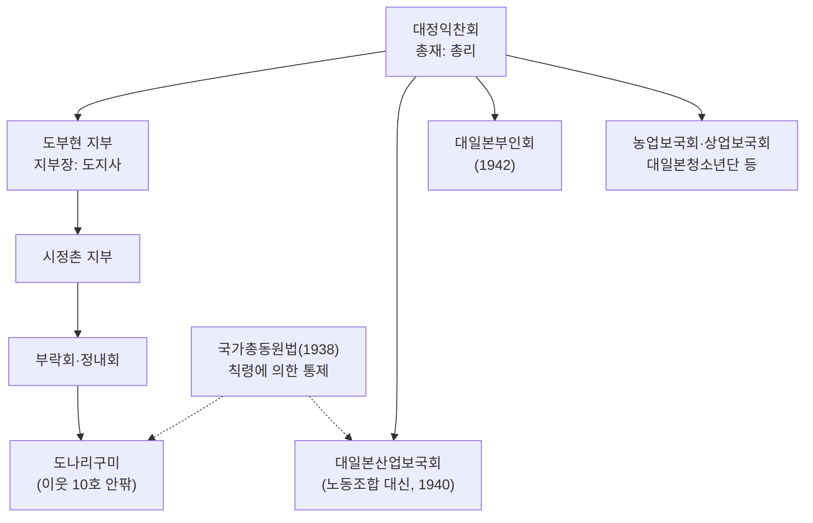

1940년 8월 1일 아침, 도쿄 긴자의 거리 곳곳에 커다란 입간판이 세워졌다. 거기에는 이렇게 적혀 있었다. **"사치는 적이다!"** 그 앞에서는 국방부인회 등의 여성들이 지나가는 사람들을 붙잡고, 화려한 옷차림이나 파마 머리, 반지를 한 여성에게 "자숙해 주세요"라고 적힌 쪽지를 건넸다. 몇 주 전 정부는 사치품의 제조와 판매를 금지하는 규칙을 내놓았다. 전쟁을 위해서라면 국민의 옷차림과 머리 모양까지도 나라가 간섭하는 시대가 된 것이다.

같은 무렵 바다 건너 조선에서는 사람들이 관청 앞에 줄을 서 있었다. 1940년 2월부터 시행된 **창씨개명**에 따라, 조선 사람들은 8월 10일까지 일본식 '씨'를 만들어 신고해야 했다. 같은 해 8월, 『조선일보』와 『동아일보』는 폐간되었다. 이 강의는 중일전쟁에서 태평양 전쟁에 이르는 시기, 일본과 그 식민지 전체가 전쟁을 위해 하나로 묶여 가는 **총력전 체제**를 살펴본다. 일본 본토의 사람들에게는 '국민'으로서의 희생이 요구되었고, 조선과 대만의 사람들에게는 민족의 이름과 말, 그리고 몸과 목숨이 요구되었다.

> [!핵심] 이 강의의 질문
> 1. 총력전 체제는 일본 국민의 정치와 일상을 어떻게 바꾸었는가?
> 2. '내선일체'를 내건 황국 신민화 정책은 조선 사람들에게 무엇을 강요했는가?
> 3. 노무 동원, 징병, 일본군 '위안부' 문제는 어떻게 일어났고, 오늘날 왜 여전히 논쟁이 되는가?

{{F:l17-opening}}

```timeline
1937.9 | 국민정신총동원운동 시작 | 
1937.10 | 조선에서 '황국 신민 서사' 제정 | 미나미 지로 총독
1938.2 | 조선 육군 특별 지원병령 | 4월 시행
1938.3 | 제3차 조선 교육령 | 조선어를 선택 과목으로
1938.4 | 국가총동원법 공포 | 
1939.7 | 국민징용령 / 조선인 노무 동원 '모집' 시작 | 
1940.2 | 창씨개명 시행 | 8월 10일까지 씨 신고
1940.8 | 『조선일보』·『동아일보』 폐간 | 
1940.10 | 대정익찬회 발족 | 정당 해산
1941.4 | 국민학교령, 6대 도시 쌀 배급 통장제 | 
1942.10 | 조선어학회 사건 | 
1943.8 | 조선에 징병제 시행 | 1944년부터 실제 징집
1943.10 | 학도 출진 | 메이지 신궁 외원 장행회
1944.8 | 여자 정신 근로령 | 
1944.9 | 국민징용령 조선에 전면 적용 | 
```

## 일본 본토의 총력전 체제

### 국민정신총동원운동

**총력전**이란 군대끼리의 싸움을 넘어 나라의 경제, 사회, 사상, 국민 전체를 전쟁에 쏟아붓는 전쟁을 말한다. 제1차 세계대전에서 유럽 나라들이 겪은 이 새로운 전쟁 형태를 일본 육군은 오래전부터 연구해 왔다. 중일전쟁이 장기화하자 일본은 이를 실제로 실현해 나갔다.

1937년 9월 고노에 내각은 **국민정신총동원운동**을 시작했다. '거국일치, 진충보국, 견인지구(굳게 참고 오래 버틴다)'를 표어로, 국민에게 절약과 저축, 근로 봉사, 신사 참배 등을 요구했다. 1939년부터는 매달 1일이 '흥아 봉공일'로 정해져, 이날은 술집이 문을 닫고 사람들은 반찬 없이 흰밥 한가운데 매실 장아찌 하나만 올린 **히노마루 도시락**을 먹어야 했다. 전쟁을 국민의 '정신'으로 이겨 내겠다는 운동이었다.

### 신체제 운동과 대정익찬회

1940년 봄, 독일이 서유럽을 순식간에 휩쓸자 일본에서는 나치 독일처럼 강력한 일당 체제를 만들어야 한다는 목소리가 커졌다. 추밀원 의장을 그만둔 고노에 후미마로는 기존 정당을 넘어서는 강력한 국민 조직을 만들자는 **신체제 운동**을 시작했다. 그러자 정당들은 앞다투어 스스로 해산했다. 7월 사회대중당이, 8월에는 메이지 이래의 정당 정치를 이끌어 온 입헌정우회와 입헌민정당까지 해산했다. 7월에 두 번째로 총리가 된 고노에는 1940년 10월 12일 **대정익찬회**를 발족시켰다.

그러나 대정익찬회는 나치당 같은 강력한 정당이 되지 못했다. "천황 아래 국민을 하나로 묶는 조직이 천황의 정부와 맞서는 '막부'가 될 수 있다"는 비판이 우익과 재계, 내무성에서 나오자, 대정익찬회는 정치 결사가 아니라 정부의 지시를 국민에게 전달하는 '공사(공적인 단체)'로 바뀌었다. 총재는 총리가, 지방 지부장은 도지사가 맡았다. 결국 대정익찬회는 위에서 아래로 명령을 내려보내는 거대한 관제 조직이 되었다.



노동조합도 해산되었다. 노동자와 경영자가 함께 '산업으로 나라에 보답한다'는 **산업보국회**가 각 사업장에 만들어지고, 1940년 11월 그 전국 조직인 대일본산업보국회가 생겼다. 여성 단체들은 1942년 **대일본부인회**로 통합되었다. 1942년 4월 도조 히데키 내각 아래 치러진 총선거는 정부가 후보를 '추천'하는 **익찬 선거**였다. 추천 후보들은 선거 자금을 지원받았고, 비추천 후보는 경찰의 감시와 방해를 받았다. 그 결과 의석의 80% 이상을 추천 후보가 차지했다. 이렇게 일본의 정당 정치는 완전히 막을 내렸다.

### 도나리구미와 배급 생활

국민 생활의 가장 밑바닥에는 **도나리구미**(이웃 조)가 있었다. 1940년 내무성의 지시로 전국의 마을과 동네마다 10호 안팎의 가구를 한 조로 묶은 도나리구미가 만들어졌다. 도나리구미는 정부의 지시가 적힌 회람판을 돌리고, 쌀과 생활 물자를 배급하고, 저축과 국채 구매를 할당하고, 방공 훈련을 했다. 동시에 이웃끼리 서로를 감시하는 조직이기도 했다. 전쟁에 비협조적인 사람은 배급에서 불이익을 받을 수 있었다.

물자는 점점 모자랐다. 1938년부터 면제품의 판매가 제한되었고, 1940년에는 설탕과 성냥에 배급표가 도입되었다. 1941년 4월부터는 도쿄·오사카 등 6대 도시에서 쌀이 **배급 통장제**가 되어, 어른 한 사람이 하루 2홉 3작(약 330g)의 쌀을 배급받았다. 전쟁 말기에는 쌀 대신 고구마나 콩깻묵이 배급되었고, 그마저도 제때 나오지 않았다. 사람들은 농촌으로 쌀을 구하러 다니거나 암시장에 기대야 했다.

| 연도 | 통제·동원 조치 | 생활의 변화 |
|---|---|---|
| 1938 | 국가총동원법, 면제품 판매 제한 | 스프(인조 섬유) 옷의 등장 |
| 1939 | 국민징용령, 가격 통제령 | 물가 동결, 암거래 시작 |
| 1940 | 사치품 제조·판매 제한(7·7 금령), 설탕·성냥 배급표 | "사치는 적이다", 파마 금지 운동 |
| 1941 | 6대 도시 쌀 배급 통장제, 국민학교령 | 하루 2홉 3작, 소학교가 '국민학교'로 |
| 1943 | 학도 출진, 적성어(영어) 배척 | 야구 용어까지 일본어로, 금속 회수 |
| 1944 | 학도 근로 동원, 여자 정신 근로령, 학동 소개 | 학생은 공장으로, 아이들은 시골로 |

표: 일본 본토 국민 생활의 전시 통제

교육도 바뀌었다. 1941년 소학교는 **국민학교**가 되어 '황국의 길에 따라' 아이들을 '소국민'으로 기르는 곳이 되었다. 같은 해 1월 육군대신 도조 히데키는 장병의 행동 규범인 「전진훈」을 내렸다. "살아서 포로가 되는 치욕을 받지 말라"는 구절은 군인뿐 아니라 민간인에게까지 항복 대신 죽음을 강요하는 사상이 되어, 뒤에 사이판과 오키나와에서 비극을 낳았다(19강, 20강).

{{F:l17-tojo}}

### 학도 출진

1943년, 전세가 불리해지자 정부는 그동안 대학생과 전문학교 학생에게 허락하던 징병 유예를 문과 계열 학생을 중심으로 중단했다. 1943년 10월 21일, 비가 내리는 도쿄의 메이지 신궁 외원 경기장에서 출진 학도 장행회가 열렸다. 총을 멘 학생들이 행진하고, 관중석의 여학생들이 그들을 배웅했다. 이렇게 군대에 간 학생들 가운데 많은 수가 특공대원이 되어 돌아오지 못했다. 남은 학생들과 중학생, 여학생들은 군수 공장에서 일하는 **근로 동원**에 나섰다. 1944년에는 미혼 여성을 공장에 동원하는 여자 정신 근로령이 나왔다.

{{F:l17-students}}

## 식민지 조선의 황국 신민화

### 미나미 지로와 '내선일체'

1936년 조선 총독으로 부임한 **미나미 지로**는 관동군 사령관 출신의 육군 대장이었다. 중일전쟁이 일어나자 그는 조선을 대륙 침략의 **병참 기지**로 삼고, 조선 사람들을 전쟁에 동원하기 위해 '일본(내지)과 조선은 하나'라는 **내선일체**를 내세웠다. 조선 사람들을 '천황의 충실한 백성', 즉 **황국 신민**으로 만들겠다는 것이었다.

겉으로는 차별을 없앤다는 말처럼 들렸지만, 내선일체는 조선인이 일본인과 같은 권리를 누린다는 뜻이 아니었다. 조선에는 여전히 일본 제국 의회 선거권이 없었고(중의원 선거법은 조선에 시행되지 않았다), 임금과 승진에서 차별이 계속되었다. 내선일체란 조선 사람들에게 조선의 말과 이름, 정체성을 버리고 일본인처럼 전쟁에 목숨을 바치라고 요구하는 것이었다.

### 신사 참배와 황국 신민 서사

1937년 10월 총독부는 **황국 신민 서사**를 만들어 학교와 관공서, 각종 모임에서 외우게 했다. 아동용은 "우리는 대일본 제국의 신민입니다. 우리는 마음을 합하여 천황 폐하께 충의를 다합니다. 우리는 인고 단련하여 훌륭하고 강한 국민이 되겠습니다"였다. 아침마다 천황이 있는 도쿄 쪽을 향해 절하는 **궁성 요배**와 정오의 묵도도 강요되었다.

**신사 참배**도 강요되었다. 1925년 서울 남산에 세워진 조선 신궁을 정점으로 전국에 신사가 세워졌고, 각 가정에는 신궁의 부적을 모시는 가미다나를 두게 했다. 기독교계 학교와 교회는 신사 참배가 우상 숭배라며 거부했다. 그러자 총독부는 이를 거부한 학교들을 폐교로 몰아넣었고, 1938년에는 경찰이 둘러싼 가운데 조선 예수교 장로회 총회가 신사 참배를 결의했다. 끝까지 거부한 주기철 목사 등 2,000명 가까운 신자가 투옥되었고, 주기철은 1944년 옥중에서 숨졌다.

{{F:l17-shrine}}

### 조선어와 조선 이름을 빼앗다

1938년 **제3차 조선 교육령**으로 학교 이름과 교육 내용이 일본과 같아지고, 조선어는 필수 과목에서 선택 과목으로 밀려났다. 사실상 조선어 수업은 사라졌고, 1943년 제4차 교육령으로 완전히 폐지되었다. 학교에서는 조선말을 쓰는 학생에게 벌을 주거나, 서로 감시하게 하는 '국어(일본어) 상용' 운동이 벌어졌다. 1940년 『조선일보』와 『동아일보』가 폐간되었고, 1942년에는 우리말 사전을 만들던 조선어학회 회원들을 독립운동 혐의로 잡아들였다(**조선어학회 사건**). 이윤재와 한징이 옥중에서 숨졌다.

1939년 11월 총독부는 조선 민사령을 고쳐 **창씨개명**을 공포했다. 1940년 2월 11일부터 8월 10일까지 6개월 안에 모든 가정이 일본식 '씨(氏)'를 만들어 신고하게 한 것이다.

> [!주의] 창씨개명은 '자발적'이었나?
> 총독부는 창씨가 '자발적인 신고'라고 내세웠다. 그러나 실제로는 관청과 경찰, 학교가 총동원되어 압력을 가했다. 창씨를 하지 않은 집 아이는 학교 입학이나 진학이 막히거나 교사에게 꾸지람을 들었고, 관공서 채용에서 불이익을 받았으며, 식량 배급에서 제외되기도 했다. 우편물이 배달되지 않기도 했다. 처음 석 달 동안 신고율이 10%에도 미치지 못하자 압력은 더욱 거세졌고, 마감까지 약 80%의 가구가 씨를 신고했다. 씨를 신고하지 않은 집도 법에 따라 호주의 성이 그대로 '씨'로 등록되었다. 반대로 '이름'을 일본식으로 바꾸는 개명은 수수료가 들고 의무가 아니어서 훨씬 적었다.

창씨개명은 조선의 성(姓) 제도와 가족 제도를 일본식 '이에(집)' 제도로 바꾸려는 것이었다. 혈통을 나타내는 조선의 성은 결혼해도 바뀌지 않지만, 일본의 씨는 집의 이름이어서 아내와 데릴사위도 같은 씨를 쓴다. 조상 대대로 이어 온 성을 바꾸는 것은 조선 사람들에게 큰 굴욕이었다. 항의의 뜻으로 자결한 사람도 있었고, 일본 천황을 비꼬는 씨를 지어 내 거부된 사람도 있었다.

## 몸과 목숨의 동원

### 노무 동원

일본 본토의 젊은 남성들이 군대로 끌려가자 탄광과 광산, 공장, 토목 공사장에는 일손이 모자랐다. 1939년부터 일본은 조선 사람들을 일본 본토와 사할린, 남양 군도 등의 작업장으로 대규모로 보냈다. 동원 방식은 시기에 따라 바뀌었지만 강제성은 점점 커졌다.

| 시기 | 방식 | 내용 |
|---|---|---|
| 1939~1942 | '모집' | 일본 기업이 총독부의 허가를 받아 지역별로 인원을 할당받아 모집. 면사무소와 경찰이 할당 인원을 채우기 위해 압력 |
| 1942~1944 | '관 알선' | 총독부가 직접 나서서 인원을 모아 기업에 넘김. 사실상 강제로 끌고 가는 경우가 많아짐 |
| 1944~1945 | '징용' | 국민징용령을 조선에 전면 적용. 거부하면 처벌 |

표: 조선인 노무 동원의 세 단계

동원된 사람들은 위험한 탄광의 막장 같은 곳에서 일본인보다 긴 시간 일했고, 임금은 강제 저금 등의 명목으로 제대로 받지 못한 경우가 많았다. 도망치다 붙잡히면 심한 폭행을 당했다. 일본 본토와 사할린·남양 등으로 동원된 사람의 수는 연구에 따라 70만 명에서 100만 명 이상으로 추정되며, 조선 안에서의 동원까지 합하면 훨씬 많아진다. 일본 본토에 사는 조선인의 수는 전쟁 기간 동안 크게 늘었다.

```chart
{
  "type": "line",
  "caption": "일본 본토에 거주한 조선인 인구 (만 명, 일본 내무성 경보국 통계 등을 바탕으로 한 대략적인 수치). 노무 동원이 시작된 1939년 이후 급증해 1945년에는 200만 명에 이르렀다",
  "data": {
    "labels": ["1930", "1935", "1938", "1940", "1942", "1944", "1945"],
    "datasets": [{ "label": "재일 조선인 인구(만 명)", "data": [30, 63, 80, 119, 163, 194, 200] }]
  },
  "options": { "scales": { "y": { "min": 0 } }, "plugins": { "legend": { "display": false } } }
}
```

{{F:l17-labor}}

이들 가운데에는 일본의 패전 뒤 귀국하지 못하고 일본에 남은 사람들이 많았고, 이들은 재일 한국·조선인 사회의 한 뿌리가 되었다. 사할린에 동원된 사람들은 소련 점령 뒤 오랫동안 고향에 돌아오지 못했다. 2018년 한국 대법원은 일본 기업이 동원 피해자에게 배상해야 한다는 판결을 내렸고, 이 문제는 지금도 한일 관계의 큰 쟁점이다.

### 지원병에서 징병으로

조선인을 군인으로 만드는 일도 단계적으로 진행되었다. 1938년 **육군 특별 지원병 제도**가 시작되었다. '지원'이었지만, 면마다 지원자 수가 할당되어 경찰과 관리들이 젊은이들에게 지원을 강요했다. 1943년에는 전문학교·대학에 다니던 조선인 학생들에게 **학도 지원병**이 강요되었다. 그리고 1943년 8월 조선에 **징병제**가 시행되어 1944년부터 실제로 징집이 시작되었다. 대만에서도 1942년 지원병 제도가, 1945년 징병제가 시행되었다.

일본 정부의 집계로 조선인 군인·군속은 약 24만 명이며, 그 가운데 약 2만 2천 명이 숨졌다. 전쟁터에서 숨진 조선인들 가운데 일부는 본인과 유족의 뜻과 관계없이 야스쿠니 신사에 '합사'되어, 유족들이 합사 취소를 요구하는 소송을 벌이기도 했다. 일본의 군인이나 군속으로 동원되었다가 연합군 포로 감시원 등으로 일한 조선인들 가운데 일부는 전쟁이 끝난 뒤 BC급 전범으로 재판을 받았다(19강).

### 일본군 '위안부'

일본군은 1932년 상하이 사변 무렵부터 군대를 위한 **위안소**를 만들기 시작했다. 중일전쟁이 시작되고, 특히 난징 대학살로 강간 문제가 국제적 비난을 받자, 군은 병사들의 강간을 막고 성병을 막는다는 명목으로 위안소를 중국 각지와 뒤에는 동남아시아·태평양 전역으로 늘려 갔다. 그곳에 끌려가 일본군의 성 노예가 된 여성들이 **일본군 '위안부'**다. 조선과 대만의 여성들이 많았고, 중국, 필리핀, 인도네시아, 네덜란드 여성 등 점령지 여성들도 피해자가 되었다.

{{F:l17-comfort-women}}

조선 여성들은 "공장에 취직시켜 주겠다", "돈을 많이 벌 수 있다"는 속임수나 인신매매, 폭력에 의해 끌려갔다. 전쟁터의 위안소에서 여성들은 감시 속에 자유를 빼앗긴 채 하루에도 수많은 군인을 상대해야 했다. 패전 때 현지에 버려지거나 목숨을 잃은 사람도 많았다.

이 문제는 전쟁이 끝난 뒤 오랫동안 묻혀 있었다. 1991년 8월 14일, **김학순**이 처음으로 피해 사실을 공개적으로 증언하면서 세상에 알려졌다. 이듬해 일본 연구자가 일본 방위청 도서관에서 군이 위안소 설치에 관여했음을 보여 주는 문서를 찾아냈다. 1993년 일본 정부는 관방장관 담화(**고노 담화**)에서 위안소가 군 당국의 요청으로 설치되었고 군이 그 설치와 관리, 위안부 이송에 직간접으로 관여했으며, 모집이 감언과 강압 등 본인의 의사에 반하여 이루어진 경우가 많았고 관헌이 직접 가담한 경우도 있었으며, 위안소의 생활은 강제적인 상황 아래의 참혹한 것이었다고 인정하고 사죄했다.

> [!참고] 지금도 이어지는 논쟁
> 그러나 그 뒤 일본 정부 안팎에서는 '관헌이 직접 끌고 간 강제 연행을 보여 주는 문서는 없다'며 고노 담화를 사실상 부정하려는 움직임이 되풀이되었다. 2015년 한일 정부는 '위안부' 문제 합의를 발표했지만, 피해자들이 배제된 합의라는 비판을 받았다. 피해자들은 1992년부터 지금까지 서울의 일본 대사관 앞에서 매주 수요일 집회(수요 시위)를 열고 있다. 유엔 인권 기구들은 이 문제를 전시 성폭력과 '성 노예제'의 문제로 다루어 왔다.

## 대만의 황민화

대만에서도 1936년 해군 대장 출신의 고바야시 세이조 총독이 '황민화, 공업화, 남진 기지화'를 내세웠다. 신문의 한문 지면이 폐지되고, 일본어 상용과 신사 참배가 강요되었다. 1940년에는 중국식 성명을 일본식으로 바꾸는 개성명이 시작되었지만, 조선의 창씨개명과 달리 허가제였고 '국어(일본어) 상용 가정' 등 조건을 갖춘 사람만 할 수 있어서 바꾼 사람은 소수였다. 대만 원주민들은 '다카사고 의용대'로 조직되어 필리핀과 뉴기니의 정글 전투에 보내졌다.

| 구분 | 조선 | 대만 |
|---|---|---|
| 이름 | 창씨개명(1940): 사실상 강제, 약 80% 신고 | 개성명(1940): 허가제, 소수만 변경 |
| 언어 | 조선어 과목 폐지(1943), 신문 폐간(1940) | 신문 한문란 폐지(1937), 일본어 상용 운동 |
| 군사 동원 | 지원병(1938), 학도병(1943), 징병제(1944년 징집) | 지원병(1942), 징병제(1945), 다카사고 의용대 |
| 노무 동원 | 모집 → 관 알선 → 징용 | 군속·군부로 남방 동원 |

표: 조선과 대만의 황민화 정책 비교

## 정리

> [!핵심] 17강 요약
> - 중일전쟁이 길어지자 일본은 **국민정신총동원운동**(1937)과 **국가총동원법**(1938)으로 총력전 체제를 만들었다.
> - 1940년 **신체제 운동**으로 정당이 모두 해산하고 **대정익찬회**가 생겼지만, 정부의 지시를 전달하는 관제 조직이 되었다. 1942년 **익찬 선거**로 정당 정치는 끝났다.
> - 국민 생활은 **도나리구미**와 **배급제**로 통제되었고, 1943년 **학도 출진**으로 학생들도 전장에 나갔다.
> - 조선에서는 **내선일체**를 내건 황국 신민화 정책으로 **황국 신민 서사**, **신사 참배**, **조선어 말살**, **창씨개명**이 강요되었다.
> - 조선 사람들은 **노무 동원**(모집→관 알선→징용), **지원병과 징병**으로 동원되었고, 많은 여성이 **일본군 '위안부'**로 끌려갔다. 이 문제들은 오늘날까지 한일 관계의 쟁점으로 남아 있다.

### 생각해 볼 질문

1. 대정익찬회는 왜 나치당과 같은 일당 독재 정당이 되지 못했을까? 그런데도 일본의 정당 정치는 왜 사라졌을까?
2. '내선일체'와 '동화'라는 말은 차별을 없애겠다는 뜻처럼 들린다. 그런데 조선인에게 이것은 무엇을 의미했을까?
3. 일본군 '위안부' 문제에서 '강제성'을 문서로만 판단하려는 주장에는 어떤 문제가 있을까? 피해자의 증언은 역사 연구에서 어떤 의미를 가질까?

### 다음 강 예고

18강에서는 다시 국제 정세로 돌아간다. 노몬한 사건과 독소 불가침 조약, 유럽 대전 발발 뒤 일본이 왜 '남진'을 택했는지, 삼국 동맹과 일소 중립 조약, 미일 교섭과 석유 금수, 헐 노트를 거쳐 1941년 12월 8일 **진주만 공격**으로 태평양 전쟁이 시작되기까지의 과정을 따라간다.
