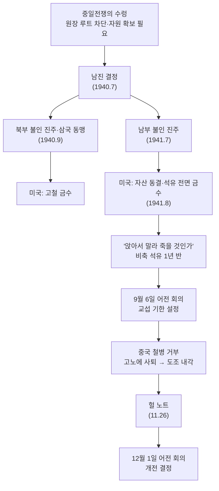

1941년 12월 8일 새벽 6시, 일본 전역의 라디오에서 갑자기 군가가 울려 퍼지더니 아나운서가 떨리는 목소리로 임시 뉴스를 읽었다. "대본영 육해군부 발표. 제국 육해군은 오늘 8일 새벽, 서태평양에서 미국·영국군과 전투 상태에 들어갔다." 몇 시간 뒤, 하와이 **진주만**의 미국 태평양 함대가 일본 해군 항공대의 기습으로 큰 타격을 입었다는 소식이 전해졌다. 많은 일본 사람이 환호했다. 4년 넘게 끝이 보이지 않던 중국과의 전쟁에 지쳐 있던 사람들에게, 거대한 미국과 영국에 맞선 '대동아 전쟁'의 개전은 오히려 가슴이 후련한 소식처럼 들렸다고 많은 이가 회고한다.

그러나 일본 정부와 군 지도자들 가운데 미국과의 전쟁에서 이길 수 있다고 확신한 사람은 거의 없었다. 국력의 차이는 누구의 눈에도 분명했다. 그런데도 일본은 왜 전쟁을 택했을까? 이 강의는 1939년 노몬한 사건부터 1941년 12월 진주만까지, 일본이 '남진'의 길을 걸으며 미국과의 전쟁으로 빠져들어 간 2년 반을 따라간다. 그것은 한 번의 큰 결단이라기보다 작은 선택들이 쌓여 돌아올 수 없는 길이 된 과정이었다.

> [!핵심] 이 강의의 질문
> 1. 일본은 왜 북쪽(소련)이 아니라 남쪽(동남아시아)으로 나아가는 길을 택했는가?
> 2. 남진은 왜 미국과의 정면충돌로 이어졌는가?
> 3. 승산이 없다는 것을 알면서도 일본 지도부는 어떻게 개전을 결정했는가?

```figure
src: asset:bf6a5140b46be3ed827e1c91335e19cb
caption: 1941년 12월 8일 새벽(일본 시각), 진주만으로 출격하는 공격기를 일본 항공모함의 승무원들이 손을 흔들며 배웅하고 있다. 전쟁 뒤 미군이 손에 넣은 일본 측 사진이다.
credit: 일본 해군 촬영, 1941년 · 미국 국립문서보관소(NARA) 소장
license: Public Domain (1946년 이전에 공표된 일본 사진, 일본 구 저작권법상 보호 기간 만료)
source: https://catalog.archives.gov/id/520599
```

```timeline
1939.5~9 | 노몬한 사건 | 관동군이 소련·몽골군에 대패
1939.7 | 미국, 미일 통상 항해 조약 폐기 통고 | 1940년 1월 실효
1939.8 | 독소 불가침 조약, 히라누마 내각 총사퇴 | "유럽 정세는 복잡 기괴"
1939.9 | 제2차 세계대전 시작 | 
1940.6 | 프랑스 항복 | "버스를 놓치지 마라"
1940.7 | 제2차 고노에 내각, 남진 방침 결정 | 
1940.9 | 북부 프랑스령 인도차이나 진주, 일독이 삼국 동맹 | 미국, 고철 수출 금지
1941.4 | 일소 중립 조약 / 미일 교섭 시작 | 
1941.6 | 독소전 시작 | 
1941.7 | 남부 프랑스령 인도차이나 진주 | 미국, 일본 자산 동결
1941.8 | 미국, 대일 석유 전면 금수 | 
1941.9.6 | 어전 회의 '제국 국책 수행 요령' | 10월 상순까지 타결 못 하면 개전
1941.10 | 고노에 내각 총사퇴, 도조 히데키 내각 | 
1941.11.26 | 헐 노트 | 
1941.12.1 | 어전 회의, 개전 결정 | 
1941.12.8 | 말레이 상륙, 진주만 공격 | 태평양 전쟁 시작
```

## 북진의 좌절

### 노몬한 사건

1930년대 일본 육군이 가장 큰 적으로 여긴 것은 소련이었다. 만주국과 소련, 몽골의 국경에서는 충돌이 끊이지 않았다. 1938년 7월 조선·소련·만주 국경이 맞닿는 두만강 하구의 장고봉에서 일본군과 소련군이 충돌한 데 이어, 1939년 5월에는 만주국과 몽골의 국경 지대인 할하강 근처의 **노몬한**에서 큰 전투가 벌어졌다.

관동군은 도쿄의 참모본부가 확대를 말리는데도 대규모 병력을 투입했다. 그러나 주코프 장군이 이끄는 소련·몽골군은 수많은 전차와 비행기, 대포로 일본군을 압도했다. 8월 소련군의 총공세로 일본군 제23사단은 거의 전멸하다시피 했고, 일본군의 사상자는 1만 8천 명을 넘었다. 9월에 정전 협정이 맺어졌다. 노몬한 사건은 일본군에게 소련군의 기계화된 화력이 얼마나 강력한지 보여 주었다. 그러나 육군은 패배의 책임을 일선 지휘관들에게 떠넘겨 자결을 강요했고, 패배의 교훈은 제대로 공유되지 않았다. 정신력으로 물량을 이길 수 있다는 생각은 바뀌지 않았다.

### "유럽 정세는 복잡 기괴"

노몬한에서 일본군이 소련군과 싸우고 있던 1939년 8월 23일, 세계를 놀라게 한 소식이 전해졌다. 독일과 소련이 **불가침 조약**을 맺은 것이다. 일본은 1936년 독일과 방공 협정을 맺었고, 히라누마 기이치로 내각은 소련을 겨냥한 군사 동맹으로 이를 강화하기 위해 독일과 교섭하던 중이었다. 그런데 동맹을 맺으려던 상대가 바로 그 소련과 손을 잡아 버린 것이다. 히라누마 내각은 "유럽의 천지는 복잡 기괴"하다는 말을 남기고 총사퇴했다. 일주일 뒤인 9월 1일 독일이 폴란드를 침공해 제2차 세계대전이 시작되었다.

한편 미국은 1939년 7월 일본에 **미일 통상 항해 조약**의 폐기를 통고했다. 이 조약은 1911년 고무라 주타로가 관세 자주권을 되찾으며 맺은 조약이었다(10강). 조약이 1940년 1월 효력을 잃자, 미국은 언제든 일본에 대한 수출을 제한할 수 있게 되었다. 당시 일본은 석유의 약 80%, 고철과 공작 기계의 상당 부분을 미국에서 수입하고 있었다. 중국과 전쟁을 하는 데 필요한 물자를 바로 그 전쟁을 비난하는 미국에 의존하는 모순된 처지였다.

## 남진의 길

### "버스를 놓치지 마라"

1940년 봄, 독일군은 덴마크와 노르웨이, 네덜란드, 벨기에를 순식간에 점령하고 6월에는 프랑스까지 항복시켰다. 영국도 곧 무너질 것처럼 보였다. 그러자 일본에서는 "**버스를 놓치지 마라**"라는 말이 유행했다. 독일이 이기는 이 기회에 올라타, 주인이 힘을 잃은 동남아시아의 식민지들, 즉 프랑스령 인도차이나(지금의 베트남·라오스·캄보디아), 네덜란드령 동인도(지금의 인도네시아), 영국령 말레이와 버마를 손에 넣자는 것이었다. 그곳에는 일본에 없는 석유와 고무, 주석, 보크사이트가 있었다.

남쪽으로 나아가려는 데에는 또 하나의 이유가 있었다. 장제스의 충칭 정부는 영국령 버마와 프랑스령 인도차이나를 거쳐 들어오는 미국과 영국의 지원 물자, 이른바 **원장 루트**(장제스를 돕는 길)에 기대어 항전을 계속하고 있었다. 이 길을 끊으면 중일전쟁을 끝낼 수 있으리라는 기대가 있었다.

1940년 7월 다시 총리가 된 고노에 후미마로는 외무대신에 마쓰오카 요스케, 육군대신에 도조 히데키를 앉혔다. 내각은 출범 직후 '세계 정세의 추이에 따른 시국 처리 요강'을 정해, 기회를 보아 무력을 써서라도 남방으로 진출한다는 방침을 세웠다. 8월 마쓰오카는 일본·만주·중국에 동남아시아까지 아우르는 **대동아공영권**이라는 말을 처음으로 공식 사용했다.

### 북부 프랑스령 인도차이나 진주와 삼국 동맹

1940년 9월, 일본군은 독일에 항복한 프랑스의 비시 정부를 압박해 **북부 프랑스령 인도차이나**에 진주했다. 원장 루트의 하나를 끊으려는 것이었다. 그리고 며칠 뒤인 9월 27일, 베를린에서 일본·독일·이탈리아 **삼국 동맹**이 맺어졌다. 세 나라가 각각 유럽과 아시아에서 '신질서'를 이끄는 것을 서로 인정하고, 현재 유럽 전쟁이나 중일전쟁에 참가하지 않은 나라, 사실상 미국으로부터 공격을 받으면 서로 돕는다는 내용이었다.

마쓰오카는 삼국 동맹으로 미국을 견제하면, 미국이 오히려 일본과의 충돌을 피하려 할 것이라고 계산했다. 강하게 나가면 상대가 물러선다는 것이었다. 그러나 결과는 정반대였다. 미국은 삼국 동맹을 자국에 대한 도전으로 받아들였다. 미국은 북부 불인 진주 직전에 이미 항공 연료 수출을 제한한 데 이어, 9월 26일 일본에 대한 **고철 수출을 전면 금지**하고 중국에 대한 차관을 늘렸다.

```figure
src: asset:a168f0ae5335a23d4f433fc1797d6f83
caption: 마쓰오카 요스케(1880~1946). 제2차 고노에 내각의 외무대신으로 삼국 동맹(1940)과 일소 중립 조약(1941)을 맺었다. 전후 A급 전범으로 기소되었으나 재판 중에 병사했다.
credit: 촬영자·연도 미상 · 국립국회도서관 「근대일본인의 초상」
license: Public Domain (국립국회도서관: 저작권 보호 기간 만료)
source: https://www.ndl.go.jp/portrait/datas/333/
width: narrow
```

```figure
src: asset:4a54190f2d17ca06cc53fa0ea3b65aa0
caption: 1940년 9월 도쿄에서 열린 삼국 동맹 축하 자리에서 독일·이탈리아 대사들과 건배하는 도조 히데키 육군대신(가운데). 뒤에 나치 독일의 깃발과 일장기가 걸려 있다.
credit: 교도 통신 사진부, 1940년 · 오스트레일리아 전쟁기념관(AWM) 소장
license: Public Domain (1946년 이전에 공표된 일본 사진, 일본 구 저작권법상 보호 기간 만료)
source: https://www.awm.gov.au/collection/C300582
```

> [!사료] 야마모토 이소로쿠의 경고 (1940)
> 연합 함대 사령 장관 **야마모토 이소로쿠**는 해군 차관 시절부터 삼국 동맹에 강하게 반대한 사람이었다. 그는 1940년 고노에 총리에게 미국과 전쟁을 하게 되면 어떻게 되겠느냐는 질문을 받고 이렇게 답했다고 전한다. "처음 반년이나 1년 동안은 마음껏 날뛰어 보이겠습니다. 그러나 2년, 3년이 되면 전혀 확신이 없습니다." 미국에서 유학하고 주미 대사관 무관을 지내 미국의 공업력을 잘 알던 그는, 바로 그 이유로 개전 초에 미국 함대를 결정적으로 무너뜨리는 진주만 기습을 구상하게 된다.

```figure
src: asset:0629da4017f2e4601984526e75d0a375
caption: 연합 함대 사령 장관 야마모토 이소로쿠(1884~1943). 삼국 동맹과 대미 개전에 반대했지만, 개전이 결정되자 진주만 기습 작전을 세웠다. 사진 아래에 '해군 대장 야마모토 이소로쿠 각하'라고 인쇄되어 있다.
credit: 촬영자·연도 미상 · 국립국회도서관 「근대일본인의 초상」
license: Public Domain (국립국회도서관: 저작권 보호 기간 만료)
source: https://www.ndl.go.jp/portrait/datas/344/
width: narrow
```

### 일소 중립 조약

1941년 3월 마쓰오카 외무대신은 유럽을 방문해 히틀러와 무솔리니를 만났다. 돌아오는 길에 모스크바에 들른 그는 4월 13일 소련과 **일소 중립 조약**을 맺었다. 서로 영토를 침범하지 않고, 한쪽이 제3국과 전쟁을 하면 다른 쪽은 중립을 지킨다는 내용이었다. 스탈린은 이례적으로 역까지 나와 마쓰오카를 배웅했다. 마쓰오카는 일본·독일·이탈리아에 소련까지 더한 '4국 협상'으로 미국을 압박할 수 있다고 생각했다. 북쪽의 안전을 확보한 일본은 남쪽으로 눈을 돌렸다.

그러나 마쓰오카의 구상은 두 달 만에 무너졌다. 1941년 6월 22일 독일이 불가침 조약을 깨고 **소련을 침공**한 것이다. 마쓰오카는 이번에는 독일과 함께 소련을 치자고 주장했다. 조금 전 자신이 맺은 중립 조약을 버리자는 것이었다.

## 석유 금수

### 미일 교섭

한편 1941년 4월부터 워싱턴에서는 주미 대사 **노무라 기치사부로**와 미국 국무장관 **코델 헐** 사이에 국교 조정을 위한 **미일 교섭**이 시작되었다. 노무라는 해군 대장 출신으로, 제1차 세계대전 때 주미 대사관 무관으로 일하며 당시 해군 차관이던 프랭클린 루스벨트와 친분을 쌓은 인물이었다. 미국은 협상의 기본으로 모든 나라의 영토 보전과 주권 존중, 내정 불간섭, 통상의 기회 균등, 평화적 수단에 의한 현상 변경이라는 '헐 4원칙'을 내세웠다. 이를 받아들이면 일본은 중국에서 군대를 빼야 했다.

### 남부 불인 진주와 'ABCD 포위진'

독소전이 시작되자 1941년 7월 2일 천황 앞에서 열린 **어전 회의**는 '정세의 추이에 따른 제국 국책 요강'을 결정했다. 남방 진출을 위해서는 '대영미전을 사양하지 않는다'고 하면서, 동시에 독소전의 형세가 일본에 유리해지면 북쪽의 소련도 친다는 것이었다. 육군은 '관동군 특종 연습(관특연)'이라는 이름으로 70만 명의 병력을 만주에 모았다. 남진과 북진을 동시에 준비하는, 결정을 미룬 '양론 병기'의 국책이었다.

고노에는 미일 교섭을 방해하던 마쓰오카를 내각에서 빼기 위해 7월 일단 총사퇴한 뒤 제3차 내각을 꾸렸다. 그리고 1941년 7월 28일, 일본군은 **남부 프랑스령 인도차이나**에 진주했다. 그곳은 영국의 싱가포르와 네덜란드령 동인도, 미국의 필리핀을 공격할 수 있는 거점이었다.

미국의 반응은 일본의 예상보다 훨씬 강했다. 진주 직전인 7월 25일 미국은 미국 안의 **일본 자산을 동결**했고, 영국과 네덜란드령 동인도도 뒤따랐다. 그리고 8월 1일 미국은 일본에 대한 **석유 수출을 전면 금지**했다. 일본 군부는 미국(America)·영국(Britain)·중국(China)·네덜란드(Dutch)가 일본을 둘러싸고 숨통을 조인다며 이를 **ABCD 포위진**이라 불렀다.

| 일본의 행동 | 미국의 대응 |
|---|---|
| 중일전쟁 장기화 (1937~) | 1939.7 미일 통상 항해 조약 폐기 통고 |
| 북부 프랑스령 인도차이나 진주 (1940.9) | 항공 연료 수출 제한, 고철 수출 전면 금지 |
| 삼국 동맹 (1940.9) | 중국 지원 확대 |
| 남부 프랑스령 인도차이나 진주 (1941.7) | 재미 일본 자산 동결, **석유 전면 금수** (1941.8) |
| 개전 결의, 교섭 기한 설정 (1941.9~11) | 헐 노트 (1941.11.26) |

표: 남진과 미국의 경제 제재

석유가 끊기자 일본은 막다른 길에 몰렸다. 해군이 비축한 석유는 평시라면 2년, 전쟁을 하면 1년 반 정도 버틸 수 있는 양이었다. 시간이 지날수록 함대는 움직일 수 없게 된다. 군부 안에서는 "앉아서 말라 죽느니 차라리 지금 싸우자"는 목소리가 커졌다. 석유를 얻으려면 네덜란드령 동인도를 점령해야 했고, 그렇게 하면 영국·미국과의 전쟁은 피할 수 없었다.

```chart
{
  "type": "bar",
  "caption": "1941년 무렵 미국의 주요 물자 생산량은 일본의 몇 배였나 (일본 = 1, 대략적인 통설 수치, 로그 눈금). 석유는 700배가 넘었다",
  "height": 300,
  "data": {
    "labels": ["석탄", "강철", "구리", "철광석", "석유"],
    "datasets": [{ "label": "미국/일본 배율", "data": [9.3, 12.1, 10.7, 74.0, 776.8] }]
  },
  "options": { "indexAxis": "y", "scales": { "x": { "type": "logarithmic", "min": 1 } }, "plugins": { "legend": { "display": false } } }
}
```

## 개전 결정

### 9월 6일 어전 회의

1941년 9월 6일 어전 회의는 **'제국 국책 수행 요령'**을 결정했다. 10월 하순을 목표로 전쟁 준비를 끝내고, 그와 함께 외교 교섭을 계속하되, 10월 상순이 되어도 일본의 요구가 관철될 전망이 없으면 즉시 미국·영국·네덜란드와의 개전을 결의한다는 것이었다. 교섭에 기한을 붙인 것이다.

```figure
src: asset:86dfe6fca0701e4561f3b7a09071f7fc
caption: 관병식에서 쇼와 천황에게 경례하는 일본군 장교. 미국 국립문서보관소 목록에는 1941년 10월 21일로 되어 있으나, 기원 2600년 기념 특별 관병식이 열린 1940년 10월 21일의 사진으로 보인다.
credit: 일본 보도 사진(미국 전시정보국 배포) · 미국 국립문서보관소(NARA) 소장
license: Public Domain (1946년 이전에 공표된 일본 사진, 일본 구 저작권법상 보호 기간 만료)
source: https://catalog.archives.gov/id/12009122
```

이날 회의에서 평소 어전 회의에서 말을 하지 않는 관례를 깨고 쇼와 천황이 입을 열었다. 천황은 할아버지 메이지 천황이 러일전쟁 때 지은 와카 한 수를 읽었다. "사방의 바다가 모두 형제라 여기는 이 세상에, 어찌하여 풍파가 일어 소란스러운가." 전쟁보다 외교를 우선하라는 뜻으로 받아들여졌다. 그러나 결정은 바뀌지 않았다.

### 고노에에서 도조로

고노에 총리는 루스벨트 대통령과 직접 만나는 정상 회담으로 돌파구를 찾으려 했지만, 미국은 먼저 원칙에 합의해야 한다며 받아들이지 않았다. 10월 상순의 기한이 다가오자, 내각 안에서는 중국에서의 철병 문제를 둘러싸고 고노에와 육군대신 도조 히데키가 정면으로 부딪혔다. 도조는 철병은 중국에서 죽은 수많은 장병의 희생을 헛되게 하는 것이라며 단호히 거부했다. 결국 고노에 내각은 10월 16일 총사퇴했다.

후임 총리로 추천된 사람은 뜻밖에도 그 도조 히데키였다. 내대신 기도 고이치는 군부를 가장 강하게 대변해 온 도조라야 오히려 육군을 억누르고 개전을 피할 수 있다고 생각했다. 천황은 도조에게 9월 6일의 결정을 백지로 돌려 다시 검토하라고 지시했다. 그러나 다시 검토한 결과도 같았다. 11월 5일 어전 회의는 12월 초에 무력을 발동한다는 방침 아래 마지막 교섭안(갑안·을안)을 미국에 내기로 했다.

```figure
src: asset:d641bc2dd7ee3449c1a72cc241cf6cce
caption: 도조 히데키(1884~1948). 육군대신으로 중국 철병에 끝까지 반대했고, 1941년 10월 총리가 되어 개전을 결정했다. 전후 도쿄 재판에서 A급 전범으로 사형되었다.
credit: 촬영자·연도 미상 · 국립국회도서관 「근대일본인의 초상」
license: Public Domain (국립국회도서관: 저작권 보호 기간 만료)
source: https://www.ndl.go.jp/portrait/datas/142/
width: narrow
```

> [!참고] '쇼와 16년 여름의 패전'
> 1941년 4월 정부는 각 부처와 군, 민간 기업의 젊은 엘리트들을 모아 **총력전 연구소**를 만들었다. 이들은 그해 8월 미국과 전쟁을 하게 되면 어떻게 될지 모의 연습을 했다. 결론은 "개전 초기에는 이기겠지만 장기전이 되어 물자가 바닥나고, 마지막에는 소련이 참전해 일본은 반드시 진다"는 것이었다. 이 결과는 도조 육군대신 등에게도 보고되었지만, "전쟁은 계산대로 되는 것이 아니다"라며 무시되었다. 실제 전쟁은 원자 폭탄을 빼면 거의 이 모의 연습대로 흘러갔다.

### 헐 노트

11월 26일, 헐 국무장관은 노무라 대사와 특명으로 파견된 구루스 사부로 대사에게 미국의 제안을 전달했다. 이것이 **헐 노트**다.

- 중국과 프랑스령 인도차이나에서 일본의 육해공군과 경찰을 **모두 철수**할 것
- 충칭의 장제스 국민정부 이외의 어떤 정부도 지지하지 않을 것 (왕징웨이 정권의 부인)
- 제3국과 맺은 어떤 협정도 태평양의 평화와 충돌하는 방향으로 해석하지 않을 것 (삼국 동맹의 사실상 무효화)

일본 정부는 이를 만주사변 이전으로 돌아가라는 **최후통첩**으로 받아들였다. 헐 노트의 '중국'에 만주가 포함되는지는 분명하지 않았지만, 일본 지도부는 그것을 확인하려 하지 않았다. 사실 일본 해군의 기동 부대는 헐 노트가 전달되기 직전인 11월 26일(일본 시각) 아침, 쿠릴 열도의 히토캅푸만을 떠나 하와이로 향하고 있었다. 교섭이 타결되면 돌아오라는 조건이었다. 12월 1일 어전 회의는 미국·영국·네덜란드와의 **개전**을 결정했다.



## 1941년 12월 8일

### 말레이와 진주만

전쟁은 진주만보다 먼저 말레이반도에서 시작되었다. 일본 시각 12월 8일 오전 1시 30분 무렵, 일본 육군은 영국령 말레이반도 북부의 코타바루에 상륙을 시작했다. 영국의 동아시아 거점 싱가포르를 향한 진격의 시작이었다.

그로부터 1시간여 뒤(하와이 시각 12월 7일 아침 7시 55분 무렵), 6척의 항공모함에서 날아오른 일본 해군기 350여 대가 하와이 오아후섬의 진주만에 정박한 미국 태평양 함대를 습격했다. 두 차례의 공격으로 전함 애리조나와 오클라호마 등 전함 4척이 침몰하고 다른 전함들도 크게 부서졌으며, 비행기 수백 대가 파괴되었다. 미국인 2,400명 이상이 목숨을 잃었다. 일본 측의 손실은 비행기 29대와 특수 잠항정 5척에 그쳤다.

```gallery
src: asset:feb4deb4ff192d70e65efe05ec1b425b
caption: 공격 중인 일본 해군기에서 내려다본 진주만의 '전함 줄(Battleship Row)'과 포드섬. 수면에 어뢰가 지나간 자국과 멀리 피어오르는 연기가 보인다. 미군이 노획한 일본 측 사진이다.
credit: 일본 해군 항공대 촬영, 1941년 12월 7일(하와이 시각) · 미국 국립문서보관소(NARA) 소장
license: Public Domain (1946년 이전에 공표된 일본 사진, 일본 구 저작권법상 보호 기간 만료)
source: https://catalog.archives.gov/id/520600
---
src: asset:ba06d2390105350cfcb33611f34d80b2
caption: 기울어진 채 불타며 가라앉는 미국 전함 애리조나. 폭탄이 탄약고를 폭발시켜 승무원 1,177명이 숨졌다. 미국인 희생자의 거의 절반이 이 배에서 나왔다.
credit: 미 해군 촬영, 1941년 12월 7일 · 미국 국립문서보관소(NARA) 소장 (80-G-32420)
license: Public Domain (미국 연방정부 저작물)
source: https://catalog.archives.gov/id/520601
---
src: asset:159c710c4e9b3e20df38cf7ee9bd3590
caption: 부유 독에 들어가 있던 미국 구축함 쇼의 앞쪽 탄약고가 폭발하는 순간. 앞쪽에 전함 네바다의 고물이 보인다.
credit: 미 해군 촬영, 1941년 12월 7일 · 미국 국립문서보관소(NARA) 소장 (80-G-16871)
license: Public Domain (미국 연방정부 저작물)
source: https://catalog.archives.gov/id/520590
```

그러나 진주만 공격은 결정적인 것을 놓쳤다. 미국의 **항공모함**들은 그때 마침 진주만에 없었다. 거대한 석유 저장 탱크와 수리 시설도 그대로 남았다. 미국 해군은 곧 회복할 수 있었다.

### '비겁한 기습'과 "진주만을 기억하라"

더 큰 문제는 정치적인 것이었다. 일본은 공격 30분 전에 미국에 교섭 중단을 알리는 통고문을 전달할 계획이었다. 그러나 워싱턴의 일본 대사관이 긴 암호 전문을 해독하고 타자하는 데 시간이 걸려, 노무라와 구루스가 헐 국무장관에게 통고문을 건넨 것은 공격이 시작되고 약 1시간 뒤였다. 게다가 그 통고문은 교섭을 중단한다는 내용일 뿐 선전 포고문도 아니었다. 미국은 이미 일본의 외교 암호를 해독하고 있어서 그 내용을 대략 알고 있었다.

```figure
src: asset:2cc64c33fb1df2b8b5ed083b0bafccc9
caption: 1941년 12월 7일(미국 시각) 오후, 국무부를 나서는 노무라 기치사부로 대사(왼쪽)와 구루스 사부로 특사(가운데, 모자). 두 사람이 헐 국무장관에게 교섭 중단 통고문을 건넨 것은 진주만 공격이 시작되고 약 1시간 뒤였다.
credit: 미국 전시정보국(OWI) 배포, 1941년 · 미국 국립문서보관소(NARA) 소장
license: Public Domain (미국 연방정부 저작물)
source: https://catalog.archives.gov/id/12009100
```

12월 8일(미국 시각) 루스벨트 대통령은 의회에서 12월 7일을 "**치욕 속에 살아갈 날**(a date which will live in infamy)"이라 부르며 선전 포고를 요청했고, 의회는 이를 거의 만장일치로 승인했다. 그때까지 유럽 전쟁에 끼어드는 것을 꺼리던 미국 여론은 "**진주만을 기억하라**"는 구호 아래 하나가 되었다. 12월 11일 독일과 이탈리아도 미국에 선전 포고했다. 유럽의 전쟁과 아시아의 전쟁은 이제 하나의 **세계대전**이 되었다.

```figure
src: asset:e6b1a42e1a856b7928f88a29c48809a0
caption: 1941년 12월 8일, 검은 상장을 팔에 두르고 대일 선전 포고문에 서명하는 루스벨트 대통령.
credit: 백악관 촬영, 1941년 · 미국 국립문서보관소(NARA) 소장
license: Public Domain (미국 연방정부 저작물)
source: https://catalog.archives.gov/id/520053
```

```figure
src: asset:f6d4fb21582eb689f19c45bde54f1a98
caption: 1942년 1월 영국령 말레이의 쿠알라룸푸르 시가지로 돌입하는 일본군 병사들. 말레이반도에 상륙한 일본군은 두 달 만에 반도 남단까지 내려갔다.
credit: 일본군 촬영, 1942년 · 오스트레일리아 전쟁기념관(AWM) 소장
license: Public Domain (1946년 이전에 공표된 일본 사진, 일본 구 저작권법상 보호 기간 만료)
source: https://www.awm.gov.au/collection/C218424
```

12월 10일, 말레이반도 앞바다에서 일본 해군 항공대는 영국 동양 함대의 최신 전함 프린스 오브 웨일스와 순양전함 리펄스를 격침했다. 항해 중인 전함이 비행기만으로 격침된 것은 역사상 처음이었다. 거대한 전함의 시대가 끝나고 항공기의 시대가 왔다는 것을 보여 준 사건이었다. 그런데도 일본 해군은 세계 최대의 전함 야마토를 이 무렵 완성했다.

일본 정부는 12월 12일 이 전쟁을 중일전쟁까지 포함해 **대동아 전쟁**이라 부르기로 했다. 아시아를 서양의 식민 지배에서 해방하는 전쟁이라는 뜻을 담은 이름이었다. 전쟁이 끝난 뒤 연합국 점령 당국은 이 말의 사용을 금지했고, 오늘날 일본의 역사학계에서는 주로 **아시아·태평양 전쟁**이라고 부른다.

| 이름 | 쓴 사람·시기 | 담긴 뜻 |
|---|---|---|
| 대동아 전쟁 | 일본 정부 (1941.12~1945) | 대동아공영권 건설, '아시아 해방'의 명분 |
| 태평양 전쟁 | 연합국·점령기 이후 일본 | 미국과의 해전 중심의 시각. 중국·동남아 전선이 가려짐 |
| 아시아·태평양 전쟁 | 오늘날 일본 역사학계 | 중국·동남아시아·태평양 전체를 포괄 |
| 15년 전쟁 | 일부 역사가 | 만주사변(1931)부터 패전(1945)까지를 하나의 전쟁으로 봄 |

표: 이 전쟁을 무엇이라 부를까

> [!더알아보기] 대한민국 임시정부의 대일 선전 포고
> 진주만 공격 이틀 뒤인 1941년 12월 10일, 충칭의 **대한민국 임시정부**는 주석 김구와 외무부장 조소앙의 이름으로 일본에 선전 포고를 했다. 임시정부는 1940년 충칭에서 **한국광복군**을 창설해 두고 있었다. 성명은 한국인이 이미 반침략 전선의 일원으로 싸우고 있음을 밝히고, 일본을 한국과 중국에서 몰아낼 때까지 싸우겠다고 선언했다. 이는 연합국의 일원으로 인정받아 전쟁이 끝난 뒤 독립을 확실히 하려는 외교 전략이기도 했다.

## 정리

> [!핵심] 18강 요약
> - 1939년 **노몬한 사건**에서 소련군에 대패하고, 동맹을 맺으려던 독일이 **독소 불가침 조약**을 맺자 일본의 북진론은 힘을 잃었다.
> - 1940년 독일이 서유럽을 휩쓸자 "버스를 놓치지 마라"며 **남진**을 결정했다. **북부 프랑스령 인도차이나 진주**와 **삼국 동맹**(1940.9)은 미국의 강한 반발을 불렀다.
> - 1941년 **일소 중립 조약**으로 북쪽을 안정시키고 미일 교섭을 벌였지만, **남부 프랑스령 인도차이나 진주**에 미국은 **석유 전면 금수**로 맞섰다.
> - **9월 6일 어전 회의**로 교섭에 기한이 붙었고, 중국 철병 문제로 고노에가 물러나고 **도조 내각**이 들어섰다. **헐 노트**를 최후통첩으로 본 일본은 12월 1일 개전을 결정했다.
> - 1941년 12월 8일 **말레이 상륙**과 **진주만 공격**으로 아시아·태평양 전쟁이 시작되었다. 기습은 성공했지만 미국 항공모함을 놓쳤고, 미국 여론을 하나로 묶었다.

### 생각해 볼 질문

1. 마쓰오카 요스케는 삼국 동맹으로 미국을 견제할 수 있다고 생각했다. 그 계산은 어디에서 틀렸을까?
2. 남부 프랑스령 인도차이나 진주에 대한 미국의 대응을 일본 지도부는 왜 예상하지 못했을까?
3. 총력전 연구소가 '필패'라는 결론을 냈는데도 일본은 왜 개전을 택했을까? 누구도 확실히 책임지지 않은 결정 과정에 주목해 보자.

### 다음 강 예고

19강에서는 개전 뒤 반년 동안의 눈부신 '승리'와 동남아시아 점령, 대동아공영권의 실상, 그리고 **미드웨이 해전**과 **과달카날 전투**로 전세가 뒤바뀌어 사이판이 함락되고 도조 내각이 무너지기까지의 과정을 따라간다.
