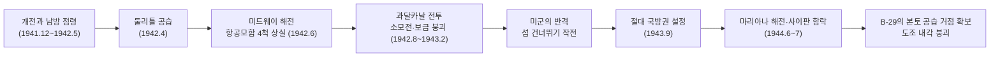

1942년 2월 15일 저녁, 싱가포르 북부 부킷티마의 포드 자동차 공장. 영국군 사령관 퍼시벌 중장이 일본군 제25군 사령관 **야마시타 도모유키** 중장과 마주 앉았다. 야마시타는 탁자를 치며 "예스냐 노냐"라고 다그쳤다는 이야기로 유명해졌다. 퍼시벌은 무조건 항복에 서명했다. 영국이 '난공불락의 요새'라 자랑하던 동양 지배의 심장 싱가포르가 개전 70일 만에 무너진 것이다. 8만 명이 넘는 영국·인도·오스트레일리아군 병사가 포로가 되었다. 영국 총리 처칠은 이를 "영국 역사상 최악의 재앙이자 최대의 항복"이라 불렀다.

일본 국내는 열광에 휩싸였다. 정부는 싱가포르 함락을 축하해 국민에게 고무공을 나누어 주었고, 싱가포르의 이름을 '쇼난(昭南, 쇼와의 남쪽 섬)'으로 바꾸었다. 그러나 이 화려한 승리는 반년밖에 가지 않았다. 이 강의는 개전 뒤의 남방 점령과 '대동아공영권'의 실상, 그리고 미드웨이와 과달카날에서 전세가 뒤바뀌어 1944년 여름 사이판이 함락되기까지의 과정을 따라간다. 전쟁터에 나간 병사들이 무엇과 싸웠는지, 점령지 사람들이 무엇을 겪었는지도 함께 본다.

> [!핵심] 이 강의의 질문
> 1. 일본은 어떻게 반년 만에 동남아시아 전역을 점령할 수 있었는가?
> 2. '아시아의 해방'을 내건 대동아공영권은 점령지 사람들에게 무엇이었는가?
> 3. 전세는 왜, 언제 뒤바뀌었는가? 일본군은 어떤 전쟁을 치렀는가?

```figure
src: asset:403732d9b3c80bd3dd92c096ac2c8a27
caption: 1942년 2월 15일, 싱가포르 부킷티마의 포드 자동차 공장에서 열린 항복 교섭. 가운데가 야마시타 도모유키 중장이고, 카메라에 등을 보인 쪽이 퍼시벌 중장 등 영국군 대표단이다.
credit: 일본군 촬영, 1942년 · 오스트레일리아 전쟁기념관(AWM) 소장
license: Public Domain (1946년 이전에 공표된 일본 사진, 일본 구 저작권법상 보호 기간 만료)
source: https://www.awm.gov.au/collection/C218441
```

```timeline
1941.12.8 | 개전: 말레이 상륙, 진주만 공격 | 괌·홍콩·필리핀 공격
1942.1 | 마닐라 점령 | 
1942.2.15 | 싱가포르 함락 | 화교 숙청
1942.3 | 자바(네덜란드령 동인도) 점령, 랑군 점령 | 
1942.4 | 바탄 '죽음의 행진', 둘리틀 공습 | 
1942.5 | 산호해 해전 | 
1942.6 | 미드웨이 해전 | 항공모함 4척 상실
1942.8 | 미군 과달카날 상륙 | 
1943.2 | 과달카날 철수 | '전진(轉進)'이라 발표
1943.4 | 야마모토 이소로쿠 전사 | 
1943.5 | 애투섬 '옥쇄' | 
1943.10 | 태면 철도 완공 | 
1943.11 | 대동아 회의, 카이로 회담 | 
1944.3~7 | 임팔 작전 | 
1944.6~7 | 마리아나 해전, 사이판 함락 | 
1944.7 | 도조 내각 총사퇴 | 고이소 구니아키 내각
```

## 반년의 '승리'

### 남방 작전

개전과 동시에 일본군은 태평양과 동남아시아 곳곳을 한꺼번에 공격했다. 말레이반도에 상륙한 부대는 자전거를 타고 정글 속 도로를 달려 '은륜 부대'라 불리며 두 달 만에 반도 남단까지 내려갔다. 홍콩은 12월 25일, 미국령 필리핀의 마닐라는 1942년 1월 초에 함락되었다. 2월 싱가포르, 3월에는 석유의 보고인 네덜란드령 동인도의 자바와 영국령 버마의 랑군이 일본군 손에 들어갔다. 필리핀 바탄반도에서 버티던 미국·필리핀군도 4월에 항복했고, 미군 사령관 맥아더는 "나는 반드시 돌아온다(I shall return)"는 말을 남기고 오스트레일리아로 탈출했다.

일본군이 이렇게 빨리 승리할 수 있었던 데에는 몇 가지 이유가 있었다. 영국·미국·네덜란드는 유럽에서 독일과 싸우느라 아시아에 병력을 많이 둘 수 없었고, 식민지 군대는 훈련과 장비가 부족했다. 일본 해군 항공대는 개전 초 세계 최고 수준이었다. 또 오랜 식민 지배에 반감을 품은 현지 사람들 가운데에는 처음에 일본군을 '해방군'으로 맞이한 이들도 있었다.

```figure
src: asset:44bfa3883d86fd0400602fb143f4aba8
caption: 싱가포르에서 손을 들고 일본군에 항복하는 영국군 병사들. 땅바닥에 버려진 소총과 장비가 흩어져 있다.
credit: 일본군 촬영, 1942년 2월 · 오스트레일리아 전쟁기념관(AWM) 소장
license: Public Domain (1946년 이전에 공표된 일본 사진, 일본 구 저작권법상 보호 기간 만료)
source: https://www.awm.gov.au/collection/C218436
```

### 싱가포르 화교 숙청과 바탄 '죽음의 행진'

그러나 점령은 처음부터 폭력과 함께였다. 싱가포르를 점령한 일본군은 항일 활동을 했다는 혐의로 18세에서 50세까지의 중국계 남성들을 모아 '검증'하고, 의심스럽다고 본 사람들을 해안 등으로 끌고 가 학살했다. 화교 사회는 중일전쟁 때 중국을 지원하는 모금 운동을 벌여 왔기 때문이었다. 희생자 수는 일본 측 기록으로 약 5,000명, 싱가포르 측 추산으로는 수만 명에 이른다. 말레이반도에서도 같은 학살이 벌어졌다.

필리핀 바탄반도에서 항복한 미국·필리핀군 포로 약 7만 명은 수용소까지 100km가 넘는 길을 뙤약볕 아래 걸어서 이동해야 했다. 일본군은 이렇게 많은 포로를 예상하지 못했고, 수송 수단도 식량도 물도 준비되어 있지 않았다. 지쳐 쓰러지거나 대열에서 벗어난 포로들은 구타당하거나 살해되었다. 행진과 그 뒤 수용소 생활에서 수천 명에서 1만 명이 넘는 포로가 숨졌다. 미국에서는 이를 **바탄 죽음의 행진**이라 부르며, 일본군의 잔혹함을 상징하는 사건으로 기억한다.

```figure
src: asset:846a019b0bc3a53e873e398c71f9ee47
caption: 바탄 '죽음의 행진' 도중 길가에 앉아 쉬는 미국·필리핀군 포로들. 미군이 노획한 일본 측 사진이다. 목록에는 '1942년 5월 무렵'으로 되어 있으나, 행진은 1942년 4월에 있었다.
credit: 일본군 촬영, 1942년 · 미국 국립문서보관소(NARA) 소장
license: Public Domain (1946년 이전에 공표된 일본 사진, 일본 구 저작권법상 보호 기간 만료)
source: https://catalog.archives.gov/id/532548
```

## 대동아공영권의 실상

### '아시아의 해방'과 군정

일본은 이 전쟁의 목적이 서양의 식민 지배로부터 아시아를 해방하고 **대동아공영권**을 건설하는 것이라고 선전했다. 그러나 개전 직전인 1941년 11월 대본영 정부 연락 회의가 정한 '남방 점령지 행정 실시 요령'은 점령의 목적을 분명히 적고 있었다. 첫째는 치안의 회복, 둘째는 **중요 국방 자원의 신속한 획득**, 셋째는 작전군의 현지 자활이었다. 그리고 "현지 주민에게 부담을 주어 생활이 어려워지더라도 참게 하라"고 했다. 점령지는 독립국이 아니라 일본 육해군이 직접 다스리는 **군정** 지역이 되었다.

| 지역 | 이전의 지배자 | 일본의 점령 방식 | 주요 자원·목적 |
|---|---|---|---|
| 말레이·싱가포르 | 영국 | 육군 군정, '쇼난'으로 개칭 | 고무, 주석, 해군 거점 |
| 네덜란드령 동인도 (인도네시아) | 네덜란드 | 육해군 군정 | **석유**, 고무, 보크사이트 |
| 필리핀 | 미국 | 육군 군정 → 1943년 '독립' | 구리, 설탕, 미국과의 전선 |
| 버마 | 영국 | 육군 군정 → 1943년 '독립' | 쌀, 석유, 원장 루트 차단 |
| 프랑스령 인도차이나 | 프랑스(비시 정부) | 프랑스 식민 정부를 남겨 두고 공동 지배 | 쌀, 고무 |
| 태국 | 독립국 | 동맹국(일본군 주둔) | 통로, 쌀 |

표: 동남아시아 각지의 일본 점령

점령지에서는 일본어 교육과 천황 숭배, 궁성 요배가 강요되었다. 일본 군표가 마구 발행되어 극심한 인플레이션이 일어났고, 쌀과 물자는 일본군이 쓰거나 일본으로 실어 갔다. 섬과 섬, 지역과 지역을 잇던 교역이 끊기고 수송선이 미군 잠수함에 격침되면서 곳곳에서 식량이 부족해졌다. 1944~45년 북부 베트남에서는 일본군과 프랑스 당국의 쌀 징발과 흉작, 수송 마비가 겹쳐 100만 명 이상이 굶어 죽은 것으로 추정된다.

### 로무샤와 태면 철도

일본군은 점령지 주민들을 군사 시설과 철도, 광산 공사에 대규모로 동원했다. 인도네시아에서는 이들을 일본어 그대로 **로무샤**(노무자)라 불렀고, 이 말은 지금도 인도네시아어에 강제 노동의 기억으로 남아 있다. 자바에서만 수십만 명이 동원되었고, 다른 섬과 해외로 끌려간 사람들 가운데 많은 수가 돌아오지 못했다.

가장 악명 높은 공사는 태국과 버마를 잇는 **태면 철도**였다. 바닷길이 위험해지자 일본군은 버마 전선에 물자를 보내기 위해 1942년 6월부터 1943년 10월까지 험한 산악 밀림을 뚫고 415km의 철도를 놓았다. 연합군 포로 약 6만 명과 아시아인 노무자 20만 명 이상이 동원되었다. 굶주림과 콜레라, 말라리아, 가혹한 강제 노동으로 포로 약 1만 2천 명, 아시아인 노무자 수만 명이 목숨을 잃었다. 침목 하나에 한 사람의 목숨이 들었다고 해서 '**죽음의 철도**'라 불린다.

```gallery
src: asset:b49e2ac1766e43fc304a892709286835
caption: 버마의 론시에서 태면 철도의 선로와 침목을 까는 오스트레일리아·영국군 포로들.
credit: 촬영자 미상(일본 측), 1943년 무렵 · 오스트레일리아 전쟁기념관(AWM) 소장
license: Public Domain (1946년 이전에 공표된 일본 사진, 일본 구 저작권법상 보호 기간 만료)
source: https://www.awm.gov.au/collection/C41431
---
src: asset:db72264a0280e5fb6c29d4ababfd32f6
caption: 타이의 탐마칸에서 강을 건너는 나무 다리의 비계를 세우는 연합군 포로들. 이곳이 뒤에 영화 『콰이강의 다리』로 알려진 다리다.
credit: 촬영자 미상, 1943년 2월 무렵 · 오스트레일리아 전쟁기념관(AWM) 소장
license: Public Domain (오스트레일리아 전쟁기념관: 저작권 만료)
source: https://www.awm.gov.au/collection/C202573
```

> [!주의] 조선인 BC급 전범
> 일본군은 연합군 포로를 감시하기 위해 조선과 대만의 청년들을 **군속 포로 감시원**으로 모집했다. 1942년 조선에서만 약 3,000명이 뽑혀 태면 철도와 동남아시아 각지의 포로수용소에 배치되었다. 이들은 일본군 조직의 가장 밑바닥에서 상관의 명령에 따라 포로를 다루었기 때문에, 전쟁이 끝난 뒤 포로들의 증언으로 연합국의 재판에 넘겨졌다. 조선인 148명이 BC급 전범으로 유죄 판결을 받았고 그 가운데 23명이 사형되었다. 이들은 '일본인'으로 처벌받았지만, 1952년 일본이 독립을 되찾을 때 일본 국적을 잃어 일본 정부의 보상에서도 제외되었다. 고국에서는 '친일파'라는 눈총을 받았다. 식민지 지배가 만들어 낸 이중의 비극이다.

```figure
src: asset:b68496392010c2e08e288cea8f6f0d73
caption: 1945년 9월 타이의 사라부리에서, 연합군 포로들에게 얼굴을 확인받기 위해 줄지어 선 조선인 포로 감시원들. 이런 확인을 거쳐 많은 감시원이 전범 재판에 넘겨졌다.
credit: 촬영자 미상, 1945년 · 오스트레일리아 전쟁기념관(AWM) 소장
license: Public Domain (오스트레일리아 전쟁기념관: 저작권 만료)
source: https://www.awm.gov.au/collection/C195473
```

### 대동아 회의

전세가 기울기 시작한 1943년, 일본은 점령지 사람들의 협력을 얻기 위해 버마(8월)와 필리핀(10월)에 '독립'을 허락했다. 그리고 1943년 11월 5~6일, 도쿄에서 **대동아 회의**를 열었다. 일본의 도조 히데키, 만주국의 장징후이, 중국 난징 정부의 왕징웨이, 태국의 완 와이타야꼰 왕자, 필리핀의 라우렐, 버마의 바 모, 그리고 자유 인도 임시 정부의 찬드라 보스가 참석했다. 회의는 공존공영과 자주독립의 존중, 인종 차별의 철폐 등을 내건 '대동아 공동 선언'을 발표했다.

그러나 이 선언은 현실과 거리가 멀었다. 회의 직전 일본은 석유와 자원이 많은 말레이와 인도네시아를 '제국 영토로 결정하고 중요 자원의 공급지로 삼는다'는 방침을 비밀리에 정해 두었고, 이 지역 대표는 초대하지 않았다. 버마와 필리핀의 '독립'도 일본군의 주둔과 지도 아래의 독립이었다. 일본의 지배를 겪은 사람들 사이에서는 반일 운동이 커져 갔다. 버마의 아웅 산은 일본군의 도움으로 독립군을 만들었지만, 1945년 3월 일본에 등을 돌려 영국군 쪽에 섰다. 필리핀과 말레이에서는 항일 게릴라가 활발했다.

### 731부대

만주 하얼빈 교외의 핑팡에는 관동군 방역 급수부, 이른바 **731부대**가 있었다. 군의관 이시이 시로가 이끈 이 부대는 세균 무기를 연구하며 중국인과 조선인, 러시아인 포로와 항일 운동가 등을 '마루타'(통나무)라 부르며 생체 실험에 썼다. 희생자는 적어도 3,000명으로 추정된다. 일본군은 중국 저장성과 후난성 등에서 페스트균을 퍼뜨리는 세균전도 벌였다. 전쟁이 끝난 뒤 이시이 등 간부들은 실험 자료를 미국에 넘기는 대가로 도쿄 재판에서 처벌을 면했다.

## 전세의 역전

### 미드웨이 해전

1942년 4월 18일, 미국 항공모함 호닛에서 날아오른 둘리틀 중령의 B-25 폭격기 16대가 도쿄와 나고야, 고베 등을 폭격했다. 피해는 크지 않았지만, 천황이 있는 수도가 공격당했다는 사실에 일본 해군은 큰 충격을 받았다. 야마모토 이소로쿠는 미국 항공모함 부대를 끌어내 전멸시키기 위해 하와이 서쪽의 **미드웨이섬**을 공략하는 작전을 서둘렀다.

```figure
src: asset:a0810ba98b0b1bd9e7e1efcca256cf58
caption: 1942년 4월 18일, 미국 항공모함 호닛의 비행갑판에서 날아오르는 B-25 폭격기. 둘리틀 공습의 시작이다.
credit: 미 해군 촬영, 1942년 · 미국 국립문서보관소(NARA) 소장 (80-G-41196)
license: Public Domain (미국 연방정부 저작물)
source: https://catalog.archives.gov/id/520603
```

그러나 미국은 일본 해군의 암호를 해독해 작전을 미리 알고 기다리고 있었다. 1942년 6월 5일(일본 시각), 미드웨이 앞바다에서 일본 항공모함 부대는 미국 급강하 폭격기의 기습을 받았다. 비행기에 폭탄과 어뢰를 바꿔 다는 작업을 하느라 갑판에 폭탄과 연료가 널려 있던 순간이었다. 몇 분 사이에 아카기, 가가, 소류가 불길에 휩싸였고, 반격에 나선 히류도 그날 저녁 격침되었다. 진주만을 공격한 주력 항공모함 6척 가운데 4척을 하루 만에 잃은 것이다. 미국은 항공모함 요크타운 한 척을 잃었다.

```gallery
src: asset:6ee1e048240d2c16c19368ec7a0860a3
caption: 미드웨이 해전 중 급강하하는 미 해군의 SBD 돈틀리스 급강하 폭격기. 이 폭격기들이 일본 항공모함 4척을 격침했다. 목록에는 '전투기'로 되어 있으나 SBD 급강하 폭격기다.
credit: 미 해군 촬영, 1942년 6월 · 미국 국립문서보관소(NARA) 소장 (80-G-17054)
license: Public Domain (미국 연방정부 저작물)
source: https://catalog.archives.gov/id/520591
---
src: asset:c30a226c9b130c1aee6faf0489e4346b
caption: 일본 항공기의 공격을 받는 미국 항공모함 요크타운(수평선 위). 하늘에 대공포탄이 터진 연기가 점점이 보인다. 요크타운은 이 해전에서 미국이 잃은 유일한 항공모함이다.
credit: 미 해군 촬영, 1942년 6월 4일 · 미국 국립문서보관소(NARA) 소장 (80-G-414423)
license: Public Domain (미국 연방정부 저작물)
source: https://catalog.archives.gov/id/221949041
```

미드웨이에서 일본은 항공모함만이 아니라 다시 기르기 어려운 숙련된 조종사와 정비사들을 잃었다. 이 해전으로 태평양의 주도권은 미국으로 넘어갔다. 그러나 대본영은 국민에게 "미국 항공모함 2척 격침, 아군 항공모함 1척 상실, 1척 대파"라고 발표했다. 살아 돌아온 병사들은 패배가 새어 나가지 않도록 한동안 격리되었다. 이후 **대본영 발표**는 거짓 전과의 대명사가 되었다.

### 과달카날, '굶주림의 섬'

1942년 8월 7일, 미국 해병대가 남태평양 솔로몬 제도의 **과달카날섬**에 상륙했다. 일본군이 오스트레일리아와 미국 사이의 바닷길을 끊기 위해 짓던 비행장을 빼앗기 위해서였다. 일본군은 미군의 병력을 얕보고 병력을 조금씩 나누어 보내다가 번번이 전멸당했다. 제해권과 제공권을 잃자 보급이 끊겼다. 섬에 들어간 일본군 약 3만 명 가운데 2만 명 이상이 죽었는데, 그 대부분은 전투가 아니라 굶주림과 말라리아 때문이었다. 병사들은 이 섬을 '굶을 기(餓)'자를 써서 '아도(餓島, 굶주림의 섬)'라 불렀다.

```figure
src: asset:0c10d0db054d6a1a16c109315b413af1
caption: 1942년 8월 7일 과달카날섬에 상륙해 야자수 사이에 몸을 숨긴 미국 해병대원들. (사진 왼쪽 아래의 번쩍임은 인화지의 반사다.)
credit: 미 해병대 촬영, 1942년 · 미국 국립문서보관소(NARA) 소장
license: Public Domain (미국 연방정부 저작물)
source: https://catalog.archives.gov/id/5891308
```

1943년 2월 일본군은 섬에서 물러났다. 대본영은 이를 '철수'가 아니라 다른 곳으로 나아간다는 뜻의 '**전진**(轉進)'이라 발표했다. 같은 해 4월 야마모토 이소로쿠는 전선을 시찰하러 가던 중 암호를 해독한 미군기의 매복 공격을 받아 전사했다. 5월에는 알래스카 알류샨 열도의 애투섬에서 일본군 수비대 약 2,600명이 거의 전멸했다. 대본영은 이를 처음으로 '**옥쇄**(玉碎, 옥처럼 아름답게 부서진다)'라 부르며 미화했다.

```chart
{
  "type": "bar",
  "caption": "일본과 미국의 군용 항공기 생산 대수 (미국 전략 폭격 조사단 자료 등을 바탕으로 한 대략적인 수치). 개전 때 이미 5배였던 격차는 끝까지 좁혀지지 않았다",
  "data": {
    "labels": ["1941", "1942", "1943", "1944", "1945"],
    "datasets": [
      { "label": "일본", "data": [5088, 8861, 16693, 28180, 11066] },
      { "label": "미국", "data": [26277, 47826, 85998, 96318, 46001] }
    ]
  },
  "options": { "scales": { "y": { "min": 0 } } }
}
```

### 섬 건너뛰기와 '절대 국방권'

1943년부터 미군은 막대한 생산력을 바탕으로 반격에 나섰다. 남서태평양에서는 맥아더가 이끄는 부대가 뉴기니를 따라 필리핀으로, 중부 태평양에서는 니미츠가 이끄는 해군이 길버트 제도와 마셜 제도, 마리아나 제도를 거쳐 일본 본토로 다가왔다. 미군은 일본군이 굳게 지키는 섬은 건너뛰고 중요한 섬만 골라 점령하는 **섬 건너뛰기** 작전을 썼다. 건너뛴 섬에 남은 일본군은 보급이 끊겨 굶주림 속에 고립되었다.

```figure
src: asset:7294d561abc66e722767afff1b9189a4
caption: 1943년 11월 길버트 제도 타라와의 해안 방벽 뒤에 몸을 숨긴 미국 해병대원들. 사흘간의 전투로 일본군 수비대와 조선인 노무자 등 약 4,600명이 거의 전멸했고, 미군도 3,000명이 넘는 사상자를 냈다.
credit: 미 해병대 촬영, 1943년 · 미국 국립문서보관소(NARA) 소장
license: Public Domain (미국 연방정부 저작물)
source: https://catalog.archives.gov/id/532385
```

1943년 9월 어전 회의는 쿠릴 열도(지시마)에서 오가사와라 제도, 마리아나 제도, 뉴기니 서부, 버마에 이르는 선을 '**절대 국방권**'으로 정하고 반드시 지키기로 했다. 그러나 그 선을 지킬 병력도, 비행기도, 배도 이미 모자랐다. 일본의 수송선은 미국 잠수함에 차례로 격침되어, 남방의 석유와 자원을 본토로 실어 나르는 일도 점점 어려워졌다.



## 병사들의 전쟁

일본군 병사들이 가장 많이 죽은 원인은 적의 총탄이 아니었다. 역사가 요시다 유타카는 아시아·태평양 전쟁에서 죽은 일본 군인·군속 약 230만 명 가운데 상당수, 연구에 따라서는 절반 이상이 넓은 의미의 **굶어 죽음**(영양실조와 그로 인한 병사)이었다고 본다. 수송선과 함께 바다에 가라앉은 사람도 30만 명이 넘는다. 보급을 경시하고 정신력을 앞세운 작전, 그리고 '살아서 포로가 되는 치욕을 받지 말라'는 전진훈(17강) 때문에 항복할 수 없었던 병사들은 절망적인 상황에서도 '반자이 돌격'으로 목숨을 버렸다.

그 극단이 1944년 3월에 시작된 **임팔 작전**이었다. 버마의 일본군은 영국령 인도의 임팔을 점령하기 위해 험한 아라칸 산맥을 넘어 진격했다. 사령관 무타구치 렌야는 보급을 소와 염소 떼에 싣고 가다 식량으로 잡아먹으면 된다고 했다. 결과는 참혹했다. 일본군은 식량과 탄약이 바닥난 채 7월 퇴각했고, 퇴각로에는 굶주림과 병으로 쓰러진 병사들의 시체가 줄을 이어 '백골 가도'라 불렸다. 약 3만 명이 죽었다.

## 사이판 함락과 도조 내각의 붕괴

1944년 6월 15일, 미군은 마리아나 제도의 **사이판**에 상륙했다. 일본 해군은 남은 항공모함을 모두 모아 반격에 나섰지만, 6월 19~20일의 마리아나 해전에서 레이더와 신형 전투기, 근접 신관 포탄으로 무장한 미군에 대패해 항공모함 3척과 비행기 대부분을 잃었다. 미군 조종사들은 이를 '마리아나의 칠면조 사냥'이라 불렀다.

7월 7일 사이판의 일본군 수비대는 마지막 돌격으로 전멸했다. 섬에는 일본인과 오키나와 출신 이주민, 조선인 노무자 등 2만 명이 넘는 민간인이 있었다. 미군에게 붙잡히면 잔인한 일을 당한다는 일본군의 선전을 믿은 많은 민간인이 섬 북쪽 끝의 절벽(뒤에 '반자이 절벽'이라 불렸다)에서 몸을 던지거나 수류탄으로 집단 자결했다. 사이판 전투에서 숨진 민간인은 약 1만 명에 이른다.

```gallery
src: asset:e57ff92306923b675afdf5b032297cef
caption: 사이판의 밀림 속 동굴을 향해 총을 겨누고 다가가는 미국 해병대원들. 일본군과 민간인은 섬 곳곳의 동굴에 숨어 있었다.
credit: 미 해병대 촬영, 1944년 7월 · 미국 국립문서보관소(NARA) 소장
license: Public Domain (미국 연방정부 저작물)
source: https://catalog.archives.gov/id/176250516
---
src: asset:26a407996870139c0d60f9eb134cbdde
caption: 사이판 해변에서 일본인 소년을 목말 태운 미국 해병대원. 미군의 선전용 사진이기도 하지만, '붙잡히면 죽는다'는 일본군의 선전과는 다른 현실을 보여 준다.
credit: 미 해안경비대 촬영, 1944년 · 미국 국립문서보관소(NARA) 소장
license: Public Domain (미국 연방정부 저작물)
source: https://catalog.archives.gov/id/205586604
```

사이판을 잃은 것은 결정적이었다. 미국의 새 폭격기 **B-29**가 사이판에서 출격하면 도쿄를 비롯한 일본 본토 대부분이 폭격 범위 안에 들어왔다. 도조 히데키는 총리와 육군대신에 더해 참모총장까지 겸하며 권력을 한 손에 쥐고 있었지만, 사이판 함락의 책임을 묻는 중신들의 압력을 이기지 못하고 7월 18일 총사퇴했다. 뒤를 이어 조선 총독이던 **고이소 구니아키**가 총리가 되었다. 1944년 11월 24일, 사이판에서 출격한 B-29 편대가 도쿄를 처음으로 본격 폭격했다.

> [!더알아보기] 카이로 선언과 독립운동
> 1943년 11월, 미국의 루스벨트, 영국의 처칠, 중국의 장제스가 이집트 카이로에서 만났다. 12월 1일 발표된 **카이로 선언**은 일본이 빼앗은 만주·대만·펑후 제도를 중국에 돌려주고, "**조선 인민의 노예 상태에 유의하여 적당한 시기에 조선을 자유롭고 독립된 나라로 한다**"고 밝혔다. 연합국이 조선의 독립을 처음으로 약속한 것이다. 여기에는 장제스와 충칭의 대한민국 임시정부의 외교 노력이 있었다. 다만 '적당한 시기에(in due course)'라는 말은 곧바른 독립이 아니라 일정 기간의 신탁 통치를 염두에 둔 표현이어서, 해방 뒤의 갈등을 예고했다. 이 무렵 한국광복군은 영국군과 함께 버마 전선에서 활동했고, 옌안에서는 조선 독립 동맹과 조선 의용군이, 국내에서는 1944년 여운형이 비밀 결사 조선 건국 동맹을 만들어 해방을 준비했다.

## 정리

> [!핵심] 19강 요약
> - 개전 뒤 반년 동안 일본군은 **싱가포르**, 필리핀, 네덜란드령 동인도, 버마를 점령했다. 그 과정에서 **싱가포르 화교 숙청**과 **바탄 죽음의 행진**이 일어났다.
> - **대동아공영권**은 '아시아 해방'을 내걸었지만, 점령의 목적은 **자원 획득**이었다. 군정 아래에서 **로무샤** 동원, **태면 철도** 건설 등 강제 노동과 수탈이 이어졌고, 조선인 포로 감시원들은 **BC급 전범**이 되었다.
> - **미드웨이 해전**(1942.6)에서 주력 항공모함 4척을 잃고, **과달카날 전투**에서 보급이 무너지면서 전세가 역전되었다. 대본영은 패배를 숨기고 '전진', '옥쇄'로 미화했다.
> - 1943년 **대동아 회의**와 버마·필리핀의 '독립'이 있었지만 실상은 일본의 지배였다. 같은 해 **카이로 선언**은 조선의 독립을 약속했다.
> - 일본군 사망자의 상당수는 굶주림과 병으로 죽었다. **임팔 작전**의 참패, **사이판 함락**(1944.7)과 민간인 집단 자결 끝에 **도조 내각**이 무너졌다.

### 생각해 볼 질문

1. 처음에 일본군을 '해방군'으로 맞이한 동남아시아 사람들은 왜 곧 일본에 등을 돌렸을까? 대동아 회의의 선언과 비밀 방침을 비교해 보자.
2. 조선인 BC급 전범은 가해자였을까, 피해자였을까? 그들의 처지를 식민 지배의 구조 속에서 생각해 보자.
3. 일본군 병사들이 전투보다 굶주림으로 더 많이 죽은 이유는 무엇일까? 미드웨이 이후 대본영 발표가 사실을 숨긴 것과 연결해 보자.

### 다음 강 예고

20강에서는 레이테만 해전과 **가미카제 특공**, 도쿄 대공습, 이오지마와 **오키나와 전투**, 포츠담 선언과 **원자 폭탄**, 소련의 참전, 그리고 1945년 8월 15일 천황의 옥음 방송과 9월 2일 항복 조인까지, 일본 제국이 무너지는 마지막 1년을 따라간다. 조선의 해방과 분단의 시작도 함께 본다.
